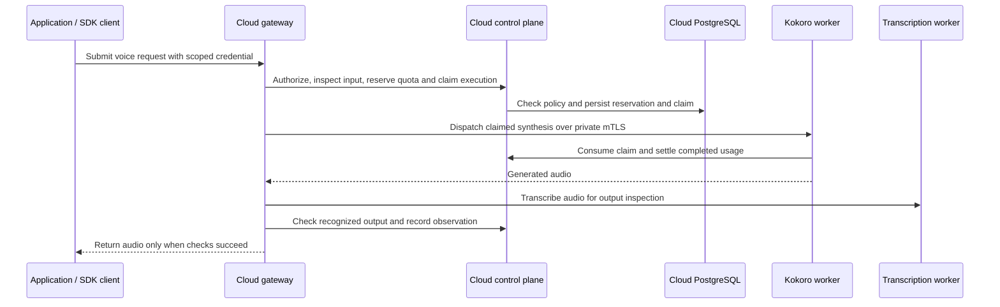
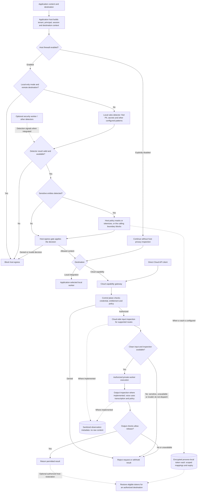

# OpenConnect

**Build AI solutions, not AI infrastructure.**

OpenConnect is an open-source, .NET-first, privacy-first, model-agnostic AI application framework for developers. It provides reusable libraries, secure defaults, and modular components that let developers focus on building AI-powered applications instead of wrestling with infrastructure.

## Features

- **Developer-First**: Simple `services.AddOpenConnect()` gets you running in minutes
- **Privacy-First**: Privacy firewall enabled by default with local detection for sensitive data
- **Model-Agnostic**: Works with any LLM provider (OpenAI, Azure, Anthropic, local models)
- **Framework, Not Platform**: Layered on Microsoft Agent Framework, not competing with it
- **Durable by Default**: PostgreSQL + NATS for reliable multi-turn conversations

## Quick Start

```csharp
// Program.cs
builder.Services.AddOpenConnect();
builder.Services.AddOpenConnectPostgres(connectionString);
builder.Services.AddOpenConnectNats(natsUrl);

var app = builder.Build();
app.MapOpenConnect();
app.Run();
```

## Architecture

The Cloud gateway is a capability API. OpenConnect SDKs and other clients use the same public contracts; SDK behavior remains in the client. An application may also use the OpenConnect application gateway and privacy controls in its own host. The application gateway is separate from the Cloud gateway.

```mermaid
flowchart TB
    subgraph Clients["Clients and application-owned runtime"]
        Browser["Browser: documentation and Cloud administration"]
        Apps["Applications: REST clients and OpenConnect SDK clients"]
        Host["Optional application host: agents, tools, local privacy and application gateway"]
        Apps -->|"Optional in-process integration"| Host
    end

    subgraph Cloud["OpenConnect Cloud"]
        Site["Blazor site and Cloud control plane"]
        Identity["Configured OIDC provider"]
        Gateway["Cloud capability gateway"]
        Database[("Cloud PostgreSQL: organizations, policies, quota, usage and audit")]
        Browser -->|"Sign in and administer"| Site
        Site -->|"OIDC authentication"| Identity
        Site --> Database
        Apps -->|"Versioned capability API + application credential"| Gateway
        Host -->|"Optional capability API call"| Gateway
        Gateway -->|"Authorization, privacy, quota and execution claims"| Site
        Site -->|"Decisions and scoped control-plane results"| Gateway
    end

    subgraph Wired["Cloud adapters currently implemented, when configured"]
        Classification["classification: text classification"]
        Inference["inference: chat inference"]
        LiveUI["liveui-inference: UI plans"]
        Kokoro["kokoro: speech synthesis"]
        Transcription["transcription: voice output inspection"]
        Gateway -->|"classification.classify"| Classification
        Gateway -->|"inference.chat"| Inference
        Gateway -->|"inference.liveui"| LiveUI
        Gateway -->|"voice.synthesize"| Kokoro
        Gateway -->|"Inspect generated voice audio"| Transcription
        Kokoro -.->|"Consume and settle a voice claim"| Site
    end

    subgraph Other["Other workers: Cloud routing remains in progress"]
        Analytics["analytics-inference: analytics"]
        Documents["document-intelligence: document processing"]
        Knowledge["knowledge: embeddings and indexing"]
        Vision["vision: image analysis and embeddings"]
        MMSTTS["mms-tts: multilingual speech"]
        NLLB["nllb: translation"]
        Realtime["realtime-voice: voice sessions"]
        Security["security: security detection"]
        Navigator["navigator-playwright: browser navigation"]
        Operational["operational-agents: operational supervision"]
        Outbox["outbox: event relay"]
    end
    Gateway -.->|"Additional Cloud adapters and routes required"| Other
    Host -.->|"Application-owned worker integrations"| Other
    Host -.->|"Optional local worker integrations"| Wired
    Runtime[("Application persistence and NATS JetStream")]
    Host -.->|"When configured"| Runtime
    Outbox -.->|"Relay committed events"| Runtime
```



The solid Cloud adapter connections show implemented opt-in execution paths, not a guarantee that a deployment is ready. Transcription also exists as a standalone worker, but the public Cloud transcription route is not yet wired to that worker. The additional worker group is shown for capability mapping; it does not imply those services are already reachable through the Cloud gateway. `workers/common` is a shared Python library, not a worker service. Model files, private worker transports, identity, deployment inventory, entitlement, region policy and quota must be configured separately; missing requirements fail closed.

For example, a configured voice synthesis request follows this sequence:



An output transcript check is not proof that every sound was recognized. The application host retains responsibility for its own privacy and tool authorization. The Cloud control plane and public documentation may share a site process, but their dependencies and access policies are separate.

### Firewall and PII workflow

The host firewall and Cloud checks are separate boundaries. This diagram shows the host path when an application uses the firewall, followed by the Cloud path for a supported, configured capability. A direct Cloud client starts at the Cloud gateway and does not automatically acquire an application-host firewall.



The rules detector can replace detected values with scoped vault tokens when a vault is configured, or with non-reversible placeholders without one. Restoration is limited to authorized output or allowlisted tool-argument paths; diagnostic destinations do not receive restored values. Some boundaries, including the current Cloud voice input and recognized-output checks, block detected sensitive content rather than forwarding a redacted request. Detector failure and missing required inspection fail closed. Optional detection models and the security worker do not receive vault keys or authority to make host authorization decisions. Detection and transcript inspection are not guarantees that all sensitive content or speech was recognized.

The framework also follows these layers:

- **Gateway Layer**: ASP.NET Core hosting with HTTP/WebSocket endpoints
- **Agent Layer**: Microsoft Agent Framework (MAF) integration
- **Privacy Layer**: Firewall, policy engine, tokenization, and egress gates
- **Runtime Layer**: Agent registry, tool broker, capability router
- **Transport Layer**: NATS JetStream for event backbone and worker protocol
- **Persistence Layer**: PostgreSQL for sessions, tasks, events, and tokens
- **Worker Layer**: Optional Python services for specialized capabilities

## Project Structure

```
openconnect/
├── src/                           # .NET libraries
│   ├── OpenConnect.Abstractions/  # Core interfaces and DTOs
│   ├── OpenConnect.Core/          # Implementation and DI
│   ├── OpenConnect.Agents/        # MAF integration
│   ├── OpenConnect.Privacy/       # Privacy firewall
│   ├── OpenConnect.Tools/         # Tool broker
│   ├── OpenConnect.Transport.Nats/
│   ├── OpenConnect.Persistence.EFCore/
│   └── OpenConnect.Hosting.AspNetCore/
├── packages/
│   └── client-ts/                 # TypeScript SDK
├── workers/
│   ├── security/                  # Privacy detection
│   ├── classification/
│   ├── mms-tts/
│   ├── nllb/
│   └── ...
├── contracts/
│   ├── openapi/
│   └── jsonschema/
└── tests/
```

## Requirements

- .NET SDK from [global.json](global.json) (currently 10.0.404); libraries target .NET 8, 9, and 10, while executables and tests default to .NET 10
- PostgreSQL 16+
- NATS Server 2.10+ (with JetStream)
- Python 3.12+ (for workers)
- Node.js 24+ (for TypeScript client)

## Development

```bash
# Restore dependencies
dotnet restore OpenConnect.slnx --locked-mode

# Build
dotnet build OpenConnect.slnx -c Release --no-restore -warnaserror

# Run tests
dotnet test OpenConnect.slnx -c Release --no-build --filter "Category!=NatsLive"

# Start infrastructure (Docker)
docker compose -f infra/compose.yml up -d
```

### CI checks

The [main CI workflow](.github/workflows/ci.yml) also checks formatting (`dotnet format OpenConnect.slnx --verify-no-changes --no-restore`) and runs security and contract checks through `scripts/verify.ps1`. Live NATS tests require an explicit broker and are excluded from the default test selection above.

Reproduce one [worker contract leg](.github/workflows/worker-sample-e2e.yml) on Linux in an activated Python 3.12 virtual environment (Node 24 is also required for navigator; host suites require the SDK from `global.json`):

```bash
python -m pip install -r samples/workers/shared/requirements-contract.txt
./samples/workers/shared/scripts/verify-no-build-models.sh classification
./samples/workers/shared/scripts/run-one.sh classification --tier contract --provider sqlite
```

See [worker samples](samples/workers/README.md) for the full matrix and infrastructure/model prerequisites. The [documentation workflow](.github/workflows/docs-portal.yml) separately validates the [portal](site/OpenConnect.Docs/README.md). Local unit tests alone do not verify these workflows.

## Documentation

- [Framework compatibility](docs/compatibility/framework-matrix.md)
- [Getting Started](site/OpenConnect.Docs/Content/v1/getting-started.md)
- [API Reference](site/OpenConnect.Docs/Content/v1/api-reference.md)
- [Configuration](site/OpenConnect.Docs/Content/v1/configuration.md)

## Contributing

Contributions are welcome! Please read the [development guide](AGENTS.md) for details.

## License

This project is licensed under the MIT License - see the [LICENSE](LICENSE) file for details.
