# OpenConnect — Exhaustive MAF-First Engineering Checklist

**Version:** 2.1-draft · **Updated:** 2026-11-08 · **Status:** implementation blueprint; NOT evidence of code completion.  
**Companion canonical files:** `requirements.md`, `spec.md`, `implementation.md`, `agents-requirements.md`, `agents-spec.md`.  
**Detail baseline:** original `checklist(4).md` plus MAF-first `openconnect-maf-aligned/checklist.md`, agent-specific, workers/VAD and cross-framework specifications.

## 0. Non-negotiable coding-agent instructions

1. **Read before writing:** six canonical MAF-first files, the detailed requirements/spec for the feature, the corresponding existing source, and the actual pinned MAF provider API. No example method name is considered compiled until proven.
2. **MAF owns execution:** native `AIAgent`, `HarnessAgent`, `AgentSession`, planning/todos, MAF workflows, middleware, context providers, approval/HITL and selected durable workflow backend. OpenConnect owns governance, authenticated application task boundaries, domain outbox, policy/egress/identity, user-facing status and client contracts. Do not build a second planner, agent loop or workflow replay engine.
3. **No scope loss:** checklist entries are atomic observable deliverables. A missing provider/model/license is `BLOCKED` or `NOT RUN` for that capability, not justification to delete the task or silently claim fallback.
4. **Authority:** `requirements.md` states what; `spec.md` states how; `implementation.md` orders steps; this file tracks specific proof. Agent documents specialize MAF integration. Contradictions require an ADR and simultaneous corrections before implementing an incompatible design.
5. **Status control:** keep `[ ]` until implementation and a passing actual test/CI artifact; `NOT RUN`, `BLOCKED`, `SKIPPED`, `FAIL`, `PARTIAL` are not `PASS`. Existing historical claimed PASS is not automatically v2 PASS.
6. **Proof per checkbox:** changed source path(s), requirement and acceptance ID(s), exact command, target framework/provider/model, run/PR/commit, reviewer, result and artifact. Never infer from compilation alone that real model, screenshot, long-running recovery or published package works.
7. **Security:** no model/skill/MCP/browser prompt can grant authority; enforce current-user versus workload identity, egress/firewall, tenant scoping and exact approvals. Preserve licensing and model provenance.
8. **Implementation sequencing:** prefer one small executable vertical slice and its negative/security tests per PR. Independent workers and providers have independent lifecycle, readiness and release gates.

## 1. Architectural responsibility and profiles

| Concern | Microsoft Agent Framework owns | OpenConnect owns | Non-negotiable test |
|---|---|---|---|
| Direct agent | `AIAgent`, native tool loop, streaming | registration, actor scope, policy, API | real MAF tool/stream |
| Harness agent | native plan/todos, modes, skills, compaction, `AgentSession` | typed profile and safe capability mapping, persistence integration | plan/todo session restore |
| Workflow | native executor/graph/handoff/HITL | typed templates, depth2/quotas, contextual authorization | actual native workflow events |
| Durable workflow | selected MAF Durable Extension or single qualified backend | task/outbox, effect receipts, identity, user delivery | restart with one execution lease owner |
| Tools and MCP | MAF tools + official MCP transport | tool admission, risk, schema, scoped discovery, approval policy | denied unregistered tool |
| Conversation state | native agent/provider history, Harness state | tenant-scoped app task/history/journal/retention | no duplicate history owner |
| Async progress | genuine tool/runtime state | committed ACK/progress/replay UX | tool accepted before actual start |
| Persistence | MAF-native checkpoint format | EF adapters, business atomicity, outbox | real relational crash/fence |
| Multimodal | model execution and supported provider interfaces | speech/VAD/worker routing, privacy and client UI | optional absence + privacy |

**Execution profile** (`Direct`, `Harness`, `Workflow`, `DurableWorkflow`) and **identity mode** (`Interactive`, `Operational`) are orthogonal. Lead depth 0, child depth 1, grandchild depth 2 maximum. Depth policy is enforced at registration **and** every dynamic child creation. No NATS/EF/Docker/Qdrant/Infisical/Aspire required merely to register a permitted Direct agent; real production durability requires a validated backend.

## 2. Dependency gates / release pathways

| Gate | Dependencies | Exit proof |
|---|---|---|
| G0 MAF proof | source/SDK licensing and capability audit | compiled Direct/Harness/Workflow/Skills/HITL/Durable lab |
| G1 composition | G0 | typed defaults, profile/identity rules, depth2 and safe registration |
| G2 security/tools | G1 | actor scoping, native tool/approval, MCP + skill negative tests |
| G3 state/data | G1–G2 | native session/checkpoint restore; EF provider transaction/outbox tests |
| G4 async | G3 | pre-start ACK, progress, cancellation and native MAF continuation |
| G5 privacy | G2–G3 | local detector coverage, vault and all-boundary canary proofs |
| G6 client/voice | G4–G5 where relevant | task API, MiniComposer, VAD, navigation, no-worker text fallback |
| G7 extensions | G2–G6 | independently validated Qdrant, KMS, workers, admin and Aspire |
| G8 distribution | matching feature gates | net8/9/10 consumers; Docker Hub version/latest; NuGet/npm/docs |

## 3. Detailed atomic work packages

Every checkbox is a separate deliverable. Format: **`OC2-D-{AREA}-{NNN}`** — implementation action; acceptance evidence in the corresponding named test suite. Section headers name the requirement and acceptance families; old IDs are cross-referenced in §5. A checkbox is **not** permission to change architecture or claim production readiness.

### 3.1 Source governance, design authority, legal and architectural evidence

**Requirement ownership:** `OC-MSTR-001–015; OC2-IMP-001–003; IMP-001–006`. **Primary acceptance:** `OC2-AT-001–017`.
- [ ] **OC2-D-GOV-001** — Create and verify the six canonical docs (requirements/spec/implementation/checklist/agents-requirements/agents-spec); give each a stable version and matching revision note. **Evidence:** implementation or reviewed design artifact, exact validation command/results, and negative/security tests wherever applicable.
- [ ] **OC2-D-GOV-002** — Define document precedence: requirements behavior; spec interfaces and architecture; implementation ordered work; checklist task and evidence status; agents documents specialize without contradicting the four master files. **Evidence:** implementation or reviewed design artifact, exact validation command/results, and negative/security tests wherever applicable.
- [x] **OC2-D-GOV-003** — Create a single ADR registry covering MAF ownership, harness profile, durable backend, EF transaction ownership, MCP transport, privacy trust zones, event ownership, client protocol and release registries. **Evidence:** implementation or reviewed design artifact, exact validation command/results, and negative/security tests wherever applicable. **VERIFIED — PASS on 2eeb5de — ADR registry: ADR-001 committed (docs/architecture/adr/ADR-001-agent-execution-profiles.md, Status Accepted 2026-11-09; lane session not supplied; file INSPECTED, not re-executed).**
- [x] **OC2-D-GOV-004** — Record each architecture decision with alternatives, rationale, compatibility impact, approving reviewer and superseded IDs. **Evidence:** implementation or reviewed design artifact, exact validation command/results, and negative/security tests wherever applicable. **VERIFIED — PASS on 2eeb5de — decision recorded in ADR-001 (Supported: Direct + host Workflow; Unsupported Harness/Durable/MCP/A2A fail closed; registry present at HEAD be82997; Atlas verify exit 0 SUPPLIED per task packet, not re-executed here).**
- [ ] **OC2-D-GOV-005** — Inventory current repository projects and actual public APIs before adding new assemblies; map each proposed package to existing code or a concrete deliverable. **Evidence:** implementation or reviewed design artifact, exact validation command/results, and negative/security tests wherever applicable.
- [ ] **OC2-D-GOV-006** — Pin the actual Microsoft Agent Framework packages and NuGet dependency graph for net8, net9 and net10; record exact supported features, not just concepts from documentation. **Evidence:** implementation or reviewed design artifact, exact validation command/results, and negative/security tests wherever applicable.
- [ ] **OC2-D-GOV-007** — Pin a Swift-Aid reference commit SHA and audit copyright/licensing before adapting code; preserve attribution in legal notices where required. **Evidence:** implementation or reviewed design artifact, exact validation command/results, and negative/security tests wherever applicable.
- [ ] **OC2-D-GOV-008** — Build source-to-destination migration ledger for composer, speech/VAD, gateway, NATS, session persistence and classification worker, with each file's disposition. **Evidence:** implementation or reviewed design artifact, exact validation command/results, and negative/security tests wherever applicable.
- [ ] **OC2-D-GOV-009** — Inventory third-party model weights, ONNX/WASM assets, tokenizer packs, speech voices, code license, commercial-use terms and redistribution restrictions. **Evidence:** implementation or reviewed design artifact, exact validation command/results, and negative/security tests wherever applicable.
- [ ] **OC2-D-GOV-010** — Publish a full trust-boundary threat model for browser, gateway, agents, MAF providers, MCP, SQL, NATS, workers, vault, memory, and observability. **Evidence:** implementation or reviewed design artifact, exact validation command/results, and negative/security tests wherever applicable.
- [ ] **OC2-D-GOV-011** — Define what counts as a released capability versus experimental, disabled, degraded, blocked or planned; publish it in capability manifests. **Evidence:** implementation or reviewed design artifact, exact validation command/results, and negative/security tests wherever applicable.
- [ ] **OC2-D-GOV-012** — Create reproducible baseline solution/CI with global.json, central package versions, lockfiles, .editorconfig and deterministic restore. **Evidence:** implementation or reviewed design artifact, exact validation command/results, and negative/security tests wherever applicable.
- [ ] **OC2-D-GOV-013** — Set CODEOWNERS and mandatory review for security, workflow graph, public protocol, migrations, release pipeline and external source incorporation. **Evidence:** implementation or reviewed design artifact, exact validation command/results, and negative/security tests wherever applicable.
- [ ] **OC2-D-GOV-014** — Prohibit secrets, personal data, hardcoded reference-app branding and unlicensed weights in packages, documentation, fixture recordings and container layers. **Evidence:** implementation or reviewed design artifact, exact validation command/results, and negative/security tests wherever applicable.
- [ ] **OC2-D-GOV-015** — Create an append-only verification ledger containing task ID, requirement IDs, test ID, commit, reviewer, environment, exact command, outcome and artifacts. **Evidence:** implementation or reviewed design artifact, exact validation command/results, and negative/security tests wherever applicable.
- [ ] **OC2-D-GOV-016** — Audit prior reported PASS evidence against actual repo commit/CI; preserve evidence as historically claimed until verified and never automatically promote it to v2 PASS. **Evidence:** implementation or reviewed design artifact, exact validation command/results, and negative/security tests wherever applicable.

### 3.2 MAF native capability audit and executable integration laboratory

**Requirement ownership:** `OC-MSTR-002; AG-REQ-001–030; OC2-IMP-001–002`. **Primary acceptance:** `OC2-AT-001–015`.
- [ ] **OC2-D-MAF-001** — Create standalone compile/run sample using a real MAF AIAgent and deterministic IChatClient; capture streaming text and structured updates. **Evidence:** implementation or reviewed design artifact, exact validation command/results, and negative/security tests wherever applicable. **NOT RUN — covered by ADR-001 Unsupported or pending slice (see agents-acceptance-evidence.md scope).**
- [ ] **OC2-D-MAF-002** — Verify MAF native function-tool invocation, tool result handling and middleware invocation order against pinned assemblies. **Evidence:** implementation or reviewed design artifact, exact validation command/results, and negative/security tests wherever applicable. **NOT RUN — covered by ADR-001 Unsupported or pending slice (see agents-acceptance-evidence.md scope).**
- [x] **OC2-D-MAF-003** — Create a native HarnessAgent using AsHarnessAgent from a real IChatClient and verify documented configuration hooks. **Evidence:** implementation or reviewed design artifact, exact validation command/results, and negative/security tests wherever applicable. **VERIFIED — PASS on 5bb96b4 — HarnessAgent created via native ChatClientHarnessExtensions.AsHarnessAgent from a real IChatClient with documented HarnessAgentOptions (options-surface test prints all members) + filtered lab 2/2 PASS + full Agents suite 493 passed / 0 failed / 1 skipped (pre-existing StallWithoutOutputOrPending) + build 0W/0E + zero review findings (AG-LAB-VERIFY-001/POST-001).**
- [x] **OC2-D-MAF-004** — Run a native Harness plan/execute sequence and inspect actual plan and todo state events without simulated OpenConnect replacements. **Evidence:** implementation or reviewed design artifact, exact validation command/results, and negative/security tests wherever applicable. **VERIFIED — PASS on 5bb96b4 — native Harness plan/execute run asserting real TodoState plan/todo events (todos_add 2 planned, todos_complete 2 completed, mode plan→execute) with no simulated replacements + filtered lab 2/2 PASS + full Agents suite 493 passed / 0 failed / 1 skipped (pre-existing StallWithoutOutputOrPending) + build 0W/0E + zero review findings (AG-LAB-VERIFY-001/POST-001).**
- [x] **OC2-D-MAF-005** — Verify Harness state survives additional turns in one AgentSession and document ownership of plan/todo/history. **Evidence:** implementation or reviewed design artifact, exact validation command/results, and negative/security tests wherever applicable. **VERIFIED — PASS on 5bb96b4 — multi-turn coherence on one native AgentSession (turn-2 carries turn-1) + fresh-session isolation (todos=0, mode=plan) proving session ownership + filtered lab 2/2 PASS + full Agents suite 493 passed / 0 failed / 1 skipped (pre-existing StallWithoutOutputOrPending) + build 0W/0E + zero review findings (AG-LAB-VERIFY-001/POST-001).**
- [x] **OC2-D-MAF-006** — Verify Harness compaction against a constrained context-window fixture and record source/native state changes. **Evidence:** implementation or reviewed design artifact, exact validation command/results, and negative/security tests wherever applicable. **VERIFIED — PASS on 598d2af — native Harness compaction via documented CompactionProvider.CompactAsync entry point: deterministic Truncation strategy 12 msgs/360 tokens→4 msgs/120 tokens + constrained-window (64/16) default strategy 12→2 msgs with before/after native index state, options round-trip, compaction-enabled 2-turn Harness loop, no custom summarizer/LLM/network + filtered 4/4 PASS + full Agents suite 499 passed / 0 failed / 1 skipped (pre-existing StallWithoutOutputOrPending) + build 0W/0E + zero S0-S2 (2 S3 deferred) (AG-IMPL-008/AG-LAB-VERIFY-003).**
- [x] **OC2-D-MAF-007** — Verify skill source loading, metadata and progressive disclosure under the chosen native MAF skill API; document unsupported targets. **Evidence:** implementation or reviewed design artifact, exact validation command/results, and negative/security tests wherever applicable. **VERIFIED — PASS on eb77ccb — native skill source loading (AgentSkillsSource/AgentInMemorySkillsSource/AgentFileSkillsSource), metadata validation (AgentSkill/AgentSkillFrontmatter name/description, invalid-name ArgumentException), progressive disclosure L1/L2/L3 (AgentInlineSkill), unsupported target documented (run.exe: no script surface; .py without runner → InvalidOperationException, never executed) + filtered 6/6 PASS + full Agents 505/0/1 + build clean + zero S0-S2 (2 S3 deferred) (AG-IMPL-009/AG-LAB-VERIFY-004).**
- [x] **OC2-D-MAF-008** — Verify Harness file-access capability and its sandbox/allowlist boundaries; deny unsafe host filesystem access by default. **Evidence:** implementation or reviewed design artifact, exact validation command/results, and negative/security tests wherever applicable. **VERIFIED — PASS on eb77ccb — native file-access sandbox (FileSystemAgentFileStore root-relative roundtrip; traversal + absolute paths rejected with ArgumentException), unsafe host access denied by default (FileAccessStore null default = no tools; lab-safe disables), temp-only fixtures cleaned + filtered 6/6 PASS + full Agents 505/0/1 + build clean + zero S0-S2 (2 S3 deferred) (AG-IMPL-009/AG-LAB-VERIFY-004).**
- [x] **OC2-D-MAF-009** — Verify native Harness tool-approval prompt and dont-ask-again behavior; record where OpenConnect policy must override or narrow approvals. **Evidence:** implementation or reviewed design artifact, exact validation command/results, and negative/security tests wherever applicable. **VERIFIED — PASS on 8e83161 — native Harness tool-approval prompt via real ToolApprovalAgent pipeline: approval granted → tool executes; denied → fail-closed (0 executions); dont-ask-again grant persists for identical calls (no new prompt, native ToolApprovalRule state); OpenConnect override point recorded (DelegationGate denies unauthorized delegation before any native prompt is built — proven in isolation, integrated gated-pipeline proof future work) + filtered 5/5 PASS + full Agents 510/0/1 + build clean + review PASS (F-01 fixed, F-02/F-03 deferred) (AG-IMPL-010/011 + AG-LAB-VERIFY-005).**
- [x] **OC2-D-MAF-010** — Verify native Harness background agent/delegation operation and test constrained child scopes against OpenConnect depth-2 ceiling. **Evidence:** implementation or reviewed design artifact, exact validation command/results, and negative/security tests wherever applicable. **VERIFIED — PASS on 0c16064 — native Harness background delegation via real BackgroundAgentsProvider: background delegate runs to completion (native BackgroundTaskInfo/Status completion, GetIncompleteTasks empty, child output propagated, spawn→wait→results tools in pipeline order), constrained child scopes (DelegationGate intersection, over-broad denied before spawn), depth-3 denied with 0 child calls (DelegationDepthExceededException, FrameworkMaxDepth=2), budget slice enforced (NarrowBudget min + ledger exhaustion) + filtered 5/5 PASS Release + full Agents 515/0/1 + code-reviewer PASS zero findings (AG-IMPL-012/AG-LAB-VERIFY-006).**
- [x] **OC2-D-MAF-011** — Build a MAF typed functional workflow using real executor bind and WorkflowBuilder edges. **Evidence:** implementation or reviewed design artifact, exact validation command/results, and negative/security tests wherever applicable. **VERIFIED — PASS on 24fb2f1 — typed functional workflow via real FunctionExecutor<string,string> bind + WorkflowBuilder.AddEdge/WithOutputFrom/Build, run through NativeWorkflowRunner.RunAsync with typed Outputs.Single().As<string>() assertion (no untyped dictionaries as contract) + filtered 2/2 PASS Release + full Agents 517/0/1 + build 0W/0E + review PASS (2 S3 deferred) (AG-IMPL-013/AG-LAB-VERIFY-007).**
- [x] **OC2-D-MAF-012** — Build a native sequential agent workflow and verify actual step ordering, inputs and outputs. **Evidence:** implementation or reviewed design artifact, exact validation command/results, and negative/security tests wherever applicable. **VERIFIED — PASS on 24fb2f1 — native sequential agent workflow via AgentWorkflowBuilder.BuildSequential([agent1, agent2]): agent1 observed host input first, agent2 observed agent1 output, final output equals agent2 text, native events in step order + filtered 2/2 PASS Release + full Agents 517/0/1 + build 0W/0E + review PASS (2 S3 deferred) (AG-IMPL-013/AG-LAB-VERIFY-007).**
- [x] **OC2-D-MAF-013** — Build a native concurrent workflow and verify typed merge/fan-in, branch cancellation and no shared unsafe mutable state. **Evidence:** implementation or reviewed design artifact, exact validation command/results, and negative/security tests wherever applicable. **VERIFIED — PASS on 39e784a — native concurrent workflow via real AddFanOutEdge (broadcast) + AddFanInBarrierEdge (barrier until every source emits, then streamed): typed merge (sorted deterministic merged value, single WorkflowOutputEvent, both branch ExecutorCompletedEvent values, 2 merge invocations), branch cancellation (OperationCanceledException, merge-never-ran, no partial merge), no shared unsafe mutable state (per-executor scratch scope, merge-scope read null, distinct branch values) + filtered 3/3 PASS Release + full Agents 520/0/1 + code-reviewer PASS (1 S3 deferred) (AG-IMPL-014/AG-LAB-VERIFY-008).**
- [x] **OC2-D-MAF-014** — Build native handoff/interactive multi-turn workflow and identify participant session ownership and request-port semantics. **Evidence:** implementation or reviewed design artifact, exact validation command/results, and negative/security tests wherever applicable. **VERIFIED — PASS on dac5e3a — native handoff/interactive multi-turn workflow via real HandoffWorkflowBuilder (triage→specialist routed handoff, turn-2 carries turn-1, isolated per-participant native sessions, request-port linkage with RequestId) + filtered 2/2 PASS exit 0 + full Agents 522 passed / 0 failed / 1 skipped (pre-existing StallWithoutOutputOrPending) + independent review PASS zero S0-S3 (AG-IMPL-015/AG-LAB-VERIFY-009).**
- [x] **OC2-D-MAF-015** — Verify native human-in-the-loop checkpoint pause/restore and that pending action is not executed while unapproved. **Evidence:** implementation or reviewed design artifact, exact validation command/results, and negative/security tests wherever applicable. **VERIFIED — PASS on 4b90286 — native HITL checkpoint pause/resume via real CheckpointManager/ExternalRequest/ResumeStreamingAsync: halt with checkpoint committed while unapproved (GetLatestCheckpointAsync non-null, store serialized), approve-continues to Ended/Idle with downstream count==1 and output completed:approved, deny-before-send with downstream InvocationCount==0 and status PendingRequests, restart resume re-emits same port/payload request with no outputs and count still 0 (fresh Workflow instance documented, matches checkpoint rehydration pattern) + filtered 4/4 PASS exit 0 + full Agents 526/0/1 + review PASS zero findings (AG-IMPL-016B/AG-LAB-VERIFY-010).**
- [x] **OC2-D-MAF-016** — Run native workflow checkpoint restart smoke and document checkpoint format/version constraints. **Evidence:** implementation or reviewed design artifact, exact validation command/results, and negative/security tests wherever applicable. **VERIFIED — PASS on 975c884 — restart smoke: checkpoint captured while halted, fresh FromSerialized + CreateJson, same CheckpointId, ResumeStreamingAsync re-emits same request with no outputs (filtered 4/4 + full 526/0/1 exit 0 on 4b90286, AG-IMPL-016B/AG-LAB-VERIFY-010) + format/version documented in ADR-003 (MAF-owned opaque JSON via CheckpointManager.CreateJson/ICheckpointStore<JsonElement>, compatibility/restart/portability limits on pinned MAF 1.27.0, explicit non-conflation with ConversationCheckpointCodec oc-checkpoint/v1; cross-version restore NOT VERIFIED) + review PASS zero findings.**
- [ ] **OC2-D-MAF-017** — Evaluate Microsoft Agent Framework Durable Extension on a real configured durable store, or mark backend unsupported with compile/test evidence. **Evidence:** implementation or reviewed design artifact, exact validation command/results, and negative/security tests wherever applicable. **BLOCKED — Durable/A2A deferred per ADR-002: Durable hosting preview-only + net10-only vs repo net8.0, A2A hosting + SDK preview-only, no prerelease/TFM exception; gates fail-closed per ADR-001 (commit fc19d79); resumption: re-evaluate when stable net8-compatible Durable package ships, then run durable-store lab.**
- [ ] **OC2-D-MAF-018** — Verify MAF hosting registration, keyed agent services, workflow-as-agent support and its compatibility with OpenConnect hosting. **Evidence:** implementation or reviewed design artifact, exact validation command/results, and negative/security tests wherever applicable. **BLOCKED — no stable net8-compatible MAF hosting surface on pinned 1.27.0 (AG-IMPL-017 investigation 2026-11-09): Microsoft.Agents.AI.Hosting has ZERO stable releases (only *-preview per NuGet flatcontainer index); dotnet package search returns only preview Hosting.AzureFunctions (latest 1.16.0, version-mismatched) with no stable core hosting or Hosting.A2A package; reflection over Microsoft.Agents.AI 1.27.0 (556 types) shows NO Hosting namespace, NO AddAIAgent/AddAgent method, NO Keyed type, ZERO IServiceCollection/ServiceDescriptor members (only IServiceProvider-consuming factories); Workflows 1.27.0 (756 types) has no DI members but DOES contain stable workflow-as-agent adapter WorkflowHostingExtensions.AsAIAgent (backing WorkflowHostAgent internal) — adapter present, but keyed-registration + DI-compat legs have no native entry point; Harness 1.27.0 (11 types) has no public DI/hosting members; hand-rolling AddKeyedSingleton would be a custom adapter (forbidden); resumption: re-run lab when Microsoft.Agents.AI.Hosting publishes a STABLE net8-compatible release with AddAIAgent-style keyed IServiceCollection extensions (never preview packages).**
- [ ] **OC2-D-MAF-019** — Inspect MAF MCP integration, remote A2A agent adapters and AG-UI protocol adapters; classify reuse, extension and incompatibilities. **Evidence:** implementation or reviewed design artifact, exact validation command/results, and negative/security tests wherever applicable. **PARTIAL — MCP live round-trip PASS on 24dd38f — real DefaultMcpToolHandler.InvokeToolAsync add(40,2)->"42" over loopback in-proc server (Declarative.Mcp@1.27.0, transitive MCP Core 2.2.0, no external network) + fail-closed unreachable-server throw bounded + filtered 2/2 PASS + full Agents 495/0/1 of 496 PASS + build 0W/0E + zero S0-S2 (3 S3 deferred) (AG-IMPL-007/AG-LAB-VERIFY-002); A2A CLASSIFIED ABSENT on 2026-11-09 (AG-IMPL-019: Hosting.A2A 62 versions ALL preview, A2A SDK 10 versions ALL preview, no cache package, 0 A2A types in 1241 reflected MAF 1.27.0 types, zero repo adapter refs — resumption: re-evaluate when stable net8-compatible Hosting.A2A/A2A SDK ships, never preview pins); AG-UI CLASSIFIED ABSENT as MAF-native (no Microsoft/MAF adapter package, 0 AG-UI types in MAF 1.27.0; third-party AGUI.* 1.0.1 stable noted but out of contract — needs package-ref ownership + AG2X-REQ-MCP-A2A trust-boundary review, no custom bridge built); implementation of both halves BLOCKED on stable packages, gates fail-closed per ADR-001/002.**
- [x] **OC2-D-MAF-020** — Measure which MAF-native metrics/ActivitySources and evaluation hooks are reusable; prevent duplicate instrumentation. **Evidence:** implementation or reviewed design artifact, exact validation command/results, and negative/security tests wherever applicable. **VERIFIED — PASS on 3972cbd — MAF-native telemetry reuse audit: Experimental.Microsoft.Agents.AI ActivitySource observed (invoke_agent + agent id/name/description tags) + Experimental.Microsoft.Extensions.AI ActivitySource AND Meter observed (activity + gen_ai.client.operation.duration) via listener-based probes (no fabricated spans); evaluation hooks classified as interface-only (IEvaluator/EvaluationMetric + IAgentEvaluator present, zero instrumentation statics); DiagnosticSource ABSENT (no memberrefs, AllListeners probe clean); Workflows source exists but unreachable via shipped builders (documented dark negative probe, fails if MAF lights it up); no duplicate OpenConnect ActivitySource/Meter (disjoint name inventory + runtime scan) + filtered 6/6 PASS exit 0 + full Agents 532/0/1 + review PASS (2 S3 deferred) (AG-IMPL-018/AG-LAB-VERIFY-009).**
- [x] **OC2-D-MAF-021** — Produce a MAF capability-adoption matrix with exact assembly/API, available TFM, test case, OpenConnect integration point and feature flag. **Evidence:** implementation or reviewed design artifact, exact validation command/results, and negative/security tests wherever applicable. **VERIFIED — PASS on 7ff2d54 — capability matrix via MafRuntimeProbe.GetWorkflowCapabilityMatrix + MafCapabilityMatrixTests 11/11 (5 Facts + 2-case and 4-case Theories); Agents suite 490 passed / 0 failed / 1 skipped (per ADR-001 Evidence; lane session not supplied; source INSPECTED, not re-executed here).**
- [x] **OC2-D-MAF-022** — Fail startup or selected profile explicitly when required native MAF capability is unsupported; no fake Harness/Workflow execution. **Evidence:** implementation or reviewed design artifact, exact validation command/results, and negative/security tests wherever applicable. **VERIFIED — PASS on 7ff2d54 — fail-closed unsupported profiles via OrchestrationProfileRouter.ValidateExecutionProfile gates (Harness/Durable/MCP/A2A throw MafCapabilityUnavailableException before execution) + targeted 34/34 PASS (SUPPLIED per task packet; lane session not supplied; not re-executed here).**

### 3.3 Strongly typed DI registration, configuration, templates and compiled profiles

**Requirement ownership:** `OC-MSTR-003–004; OC-CFG-*; AG-REQ-009–018; OC2-IMP-003–006`. **Primary acceptance:** `OC2-AT-016–023`.
- [x] **OC2-D-CONFIG-001** — Define a single canonical enum/type assembly for execution profile Direct/Harness/Workflow/DurableWorkflow and identity mode Interactive/Operational. **Evidence:** implementation or reviewed design artifact, exact validation command/results, and negative/security tests wherever applicable. **VERIFIED — PASS on 0bbf5d4 — canonical enum/type assembly with kebab-case wire format + strict unknown/numeric reject (EnumWireParity 20-enum table + serialize + reject; undefined-mode/merge-mode rejected) + Core 36/36 + Agents 573/0/1 + Abstractions 56/56 + Privacy 3/3 PASS exit 0 (AG-MAP-006/AG-CONFIG-ANCHOR-001).**
- [x] **OC2-D-CONFIG-002** — Enforce profile and identity as orthogonal options; reject invalid lifecycle + authority combinations before first request. **Evidence:** implementation or reviewed design artifact, exact validation command/results, and negative/security tests wherever applicable. **VERIFIED — PASS on 0bbf5d4 — profile×identity orthogonality enforced (operational+active-user fails validation; interactive/operational boundary asserts; catalog config-time enforcement) + Core 36/36 + Agents 573/0/1 + Abstractions 56/56 + Privacy 3/3 PASS exit 0 (AG-MAP-006/AG-CONFIG-ANCHOR-001).**
- [ ] **OC2-D-CONFIG-003** — Define stable kebab-case wire names and reject unknown or numeric enum values in JSON, YAML, C# fixture imports and TS/Pydantic parity checks. **Evidence:** implementation or reviewed design artifact, exact validation command/results, and negative/security tests wherever applicable. **NOT RUN — covered by ADR-001 Unsupported or pending slice (see agents-acceptance-evidence.md scope).**
- [x] **OC2-D-CONFIG-004** — Implement AddOpenConnect registration that creates native MAF default interactive lead and host privacy policy with no DB, Docker or model side effects. **Evidence:** implementation or reviewed design artifact, exact validation command/results, and negative/security tests wherever applicable. **VERIFIED — PASS on 0bbf5d4 — AddOpenConnect secure defaults (privacy on, Rules on, others off, interactive, lead registered) + default lead runs via MAF adapter + no heavyweight refs + Core 36/36 + Agents 573/0/1 PASS exit 0 (AG-MAP-006/AG-CONFIG-ANCHOR-001).**
- [x] **OC2-D-CONFIG-005** — Ensure AddOpenConnect is idempotent and conflict-aware; repeated different policy registrations fail with precise diagnostics. **Evidence:** implementation or reviewed design artifact, exact validation command/results, and negative/security tests wherever applicable. **VERIFIED — PASS on 32eb4ec — repeat AddOpenConnect with differing policy fails fast via OptionsConflictGuard (InvalidOperationException naming field + old + new across 10 documented dimensions; null-configure/same-policy repeats idempotent; TryAddSingleton preserved; no public API change) + filtered 5/5 PASS + full Core 41/41 PASS exit 0 + post-commit filtered 5/5 PASS + review PASS (F-01 fixed; F-02 non-compared-dimensions scope informational) (AG-IMPL-035/036 + AG-LAB-VERIFY-021).**
- [ ] **OC2-D-CONFIG-006** — Implement validated AddOpenConnectLeadAgent, AddOpenConnectAgent and template APIs that reuse the MAF hosting builder where appropriate. **Evidence:** implementation or reviewed design artifact, exact validation command/results, and negative/security tests wherever applicable. **PARTIAL — validation matrix LANDED on ded3f77 — invalid lead/agent/template inputs fail fast with exact exception types + field-naming diagnostics and no partial registration (empty id/name, missing/unsafe instructions path, negative budgets, undefined enum, duplicate id with original preserved; 7 facts) + filtered 7/7 PASS + full Agents 583/0/1 PASS exit 0 + post-commit filtered 7/7 PASS + review PASS zero findings (AG-IMPL-037 + AG-LAB-VERIFY-022); hosting-builder reuse leg still BLOCKED (MAF-018, no stable net8 hosting package) — box stays NOT RUN until hosting-leg evidence lands.**
- [x] **OC2-D-CONFIG-007** — Implement typed template definitions with stable ID, revision, instructions, capability requirements, model route, tools, budgets and context sharing. **Evidence:** implementation or reviewed design artifact, exact validation command/results, and negative/security tests wherever applicable. **VERIFIED — PASS on 0bbf5d4 — typed template definitions (full typed records constructed; canonical AgentTemplate shape) + Core 36/36 + Agents 573/0/1 PASS exit 0 (AG-MAP-006/AG-CONFIG-ANCHOR-001).**
- [x] **OC2-D-CONFIG-008** — Support deterministic single-base template inheritance, including policy narrowing and prevention of privilege expansion by derived definitions. **Evidence:** implementation or reviewed design artifact, exact validation command/results, and negative/security tests wherever applicable. **VERIFIED — PASS on 52d689f — deterministic single-base inheritance with narrowing-only enforcement (widening/tools/scopes/budget/runtime-bounds rejected) + chain negatives: self-base-as-cycle + missing-base rejected naming offending ids, valid deep-chain resolves (over-strictness guard); two-node A→B→A has no direct test by construction (first registration fails missing-base, re-registration barred duplicate — rationale in-file) + filtered 3/3 PASS + full Agents 576/0/1 PASS exit 0 + post-commit filtered 3/3 PASS + review PASS (F-01 fixed) (AG-IMPL-033/034 + AG-LAB-VERIFY-020).**
- [x] **OC2-D-CONFIG-009** — Implement trusted template variable substitution with typed allowlist, escaping and zero secret interpolation in instructions. **Evidence:** implementation or reviewed design artifact, exact validation command/results, and negative/security tests wherever applicable. **VERIFIED — PASS on 0bbf5d4 — variable substitution allowlist (HTML-encode, [REDACTED], unknown-placeholder reject) + deterministic revision + Core 36/36 + Agents 573/0/1 PASS exit 0 (AG-MAP-006/AG-CONFIG-ANCHOR-001).**
- [x] **OC2-D-CONFIG-010** — Load agent-runtime.md and per-agent files safely with path containment, UTF8/size limits, immutable SHA revision and atomic reload. **Evidence:** implementation or reviewed design artifact, exact validation command/results, and negative/security tests wherever applicable. **VERIFIED — PASS on 0bbf5d4 — agent-runtime.md safe load (containment incl. symlink/TOCTOU-handle, UTF-8/size limits, SHA-256 revision, atomic reload, grant-text-as-data; adapter guards) + Core 36/36 + Agents 573/0/1 PASS exit 0 (AG-MAP-006/AG-CONFIG-ANCHOR-001).**
- [x] **OC2-D-CONFIG-011** — Validate static delegation DAG with depth0 lead, depth1 child and depth2 grandchild; reject depth3, cycles and self recursion. **Evidence:** implementation or reviewed design artifact, exact validation command/results, and negative/security tests wherever applicable. **VERIFIED — PASS on 0bbf5d4 — static DAG depth0→1→2 allowed, depth3/cycles/self/unknown rejected + Core 36/36 + Agents 573/0/1 PASS exit 0 (AG-MAP-006/AG-CONFIG-ANCHOR-001).**
- [x] **OC2-D-CONFIG-012** — Enforce depth and fan-out limits again at runtime even if native Harness/MAF dynamically proposes new background delegates. **Evidence:** implementation or reviewed design artifact, exact validation command/results, and negative/security tests wherever applicable. **VERIFIED — PASS on 0bbf5d4 — runtime depth/fan-out re-enforced under native Harness dynamic delegation (depth-3 denied 0 child calls; scope constraining; budget slice) + Core 36/36 + Agents 573/0/1 PASS exit 0 (AG-MAP-006/AG-CONFIG-ANCHOR-001).**
- [ ] **OC2-D-CONFIG-013** — Enforce independent limits for model calls, tool calls, depth, concurrency, tokens, wall-clock time, queue size and cost. **Evidence:** implementation or reviewed design artifact, exact validation command/results, and negative/security tests wherever applicable. **NOT RUN — covered by ADR-001 Unsupported or pending slice (see agents-acceptance-evidence.md scope).**
- [ ] **OC2-D-CONFIG-014** — Make model capability selection explicit (tools, streaming, structured output, vision, locality and fallback). **Evidence:** implementation or reviewed design artifact, exact validation command/results, and negative/security tests wherever applicable. **NOT RUN — covered by ADR-001 Unsupported or pending slice (see agents-acceptance-evidence.md scope).**
- [ ] **OC2-D-CONFIG-015** — Validate structured outputs before use, including bounded repair/retry and prohibition on invalid output triggering external effects. **Evidence:** implementation or reviewed design artifact, exact validation command/results, and negative/security tests wherever applicable. **NOT RUN — covered by ADR-001 Unsupported or pending slice (see agents-acceptance-evidence.md scope).**
- [ ] **OC2-D-CONFIG-016** — Freeze catalog revision per run and enforce compatibility on resume; hot reload cannot silently add rights or mutate pending approvals. **Evidence:** implementation or reviewed design artifact, exact validation command/results, and negative/security tests wherever applicable. **NOT RUN — covered by ADR-001 Unsupported or pending slice (see agents-acceptance-evidence.md scope).**
- [x] **OC2-D-CONFIG-017** — Provide developer quickstart for Direct agent with one tool and no database/broker/optional workers. **Evidence:** implementation or reviewed design artifact, exact validation command/results, and negative/security tests wherever applicable. **VERIFIED — PASS on 44b5a43 — Direct quickstart: lead+helper registered via real AddOpenConnectLeadAgent/AddOpenConnectAgent, Direct turn with one AIFunction tool invoked once, no IHostedService/DbContext/NATS/JetStream/Postgres/Worker registrations (empty hosted-service enumeration) + filtered 4/4 PASS exit 0 + full Agents 536/0/1 + build 0W/0E + review PASS (1 S3 deferred) (AG-IMPL-020/AG-LAB-VERIFY-010).**
- [x] **OC2-D-CONFIG-018** — Provide developer quickstart for Harness with native plan/todo and AgentSession across multiple turns. **Evidence:** implementation or reviewed design artifact, exact validation command/results, and negative/security tests wherever applicable. **VERIFIED — PASS on 44b5a43 — Harness quickstart: Harness gate passes, AsHarnessAgent + native TodoProvider/AgentModeProvider, two turns on one AgentSession with plan→execute mode and 2/2 todos completed + filtered 4/4 PASS exit 0 + full Agents 536/0/1 + build 0W/0E + review PASS (1 S3 deferred) (AG-IMPL-020/AG-LAB-VERIFY-010).**
- [x] **OC2-D-CONFIG-019** — Provide developer quickstart for typed Workflow with sequential, parallel and HITL nodes. **Evidence:** implementation or reviewed design artifact, exact validation command/results, and negative/security tests wherever applicable. **VERIFIED — PASS on 44b5a43 — typed Workflow quickstart via native path (no AddOpenConnectWorkflow registration API exists — documented in lab): sequential typed edge, parallel fan-in barrier merge, HITL AddExternalCall approve path completing downstream + filtered 4/4 PASS exit 0 + full Agents 536/0/1 + build 0W/0E + review PASS (1 S3 deferred) (AG-IMPL-020/AG-LAB-VERIFY-010).**
- [x] **OC2-D-CONFIG-020** — Provide developer quickstart for DurableWorkflow with verified backend or explicit unsupported feature diagnostic. **Evidence:** implementation or reviewed design artifact, exact validation command/results, and negative/security tests wherever applicable. **VERIFIED — PASS on 44b5a43 — DurableWorkflow quickstart via explicit unsupported-feature diagnostic (passing test, not a fake run): ValidateExecutionProfile("DurableWorkflow") throws MafCapabilityUnavailableException with Profile + MissingTypeName per ADR-002 fail-closed scope + filtered 4/4 PASS exit 0 + full Agents 536/0/1 + build 0W/0E + review PASS (1 S3 deferred) (AG-IMPL-020/AG-LAB-VERIFY-010).**
- [ ] **OC2-D-CONFIG-021** — Create schema parity tests across fluent API, JSON/YAML, C#/TS/Python and invalid configuration matrices. **Evidence:** implementation or reviewed design artifact, exact validation command/results, and negative/security tests wherever applicable. **NOT RUN — covered by ADR-001 Unsupported or pending slice (see agents-acceptance-evidence.md scope).**

### 3.4 Identity modes, contextual authorization and delegation budgets

**Requirement ownership:** `OC-MSTR-005–006; OC-AGT-*; AG-REQ-020–036; OC2-IMP-007`. **Primary acceptance:** `OC2-AT-019–031`.
- [x] **OC2-D-AUTH-001** — Resolve interactive actor from authenticated ASP.NET host and trusted tenant resolver; ignore tenant or role fields supplied by browser/LLM. **Evidence:** implementation or reviewed design artifact, exact validation command/results, and negative/security tests wherever applicable. **VERIFIED — PASS on 1d0acb3 — AuthenticatedTaskHttpTests: unauthenticated 401, missing-tenant-claim 403, noncanonical/zero-identity 403 with zero admission/side-effects; EndpointRouteBuilderExtensions derives tenant+principal from claims only with per-route tenant/principal equality (no body-supplied tenant trusted) + Hosting suite 121/0/0 PASS + Agents 536/0/1 PASS exit 0 (AG-MAP-002/AG-AUTH-ANCHOR-001).**
- [x] **OC2-D-AUTH-002** — Build immutable per-task authorization/policy snapshot bound to user, tenant, session, task, catalog revision and expiry. **Evidence:** implementation or reviewed design artifact, exact validation command/results, and negative/security tests wherever applicable. **VERIFIED — PASS on 1d0acb3 — AgentExecutionContext immutable record (TenantScope, PrincipalOrWorkloadScope, IdentityKind, SessionId, TaskId, CatalogRevision, PolicyRevision, AuthRevision, Deadline, RemainingBudgets) asserted member-wise (ExecutionContextSnapshotTests) + no credential material via reflection guard + grant carries ChildDefinitionRevision (DelegationGrantFieldsTests) + Agents 536/0/1 PASS exit 0 (AG-MAP-002/AG-AUTH-ANCHOR-001).**
- [ ] **OC2-D-AUTH-003** — Reauthorize every consequential tool call against current grants, not just the initial task snapshot or capability discovery. **Evidence:** implementation or reviewed design artifact, exact validation command/results, and negative/security tests wherever applicable. **NOT RUN — covered by ADR-001 Unsupported or pending slice (see agents-acceptance-evidence.md scope).**
- [x] **OC2-D-AUTH-004** — Cancel or pause newly privileged work when user is disabled, token expires, grants revoke, tenant changes or session is invalidated. **Evidence:** implementation or reviewed design artifact, exact validation command/results, and negative/security tests wherever applicable. **VERIFIED — PASS on 1d0acb3 — RevokedCallbackDeniesDirectRunner + RevokedCallbackDeniesChildRunner (0 MAF calls, settled UnauthorizedAccessException) + ExpiredDeadlineDeniesEffect + MafDurableSessionTests mismatch/revocation fail before store load (Loads==0) + contention/ownership-loss cancel without save + Agents 536/0/1 PASS exit 0 (AG-MAP-002/AG-AUTH-ANCHOR-001).**
- [x] **OC2-D-AUTH-005** — Ensure an interactive child inherits the intersection of parent, child registration, tenant and tool policy—not the union. **Evidence:** implementation or reviewed design artifact, exact validation command/results, and negative/security tests wherever applicable. **VERIFIED — PASS on 1d0acb3 — DelegationGate triple intersection + subset rejection (RequestBeyondEffectiveGrantIsRejected_AndNarrowedGrantIntersects), ScopeNarrowingRefusesWidening, CreateChild scope-equality, background scope-intersection grant ⊆ parent with write denied + Agents 536/0/1 PASS exit 0 (AG-MAP-002/AG-AUTH-ANCHOR-001).**
- [x] **OC2-D-AUTH-006** — Reject depth3 and excessive background/harness delegation before any child model or tool begins. **Evidence:** implementation or reviewed design artifact, exact validation command/results, and negative/security tests wherever applicable. **VERIFIED — PASS on 1d0acb3 — depth/cycle/self/MaxChildren + concurrent/queued/total checks before grant; depth1/2 allowed depth3 rejected (AgentCatalogDepthTests, DelegationDepthReductionTests); background depth3 denied with 0 child calls (childClient.Calls==0) + Agents 536/0/1 PASS exit 0 (AG-MAP-002/AG-AUTH-ANCHOR-001).**
- [x] **OC2-D-AUTH-007** — Enforce per-subagent budgets as a slice of parent budget and ensure delegated spend cannot be counted twice. **Evidence:** implementation or reviewed design artifact, exact validation command/results, and negative/security tests wherever applicable. **VERIFIED — PASS on 1d0acb3 — NarrowBudget per-component min + MaxTotalAgents-1, RunBudgetLedger atomic single-debit reservations (no partial debit under concurrency), delegated model attempt charged once with excess denied without debit, parent budget immutability, background slice exhaustion on granted slice + Agents 536/0/1 PASS exit 0 (AG-MAP-002/AG-AUTH-ANCHOR-001).**
- [x] **OC2-D-AUTH-008** — Create explicit operational workload identity provider that does not rely on HttpContext, cookies or prior interactive tokens. **Evidence:** implementation or reviewed design artifact, exact validation command/results, and negative/security tests wherever applicable. **VERIFIED — PASS on 5b355f2 — explicit operational workload identity (IOperationalWorkloadIdentityProvider.ResolveAsync + exact TenantScope match, scoped disposal) with no HttpContext/cookies/interactive tokens in path; ProfileIdentity exact-ref + OperationalNavigator scoped-identity + without-identity-rejected tests + Operational 23/23 + Agents 552/0/1 + Tools 16/16 + Hosting 121/0/0 PASS exit 0 (AG-MAP-003R/AG-OPGATE-ANCHOR-001).**
- [ ] **OC2-D-AUTH-009** — Permit scheduled/event-triggered operational activation only after dedicated operator authorization and durable registration. **Evidence:** implementation or reviewed design artifact, exact validation command/results, and negative/security tests wherever applicable. **GAP — C-SCHED-FIRE DECISION (AG-DESIGN-005, lead-APPROVED 2026-11-10): package stays scheduler-free by design (OperationalContracts.cs:10); no scheduler exists in src/ or samples/ (grep: only queue-drain HostedServices). Package provides trigger-agnostic per-fire enforcement (OperationalNavigatorHandler.ExecuteAsync:106-112 — lease → ResolveAsync + ordinal tenant match → Rejected("Workload identity is unavailable or out of scope."), executor first at :134) but the timer → fresh-OperationalJob → HandleAsync path has no in-repo owner. HOST CONTRACT C-FIRE-GATE: on each Scheduled tick the supervisor MUST mint a fresh OperationalJob (fresh ServicePrincipalRef + TenantScope, new ExecutionId/IdempotencyKey) and route every fire through IOperationalHandler.HandleAsync — never cache identity, never touch IOOperationalStepExecutor directly; AUTH-009 flips only on observed host-side evidence (fake timer + unknown ServicePrincipalRef → Rejected + executor.Calls==0 + no durable receipt; rotated/mismatched tenant → same Rejected). Config-time validation COVERED (AgentCatalog.cs:95-110). Handler :110-112 negative limb itself untested (stub always returns matching identity) — a direct-HandleAsync test would prove the handler, not a scheduled fire, and MUST NOT be cited as AUTH-009 evidence.**
- [x] **OC2-D-AUTH-010** — Enforce workload scopes and tenant restrictions before each operational read/write and remote MCP call. **Evidence:** implementation or reviewed design artifact, exact validation command/results, and negative/security tests wherever applicable. **VERIFIED — PASS on 5b355f2 — workload scopes + tenant enforced before each operational read/write and remote MCP call: handler admission (scoped identity + read-only plan, mutation rejected pre-execution executor.Calls==0) + ToolBroker cross-tenant re-auth deny + Playwright allowlist credential/origin denials + host scope-mismatch-fails-before-model (Client.Calls==0) + child no-widening + Operational 23/23 + Agents 552/0/1 + Tools 16/16 + Hosting 121/0/0 PASS exit 0 (AG-MAP-003R/AG-OPGATE-ANCHOR-001).**
- [x] **OC2-D-AUTH-011** — Require explicit authorized durable enqueue for interactive-to-operational transitions; do not treat this as recursive delegation. **Evidence:** implementation or reviewed design artifact, exact validation command/results, and negative/security tests wherever applicable. **VERIFIED — PASS on 5b355f2 — explicit authorized durable enqueue for interactive-to-operational transitions (OperationalBoundary.AssertCrossModeTransition: cross-mode without explicit enqueue throws; I→O RequiresFreshUserTask==false); TurnDurableAsync + TurnGate mechanism host/MAF-owned, authorization predicate OpenConnect-owned and proven + Operational 23/23 + Agents 552/0/1 PASS exit 0 (AG-MAP-003R/AG-OPGATE-ANCHOR-001).**
- [x] **OC2-D-AUTH-012** — Require fresh authenticated review/notification for operational-to-interactive transitions; never activate another user's browser. **Evidence:** implementation or reviewed design artifact, exact validation command/results, and negative/security tests wherever applicable. **VERIFIED — PASS on 6c13914 — S1 closed: DelegationGate now calls canonical OperationalBoundary.AssertCrossModeTransition and denies O→I with missing/whitespace/short(<16) CrossModeFreshTaskToken via AgentCatalogException BEFORE capability/budget/grant construction (zero interactive activation, token never logged); O→I with valid token succeeds, I→O + same-mode preserved, cross-mode-without-enqueue still denied + filtered CrossModeFreshTaskGate 4/4 PASS + full Agents 556/0/1 PASS exit 0 + post-commit targeted CrossModeFreshTaskGate+DelegationGateTests 14/14 PASS + code/security reviews PASS zero S0-S2 (1 S3 whitespace-floor note deferred) + ACCEPTED RISK (orchestrator-owned): token is caller-attested well-formedness until host issuer/replay-ledger slice (strictly better than prior fail-open) (AG-DESIGN-002/AG-IMPL-025/AG-LAB-VERIFY-014).**
- [x] **OC2-D-AUTH-013** — Prevent prompts, skill manifests, MCP descriptions and retrieved content from changing actor identity or grants. **Evidence:** implementation or reviewed design artifact, exact validation command/results, and negative/security tests wherever applicable. **VERIFIED — PASS on 499397b — mechanism + hardening: ValidateScope + ValidateExecutionBinding exact tenant/principal/session match + per-step revalidation + CreateChild no-widening + authority-by-construction AND literal injection-payload facts (user-prompt workload-impersonation denied with 0 model calls/loads + matching-binding leaves identity unchanged + retrieved-content widening denied/quarantined + manifest-claimed extra tools denied with invoker never called) + filtered 4/4 PASS exit 0 + full Agents 560/0/1 PASS exit 0 + post-commit filtered 4/4 PASS + code/security reviews PASS zero findings (AG-IMPL-026/AG-LAB-VERIFY-015). Model-layer prompt-following residual (inert data vs model obedience) remains out of scope as documented.**
- [ ] **OC2-D-AUTH-014** — Keep principal raw credentials out of MAF prompts, NATS metadata, checkpoint diagnostics and worker payloads. **Evidence:** implementation or reviewed design artifact, exact validation command/results, and negative/security tests wherever applicable. **PARTIAL — hygiene COVERED on inspected paths (Template SecretPattern→[REDACTED], CommittedEventProjector secret rejection, ContextProjection quarantine, Playwright credential-field deny, TelemetryPrivacy Credential→Drop, ExportCheckpoint metadata-only) + relevant suites green on 5b355f2; V-014n audit COMPLETE (AG-MAP-005): 12 crossings classified — NATS envelope body/producer/event/dispatcher NOT VERIFIED (free-text CAN reach; resumption V-01..V-04 publish/producer capture with synthetic secret or trusted-producer acceptance), ScanRequest.text YES-by-design + ScanResponse REJECTED-by-schema (resumption V-05 transport audit + V-06 schema test), receipt Result + SafeSummary NOT VERIFIED (persisted verbatim; resumption V-07/V-08 rejection/capture + producer audit, in-repo handler emits fixed literals only but real IOerationalStepExecutor implementers unaudited), checkpoint codec REDACTED-by-construction + diagnostics NOT VERIFIED (resumption V-09 serialization capture), native-session ciphertext YES-by-design with key/ACL NOT VERIFIED (resumption V-10), MAF prompts YES-by-design unguarded pending product decision passthrough-vs-hygiene (resumption V-11), Qdrant content NOT VERIFIED with stub reader indexing nothing today (resumption V-12); NATS/worker bodies therefore remain NOT VERIFIED — no PASS claimed. V-11 DECISION (AG-DESIGN-003, lead-APPROVED 2026-11-09): MAF prompt bodies (TurnAsync/DelegateAsync/TurnDurableAsync) accepted as intentional user-content passthrough. AUTH-014 "principal raw credentials" scoped to host-sourced authority material (AgentExecutionContext fields, session/workload tokens, vault-resolved secrets, connection strings); host MUST NOT serialize such material into prompts/NATS/checkpoint/worker payloads (verified: runner never interpolates context). User-authored prompt text policed at privacy egress boundary (EgressDestination.ExternalModel, strict-local fail-closed) + template/projection/telemetry layers, not runner-inline scan (regex wrong tool: false negatives/positives, History/session divergence, layering violation). Residual risk ACCEPTED (orchestrator-owned): user-pasted own secrets traverse runner verbatim pending proven egress gate; detectors non-exhaustive. Status stays NOT RUN until firewall-to-MAF wiring proof (FOLLOW-PROVE-002) + context-never-interpolated negatives (FOLLOW-LOCK-003) land with commit + review link.** FOLLOW-LOCK-003 LANDED on 185276b — context-never-interpolated negatives: TurnDurableAsync History + checkpoint serialization + OutboxEntry construction carry no host authority canaries (synthetic only) + filtered 3/3 PASS exit 0 + full Agents 563/0/1 PASS exit 0 + post-commit filtered 3/3 PASS + targeted review F-01/F-02/F-03 CLOSED, zero S0-S2 (AG-IMPL-027/028 + AG-LAB-VERIFY-016/017); WorkerEnvelope non-coverage explicitly disclaimed in-file (rests on source inspection); box stays NOT RUN pending FOLLOW-PROVE-002 egress-wiring proof. FOLLOW-PROVE-002 BLOCKED (AG-IMPL-029): firewall fail-closed in isolation (PolicyEngine missing-detector→Block) but NOTHING calls IPrivacyFirewall/IEgressGate on the pinned MAF provider path (raw IChatClient→AsAIAgent→RunAsync at MafRealAgentFactory.cs:11,28 + MafConversationRunner.cs:109,191,261,400; zero EvaluateAsync callers in Agents/Hosting; no decorated IChatClient in src) — V-11 passthrough premise therefore UNPROVEN as enforced guarantee (posture statement only); resumption: firewall-decorated IChatClient (or DelegatingHandler-style wrapper) injected into MafRealAgentFactory with ExternalModel evaluation + privacy_blocked mapping, strict-local fail-closed preserved, still no runner-inline regex — separate design slice required before proof tests can land. EGRESS WIRING LANDED on 6af4ba0 — FirewallGuardedChatClient (DelegatingChatClient) wraps the pinned IChatClient at MafRealAgentFactory construction: per-message ExternalModel evaluation, sanitized-forward on allow, PrivacyBlockedException (privacy_blocked prefix, no echo) before first provider byte incl. streaming, OCE propagates else fail-closed, factory nullable-defaulted (unwired path byte-identical), DI opt-in extension with lifetime match + no double-wrap; filtered 6/6 PASS + Agents 569/0/1 + Privacy 3/3 + full solution 1038/0/1 PASS exit 0 + post-commit filtered 6/6 PASS + code/security reviews PASS zero S0-S2 (3 S3 deferred: multipart/non-text, context-precedence doc, AuthorName) (AG-DESIGN-004/AG-IMPL-030/AG-LAB-VERIFY-018); MAF-prompts leg now PROVEN — box stays NOT RUN overall pending NATS/worker/diagnostics legs (V-01..V-12) + host DI call-site wiring proof (AddFirewallGuardedChatClient consumer). DI WIRING PROOF LANDED on f30e58f — AddFirewallGuardedChatClient composes in a real ServiceCollection: decorated resolution + single gate evaluation per turn, Singleton lifetime match + no double-wrap on repeat application, end-to-end denial via resolved client (privacy_blocked, inner Calls==0), raw-inner passthrough without extension + filtered 4/4 PASS + full Agents 573/0/1 PASS exit 0 + post-commit filtered 4/4 PASS + reviews PASS (F-01 S3 fixed) (AG-IMPL-031/032 + AG-LAB-VERIFY-019); box stays NOT RUN overall pending NATS/worker/diagnostics legs (V-01..V-12).
- [x] **OC2-D-AUTH-015** — Provide per-tenant and per-application rate limits, quotas, budgets and signed audit metadata across both modes. **Evidence:** implementation or reviewed design artifact, exact validation command/results, and negative/security tests wherever applicable. **VERIFIED — PASS on e565169 — per-tenant + per-application rate limits with signed audit across Interactive + Operational modes: TenantApplicationRateLimiter (burst+sustained windows, single-process, TimeProvider-driven) + HMAC-SHA256 audit records with FixedTimeEquals verify; Interactive deny-before-MAF with zero side effects, tenant/app isolation, windows advance with fake clock, audit verifies + tampered fails; Operational deny → Rejected with no lease/execution/durable write; tenant-aware attributable paths, single gate evaluation, refund on deny, cancellation propagates (R1/R2 fixed); Coverage for this box is the new TenantApplicationRateLimitTests (16 tests) + existing ledger tests (both executed green, cited above); broader repo-wide suites remain out of scope and are not claimed; filtered 16/16 PASS + Agents 552/0/1 + Operational 23/23 PASS exit 0 + build 0W/0E + code/security reviews PASS (R1/R2 closed; R3/F-02..F-05/Sec F3/F4 deferred) (AG-IMPL-021/022/023 + AG-LAB-VERIFY-012/013).**
- [ ] **OC2-D-AUTH-016** — Write adversarial tests for cross-tenant session IDs, revoked rights on reconnect, forged approval, compromised worker and malicious child contexts. **Evidence:** implementation or reviewed design artifact, exact validation command/results, and negative/security tests wherever applicable. **PARTIAL — forged/replay approval slice PASS on 5575aea — real ToolAuthorizationService exact-argument-digest + tenant/session/tool/actor match + FixedTimeEquals + one-time consume + expiry + ToolBroker approval_required without tool invocation: forged args/wrong tenant/session/tool/actor/expired/replay/tampered/malformed/null all denied with zero side effects (counter pinned 0; replay first-true then false counter==1) + filtered 12/12 PASS exit 0 + full Tools 16/16 PASS exit 0 + review PASS zero findings (AG-IMPL-024/AG-LAB-VERIFY-011); remaining adversarial sub-cases (cross-tenant session IDs beyond approval scope, revoked rights on reconnect beyond expiry, compromised worker, malicious child contexts) still NOT RUN; resumption: dedicated adversarial slices per sub-case.**

### 3.5 Native MAF tools, tool discovery, MCP microservices, remote agents and skills

**Requirement ownership:** `OC-MSTR-006; AG-REQ-037–048; OC2-IMP-008; OC2-AT-024–036`. **Primary acceptance:** `OC2-AT-024–036`.
- [ ] **OC2-D-TOOLS-001** — Implement canonical OpenConnect tool descriptors (ID/version, schemas, impact, residency, scopes, timeout, cancellation, idempotency, progress capability). **Evidence:** implementation or reviewed design artifact, exact validation command/results, and negative/security tests wherever applicable. **NOT RUN — covered by ADR-001 Unsupported or pending slice (see agents-acceptance-evidence.md scope).**
- [ ] **OC2-D-TOOLS-002** — Adapt typed DI-registered C# service tools to real MAF AITool/AIFunctionFactory without building a second tool invocation loop. **Evidence:** implementation or reviewed design artifact, exact validation command/results, and negative/security tests wherever applicable. **NOT RUN — covered by ADR-001 Unsupported or pending slice (see agents-acceptance-evidence.md scope).**
- [ ] **OC2-D-TOOLS-003** — Register existing MAF tools as first-class OpenConnect-governed tools, preserving native tool behavior. **Evidence:** implementation or reviewed design artifact, exact validation command/results, and negative/security tests wherever applicable. **NOT RUN — covered by ADR-001 Unsupported or pending slice (see agents-acceptance-evidence.md scope).**
- [ ] **OC2-D-TOOLS-004** — Build bounded tool discovery that intersects agent registration, current actor grants, tenant, task, model ability, policy and live service readiness. **Evidence:** implementation or reviewed design artifact, exact validation command/results, and negative/security tests wherever applicable. **NOT RUN — covered by ADR-001 Unsupported or pending slice (see agents-acceptance-evidence.md scope).**
- [ ] **OC2-D-TOOLS-005** — Return discoverable tool descriptions only after policy filtering and redact untrusted descriptions before model context. **Evidence:** implementation or reviewed design artifact, exact validation command/results, and negative/security tests wherever applicable. **NOT RUN — covered by ADR-001 Unsupported or pending slice (see agents-acceptance-evidence.md scope).**
- [ ] **OC2-D-TOOLS-006** — Validate input arguments with explicit JSON schema and canonicalization before approval or execution. **Evidence:** implementation or reviewed design artifact, exact validation command/results, and negative/security tests wherever applicable. **NOT RUN — covered by ADR-001 Unsupported or pending slice (see agents-acceptance-evidence.md scope).**
- [ ] **OC2-D-TOOLS-007** — Validate tool outputs with schema, size caps, MIME and privacy rules before they are returned to the MAF run. **Evidence:** implementation or reviewed design artifact, exact validation command/results, and negative/security tests wherever applicable. **NOT RUN — covered by ADR-001 Unsupported or pending slice (see agents-acceptance-evidence.md scope).**
- [ ] **OC2-D-TOOLS-008** — Define side-effect taxonomy (read, write, external effect) and approval requirements, with conservative unknown-tool default deny. **Evidence:** implementation or reviewed design artifact, exact validation command/results, and negative/security tests wherever applicable. **NOT RUN — covered by ADR-001 Unsupported or pending slice (see agents-acceptance-evidence.md scope).**
- [x] **OC2-D-TOOLS-009** — Apply exact-argument-digest/nonce/actor/tenant/session/tool-revision approvals through the pinned native MAF HITL mechanism. **Evidence:** implementation or reviewed design artifact, exact validation command/results, and negative/security tests wherever applicable. **VERIFIED — PASS on 5575aea — exact-argument-digest approvals via real ToolAuthorizationService: canonical-args SHA-256 digest + tenant/session/tool/actor identity match (FixedTimeEquals digest compare), one-time TryAdd consume (nonce-equivalent), expiry enforced + denied forged/wrong-scope/tampered/malformed/null with zero side effects + filtered 12/12 PASS exit 0 + full Tools 16/16 PASS exit 0 + review PASS zero findings (AG-IMPL-024/AG-LAB-VERIFY-011).**
- [x] **OC2-D-TOOLS-010** — Prove approved tool execution cannot occur before approval receipt; expired/revoked approvals cannot be replayed after restart. **Evidence:** implementation or reviewed design artifact, exact validation command/results, and negative/security tests wherever applicable. **VERIFIED — PASS on 5575aea — no execution before approval receipt proven at broker level (ToolBroker.InvokeAsync throws ToolAuthorizationException approval_required without invoking registered tool) + expired approvals denied after fake-clock advance + consumed approvals cannot be replayed (second consume false, counter unchanged) after logical restart-equivalent (fresh service state re-check) + filtered 12/12 PASS exit 0 + full Tools 16/16 PASS exit 0 + review PASS zero findings (AG-IMPL-024/AG-LAB-VERIFY-011).**
- [ ] **OC2-D-TOOLS-011** — Implement policy-controlled tool retry classification; never automatically replay non-idempotent effect with uncertain outcome. **Evidence:** implementation or reviewed design artifact, exact validation command/results, and negative/security tests wherever applicable. **NOT RUN — covered by ADR-001 Unsupported or pending slice (see agents-acceptance-evidence.md scope).**
- [ ] **OC2-D-TOOLS-012** — Provide tool cancellation tokens and measured IProgress equivalent with scoped execution context, without leaking credentials. **Evidence:** implementation or reviewed design artifact, exact validation command/results, and negative/security tests wherever applicable. **NOT RUN — covered by ADR-001 Unsupported or pending slice (see agents-acceptance-evidence.md scope).**
- [ ] **OC2-D-TOOLS-013** — Implement MCP client adapter using official MCP .NET SDK and supported Streamable HTTP remote transport. **Evidence:** implementation or reviewed design artifact, exact validation command/results, and negative/security tests wherever applicable. **NOT RUN — covered by ADR-001 Unsupported or pending slice (see agents-acceptance-evidence.md scope).**
- [ ] **OC2-D-TOOLS-014** — Implement MCP server exposure of explicitly selected microservice tools/resources/prompts through approved hosting routes. **Evidence:** implementation or reviewed design artifact, exact validation command/results, and negative/security tests wherever applicable. **NOT RUN — covered by ADR-001 Unsupported or pending slice (see agents-acceptance-evidence.md scope).**
- [ ] **OC2-D-TOOLS-015** — Implement MCP gateway aggregation with normalized namespaced IDs and service/version collision rejection. **Evidence:** implementation or reviewed design artifact, exact validation command/results, and negative/security tests wherever applicable. **NOT RUN — covered by ADR-001 Unsupported or pending slice (see agents-acceptance-evidence.md scope).**
- [ ] **OC2-D-TOOLS-016** — Implement MCP service identity (workload/delegated user), origin allowlists, transport security, DNS/redirect/SSRF defenses and token isolation. **Evidence:** implementation or reviewed design artifact, exact validation command/results, and negative/security tests wherever applicable. **NOT RUN — covered by ADR-001 Unsupported or pending slice (see agents-acceptance-evidence.md scope).**
- [ ] **OC2-D-TOOLS-017** — Require explicit user-identity delegation strategy where remote service supports it; never forward unrelated bearer tokens. **Evidence:** implementation or reviewed design artifact, exact validation command/results, and negative/security tests wherever applicable. **NOT RUN — covered by ADR-001 Unsupported or pending slice (see agents-acceptance-evidence.md scope).**
- [ ] **OC2-D-TOOLS-018** — Require tool metadata refresh and schema-diff review before newly discovered MCP capabilities become callable. **Evidence:** implementation or reviewed design artifact, exact validation command/results, and negative/security tests wherever applicable. **NOT RUN — covered by ADR-001 Unsupported or pending slice (see agents-acceptance-evidence.md scope).**
- [ ] **OC2-D-TOOLS-019** — Handle MCP progress notifications only as validated non-authoritative progress; map durable job polling/receipts explicitly. **Evidence:** implementation or reviewed design artifact, exact validation command/results, and negative/security tests wherever applicable. **NOT RUN — covered by ADR-001 Unsupported or pending slice (see agents-acceptance-evidence.md scope).**
- [ ] **OC2-D-TOOLS-020** — Implement remote A2A integration only when registered, with trust/identity boundaries and no implicit transitive tool permissions. **Evidence:** implementation or reviewed design artifact, exact validation command/results, and negative/security tests wherever applicable. **NOT RUN — covered by ADR-001 Unsupported or pending slice (see agents-acceptance-evidence.md scope).**
- [ ] **OC2-D-TOOLS-021** — Integrate native MAF skill catalogs and verified progressive loading; avoid OpenConnect's own generic skills engine. **Evidence:** implementation or reviewed design artifact, exact validation command/results, and negative/security tests wherever applicable. **NOT RUN — covered by ADR-001 Unsupported or pending slice (see agents-acceptance-evidence.md scope).**
- [ ] **OC2-D-TOOLS-022** — Enforce skill package provenance, path containment, size quotas, policy metadata and tool grants. **Evidence:** implementation or reviewed design artifact, exact validation command/results, and negative/security tests wherever applicable. **NOT RUN — covered by ADR-001 Unsupported or pending slice (see agents-acceptance-evidence.md scope).**
- [ ] **OC2-D-TOOLS-023** — Sandbox any privileged shell/file/network skill execution separately and default it to disabled. **Evidence:** implementation or reviewed design artifact, exact validation command/results, and negative/security tests wherever applicable. **NOT RUN — covered by ADR-001 Unsupported or pending slice (see agents-acceptance-evidence.md scope).**
- [ ] **OC2-D-TOOLS-024** — Test hostile MCP tool names, misleading capability descriptions, URL rebinds, shadowed tools, script injection and output exfiltration. **Evidence:** implementation or reviewed design artifact, exact validation command/results, and negative/security tests wherever applicable. **NOT RUN — covered by ADR-001 Unsupported or pending slice (see agents-acceptance-evidence.md scope).**
- [ ] **OC2-D-TOOLS-025** — Provide one real sample exposing orders/inventory microservices with read-only and approval-gated write tools. **Evidence:** implementation or reviewed design artifact, exact validation command/results, and negative/security tests wherever applicable. **NOT RUN — covered by ADR-001 Unsupported or pending slice (see agents-acceptance-evidence.md scope).**

### 3.6 Native MAF session/history, scoped context, compaction and memory

**Requirement ownership:** `OC-MSTR-002/008; AG-REQ-067–082; OC2-IMP-010`. **Primary acceptance:** `OC2-AT-002–012; OC2-AT-037–040`.
- [ ] **OC2-D-SESSION-001** — Document authoritative owner of model history per provider: native MAF session/local history provider or service-managed history, never both. **Evidence:** implementation or reviewed design artifact, exact validation command/results, and negative/security tests wherever applicable. **NOT RUN — covered by ADR-001 Unsupported or pending slice (see agents-acceptance-evidence.md scope).**
- [ ] **OC2-D-SESSION-002** — Use native AgentSession serialization and restore where supported, preserving provider-specific compatibility metadata. **Evidence:** implementation or reviewed design artifact, exact validation command/results, and negative/security tests wherever applicable. **NOT RUN — covered by ADR-001 Unsupported or pending slice (see agents-acceptance-evidence.md scope).**
- [ ] **OC2-D-SESSION-003** — Persist and restore native Harness planning, todo lists, approval and background-child state through native MAF codecs. **Evidence:** implementation or reviewed design artifact, exact validation command/results, and negative/security tests wherever applicable. **NOT RUN — covered by ADR-001 Unsupported or pending slice (see agents-acceptance-evidence.md scope).**
- [ ] **OC2-D-SESSION-004** — Persist workflow checkpoint references with native graph identity/revision and checkpoint-version compatibility. **Evidence:** implementation or reviewed design artifact, exact validation command/results, and negative/security tests wherever applicable. **NOT RUN — covered by ADR-001 Unsupported or pending slice (see agents-acceptance-evidence.md scope).**
- [ ] **OC2-D-SESSION-005** — Define OpenConnect app conversation/turn event history separately from raw MAF transcript/state and provenance. **Evidence:** implementation or reviewed design artifact, exact validation command/results, and negative/security tests wherever applicable. **NOT RUN — covered by ADR-001 Unsupported or pending slice (see agents-acceptance-evidence.md scope).**
- [ ] **OC2-D-SESSION-006** — Ensure ten sequential turns across host restart restore the same authorized native session and produce coherent answers. **Evidence:** implementation or reviewed design artifact, exact validation command/results, and negative/security tests wherever applicable. **NOT RUN — covered by ADR-001 Unsupported or pending slice (see agents-acceptance-evidence.md scope).**
- [ ] **OC2-D-SESSION-007** — Enforce per-session turn serialization/queue-or-conflict policy with optimistic revision and no silent concurrent history mutation. **Evidence:** implementation or reviewed design artifact, exact validation command/results, and negative/security tests wherever applicable. **NOT RUN — covered by ADR-001 Unsupported or pending slice (see agents-acceptance-evidence.md scope).**
- [ ] **OC2-D-SESSION-008** — Define approved context projection types (task summary, relevant history, approved artifacts, memory) with bounded sizes and TTL. **Evidence:** implementation or reviewed design artifact, exact validation command/results, and negative/security tests wherever applicable. **NOT RUN — covered by ADR-001 Unsupported or pending slice (see agents-acceptance-evidence.md scope).**
- [ ] **OC2-D-SESSION-009** — Restrict child context by identity, tenant, classification, purpose, data zone, model route and delegated token budget. **Evidence:** implementation or reviewed design artifact, exact validation command/results, and negative/security tests wherever applicable. **NOT RUN — covered by ADR-001 Unsupported or pending slice (see agents-acceptance-evidence.md scope).**
- [ ] **OC2-D-SESSION-010** — Keep parallel branch scratchpads and provider sessions isolated; merge only validated, versioned child result summaries. **Evidence:** implementation or reviewed design artifact, exact validation command/results, and negative/security tests wherever applicable. **NOT RUN — covered by ADR-001 Unsupported or pending slice (see agents-acceptance-evidence.md scope).**
- [ ] **OC2-D-SESSION-011** — Integrate MAF AIContextProvider / ChatHistoryProvider rather than creating a competing prompt history injector. **Evidence:** implementation or reviewed design artifact, exact validation command/results, and negative/security tests wherever applicable. **NOT RUN — covered by ADR-001 Unsupported or pending slice (see agents-acceptance-evidence.md scope).**
- [ ] **OC2-D-SESSION-012** — Use native Harness compaction where supported and preserve sources, user commitments, approvals and privacy boundaries. **Evidence:** implementation or reviewed design artifact, exact validation command/results, and negative/security tests wherever applicable. **NOT RUN — covered by ADR-001 Unsupported or pending slice (see agents-acceptance-evidence.md scope).**
- [ ] **OC2-D-SESSION-013** — Treat retrieved memory, summaries, tools and prior conversations as untrusted data, not new system authority. **Evidence:** implementation or reviewed design artifact, exact validation command/results, and negative/security tests wherever applicable. **NOT RUN — covered by ADR-001 Unsupported or pending slice (see agents-acceptance-evidence.md scope).**
- [ ] **OC2-D-SESSION-014** — Implement optional scoped durable memory key/value/summary records with consent, provenance, retention and deletion tombstones. **Evidence:** implementation or reviewed design artifact, exact validation command/results, and negative/security tests wherever applicable. **NOT RUN — covered by ADR-001 Unsupported or pending slice (see agents-acceptance-evidence.md scope).**
- [ ] **OC2-D-SESSION-015** — Implement optional semantic-memory retrieval adapter with query-time authorization and no core Qdrant dependency. **Evidence:** implementation or reviewed design artifact, exact validation command/results, and negative/security tests wherever applicable. **NOT RUN — covered by ADR-001 Unsupported or pending slice (see agents-acceptance-evidence.md scope).**
- [ ] **OC2-D-SESSION-016** — Implement memory erase/revoke propagation to derived vector projections and caches, with proof of unauthorized retrieval denial. **Evidence:** implementation or reviewed design artifact, exact validation command/results, and negative/security tests wherever applicable. **NOT RUN — covered by ADR-001 Unsupported or pending slice (see agents-acceptance-evidence.md scope).**
- [ ] **OC2-D-SESSION-017** — Store large/private attachments as encrypted, tenant-scoped object refs instead of unrestricted prompt/NATS payloads. **Evidence:** implementation or reviewed design artifact, exact validation command/results, and negative/security tests wherever applicable. **NOT RUN — covered by ADR-001 Unsupported or pending slice (see agents-acceptance-evidence.md scope).**
- [ ] **OC2-D-SESSION-018** — Test provider history incompatibility, checkpoint version mismatch, branch merge race, retained secrets and cross-session memory leakage. **Evidence:** implementation or reviewed design artifact, exact validation command/results, and negative/security tests wherever applicable. **NOT RUN — covered by ADR-001 Unsupported or pending slice (see agents-acceptance-evidence.md scope).**

### 3.7 EF Core provider neutrality, mappings, migration and transaction boundaries

**Requirement ownership:** `OC-EF-001–096; OC-MSTR-008–009; OC2-IMP-011`. **Primary acceptance:** `OC2-AT-037–043`.
- [ ] **OC2-D-DATA-001** — Implement OpenConnect.Persistence.EFCore with no concrete SQL Server, SQLite, PostgreSQL or EF InMemory provider package references. **Evidence:** implementation or reviewed design artifact, exact validation command/results, and negative/security tests wherever applicable.
- [ ] **OC2-D-DATA-002** — Implement existing ApplicationDbContext adapter registration using application's registered DbContext and provider configuration. **Evidence:** implementation or reviewed design artifact, exact validation command/results, and negative/security tests wherever applicable.
- [ ] **OC2-D-DATA-003** — Implement ApplyOpenConnectModel() explicit entity mappings with internal entities, no user DbSet properties and no unrelated model scans. **Evidence:** implementation or reviewed design artifact, exact validation command/results, and negative/security tests wherever applicable.
- [ ] **OC2-D-DATA-004** — Provide optional OpenConnectDbContext with explicit provider setup, not inferred from connection string. **Evidence:** implementation or reviewed design artifact, exact validation command/results, and negative/security tests wherever applicable.
- [ ] **OC2-D-DATA-005** — Define schema openconnect for PostgreSQL/SQL Server and portable oc_ table prefix for SQLite without pretending named schema exists. **Evidence:** implementation or reviewed design artifact, exact validation command/results, and negative/security tests wherever applicable.
- [ ] **OC2-D-DATA-006** — Define and verify schema/model cache keys when mapping-shaping settings vary by provider/schema/prefix. **Evidence:** implementation or reviewed design artifact, exact validation command/results, and negative/security tests wherever applicable.
- [ ] **OC2-D-DATA-007** — Keep migrations Manual by default and prohibit migration/EnsureCreated/EnsureDeleted during DI registration. **Evidence:** implementation or reviewed design artifact, exact validation command/results, and negative/security tests wherever applicable.
- [ ] **OC2-D-DATA-008** — Generate reviewed shared-context app-owned migration scripts and confirm business tables/rows remain untouched. **Evidence:** implementation or reviewed design artifact, exact validation command/results, and negative/security tests wherever applicable.
- [ ] **OC2-D-DATA-009** — Provide provider-compatible dedicated-context migration assembly/history and safe manual migration workflow. **Evidence:** implementation or reviewed design artifact, exact validation command/results, and negative/security tests wherever applicable.
- [ ] **OC2-D-DATA-010** — Reject unsafe ApplyOnStartup for shared context; dedicated startup migrations require tested cross-replica coordination. **Evidence:** implementation or reviewed design artifact, exact validation command/results, and negative/security tests wherever applicable.
- [ ] **OC2-D-DATA-011** — Map sessions, tasks, turns, sanitized events, outbox, leases, approvals and encrypted token mappings with scoped indexes. **Evidence:** implementation or reviewed design artifact, exact validation command/results, and negative/security tests wherever applicable.
- [ ] **OC2-D-DATA-012** — Map operational schedules/runs/leases and selected optional feature tables only when their modules are installed. **Evidence:** implementation or reviewed design artifact, exact validation command/results, and negative/security tests wherever applicable.
- [ ] **OC2-D-DATA-013** — Define native MAF checkpoint blob/reference store with encryption, compatibility metadata and strict scope. **Evidence:** implementation or reviewed design artifact, exact validation command/results, and negative/security tests wherever applicable.
- [ ] **OC2-D-DATA-014** — Implement IOpenConnectPersistenceUnitOfWork for owned/shared/external transaction modes with explicit commit owner. **Evidence:** implementation or reviewed design artifact, exact validation command/results, and negative/security tests wherever applicable.
- [ ] **OC2-D-DATA-015** — Prove application business changes and OpenConnect outbox are atomic only when they share an actual transaction, not merely a connection string. **Evidence:** implementation or reviewed design artifact, exact validation command/results, and negative/security tests wherever applicable.
- [ ] **OC2-D-DATA-016** — Persist accepted task/session mutation/committed event/outbox in a single relational transaction. **Evidence:** implementation or reviewed design artifact, exact validation command/results, and negative/security tests wherever applicable.
- [ ] **OC2-D-DATA-017** — Allocate monotonic per-session sequence with atomic concurrency control and test simultaneous admitted turns. **Evidence:** implementation or reviewed design artifact, exact validation command/results, and negative/security tests wherever applicable.
- [ ] **OC2-D-DATA-018** — Implement idempotency key + scoped content-hash uniqueness; identical retries return same accepted task, divergent payload conflicts. **Evidence:** implementation or reviewed design artifact, exact validation command/results, and negative/security tests wherever applicable.
- [ ] **OC2-D-DATA-019** — Implement short fenced outbox claim, broker-ACK publish, delivery marking and expiry recovery without DB transaction across network. **Evidence:** implementation or reviewed design artifact, exact validation command/results, and negative/security tests wherever applicable.
- [ ] **OC2-D-DATA-020** — Implement provider-specific validated claim/CAS strategy; prohibit universal use of Postgres-only SKIP LOCKED or SQLServer rowversion assumptions. **Evidence:** implementation or reviewed design artifact, exact validation command/results, and negative/security tests wherever applicable.
- [ ] **OC2-D-DATA-021** — Test SQL Server multi-host concurrent claims, split-brain fencing and broker failure with real disposable database. **Evidence:** implementation or reviewed design artifact, exact validation command/results, and negative/security tests wherever applicable.
- [ ] **OC2-D-DATA-022** — Test PostgreSQL multi-host concurrent claims, split-brain fencing and broker failure with real disposable database. **Evidence:** implementation or reviewed design artifact, exact validation command/results, and negative/security tests wherever applicable.
- [ ] **OC2-D-DATA-023** — Test SQLite file-based restart/lock contention and bounded retry policy; document supported small-instance scale. **Evidence:** implementation or reviewed design artifact, exact validation command/results, and negative/security tests wherever applicable.
- [ ] **OC2-D-DATA-024** — Test EF InMemory dev-only capability with explicit rejection of production distributed/outbox durability claims. **Evidence:** implementation or reviewed design artifact, exact validation command/results, and negative/security tests wherever applicable.
- [ ] **OC2-D-DATA-025** — Test rollback, outbox crash-after-publish, duplicate consumer receipt, replay recovery and lease takeover after process kill. **Evidence:** implementation or reviewed design artifact, exact validation command/results, and negative/security tests wherever applicable.
- [ ] **OC2-D-DATA-026** — Test tenant/actor isolation for all session, approval, checkpoint, vault and background run records. **Evidence:** implementation or reviewed design artifact, exact validation command/results, and negative/security tests wherever applicable.
- [ ] **OC2-D-DATA-027** — Validate schema readiness without creating tables, and expose exact actionable diagnostics for missing/mismatched mappings. **Evidence:** implementation or reviewed design artifact, exact validation command/results, and negative/security tests wherever applicable.
- [ ] **OC2-D-DATA-028** — Document backup/restore, forward-compatible migration, destructive retention/purge, legal hold and rolling upgrade restrictions. **Evidence:** implementation or reviewed design artifact, exact validation command/results, and negative/security tests wherever applicable.

### 3.8 MAF Durable workflows, operational scheduling and side-effect ownership

**Requirement ownership:** `OC-MSTR-005/008; AG-REQ-083–090; OC2-IMP-012`. **Primary acceptance:** `OC2-AT-013–015; OC2-AT-041–050`.
- [ ] **OC2-D-DURABLE-001** — Define one selected runtime execution backend per run (native MAF Durable Extension or qualified alternative); do not run competing workflow schedulers. **Evidence:** implementation or reviewed design artifact, exact validation command/results, and negative/security tests wherever applicable.
- [ ] **OC2-D-DURABLE-002** — Build actual MAF Durable Extension lab with relevant storage/hosting and document supported TFMs and checkpoint behavior. **Evidence:** implementation or reviewed design artifact, exact validation command/results, and negative/security tests wherever applicable.
- [ ] **OC2-D-DURABLE-003** — Implement explicit backend option validation and fail if requested durable backend is unavailable or incompatible. **Evidence:** implementation or reviewed design artifact, exact validation command/results, and negative/security tests wherever applicable.
- [ ] **OC2-D-DURABLE-004** — Map OpenConnect TaskId/RunId to native workflow instance and checkpoint identity with stable versioned association. **Evidence:** implementation or reviewed design artifact, exact validation command/results, and negative/security tests wherever applicable.
- [ ] **OC2-D-DURABLE-005** — Keep OpenConnect domain transaction/outbox separate from native workflow state transaction; document cross-store consistency limits. **Evidence:** implementation or reviewed design artifact, exact validation command/results, and negative/security tests wherever applicable.
- [ ] **OC2-D-DURABLE-006** — Implement operational workload triggers via bounded scheduler integration without reimplementing native workflow graph traversal. **Evidence:** implementation or reviewed design artifact, exact validation command/results, and negative/security tests wherever applicable.
- [ ] **OC2-D-DURABLE-007** — Define cron/timezone and misfire validation, overlap policy, concurrency caps, budgets and max runtime for operational activation. **Evidence:** implementation or reviewed design artifact, exact validation command/results, and negative/security tests wherever applicable.
- [ ] **OC2-D-DURABLE-008** — Implement durable run acceptance, lease/fencing and stable schedule-occurrence idempotency when the chosen backend requires it. **Evidence:** implementation or reviewed design artifact, exact validation command/results, and negative/security tests wherever applicable.
- [ ] **OC2-D-DURABLE-009** — Prevent double lease ownership when MAF durable backend provides distributed leases; only one component owns execution lease. **Evidence:** implementation or reviewed design artifact, exact validation command/results, and negative/security tests wherever applicable.
- [ ] **OC2-D-DURABLE-010** — Persist exact planned external side-effect intent and result receipt with idempotency/reconciliation in OpenConnect domain store. **Evidence:** implementation or reviewed design artifact, exact validation command/results, and negative/security tests wherever applicable.
- [ ] **OC2-D-DURABLE-011** — Implement prompt/approval pause using native MAF continuation, not a custom execution loop replaying every step. **Evidence:** implementation or reviewed design artifact, exact validation command/results, and negative/security tests wherever applicable.
- [ ] **OC2-D-DURABLE-012** — Revalidate principal/workload grants and privacy policy before any resumed external effect. **Evidence:** implementation or reviewed design artifact, exact validation command/results, and negative/security tests wherever applicable.
- [ ] **OC2-D-DURABLE-013** — Implement cancelled/failed/stale run status mapping from real native runtime and committed OpenConnect events. **Evidence:** implementation or reviewed design artifact, exact validation command/results, and negative/security tests wherever applicable.
- [ ] **OC2-D-DURABLE-014** — Document unknown external-effect reconciliation after crash and prohibit automatic replay of uncertain writes. **Evidence:** implementation or reviewed design artifact, exact validation command/results, and negative/security tests wherever applicable.
- [ ] **OC2-D-DURABLE-015** — Test host restart between workflow checkpoint and external tool acceptance without duplicate native executor or business effects. **Evidence:** implementation or reviewed design artifact, exact validation command/results, and negative/security tests wherever applicable.
- [ ] **OC2-D-DURABLE-016** — Test work distributed over two host instances with a real lease backend and deterministic run outcome. **Evidence:** implementation or reviewed design artifact, exact validation command/results, and negative/security tests wherever applicable.
- [ ] **OC2-D-DURABLE-017** — Test MAF package upgrade/checkpoint incompatible restore fails safe with migration/recovery playbook. **Evidence:** implementation or reviewed design artifact, exact validation command/results, and negative/security tests wherever applicable.

### 3.9 Long-running tool acceptance, truthful progress, cancellation and resume

**Requirement ownership:** `AG-REQ-049–066; OC2-IMP-013`. **Primary acceptance:** `OC2-AT-044–053`.
- [ ] **OC2-D-ACK-001** — Define ToolExecutionMode Inline versus BackgroundDurable and typed expected-duration policy; require explicit long-running declaration for guaranteed pre-start ACK. **Evidence:** implementation or reviewed design artifact, exact validation command/results, and negative/security tests wherever applicable.
- [ ] **OC2-D-ACK-002** — Create durable invocation row with stable invocation ID, attempt, owner, canonical argument hash, tool revision and auth/policy snapshot. **Evidence:** implementation or reviewed design artifact, exact validation command/results, and negative/security tests wherever applicable.
- [ ] **OC2-D-ACK-003** — Persist approval request before queued state for approval-gated tools; never indicate queued/executing while approval pending. **Evidence:** implementation or reviewed design artifact, exact validation command/results, and negative/security tests wherever applicable.
- [ ] **OC2-D-ACK-004** — Commit tool.accepted event, invocation state and outbox atomically before dispatching a declared BackgroundDurable tool. **Evidence:** implementation or reviewed design artifact, exact validation command/results, and negative/security tests wherever applicable.
- [ ] **OC2-D-ACK-005** — Distinguish durable acceptance from actual client display delivery; do not wait for browser render ACK before executing. **Evidence:** implementation or reviewed design artifact, exact validation command/results, and negative/security tests wherever applicable.
- [ ] **OC2-D-ACK-006** — Persist real tool.started only after handler/worker claims task and execution actually begins. **Evidence:** implementation or reviewed design artifact, exact validation command/results, and negative/security tests wherever applicable.
- [ ] **OC2-D-ACK-007** — Expose measured phase, completed units and verified total with monotonic bounds; never synthesize percentages. **Evidence:** implementation or reviewed design artifact, exact validation command/results, and negative/security tests wherever applicable.
- [ ] **OC2-D-ACK-008** — Keep progress events bounded/coalesced and allow independently configured latest snapshot vs transient updates. **Evidence:** implementation or reviewed design artifact, exact validation command/results, and negative/security tests wherever applicable.
- [ ] **OC2-D-ACK-009** — Emit heartbeat only from verified lease/process liveness; prevent heartbeat from implying actual work advanced. **Evidence:** implementation or reviewed design artifact, exact validation command/results, and negative/security tests wherever applicable.
- [ ] **OC2-D-ACK-010** — Emit explicit Finalizing when work reports 100 percent but output validation or durable commit remains pending. **Evidence:** implementation or reviewed design artifact, exact validation command/results, and negative/security tests wherever applicable.
- [ ] **OC2-D-ACK-011** — Validate tool result schema/privacy and commit terminal event before telling native MAF continuation the operation succeeded. **Evidence:** implementation or reviewed design artifact, exact validation command/results, and negative/security tests wherever applicable.
- [ ] **OC2-D-ACK-012** — Resume MAF pending tool request with one logical result across duplicate notifications/restarts; deduplicate by invocation receipt. **Evidence:** implementation or reviewed design artifact, exact validation command/results, and negative/security tests wherever applicable.
- [ ] **OC2-D-ACK-013** — Map cancellation.requested vs confirmed cancelled/completed/outcome_unknown as separate transitions with racing outcome test. **Evidence:** implementation or reviewed design artifact, exact validation command/results, and negative/security tests wherever applicable.
- [ ] **OC2-D-ACK-014** — Do not retry uncertain non-idempotent remote effects without reconciliation; provide operator review/recovery endpoint. **Evidence:** implementation or reviewed design artifact, exact validation command/results, and negative/security tests wherever applicable.
- [ ] **OC2-D-ACK-015** — Implement timeout/watchdog for missing heartbeat, stale lease, cancellation and dead-letter quarantine with safe diagnostics. **Evidence:** implementation or reviewed design artifact, exact validation command/results, and negative/security tests wherever applicable.
- [ ] **OC2-D-ACK-016** — Expose task/get tool status endpoint and replay snapshot, with tenant/actor scope and no raw arguments in browser event. **Evidence:** implementation or reviewed design artifact, exact validation command/results, and negative/security tests wherever applicable.
- [ ] **OC2-D-ACK-017** — Use deterministic localized status keys for MiniComposer, not additional LLM-generated chat turns or unmetered commentary. **Evidence:** implementation or reviewed design artifact, exact validation command/results, and negative/security tests wherever applicable.
- [ ] **OC2-D-ACK-018** — Test a disconnected client before ACK delivery, a second client reconnect and a tool finish under WS outage. **Evidence:** implementation or reviewed design artifact, exact validation command/results, and negative/security tests wherever applicable.
- [ ] **OC2-D-ACK-019** — Test progress floods/backpressure, re-ordered events, duplicate NATS notices, age-bounded replay and percent=100-before-commit fault. **Evidence:** implementation or reviewed design artifact, exact validation command/results, and negative/security tests wherever applicable.

### 3.10 Default-on privacy firewall, detector coverage, vault and information flow

**Requirement ownership:** `OC-FW-001–064; OC-MSTR-007; OC2-IMP-009`. **Primary acceptance:** `OC2-AT-055–058`.
- [ ] **OC2-D-PRIVACY-001** — Register .NET host privacy enforcement default-on and separate always-on authentication/authorization regardless privacy enabled state. **Evidence:** implementation or reviewed design artifact, exact validation command/results, and negative/security tests wherever applicable.
- [ ] **OC2-D-PRIVACY-002** — Define policy snapshots with trust zone, data class, actor, session/task, detector coverage requirements, destinations and revisions. **Evidence:** implementation or reviewed design artifact, exact validation command/results, and negative/security tests wherever applicable.
- [ ] **OC2-D-PRIVACY-003** — Implement authenticated local security-worker channel with strict size/deadline/resource bounds and no worker DB/vault key access. **Evidence:** implementation or reviewed design artifact, exact validation command/results, and negative/security tests wherever applicable.
- [ ] **OC2-D-PRIVACY-004** — Implement deterministic local PII/secrets/checksum rules and optional custom matchers with stable Unicode-safe offsets. **Evidence:** implementation or reviewed design artifact, exact validation command/results, and negative/security tests wherever applicable.
- [ ] **OC2-D-PRIVACY-005** — Enable GLiNER semantic PII independently with pinned reviewed checkpoint and truthful supported language/entity capabilities. **Evidence:** implementation or reviewed design artifact, exact validation command/results, and negative/security tests wherever applicable.
- [ ] **OC2-D-PRIVACY-006** — Enable DeBERTa injection independently and distinguish probabilistic risk signal from permission authority. **Evidence:** implementation or reviewed design artifact, exact validation command/results, and negative/security tests wherever applicable.
- [ ] **OC2-D-PRIVACY-007** — Enable Qwen3Guard independently with calibrated/tested safety categories and no universal safety claim. **Evidence:** implementation or reviewed design artifact, exact validation command/results, and negative/security tests wherever applicable.
- [ ] **OC2-D-PRIVACY-008** — Enable PaddleOCR independently with original-image and PDF hidden-layer security tests. **Evidence:** implementation or reviewed design artifact, exact validation command/results, and negative/security tests wherever applicable.
- [ ] **OC2-D-PRIVACY-009** — Enable YuNet independently with actual image redaction/face detection verification when policy requires it. **Evidence:** implementation or reviewed design artifact, exact validation command/results, and negative/security tests wherever applicable.
- [ ] **OC2-D-PRIVACY-010** — Prove all disabled detector paths avoid downloading, importing model weights, allocating GPU sessions or advertising capabilities. **Evidence:** implementation or reviewed design artifact, exact validation command/results, and negative/security tests wherever applicable.
- [ ] **OC2-D-PRIVACY-011** — Validate detector signals against host-owned input bounds; reject malicious/invalid offsets and forged allow decisions. **Evidence:** implementation or reviewed design artifact, exact validation command/results, and negative/security tests wherever applicable.
- [ ] **OC2-D-PRIVACY-012** — Implement required vs achieved coverage matrix per operation/media/destination, with fail-closed or approved review/local-only routes. **Evidence:** implementation or reviewed design artifact, exact validation command/results, and negative/security tests wherever applicable.
- [ ] **OC2-D-PRIVACY-013** — Tokenize with cryptographically random opaque placeholders and encrypted per-tenant/principal/session/turn mappings. **Evidence:** implementation or reviewed design artifact, exact validation command/results, and negative/security tests wherever applicable.
- [ ] **OC2-D-PRIVACY-014** — Implement persistent protected local KEK/DEK envelope AES-GCM vault and optional key wrapping interface without plaintext database columns. **Evidence:** implementation or reviewed design artifact, exact validation command/results, and negative/security tests wherever applicable.
- [ ] **OC2-D-PRIVACY-015** — Implement authorized path-specific restoration for final user output and separately trusted tool argument fields. **Evidence:** implementation or reviewed design artifact, exact validation command/results, and negative/security tests wherever applicable.
- [ ] **OC2-D-PRIVACY-016** — Implement streaming placeholder split buffering with every split-point property tests and no partial secret emission. **Evidence:** implementation or reviewed design artifact, exact validation command/results, and negative/security tests wherever applicable.
- [ ] **OC2-D-PRIVACY-017** — Scan outgoing model/tool response and tool result content independently, including literal sensitive values not just known placeholders. **Evidence:** implementation or reviewed design artifact, exact validation command/results, and negative/security tests wherever applicable.
- [ ] **OC2-D-PRIVACY-018** — Gate images, documents, EXIF, hidden PDF text and audio modality egress; never claim transcript-only redaction protects remote raw audio. **Evidence:** implementation or reviewed design artifact, exact validation command/results, and negative/security tests wherever applicable.
- [ ] **OC2-D-PRIVACY-019** — Prohibit raw prompts, secrets, token maps, sensitive tool args, audio and private checkpoints in NATS and telemetry. **Evidence:** implementation or reviewed design artifact, exact validation command/results, and negative/security tests wherever applicable.
- [ ] **OC2-D-PRIVACY-020** — Run malicious prompt/MCP/skill/memory/child context test fixtures against all policy boundaries and verify no unsafe egress. **Evidence:** implementation or reviewed design artifact, exact validation command/results, and negative/security tests wherever applicable.
- [ ] **OC2-D-PRIVACY-021** — Verify privacy-disabled trusted-host option emits warning but leaves all auth, tenant and tool controls enforced. **Evidence:** implementation or reviewed design artifact, exact validation command/results, and negative/security tests wherever applicable.
- [ ] **OC2-D-PRIVACY-022** — Verify security-worker crash, stale readiness, wrong checkpoint hash, unsupported language and timeout block only policy-required paths. **Evidence:** implementation or reviewed design artifact, exact validation command/results, and negative/security tests wherever applicable.
- [ ] **OC2-D-PRIVACY-023** — Create independent licensing/benchmark report with FP/FN, leakage/overmask, p50/p95 latency, models/languages/hardware. **Evidence:** implementation or reviewed design artifact, exact validation command/results, and negative/security tests wherever applicable.

### 3.11 NATS JetStream, committed subscriptions, HTTP/WS, AG-UI

**Requirement ownership:** `OC-EVT-*; OC-API-*; OC2-IMP-014`. **Primary acceptance:** `OC2-AT-041–054`.
- [ ] **OC2-D-EVENTS-001** — Define canonical versioned OpenAPI routes, error ProblemDetails codes and authenticated tenant/actor derivation. **Evidence:** implementation or reviewed design artifact, exact validation command/results, and negative/security tests wherever applicable.
- [ ] **OC2-D-EVENTS-002** — Implement POST sessions/tasks with idempotency and durable 202 semantics only after relational commit. **Evidence:** implementation or reviewed design artifact, exact validation command/results, and negative/security tests wherever applicable.
- [ ] **OC2-D-EVENTS-003** — Implement GET task/session and bounded per-session replay with monotonic database cursor and replay-window expiry resnapshot. **Evidence:** implementation or reviewed design artifact, exact validation command/results, and negative/security tests wherever applicable.
- [ ] **OC2-D-EVENTS-004** — Implement authenticated WebSocket subscribe/reconnect, origin verification, bounded backpressure and revocation-aware auth refresh. **Evidence:** implementation or reviewed design artifact, exact validation command/results, and negative/security tests wherever applicable.
- [ ] **OC2-D-EVENTS-005** — Implement safe event schemas for task/agent/harness plan/todo/workflow/tool/approval/progress/voice and extension payloads. **Evidence:** implementation or reviewed design artifact, exact validation command/results, and negative/security tests wherever applicable.
- [ ] **OC2-D-EVENTS-006** — Distinguish committed authoritative lifecycle events from non-durable high-frequency streaming deltas. **Evidence:** implementation or reviewed design artifact, exact validation command/results, and negative/security tests wherever applicable.
- [ ] **OC2-D-EVENTS-007** — Map native MAF events into OpenConnect client projections without fabricated execution trees or fake agent steps. **Evidence:** implementation or reviewed design artifact, exact validation command/results, and negative/security tests wherever applicable.
- [ ] **OC2-D-EVENTS-008** — Persist sanitized notices in transactional outbox and deliver to NATS only after domain commit. **Evidence:** implementation or reviewed design artifact, exact validation command/results, and negative/security tests wherever applicable.
- [ ] **OC2-D-EVENTS-009** — Use NATS-Msg-Id and ACK-after-durable-consumer processing; test duplicate publish, consumer crash and broker outage. **Evidence:** implementation or reviewed design artifact, exact validation command/results, and negative/security tests wherever applicable.
- [ ] **OC2-D-EVENTS-010** — Keep IEventJournal replay scoped to known SessionId; expose distinct approved committed-event subscription abstraction. **Evidence:** implementation or reviewed design artifact, exact validation command/results, and negative/security tests wherever applicable.
- [ ] **OC2-D-EVENTS-011** — Implement per-consumer role-limited NATS subjects; workers cannot create/delete streams or see unrelated tenants. **Evidence:** implementation or reviewed design artifact, exact validation command/results, and negative/security tests wherever applicable.
- [ ] **OC2-D-EVENTS-012** — Use authenticated short-lived payload reference fetch for worker-private original content, not NATS body or URL query. **Evidence:** implementation or reviewed design artifact, exact validation command/results, and negative/security tests wherever applicable.
- [ ] **OC2-D-EVENTS-013** — Implement optional AG-UI endpoint using MAF adapter when installed; preserve independent OpenConnect task API authority. **Evidence:** implementation or reviewed design artifact, exact validation command/results, and negative/security tests wherever applicable.
- [ ] **OC2-D-EVENTS-014** — Verify AG-UI/tool approval/session/authorization/cancellation parity with OpenConnect HTTP/WS behavior. **Evidence:** implementation or reviewed design artifact, exact validation command/results, and negative/security tests wherever applicable.
- [ ] **OC2-D-EVENTS-015** — Do not require NATS or AG-UI when only basic Direct agent and in-process execution are configured. **Evidence:** implementation or reviewed design artifact, exact validation command/results, and negative/security tests wherever applicable.
- [ ] **OC2-D-EVENTS-016** — Document safe NATS subject/version migration, retention and loss/rebuild of ephemeral client events. **Evidence:** implementation or reviewed design artifact, exact validation command/results, and negative/security tests wherever applicable.

### 3.12 C# / Blazor / TypeScript / Node client parity and compact composer

**Requirement ownership:** `OC-CLI-*; ACR-*; CMP-*; OC2-IMP-015`. **Primary acceptance:** `OC2-AT-051–054`.
- [ ] **OC2-D-CLIENT-001** — Implement net8/9/10 IOpenConnectClient with typed authenticated task/session/cancel/capability/subscription APIs. **Evidence:** implementation or reviewed design artifact, exact validation command/results, and negative/security tests wherever applicable.
- [ ] **OC2-D-CLIENT-002** — Implement browser-and-Node @openconnect/client with typed OpenAPI DTOs, AbortSignal, WebSocket reconnect and SSR-safe import. **Evidence:** implementation or reviewed design artifact, exact validation command/results, and negative/security tests wherever applicable.
- [ ] **OC2-D-CLIENT-003** — Implement shared client event dedup, cursor replay/resnapshot and auth switch/logout clearing of scoped projections. **Evidence:** implementation or reviewed design artifact, exact validation command/results, and negative/security tests wherever applicable.
- [ ] **OC2-D-CLIENT-004** — Implement Blazor OpenConnectProvider with correct cascading child content and no duplicate MudBlazor providers. **Evidence:** implementation or reviewed design artifact, exact validation command/results, and negative/security tests wherever applicable.
- [ ] **OC2-D-CLIENT-005** — Implement default MiniComposer bottom-right 44–56px FAB, no document reflow or unsolicited popups. **Evidence:** implementation or reviewed design artifact, exact validation command/results, and negative/security tests wherever applicable.
- [ ] **OC2-D-CLIENT-006** — Implement compact 23.5–24rem responsive anchored bubble, subtle tail, drag handle, settings, stop and close. **Evidence:** implementation or reviewed design artifact, exact validation command/results, and negative/security tests wherever applicable.
- [ ] **OC2-D-CLIENT-007** — Implement pointer/touch/keyboard drag constrained to viewport; arrows 24px and Home reset, mobile keyboard/safe-area zoom handling. **Evidence:** implementation or reviewed design artifact, exact validation command/results, and negative/security tests wherever applicable.
- [ ] **OC2-D-CLIENT-008** — Implement textarea initial 1 row/max5/8000 chars and Enter/ShiftEnter/IME/double submit safe task admission. **Evidence:** implementation or reviewed design artifact, exact validation command/results, and negative/security tests wherever applicable.
- [ ] **OC2-D-CLIENT-009** — Implement distinct Stop/Cancel versus Close/Minimize; close must not silently cancel durable run. **Evidence:** implementation or reviewed design artifact, exact validation command/results, and negative/security tests wherever applicable.
- [ ] **OC2-D-CLIENT-010** — Implement bounded latest user/assistant/partial transcript snippets and real streaming output status. **Evidence:** implementation or reviewed design artifact, exact validation command/results, and negative/security tests wherever applicable.
- [ ] **OC2-D-CLIENT-011** — Implement concise Harness native plan/todo/Workflow execution status without inventing progress or exposing private reasoning. **Evidence:** implementation or reviewed design artifact, exact validation command/results, and negative/security tests wherever applicable.
- [ ] **OC2-D-CLIENT-012** — Implement long-running tool ACK/heartbeat display with accessible non-spam coalescing and approval state. **Evidence:** implementation or reviewed design artifact, exact validation command/results, and negative/security tests wherever applicable.
- [ ] **OC2-D-CLIENT-013** — Implement independent voice output and microphone controls, conditional availability and browser permission only from user gesture. **Evidence:** implementation or reviewed design artifact, exact validation command/results, and negative/security tests wherever applicable.
- [ ] **OC2-D-CLIENT-014** — Implement responsive light/dark/RTL/high-contrast/reduced-motion/a11y controls and accessible 44px touch hit regions. **Evidence:** implementation or reviewed design artifact, exact validation command/results, and negative/security tests wherever applicable.
- [ ] **OC2-D-CLIENT-015** — Implement optional component metadata (IOpenConnectComponent descriptor), schemas, capability maps and server-side filtering. **Evidence:** implementation or reviewed design artifact, exact validation command/results, and negative/security tests wherever applicable.
- [ ] **OC2-D-CLIENT-016** — Implement validated component proposal mapping to locally registered renderers only; deny arbitrary HTML/CSS/JS execution. **Evidence:** implementation or reviewed design artifact, exact validation command/results, and negative/security tests wherever applicable.
- [ ] **OC2-D-CLIENT-017** — Implement framework-neutral browser composer package with stylesheet scope/ShadowRoot strategy and no global host CSS interference. **Evidence:** implementation or reviewed design artifact, exact validation command/results, and negative/security tests wherever applicable.
- [ ] **OC2-D-CLIENT-018** — Implement optional React wrapper sharing underlying client and state; no duplicate data model or session coordinator. **Evidence:** implementation or reviewed design artifact, exact validation command/results, and negative/security tests wherever applicable.
- [ ] **OC2-D-CLIENT-019** — Implement attached Navigator composer mode reusing same core editor state and hiding FAB/tail/drag. **Evidence:** implementation or reviewed design artifact, exact validation command/results, and negative/security tests wherever applicable.
- [ ] **OC2-D-CLIENT-020** — Run bUnit, Blazor Server/WASM, Playwright screenshot/visual parity, Node SSR and React StrictMode disposal tests. **Evidence:** implementation or reviewed design artifact, exact validation command/results, and negative/security tests wherever applicable.
- [ ] **OC2-D-CLIENT-021** — Test network loss, WS reconnection, auth expiry, two users, multiple renders, modal stacking and mobile viewport. **Evidence:** implementation or reviewed design artifact, exact validation command/results, and negative/security tests wherever applicable.

### 3.13 Voice capture, VAD, transcribe and playback coordination

**Requirement ownership:** `WRK-REQ-121–150; OC-VOI-*; OC2-IMP-016`. **Primary acceptance:** `OC2-AT-059–060`.
- [ ] **OC2-D-VOICE-001** — Define typed client/server/hybrid/disabled VAD modes, threshold options, frame/session state and capability manifests. **Evidence:** implementation or reviewed design artifact, exact validation command/results, and negative/security tests wherever applicable.
- [ ] **OC2-D-VOICE-002** — Reuse approved Silero ONNX model through optional .NET server VAD adapter, with independently scoped recurrent state per audio stream. **Evidence:** implementation or reviewed design artifact, exact validation command/results, and negative/security tests wherever applicable.
- [ ] **OC2-D-VOICE-003** — Verify server Silero frames use actual model-required rate/size (16kHz/512 samples for selected pinned model) and reject invalid PCM. **Evidence:** implementation or reviewed design artifact, exact validation command/results, and negative/security tests wherever applicable.
- [ ] **OC2-D-VOICE-004** — Implement bounded PCM16 resampler from client sample rate to selected detector, with explicit source absolute sample positions. **Evidence:** implementation or reviewed design artifact, exact validation command/results, and negative/security tests wherever applicable.
- [ ] **OC2-D-VOICE-005** — Reset VAD recurrent state on sequence discontinuity, sample-rate change, stream epoch reset or disposed session. **Evidence:** implementation or reviewed design artifact, exact validation command/results, and negative/security tests wherever applicable.
- [ ] **OC2-D-VOICE-006** — Provide browser Silero ONNX/WASM local VAD with pinned assets and zero request-time model download; lazy load only after user action. **Evidence:** implementation or reviewed design artifact, exact validation command/results, and negative/security tests wherever applicable.
- [ ] **OC2-D-VOICE-007** — Provide WebRTC-class short-frame client barge-in detector with actual speech confirmation threshold and single-shot reset. **Evidence:** implementation or reviewed design artifact, exact validation command/results, and negative/security tests wherever applicable.
- [ ] **OC2-D-VOICE-008** — Support optional native Android Silero VAD without duplicate microphone ownership or extra audio enhancement chain. **Evidence:** implementation or reviewed design artifact, exact validation command/results, and negative/security tests wherever applicable.
- [ ] **OC2-D-VOICE-009** — Implement client silence gating, pre-roll buffering, segment start/end/heartbeat packets and bounded resource limits. **Evidence:** implementation or reviewed design artifact, exact validation command/results, and negative/security tests wherever applicable.
- [ ] **OC2-D-VOICE-010** — Enforce server authority for accepted speech turns, final STT/transcripts and durable task admission regardless client VAD decisions. **Evidence:** implementation or reviewed design artifact, exact validation command/results, and negative/security tests wherever applicable.
- [ ] **OC2-D-VOICE-011** — Fence speech epochs across microphone capture, STT, model response, TTS, output playback and interruption. **Evidence:** implementation or reviewed design artifact, exact validation command/results, and negative/security tests wherever applicable.
- [ ] **OC2-D-VOICE-012** — Test suppression of stale audio on barge-in and retained text transcript availability when TTS absent. **Evidence:** implementation or reviewed design artifact, exact validation command/results, and negative/security tests wherever applicable.
- [ ] **OC2-D-VOICE-013** — Maintain privacy-zone policy: local VAD alone does not make remote raw audio privacy preserving. **Evidence:** implementation or reviewed design artifact, exact validation command/results, and negative/security tests wherever applicable.
- [ ] **OC2-D-VOICE-014** — Test frame gaps, concurrent sessions, silence, synthetic voiced signal, browser permission denial, missing model and clean disposal. **Evidence:** implementation or reviewed design artifact, exact validation command/results, and negative/security tests wherever applicable.

### 3.14 Python worker common platform and each Dockerized Python capability

**Requirement ownership:** `WRK-REQ-001–150; WRK-IMP-*; OC2-IMP-017`. **Primary acceptance:** `OC2-AT-061–064`.
- [ ] **OC2-D-WORKERS-001** — Build common Python 3.12 uv-locked package with versioned Pydantic schemas and golden C#/TS parity fixtures. **Evidence:** implementation or reviewed design artifact, exact validation command/results, and negative/security tests wherever applicable.
- [ ] **OC2-D-WORKERS-002** — Provide worker machine authentication, scoped payload fetch, NATS pull/ACK and bounded leases/retries/cancellation. **Evidence:** implementation or reviewed design artifact, exact validation command/results, and negative/security tests wherever applicable.
- [ ] **OC2-D-WORKERS-003** — Separate liveness from model-backed true readiness and report health TTL, model ID/revision/license and installed capabilities. **Evidence:** implementation or reviewed design artifact, exact validation command/results, and negative/security tests wherever applicable.
- [ ] **OC2-D-WORKERS-004** — Create security Python image with selectable rules, GLiNER, DeBERTa, Qwen3Guard, PaddleOCR and YuNet detectors. **Evidence:** implementation or reviewed design artifact, exact validation command/results, and negative/security tests wherever applicable.
- [ ] **OC2-D-WORKERS-005** — Create classification Python image with selectable licensed models, language/label taxonomy and abstention semantics. **Evidence:** implementation or reviewed design artifact, exact validation command/results, and negative/security tests wherever applicable.
- [ ] **OC2-D-WORKERS-006** — Create NLLB Python translation image with pinned model and explicit supported language pairs and license clearance. **Evidence:** implementation or reviewed design artifact, exact validation command/results, and negative/security tests wherever applicable.
- [ ] **OC2-D-WORKERS-007** — Create self-hosted inference Python image that advertises chat/stream/tool/embedding only when backend actually supports each. **Evidence:** implementation or reviewed design artifact, exact validation command/results, and negative/security tests wherever applicable.
- [ ] **OC2-D-WORKERS-008** — Create transcription Python image with codec/sample-rate/locale and actual recorded/streaming STT capability declaration. **Evidence:** implementation or reviewed design artifact, exact validation command/results, and negative/security tests wherever applicable.
- [ ] **OC2-D-WORKERS-009** — Create realtime-voice Python image with VAD/STT/TTS adapters, speech epochs and interruption/cancellation semantics. **Evidence:** implementation or reviewed design artifact, exact validation command/results, and negative/security tests wherever applicable.
- [ ] **OC2-D-WORKERS-010** — Create independent Kokoro Python image with English af_heart preferred only when approved model/voice installed. **Evidence:** implementation or reviewed design artifact, exact validation command/results, and negative/security tests wherever applicable.
- [ ] **OC2-D-WORKERS-011** — Create independent MMS-TTS Python image with opt-in permitted language checkpoints and noncommercial licensing guard. **Evidence:** implementation or reviewed design artifact, exact validation command/results, and negative/security tests wherever applicable.
- [ ] **OC2-D-WORKERS-012** — For every Python image create own Dockerfile, pyproject.toml, uv.lock, tests, manifest, health endpoints and Compose profile. **Evidence:** implementation or reviewed design artifact, exact validation command/results, and negative/security tests wherever applicable.
- [ ] **OC2-D-WORKERS-013** — Provision only enabled worker model assets at first startup using signed/pinned manifests, checksum and audited license. **Evidence:** implementation or reviewed design artifact, exact validation command/results, and negative/security tests wherever applicable.
- [ ] **OC2-D-WORKERS-014** — Persist model cache in dedicated named volume with atomic staging/checksum/promotion, lock and offline reuse. **Evidence:** implementation or reviewed design artifact, exact validation command/results, and negative/security tests wherever applicable.
- [ ] **OC2-D-WORKERS-015** — Never download models during inference/synthesis request or import disabled detector models as side effects. **Evidence:** implementation or reviewed design artifact, exact validation command/results, and negative/security tests wherever applicable.
- [ ] **OC2-D-WORKERS-016** — Create CPU-only smoke, optional GPU profile, memory/concurrency admission and clean SIGTERM/health behavior for each image. **Evidence:** implementation or reviewed design artifact, exact validation command/results, and negative/security tests wherever applicable.
- [ ] **OC2-D-WORKERS-017** — Verify each worker independently can be absent without breaking unrelated text agent, MCP and MiniComposer functionality. **Evidence:** implementation or reviewed design artifact, exact validation command/results, and negative/security tests wherever applicable.
- [ ] **OC2-D-WORKERS-018** — Test broker redelivery and completion ACK only after durable OpenConnect host outcome for each durable worker job. **Evidence:** implementation or reviewed design artifact, exact validation command/results, and negative/security tests wherever applicable.

### 3.15 Navigator semantic UI, Playwright MCP and optional standalone .NET worker hosts

**Requirement ownership:** `NAV-*; R-GOAL/DEP/ID/API/UI/MCP-*; OC2-IMP-017–018`. **Primary acceptance:** `OC2-AT-063–064`.
- [ ] **OC2-D-BROWSER-001** — Implement optional Navigator semantic targets with stable registered ID/route/action/sensitivity/capability metadata. **Evidence:** implementation or reviewed design artifact, exact validation command/results, and negative/security tests wherever applicable.
- [ ] **OC2-D-BROWSER-002** — Implement read-only tours, highlighting, focus/scroll/next/back/pause/skip and a11y without Playwright/TTS. **Evidence:** implementation or reviewed design artifact, exact validation command/results, and negative/security tests wherever applicable.
- [ ] **OC2-D-BROWSER-003** — Implement bounded DOM observation with permission filtering, no secret/input value capture and injection-safe context treatment. **Evidence:** implementation or reviewed design artifact, exact validation command/results, and negative/security tests wherever applicable.
- [ ] **OC2-D-BROWSER-004** — Implement short-lived authenticated client bridge grants scoped to user/tenant/route/target/revision/action digest. **Evidence:** implementation or reviewed design artifact, exact validation command/results, and negative/security tests wherever applicable.
- [ ] **OC2-D-BROWSER-005** — Require independent explicit consent for screenshots/capture and separate authorization for UI mutations. **Evidence:** implementation or reviewed design artifact, exact validation command/results, and negative/security tests wherever applicable.
- [ ] **OC2-D-BROWSER-006** — Require registered target + fresh reauthorization + actual postcondition receipts for any mutating UI operation. **Evidence:** implementation or reviewed design artifact, exact validation command/results, and negative/security tests wherever applicable.
- [ ] **OC2-D-BROWSER-007** — Create Node.js/Chromium Playwright MCP Docker image with per-job isolated browser profiles and explicit tool allowlist. **Evidence:** implementation or reviewed design artifact, exact validation command/results, and negative/security tests wherever applicable.
- [ ] **OC2-D-BROWSER-008** — Enforce network origin allowlists, SSRF/redirect/DNS rebinding defenses and ban unrestricted JS evaluation by default. **Evidence:** implementation or reviewed design artifact, exact validation command/results, and negative/security tests wherever applicable.
- [ ] **OC2-D-BROWSER-009** — Ensure Playwright absence does not affect semantic read-only navigation or unrelated MCP services. **Evidence:** implementation or reviewed design artifact, exact validation command/results, and negative/security tests wherever applicable.
- [ ] **OC2-D-BROWSER-010** — Wire operational Navigator through existing workload identity and selected durable run owner, not another scheduler. **Evidence:** implementation or reviewed design artifact, exact validation command/results, and negative/security tests wherever applicable.
- [ ] **OC2-D-BROWSER-011** — Provide optional standalone .NET operational-agent worker-host image reusing same native MAF durable backend. **Evidence:** implementation or reviewed design artifact, exact validation command/results, and negative/security tests wherever applicable.
- [ ] **OC2-D-BROWSER-012** — Provide optional standalone .NET outbox-dispatcher worker-host image, with single consumer ownership and safe embedded alternative. **Evidence:** implementation or reviewed design artifact, exact validation command/results, and negative/security tests wherever applicable.
- [ ] **OC2-D-BROWSER-013** — Prevent embedded and standalone supervisor/dispatcher from simultaneously owning same lease or publishing twice. **Evidence:** implementation or reviewed design artifact, exact validation command/results, and negative/security tests wherever applicable.
- [ ] **OC2-D-BROWSER-014** — Test capture redaction on actual image bytes/metadata and deny uncertain sensitive pixels/frames. **Evidence:** implementation or reviewed design artifact, exact validation command/results, and negative/security tests wherever applicable.

### 3.16 Qdrant semantic projections, Infisical key wrapping and extension contracts

**Requirement ownership:** `VEC-*; KMS-*; OC2-IMP-018`. **Primary acceptance:** `OC2-AT-037–040`.
- [ ] **OC2-D-EXT-001** — Implement independently installable QdrantVactor registration with no Qdrant client/consumer when absent. **Evidence:** implementation or reviewed design artifact, exact validation command/results, and negative/security tests wherever applicable.
- [ ] **OC2-D-EXT-002** — Subscribe to committed safe agent events using approved IAgentEventSubscription, not unbounded journal-wide scan. **Evidence:** implementation or reviewed design artifact, exact validation command/results, and negative/security tests wherever applicable.
- [ ] **OC2-D-EXT-003** — Retrieve sanitized policy-approved projection with tenant/actor authorization before embedding any memory content. **Evidence:** implementation or reviewed design artifact, exact validation command/results, and negative/security tests wherever applicable.
- [ ] **OC2-D-EXT-004** — Generate embedding asynchronously with pinned model revision and idempotent vector IDs; no vectors added to EventRecord. **Evidence:** implementation or reviewed design artifact, exact validation command/results, and negative/security tests wherever applicable.
- [ ] **OC2-D-EXT-005** — Filter Qdrant retrieval by tenant/agent/principal scopes at query time; prevent stale indexing from widening rights. **Evidence:** implementation or reviewed design artifact, exact validation command/results, and negative/security tests wherever applicable.
- [ ] **OC2-D-EXT-006** — Propagate source deletion, retention expiry and consent revocation to Qdrant vector removal/quarantine. **Evidence:** implementation or reviewed design artifact, exact validation command/results, and negative/security tests wherever applicable.
- [ ] **OC2-D-EXT-007** — Prove Qdrant outage or missing embedder leaves direct/harness/workflow tasks independently usable. **Evidence:** implementation or reviewed design artifact, exact validation command/results, and negative/security tests wherever applicable.
- [ ] **OC2-D-EXT-008** — Implement default encrypted local key-wrapping provider with securely persistent rotated master key policy. **Evidence:** implementation or reviewed design artifact, exact validation command/results, and negative/security tests wherever applicable.
- [ ] **OC2-D-EXT-009** — Provide optional Infisical KMS adapter strictly for KEK wrap/unwrap; never export original PII or vault mappings. **Evidence:** implementation or reviewed design artifact, exact validation command/results, and negative/security tests wherever applicable.
- [ ] **OC2-D-EXT-010** — Validate key rotation, unwrap outage, cache TTL, scope binding and inability to restore across tenants. **Evidence:** implementation or reviewed design artifact, exact validation command/results, and negative/security tests wherever applicable.
- [ ] **OC2-D-EXT-011** — Test extension registration/unregistration has no mandatory DB/worker/transport dependency leak. **Evidence:** implementation or reviewed design artifact, exact validation command/results, and negative/security tests wherever applicable.

### 3.17 Observability, financial metering, evaluation, budgets and operator UX

**Requirement ownership:** `OBS-*; REQ-TEL/MET/FW/AG/ADM/ASP-*; OC2-IMP-019`. **Primary acceptance:** `OC2-AT-065–067`.
- [ ] **OC2-D-OBS-001** — Use existing MAF instrumentation and add OpenConnect ActivitySources/Meters only for application-specific stages; avoid duplicate spans. **Evidence:** implementation or reviewed design artifact, exact validation command/results, and negative/security tests wherever applicable.
- [ ] **OC2-D-OBS-002** — Implement W3C trace context over approved HTTP/JetStream metadata and agent/harness/tool/workflow lineage. **Evidence:** implementation or reviewed design artifact, exact validation command/results, and negative/security tests wherever applicable.
- [ ] **OC2-D-OBS-003** — Use metadata-only default for all logs/traces/metrics with bounded-cardinality dimensions and synthetic canary tests. **Evidence:** implementation or reviewed design artifact, exact validation command/results, and negative/security tests wherever applicable.
- [ ] **OC2-D-OBS-004** — Instrument detector state Disabled/NotInstalled/Executed/Failed/TimedOut and measured firewall queue/latency separately. **Evidence:** implementation or reviewed design artifact, exact validation command/results, and negative/security tests wherever applicable.
- [ ] **OC2-D-OBS-005** — Implement durable model attempt ledger outside OTLP/sampled traces with provider reported/estimated/unknown provenance. **Evidence:** implementation or reviewed design artifact, exact validation command/results, and negative/security tests wherever applicable.
- [ ] **OC2-D-OBS-006** — Record pricing catalog with immutable effective dates, decimal rates, cache/reasoning modality overlap and currency provenance. **Evidence:** implementation or reviewed design artifact, exact validation command/results, and negative/security tests wherever applicable.
- [ ] **OC2-D-OBS-007** — Record retries, streaming cancellation, unknown usage and late provider correction without double billing. **Evidence:** implementation or reviewed design artifact, exact validation command/results, and negative/security tests wherever applicable.
- [ ] **OC2-D-OBS-008** — Implement hard budget reservation/settlement transaction and cost-aware model routing thresholds with safe unknown-cost policy. **Evidence:** implementation or reviewed design artifact, exact validation command/results, and negative/security tests wherever applicable.
- [ ] **OC2-D-OBS-009** — Distinguish local CPU/GPU infrastructure estimates from actual externally billed charges in every admin report. **Evidence:** implementation or reviewed design artifact, exact validation command/results, and negative/security tests wherever applicable.
- [ ] **OC2-D-OBS-010** — Implement native MAF evaluation harness using Microsoft.Extensions.AI.Evaluation where supported; avoid custom evaluator engine. **Evidence:** implementation or reviewed design artifact, exact validation command/results, and negative/security tests wherever applicable.
- [ ] **OC2-D-OBS-011** — Create reproducible labeled eval sets for tool choice, grounding, instruction hierarchy, workflow outcome, privacy and injection. **Evidence:** implementation or reviewed design artifact, exact validation command/results, and negative/security tests wherever applicable.
- [ ] **OC2-D-OBS-012** — Track eval dataset version, model checkpoint, run config, metrics, CI trends and test evidence—not unsupported global accuracy claim. **Evidence:** implementation or reviewed design artifact, exact validation command/results, and negative/security tests wherever applicable.
- [ ] **OC2-D-OBS-013** — Provide authenticated tenant/operator Admin API for workflow cost, reliability, firewall and budgets with strict RBAC. **Evidence:** implementation or reviewed design artifact, exact validation command/results, and negative/security tests wherever applicable.
- [ ] **OC2-D-OBS-014** — Provide optional embeddable admin UI without turning it into another official public OpenConnect application. **Evidence:** implementation or reviewed design artifact, exact validation command/results, and negative/security tests wherever applicable.
- [ ] **OC2-D-OBS-015** — Integrate optional OpenTelemetry OTLP exporter and .NET Aspire dashboard/AppHost without making either mandatory. **Evidence:** implementation or reviewed design artifact, exact validation command/results, and negative/security tests wherever applicable.
- [ ] **OC2-D-OBS-016** — Fault-inject OTLP outage and dashboard disconnection; gateway firewall and durable cost ledger continue independently. **Evidence:** implementation or reviewed design artifact, exact validation command/results, and negative/security tests wherever applicable.
- [ ] **OC2-D-OBS-017** — Prove alerts, retention, trace links and export/pagination cannot reveal another tenant's data. **Evidence:** implementation or reviewed design artifact, exact validation command/results, and negative/security tests wherever applicable.

### 3.18 Cross-framework .NET 8/9/10 build, EF dependencies and runtime testing

**Requirement ownership:** `CF-REQ-*; OC2-IMP-020`. **Primary acceptance:** `OC2-AT-068–070`.
- [ ] **OC2-D-TFM-001** — Multi-target all public .NET libraries for net8.0, net9.0 and net10.0 only where pinned dependencies support each target. **Evidence:** implementation or reviewed design artifact, exact validation command/results, and negative/security tests wherever applicable.
- [ ] **OC2-D-TFM-002** — Pin exact centrally managed dependency versions and target-conditional references for EF Core 8/9/10 where required. **Evidence:** implementation or reviewed design artifact, exact validation command/results, and negative/security tests wherever applicable.
- [ ] **OC2-D-TFM-003** — Pin actual MAF/Harness/Durable/MCP/MudBlazor compatibility for each TFM or declare individual feature unavailable before packaging. **Evidence:** implementation or reviewed design artifact, exact validation command/results, and negative/security tests wherever applicable.
- [ ] **OC2-D-TFM-004** — Verify public API parity across TFMs with baseline assembly/API compatibility and no accidental conditional member loss. **Evidence:** implementation or reviewed design artifact, exact validation command/results, and negative/security tests wherever applicable.
- [ ] **OC2-D-TFM-005** — Run net8 targeted test assemblies under installed .NET 8 runtime, not merely compile using .NET 10 SDK. **Evidence:** implementation or reviewed design artifact, exact validation command/results, and negative/security tests wherever applicable.
- [ ] **OC2-D-TFM-006** — Run net9 targeted test assemblies under installed .NET 9 runtime, not merely compile using .NET 10 SDK. **Evidence:** implementation or reviewed design artifact, exact validation command/results, and negative/security tests wherever applicable.
- [ ] **OC2-D-TFM-007** — Run net10 targeted test assemblies under installed .NET 10 runtime, not merely compile using .NET 10 SDK. **Evidence:** implementation or reviewed design artifact, exact validation command/results, and negative/security tests wherever applicable.
- [ ] **OC2-D-TFM-008** — Run EF SQLServer/PostgreSQL/SQLite provider matrix on representative TFM-compatible EF provider majors. **Evidence:** implementation or reviewed design artifact, exact validation command/results, and negative/security tests wherever applicable.
- [ ] **OC2-D-TFM-009** — Run real Blazor server/WASM and OpenConnect.Client smoke tests on each advertised compatible TFM. **Evidence:** implementation or reviewed design artifact, exact validation command/results, and negative/security tests wherever applicable.
- [ ] **OC2-D-TFM-010** — Build standalone .NET worker images on supported runtime (default net10) and verify wire interoperability with net8/9 libraries. **Evidence:** implementation or reviewed design artifact, exact validation command/results, and negative/security tests wherever applicable.
- [ ] **OC2-D-TFM-011** — Document .NET 8/9 vendor end-of-support as compatibility-only and .NET 10 production recommendation. **Evidence:** implementation or reviewed design artifact, exact validation command/results, and negative/security tests wherever applicable.
- [ ] **OC2-D-TFM-012** — Verify single NuGet package per library contains lib/net8.0, lib/net9.0, lib/net10.0 and correct framework-specific dependency groups. **Evidence:** implementation or reviewed design artifact, exact validation command/results, and negative/security tests wherever applicable.
- [ ] **OC2-D-TFM-013** — Run clean third-party app package consumers on all advertised TFMs with no source project references. **Evidence:** implementation or reviewed design artifact, exact validation command/results, and negative/security tests wherever applicable.

### 3.19 GitHub Actions, 11-image Docker Hub publication, NuGet/npm and documentation

**Requirement ownership:** `OC-REL-*; WRK-IMP-*; OC2-IMP-020`. **Primary acceptance:** `OC2-AT-063–071`.
- [ ] **OC2-D-REL-001** — Implement protected branch PR checks for locked dotnet restore/build/test, MAF native integration, format and warning-as-error. **Evidence:** implementation or reviewed design artifact, exact validation command/results, and negative/security tests wherever applicable.
- [ ] **OC2-D-REL-002** — Implement per-TFM net8/net9/net10 runtime test matrix with net8/9 compatibility only where supported. **Evidence:** implementation or reviewed design artifact, exact validation command/results, and negative/security tests wherever applicable.
- [ ] **OC2-D-REL-003** — Implement provider-specific SQL Server/Postgres/SQLite integration CI with Testcontainers and NATS crash/replay fault tests. **Evidence:** implementation or reviewed design artifact, exact validation command/results, and negative/security tests wherever applicable.
- [ ] **OC2-D-REL-004** — Implement Python uv/Ruff/mypy/pytest worker matrix and Dockerfile builds for each of eight Python images. **Evidence:** implementation or reviewed design artifact, exact validation command/results, and negative/security tests wherever applicable.
- [ ] **OC2-D-REL-005** — Implement Node Playwright worker image build, browser security and CVE scanning. **Evidence:** implementation or reviewed design artifact, exact validation command/results, and negative/security tests wherever applicable.
- [ ] **OC2-D-REL-006** — Implement two standalone .NET worker-host Docker image builds and in-process/standalone ownership smoke. **Evidence:** implementation or reviewed design artifact, exact validation command/results, and negative/security tests wherever applicable.
- [ ] **OC2-D-REL-007** — Implement client TypeScript/Node/browser/React and Blazor bUnit/Playwright screenshot/a11y CI jobs. **Evidence:** implementation or reviewed design artifact, exact validation command/results, and negative/security tests wherever applicable.
- [ ] **OC2-D-REL-008** — Implement C#/TS/Python OpenAPI/JSON Schema golden contract parity and breaking-change release gates. **Evidence:** implementation or reviewed design artifact, exact validation command/results, and negative/security tests wherever applicable.
- [ ] **OC2-D-REL-009** — Implement MAF native Harness/Workflow/Durable proof tests with pinned dependency snapshot in CI. **Evidence:** implementation or reviewed design artifact, exact validation command/results, and negative/security tests wherever applicable.
- [ ] **OC2-D-REL-010** — Implement firewall/security/adversarial canary suites for worker, tool, MCP, session memory and UI leakage. **Evidence:** implementation or reviewed design artifact, exact validation command/results, and negative/security tests wherever applicable.
- [ ] **OC2-D-REL-011** — Implement selected model-backed scheduled/manual tests gated on checkpoint/license approvals and truthful SKIP status. **Evidence:** implementation or reviewed design artifact, exact validation command/results, and negative/security tests wherever applicable.
- [ ] **OC2-D-REL-012** — Define Docker Hub image matrix: matibevuminkosi/openconnect-worker-security, classification, nllb, inference, transcription, realtime-voice, kokoro, mms-tts, navigator-playwright, operational-agents, outbox. **Evidence:** implementation or reviewed design artifact, exact validation command/results, and negative/security tests wherever applicable.
- [ ] **OC2-D-REL-013** — Use canonical full image name matibevuminkosi/openconnect-worker-<name>:<version> for all 11, with immutable SHA/digest manifest. **Evidence:** implementation or reviewed design artifact, exact validation command/results, and negative/security tests wherever applicable.
- [ ] **OC2-D-REL-014** — Implement PR image build/test/scan with no registry push and restricted untrusted workflow permissions. **Evidence:** implementation or reviewed design artifact, exact validation command/results, and negative/security tests wherever applicable.
- [ ] **OC2-D-REL-015** — Implement protected tag release that builds and pushes exact version tags for each of 11 images only after passing image gates. **Evidence:** implementation or reviewed design artifact, exact validation command/results, and negative/security tests wherever applicable.
- [ ] **OC2-D-REL-016** — Verify all version images by digest pull/start/health and artifact provenance before promoting :latest tags. **Evidence:** implementation or reviewed design artifact, exact validation command/results, and negative/security tests wherever applicable.
- [ ] **OC2-D-REL-017** — Document Docker Hub bot token/credential scope, secret handling and protected release environment approvals. **Evidence:** implementation or reviewed design artifact, exact validation command/results, and negative/security tests wherever applicable.
- [ ] **OC2-D-REL-018** — Publish GHCR only as optional mirror, never silently substitute GHCR for primary Docker Hub registry. **Evidence:** implementation or reviewed design artifact, exact validation command/results, and negative/security tests wherever applicable.
- [ ] **OC2-D-REL-019** — Implement signed/SBOM/provenance/vulnerability/license reports for NuGet/npm/containers and maintain release manifest. **Evidence:** implementation or reviewed design artifact, exact validation command/results, and negative/security tests wherever applicable.
- [ ] **OC2-D-REL-020** — Implement nuget.org trusted publishing where account supports it and inspect nupkg/snupkg/XML docs/source links. **Evidence:** implementation or reviewed design artifact, exact validation command/results, and negative/security tests wherever applicable.
- [ ] **OC2-D-REL-021** — Implement npm @openconnect/client/composer/navigator packages with ESM/type exports, SSR-safe headless modules and optional React bindings. **Evidence:** implementation or reviewed design artifact, exact validation command/results, and negative/security tests wherever applicable.
- [ ] **OC2-D-REL-022** — Verify registry-installed NuGet/npm artifacts in clean external consumers, not source project references. **Evidence:** implementation or reviewed design artifact, exact validation command/results, and negative/security tests wherever applicable.
- [ ] **OC2-D-REL-023** — Create Astro Starlight static docs, versioned navigation/search, DocFX .NET API and generated OpenAPI contracts from actual assemblies. **Evidence:** implementation or reviewed design artifact, exact validation command/results, and negative/security tests wherever applicable.
- [ ] **OC2-D-REL-024** — Implement optional docs-only read-agent through published OpenConnect APIs with grounded citations, authentication and read-only tools. **Evidence:** implementation or reviewed design artifact, exact validation command/results, and negative/security tests wherever applicable.
- [ ] **OC2-D-REL-025** — Verify docs site/search works when all AI/worker/backend services are offline. **Evidence:** implementation or reviewed design artifact, exact validation command/results, and negative/security tests wherever applicable.
- [ ] **OC2-D-REL-026** — Define staged release, partial failure, immutable-version recovery, rollback and image digest re-deploy procedures. **Evidence:** implementation or reviewed design artifact, exact validation command/results, and negative/security tests wherever applicable.
- [ ] **OC2-D-REL-027** — Ensure deployment/manifests and operator docs document optional worker absence, cache persistence, credential rotation and profile-level readiness. **Evidence:** implementation or reviewed design artifact, exact validation command/results, and negative/security tests wherever applicable.

## 4. MAF-aligned end-to-end acceptance suite (71 scenarios)

**All start `NOT RUN` pending independent current-repository test evidence.** These are baseline end-to-end tests; subsystem-specific historical suites remain in §5.

| ID | Expected result | Evidence type | Status |
|---|---|---|---|
| OC2-AT-001 | MAF Direct real stream/tool | pinned run | NOT RUN |
| OC2-AT-002 | MAF Harness native plan/todo | native todo proof | NOT RUN |
| OC2-AT-003 | Harness mode/todo across turns | session run | NOT RUN |
| OC2-AT-004 | Native AgentSession serial/deserial across restart | 10-turn restart | NOT RUN |
| OC2-AT-005 | Harness compaction native | context budget test | NOT RUN |
| OC2-AT-006 | MAF skill file source sandbox | negative path | NOT RUN |
| OC2-AT-007 | MAF MCP skill source no script escalation | negative execution | NOT RUN |
| OC2-AT-008 | MAF typed workflow function+agent | native run | NOT RUN |
| OC2-AT-009 | MAF sequential correct agent graph | lineage | NOT RUN |
| OC2-AT-010 | MAF parallel isolated context | stress test | NOT RUN |
| OC2-AT-011 | MAF native handoff multi-turn | participant sessions | NOT RUN |
| OC2-AT-012 | MAF HITL approval+pending resume | checkpoint evidence | NOT RUN |
| OC2-AT-013 | MAF Durable Extension actual host | real storage smoke | NOT RUN |
| OC2-AT-014 | Unsupported Durable profile fails explicitly | config negative | NOT RUN |
| OC2-AT-015 | One lease/replay owner per workflow | crash audit | NOT RUN |
| OC2-AT-016 | Typed config unknown/numeric rejection | schema golden | NOT RUN |
| OC2-AT-017 | AddOpenConnect DI no implicit DB/Docker | startup probe | NOT RUN |
| OC2-AT-018 | Template override may narrow only | hot reload proof | NOT RUN |
| OC2-AT-019 | Delegation 0→1→2 allowed | native lineage | NOT RUN |
| OC2-AT-020 | Depth3/background agent spawn denied | runtime negative | NOT RUN |
| OC2-AT-021 | Cycle/reentry rejected | graph tests | NOT RUN |
| OC2-AT-022 | Bounded fanout/tool/model/token cost | budget tests | NOT RUN |
| OC2-AT-023 | Interactive host user scope | auth middleware | NOT RUN |
| OC2-AT-024 | Operational workload identity not HttpContext | run trace | NOT RUN |
| OC2-AT-025 | Auth revoke mid-run blocks new effect | revocation probe | NOT RUN |
| OC2-AT-026 | Exact approval args/nonce/version enforcement | tamper test | NOT RUN |
| OC2-AT-027 | Unauthorized tool denied at execution | tool hook negative | NOT RUN |
| OC2-AT-028 | MCP service allowlist identity and SSRF | microservice integration | NOT RUN |
| OC2-AT-029 | MCP client/server actual MAF tool call | end-to-end | NOT RUN |
| OC2-AT-030 | Opaque remote agent unobservable privacy blocked | egress negative | NOT RUN |
| OC2-AT-031 | Direct text-only with optional modules missing | minimal host | NOT RUN |
| OC2-AT-032 | Native local/provider managed history not duplicated | session owner | NOT RUN |
| OC2-AT-033 | Scoped MAF context memory authorization | tenant consent | NOT RUN |
| OC2-AT-034 | Qdrant deletion + optional outage | projection replay | NOT RUN |
| OC2-AT-035 | Accepted task+event+outbox atomic | rollback | NOT RUN |
| OC2-AT-036 | No EF DDL on registration | migration probe | NOT RUN |
| OC2-AT-037 | SQL Server real concurrent claims | container integration | NOT RUN |
| OC2-AT-038 | Postgres real concurrent claims | container integration | NOT RUN |
| OC2-AT-039 | SQLite file-based retry/busy safety | sqlite integration | NOT RUN |
| OC2-AT-040 | EF InMemory rejects durable mode | negative test | NOT RUN |
| OC2-AT-041 | Native checkpoint reference persists | restart and resume | NOT RUN |
| OC2-AT-042 | Durable tool accepted before start | ordering and crash | NOT RUN |
| OC2-AT-043 | Approval before durable tool queue | no-effect preapproval | NOT RUN |
| OC2-AT-044 | Actual started requires actual start | execution trace | NOT RUN |
| OC2-AT-045 | Measured progress monotonic, no invented ETA | progress source | NOT RUN |
| OC2-AT-046 | Heartbeat only with liveness proof | stalled worker | NOT RUN |
| OC2-AT-047 | 100% progress != committed final | fault injection | NOT RUN |
| OC2-AT-048 | Cancellation requested != cancelled | raced cancellation | NOT RUN |
| OC2-AT-049 | Unknown remote effect not automatically replayed | external idempotency | NOT RUN |
| OC2-AT-050 | MAF tool continuation receives one result | resume dedup | NOT RUN |
| OC2-AT-051 | Auth scoped WS reconnect/progress replay | client tests | NOT RUN |
| OC2-AT-052 | MiniComposer real Harness plan/Workflow status | UI rendering | NOT RUN |
| OC2-AT-053 | No fake conversational progress turns | turn counts | NOT RUN |
| OC2-AT-054 | AG-UI auth/session approval parity | protocol tests | NOT RUN |
| OC2-AT-055 | Firewall missing required detector blocks egress | network sink | NOT RUN |
| OC2-AT-056 | Optional detectors off no loading/adverts | worker memory | NOT RUN |
| OC2-AT-057 | Vault scope AES-GCM/key rotation | canary tests | NOT RUN |
| OC2-AT-058 | MCP/skill/tool/memory injection denied | threat suite | NOT RUN |
| OC2-AT-059 | Client/server hybrid VAD state isolation | ONNX and JS | NOT RUN |
| OC2-AT-060 | Barge-in epochs reject stale audio | voice integration | NOT RUN |
| OC2-AT-061 | Kokoro pinned model cache offline restart | live model smoke | NOT RUN |
| OC2-AT-062 | MMS license/model language opt-in | license tests | NOT RUN |
| OC2-AT-063 | All 11 Docker images PR build no publish | CI image jobs | NOT RUN |
| OC2-AT-064 | Docker Hub version/latest promotion verified | digest pull | NOT RUN |
| OC2-AT-065 | Native MAF OTel correlation and no sensitive data | trace canaries | NOT RUN |
| OC2-AT-066 | Usage ledger not sampled/double counted | metering replay | NOT RUN |
| OC2-AT-067 | MAF eval reproducible tool/workflow quality | eval report | NOT RUN |
| OC2-AT-068 | net8 NuGet consumer verified MAF supported behavior | net8 runtime | NOT RUN |
| OC2-AT-069 | net9 NuGet consumer verified MAF supported behavior | net9 runtime | NOT RUN |
| OC2-AT-070 | net10 NuGet consumer verified MAF supported behavior | net10 runtime | NOT RUN |
| OC2-AT-071 | Starlight static/docs assistant real package test | offline docs smoke | NOT RUN |

## 5. Historical acceptance preservation / requirements traceability

The following prior IDs are **preserved as individual verification obligations** rather than silently reduced to 71 tests. Each must be mapped to at least one `OC2-D-*` task and a current execution/evidence artifact before it can be marked complete. Some old test plans mention PostgreSQL-only, GHCR-only or a custom MAF planner: retain the **behavior and negative tests**, but use the new MAF-native execution, provider-neutral EF Core, and primary Docker Hub architectures. A prior test `PASS` is a historic evidence claim only until its commit/log is independently rechecked.

Each `[ ]` below is an **evidence-review requirement**; don't run obsolete commands as-is. For current source details, refer to the named original specification, not guesses generated from an ID.

### 5.1 Core/legacy — 42 individually retained test identifiers

- [ ] **AT-001** — Reconcile the original source acceptance condition with current MAF-first implementation; attach exact proof and current-requirement mapping.
- [ ] **AT-002** — Reconcile the original source acceptance condition with current MAF-first implementation; attach exact proof and current-requirement mapping.
- [ ] **AT-003** — Reconcile the original source acceptance condition with current MAF-first implementation; attach exact proof and current-requirement mapping.
- [ ] **AT-004** — Reconcile the original source acceptance condition with current MAF-first implementation; attach exact proof and current-requirement mapping.
- [ ] **AT-005** — Reconcile the original source acceptance condition with current MAF-first implementation; attach exact proof and current-requirement mapping.
- [ ] **AT-006** — Reconcile the original source acceptance condition with current MAF-first implementation; attach exact proof and current-requirement mapping.
- [ ] **AT-007** — Reconcile the original source acceptance condition with current MAF-first implementation; attach exact proof and current-requirement mapping.
- [ ] **AT-008** — Reconcile the original source acceptance condition with current MAF-first implementation; attach exact proof and current-requirement mapping.
- [ ] **AT-009** — Reconcile the original source acceptance condition with current MAF-first implementation; attach exact proof and current-requirement mapping.
- [ ] **AT-010** — Reconcile the original source acceptance condition with current MAF-first implementation; attach exact proof and current-requirement mapping.
- [ ] **AT-011** — Reconcile the original source acceptance condition with current MAF-first implementation; attach exact proof and current-requirement mapping.
- [ ] **AT-012** — Reconcile the original source acceptance condition with current MAF-first implementation; attach exact proof and current-requirement mapping.
- [ ] **AT-013** — Reconcile the original source acceptance condition with current MAF-first implementation; attach exact proof and current-requirement mapping.
- [ ] **AT-014** — Reconcile the original source acceptance condition with current MAF-first implementation; attach exact proof and current-requirement mapping.
- [ ] **AT-015** — Reconcile the original source acceptance condition with current MAF-first implementation; attach exact proof and current-requirement mapping.
- [ ] **AT-016** — Reconcile the original source acceptance condition with current MAF-first implementation; attach exact proof and current-requirement mapping.
- [ ] **AT-017** — Reconcile the original source acceptance condition with current MAF-first implementation; attach exact proof and current-requirement mapping.
- [ ] **AT-018** — Reconcile the original source acceptance condition with current MAF-first implementation; attach exact proof and current-requirement mapping.
- [ ] **AT-019** — Reconcile the original source acceptance condition with current MAF-first implementation; attach exact proof and current-requirement mapping.
- [ ] **AT-020** — Reconcile the original source acceptance condition with current MAF-first implementation; attach exact proof and current-requirement mapping.
- [ ] **AT-021** — Reconcile the original source acceptance condition with current MAF-first implementation; attach exact proof and current-requirement mapping.
- [ ] **AT-022** — Reconcile the original source acceptance condition with current MAF-first implementation; attach exact proof and current-requirement mapping.
- [ ] **AT-023** — Reconcile the original source acceptance condition with current MAF-first implementation; attach exact proof and current-requirement mapping.
- [ ] **AT-024** — Reconcile the original source acceptance condition with current MAF-first implementation; attach exact proof and current-requirement mapping.
- [ ] **AT-025** — Reconcile the original source acceptance condition with current MAF-first implementation; attach exact proof and current-requirement mapping.
- [ ] **AT-026** — Reconcile the original source acceptance condition with current MAF-first implementation; attach exact proof and current-requirement mapping.
- [ ] **AT-027** — Reconcile the original source acceptance condition with current MAF-first implementation; attach exact proof and current-requirement mapping.
- [ ] **AT-028** — Reconcile the original source acceptance condition with current MAF-first implementation; attach exact proof and current-requirement mapping.
- [ ] **AT-029** — Reconcile the original source acceptance condition with current MAF-first implementation; attach exact proof and current-requirement mapping.
- [ ] **AT-030** — Reconcile the original source acceptance condition with current MAF-first implementation; attach exact proof and current-requirement mapping.
- [ ] **AT-031** — Reconcile the original source acceptance condition with current MAF-first implementation; attach exact proof and current-requirement mapping.
- [ ] **AT-032** — Reconcile the original source acceptance condition with current MAF-first implementation; attach exact proof and current-requirement mapping.
- [ ] **AT-033** — Reconcile the original source acceptance condition with current MAF-first implementation; attach exact proof and current-requirement mapping.
- [ ] **AT-034** — Reconcile the original source acceptance condition with current MAF-first implementation; attach exact proof and current-requirement mapping.
- [ ] **AT-035** — Reconcile the original source acceptance condition with current MAF-first implementation; attach exact proof and current-requirement mapping.
- [ ] **AT-036** — Reconcile the original source acceptance condition with current MAF-first implementation; attach exact proof and current-requirement mapping.
- [ ] **AT-037** — Reconcile the original source acceptance condition with current MAF-first implementation; attach exact proof and current-requirement mapping.
- [ ] **AT-038** — Reconcile the original source acceptance condition with current MAF-first implementation; attach exact proof and current-requirement mapping.
- [ ] **AT-039** — Reconcile the original source acceptance condition with current MAF-first implementation; attach exact proof and current-requirement mapping.
- [ ] **AT-040** — Reconcile the original source acceptance condition with current MAF-first implementation; attach exact proof and current-requirement mapping.
- [ ] **AT-041** — Reconcile the original source acceptance condition with current MAF-first implementation; attach exact proof and current-requirement mapping.
- [ ] **AT-042** — Reconcile the original source acceptance condition with current MAF-first implementation; attach exact proof and current-requirement mapping.

### 5.2 EF provider — 30 individually retained test identifiers

- [ ] **EF-AT-001** — Reconcile the original source acceptance condition with current MAF-first implementation; attach exact proof and current-requirement mapping.
- [ ] **EF-AT-002** — Reconcile the original source acceptance condition with current MAF-first implementation; attach exact proof and current-requirement mapping.
- [ ] **EF-AT-003** — Reconcile the original source acceptance condition with current MAF-first implementation; attach exact proof and current-requirement mapping.
- [ ] **EF-AT-004** — Reconcile the original source acceptance condition with current MAF-first implementation; attach exact proof and current-requirement mapping.
- [ ] **EF-AT-005** — Reconcile the original source acceptance condition with current MAF-first implementation; attach exact proof and current-requirement mapping.
- [ ] **EF-AT-006** — Reconcile the original source acceptance condition with current MAF-first implementation; attach exact proof and current-requirement mapping.
- [ ] **EF-AT-007** — Reconcile the original source acceptance condition with current MAF-first implementation; attach exact proof and current-requirement mapping.
- [ ] **EF-AT-008** — Reconcile the original source acceptance condition with current MAF-first implementation; attach exact proof and current-requirement mapping.
- [ ] **EF-AT-009** — Reconcile the original source acceptance condition with current MAF-first implementation; attach exact proof and current-requirement mapping.
- [ ] **EF-AT-010** — Reconcile the original source acceptance condition with current MAF-first implementation; attach exact proof and current-requirement mapping.
- [ ] **EF-AT-011** — Reconcile the original source acceptance condition with current MAF-first implementation; attach exact proof and current-requirement mapping.
- [ ] **EF-AT-012** — Reconcile the original source acceptance condition with current MAF-first implementation; attach exact proof and current-requirement mapping.
- [ ] **EF-AT-013** — Reconcile the original source acceptance condition with current MAF-first implementation; attach exact proof and current-requirement mapping.
- [ ] **EF-AT-014** — Reconcile the original source acceptance condition with current MAF-first implementation; attach exact proof and current-requirement mapping.
- [ ] **EF-AT-015** — Reconcile the original source acceptance condition with current MAF-first implementation; attach exact proof and current-requirement mapping.
- [ ] **EF-AT-016** — Reconcile the original source acceptance condition with current MAF-first implementation; attach exact proof and current-requirement mapping.
- [ ] **EF-AT-017** — Reconcile the original source acceptance condition with current MAF-first implementation; attach exact proof and current-requirement mapping.
- [ ] **EF-AT-018** — Reconcile the original source acceptance condition with current MAF-first implementation; attach exact proof and current-requirement mapping.
- [ ] **EF-AT-019** — Reconcile the original source acceptance condition with current MAF-first implementation; attach exact proof and current-requirement mapping.
- [ ] **EF-AT-020** — Reconcile the original source acceptance condition with current MAF-first implementation; attach exact proof and current-requirement mapping.
- [ ] **EF-AT-021** — Reconcile the original source acceptance condition with current MAF-first implementation; attach exact proof and current-requirement mapping.
- [ ] **EF-AT-022** — Reconcile the original source acceptance condition with current MAF-first implementation; attach exact proof and current-requirement mapping.
- [ ] **EF-AT-023** — Reconcile the original source acceptance condition with current MAF-first implementation; attach exact proof and current-requirement mapping.
- [ ] **EF-AT-024** — Reconcile the original source acceptance condition with current MAF-first implementation; attach exact proof and current-requirement mapping.
- [ ] **EF-AT-025** — Reconcile the original source acceptance condition with current MAF-first implementation; attach exact proof and current-requirement mapping.
- [ ] **EF-AT-026** — Reconcile the original source acceptance condition with current MAF-first implementation; attach exact proof and current-requirement mapping.
- [ ] **EF-AT-027** — Reconcile the original source acceptance condition with current MAF-first implementation; attach exact proof and current-requirement mapping.
- [ ] **EF-AT-028** — Reconcile the original source acceptance condition with current MAF-first implementation; attach exact proof and current-requirement mapping.
- [ ] **EF-AT-029** — Reconcile the original source acceptance condition with current MAF-first implementation; attach exact proof and current-requirement mapping.
- [ ] **EF-AT-030** — Reconcile the original source acceptance condition with current MAF-first implementation; attach exact proof and current-requirement mapping.

### 5.3 Agents — 40 individually retained test identifiers

- [ ] **AG-AT-001** — Reconcile the original source acceptance condition with current MAF-first implementation; attach exact proof and current-requirement mapping.
- [ ] **AG-AT-002** — Reconcile the original source acceptance condition with current MAF-first implementation; attach exact proof and current-requirement mapping.
- [ ] **AG-AT-003** — Reconcile the original source acceptance condition with current MAF-first implementation; attach exact proof and current-requirement mapping.
- [ ] **AG-AT-004** — Reconcile the original source acceptance condition with current MAF-first implementation; attach exact proof and current-requirement mapping.
- [ ] **AG-AT-005** — Reconcile the original source acceptance condition with current MAF-first implementation; attach exact proof and current-requirement mapping.
- [ ] **AG-AT-006** — Reconcile the original source acceptance condition with current MAF-first implementation; attach exact proof and current-requirement mapping.
- [ ] **AG-AT-007** — Reconcile the original source acceptance condition with current MAF-first implementation; attach exact proof and current-requirement mapping.
- [ ] **AG-AT-008** — Reconcile the original source acceptance condition with current MAF-first implementation; attach exact proof and current-requirement mapping.
- [ ] **AG-AT-009** — Reconcile the original source acceptance condition with current MAF-first implementation; attach exact proof and current-requirement mapping.
- [ ] **AG-AT-010** — Reconcile the original source acceptance condition with current MAF-first implementation; attach exact proof and current-requirement mapping.
- [ ] **AG-AT-011** — Reconcile the original source acceptance condition with current MAF-first implementation; attach exact proof and current-requirement mapping.
- [ ] **AG-AT-012** — Reconcile the original source acceptance condition with current MAF-first implementation; attach exact proof and current-requirement mapping.
- [ ] **AG-AT-013** — Reconcile the original source acceptance condition with current MAF-first implementation; attach exact proof and current-requirement mapping.
- [ ] **AG-AT-014** — Reconcile the original source acceptance condition with current MAF-first implementation; attach exact proof and current-requirement mapping.
- [ ] **AG-AT-015** — Reconcile the original source acceptance condition with current MAF-first implementation; attach exact proof and current-requirement mapping.
- [ ] **AG-AT-016** — Reconcile the original source acceptance condition with current MAF-first implementation; attach exact proof and current-requirement mapping.
- [ ] **AG-AT-017** — Reconcile the original source acceptance condition with current MAF-first implementation; attach exact proof and current-requirement mapping.
- [ ] **AG-AT-018** — Reconcile the original source acceptance condition with current MAF-first implementation; attach exact proof and current-requirement mapping.
- [ ] **AG-AT-019** — Reconcile the original source acceptance condition with current MAF-first implementation; attach exact proof and current-requirement mapping.
- [ ] **AG-AT-020** — Reconcile the original source acceptance condition with current MAF-first implementation; attach exact proof and current-requirement mapping.
- [ ] **AG-AT-021** — Reconcile the original source acceptance condition with current MAF-first implementation; attach exact proof and current-requirement mapping.
- [ ] **AG-AT-022** — Reconcile the original source acceptance condition with current MAF-first implementation; attach exact proof and current-requirement mapping.
- [ ] **AG-AT-023** — Reconcile the original source acceptance condition with current MAF-first implementation; attach exact proof and current-requirement mapping.
- [ ] **AG-AT-024** — Reconcile the original source acceptance condition with current MAF-first implementation; attach exact proof and current-requirement mapping.
- [ ] **AG-AT-025** — Reconcile the original source acceptance condition with current MAF-first implementation; attach exact proof and current-requirement mapping.
- [ ] **AG-AT-026** — Reconcile the original source acceptance condition with current MAF-first implementation; attach exact proof and current-requirement mapping.
- [ ] **AG-AT-027** — Reconcile the original source acceptance condition with current MAF-first implementation; attach exact proof and current-requirement mapping.
- [ ] **AG-AT-028** — Reconcile the original source acceptance condition with current MAF-first implementation; attach exact proof and current-requirement mapping.
- [ ] **AG-AT-029** — Reconcile the original source acceptance condition with current MAF-first implementation; attach exact proof and current-requirement mapping.
- [ ] **AG-AT-030** — Reconcile the original source acceptance condition with current MAF-first implementation; attach exact proof and current-requirement mapping.
- [ ] **AG-AT-031** — Reconcile the original source acceptance condition with current MAF-first implementation; attach exact proof and current-requirement mapping.
- [ ] **AG-AT-032** — Reconcile the original source acceptance condition with current MAF-first implementation; attach exact proof and current-requirement mapping.
- [ ] **AG-AT-033** — Reconcile the original source acceptance condition with current MAF-first implementation; attach exact proof and current-requirement mapping.
- [ ] **AG-AT-034** — Reconcile the original source acceptance condition with current MAF-first implementation; attach exact proof and current-requirement mapping.
- [ ] **AG-AT-035** — Reconcile the original source acceptance condition with current MAF-first implementation; attach exact proof and current-requirement mapping.
- [ ] **AG-AT-036** — Reconcile the original source acceptance condition with current MAF-first implementation; attach exact proof and current-requirement mapping.
- [ ] **AG-AT-037** — Reconcile the original source acceptance condition with current MAF-first implementation; attach exact proof and current-requirement mapping.
- [ ] **AG-AT-038** — Reconcile the original source acceptance condition with current MAF-first implementation; attach exact proof and current-requirement mapping.
- [ ] **AG-AT-039** — Reconcile the original source acceptance condition with current MAF-first implementation; attach exact proof and current-requirement mapping.
- [ ] **AG-AT-040** — Reconcile the original source acceptance condition with current MAF-first implementation; attach exact proof and current-requirement mapping.

### 5.4 Workers — 57 individually retained test identifiers

- [ ] **WRK-AT-001** — Reconcile the original source acceptance condition with current MAF-first implementation; attach exact proof and current-requirement mapping.
- [ ] **WRK-AT-002** — Reconcile the original source acceptance condition with current MAF-first implementation; attach exact proof and current-requirement mapping.
- [ ] **WRK-AT-003** — Reconcile the original source acceptance condition with current MAF-first implementation; attach exact proof and current-requirement mapping.
- [ ] **WRK-AT-004** — Reconcile the original source acceptance condition with current MAF-first implementation; attach exact proof and current-requirement mapping.
- [ ] **WRK-AT-005** — Reconcile the original source acceptance condition with current MAF-first implementation; attach exact proof and current-requirement mapping.
- [ ] **WRK-AT-006** — Reconcile the original source acceptance condition with current MAF-first implementation; attach exact proof and current-requirement mapping.
- [ ] **WRK-AT-007** — Reconcile the original source acceptance condition with current MAF-first implementation; attach exact proof and current-requirement mapping.
- [ ] **WRK-AT-008** — Reconcile the original source acceptance condition with current MAF-first implementation; attach exact proof and current-requirement mapping.
- [ ] **WRK-AT-009** — Reconcile the original source acceptance condition with current MAF-first implementation; attach exact proof and current-requirement mapping.
- [ ] **WRK-AT-010** — Reconcile the original source acceptance condition with current MAF-first implementation; attach exact proof and current-requirement mapping.
- [ ] **WRK-AT-011** — Reconcile the original source acceptance condition with current MAF-first implementation; attach exact proof and current-requirement mapping.
- [ ] **WRK-AT-012** — Reconcile the original source acceptance condition with current MAF-first implementation; attach exact proof and current-requirement mapping.
- [ ] **WRK-AT-013** — Reconcile the original source acceptance condition with current MAF-first implementation; attach exact proof and current-requirement mapping.
- [ ] **WRK-AT-014** — Reconcile the original source acceptance condition with current MAF-first implementation; attach exact proof and current-requirement mapping.
- [ ] **WRK-AT-015** — Reconcile the original source acceptance condition with current MAF-first implementation; attach exact proof and current-requirement mapping.
- [ ] **WRK-AT-016** — Reconcile the original source acceptance condition with current MAF-first implementation; attach exact proof and current-requirement mapping.
- [ ] **WRK-AT-017** — Reconcile the original source acceptance condition with current MAF-first implementation; attach exact proof and current-requirement mapping.
- [ ] **WRK-AT-018** — Reconcile the original source acceptance condition with current MAF-first implementation; attach exact proof and current-requirement mapping.
- [ ] **WRK-AT-019** — Reconcile the original source acceptance condition with current MAF-first implementation; attach exact proof and current-requirement mapping.
- [ ] **WRK-AT-020** — Reconcile the original source acceptance condition with current MAF-first implementation; attach exact proof and current-requirement mapping.
- [ ] **WRK-AT-021** — Reconcile the original source acceptance condition with current MAF-first implementation; attach exact proof and current-requirement mapping.
- [ ] **WRK-AT-022** — Reconcile the original source acceptance condition with current MAF-first implementation; attach exact proof and current-requirement mapping.
- [ ] **WRK-AT-023** — Reconcile the original source acceptance condition with current MAF-first implementation; attach exact proof and current-requirement mapping.
- [ ] **WRK-AT-024** — Reconcile the original source acceptance condition with current MAF-first implementation; attach exact proof and current-requirement mapping.
- [ ] **WRK-AT-025** — Reconcile the original source acceptance condition with current MAF-first implementation; attach exact proof and current-requirement mapping.
- [ ] **WRK-AT-026** — Reconcile the original source acceptance condition with current MAF-first implementation; attach exact proof and current-requirement mapping.
- [ ] **WRK-AT-027** — Reconcile the original source acceptance condition with current MAF-first implementation; attach exact proof and current-requirement mapping.
- [ ] **WRK-AT-028** — Reconcile the original source acceptance condition with current MAF-first implementation; attach exact proof and current-requirement mapping.
- [ ] **WRK-AT-029** — Reconcile the original source acceptance condition with current MAF-first implementation; attach exact proof and current-requirement mapping.
- [ ] **WRK-AT-030** — Reconcile the original source acceptance condition with current MAF-first implementation; attach exact proof and current-requirement mapping.
- [ ] **WRK-AT-031** — Reconcile the original source acceptance condition with current MAF-first implementation; attach exact proof and current-requirement mapping.
- [ ] **WRK-AT-032** — Reconcile the original source acceptance condition with current MAF-first implementation; attach exact proof and current-requirement mapping.
- [ ] **WRK-AT-033** — Reconcile the original source acceptance condition with current MAF-first implementation; attach exact proof and current-requirement mapping.
- [ ] **WRK-AT-034** — Reconcile the original source acceptance condition with current MAF-first implementation; attach exact proof and current-requirement mapping.
- [ ] **WRK-AT-035** — Reconcile the original source acceptance condition with current MAF-first implementation; attach exact proof and current-requirement mapping.
- [ ] **WRK-AT-036** — Reconcile the original source acceptance condition with current MAF-first implementation; attach exact proof and current-requirement mapping.
- [ ] **WRK-AT-037** — Reconcile the original source acceptance condition with current MAF-first implementation; attach exact proof and current-requirement mapping.
- [ ] **WRK-AT-038** — Reconcile the original source acceptance condition with current MAF-first implementation; attach exact proof and current-requirement mapping.
- [ ] **WRK-AT-039** — Reconcile the original source acceptance condition with current MAF-first implementation; attach exact proof and current-requirement mapping.
- [ ] **WRK-AT-040** — Reconcile the original source acceptance condition with current MAF-first implementation; attach exact proof and current-requirement mapping.
- [ ] **WRK-AT-041** — Reconcile the original source acceptance condition with current MAF-first implementation; attach exact proof and current-requirement mapping.
- [ ] **WRK-AT-042** — Reconcile the original source acceptance condition with current MAF-first implementation; attach exact proof and current-requirement mapping.
- [ ] **WRK-AT-043** — Reconcile the original source acceptance condition with current MAF-first implementation; attach exact proof and current-requirement mapping.
- [ ] **WRK-AT-044** — Reconcile the original source acceptance condition with current MAF-first implementation; attach exact proof and current-requirement mapping.
- [ ] **WRK-AT-045** — Reconcile the original source acceptance condition with current MAF-first implementation; attach exact proof and current-requirement mapping.
- [ ] **WRK-AT-046** — Reconcile the original source acceptance condition with current MAF-first implementation; attach exact proof and current-requirement mapping.
- [ ] **WRK-AT-047** — Reconcile the original source acceptance condition with current MAF-first implementation; attach exact proof and current-requirement mapping.
- [ ] **WRK-AT-048** — Reconcile the original source acceptance condition with current MAF-first implementation; attach exact proof and current-requirement mapping.
- [ ] **WRK-AT-049** — Reconcile the original source acceptance condition with current MAF-first implementation; attach exact proof and current-requirement mapping.
- [ ] **WRK-AT-050** — Reconcile the original source acceptance condition with current MAF-first implementation; attach exact proof and current-requirement mapping.
- [ ] **WRK-AT-051** — Reconcile the original source acceptance condition with current MAF-first implementation; attach exact proof and current-requirement mapping.
- [ ] **WRK-AT-052** — Reconcile the original source acceptance condition with current MAF-first implementation; attach exact proof and current-requirement mapping.
- [ ] **WRK-AT-053** — Reconcile the original source acceptance condition with current MAF-first implementation; attach exact proof and current-requirement mapping.
- [ ] **WRK-AT-054** — Reconcile the original source acceptance condition with current MAF-first implementation; attach exact proof and current-requirement mapping.
- [ ] **WRK-AT-055** — Reconcile the original source acceptance condition with current MAF-first implementation; attach exact proof and current-requirement mapping.
- [ ] **WRK-AT-056** — Reconcile the original source acceptance condition with current MAF-first implementation; attach exact proof and current-requirement mapping.
- [ ] **WRK-AT-057** — Reconcile the original source acceptance condition with current MAF-first implementation; attach exact proof and current-requirement mapping.

### 5.5 Navigator — 24 individually retained test identifiers

- [ ] **NAV-AT-001** — Reconcile the original source acceptance condition with current MAF-first implementation; attach exact proof and current-requirement mapping.
- [ ] **NAV-AT-002** — Reconcile the original source acceptance condition with current MAF-first implementation; attach exact proof and current-requirement mapping.
- [ ] **NAV-AT-003** — Reconcile the original source acceptance condition with current MAF-first implementation; attach exact proof and current-requirement mapping.
- [ ] **NAV-AT-004** — Reconcile the original source acceptance condition with current MAF-first implementation; attach exact proof and current-requirement mapping.
- [ ] **NAV-AT-005** — Reconcile the original source acceptance condition with current MAF-first implementation; attach exact proof and current-requirement mapping.
- [ ] **NAV-AT-006** — Reconcile the original source acceptance condition with current MAF-first implementation; attach exact proof and current-requirement mapping.
- [ ] **NAV-AT-007** — Reconcile the original source acceptance condition with current MAF-first implementation; attach exact proof and current-requirement mapping.
- [ ] **NAV-AT-008** — Reconcile the original source acceptance condition with current MAF-first implementation; attach exact proof and current-requirement mapping.
- [ ] **NAV-AT-009** — Reconcile the original source acceptance condition with current MAF-first implementation; attach exact proof and current-requirement mapping.
- [ ] **NAV-AT-010** — Reconcile the original source acceptance condition with current MAF-first implementation; attach exact proof and current-requirement mapping.
- [ ] **NAV-AT-011** — Reconcile the original source acceptance condition with current MAF-first implementation; attach exact proof and current-requirement mapping.
- [ ] **NAV-AT-012** — Reconcile the original source acceptance condition with current MAF-first implementation; attach exact proof and current-requirement mapping.
- [ ] **NAV-AT-013** — Reconcile the original source acceptance condition with current MAF-first implementation; attach exact proof and current-requirement mapping.
- [ ] **NAV-AT-014** — Reconcile the original source acceptance condition with current MAF-first implementation; attach exact proof and current-requirement mapping.
- [ ] **NAV-AT-015** — Reconcile the original source acceptance condition with current MAF-first implementation; attach exact proof and current-requirement mapping.
- [ ] **NAV-AT-016** — Reconcile the original source acceptance condition with current MAF-first implementation; attach exact proof and current-requirement mapping.
- [ ] **NAV-AT-017** — Reconcile the original source acceptance condition with current MAF-first implementation; attach exact proof and current-requirement mapping.
- [ ] **NAV-AT-018** — Reconcile the original source acceptance condition with current MAF-first implementation; attach exact proof and current-requirement mapping.
- [ ] **NAV-AT-019** — Reconcile the original source acceptance condition with current MAF-first implementation; attach exact proof and current-requirement mapping.
- [ ] **NAV-AT-020** — Reconcile the original source acceptance condition with current MAF-first implementation; attach exact proof and current-requirement mapping.
- [ ] **NAV-AT-021** — Reconcile the original source acceptance condition with current MAF-first implementation; attach exact proof and current-requirement mapping.
- [ ] **NAV-AT-022** — Reconcile the original source acceptance condition with current MAF-first implementation; attach exact proof and current-requirement mapping.
- [ ] **NAV-AT-023** — Reconcile the original source acceptance condition with current MAF-first implementation; attach exact proof and current-requirement mapping.
- [ ] **NAV-AT-024** — Reconcile the original source acceptance condition with current MAF-first implementation; attach exact proof and current-requirement mapping.

### 5.6 Composer — 24 individually retained test identifiers

- [ ] **CMP-AT-001** — Reconcile the original source acceptance condition with current MAF-first implementation; attach exact proof and current-requirement mapping.
- [ ] **CMP-AT-002** — Reconcile the original source acceptance condition with current MAF-first implementation; attach exact proof and current-requirement mapping.
- [ ] **CMP-AT-003** — Reconcile the original source acceptance condition with current MAF-first implementation; attach exact proof and current-requirement mapping.
- [ ] **CMP-AT-004** — Reconcile the original source acceptance condition with current MAF-first implementation; attach exact proof and current-requirement mapping.
- [ ] **CMP-AT-005** — Reconcile the original source acceptance condition with current MAF-first implementation; attach exact proof and current-requirement mapping.
- [ ] **CMP-AT-006** — Reconcile the original source acceptance condition with current MAF-first implementation; attach exact proof and current-requirement mapping.
- [ ] **CMP-AT-007** — Reconcile the original source acceptance condition with current MAF-first implementation; attach exact proof and current-requirement mapping.
- [ ] **CMP-AT-008** — Reconcile the original source acceptance condition with current MAF-first implementation; attach exact proof and current-requirement mapping.
- [ ] **CMP-AT-009** — Reconcile the original source acceptance condition with current MAF-first implementation; attach exact proof and current-requirement mapping.
- [ ] **CMP-AT-010** — Reconcile the original source acceptance condition with current MAF-first implementation; attach exact proof and current-requirement mapping.
- [ ] **CMP-AT-011** — Reconcile the original source acceptance condition with current MAF-first implementation; attach exact proof and current-requirement mapping.
- [ ] **CMP-AT-012** — Reconcile the original source acceptance condition with current MAF-first implementation; attach exact proof and current-requirement mapping.
- [ ] **CMP-AT-013** — Reconcile the original source acceptance condition with current MAF-first implementation; attach exact proof and current-requirement mapping.
- [ ] **CMP-AT-014** — Reconcile the original source acceptance condition with current MAF-first implementation; attach exact proof and current-requirement mapping.
- [ ] **CMP-AT-015** — Reconcile the original source acceptance condition with current MAF-first implementation; attach exact proof and current-requirement mapping.
- [ ] **CMP-AT-016** — Reconcile the original source acceptance condition with current MAF-first implementation; attach exact proof and current-requirement mapping.
- [ ] **CMP-AT-017** — Reconcile the original source acceptance condition with current MAF-first implementation; attach exact proof and current-requirement mapping.
- [ ] **CMP-AT-018** — Reconcile the original source acceptance condition with current MAF-first implementation; attach exact proof and current-requirement mapping.
- [ ] **CMP-AT-019** — Reconcile the original source acceptance condition with current MAF-first implementation; attach exact proof and current-requirement mapping.
- [ ] **CMP-AT-020** — Reconcile the original source acceptance condition with current MAF-first implementation; attach exact proof and current-requirement mapping.
- [ ] **CMP-AT-021** — Reconcile the original source acceptance condition with current MAF-first implementation; attach exact proof and current-requirement mapping.
- [ ] **CMP-AT-022** — Reconcile the original source acceptance condition with current MAF-first implementation; attach exact proof and current-requirement mapping.
- [ ] **CMP-AT-023** — Reconcile the original source acceptance condition with current MAF-first implementation; attach exact proof and current-requirement mapping.
- [ ] **CMP-AT-024** — Reconcile the original source acceptance condition with current MAF-first implementation; attach exact proof and current-requirement mapping.

### 5.7 Cross-framework — 40 individually retained test identifiers

- [ ] **CF-AT-001** — Reconcile the original source acceptance condition with current MAF-first implementation; attach exact proof and current-requirement mapping.
- [ ] **CF-AT-002** — Reconcile the original source acceptance condition with current MAF-first implementation; attach exact proof and current-requirement mapping.
- [ ] **CF-AT-003** — Reconcile the original source acceptance condition with current MAF-first implementation; attach exact proof and current-requirement mapping.
- [ ] **CF-AT-004** — Reconcile the original source acceptance condition with current MAF-first implementation; attach exact proof and current-requirement mapping.
- [ ] **CF-AT-005** — Reconcile the original source acceptance condition with current MAF-first implementation; attach exact proof and current-requirement mapping.
- [ ] **CF-AT-006** — Reconcile the original source acceptance condition with current MAF-first implementation; attach exact proof and current-requirement mapping.
- [ ] **CF-AT-007** — Reconcile the original source acceptance condition with current MAF-first implementation; attach exact proof and current-requirement mapping.
- [ ] **CF-AT-008** — Reconcile the original source acceptance condition with current MAF-first implementation; attach exact proof and current-requirement mapping.
- [ ] **CF-AT-009** — Reconcile the original source acceptance condition with current MAF-first implementation; attach exact proof and current-requirement mapping.
- [ ] **CF-AT-010** — Reconcile the original source acceptance condition with current MAF-first implementation; attach exact proof and current-requirement mapping.
- [ ] **CF-AT-011** — Reconcile the original source acceptance condition with current MAF-first implementation; attach exact proof and current-requirement mapping.
- [ ] **CF-AT-012** — Reconcile the original source acceptance condition with current MAF-first implementation; attach exact proof and current-requirement mapping.
- [ ] **CF-AT-013** — Reconcile the original source acceptance condition with current MAF-first implementation; attach exact proof and current-requirement mapping.
- [ ] **CF-AT-014** — Reconcile the original source acceptance condition with current MAF-first implementation; attach exact proof and current-requirement mapping.
- [ ] **CF-AT-015** — Reconcile the original source acceptance condition with current MAF-first implementation; attach exact proof and current-requirement mapping.
- [ ] **CF-AT-016** — Reconcile the original source acceptance condition with current MAF-first implementation; attach exact proof and current-requirement mapping.
- [ ] **CF-AT-017** — Reconcile the original source acceptance condition with current MAF-first implementation; attach exact proof and current-requirement mapping.
- [ ] **CF-AT-018** — Reconcile the original source acceptance condition with current MAF-first implementation; attach exact proof and current-requirement mapping.
- [ ] **CF-AT-019** — Reconcile the original source acceptance condition with current MAF-first implementation; attach exact proof and current-requirement mapping.
- [ ] **CF-AT-020** — Reconcile the original source acceptance condition with current MAF-first implementation; attach exact proof and current-requirement mapping.
- [ ] **CF-AT-021** — Reconcile the original source acceptance condition with current MAF-first implementation; attach exact proof and current-requirement mapping.
- [ ] **CF-AT-022** — Reconcile the original source acceptance condition with current MAF-first implementation; attach exact proof and current-requirement mapping.
- [ ] **CF-AT-023** — Reconcile the original source acceptance condition with current MAF-first implementation; attach exact proof and current-requirement mapping.
- [ ] **CF-AT-024** — Reconcile the original source acceptance condition with current MAF-first implementation; attach exact proof and current-requirement mapping.
- [ ] **CF-AT-025** — Reconcile the original source acceptance condition with current MAF-first implementation; attach exact proof and current-requirement mapping.
- [ ] **CF-AT-026** — Reconcile the original source acceptance condition with current MAF-first implementation; attach exact proof and current-requirement mapping.
- [ ] **CF-AT-027** — Reconcile the original source acceptance condition with current MAF-first implementation; attach exact proof and current-requirement mapping.
- [ ] **CF-AT-028** — Reconcile the original source acceptance condition with current MAF-first implementation; attach exact proof and current-requirement mapping.
- [ ] **CF-AT-029** — Reconcile the original source acceptance condition with current MAF-first implementation; attach exact proof and current-requirement mapping.
- [ ] **CF-AT-030** — Reconcile the original source acceptance condition with current MAF-first implementation; attach exact proof and current-requirement mapping.
- [ ] **CF-AT-031** — Reconcile the original source acceptance condition with current MAF-first implementation; attach exact proof and current-requirement mapping.
- [ ] **CF-AT-032** — Reconcile the original source acceptance condition with current MAF-first implementation; attach exact proof and current-requirement mapping.
- [ ] **CF-AT-033** — Reconcile the original source acceptance condition with current MAF-first implementation; attach exact proof and current-requirement mapping.
- [ ] **CF-AT-034** — Reconcile the original source acceptance condition with current MAF-first implementation; attach exact proof and current-requirement mapping.
- [ ] **CF-AT-035** — Reconcile the original source acceptance condition with current MAF-first implementation; attach exact proof and current-requirement mapping.
- [ ] **CF-AT-036** — Reconcile the original source acceptance condition with current MAF-first implementation; attach exact proof and current-requirement mapping.
- [ ] **CF-AT-037** — Reconcile the original source acceptance condition with current MAF-first implementation; attach exact proof and current-requirement mapping.
- [ ] **CF-AT-038** — Reconcile the original source acceptance condition with current MAF-first implementation; attach exact proof and current-requirement mapping.
- [ ] **CF-AT-039** — Reconcile the original source acceptance condition with current MAF-first implementation; attach exact proof and current-requirement mapping.
- [ ] **CF-AT-040** — Reconcile the original source acceptance condition with current MAF-first implementation; attach exact proof and current-requirement mapping.

### 5.8 Requirement families that must remain mapped individually

- [ ] `OC-ARC-*`, `OC-CFG-*`, `OC-AGT-*`, `OC-CAP-*`, `OC-PRV-*`, `OC-EVT-*`, `OC-API-*`, `OC-CLI-*`, `OC-REL-*` — original framework requirements; map to GOV/MAF/CONFIG/AUTH/TOOLS/PRIVACY/EVENTS/CLIENT/REL without discarding negative tests.
- [ ] `OC-EF-001–096` and `EF-IMP-001–016` — preserve individual EF mapping, transaction, migration and provider tests; map to DATA tasks.
- [ ] `OC-FW-001–064`, `IMP-080–089` — preserve every detector, vault, egress and model-backed release gate; map to PRIVACY tasks.
- [ ] `AG-REQ-001–116`, `AG-IMP-001–020` — map all agent/harness/ACK/history/delegation requirements to MAF/CONFIG/AUTH/TOOLS/SESSION/DURABLE/ACK.
- [ ] `WRK-REQ-001–150`, `WRK-IMP-001–031` — map worker, VAD, Docker/CI/license/cache tasks to VOICE/WORKERS/BROWSER/REL.
- [ ] `ACR-*`, `CMP-IMP-001–014`, `NAV-IMP-001–020` — preserve compact composer and Navigator visual/semantic/consent and security tests.
- [ ] `OBS-*`, `REQ-TEL-*`, `REQ-MET-*`, `REQ-FW-*`, `REQ-AG-*`, `REQ-ADM-*`, `REQ-ASP-*` — preserve metering and observability detailed criteria.
- [ ] `CF-*` cross-framework requirements — preserve TFM-specific support evidence and end-of-support documentation.
- [ ] `SITE-*`, `VEC-*`, `KMS-*` — preserve docs, Qdrant and Infisical extensions and their independent absence tests.

**Mandatory crosswalk format:** `original requirement ID → new OC2-D task ID → spec section → test ID → CI evidence → disposition` (`AdoptedNativeMAF`, `OpenConnectExtension`, `RevisedImplementation`, `DeferredWithGate`, `SupersededImplementationOnly`). `SupersededImplementationOnly` cannot eliminate behavior or tests.

## 6. Required vertical-slice demonstrations

- [ ] **DEMO-01:** Direct agent with one restricted tool, live MAF stream, no NATS/EF/Docker installed; scope, privacy policy and useful errors demonstrated.
- [ ] **DEMO-02:** Harness with native plan/todos, skill, compact status UI, two turns and native session state restoration.
- [ ] **DEMO-03:** Lead + two nested agents, depth3 denied at runtime, sequential/parallel MAF workflows and scoped merge.
- [ ] **DEMO-04:** MCP orders and inventory microservices, filtered tool discovery, real approval-gated write and revoked-authorization denial.
- [ ] **DEMO-05:** Durable MAF workflow pauses for HITL; DB commit/outbox; process kill; restores and finishes once logically.
- [ ] **DEMO-06:** Long tool queued before side effect, user-visible ACK/status, measured progress, offline reconnect and cancel-outcome race.
- [ ] **DEMO-07:** Rules-only firewall under declared allowed coverage; required semantic PII unavailable blocks external egress; encrypted restorer isolated.
- [ ] **DEMO-08:** Shared ApplicationDbContext on SQL Server, PostgreSQL, SQLite; migrations manual; business+outbox atomic when same transaction.
- [ ] **DEMO-09:** No optional worker; client/server VAD modes when opted in; permitted text and MCP still succeed.
- [ ] **DEMO-10:** Independent images under Docker Hub matibevuminkosi namespace; 11 version tags verified before latest; Kokoro cached offline and MMS license gating.
- [ ] **DEMO-11:** MiniComposer/TS/browser/Blazor/Node client tasks, authentic workflow progress, clean reconnect, no invented status.
- [ ] **DEMO-12:** net8, net9 and net10 external NuGet consuming apps and .NET10 standalone worker host wire interoperability.
- [ ] **DEMO-13:** OTel outage does not interrupt firewall; durable usage ledger cost+budget correctness and MAF eval evidence.
- [ ] **DEMO-14:** Starlight/DocFX static docs offline and optional read-only docs assistant through published framework.

## 7. Detailed task evidence and PR execution template

For every `OC2-D-*` checkbox, copy and complete this record; a blank or `NOT RUN` record cannot justify `[x]`:

```yaml
task_id: OC2-D-AREA-001
legacy_ids: []
canonical_requirement_ids: []
maf_ownership: OpenConnectExtension # or NativeMAFIntegration / Composite
source_paths_changed: []
api_package_versions: {}
target_frameworks: [net8.0, net9.0, net10.0] # narrow only if explicit supported-scope decision
test_ids: []
commands_and_results: []
negative_security_tests: []
ci_run_and_artifact_urls: []
commit: null
reviewer: null
status: NOT_RUN
blocking_decisions: []
known_limitations: []
```

## 8. Evidence ledger (append-only)

| UTC date | Task ID | Requirement IDs | Test IDs | Commit / PR | MAF/EF/TFM/provider | Exact command | Result | Artifact/reviewer |
|---|---|---|---|---|---|---|---|---|
| — | — | — | — | — | — | — | NOT RUN | — |

## 9. Release readiness gates (all unchecked)

- [ ] Every advertised MAF native Direct/Harness/Workflow/Durable profile has a compiled and executed pinned-version test, with no duplicate agent loop/planner/replay.
- [ ] Native MAF/Harness state ownership and approved checkpoint codecs survive documented restart/upgrade scenarios; revoked approvals cannot resume.
- [ ] Depth2, fan-out, user/workload identity, MCP/skills, tool authorization and exact HITL approvals pass cross-tenant adversarial tests.
- [ ] Declared long tools durably ACK before start and send genuine progress/heartbeats, final receipt and bounded replay.
- [ ] SQL Server/PostgreSQL/SQLite real transactions, migrations, claims/leases and broker-crash recovery pass the advertised production profile; InMemory is dev only.
- [ ] Firewall, encrypted vault, restoration, detector opt-in, media trust zones and sensitive canary-negative tests pass for every advertised protected modality.
- [ ] Native and optional model workers do not download or activate when disabled; all shipping models licensed/manifest verified; no hidden Docker/NATS/Qdrant dependencies.
- [ ] Compact composer visual/keyboard/auth/reconnect, browser/Node SDK and optional AG-UI pass real user-identity and clean package-consumer tests.
- [ ] Client/server VAD and speech barge-in/epoch tests pass where installed; text-only path remains fully usable.
- [ ] Actual net8/net9/net10 target assemblies are compatible with pinned MAF and EF combinations; vendor end-of-support policy is documented.
- [ ] All 11 Docker Hub images built, scanned, signed/attested and verified by digest/version before any latest promotion; GHCR only optional mirror.
- [ ] Durable provider cost ledger, budgets, native MAF evaluations and OTLP privacy/failure isolation pass.
- [ ] Starlight static site, generated reference docs, optional docs assistant and external NuGet/npm install smoke pass.
- [ ] Single evidence registry marks each claim PASS only with commit+command+artifact; any BLOCKED/experimental feature is accurately absent from stable capability manifest.

```mermaid 
flowchart TB
    subgraph APPS["Developer Applications"]
        direction LR
        ASP["ASP.NET Core"]
        BLAZOR["Blazor"]
        BROWSER["Browser / React"]
        NODE["Node.js"]
    end

    subgraph CLIENT["OpenConnect Client Packages"]
        direction TB
        DOTNETCLIENT["OpenConnect.Client"]
        COMPONENTS["OpenConnect.Components.Blazor"]
        COMPONENTCONTRACTS["OpenConnect.Components.Contracts"]
        TSCLIENT["@openconnect/client"]
        TSCOMPOSER["@openconnect/composer"]
        REACT["@openconnect/react"]
        NAVCLIENT["OpenConnect.Navigator.Client"]
        VOICECLIENT["OpenConnect.Voice.Client"]
    end

    subgraph HOST["OpenConnect Application Harness"]
        direction TB
        HOSTING["OpenConnect.Hosting.AspNetCore"]
        CORE["OpenConnect.Core"]
        AGENTS["OpenConnect.Agents"]
        TOOLS["OpenConnect.Tools"]
        SESSIONS["OpenConnect.Sessions"]
        PRIVACY["OpenConnect.Privacy"]
        ABSTRACT["OpenConnect.Abstractions"]
    end

    subgraph PROFILES["MAF Execution Profiles"]
        direction LR
        DIRECT["Direct Agent"]
        HARNESS["Harness Agent"]
        WORKFLOW["MAF Workflow"]
        DURABLE["Durable Workflow"]
    end

    subgraph MAF["Microsoft Agent Framework"]
        direction TB
        MAFAI["AIAgent / ChatClientAgent"]
        MAFHARNESS["HarnessAgent"]
        MAFWORKFLOW["Workflow / Executors"]
        MAFDURABLE["Durable Extension"]
        MAFSERVICES["Sessions / Context / Middleware / Tools / Skills / Hosting"]
    end

    subgraph ADAPTERS["OpenConnect Infrastructure Adapters"]
        direction TB
        EF["OpenConnect.Persistence.EFCore"]
        NATS["OpenConnect.Transport.Nats"]
        MCP["OpenConnect.Mcp"]
        NAV["OpenConnect.Navigator"]
        VOICE["OpenConnect.Voice"]
        WORKERCONTRACTS["OpenConnect.Workers.Contracts"]
        QDRANT["OpenConnect.QdrantVactor"]
        INFISICAL["OpenConnect.Cryptography.Infisical"]
        OTEL["OpenConnect.Observability"]
        METER["OpenConnect.Metering"]
        ASPIRE["OpenConnect.Hosting.Aspire"]
        ADMIN["OpenConnect.Admin"]
    end

    subgraph INFRA["Pluggable External Infrastructure"]
        direction TB
        DB["Application-owned EF Core database"]
        BROKER["NATS JetStream"]
        MCPSERVICES["MCP Microservices"]
        VECTOR["Qdrant"]
        KMS["Infisical KMS"]
        TELEMETRY["OpenTelemetry / OTLP"]
    end

    subgraph WORKERS["Optional Docker Workers"]
        direction TB
        SECURITY["Python Security"]
        CLASSIFY["Python Classification"]
        NLLB["Python NLLB"]
        INFERENCE["Python Inference"]
        TRANSCRIPTION["Python Transcription"]
        REALTIME["Python Realtime Voice"]
        KOKORO["Python Kokoro"]
        MMSTTS["Python MMS-TTS"]
        PLAYWRIGHT["Node Playwright MCP"]
        SUPERVISOR[".NET Operational Supervisor"]
        DISPATCHER[".NET Outbox Dispatcher"]
    end

    ASP --> HOSTING
    BLAZOR --> COMPONENTS
    BLAZOR --> DOTNETCLIENT
    BROWSER --> TSCOMPOSER
    NODE --> TSCLIENT

    COMPONENTS --> DOTNETCLIENT
    COMPONENTS --> COMPONENTCONTRACTS
    TSCOMPOSER --> TSCLIENT
    REACT --> TSCLIENT
    NAVCLIENT --> DOTNETCLIENT
    VOICECLIENT --> DOTNETCLIENT

    DOTNETCLIENT --> HOSTING
    TSCLIENT --> HOSTING

    HOSTING --> CORE
    CORE --> AGENTS
    CORE --> TOOLS
    CORE --> SESSIONS
    CORE --> PRIVACY
    CORE --> ABSTRACT
    AGENTS --> ABSTRACT
    TOOLS --> ABSTRACT
    SESSIONS --> ABSTRACT
    PRIVACY --> ABSTRACT

    AGENTS --> DIRECT
    AGENTS --> HARNESS
    AGENTS --> WORKFLOW
    AGENTS --> DURABLE

    DIRECT --> MAFAI
    HARNESS --> MAFHARNESS
    WORKFLOW --> MAFWORKFLOW
    DURABLE --> MAFDURABLE
    MAFAI --> MAFSERVICES
    MAFHARNESS --> MAFSERVICES
    MAFWORKFLOW --> MAFSERVICES
    MAFDURABLE --> MAFSERVICES

    HOSTING -.-> EF
    HOSTING -.-> NATS
    HOSTING -.-> MCP
    HOSTING -.-> NAV
    HOSTING -.-> VOICE
    HOSTING -.-> OTEL
    HOSTING -.-> METER
    HOSTING -.-> ADMIN
    HOSTING -.-> ASPIRE

    EF --> SESSIONS
    EF --> DB
    NATS --> BROKER
    MCP --> TOOLS
    MCP --> MCPSERVICES
    NAV --> TOOLS
    VOICE --> WORKERCONTRACTS

    QDRANT -.-> NATS
    QDRANT --> VECTOR
    INFISICAL -.-> PRIVACY
    INFISICAL --> KMS

    OTEL --> TELEMETRY
    METER --> EF
    ASPIRE -.-> OTEL
    ADMIN -.-> METER
    ADMIN -.-> OTEL

    WORKERCONTRACTS -.-> SECURITY
    WORKERCONTRACTS -.-> CLASSIFY
    WORKERCONTRACTS -.-> NLLB
    WORKERCONTRACTS -.-> INFERENCE
    WORKERCONTRACTS -.-> TRANSCRIPTION
    WORKERCONTRACTS -.-> REALTIME
    WORKERCONTRACTS -.-> KOKORO
    WORKERCONTRACTS -.-> MMSTTS

    NAV -.-> PLAYWRIGHT
    SESSIONS -.-> SUPERVISOR
    NATS -.-> DISPATCHER

    classDef application fill:#e8f1ff,stroke:#3772c5,color:#153b6c
    classDef openconnect fill:#e8f6ef,stroke:#26855a,color:#155c3d
    classDef execution fill:#fff2da,stroke:#c58a27,color:#774c12
    classDef external fill:#f0ecf9,stroke:#8265b1,color:#493475

    class ASP,BLAZOR,BROWSER,NODE application
    class DOTNETCLIENT,COMPONENTS,COMPONENTCONTRACTS,TSCLIENT,TSCOMPOSER,REACT,NAVCLIENT,VOICECLIENT,HOSTING,CORE,AGENTS,TOOLS,SESSIONS,PRIVACY,ABSTRACT,EF,NATS,MCP,NAV,VOICE,WORKERCONTRACTS,QDRANT,INFISICAL,OTEL,METER,ASPIRE,ADMIN openconnect
    class DIRECT,HARNESS,WORKFLOW,DURABLE,MAFAI,MAFHARNESS,MAFWORKFLOW,MAFDURABLE,MAFSERVICES execution
    class DB,BROKER,MCPSERVICES,VECTOR,KMS,TELEMETRY,SECURITY,CLASSIFY,NLLB,INFERENCE,TRANSCRIPTION,REALTIME,KOKORO,MMSTTS,PLAYWRIGHT,SUPERVISOR,DISPATCHER external

```



