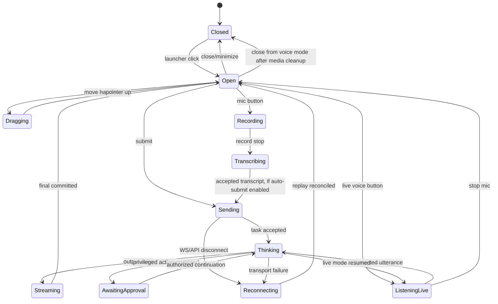

# OpenConnect Anchor Composer — Technical Design, Replication & Implementation Specification

**Document:** `composer-spec.md`  
**Version:** 1.0-draft · **Date:** 2026-11-07 · **Status:** Proposed, implementation-ready target  
**Companion:** [`composer-requirements.md`](./composer-requirements.md)

## 0. Coding-agent rules and implementation priority

1. **Read `composer-requirements.md` first.** Match the reviewed reference anatomy and interaction semantics before inventing a new design. The reference UI screenshot is the design target, not permission to copy application-specific behavior.
2. **Pin source commit** `1c98e0a1efc94ac517805a6454216fde7b6e8743` of `Vuminkosi/Swift-Aid`. Audit and adapt `EllaiCompactComposer.razor` and CSS, `EllaiLauncherMenu`, `EllaiStatusLine`, `EllaiComposerPosition`, `ellai-composer-drag.js`, `ellai-composer-input.js`, `EllaiGuidanceHost` integration and the corresponding voice/UI tests. Verify original license, copied-file attribution and dependency rights. Avoid copying a 134 KB domain-specific host component wholesale.
3. **Implement one shared contract** with two renderers: Blazor/MudBlazor and browser DOM/optional React; Node SDK remains headless. Neither renderer may own session, identity, firewall, tool broker or durable event logic.
4. **Do not claim pixel parity on source inspection alone.** Build a golden reference fixture, run screenshot comparisons on pinned browsers/fonts and manually review all dynamic controls. Full screenshot 634×326 contains a cropped host page and the composer; do not infer physical CSS size directly from bitmap pixels.
5. **Reuse OpenConnect runtime** for task, auth, component discovery, voice capability router, operational/interactive agent context, HTTP/WS transport and JetStream committed event projections. Text-only works when all optional workers are absent.
6. **Evidence for every task**: code paths, tests/commands, screenshots/diffs, missing features and traced requirement IDs. Proposed code below requires adaptation to actual public types/MudBlazor version and compilation before describing as shipped.

## 1. Reference implementation inventory — verified source behavior

| Source path (relative to repo root) | Behavior to preserve | Migration target |
|---|---|---|
| `src/SwiftAid.UI/Ellai/Components/EllaiCompactComposer.razor` | single compact user interface, header move/settings/stop/close, one growing input, dynamic mic/live/send, latest response & partial transcript, footer voice/mic, lifecycle | `OpenConnect.Components.Blazor/Composer/MiniComposer.razor` |
| `.../EllaiCompactComposer.razor.css` | 24rem bounded width, subtle card/tail, compact rows and overflow, handle-only movement, theme tokens | `MiniComposer.razor.css` |
| `.../EllaiLauncherMenu.razor` | one `MudFabMenu` with SmartToy icon and actions | `MiniComposerLauncher.razor` |
| `.../EllaiLauncherMenu.razor.css` | launcher fixed placement, 2.75rem FAB, focus and menu styling | isolated launcher CSS |
| `.../EllaiStatusLine.razor(.css)` | 3 bars, status and activity, safe rich text, capped lines, reduced motion | `ComposerStatusLine` renderer |
| `.../Ellai/EllaiComposerPosition.cs` | viewport XY clamp and 24px keyboard increments | `ComposerPosition` typed value object |
| `.../wwwroot/js/ellai-composer-drag.js` | handle-only interact.js move, viewport clamp, resize updates and dispose safety | `composer-drag.js` or dependency-free pointer bridge |
| `.../wwwroot/js/ellai-composer-input.js` | Enter to submit, Shift+Enter newline, IME/keydown-repeat protection, current DOM value, detach | `composer-input.js`/browser event handler |
| `.../Ellai/Guidance/EllaiGuidanceHost.razor(.css)` | floating versus attached mode, latest-user/latest-response/status, cancellation, voice callbacks, optional tour integration | small `OpenConnectProvider`/coordinator adapter, NOT copy full host |
| `tests/voice/ellai-composer-{drag,input}.test.mjs`, `tests/SwiftAid.Ui.Tests/EllaiSurfaceLogicTests.cs` | regression ideas for attach/detach, stale async loading, input submit gating, position | `tests/Composer.*` |

Source also uses `inset-block-end: 20vh` for launcher and `calc(20vh + 4rem)` for floating composer, with `inset-inline-end: max(1rem, env(safe-area-inset-right))`. OpenConnect's default launcher will be **bottom right** with safe inset spacing (per product decision); create `LegacyViewport20Vh` preset for behavior-level source fidelity. The screenshot shows the compact bubble above a green launcher and is not evidence that `20vh` is suitable for every host app.

## 2. Reference composition and component structure

```text
OpenConnectProvider (one scoped client coordinator)
 └── ComposerHost (one per browser app root)
     ├── AnchorLayer (fixed, pointer-events-none outside active surfaces)
     │   ├── MiniComposerLauncher [FAB / optional capability menu]
     │   └── AnchorBubble (conditionally open)
     │       ├── Header: DragHandle | Settings | Stop | Close
     │       ├── Editor: label + growing textarea | Record/Stop + Live/Send
     │       ├── SentSnippet (optional, capped)
     │       ├── ResponseSnippet (optional, capped)
     │       ├── PartialTranscript (optional, capped)
     │       └── Footer: StatusLine | SpeechToggle | MicrophoneToggle
     └── Optional attach outlet for Navigator/IOpenConnectComponent
```

**Crucial ownership:** The FAB and bubble are *separate elements* sharing an anchor-state coordinator. Do not put FAB inside composer card, do not render a full conversation list by default. The `AnchorBubble` is fixed or portal-positioned and should visually have a tail pointing toward FAB only when attached to anchor. In dragged/free mode, detach or adjust tail: never leave a misleading tail pointed away from launcher. In an in-flow Navigator card, suppress FAB/tail/drag, keep identical editor/status content.

## 3. Visual specification — exact reference-aligned layout

### 3.1 Reference image interpretation

User image `example-openconnect-compact-composer.png` measures **634×326 RGBA**. The image shows a bubble occupying almost the full width of this *cropped image*, approximately x=4–628, y=5–220, and a circular green FAB partially cut off near x=555–628, y=253–326. **These are screenshot crop coordinates, not canonical CSS dimensions.** The screenshot does not show a full viewport; geometry must derive from reviewed CSS plus new acceptance rules.

Header: four-way move glyph upper left; settings gear, red stop-circle, close X at upper right. Input label appears “Message Ellai” (replace with dynamic `Message {AssistantName}`), placeholder “Ask Ellai…”; the input occupies nearly whole bubble width; active recording stop and waveform appear on right in the screenshot. A thin dotted field separator separates editing from footer. Bottom row: three green bars, `Ready` at left; speaker icon + `Voice on` and green microphone icon + `Mic on` at right. Below/right is a small bot FAB.

### 3.2 Proposed theme token defaults

These are **target tokens to tune against screenshots**, not values confirmed in the source screenshot:

```css
:host, .oc-composer-root {
  --oc-composer-width: 23.5rem;         /* source host width; source card width 24rem */
  --oc-composer-max-width: calc(100vw - 2rem);
  --oc-composer-padding: .625rem;
  --oc-composer-radius: .75rem;
  --oc-composer-surface: var(--mud-palette-surface, #fff);
  --oc-composer-text: var(--mud-palette-text-primary, #23272c);
  --oc-composer-muted: var(--mud-palette-text-secondary, #777d84);
  --oc-composer-border: var(--mud-palette-divider, #dedfe3);
  --oc-composer-accent: var(--mud-palette-primary, #00875f);
  --oc-composer-danger: var(--mud-palette-error, #c62828);
  --oc-composer-shadow: 0 4px 16px rgb(0 0 0 / .12);
  --oc-composer-fab-size: 2.75rem;   /* reviewed source: 44 CSS px at base root */
  --oc-composer-anchor-edge: max(1rem, env(safe-area-inset-right));
  --oc-composer-anchor-bottom: max(1rem, env(safe-area-inset-bottom));
  --oc-composer-anchor-gap: .875rem;
  --oc-composer-status-font: .75rem;
  --oc-composer-max-response-height: 12rem;
  --oc-composer-max-sent-height: 4.5rem;
  --oc-composer-max-partial-height: 4.5rem;
  --oc-composer-layer-z: 1400; /* resolve relative to host MudPopover/dialog layers */
}
```

Always use CSS logical properties (`inset-inline-end`, `inset-block-end`), theme variables, `max-width` and `max-height`; support dark/light and RTL. Do not hardcode a universal z-index above consent dialogs or app security overlays. For Blazor CSS isolation, scope Mud internals via `::deep` narrowly, matching source strategy. For web use a namespaced stylesheet or ShadowRoot and explicitly map host CSS variables; avoid polluting page styles.

### 3.3 Layout rules

| Element | Desktop intended | Mobile intended | Interaction |
|---|---|---|---|
| FAB | 2.75rem face, ≥44px hit area | 44–56px hit area | Toggle open; optional vetted capability menu |
| Bubble | inline-size min(23.5rem, viewport−2rem) | fit visual viewport, 1rem margin | Anchored above FAB; no reflow |
| Header | single compact row | never hide close | drag handle and 3 icons |
| Input | 1 auto-grow row, max 5 | 1–5; keyboard aware | max 8000 characters by default |
| Field actions | aligned inline end/bottom | stay within editor | record/stop + live/send context |
| Sent snippet | cap 4.5rem | same | only last message; scroll inside |
| Response | cap 12rem | smaller based on viewport | latest streamed response |
| Partial STT | cap 4.5rem | same | transient; not duplicated as accepted turn |
| Footer | status left, speech right | allow wrap or compact icon label if narrow | states always perceivable |
| Tail | 1rem notch near FAB | hide if detached/near viewport edge | decorative pointer |

Max bubble height MUST be bounded by `visualViewport.height - 2 * safeMargin - fab/gap`, with inner scroll regions. Never let bottom footer controls disappear below mobile keyboard. When expanded content is long, show user-controlled `View conversation` action or internal scroll; do not continuously grow into a half-screen drawer unless the user explicitly requests another view.

### 3.4 Launcher and menu modes

OpenConnect equivalent of source `MudFabMenu` uses a SmartToy/assistant icon and explicit `Ask` default. Conditional extra modes based on authorized capabilities: `Show Me` (Navigator observe), `Guide Me` (Navigator tour), `Help Me Work` (authorized tools), `Explore` (agent collaboration). Do not expose application-specific `Review Evidence` unless developer registered that capability. If one mode, FAB opens composer directly. If multiple modes, offer accessible menu or long-press action configured by typed option. Menu and bubble are not simultaneously stacked in ways that obscure host actions.

## 4. Shared strongly typed public APIs

### 4.1 Configuration enums

```csharp
public enum ComposerPlacement { BottomRight, BottomLeft, TopRight, TopLeft, Custom, LegacyViewport20Vh, Attached }
public enum ComposerDisplayState { Hidden, Closed, Opening, Open, Dragging, Closing }
public enum ComposerCloseBehavior { MinimizeOnly, CancelActiveTask, EndSession }
public enum ComposerInputAction { LiveVoiceOrSend, SendOnly, RecordedVoiceOrSend }
public enum ComposerTaskPhase { Ready, Connecting, Sending, Thinking, ToolExecuting, AwaitingApproval, Streaming, Reconnecting, Completed, Cancelling, Cancelled, Failed }
public enum ComposerMicrophoneState { Unavailable, Off, PermissionRequested, Recording, ListeningLive, Transcribing, Stopping, Failed }
public enum ComposerSpeechState { Unavailable, Off, On, Buffering, Playing, Paused, Failed }
public enum ComposerHistoryPresentation { LatestOnly, OnDemandHistory }
public enum ComposerUiIntegration { Floating, Attached }
```

All closed choices are validated typed enums, JSON wire values stable strings and never numeric. Voice/agent labels, custom target IDs, colors, model voice/language and URL strings remain validated extensible values. Missing optional speech components must not cause options validation to fail when text-only mode is selected.

### 4.2 Proposed Blazor registration and markup

```csharp
builder.Services.AddOpenConnectClient(options =>
{
    options.ApiBaseAddress = new Uri("https://host.example.test/openconnect/v1/");
    options.WebSocketAddress = new Uri("wss://host.example.test/openconnect/v1/events");
});

builder.Services.AddOpenConnectComposer(options =>
{
    options.AssistantName = "Assistant";
    options.Placement = ComposerPlacement.BottomRight;
    options.CloseBehavior = ComposerCloseBehavior.MinimizeOnly;
    options.History = ComposerHistoryPresentation.LatestOnly;
    options.Input.MaxCharacters = 8000;
    options.Input.MaxLines = 5;
    options.Voice.ShowWhenAvailable = true;
    options.InitiallyOpen = false;
});
```

```razor
@inherits LayoutComponentBase
<MudThemeProvider />
<MudPopoverProvider />
<MudDialogProvider />
<MudSnackbarProvider />
<OpenConnectProvider>
    @Body
    <MiniComposer />
</OpenConnectProvider>
```

**Implementation note:** If existing `OpenConnectProvider` is a service-host sibling rather than a cascading content component, use the *real* supported pattern and document it. Do not add duplicate Mud providers when host already defines them. `MiniComposer` must render one FAB and one conditional bubble and consume scoped `IOpenConnectClient`, event coordinator and capability registry.

### 4.3 Browser SDK and React adapter

```typescript
import { createOpenConnectClient } from '@openconnect/client';
import { createMiniComposer } from '@openconnect/composer';

const client = createOpenConnectClient({
  apiBaseUrl: 'https://host.example.test/openconnect/v1',
  eventsUrl: 'wss://host.example.test/openconnect/v1/events',
  auth: authProvider,
});
const composer = createMiniComposer({
  client, assistantName: 'Assistant', placement: 'bottom-right',
  initiallyOpen: false, closeBehavior: 'minimize-only',
});
composer.mount(document.getElementById('assistant-root')!);
// on logout/unmount: composer.dispose(), client auth lifecycle clears subscriptions
```

```tsx
<OpenConnectProvider client={client}>
  <Application />
  <MiniComposer assistantName="Assistant" placement="bottom-right" />
</OpenConnectProvider>
```

`@openconnect/client` is safe for browser/Node and **never imports DOM**. `@openconnect/composer` supports browser DOM only on `mount` (SSR import safe); `@openconnect/react` is optional adapter, not part of core `client.ts`. Reuse provided core client and task events. No extra realtime backend route necessary.

### 4.4 Composer options and interfaces

```csharp
public sealed class OpenConnectComposerOptions
{
    public string AssistantName { get; set; } = "Assistant";
    public ComposerPlacement Placement { get; set; } = ComposerPlacement.BottomRight;
    public ComposerCloseBehavior CloseBehavior { get; set; } = ComposerCloseBehavior.MinimizeOnly;
    public ComposerHistoryPresentation History { get; set; } = ComposerHistoryPresentation.LatestOnly;
    public ComposerInputOptions Input { get; } = new();
    public ComposerVoiceOptions Voice { get; } = new();
    public ComposerAppearanceOptions Appearance { get; } = new();
    public bool InitiallyOpen { get; set; }
    public bool PersistPosition { get; set; } = true;
}
public sealed class ComposerInputOptions
{
    public int MaxCharacters { get; set; } = 8000;
    public int MaxLines { get; set; } = 5;
    public ComposerInputAction Action { get; set; } = ComposerInputAction.LiveVoiceOrSend;
}
public sealed class ComposerVoiceOptions
{
    public bool ShowWhenAvailable { get; set; } = true;
    public bool AllowRecorded { get; set; } = true;
    public bool AllowLive { get; set; } = true;
    public bool EnableAutoplayAfterGesture { get; set; }
}
```

Prefer a reducer/state store to hand-coded scattered `bool` flags. Suggested platform-neutral interfaces: `IComposerStateStore`, `IComposerTaskController`, `IComposerVoiceController`, `IComposerPositionStore`, `IComposerCapabilityProjection`, `IComposerSettingsPresenter`, `IComposerComponentProposalRouter`, `IComposerViewportAdapter`, `IComposerUiHost`. The coordinator is scoped to authenticated user/application and must not persist server credentials in browser storage.

## 5. Deterministic composer state machine



Treat **UI display state**, **task phase**, **microphone state** and **speech playback state** as **orthogonal state axes**. Example `Open` + `Thinking` + `ListeningLive` + `SpeechOff` is valid. This avoids impossible combinatorial flags and reduces inconsistent buttons. Source currently uses multiple booleans; new implementation should normalize them through a shared cross-platform reducer with golden state fixtures.

### 5.1 Control rendering truth table

| Input | Microphone | Live supported? | Right control | Recorded control | Footer speech |
|---|---|---|---|---|---|
| Empty | Off | Yes | `Live voice` waveform | `Mic` | off/on if TTS healthy |
| Nonempty | Off | Any | `Send` | `Mic` if allowed | off/on if available |
| Empty | Off | No | Disabled/omitted live action | mic if recorded STT supported | no fake live icon |
| Any | Recording | Any | `Stop recording` / live control only if applicable | stop | independent |
| Any | ListeningLive | Yes | active waveform `Stop live` | stop | independent |
| Any | Unavailable | No | Send if text | omitted / truthful disabled | hidden if no TTS |
| Any | PermissionRequested | Any | no duplicate start | pending feedback | independent |
| Any | Transcribing | Any | processing feedback | disabled | independent |

**Priority order:** session cancel/close always accessible; active capture stop overrides start; during live capture text may be temporarily disabled; if text nonempty and capture inactive, Send overrides live action; if no input, live action present only with supported capabilities. Exactly one primary right-side action at a time; the reference may visually show additional record/stop when capture active. Use separate action IDs/ARIA rather than relying on icon position.

### 5.2 Status projection

Map real event types to `ComposerTaskPhase`: `task.accepted`→Sending/Thinking, `agent.started`→Thinking, `tool.started`→ToolExecuting, `task.output.delta`→Streaming, `tool.approval.requested`→AwaitingApproval, `task.completed`→Ready/Completed, `task.failed`→Failed, `task.cancelled`→Cancelled, `ws.disconnect`→Reconnecting, `ws.resume`→resnapshot state, voice events→Listening/Speaking. Store durable event sequence and de-duplicate by event ID. Never infer completion from audio synthesis or UI animation. Status line supports themed three bars with reduced motion and sanitized rich text (plain, emphasis, code and allowlisted links only). Avoid sanitizing by generic `dangerouslySetInnerHTML`.

### 5.3 Close/stop and auth

`Close` default `MinimizeOnly`: hide bubble and stop active device capture if policy requires; do not cancel accepted durable task. `Stop` applies configured scoped active-task/session cancel, obtains gateway receipt; do not show success until confirmed. If cancel outcome unknown, show status with reconcile action instead of silently replaying. Log out/unmount fully disposes capture, streaming subscriptions and per-user state. Interactive agent scope is from authenticated server principal, never user-entered tenant ID. Operational-agent events are shown only when separately authorized and explicitly opened, never automatically hijack composer.

## 6. Positioning and dragging implementation

### 6.1 Anchor positioning algorithm

Use one positioning utility on both Blazor JS and browser UI. Resolve CSS logical anchor (default bottom-right), visualViewport offsets, safe insets and keyboard occlusion. Bounds:

```typescript
function clampComposerPosition(x: number, y: number, viewport: DOMRectReadOnly, size: {width:number;height:number}, margin = 16) {
  const maxX = Math.max(margin, viewport.x + viewport.width  - size.width  - margin);
  const maxY = Math.max(margin, viewport.y + viewport.height - size.height - margin);
  return {
    x: Math.min(Math.max(x, viewport.x + margin), maxX),
    y: Math.min(Math.max(y, viewport.y + margin), maxY),
  };
}
```

This illustrates geometry only; validate narrow viewport where component itself may exceed remaining content space, and clamp after its responsive reflow. Use `ResizeObserver`/`visualViewport` events with throttling; prevent bounce loops and memory leaks. Persist normalized relative position, not stale absolute pixels; verify stored position belongs to same user, layout and viewport class. Keyboard arrows move 24px (configurable), Home resets, Escape closes. Pointer events originate only from handle; touch drag must not scroll browser accidentally. No external `interact.js` dependency required if native Pointer Events can meet behavior; if reused, pin version/license and lazy-load it.

### 6.2 Bubble tail positioning

When anchored, tail is a 1rem rotated notch at bottom on the side nearest FAB. Align within host bubble bounds and avoid drawing a second border at corner. The reference CSS uses a skewed 1rem square and right/bottom borders. When freely dragged far away, hide tail or position toward the launcher only if it still accurately indicates anchor. When attached to tour flow, hide tail. Test against clipping ancestor, portal and mobile safe area; portal to root overlay if necessary.

### 6.3 No host interference

Root overlay container `pointer-events:none`, FAB and composer `pointer-events:auto`. Do not trap scrolling, disable page pointer events, or override global body overflow. Protect host FABs and dialogs via configurable anchor/z-index conflict strategy. The unobtrusive behavior is a measured product goal: no blocked clicks outside actual bubble, no viewport resize, no visual content shift, no input interception elsewhere.

## 7. Input events and keyboard behavior

Replicate reviewed JS `ellai-composer-input.js` precisely as the baseline: attach a delegated listener only to composer textarea/input; `Enter` submits, except Shift+Enter, `isComposing`, `keyCode===229`, key repeat, disabled field, empty field or pending previous submit. `preventDefault` on supported Enter. Use DOM current value at gesture and then update shared state before sending; guards must also run server-side and in .NET component callback (`CanSend`, length, active task mode). `Ctrl+Enter` can be an optional future shortcut but should not silently differ between SDKs. Tests must verify no duplicate submits across Blazor rerender/React StrictMode and that keyboard input in host app isn't affected.

## 8. Speech features and dependencies

The composer is a **presentation and input controller**; speech is an optional OpenConnect capability managed by shared speech router and independently enabled Kokoro/MMS-TTS, recorded STT and real-time dialog workers. No Python download or Docker startup from composer render/registration. `Voice on` controls audio playback only; `Mic on` controls captured input separately. Default voice `af_heart` only where Kokoro available/verified; MMS language cannot be assumed. UI asks for browser mic permission only on user gesture and uses real capability registry and permission status. If worker missing, still render text send, status and task results. If voice becomes unavailable mid-turn, stop epoch, release device and show subtle failure feedback; never block core session.

For live voice: mic on -> input audio frame stream -> local VAD/approved STT -> accepted turn through normal task API -> response text/output TTS -> playback acknowledgement; continue listening until stop, user consent permitting. State transitions and transcripts are tied to real stream event IDs, and stale audio chunks are discarded on barge-in. Do not treat a WAV chunk pushed to browser as proof audio was heard. Browser autoplay requires explicit user gesture. Audio content must not appear in JetStream/analytics, and strict local privacy gates external speech providers.

## 9. Canonical client protocol and component discovery

`MiniComposer` does not need new server endpoints. Use `/openconnect/v1/tasks`, `/sessions`, `/capabilities`, `/components`, authorized session event replay, and `/events` WS as defined by core OpenConnect. For optional voice, reuse existing speech stream path and capability descriptors. Client sends `clientTaskId` to enforce idempotency; host derives tenant/principal. `OpenConnectProvider` manages subscriptions and projections; composer consumes a single scoped state. `IOpenConnectComponent` allows descriptions/suggestions/contract-rendered UI; composer shows at most small suggestion chips or a “View result” affordance, never mounts unbounded business UI inside bubble. Discovery must be filtered per user/agent/tool rights. Navigator may attach the composer content to its tour card; do not instantiate a second active client session.

### 9.1 Shared presentation-only wire state

```json
{
  "schemaVersion": "openconnect.composer/v1",
  "displayState": "open",
  "phase": "ready",
  "inputText": "",
  "sentPreview": null,
  "responsePreview": null,
  "partialTranscript": null,
  "voice": { "available": true, "enabled": true, "playing": false },
  "microphone": { "available": true, "state": "listening-live" },
  "session": { "id": "opaque-session", "active": true },
  "capabilities": ["chat", "speech.output", "speech.live"],
  "status": { "label": "Ready", "detail": null }
}
```

This is a **UI projection**, not a request granting client authority and not a mandate to persist raw text in broker events. Persist session/history on server; client may hold previews in memory only. Stable enum values share JSON fixtures across C# and TypeScript.

## 10. Security, authorization, privacy and accessibility

- Use host auth/session identity. On user switch/logout, clear local preview and scoped UI preferences; disallow cross-user restoration of state or autocomplete.
- Permit no model-generated arbitrary button callbacks, HTML, CSS, JS or navigation. Only known local action IDs and typed component props are accepted after server policy checks.
- Settings is for user-local UI preferences and authorized host-approved options; no direct toggling of privacy enforcement or operational roles.
- Output text, status rich text and tool activity are sanitized and safe-link allowlisted. No external links open without explicit gesture.
- Microphone permission requested only after click; `aria-pressed` on voice/mic toggles, `aria-label` on all icon buttons, status `role=status` and `aria-live=polite`. Partial STT should avoid noisy live announcements; final transcript may be announced.
- Reduced motion turns off bar-wave/glow animation. Header move handle keyboard focus and descriptive label. Focus return on close; no keyboard traps.
- `Capture`/Navigator actions, when available, are separately consented and authorized; tiny composer is not a consent substitute.
- Backend and frontend telemetry log only safe event type, duration, phase, known error and optional pseudonymous correlation; no DOM values, prompts, response raw PII, audio bytes or credentials.

## 11. Implementation work breakdown (Codex/Muse/DeepSeek)

| Task | Deliverable | Tests / evidence |
|---|---|---|
| CMP-IMP-001 | Audit pinned source/bitmap and rights; identify reused versus rewritten files | Source ledger with SHA, screenshots, reviewed CSS/JS |
| CMP-IMP-002 | Freeze schema, typed enums, state axes, cross-platform golden fixtures | C#/TS schema parity, invalid state rejects |
| CMP-IMP-003 | `ComposerHost` layout and launcher, card, tail + theme tokens | Reference-like screenshot and no host reflow |
| CMP-IMP-004 | Blazor `MiniComposer`, MudFabMenu, header, editor, response and status | bUnit controls + CSS isolation |
| CMP-IMP-005 | Browser `@openconnect/composer` DOM implementation; React adapter | Vite/Next/browser + SSR import |
| CMP-IMP-006 | Positioning/dragger, keyboard and cleanup adapters | JS pointer/resize/drag/detach/zoom tests |
| CMP-IMP-007 | Enter/IME/input submit handling and task API integration | Double-click/idempotency/Shift+Enter tests |
| CMP-IMP-008 | Scoped provider, WS event mapping, reconnect/replay, close vs stop | ASP.NET integration and real task/status event tests |
| CMP-IMP-009 | Recorded/live mic + independent voice state + epoch fences | Fake worker + real worker gated voice smoke |
| CMP-IMP-010 | Dynamic capability/action menu and `IOpenConnectComponent` suggestions | Disabled capability and authorization negatives |
| CMP-IMP-011 | Attached Navigator mode using same core content, lifecycle | Tour mount/switch without duplicate subscriptions |
| CMP-IMP-012 | Settings, theming, dark/RTL/mobile/zoom/a11y | WCAG scans + manual keyboard/screen reader |
| CMP-IMP-013 | Cross-render screenshot parity and regression baselines | Pixel diff + approved manual visual evaluation |
| CMP-IMP-014 | CI, package consumers, NuGet/npm release/docs and migration notes | Clean registry/package install, screenshot artifact and security jobs |

### 11.1 Stage gates

**Stage 0 — source audit:** screenshot and checked source mapped to portable design anatomy, license audit complete. **Stage 1 — text-only composer:** launcher/card/drag/input/footer, real task, two SDK renderers, no workers; CMP-AT-001–009/013–019/022/024 relevant tests pass. **Stage 2 — optional voice:** conditional record/live/playback controls, no-workers behavior, permission handling, live stream and epoch; CMP-AT-010–012 pass where enabled. **Stage 3 — components/attached mode:** CMP-AT-020 and safe discovery/authorization. **Stage 4 — release:** CMP-AT-021/023, visual+security matrix and clean consumers.

### 11.2 Reference screenshot test harness

Create a minimal static/Blazor/browser fixture page with neutral host layout, pinned CSS variables and fixed test viewport in CSS pixels; capture (a) Closed only FAB, (b) Open idle/no voice, (c) Open with `Voice on`/`Mic on` and active waveform/stop, (d) Processing with latest response, (e) Dragged, (f) Attached. Use user screenshot as a **visual review reference**. Because screenshot may be an image crop with unknown pixel scale, create new canonical golden files from OpenConnect implementations under a documented deterministic viewport/font/browser; review golden images side-by-side with source reference, not a blind exact hash match. Screenshot diff thresholds must be scoped to expected controls, with a separate geometry/semantic assertion test so visual diffs cannot be masked by permissive thresholds.

### 11.3 CI matrices

- `.NET`: locked restore, `dotnet build/test`, bUnit, Blazor Server/WebAssembly browser fixture; verify no JS invocation before hydration and correct Mud provider composition.
- `npm`: `npm ci`, ESLint, TypeScript strict, Node SSR import, Vitest tests for state reducer, browser Playwright snapshots, bundle-size report, `npm pack` smoke and clean external Next/Vite apps.
- `contracts`: openconnect.composer/v1 JSON schema valid/invalid fixtures, C#/TS serialized enum values, event cursor and voice states.
- `integration`: authenticated disposable gateway + NATS/Postgres where configured, tool/privacy injection negatives, reconnect/stop/idempotency, voice unavailable fallback.
- `security/a11y`: XSS, untrusted status rich text, cross-user local preview, client logout, CSP, keyboard controls, reduced motion/contrast, 200% zoom/mobile safe-area.
- `release`: signed/approved tag, protected OIDC trusted NuGet/npm publishing, package integrity and fresh consuming app screenshots; never publish from untrusted PRs.

## 12. Acceptance matrix (all NOT RUN until evidenced)

| ID | Automated test or review | Status |
|---|---|---|
| CMP-AT-001 | Closed FAB only | NOT RUN |
| CMP-AT-002 | Anchor bubble/tail and no overflow | NOT RUN |
| CMP-AT-003 | Reference anatomy parity | NOT RUN |
| CMP-AT-004 | Close versus Stop semantics | NOT RUN |
| CMP-AT-005 | Drag/keyboard/clamp/reset | NOT RUN |
| CMP-AT-006 | Enter/current-value/IME/idempotency | NOT RUN |
| CMP-AT-007 | Text-only no workers | NOT RUN |
| CMP-AT-008 | Dynamic controls table | NOT RUN |
| CMP-AT-009 | Status real event mapping | NOT RUN |
| CMP-AT-010 | Voice/mic independent | NOT RUN |
| CMP-AT-011 | Real voice supported worker | NOT RUN |
| CMP-AT-012 | Permission/capability absence | NOT RUN |
| CMP-AT-013 | Latest response bounds | NOT RUN |
| CMP-AT-014 | WS retry/replay | NOT RUN |
| CMP-AT-015 | User switch/logout | NOT RUN |
| CMP-AT-016 | Blazor consumer | NOT RUN |
| CMP-AT-017 | TS/React consumer and Node SSR | NOT RUN |
| CMP-AT-018 | Accessibility | NOT RUN |
| CMP-AT-019 | Mobile/RTL/zoom | NOT RUN |
| CMP-AT-020 | Navigator/Component proposals | NOT RUN |
| CMP-AT-021 | Privacy and telemetry | NOT RUN |
| CMP-AT-022 | Session/event reconciliation | NOT RUN |
| CMP-AT-023 | Pack/registry release smoke | NOT RUN |
| CMP-AT-024 | Unmount/mount cleanup | NOT RUN |

## 13. Final engineering directive

**Do not replace the compact reference with a generic chat widget.** Implement the **single anchored FAB + compact bubble + thin status footer** as a reusable, brand-neutral and text-first UI primitive. Preserve the source's meaningful keyboard, drag, voice, status, cancellation and disposal behaviors, while improving state ownership, security, cross-client parity and source-independent customization. Keep optional speech/Navigator/Playwright completely detached from core task and MCP availability. The final developer integration must be possible with `AddOpenConnectClient`, a provider, and `MiniComposer`, without modifying the host page beyond explicitly chosen placement.

## 14. Sources and implementation limitations

Reviewed public source tree: https://github.com/Vuminkosi/Swift-Aid/tree/1c98e0a1efc94ac517805a6454216fde7b6e8743 — exact component/JS paths listed in §1. Supplied `example-openconnect-compact-composer.png` is the visual reference. The reviewed source is Blazor/MudBlazor, **not a ready-made Node or React component**, so browser/React implementation and visual equivalence are new engineering work. No released package, running UI or integration behavior has been independently executed in this document-generation step. License/attribution must be audited before copying source.
