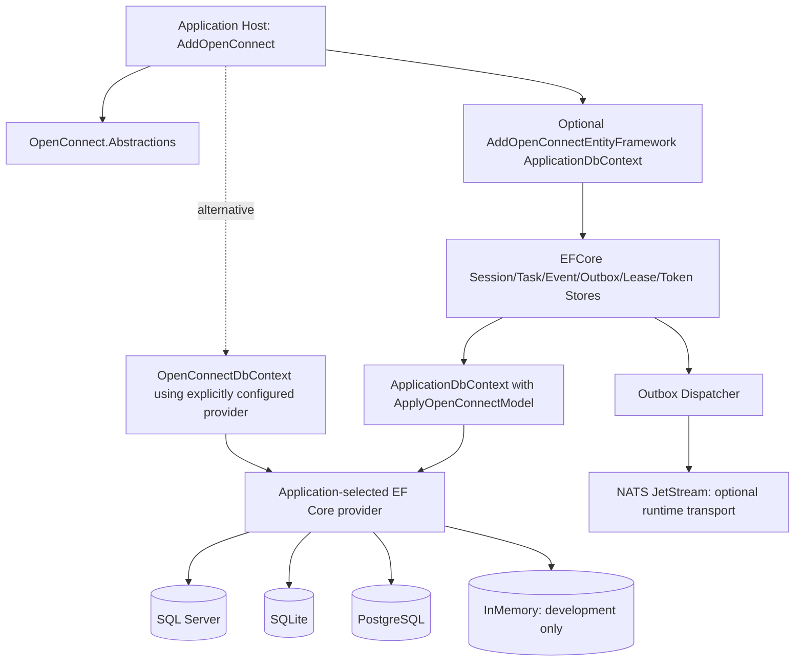

# OpenConnect — Entity Framework Core Adapter Technical Specification

**File:** `entityframework-spec.md`  
**Version:** 1.0-draft | **Date:** 2026-11-07  
**Status:** Proposed implementation, to be validated in source and CI  
**Companion:** `entityframework-requirements.md`  
**Primary developer API:** `.AddOpenConnectEntityFramework<ApplicationDbContext>(options => ...)`  
**Implementation IDs:** `EF-IMP-001`–`EF-IMP-016`  
**Acceptance:** `EF-AT-001`–`EF-AT-030`

## 0. Instructions for coding agents

1. Inspect current OpenConnect persistence abstractions, existing PostgreSQL `DbContext`, entity definitions, stores and migrations before implementing anything. Preserve stable public contracts and event/session semantics. Existing storage names and namespaces are not assumed to match this proposed design.
2. Implement provider-neutral interfaces first; do not make EF Core a dependency of `AddOpenConnect()`. Use a dedicated NuGet `OpenConnect.Persistence.EFCore` with only needed EF Core library dependencies. A test host installs its own provider.
3. Never execute `Database.Migrate()`, `EnsureCreated()`, `EnsureDeleted()` or schema DDL at DI-registration time. Migration mode defaults to `Manual`; shared app contexts do not get automatic migrations.
4. A successful compilation without SQL Server, SQLite and PostgreSQL integration tests is not provider compatibility evidence. Use real relational test instances and provider-specific concurrency/failure scenarios.
5. `EF-AT` items start **NOT RUN**. Do not claim success, mark complete or publish an API until tests and documentation are verified.
6. Work one `EF-IMP-*` task or tightly related group per PR. Update the existing OpenConnect implementation/checklist with task IDs and test evidence. Include threat-model changes for PII-token storage and shared app context behavior.
7. Do not copy application/domain data from the reference implementation, regenerate destructive migrations or issue database queries requiring production credentials.

## 1. Target architecture



Architecture rules:

- `OpenConnect.Abstractions` owns `IEventJournal`, `ISessionStore`, `ITaskStore`, `IOutboxStore`, `ILeaseStore`, `IPrivacyTokenVault` and a transactional unit-of-work contract. It has **no** EF Core dependency.
- `OpenConnect.Persistence.EFCore` owns EF persistence entities, mappings, stores, model-builder extension, DI and provider-neutral transaction/outbox coordination.
- The application owns its EF Core provider and **its own shared-context migrations**.
- A dedicated context is separately configurable and shares the same physical database *only when the developer explicitly configures it so*.
- `OpenConnect.Transport.Nats` publishes committed outbox records; the EF package does not depend on the NATS implementation.
- QdrantVactor, Navigator, MiniComposer and other extension packages remain independent and consume committed events through common abstractions.

## 2. Project and package layout

```text
src/
  OpenConnect.Abstractions/
    Persistence/{IEventJournal,ISessionStore,ITaskStore,IOutboxStore,ILeaseStore}.cs
    Persistence/IOpenConnectPersistenceUnitOfWork.cs
    Privacy/IPrivacyTokenVault.cs
  OpenConnect.Persistence.EFCore/
    OpenConnect.Persistence.EFCore.csproj
    Configuration/{OpenConnectEfOptions,Enums,OptionsValidator}.cs
    DependencyInjection/OpenConnectEfServiceCollectionExtensions.cs
    Model/OpenConnectModelBuilderExtensions.cs
    Model/OpenConnectModelOptions.cs
    Entities/{SessionEntity,TaskEntity,TurnEntity,EventEntity,OutboxEntity,LeaseEntity,
      ApprovalEntity,PrivacyTokenEntity,OperationalRunEntity}.cs
    EntityConfigurations/{SessionConfiguration,TaskConfiguration,TurnConfiguration,
      EventConfiguration,OutboxConfiguration,LeaseConfiguration,ApprovalConfiguration,
      PrivacyTokenConfiguration,OperationalRunConfiguration}.cs
    Context/OpenConnectDbContext.cs
    Context/OpenConnectModelCacheKeyFactory.cs
    Stores/{EfSessionStore,EfTaskStore,EfEventJournal,EfOutboxStore,
      EfLeaseStore,EfApprovalStore,EfPrivacyTokenVault}.cs
    Transactions/{EfUnitOfWork,EfTransactionCoordinator}.cs
    Outbox/{EfOutboxDispatcher,EfOutboxClaimCoordinator,ClaimResult}.cs
    Providers/{IEfProviderCapabilities,IEfOutboxClaimDialect,SqlServerClaimDialect,
      PostgreSqlClaimDialect,SqliteClaimDialect,InMemoryDevelopmentDialect}.cs
    Health/{EfSchemaHealthCheck,EfRuntimeModelValidator}.cs
  # Provider-specific migration samples SHOULD be separate implementation/test projects,
  # not transitively installed EF provider packages.
tests/
  OpenConnect.Persistence.EFCore.UnitTests/
  OpenConnect.Persistence.EFCore.ContractTests/
  OpenConnect.Persistence.EFCore.IntegrationTests/
  OpenConnect.Persistence.EFCore.MigrationsTests/
  OpenConnect.Persistence.EFCore.PackageConsumers/
examples/
  existing-context-sqlserver/
  existing-context-postgres/
  existing-context-sqlite/
  in-memory-development/
  dedicated-context/
```

Only create concrete projects where they contain real functionality. The EF adapter's project dependency should be OpenConnect abstractions + tested compatible EF Core packages (base/relational where needed); **not** `Microsoft.EntityFrameworkCore.SqlServer`, `Microsoft.EntityFrameworkCore.Sqlite`, `Npgsql.EntityFrameworkCore.PostgreSQL` or `Microsoft.EntityFrameworkCore.InMemory`. In provider-specific development test projects, normal package references are expected and required.

## 3. Public typed options

```csharp
public enum OpenConnectEfIntegrationMode
{
    ExistingDbContext,
    DedicatedDbContext
}

public enum OpenConnectMigrationMode
{
    None,
    Manual,
    ApplyOnStartup
}

public enum OpenConnectSchemaValidationMode
{
    None,
    ValidateModel,
    ValidateSchemaAndVersion
}

public enum OpenConnectPersistenceConsistency
{
    DevelopmentOnly,
    DurableSingleDatabase
}

public enum OpenConnectOutboxClaimStrategy
{
    Auto,
    OptimisticConcurrency,
    ProviderOptimized
}

public sealed class OpenConnectEfOptions
{
    public OpenConnectEfIntegrationMode IntegrationMode { get; set; }
        = OpenConnectEfIntegrationMode.ExistingDbContext;

    public string Schema { get; set; } = "openconnect";
    public string SqliteTablePrefix { get; set; } = "oc_";
    public OpenConnectMigrationMode Migrations { get; set; }
        = OpenConnectMigrationMode.Manual;
    public OpenConnectSchemaValidationMode ValidateSchema { get; set; }
        = OpenConnectSchemaValidationMode.ValidateModel;
    public OpenConnectPersistenceConsistency Consistency { get; set; }
        = OpenConnectPersistenceConsistency.DurableSingleDatabase;
    public OpenConnectOutboxClaimStrategy OutboxClaimStrategy { get; set; }
        = OpenConnectOutboxClaimStrategy.Auto;
    public TimeSpan OutboxPollingInterval { get; set; }
        = TimeSpan.FromSeconds(2);
    public TimeSpan OutboxLeaseDuration { get; set; }
        = TimeSpan.FromSeconds(30);
    public int OutboxBatchSize { get; set; } = 50;
    public int MaxOutboxDispatchers { get; set; } = 2;
    public int OutboxMaxAttempts { get; set; } = 12;
    public bool RequireExistingContextModelRegistration { get; set; } = true;
}
```

The enums use strongly typed .NET APIs and a stable wire converter for JSON/YAML. Unknown/numeric enum strings and invalid combinations fail at startup. Example invariant validation:

```csharp
// Pseudocode; implement with IValidateOptions<OpenConnectEfOptions>.
if (options.Migrations == OpenConnectMigrationMode.ApplyOnStartup &&
    options.IntegrationMode == OpenConnectEfIntegrationMode.ExistingDbContext)
    return ValidateOptionsResult.Fail(
        "ApplyOnStartup cannot migrate an existing application's DbContext.");

if (provider == KnownEfProvider.InMemory &&
    options.Consistency == OpenConnectPersistenceConsistency.DurableSingleDatabase)
    return ValidateOptionsResult.Fail(
        "EF InMemory cannot implement a durable transactional outbox.");
```

Other validations: schema injection/length/identifier checks; SQLite schema translated to prefix; contradictory provider identity vs EF context; missing registration; missing entity types; lease/poll/batch bounds; multi-host SQLite configuration; schema drift; duplicate conflicting DI registration; more than one selected context without named-store support.

## 4. The requested fluent API: existing application context

```csharp
using Microsoft.EntityFrameworkCore;

builder.Services.AddDbContext<ApplicationDbContext>(db =>
    db.UseSqlServer(builder.Configuration.GetConnectionString("Default")));

builder.Services.AddOpenConnect();

builder.Services.AddOpenConnectEntityFramework<ApplicationDbContext>(options =>
{
    options.Schema = "openconnect";
    options.Migrations = OpenConnectMigrationMode.Manual;
});
```

In the application's existing context:

```csharp
public sealed class ApplicationDbContext : DbContext
{
    public ApplicationDbContext(DbContextOptions<ApplicationDbContext> options)
        : base(options) { }

    public DbSet<Customer> Customers => Set<Customer>();
    public DbSet<Order> Orders => Set<Order>();

    protected override void OnModelCreating(ModelBuilder modelBuilder)
    {
        base.OnModelCreating(modelBuilder);
        modelBuilder.ApplyOpenConnectModel();
    }
}
```

**Contract:** `AddOpenConnectEntityFramework<TContext>()` selects this existing registered context. `ApplyOpenConnectModel()` registers OpenConnect internal entity configurations. Host context **does not** need a single `DbSet<OpenConnectEntity>` property. EF Core already includes entities registered in `OnModelCreating`. The runtime store calls `context.Set<TEntity>()` and resolves internal types because the adapter assembly owns them.

**Important model-options caveat:** EF's `OnModelCreating` must know the same schema/table configuration as the DI adapter. A parameterless model extension may read a scoped context model configuration injected into the context's constructor or use a consistent public `OpenConnectModelOptions` supplied explicitly. Do not assume options configured in DI automatically appear inside `ModelBuilder`; create an explicit bridge. For simplest initial integration, the parameterless `ApplyOpenConnectModel()` uses the standard schema/prefix, and custom schemas require explicit model options or a validated model-options accessor. At runtime compare actual `GetTableName()`/`GetSchema()` with intended options and fail before queries if they differ.

**Canonical custom-schema example:**

```csharp
// App can supply the same immutable model settings through DI or a constant.
protected override void OnModelCreating(ModelBuilder modelBuilder)
{
    base.OnModelCreating(modelBuilder);
    modelBuilder.ApplyOpenConnectModel(new OpenConnectModelOptions
    {
        Schema = "openconnect", SqliteTablePrefix = "oc_"
    });
}
```

It is acceptable for the sample context to use the parameterless extension for the defaults, while custom mappings require the explicit overload. The adapter must catch mismatch rather than silently query the wrong schema.

## 5. Entity registration without DbSet properties

### 5.1 Model builder extension

```csharp
public static class OpenConnectModelBuilderExtensions
{
    public static ModelBuilder ApplyOpenConnectModel(
        this ModelBuilder modelBuilder,
        OpenConnectModelOptions? options = null)
    {
        var mapping = options ?? OpenConnectModelOptions.Default;

        modelBuilder.ApplyConfiguration(new SessionEntityConfiguration(mapping));
        modelBuilder.ApplyConfiguration(new TaskEntityConfiguration(mapping));
        modelBuilder.ApplyConfiguration(new TurnEntityConfiguration(mapping));
        modelBuilder.ApplyConfiguration(new EventEntityConfiguration(mapping));
        modelBuilder.ApplyConfiguration(new OutboxEntityConfiguration(mapping));
        modelBuilder.ApplyConfiguration(new LeaseEntityConfiguration(mapping));
        modelBuilder.ApplyConfiguration(new ApprovalEntityConfiguration(mapping));
        modelBuilder.ApplyConfiguration(new PrivacyTokenEntityConfiguration(mapping));
        modelBuilder.ApplyConfiguration(new OperationalRunEntityConfiguration(mapping));
        return modelBuilder;
    }
}
```

### 5.2 Example internal entity

```csharp
internal sealed class OutboxEntity
{
    public Guid Id { get; set; }
    public string TenantScope { get; set; } = null!;
    public string EventId { get; set; } = null!;
    public string Subject { get; set; } = null!;
    public string SanitizedPayload { get; set; } = null!;
    public long FencingVersion { get; set; }
    public string? LeaseOwner { get; set; }
    public DateTime? LeaseExpiresUtc { get; set; }
    public DateTime CreatedUtc { get; set; }
    public DateTime? PublishedUtc { get; set; }
    public DateTime NextAttemptUtc { get; set; }
    public int Attempts { get; set; }
}
```

The final model SHALL include index on publish status/nextAttempt, eventId uniqueness appropriate to tenant scope, and (tenant, session, sequence) uniqueness on event journal. Prefer UTC `DateTime` or a normalized Unix-time representation for sortable times, because SQLite has translation limitations for `DateTimeOffset` ordering. Don't implement global `rowversion` as required property: SQLite does not support database-generated rowversion. Use application-managed numeric concurrency tokens and increments where provider transactions guarantee compare-and-swap.

### 5.3 Provider-neutral table mapping

```csharp
internal sealed class OutboxEntityConfiguration
    : IEntityTypeConfiguration<OutboxEntity>
{
    private readonly OpenConnectModelOptions _mapping;
    public OutboxEntityConfiguration(OpenConnectModelOptions mapping) => _mapping = mapping;

    public void Configure(EntityTypeBuilder<OutboxEntity> builder)
    {
        // Final implementation must be aware of effective EF provider.
        var table = _mapping.UseSqlitePrefix ? "oc_outbox" : "Outbox";
        var schema = _mapping.UseSqlitePrefix ? null : _mapping.Schema;
        builder.ToTable(table, schema);
        builder.HasKey(x => x.Id);
        builder.Property(x => x.TenantScope).HasMaxLength(128).IsRequired();
        builder.Property(x => x.FencingVersion).IsConcurrencyToken();
        builder.HasIndex(x => new { x.TenantScope, x.EventId }).IsUnique();
        builder.HasIndex(x => new { x.PublishedUtc, x.NextAttemptUtc });
    }
}
```

`UseSqlitePrefix` is a computed immutable mapping choice derived from provider capability at design time and startup; never a free-form client toggle. For the InMemory provider use logical mapping and no relational schema assumptions. Model options that alter mappings require a provider/mapping-sensitive EF model cache key when multiple configurations share the context type and service provider.

## 6. Default database schema and entity relationships

| Entity | Logical table (SQL Server/PostgreSQL) | SQLite | Essential keys / indexes |
|---|---|---|---|
| SessionEntity | `openconnect.Sessions` | `oc_sessions` | PK SessionId; tenant/owner/version; TTL |
| TaskEntity | `openconnect.Tasks` | `oc_tasks` | PK TaskId; unique tenant+principal+clientTaskId; state |
| TurnEntity | `openconnect.Turns` | `oc_turns` | PK TurnId; session+sequence unique |
| EventEntity | `openconnect.Events` | `oc_events` | PK EventId; unique session+sequence; type and time |
| OutboxEntity | `openconnect.Outbox` | `oc_outbox` | PK Id; safe EventId unique; publish due+status |
| LeaseEntity | `openconnect.Leases` | `oc_leases` | unique resource scope/key; owner/fence/expiry |
| ApprovalEntity | `openconnect.Approvals` | `oc_approvals` | PK approval; scope/expires; bound argument hash |
| PrivacyTokenEntity | `openconnect.PrivacyTokens` | `oc_privacy_tokens` | token+scope unique, encrypted mapping, TTL |
| OperationalRunEntity | `openconnect.OperationalRuns` | `oc_operational_runs` | workload scope+runId; status and fence |

Optional module tables (Navigator sessions, vector projection checkpoints, etc.) should be registered through explicit module extension callbacks, not by indiscriminate assembly scanning. For a new optional module, adding mappings to an existing shared context requires the application to create a new migration. The persistence package must be conscious of schema drift between modules and versions.

### 6.1 Privacy-token columns

`PrivacyTokenEntity` must include `TenantScope`, `PrincipalOrWorkloadScope`, `SessionId`, `TurnId`, `TokenId`, `EntityType`, `EncryptedValue`, `Nonce`, `AuthenticationTag`, `WrappedDataKey`, `KeyProviderId`, `KeyVersion`, `CreatedUtc`, `ExpiresUtc` and a stable binding digest. Actual vault crypto is performed by .NET privacy services before EF storage; the EF adapter never decrypts implicitly or exposes plaintext in logs. Optional Infisical can implement key wrapping, but is not a database provider or mandatory dependency.

### 6.2 Delete, retention, and ownership

Configure foreign key delete behavior explicitly. Prefer an explicit tenant-scoped purge worker with bounded batches and legal-retention decisions over unconditional cascade deletion of long session trees. Session deletion must also trigger policy-approved removal of derived vector projections and captures via committed safe events. Expired privacy mappings should be purged under vault policy even when session history remains retained.

## 7. EF Core repositories, DbContext lifetime, and DI

### 7.1 Repository implementation

```csharp
internal sealed class EfEventJournal<TContext> : IEventJournal
    where TContext : DbContext
{
    private readonly TContext _db;
    public EfEventJournal(TContext db) => _db = db;

    public async Task<IReadOnlyList<EventRecord>> ReplayAsync(
        SessionId sessionId, long afterSequence, CancellationToken ct)
    {
        // Implement: resolve authenticated scope from server context and
        // verify access BEFORE querying. Only load a bounded event window.
        var rows = await _db.Set<EventEntity>()
            .AsNoTracking()
            .Where(x => x.SessionId == sessionId.Value && x.Sequence > afterSequence)
            .OrderBy(x => x.Sequence)
            .Take(200)
            .ToListAsync(ct);
        return rows.Select(MapSafeEvent).ToList();
    }

    private static EventRecord MapSafeEvent(EventEntity entity) =>
        throw new NotImplementedException("Implement approved DTO mapping");
}
```

Above is pseudocode: enforce tenant+principal authorization on the database query too, not just a comment in production code. Explicitly avoid exposing `IQueryable` or entities to clients. Use scoped DbContext lifetime and fresh scopes for background dispatcher instances; NEVER cache one `DbContext` in a singleton/background worker. If app uses `AddDbContextPool`, test that configuration/mapping state does not leak between tenant scopes.

### 7.2 DI and lifetime

- `AddOpenConnectEntityFramework<TContext>` must validate `TContext` is registered via `DbContext` DI and exposes all mandatory mapped entities.
- Register stores `Scoped` and `EfOutboxDispatcher` as `HostedService` only if an outbox publisher/transport is registered and mode supports it; the dispatcher creates a fresh `IServiceScope`/`TContext` per batch.
- DI registration is additive, idempotent and no DB connection until validation/readiness is explicitly requested.
- `AddDbContextFactory<TContext>`-only registrations MAY be supported via a separate validated overload; do not silently assume scoped `TContext` exists.
- If app has several DbContexts, require explicit generic parameter; do not guess which context owns the OpenConnect model.

## 8. Transaction semantics — critical implementation boundary

### 8.1 Same context: the recommended atomic transaction

```csharp
// Illustrative shared-context transaction; no external network in the transaction.
await using var tx = await appDb.Database.BeginTransactionAsync(ct);

appDb.Customers.Add(customer);
await taskStore.StageAcceptedTaskAsync(task, ct); // same appDb instance
await eventJournal.StageAppendAsync(evt, ct);
await outboxStore.StageEnqueueAsync(outbox, ct);

await appDb.SaveChangesAsync(ct); // one EF transaction and SaveChanges
await tx.CommitAsync(ct);        // sole commit owner
```

`Stage*` methods are proposed in this example: existing OpenConnect store interfaces may be narrower. Implement a consistent `IOpenConnectPersistenceUnitOfWork` exposing `ExecuteInTransactionAsync(...)` and a scope-bound staging API. **Do not let a repository call `SaveChanges` and commit early** if this scenario needs atomicity. A successful `SaveChanges` inside an explicit transaction is still not visible as committed until the owner commits. The outbox dispatcher sees published work only after commit.

### 8.2 Proposed unit-of-work contract

```csharp
public interface IOpenConnectPersistenceUnitOfWork
{
    Task<TResult> ExecuteAsync<TResult>(
        Func<CancellationToken, Task<TResult>> work,
        CancellationToken cancellationToken = default);
}
```

In the implementation, `work` is executed with a scoped shared `DbContext`, a suitable EF execution strategy, and an explicit transaction if durable relational mode. If caller already owns a context transaction, it must be able to choose an external/ambient transaction mode without nested commits. The interface needs an explicit way to retrieve/use the transaction-scoped OpenConnect repositories; the exact shape must be locked in a contract test so there is no accidental second `DbContext` instance.

### 8.3 Separate context but same physical database

Two contexts may use the same connection string and still create separate connections/transactions. Only provider-supported cross-context transaction sharing with a common `DbConnection` and `DbTransaction`, plus `UseTransaction(...)`, can join the same local transaction. Don't inject a shared SQL `TransactionScope` as blanket provider-neutral behavior; provider support differs, and distributed transactions have platform constraints. If the contexts cannot truly share one transaction, operate in `EventualConsistency` configuration (new explicit mode only after design approval) with compensation and clear non-atomicity.

### 8.4 Dedicated database

Independent database changes and application business changes are not atomically committed. OpenConnect can still durably save its own event/outbox records, but cannot claim those records are in the same ACID transaction as unrelated business data in the other DB. Explicit saga/outbox handoff is required for cross-store workflows.

## 9. Outbox dispatcher and provider-specific concurrency

### 9.1 Outbox dispatch algorithm

1. Select due, uncommitted/pending messages ordered by due UTC and stable identifier, bounded by batch size.
2. Claim each row in a short transaction using a concurrency token/fencing version and lease owner/expiry; *only the claim winner* proceeds.
3. Commit claim transaction, then publish safe envelope to NATS with eventId as `Nats-Msg-Id`.
4. Wait for broker acknowledgment, then in a new short EF transaction compare lease/fencing and mark delivered.
5. On broker failure, increment attempts and schedule bounded backoff when lease still owned; after max attempts mark quarantined with a sanitized reason and expose operator repair flow.
6. If crash occurs after publish but before mark delivered, lease expires and second publish may occur. Consumers deduplicate by eventId and idempotently commit.
7. If another lease owner has advanced version, stale process MUST NOT mark delivered or alter the newer owner's state.
8. On session/tenant deletion or privacy revocation, validate that payload reference is still authorized before publish; drop or tombstone according to policy.

**Never** keep a database transaction open while waiting on NATS or an embedding provider.

### 9.2 Claim dialect interface

```csharp
public interface IOpenConnectOutboxDialect
{
    Task<IReadOnlyList<OutboxClaim>> ClaimBatchAsync(
        DbContext context,
        OutboxClaimRequest request,
        CancellationToken ct);
    Task<bool> CompleteClaimAsync(
        DbContext context,
        OutboxClaim claim,
        CancellationToken ct);
}
```

Suggested implementations (all must be validated with real DB integration tests):

| Dialect | Recommended approach | Things to avoid |
|---|---|---|
| SQL Server | Short transactional candidate selection/claim, optimistic version or provider-optimized lock hints tested under isolation | Assuming `SKIP LOCKED` PostgreSQL syntax works |
| PostgreSQL | Short transactional row claim with `FOR UPDATE SKIP LOCKED` or atomic compare-and-swap | Holding row lock while publishing remotely |
| SQLite | `BEGIN IMMEDIATE`/serialized single-writer or CAS update; busy timeout and retry; one primary dispatcher recommended | Assuming row-level locks / named schemas / `rowversion` |
| InMemory | Dedicated development-only queue simulation, no DB transaction semantics | Advertising durable distributed outbox |

The `ProviderOptimized` claim strategy is only enabled after provider-specific test suite passes. The default `Auto` can choose conservative CAS for small deployments; if provider is unrecognized or lacks verified transaction capabilities, reject durable mode. Because the EF adapter cannot require provider packages, use EF Relational APIs or a small provider-specific add-on for any provider SDK-specific lock primitive. All raw SQL must parameterize values and validate identifiers at registration.

### 9.3 Isolation, concurrency and idempotency tests

Test two host processes claiming same event; lose ACK after broker receives; worker death before/after mark; lock timeout; clock skew (prefer DB UTC time or bounded skew); lease expiration; forced serialization conflicts; retry storms; long-running stuck worker; duplicate `clientTaskId`; per-session monotonic sequence; tenant-scope crossover. Measure throughput p95, duplicate suppression and lock contention on each real provider.

## 10. Migrations and schema ownership

### 10.1 Shared application context: Manual (default)

```bash
# In the host's migration project; review SQL before applying.
dotnet ef migrations add AddOpenConnectTables \
  --context ApplicationDbContext \
  --project ./src/MyApplication.Data \
  --startup-project ./src/MyApplication.Web

dotnet ef migrations script \
  --context ApplicationDbContext \
  --project ./src/MyApplication.Data \
  --startup-project ./src/MyApplication.Web \
  --output ./artifacts/add-openconnect-tables.sql

# Only after application team reviews the generated migration:
dotnet ef database update \
  --context ApplicationDbContext \
  --project ./src/MyApplication.Data \
  --startup-project ./src/MyApplication.Web
```

These commands are examples; adjust paths and design-time factories. The developer's migrations history remains owned by `ApplicationDbContext`, and OpenConnect's entity mappings become part of its snapshot. No migration runs simply because `.AddOpenConnectEntityFramework` was called. If `ApplyOpenConnectModel` wasn't added, runtime model validation fails before executing OpenConnect stores.

### 10.2 Dedicated OpenConnect context

```csharp
// Registration API idea: developer explicitly configures provider.
builder.Services.AddDbContext<OpenConnectDbContext>(db =>
    db.UseNpgsql(builder.Configuration.GetConnectionString("Default"), sql =>
        sql.MigrationsHistoryTable("__OpenConnectMigrationsHistory", "openconnect")));

builder.Services.AddOpenConnect();
builder.Services.AddOpenConnectEntityFramework<OpenConnectDbContext>(options =>
{
    options.IntegrationMode = OpenConnectEfIntegrationMode.DedicatedDbContext;
    options.Schema = "openconnect";
    options.Migrations = OpenConnectMigrationMode.Manual;
});
```

Dedicated migrations may live in an application-selected migration assembly/project. Provider-specific migrations cannot be assumed identical for SQL Server, SQLite and PostgreSQL, especially schema creation, column types, sequences and SQL. Provide tested samples rather than shipping a universal raw SQL file. For SQLite use `__OpenConnectMigrationsHistory` in the main SQLite database without schema.

### 10.3 ApplyOnStartup restrictions

```csharp
options.Migrations = OpenConnectMigrationMode.ApplyOnStartup;
```

**Only** valid in an explicit dedicated context, with a tested migration assembly and coordination strategy. Calling `Database.MigrateAsync()` on an arbitrary shared application context could run the application's unrelated migrations, so it MUST be rejected. In production prefer a deployment migration bundle/job and `Manual`. For replicated host deployments, concurrent `MigrateAsync` needs a validated EF-version/provider migration lock or a single-replica deployment job; if unavailable, refuse to run automatically. `None` means no migration execution and no automatic `EnsureCreated`.

### 10.4 SQLite differences

SQLite does not support relational named schemas; map names as `oc_sessions`, `oc_outbox`, etc. Some EF SQLite schema changes require table rebuild and migration review. Use UTC sortable `DateTime` and application-managed numeric concurrency token rather than SQL Server-style `rowversion`. SQLite in-memory is a **real relational SQLite database** but only persists while its connection remains open. EF's InMemory provider is distinct and non-relational.

### 10.5 Schema readiness check

At startup or readiness, verify mapping model contains all essential entities, no duplicate table names, supported provider, and optional DB schema existence/version. For `Manual` when schema hasn't been migrated: surface `ef_schema_missing` and fail durable host readiness, **without creating objects**. Distinguish model-only preflight from DB network availability; provide configurable `OpenConnectSchemaValidationMode`.

## 11. SQL Server, PostgreSQL, SQLite and InMemory examples

### 11.1 SQL Server

```csharp
builder.Services.AddDbContext<ApplicationDbContext>(db =>
    db.UseSqlServer(builder.Configuration.GetConnectionString("Default")));
builder.Services.AddOpenConnectEntityFramework<ApplicationDbContext>(o =>
{
    o.Schema = "openconnect";
    o.Migrations = OpenConnectMigrationMode.Manual;
});
```

### 11.2 PostgreSQL

```csharp
builder.Services.AddDbContext<ApplicationDbContext>(db =>
    db.UseNpgsql(builder.Configuration.GetConnectionString("Default")));
builder.Services.AddOpenConnectEntityFramework<ApplicationDbContext>(o =>
{
    o.Schema = "openconnect";
    o.Migrations = OpenConnectMigrationMode.Manual;
});
```

### 11.3 SQLite

```csharp
builder.Services.AddDbContext<ApplicationDbContext>(db =>
    db.UseSqlite("Data Source=my-app.db"));
builder.Services.AddOpenConnectEntityFramework<ApplicationDbContext>(o =>
{
    o.Schema = "openconnect";        // intent; mapped to SQLite prefix
    o.SqliteTablePrefix = "oc_";
    o.Migrations = OpenConnectMigrationMode.Manual;
    o.MaxOutboxDispatchers = 1;
});
```

### 11.4 EF InMemory — only explicitly non-durable mode

```csharp
builder.Services.AddDbContext<ApplicationDbContext>(db =>
    db.UseInMemoryDatabase("openconnect-dev"));
builder.Services.AddOpenConnectEntityFramework<ApplicationDbContext>(o =>
{
    o.Migrations = OpenConnectMigrationMode.None;
    o.Consistency = OpenConnectPersistenceConsistency.DevelopmentOnly;
    o.ValidateSchema = OpenConnectSchemaValidationMode.ValidateModel;
});
```

Install the appropriate EF provider in the **developer app** only. InMemory is not suitable for production task durability or multi-replica operational agents. The examples assume `ApplicationDbContext.OnModelCreating` calls `ApplyOpenConnectModel()`.

## 12. Integration with agent modes and privacy worker

- **Interactive agent:** the server derives tenant/principal and persists scoped session, task and event. OpenConnect EF stores must never use a client-supplied actor as authorization. If active user revocation occurs, tool and restoration authorization are still handled outside the DB adapter.
- **Operational agent:** the .NET background supervisor uses dedicated workload identity, durable scheduled run/checkpoint/lease, outbox and NATS. InMemory not supported in production; SQLite operational mode limited to validated single-node configurations.
- **Privacy firewall:** the Python detector worker never connects to the EF token store. Host .NET privacy services encrypt original token mappings before using `IPrivacyTokenVault`; optional Infisical wraps keys only when selected.
- **QdrantVactor:** optional subscriber to committed events; no vector columns required in event rows and no journal-wide session enumeration API.
- **MiniComposer/Navigator:** remain clients of HTTP/WS events and capabilities; DB choice never changes the client contract.

## 13. Errors, diagnostics, health and operations

Proposed stable error codes: `ef_context_missing`, `ef_model_missing`, `ef_provider_unsupported`, `ef_schema_missing`, `ef_schema_mismatch`, `ef_migration_not_allowed`, `ef_transaction_unavailable`, `ef_outbox_claim_conflict`, `ef_lease_expired`, `ef_persistence_unavailable`, `ef_inmemory_not_durable`, `ef_concurrency_conflict`. No connection strings, query parameter values or sensitive entity content in error bodies/logs.

Telemetry: EF provider family, data operation, duration, execution strategy retries, outbox pending count/age, attempts, lease claim conflicts, batch size, publish lag, schema version, safe error category. Health check separately reports model registration, database connectivity, schema readiness and dispatcher lag. Avoid high-cardinality tenant/user IDs as metric labels.

Operational runbooks must cover DB backups, migration review, schema drift, active outbox drains, poisoned messages, retry escalation, lease repair and retention. Schema changes require backwards/forwards compatibility tests when rolling upgrades are supported.

## 14. Testing, CI and release workflows

### 14.1 Implementation tasks

| Task | Work | Acceptance |
|---|---|---|
| EF-IMP-001 | Inventory current PostgreSQL store, event/outbox/lease contracts and migrations; freeze migration plan | EF-AT-001 |
| EF-IMP-002 | Extract provider-independent persistence behavior and error contracts into abstractions | EF-AT-002 |
| EF-IMP-003 | Build `OpenConnect.Persistence.EFCore` project with zero provider refs and strongly typed options/validators | EF-AT-003–004 |
| EF-IMP-004 | Create internal entities, shared `IEntityTypeConfiguration<T>` mappings and model builder extension | EF-AT-005–006 |
| EF-IMP-005 | Implement generic `AddOpenConnectEntityFramework<TContext>` DI and runtime model/provider validation | EF-AT-007–009 |
| EF-IMP-006 | Add optional `OpenConnectDbContext`, provider-supplied registration and migration ownership policy | EF-AT-010–011 |
| EF-IMP-007 | Implement session/task/turn/event stores + authorization scoped queries and idempotency | EF-AT-012–014 |
| EF-IMP-008 | Implement real relational unit-of-work staging/commit and cross-context transaction limits | EF-AT-015–016 |
| EF-IMP-009 | Implement outbox entity/store, dispatcher/fences/claims, provider dialect strategy and retry | EF-AT-017–021 |
| EF-IMP-010 | Operational-agent leases/schedules and approvals on shared EF persistence | EF-AT-022 |
| EF-IMP-011 | Encrypted privacy token vault adapter, expiry/rotation storage behavior and tenant scoping | EF-AT-023–024 |
| EF-IMP-012 | Migrations: shared app manual, dedicated manual/startup gated, separate histories, schema validator | EF-AT-025–027 |
| EF-IMP-013 | Provider matrix SQL Server, SQLite, PostgreSQL, EF InMemory and fault injection | EF-AT-028 |
| EF-IMP-014 | Add representative external ASP.NET app sample with business entities, no OpenConnect DbSet fields | EF-AT-029 |
| EF-IMP-015 | Add CI matrix, migration checks, security/vulnerability scan, OTel docs and baseline benchmarks | EF-AT-001–029 |
| EF-IMP-016 | NuGet `OpenConnect.Persistence.EFCore` OIDC release, external consumer install and compatibility test | EF-AT-030 |

### 14.2 Acceptance matrix — all tests initially NOT RUN

| ID | Test | Status |
|---|---|---|
| EF-AT-001 | Inventory legacy PostgreSQL contracts and migration provenance | NOT RUN |
| EF-AT-002 | `OpenConnect.Abstractions` compiles with no EF dependency | NOT RUN |
| EF-AT-003 | EF adapter `.nupkg` has no SQL Server/SQLite/Postgres/InMemory provider package references | NOT RUN |
| EF-AT-004 | Typed options/unknown enums/config conflicts fail at startup | NOT RUN |
| EF-AT-005 | Existing DbContext with **zero** OpenConnect DbSet properties includes all OpenConnect entities | NOT RUN |
| EF-AT-006 | SQLite prefix and SQL Server/Postgres schema mapping correct | NOT RUN |
| EF-AT-007 | Generic DI resolves all stores with exact intended context; unrelated tables unaffected | NOT RUN |
| EF-AT-008 | Missing `ApplyOpenConnectModel()` causes actionable `ef_model_missing` | NOT RUN |
| EF-AT-009 | No EF provider absent adapter registration; no implicit connection/migration on DI | NOT RUN |
| EF-AT-010 | Dedicated context shares same physical DB only when explicitly configured | NOT RUN |
| EF-AT-011 | Separate context same connection string not misrepresented as atomic shared transaction | NOT RUN |
| EF-AT-012 | Scoped session/task/turn persist/read/replay for each relational provider | NOT RUN |
| EF-AT-013 | Concurrent identical client request accepted once, differing payload 409 | NOT RUN |
| EF-AT-014 | User/tenant/workload scope violations denied before data disclosure | NOT RUN |
| EF-AT-015 | Shared-context transaction rolls back business change and outbox together | NOT RUN |
| EF-AT-016 | Cross-context transaction sharing only when verified connection/transaction sharing supported | NOT RUN |
| EF-AT-017 | Multiple dispatchers claim once, fencing prevents stale completion | NOT RUN |
| EF-AT-018 | Crash after JetStream publish produces safe idempotent redelivery | NOT RUN |
| EF-AT-019 | Publish failure retries, exponential backoff and quarantine | NOT RUN |
| EF-AT-020 | Per-session journal ordering remains deterministic across restarts | NOT RUN |
| EF-AT-021 | SQLite busy/lock contention and documented single-writer limitations verified | NOT RUN |
| EF-AT-022 | Operational workload leases, pause/retry/restart work without interactive identity leakage | NOT RUN |
| EF-AT-023 | Encrypted vault, scoped lookups and expired token deletion; no plaintext logs | NOT RUN |
| EF-AT-024 | Optional KMS key-rotation/decryption failure blocks protected restoration | NOT RUN |
| EF-AT-025 | Migration mode Manual adds no schema until explicit migration apply | NOT RUN |
| EF-AT-026 | ApplyOnStartup forbidden on shared app context, limited and coordinated on dedicated | NOT RUN |
| EF-AT-027 | Host business tables and migration history unchanged except reviewed additions; SQLite schema mapping correct | NOT RUN |
| EF-AT-028 | Provider matrix: SQL Server+Postgres actual containers, SQLite file, InMemory dev; faults tested | NOT RUN |
| EF-AT-029 | Clean external ASP.NET consumer with existing DbContext + provider installs EF adapter and runs task | NOT RUN |
| EF-AT-030 | NuGet release package installs with one chosen provider; no unwanted transitive provider, source links/SBOM validated | NOT RUN |

### 14.3 GitHub Actions CI plan

- **`efcore-unit`**: build/test adapter with common EF packages, validate entity config, options and no provider references.
- **`efcore-contracts`**: test events/tasks/session persistence interfaces and serialized golden fixtures.
- **`efcore-sqlite`**: SQLite file and relational in-memory tests with locking/transaction failure; migration generation and prefix.
- **`efcore-sqlserver`**: run disposable SQL Server instance, verify EF migration, transaction and multi-dispatcher lease races.
- **`efcore-postgres`**: run disposable PostgreSQL instance, verify EF migration, transaction and outbox claim races.
- **`efcore-inmemory`**: development-only behavior and required durable-mode startup rejection.
- **`efcore-migrations`**: generate SQL scripts, review known-owned table changes, validate separate migration history and no application table mutation.
- **`efcore-package-consumer`**: install local `.nupkg` into clean app with one provider at a time and use existing DbContext without OpenConnect DbSet properties.
- **`efcore-security`**: tenant isolation, encrypted token canaries, missing schema/invalid identifiers, query diagnostics, dependency scanning.

All jobs must return a green CI status before release. Do not run production migrations in CI; disposable test DB only. Required PR checks must be configured at branch protection. Use pinned GitHub Actions revisions and least-privilege credentials, no database secrets in workflow logs.

### 14.4 NuGet release integration

Publish only `OpenConnect.Persistence.EFCore` (and genuinely necessary compatible abstractions) using existing OpenConnect trusted publisher workflow. NuGet package dependency graph may include compatible `Microsoft.EntityFrameworkCore` and `Microsoft.EntityFrameworkCore.Relational` packages; it MUST NOT ship `SqlServer`, `Sqlite`, `Npgsql.EntityFrameworkCore.PostgreSQL`, or `InMemory` transitively. Verify package symbols/XML docs/source link/license, `PackageReadmeFile`, deterministic build and source SHA. Consumers select a provider explicitly.

Release is **not complete** until a clean host installs the published package and its existing provider (independently) and passes a task/outbox/replay scenario. Versioned documentation includes migration and provider capability matrix. A provider with failing integration tests must be excluded from advertised stable support, not quietly labeled supported.

## 15. Stage gates and handoff

1. **EF foundation:** EF-IMP-001–005, requirements EF-AT-001–009. Public API compiles against actual EF Core version, model loads without DbSets.
2. **Durable foundation:** EF-IMP-007–009, EF-AT-012–021. SQL Server/Postgres/SQLite real relational tests prove transaction/outbox, under documented concurrency limits.
3. **Identity + security:** EF-IMP-010–011, EF-AT-022–024. Operational leases and encrypted privacy mappings correctly scoped.
4. **Migration + portability:** EF-IMP-006,012–014; EF-AT-010–011,025–029. Host business migrations isolated; dedicated context behavior explicit.
5. **Release:** EF-IMP-015–016, EF-AT-030 and required previously passed gates; published NuGet smoke verified.

**Coding agent instructions:** Implement tests before changing legacy persistence files. Favor narrow adapters and preserve existing `IEventJournal` session-scoped replay. Use common NATS JetStream publication abstraction; do not insert vector fields into events or force Qdrant. Preserve no-Python/no-worker behavior for core. Record any change to session/turn/event contract in the common schema compatibility suite.

## 16. Official EF Core references

- Entity types, `OnModelCreating`, model registration: https://learn.microsoft.com/en-us/ef/core/modeling/entity-types
- Transactions, execution strategy, cross-context `UseTransaction`: https://learn.microsoft.com/en-us/ef/core/saving/transactions
- Concurrency tokens: https://learn.microsoft.com/en-us/ef/core/saving/concurrency
- Migration lifecycle: https://learn.microsoft.com/en-us/ef/core/managing-schemas/migrations/managing
- Separate migrations projects: https://learn.microsoft.com/en-us/ef/core/managing-schemas/migrations/projects
- Custom migration history: https://learn.microsoft.com/en-us/ef/core/managing-schemas/migrations/history-table
- SQLite limitations: https://learn.microsoft.com/en-us/ef/core/providers/sqlite/limitations
- InMemory provider cautions: https://learn.microsoft.com/en-us/ef/core/testing/choosing-a-testing-strategy

**Final engineering constraint:** registration, model mapping, migration generation, migration execution and durable outbox operation are five separate concepts. Do not combine them into an implicit side effect of `.AddOpenConnectEntityFramework<TContext>()`.
