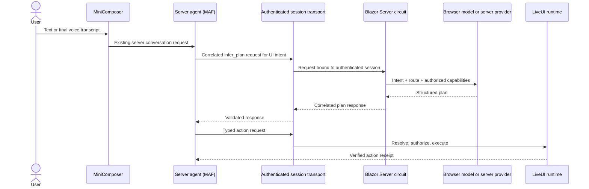

# OpenConnect LiveUI Specification

## Purpose and scope

LiveUI lets an OpenConnect agent inspect and interact with a host application's rendered interface through existing controls. The host application remains authoritative for navigation, component state, business data, and authorization. A model proposes a bounded action plan; the .NET runtime validates, authorizes, executes, and verifies each action.

The initial reusable integration is .NET and Blazor Server. The Todo sample demonstrates existing tabs, a search input, task list, navigation, and popup-free highlighting. The SDK does not replace application controls or require every element to be annotated. Other UI frameworks can implement the framework-neutral manifest, context, authorization, and runtime contracts without changing the action schema.

Requirements and journeys are maintained in [liveui-requirements.md](liveui-requirements.md). The server-orchestrated inference and optional CPU worker requirements are in [liveui-inference-requirements.md](liveui-inference-requirements.md).

## Package boundaries

| Package | Responsibility |
| --- | --- |
| `OpenConnect.LiveUI` | Versioned manifests, typed actions and receipts, configuration, validation, orchestration, hashing, and framework-neutral metrics. |
| `OpenConnect.LiveUI.Compiler` | Build-time Razor analysis and deterministic manifest generation. |
| `OpenConnect.LiveUI.Blazor` | Blazor Server registration, manifest loading, scoped context, JS interop, Prompt API provider, browser runtime, and speech/highlight coordination. |
| `OpenConnect.LiveUI.Agents` | Microsoft Agent Framework tools and authenticated connected-client request helpers. |
| `OpenConnect.LiveUI.Inference` | Structured inference contracts, provider routing, plan validation/mapping, private worker HTTP client, and the guarded chat-client adapter. |

The core LiveUI assembly has no Blazor, model, persistence, or browser dependency. The Blazor NuGet package carries the compiler and a `buildTransitive` target for Razor SDK consumers. The Todo sample retains an explicit source-project compiler integration for repository builds.

## Manifest generation and discovery

The Razor compiler runs during build and emits a deterministic JSON manifest with schema version `openconnect.liveui/v1`, build identifier, content hash, routes, and discovered targets. Target identifiers are derived from the Razor component and element structure; the same build produces stable identifiers. The compiler uses Razor parsing and component/tag metadata rather than treating arbitrary Razor files as plain HTML. Supported static patterns include route declarations, headings, buttons and links, common inputs and selection controls, tabs, lists, tables, and component relationships where those can be established from source.

The Blazor provider loads the embedded manifest and validates its schema and hash before use. Runtime discovery is an opt-in supplement for supported cases. A runtime match that is absent, stale, hidden, or ambiguous fails explicitly; the runtime does not select an arbitrary similar element. Dynamic route parameters, dynamically generated markup, opaque third-party controls, and data-dependent component structure may need a host adapter or may remain unsupported.

Sensitive controls are omitted or denied based on their input type and metadata. Passwords, payment data, credentials, and sensitive field values are not added to inference context or receipts. Only the current route and the minimum target/action capability pairs needed for a plan are sent to an inference provider; full DOM snapshots are not the default context.

## Request and action flow

MiniComposer remains the sole conversation entry point. LiveUI planning is an agent capability in the existing turn; it does not create another session or browser conversation. Ordinary questions remain on the normal server conversation path. UI navigation and explanation can use deterministic route/page/inspection tools and do not require a separate browser inference conversation.

Every client interaction carries a correlation ID and an expected response kind. The transport binds pending requests to the server-owned session and authenticated client, suppresses duplicate/conflicting responses, rejects stale or mismatched responses, and propagates cancellation. The Blazor provider also binds work to the originating `ComposerSession`; replacing that session cancels in-flight operations and suppresses stale receipts. The default broker uses an in-memory session store and is process-local; hosts deploying multiple Gateway instances must provide a shared broker/session implementation.

## Inference and fallback

The server agent initiates browser inference through the existing authenticated session transport. In Blazor Server, the .NET circuit invokes the browser-managed Chrome or Edge Prompt API through JS interop. The browser computes a plan but never executes it. Availability checks do not download a browser model; model initialization that requires a browser-managed download must be started from a user gesture. `BrowserOnly` limits provider selection to the browser.

For `BrowserFirst`, the configured order is browser, optional local CPU worker, then an explicitly registered host LLM provider. The default policy falls through on provider unavailability. Worker inference is disabled unless configured. The normal LLM adapter is available only when the host registers `AddFirewallGuardedLiveUIGatewayInference`; the adapter rejects an unguarded `IChatClient`. Cancellation, authorization failure, privacy denial, and tenant-policy violations stop provider fallback. A plan is accepted only after checking schema version, action count, target membership, action capability, and parameter bounds. A missing plan returns an inference error; the server conversation model may answer or ask for clarification, but the host must not claim an action occurred.

The optional `workers/liveui-inference` service is private to the Compose network and is called by the server-side .NET client. It has a versioned plan endpoint, bearer authentication, liveness/readiness separation, bounded concurrency, and constrained JSON output. Its initial Qwen3-0.6B Q4_K_M GGUF is pinned by repository revision and SHA-256 and stored on a persistent model volume. Model repository, revision, filename, checksum, and path can be changed by configuration without changing the SDK or action contract. The worker performs inference only; it has no browser, application database, tool, or authorization access.

## Validation, authorization, and execution

The inference plan schema identifies a schema version and an ordered list of actions. Plan validation checks each target and action against the server-supplied capability set. `LiveUIInferenceActionMapper` maps valid proposals into the existing typed `LiveUIAction` contract, including trusted session, route, manifest hash, and timeout context. No identity, target capability, or authorization decision supplied by the model is trusted.

`LiveUIOrchestrator` validates manifest freshness, route and target existence, action shape, capability, duplicate action IDs, and action bounds. It asks the host's `ILiveUIActionAuthorizer` for a decision before calling the runtime. The default Blazor authorizer denies actions. Hosts must bind decisions to authenticated principal, tenant, session, route, and application policy. Consequential writes require the host's explicit approval policy; read or highlight permission does not grant write authority.

The browser runtime resolves a compiled target, performs a typed operation on the existing DOM/control, waits for the relevant rerender or state condition, and returns a receipt. `Completed` requires an observed postcondition. A dispatch without a verified state is not success. Missing or ambiguous targets, stale manifests, denied actions, and unsupported operations return bounded errors or uncertain receipts without arbitrary script execution. Search and filtering set the existing control's value and verify the application's rendered result; LiveUI does not render a parallel filtered view.

Supported typed operations include internal route navigation, inspection, focus, scroll, highlight/clear-highlight, setting a permitted input value, selecting a tab or control, and waiting for a supported state. Navigation is constrained to host-approved manifest routes. Sensitive input entry is denied. Browser operations never invoke application services directly; the application's existing event handlers and state logic remain authoritative.

## Blazor and agent integration

Register `AddOpenConnectLiveUIBlazor` in the existing application and provide an `ILiveUIActionAuthorizer`. The adapter registers the manifest provider, browser runtime, server-side Prompt API provider, and MAF tool support. Agent tools expose current-page inspection, inference planning, navigation, inspect, execute, wait-for-state, highlight, and clear-highlight. The current page response contains only targets and routes the host authorizes for that session.

For the optional worker, configure the server-side endpoint and bearer token under the host's LiveUI inference worker settings and enable `Worker`. The sample Compose environment passes `LIVEUI_WORKER_TOKEN` only to the Todo server and worker containers; it is not embedded in browser assets. Register the guarded normal chat-client provider only in a host that already has an appropriate privacy-guarded model client. `BrowserOnly` disables worker and LLM provider selection.

The Todo acceptance policy illustrates exact target ID and target-kind checks for existing tabs, search input, list, and page regions. Application-specific policy belongs in the host, not the shared SDK. The Todo app keeps its existing MudBlazor controls and data logic.

## Speech, narration, and highlighting

Narration uses MiniComposer's existing response and speech services. LiveUI does not add a second TTS or voice pipeline. Speech-disabled mode, missing TTS, interruption, session replacement, cancellation, playback epoch changes, and browser disconnect must leave the UI actions usable and clear pending speech-linked cues safely.

When synchronization is enabled, agent highlight tools may bind a target to a zero-based UTF-16 character range in the following response. The Blazor provider observes actual audio playback segment events and switches highlights at matching segment boundaries. It clears partial multi-target highlighting if any requested cue fails. This is segment-level synchronization; it does not provide word-level alignment or prove that a model-selected target/range is semantically correct. Highlights are non-modal, preserve focus, respect reduced motion, and do not open Navigator tour dialogs.

## Configuration and extension points

Configuration is strongly typed through `LiveUIOptions` and `LiveUIInferenceOptions`. Safe defaults require plan validation, use browser-first inference, disable worker use, and fall through to an available registered guarded LLM only when local providers report unavailable. Hosts may disable all fallback with `BrowserOnly`, constrain the browser family, set a planning timeout/action limit, enable a worker, or register the guarded LLM provider. Model endpoints and credentials remain server-side.

React and other clients can implement the same versioned request, manifest, plan, and receipt contracts. They must preserve the same server-owned identity, session binding, plan validation, action authorization, and execution verification. The current runtime and compiler do not claim support for those frameworks.

## Observability and performance

The `OpenConnect.LiveUI` meter records manifest load, target resolution, target-resolution failures, browser action, action execution, confirmed state, and speech/highlight offset. Tags are limited to non-sensitive action type/outcome; metrics do not include user content, target IDs, labels, or session identifiers. Browser timing inputs are bounded and validated.

The implementation avoids full DOM extraction and reduces model context to the current intent, route, schema, and authorized capabilities. Deterministic routing may handle exact unambiguous common requests without generation. Performance benchmarks must identify browser/runtime, sample, timer precision, operation count, and measurement interval; a browser microbenchmark does not establish end-to-end agent/model latency or speech alignment.

## Verification status and limits

Focused .NET tests cover manifest/compiler behavior, plan validation and mapping, provider order and privacy denial, session-correlated dispatch, action authorization, receipts, cancellation, highlight lifecycle, transport response ownership, and same-turn continuation through the normal server conversation when browser and worker inference are unavailable. An opt-in .NET acceptance test calls a configured private worker through the production client and validates a model-backed plan. The connected Chromium suite exercises Todo journeys A through F, speech on/off, denied actions, TTS-unavailable fallback, and browser runtime measurements through the running Blazor sample. The optional worker tests exercise its API and constrained plan generation with a fake model; real browser Prompt API and external LLM tests remain environment-dependent.

Mocked or scripted provider runs do not prove that Chrome/Edge model weights are installed, that Prompt API inference works on a particular device, or that every host's privacy policy accepts an external LLM request. Those require a browser/device lane with an available model and a deployment-specific guarded provider. Word-level speech synchronization, broad third-party component support, distributed session broker behavior, and authorization through a real external-provider gateway remain outside the current verified evidence. Cross-tenant denial is covered by orchestrator tests for every action type and agent-tool tests for every typed operation, but that test coverage does not verify a production identity provider or gateway deployment. Treat the remaining items as explicit compatibility or acceptance work rather than implied guarantees.
