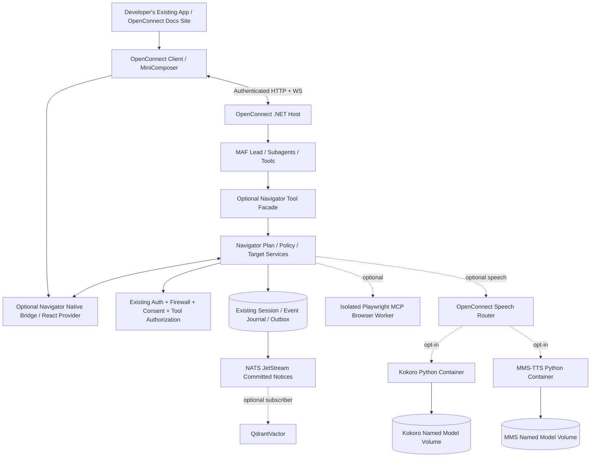
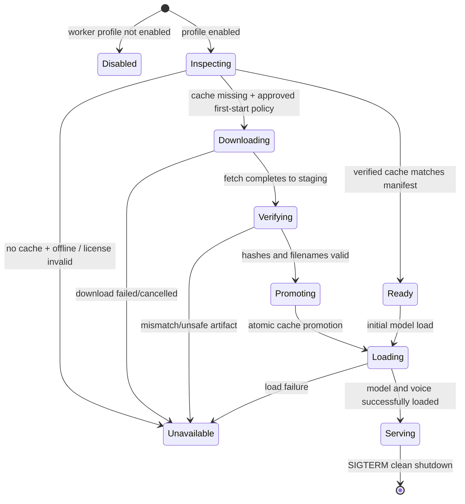

# OpenConnect.Navigator — Framework-Aligned End-to-End Technical Specification

**Version:** 2.0-draft · **Date:** 2026-11-07 · **Status:** Proposed implementation, not verified implementation  
**Companion:** `navigator-requirements.md` · **Reference platform:** OpenConnect `spec.md`, `implementation.md`, `checklist.md`, `configuration.md`, `firewall.md`  
**Intended readers:** Codex, Muse, DeepSeek and maintainers implementing NuGet/npm packages and optional Docker workers.

## 0. Execution contract for coding agents

1. Inspect existing OpenConnect public interfaces, `AddOpenConnect()`, `AddOpenConnectClient()`, `IOpenConnectComponent`, `IEventJournal`, committed event subscriptions, operational background agents and the worker protocol. Implement as extensions, not replacements; APIs here are proposed until real source confirms signatures.
2. Inspect `C:\DevOps\SwiftAidv2` **only if accessible on the implementation machine**; otherwise pin the equivalent `Vuminkosi/Swift-Aid` Git commit and audit the same files there. The source review for this document used the public GitHub Swift-Aid Python speech files. Do not claim local C: access was performed.
3. Keep existing model/tool auth, user-scoped interactive execution, workload-scoped operational execution, security firewall, NATS JetStream, session persistence and OpenTelemetry authoritative. Preserve strong enum-based options and validate them before host startup.
4. Prefer one cohesive implementation/task/PR with test evidence at a time. Record exact commands, results, source SHA, package metadata, license verdict and any discrepancy in an ADR/checklist. No placeholder packages without behavior or synthetic claims of real inference.
5. Do not silently change OpenConnect's common protocol from HTTP/WS + JetStream to a Navigator-only SignalR bus. Optional adapters must project onto common contracts.
6. The **minimum acceptance experience is text-only**: interactive agents and MCP work; Navigator can highlight/show tours; no TTS or Playwright model worker is installed. Voice and isolated browser automation are enhancements.

## 1. Architectural composition: where Navigator belongs



**Invariant:** disabling Navigator has no effect on lead-agent execution, MCP, provider routing, privacy, sessions or client streaming. Disabling Playwright or speech has no effect on Navigator text tours. QdrantVactor never gates task or presentation readiness.

### 1.1 Component ownership matrix

| Concern | Existing OpenConnect owner | Navigator-specific responsibility |
|---|---|---|
| Agent lifecycle/lead/subagents | MAF integration + OpenConnect.Agents | Scoped Navigator tools and typed step proposal only |
| Interactive identity | ASP.NET host auth + execution context | Live bridge pairing/command grants; no duplicated identity system |
| Operational identity | Existing operational agent background worker | Optional Navigator job handler + isolated browser lease |
| Tool discovery/permissions | OpenConnect tool catalog/broker | Navigator capability descriptors and explicit allowlist |
| UI capability metadata | `IOpenConnectComponent` / component registry | Target/route/tour descriptors projected through same discovery |
| MiniComposer | OpenConnect client | Suggestions to navigate/highlight; text tour opens alongside composer |
| Security/firewall | OpenConnect .NET gateway/security worker | Treat DOM/MCP/capture as untrusted, call existing policy gates |
| HTTP/WS task/events | OpenConnect gateway and client | Typed Navigator messages over common authenticated channel |
| Durable events | PostgreSQL journal + outbox + NATS | Navigator event types, subscribers; not global journal enumeration |
| Semantic vector projections | Optional QdrantVactor | Optional approved summaries; no Qdrant dependency |
| Speech routing | OpenConnect shared worker registry | Request narration by capability, sync playback to steps |
| Speech inference | Independent Python TTS worker images | No direct model/framework dependence in Navigator |
| Observability | Existing OpenTelemetry/Aspire adapters | Navigator-specific activities and safe metrics |

## 2. Packages and dependencies

Suggested modules; create actual package only when it has concrete implementation:

```text
src/
  OpenConnect.Navigator/                  # typed options, contracts, plan/policy/tour logic, DI
  OpenConnect.Navigator.AspNetCore/       # endpoint extension, authenticated WS message handlers
  OpenConnect.Navigator.Playwright/       # optional MCP allowlist adapter
  OpenConnect.Navigator.Blazor/           # optional renderer integration for existing client
  OpenConnect.Speech/                     # shared TTS routing contracts if not already present
  OpenConnect.Workers.Contracts/          # shared Python worker envelope/capability contracts
packages/
  navigator/                              # @openconnect/navigator (framework neutral, SSR-safe)
  navigator-react/                        # @openconnect/navigator-react (optional view adapter)
workers/
  common/                                 # shared Python auth, schema, readiness/provisioning
  kokoro/                                 # independent package/image/cache
  mms-tts/                                # independent package/image/cache
  navigator-playwright/                    # Node/Chromium isolated browser service, OPTIONAL
infra/
  compose.yaml                            # base host/NATS/Postgres; optional profiles
  model-manifests/{kokoro.json,mms-eng.json}
  scripts/                                 # model cache verification/provisioning tests
contracts/
  navigator/v1/{session,step,command,receipt,observation,speech}.schema.json
  workers/v1/{capability,model-manifest,speech-request,speech-chunk}.schema.json
examples/
  navigator-minimal-web/                  # sample integration only, not another product
  navigator-blazor/                       # optional example
```

**Dependencies:** Navigator.Core -> OpenConnect.Abstractions and policy/tool interfaces, never MudBlazor; Navigator.Blazor -> existing OpenConnect.Client/Components.Blazor; TS navigator -> `@openconnect/client` as peer dependency; React provider -> TS navigator as peer dependency. `OpenConnect.Speech` and model workers are optional. Core build MUST pass without package refs to Playwright, Python, Kokoro, MMS or Qdrant.

## 3. Strongly typed server configuration

### 3.1 Enums and options (proposed C# API)

```csharp
public enum NavigatorMode { Interactive, Operational, InteractiveAndOperational }
public enum NavigatorBrowserProvider { Disabled, PlaywrightMcp, Custom }
public enum NavigatorHighlightProvider { Native, Custom }
public enum NavigatorSpeechProvider { Disabled, Kokoro, MmsTts, Custom }
public enum NavigatorSpeechFallback { TextOnly, ExplicitAlternative }
public enum NavigatorCaptureMode { None, Semantic, Element, MaskedScreenshot, WorkflowEvents }
public enum NavigatorActionType { Observe, Explain, Highlight, Focus, Scroll, Navigate,
    Click, Fill, Select, Toggle, InvokeRegisteredAction, Capture, Speak }
public enum NavigatorActionRisk { ReadOnly, Navigation, Interaction, Mutation, Sensitive, Forbidden }
public enum NavigatorSessionState { Created, Pairing, Ready, Running, AwaitingApproval,
    Paused, Completing, Completed, Failed, Cancelled, Expired }
public enum SpeechModelProvisioning { Disabled, FirstStartIfMissing, VerifyExistingOnly }
public enum SpeechCacheFailurePolicy { FailWorker, ReprovisionApprovedManifest }

public sealed class NavigatorOptions
{
    public bool Enabled { get; set; } = true; // opt-in registration; absent package means disabled
    public NavigatorMode Mode { get; set; } = NavigatorMode.Interactive;
    public NavigatorBrowserOptions Browser { get; set; } = new();
    public NavigatorOnboardingOptions Onboarding { get; set; } = new();
    public NavigatorCaptureOptions Capture { get; set; } = new();
    public NavigatorSpeechOptions Speech { get; set; } = new();
    public NavigatorLimitsOptions Limits { get; set; } = new();
}
public sealed class NavigatorBrowserOptions
{
    public NavigatorBrowserProvider Provider { get; set; } = NavigatorBrowserProvider.Disabled;
    public Uri? WorkerEndpoint { get; set; }
    public string[] AllowedOrigins { get; set; } = [];
    public int MaxConcurrentBrowsers { get; set; } = 1;
}
public sealed class NavigatorOnboardingOptions
{
    public bool Enabled { get; set; } = true;
    public bool AllowDynamicTours { get; set; } = false;
    public NavigatorHighlightProvider Highlighter { get; set; } = NavigatorHighlightProvider.Native;
    public int MaxSteps { get; set; } = 25;
}
public sealed class NavigatorCaptureOptions
{
    public bool Enabled { get; set; } = false;
    public NavigatorCaptureMode[] AllowedModes { get; set; } = [NavigatorCaptureMode.Semantic];
    public TimeSpan ArtifactTtl { get; set; } = TimeSpan.FromHours(1);
}
public sealed class NavigatorSpeechOptions
{
    public bool Enabled { get; set; } = false;
    public NavigatorSpeechProvider PreferredProvider { get; set; } = NavigatorSpeechProvider.Kokoro;
    public NavigatorSpeechFallback Fallback { get; set; } = NavigatorSpeechFallback.TextOnly;
    public string DefaultVoice { get; set; } = "af_heart";
    public string DefaultLanguage { get; set; } = "en-US";
    public int MaxCharacters { get; set; } = 1500;
}
public sealed class NavigatorLimitsOptions
{
    public int MaxObservationNodes { get; set; } = 500;
    public int MaxObservationBytes { get; set; } = 65536;
    public int MaxPlanSteps { get; set; } = 25;
    public int MaxConcurrentMutationsPerSession { get; set; } = 1;
}
```

A false `Speech.Enabled` SHALL completely bypass worker discovery/connection. `Browser.Provider == Disabled` SHALL bypass Playwright. No options shall expose a working `AllowUnrestrictedEval=true` or `AllowOperationalUserImpersonation=true` escape hatch in v1. Mutations/capture cannot bypass policy via options.

### 3.2 Minimal .NET integration

```csharp
builder.Services.AddOpenConnect(options =>
{
    options.Privacy.Enabled = true; // inherited default
});

// Optional: navigator enriches existing agent tools/UI discovery.
builder.Services.AddOpenConnectNavigator(options =>
{
    options.Mode = NavigatorMode.Interactive;
    options.Onboarding.Enabled = true;
    options.Speech.Enabled = false;
    options.Browser.Provider = NavigatorBrowserProvider.Disabled;
    options.Capture.Enabled = false;
});

var app = builder.Build();
app.UseAuthentication();
app.UseAuthorization();
app.MapOpenConnect();
app.MapOpenConnectNavigator(); // optional, shares host authentication and event channel
```

### 3.3 Optional speech routing / worker registrations

```csharp
// Opt-in only where the developer has deployed the corresponding Docker worker.
builder.Services.AddOpenConnectSpeech(options =>
{
    options.Provider = SpeechProviderSelection.PreferredAvailable; // proposed enum
    options.UnavailableBehavior = SpeechUnavailableBehavior.TextOnly;
});
builder.Services.AddKokoroWorker(options =>
{
    options.Endpoint = new Uri("http://kokoro:8091");
    options.DefaultVoice = "af_heart";
});
builder.Services.AddMmsTtsWorker(options =>
{
    options.Endpoint = new Uri("http://mms-tts:8092");
});
```

Actual names must reuse existing worker routing APIs when present, not introduce duplicated workers framework. If neither speech adapter is registered, speech capabilities are unavailable and every text-oriented SDK API remains usable.

### 3.4 TS / React / Blazor composition

```typescript
import { createOpenConnectNavigator } from "@openconnect/navigator";
const navigator = createOpenConnectNavigator({
  client: openConnectClient, // already authenticated @openconnect/client
  speech: { enabled: false },
  capture: { enabled: false }
});
// Start only after authentication and browser hydration:
await navigator.start();
// Dispose on logout, user switch or unmount:
await navigator.dispose();
```

```tsx
<OpenConnectProvider client={client}>
  <OpenConnectNavigatorProvider navigator={navigator}>
    <ApplicationLayout />
    <MiniComposer />
  </OpenConnectNavigatorProvider>
</OpenConnectProvider>
```

*Composition above is conceptual: follow actual existing OpenConnectProvider API (Blazor uses `<OpenConnectProvider />` in its existing layout). The TS/React provider MUST NOT alter host MiniComposer registration or duplicate root providers.*

## 4. Functional contracts and UI capability discovery

### 4.1 Target descriptor

```json
{
  "schemaVersion": "openconnect.navigator.target/v1",
  "targetId": "docs.installation.copy",
  "componentId": "docs.installation",
  "componentVersion": 1,
  "label": "Copy install command",
  "description": "The installation command's copy control",
  "routeId": "docs.install",
  "allowedActions": ["observe", "highlight", "focus"],
  "requiredCapabilities": ["ui.navigator.guide"],
  "sensitivity": "public",
  "suggestions": [{"id": "show-install", "text": "Show me how to install"}]
}
```

The metadata MUST be compatible with `IOpenConnectComponent` registration. Component descriptor is discoverability, **not authorization**. A proposed action is checked against existing tenant, agent, principal, current route, host component policy and command grant, then host API if it affects server state.

### 4.2 Navigator tool facade

Proposed operations: `navigator.observe`, `navigator.find-target`, `navigator.highlight`, `navigator.start-tour`, `navigator.request-action`, `navigator.capture-request`, `navigator.speak`. Agent catalog grants only explicitly enabled operations; `navigator.speak` is absent when speech disabled, or returns capability unavailable with text fallback. Expose bounded user-scope capability maps through the existing tool broker. No raw `browser_*` MCP handles in model tools.

### 4.3 Semantic observation/target resolution

1. Client registers mounted target ID/element and current route; updates revision on DOM remount and route transition.
2. Agent asks for goal-relevant descriptors; server checks current scope and max result bound.
3. Client produces bounded visible semantic snapshot. Strip hidden, inputs, raw HTML/JS, credentials, page storage, inaccessible frames, unrelated content.
4. Route snapshot through configured firewall and policy to model. Treat UI content as untrusted data.
5. Resolve registered target first, then scoped accessible-role/name for explanation only. Do not best-guess mutating targets.
6. Before action, check element still mounted/actionable/visible, route/revision unchanged and grant valid.
7. Record receipt and postcondition; unknown mutation outcome gets `OutcomeUnknown` and user reconciliation.

### 4.4 Tour/command schemas

`NavigatorTour` = `{tourId, version, steps[], locale, scope, origin, maxDuration}`. Step union = `Explain|Navigate|Locate|Highlight|Focus|WaitFor|RequestApproval|Execute|Narrate|Capture|Complete`; dynamic proposal has source `Agent` and authorizing policy revision. Static/dynamic tours share validator and executor. Commands have `{commandId, navigatorSessionId, sequence, action, targetId, targetRevision, args, normalizedDigest, grant, expiresAt, preconditions, postconditions}`. Client may narrow a grant but never upgrade it. Persist before sending a mutating command. Never treat command ACK as action completion.

### 4.5 UX and accessibility

Native highlighter: fixed overlay, computed target bounding box, tooltip/sidebar, progress, Escape/Skip/Back/Next/Pause, focus restore, reduced-motion, RTL. MiniComposer remains the interaction entry; tours are rendered alongside or in an explicitly registered `IOpenConnectComponent` surface. Speech playback is optional; subtitles always present. Capture and mutation surfaces require separate prominent confirmation. No global CSS collisions.

## 5. Identity and operational/interactive execution

### 5.1 Interactive

- Use active `ClaimsPrincipal` and existing `AgentExecutionMode.Interactive` context; model cannot supply tenant or role.
- Bind bridge to a verified short-lived session challenge + client instance + origin + user; reauthenticate on reconnect and auth changes.
- Approvals are one-shot, exact payload-digest-bound and time-limited. An action still invokes the host API's own authorization.
- When browser not paired, return pause/unavailable and do not change app UI; text explanation can still complete.

### 5.2 Operational

- Existing OpenConnect operational `BackgroundService` / durable lease manager activates jobs under configured workload identity, not under a past user session.
- Navigator registers an *optional handler* that can run bounded tours in isolated Playwright MCP browser contexts. It does not create another scheduler or independent operational-agent mode.
- Job contains `tenantScope`, `servicePrincipalRef`, `planId`, `applicationAllowlist`, `executionId`, `deadline`, `idempotencyKey`, `policyRevision`. Host resolves identity and grants from trusted storage; job data alone cannot authenticate.
- Before job: lease/fencing, capability check, origin egress check; while running: timed steps, cancellation, limited MCP tools, lease renewal; after: sanitized receipts/checkpoints, cleanup profile/files, and no leaked credentials.
- Any uncertain write status is reconciled, never auto-replayed. Reviewable capture requires separate approval from source application/tenant and retention policy.

## 6. Transport and event integration

### 6.1 Shared transport, no duplicate bus

Existing client uses HTTP/HTTPS task APIs and WS/WSS event stream; reuse auth, reconnection and event cursor. Do not require SignalR for Navigator v2. If a host needs SignalR, implement adapter translating to the same protocol without new policy authority. The browser never connects to NATS. JetStream is used for *committed, sanitized* lifecycle events only. High-volume audio bytes flow over bounded authenticated private streams, not individual JetStream messages.

### 6.2 Event catalog

`navigator.session.created`, `navigator.session.started`, `navigator.tour.step.started`, `navigator.tour.step.completed`, `navigator.command.approval.requested`, `navigator.command.dispatched`, `navigator.command.completed`, `navigator.command.outcome_unknown`, `navigator.capture.consent`, `navigator.speech.requested`, `navigator.speech.playback.completed`, `navigator.session.completed`, `navigator.session.failed`. Events share OpenConnect `eventId`, `sessionId`, `taskId`, `executionId`, parent ID, tenant scope, type, version, per-session sequence, correlation, policy-safe payload. Raw DOM/screenshots/audio/PII must never be attached. Publish after DB commit through transactional outbox; JetStream consumer ACK is after durable outcome. Progress events that are ephemeral are marked non-durable and are not replayed as authoritative state.

### 6.3 Optional QdrantVactor

QdrantVactor can subscribe to *committed* events using the shared `IAgentEventSubscription` (or actual existing equivalent) but Navigator must not reference its assemblies. `IEventJournal` remains a session-scoped replay store and is not turned into global scanning API. A vector projection requires a separately authorized, sanitized text projection and a local/approved embedding provider; no embedding is part of `EventRecord`. Lifecycle or audio chunk events should not be embedded. Deletion/revocation propagate to derived vectors; indexing failure never blocks navigation.

## 7. Security, capture and approval boundary

| Input/action | Control |
|---|---|
| DOM/accessible text, MCP outputs | Untrusted, bounded, sanitized, firewall-checked |
| Browser command | Server schema, grant, tenant, route, risk, TTL, user/workload authorization |
| Navigation | Registered internal route/origin allowlist, redirect/DNS/IP egress controls |
| Mutation | Exact approval when needed, independent host resource reauthorization |
| Capture | Per-scope consent, client rasterized redaction where possible, server reinspection |
| Speech text | Local privacy policy, sanitized narration, no raw token vault access |
| Audio/DOM telemetry | Only safe metadata and timings, no raw content |
| Model/worker capability | Signed/scoped registration, health + actual installed model/voice |

Capture defaults disabled. Standard DOM APIs do not grant full screenshots. Use only a consented capture mechanism with demonstrated pixel redaction, or isolated Playwright in its own context. An HTML overlay is not adequate to redact captured pixels. Secrets/input values, hidden content and cross-origin inaccessible frames must be excluded or capture denied. Persist encrypted artifacts only with explicit purpose, user/tenant permission and TTL. Disabling the optional GLiNER/DeBERTa/Qwen3Guard detectors never bypasses deterministic schema, approval or tenant authorization.

## 8. Playwright MCP: optional browser adapter

### 8.1 Curated mapping

| Navigator command | MCP mapping (only when enabled) | Notes |
|---|---|---|
| Observe | `browser_snapshot` | Trim/label untrusted text |
| Navigate | `browser_navigate` | Validated destination/origin |
| Click | `browser_click` | Explicit target, risk review; never guess |
| Fill | `browser_type`/`browser_fill_form` | Deny credentials and private fields by default |
| Select | `browser_select_option` | Enumerated allowed options |
| Wait | `browser_wait_for` | Bounded time |
| Capture | `browser_take_screenshot` | Requires consent and approved redaction |
| Other MCP actions | Deny | Requires explicit future security review |

Never delegate `browser_evaluate`, unrestricted code execution, network/debug/storage/file tools to the model. Pin Playwright MCP version and Chromium build. Operational contexts must be isolated by job/tenant; enforce real network egress rules beyond Docker `internal` networking, block metadata/loopback/link-local/redirect/DNS rebinding, and provide CPU/memory/time limits. An MCP tool name supplied by a model is never used directly as a dispatch string.

## 9. Shared optional speech architecture

### 9.1 Provider-independent speech contract

The Navigator narration component invokes `ISpeechCapabilityRouter` (or repository's actual shared abstraction), which resolves `speech.synthesize` capability from healthy registered workers. It does not reference Python or specific model libraries. Provider selection is explicit; preferred Kokoro with `af_heart` if enabled, installed and suitable. MMS is a distinct worker and optional route, not a fallthrough from Kokoro by changing an environment variable. A capability response contains `{providerId, workerId, modelId, modelRevision, voiceId, languages[], formats[], sampleRates[], maxCharacters, concurrency, licenseStatus, readiness}`.

Request fields: `{requestId, tenantScopeRef, taskId, sessionId, turnId, narrationId, textReference or sanitizedText, locale, voiceId, requestedFormat, speechEpoch, deadline}`; the host performs authorization/sanitization before granting worker access. Response frames: `Started`, `AudioChunk(index, epoch, bytes, codec, sampleRate, channels)`, `Completed(duration, chunks)`, or typed `Error`. Binary chunks travel through authenticated stream; status metadata may be published as sanitized events. First emitted chunk can only play when it matches current speech epoch. A speech failure leaves tour state text-readable.

### 9.2 Separate Python workers

| Component | Kokoro | MMS-TTS |
|---|---|---|
| Directory | `workers/kokoro` | `workers/mms-tts` |
| Image | `ghcr.io/<owner>/openconnect-worker-kokoro` | `ghcr.io/<owner>/openconnect-worker-mms-tts` |
| Compose profile | `kokoro` | `mms-tts` |
| Private port (example) | 8091 | 8092 |
| Model volume | `oc_kokoro_models` | `oc_mms_models` |
| Default deployment | Not started | Not started |
| Default voice/language | `af_heart`, English after validated provisioning | Explicit pinned allowed language/voice |
| Model framework | Kokoro Python backend | MMS VITS/Transformers as pinned per checkpoint |
| Licensing | Kokoro model card Apache-2.0; audit deps/voices | Public MMS model cards CC BY-NC 4.0; commercial restrictions |
| Cache | Model + config + voices + linguistic assets | Checkpoint + tokenizer/config + selected language artifacts |
| Isolation | Non-root, model runtime offline | Non-root, model runtime offline |

Both can be independently started/stopped or scaled. Do not put Kokoro as English mode inside MMS worker and do not require MMS as Kokoro's base image. Share only generic model-download/lock/audit/health libraries if actually reusable.

### 9.3 Swift-Aid extraction map (observed source)

The public Swift-Aid repo currently contains `infra/ellai-tts/kokoro_voice.py` with `KokoroVoice`, pinned asset hashes, `af_heart` voice, 24kHz output, CPU runtime and offline inference behavior. Its `app.py` combines MMS/VITS loading and Kokoro selection in a single process. `voice_pool.py` manages profiles and locks; `audio_processing.py` optional clarity processing. `Dockerfile.kokoro` inherits a preexisting MMS runtime image and copies English assets from an independent image; `Dockerfile` is primarily an MMS base. This coupling must be **removed** for OpenConnect.

| Source (pin commit first) | Target | What to preserve / change |
|---|---|---|
| `infra/ellai-tts/kokoro_voice.py` | `workers/kokoro/src/openconnect_kokoro/engine.py` | Preserve pinned hashes, voice selection, bounded synthesis; generalize identity and remove hardcoded local asset-image requirement |
| `infra/ellai-tts/app.py` | Split provider-specific handlers | Extract MMS `VitsModel` loader to MMS only; Kokoro endpoints to Kokoro only; new shared worker v1 schemas |
| `infra/ellai-tts/voice_pool.py` | Shared abstraction or per-worker pool | Retain mutex/lock/cache behavior, no cross-worker model switching |
| `infra/ellai-tts/audio_processing.py` | Optional shared speech audio helper | Preserve sample rate and safety tests, do not falsely normalize native formats |
| `infra/ellai-tts/Dockerfile.kokoro` | `workers/kokoro/Dockerfile` | Replace dependent image layering with standalone locked build + first-run provisioner |
| `infra/ellai-tts/Dockerfile` | `workers/mms-tts/Dockerfile` | Remove Kokoro dependency and build independent VITS image |
| `infra/ellai-tts/pyproject.toml`, `uv.lock` | Per-worker pins/locks | Split dependency extras to reduce image size, Python 3.12 initially |
| `infra/ellai-tts/tests/*` | Each worker's tests | Preserve functional/quality fixtures where license and expected semantics permit; add provisioning tests |

The source path `C:\DevOps\SwiftAidv2` is user-provided and must be inspected by an implementing agent *on that machine*. This document did not access it. Review model/voice/dependency licenses and file notices before copying. Record `docs/migration/swiftaid-speech.csv` with pinned commit, source SHA/file, disposition, license, changed path, test mappings.

## 10. First-start model provisioning and persistent reuse

### 10.1 Lifecycle state machine



Only `Serving` is health `/ready` and advertises `speech.synthesize`. `health/live` only proves responsive process. Provisioning should be visible as a distinct status, not `ready`. A verified cache can be used offline after restart; the initializer MUST verify manifest/hash before model load. `docker compose down` preserves named volumes, while `down -v` deletes them and must be documented as destructive.

### 10.2 Pinned model manifests

A manifest is deployment-owned, versioned, hashed and allowlisted. Example (illustrative IDs/hashes MUST be populated with verified artifacts; do not use dummy digests for production):

```json
{
  "schemaVersion": "openconnect.speech.model/v1",
  "provider": "kokoro",
  "modelId": "hexgrad/Kokoro-82M",
  "revision": "PIN_EXACT_COMMIT_SHA",
  "licenseId": "Apache-2.0",
  "approvedForDeployment": true,
  "artifacts": [
    {"path": "kokoro-v1_0.pth", "sha256": "PIN_VERIFIED_SHA256", "sizeBytes": 0},
    {"path": "config.json", "sha256": "PIN_VERIFIED_SHA256", "sizeBytes": 0},
    {"path": "voices/af_heart.pt", "sha256": "PIN_VERIFIED_SHA256", "sizeBytes": 0}
  ],
  "maxDownloadBytes": 1073741824
}
```

Actual provisioning manifests MUST also enumerate tokenizer/linguistic dependencies (e.g. English language pack) and full file hashes, plus license notices. Artifacts whose digest/size is unknown MUST NOT be used for production. Source URL is never user-supplied on a speech request. Default model download mode is `FirstStartIfMissing` **only for explicitly enabled worker deployments**; `VerifyExistingOnly` supports strictly offline installations. `Disabled` means no downloading and no cache if not already populated.

### 10.3 Provisioning algorithm

1. Container starts with distinct runtime user, minimal secrets and writable mounted model volume. Entrypoint invokes shared `model-cache-provision` before serving. All network retrieval is restricted to preapproved model domain/repository and pinned revision; forbid HTTP redirects to arbitrary hosts or private/metadata IPs.
2. Check explicit `licenseAccepted`/`licensePolicy` and operator approval for selected manifest. MMS noncommercial terms require explicit eligible usage; a config bool does not create commercial licensing rights.
3. Lock per `(provider, modelId, revision)` using safe filesystem locking on the mounted volume, or a dedicated single-replica init container when shared filesystem locking is unreliable. Another replica waits or exits unready.
4. Resolve cache folder `/models/<model-id-safe>/<revision>/`, verify manifest signature/config provenance plus every artifact checksum, size, file mode and path containment. Reject symlinks, `../` and unsafe file extensions where possible. If valid, skip network entirely.
5. Otherwise, if provisioning not allowed or egress unavailable, return `model_unavailable`, do not start inference, and let Gateway mark speech unavailable without breaking core.
6. Download exact pinned artifacts into a separate `.staging/<random-id>/` within the same persistent filesystem; enforce total bytes, timeout, retries and separate cache free-space budget. Never overwrite active verified cache in place.
7. Hash-check all bytes and verify model config/revision/expected voice and tokenizer IDs. Fetch/record license notices. Perform optional local safe-format/model load validation before promotion. Do not load arbitrary untrusted pickled weights without reviewing their format/provenance.
8. Atomically rename validated directory into revisioned cache and write/rename a small verified manifest marker last. `fsync` as appropriate for crash consistency. Previous revision remains intact for rollback.
9. Drop write access or use read-only runtime mount where practical; run model in network-disabled/offline mode (`HF_HUB_OFFLINE=1`, `TRANSFORMERS_OFFLINE=1`) with `local_files_only=True` when supported. Model and voice load from validated local paths only.
10. Report model readiness with exact manifest/revision/checksum. On SIGTERM, stop new calls, complete/cancel outstanding within timeout and release locks. Never delete verified volume on normal shutdown.

**Security nuance:** a writable model cache and model artifact downloads are a supply-chain boundary. Hash pinning is a necessary check, not automatic assurance that arbitrary Python checkpoints are safe. Prefer safetensors or validated reviewed artifacts and isolated provisioner privileges.

### 10.4 Configuration environment (example)

```text
OC_SPEECH_MODEL_PROVISIONING=FirstStartIfMissing
OC_SPEECH_MODELS_ROOT=/models
OC_SPEECH_MANIFEST=/etc/openconnect/models/kokoro.json
OC_SPEECH_LICENSE_POLICY=ExplicitApprovedManifest
OC_SPEECH_DOWNLOAD_TIMEOUT_SECONDS=600
OC_SPEECH_CACHE_MAX_BYTES=2147483648
OC_SPEECH_MODEL_NETWORK=ProvisioningOnly
OC_SPEECH_RUNTIME_OFFLINE=true
```

Environment values are deployment config bound into Pydantic enums, not unvalidated free-text switches. Production secrets and HF tokens come from the host's approved secret provider/secret mount; never bake in Docker layers or commit Compose secrets.

### 10.5 Failure handling

| Failure | Worker behavior | Navigator/Core behavior |
|---|---|---|
| Worker profile absent | No process/capability | Text tour and normal MCP/agent tasks |
| Internet down + verified volume | Load cache offline | Speech works; no download |
| Internet down + empty volume | Worker `unavailable` | Text-only |
| Wrong manifest SHA | Reject cache/download | Text-only, security event |
| Partial `.staging` on crash | Safe cleanup/retry; do not promote | Text-only until ready |
| License unapproved | Deny provisioning/model load | Text-only; do not silently fallback to MMS |
| Worker killed during synthesis | Cancel audio epoch | Preserve step/tour progress |
| Wrong voice or language | Typed unsupported error | Display text, optional explicit alternative |
| Full disk | Bounded failure, no destructive removal | Text-only, operator alert |
| Model revision updated | New versioned cache, checksum verify; old cache retained | Switch only on readiness/approved config |
| Multiple replicas startup | Per-model exclusive lock / init job | No partial model reads |

## 11. Docker Compose: distinct optional profiles

The following is a **design sample**, not a verified runnable YAML file against the current OpenConnect repo. Pin actual image digests, port conventions, model manifests and validated environment variables during implementation.

```yaml
services:
  # Host, PostgreSQL and NATS are defined in OpenConnect's existing base Compose.
  # These two speech services do not start without the relevant --profile.
  kokoro:
    profiles: [kokoro]
    image: ghcr.io/OWNER/openconnect-worker-kokoro:${OC_VERSION:-dev}
    build:
      context: ../workers/kokoro
    environment:
      OC_SPEECH_MODEL_PROVISIONING: FirstStartIfMissing
      OC_SPEECH_MANIFEST: /etc/openconnect/models/kokoro.json
      OC_SPEECH_MODELS_ROOT: /models
      OC_SPEECH_RUNTIME_OFFLINE: "true"
    volumes:
      - oc_kokoro_models:/models
      - ./model-manifests/kokoro.json:/etc/openconnect/models/kokoro.json:ro
    expose: ["8091"]
    networks: [speech-private, model-provisioning]
    security_opt: ["no-new-privileges:true"]
    restart: unless-stopped

  mms-tts:
    profiles: [mms-tts]
    image: ghcr.io/OWNER/openconnect-worker-mms-tts:${OC_VERSION:-dev}
    build:
      context: ../workers/mms-tts
    environment:
      OC_SPEECH_MODEL_PROVISIONING: FirstStartIfMissing
      OC_SPEECH_MANIFEST: /etc/openconnect/models/mms.json
      OC_SPEECH_MODELS_ROOT: /models
      OC_SPEECH_RUNTIME_OFFLINE: "true"
    volumes:
      - oc_mms_models:/models
      - ./model-manifests/mms.json:/etc/openconnect/models/mms.json:ro
    expose: ["8092"]
    networks: [speech-private, model-provisioning]
    security_opt: ["no-new-privileges:true"]
    restart: unless-stopped

networks:
  speech-private:
    internal: true
  model-provisioning: {} # network membership alone is NOT egress security
volumes:
  oc_kokoro_models: {}
  oc_mms_models: {}
```

**Critical Compose implementation caveats:** `model-provisioning` network membership alone does not limit outbound sites; enforce a real egress proxy/NetworkPolicy and disable inference-stage network access using an init-service-to-runtime split or equivalent enforceable controls. `OC_SPEECH_RUNTIME_OFFLINE=true` must not prevent *approved provisioner* downloads, and is not itself a network firewall. Use model init containers or entrypoint provisioning, then a read-only cache mount for final inference where possible. Do not declare cache volume read-only on a process expected to download into it. Compose `profiles` are opt-in; the base host must neither `depends_on` nor await `kokoro`/`mms-tts` by default. Worker healthchecks `/health/live` and `/health/ready` must be wired after implementation, not assumed. CPU/GPU-specific images/limits are optional and separately benchmarked.

### 11.1 Recommended two-stage production variant

**Kokoro:** `kokoro-model-init` runs once in profile `kokoro`, with network access and writable volume; `kokoro` runs network-restricted with same volume mounted read-only. **MMS:** independent `mms-model-init` and `mms-tts`, separate language manifests/volumes. If operational constraints require one-container bootstrap, restrict network at infrastructure level after provisioning and document the weaker isolation. In all cases repeat starts must consult verified cached assets before requesting network access.

### 11.2 Deployment commands

```bash
# Core + Navigator without optional workers (existing app works text-only)
docker compose -f infra/compose.yaml up -d nats postgres openconnect-host

# Enable only Kokoro English narration; first run provisions approved model
docker compose -f infra/compose.yaml --profile kokoro up -d kokoro

# Independently enable only selected MMS language(s)
docker compose -f infra/compose.yaml --profile mms-tts up -d mms-tts

# Offline reuse check: block model-host egress, recreate (not down -v)
docker compose -f infra/compose.yaml --profile kokoro up -d --force-recreate kokoro
```

Commands are examples; adapt actual Compose service names and startup initializer design. Production deployment instructions must explain model license consent, hashes, required disk/memory, cold-start time, volume backup, offline startup, upgrade and cache cleanup.

## 12. Python worker protocol, models and runtime

### 12.1 Shared lightweight library

Use `workers/common` for Pydantic v2 contracts, work identity, machine authentication, safe error codes, health, model manifest reading, SHA verification, atomic provisioning helpers, metrics and cancellation. No database credentials. Python 3.12 initially for Swift-Aid compatibility, `uv.lock` committed, optional CPU/GPU dependencies isolated; `uv sync --locked` in CI and Docker. Do not force Triton/CUDA/large Torch wheels into base OpenConnect host or TS packages.

### 12.2 HTTP endpoints (private only)

- `GET /health/live`: process alive, even while model provisioning.
- `GET /health/ready`: 200 only after verified model and worker loaded; 503 for provisioning/corrupt/missing/license denied.
- `GET /v1/capabilities`: authenticated model/voice/language/format/status, versioned schema.
- `POST /v1/speech/synthesize`: authenticated bounded sanitized text (or authorized transient reference), typed request/response; streaming audio frames with metadata.
- `POST /v1/speech/{requestId}/cancel`: cancel best effort; host/client speech epoch always authoritative for stale chunk rejection.

For durable background synthesis, reuse existing OpenConnect worker lease/claim/commit protocol with JetStream opaque notice + authorized payload retrieval + ACK after committed host outcome. For immediate interactive speech, private authenticated streaming HTTP can bypass JetStream per-frame while delivering sanitized lifecycle events into the existing journal. Do not force a blocking JetStream round trip for every low-latency audio frame.

### 12.3 Model/resource policy

Kokoro `af_heart` is preferred for English only when installed and healthy. MMS requires explicit allowed language list and license review; language codes must be cross-checked against pinned checkpoint. Both workers support capped characters/audio seconds, one or few concurrent inference calls per CPU, queue boundedness, cancellation, backpressure, sample-rate validation and no hallucinated audio success. Output sample rate must come from actual model. Return safe error codes `speech_model_unavailable`, `speech_license_denied`, `speech_voice_unsupported`, `speech_capacity`, `speech_cancelled`, `speech_invalid_audio`, `speech_model_hash_mismatch`.

## 13. Persistence, command state and recovery

Use existing OpenConnect stores/transactional outbox; add Navigator-specific entities only where necessary: `navigator_sessions`, `navigator_plans`, `navigator_commands`, `navigator_receipts`, `navigator_consents`, `navigator_captures` (metadata), `navigator_tour_progress`. Tenant + principal/workload scoped rows, expected-version CAS, per-session sequence, command idempotency and expiry. Persist minimized structured tour/commands, not raw DOM or hidden form content. Audio caches disabled for personal narration by default. Retention/deletion cascade from owning session to captures and derived optional Qdrant vectors. Browser contexts ephemeral. Unknown write outcome must remain explicit until externally reconciled.

## 14. Telemetry, health and cost

Use existing OpenTelemetry/Aspire optionally, with `OpenConnect.Navigator` span source and speech worker spans correlated through existing trace context. Metrics: navigator sessions/steps/denials/approval waits, bridge reconnect, browser executions, cache hits/misses/download bytes/verified failures, Kokoro/MMS cold start, speech first audio time, synthesis duration/chunk count, active model memory, fallback count. Log only model IDs/revisions, safe bounded error codes, coarse tenant-safe metadata; never prompt/DOM/PII/audio bytes, vault keys or source secret URLs. Distinguish provider billed token cost from estimated local inference cost. A missing optional worker is a capability health issue, not gateway global-down status.

## 15. Verification plan and acceptance evidence

### 15.1 Test pyramid

- **C# unit:** DI option validation, tool grants, identity mode separation, risk policy, tour state/step validator, action/receipt idempotency.
- **C# integration:** current host authentication, actual MAF lead/subagent delegation to Navigator tool, persisted events/outbox/WS replay; no duplicate event bus.
- **TS/React:** safe SSR imports, bridge pairing, target registry, accessible tours/highlight, first render with MiniComposer, unmount cleanup, auth revoke.
- **MCP:** pinned Playwright MCP integration, denied raw tool names, disallowed origins/SSRF/rebinding, session/profile isolation, uncertain mutation recovery.
- **Worker fake-model CI:** schemas, SHA cache checks, first-run manifest policy, licenses, lock race, interrupted downloads, atomic promote, expiry, no-network reuse, speech fallback; no large model download in PR CI.
- **Real Kokoro manual/nightly:** exact model/voice checksums and licensed linguistic assets; play real audio on declared CPU; verify first start and restart offline.
- **Real MMS manual/nightly:** explicitly licensed language checkpoint, checksum, actual inference, invalid language reject, model cache offline replay, CPU/GPU only where tested.
- **Deployment E2E:** Compose with core only, Navigator alone, Kokoro-only, MMS-only, both, no worker; forced failure in each case demonstrates interactive/MCP uninterrupted.
- **Supply-chain:** dependency scan, model notices and licensed artifacts, GHCR SBOM/signing, immutable image digests; NuGet/npm clean consumers.

### 15.2 Traceability table

| Requirement group | Implementation work package | Acceptance IDs |
|---|---|---|
| Product fit/optional dependencies | NAV-IMP-001–003 | NAV-AT-001,002,009,017,024 |
| Identity and two agent modes | NAV-IMP-004–005 | NAV-AT-003,004,006 |
| Native bridge, UI targets, tours | NAV-IMP-006–008 | NAV-AT-002,005,007 |
| Event/transport, Qdrant optionality | NAV-IMP-009 | NAV-AT-008,024 |
| Browser MCP/operational job | NAV-IMP-010–011 | NAV-AT-009,023 |
| Speech contracts/router | NAV-IMP-012 | NAV-AT-017–019 |
| Source audit and independent Python workers | NAV-IMP-013–015 | NAV-AT-011–014,022 |
| Model provisioning and volumes | NAV-IMP-016–017 | NAV-AT-011–016 |
| Capture/privacy integration | NAV-IMP-018 | NAV-AT-010,021 |
| CI/release, docs site proof | NAV-IMP-019–020 | NAV-AT-020–022 |

### 15.3 Implementation order for coding agents

**NAV-IMP-001:** Inspect current OpenConnect packages and contracts; write compatibility ledger, no speculative duplicate services.  
**NAV-IMP-002:** Establish new `navigator/v1` JSON schemas, options and golden C#/TS fixtures.  
**NAV-IMP-003:** DI registration + capability registration; prove host/core/MCP works with all Navigator providers absent.  
**NAV-IMP-004:** Interactive context/pairing/grant/authorization through shared tool broker, negative auth tests.  
**NAV-IMP-005:** Operational handler on existing BackgroundService, leases and workload identity; avoid a second scheduler.  
**NAV-IMP-006:** Framework-neutral TS native bridge, route/target registry, sanitized observations and command receipt protocol.  
**NAV-IMP-007:** React provider (optional Blazor adapter) and `IOpenConnectComponent` integration, highlighter and MiniComposer compatibility.  
**NAV-IMP-008:** Static/dynamic tours with versioning, re-resolve/pause, approvals and accessibility tests.  
**NAV-IMP-009:** Committed event journal/outbox/JetStream projection and WS notification mapping; optional Qdrant listener unaffected.  
**NAV-IMP-010:** Curated Playwright MCP facade, deny dangerous tools, enforce origin/egress isolation.  
**NAV-IMP-011:** Operational isolated browser job, leases, cleanup, durable status and safe unknown-action recovery.  
**NAV-IMP-012:** Shared TTS capability router/protocol, client audio playback, epoch and text fallback.  
**NAV-IMP-013:** Pin local Swift-Aid source commit; audit/attribute Kokoro/MMS source/tests/dependencies/licenses.  
**NAV-IMP-014:** Extract independent `workers/kokoro` Python project/image with voices/config/linguistic artifacts and fake/real tests.  
**NAV-IMP-015:** Extract independent `workers/mms-tts` Python project/image with pinned language profiles, noncommercial license gate and tests.  
**NAV-IMP-016:** Build shared verified first-run model provisioner (approved manifest, SHA, safe download, lock, staged atomically promoted cache).  
**NAV-IMP-017:** Build Compose profiles and named volumes; test offline reuse, eviction/revision changes, SIGTERM and no-worker mode.  
**NAV-IMP-018:** Consent/redaction/capture with host firewall, safe storage, retention deletion and attacks.  
**NAV-IMP-019:** GitHub Actions .NET/npm/Python matrix, contract/consumer tests, image build/scan/SBOM, gated model integration.  
**NAV-IMP-020:** Versioned NuGet/npm/GHCR releases, docs quickstarts, real site assistant dogfooding, verification and rollback instructions.

Each task definition of done: implementation + focused passing tests + security negatives + docs + traceability in `checklist.md` + an exact evidence record (commands, hardware, environment, model SHA, CI link). If the main checklist is not modified in the same PR, link a Navigator task-specific checklist; do not mark future capabilities complete.

### 15.4 CI and release policy

PR workflow: `dotnet restore --locked-mode`/format/build/test; TypeScript `npm ci`, lint/typecheck/test/build/pack; Python each worker `uv sync --locked`, Ruff/mypy/pytest; OpenAPI/JSON schema parity, security checks and package consumers. No GPU or model download required in PR. Scheduled/manual gated jobs exercise real first-run model acquisition with explicit license approval, offline cache reuse and audio playback. Release tagged artifacts: `OpenConnect.Navigator*` on NuGet, `@openconnect/navigator*` on npm and separate `ghcr.io/<owner>/openconnect-worker-kokoro`/`...mms-tts` on GHCR; immutable digests, provenance, SBOM/license manifest and clean external consumer smoke. Follow existing OpenConnect protected/OIDC release workflows rather than inventing a second release system. Never ship unlicensed MMS models or duplicate recompiled artifacts on publish.

## 16. Release gates and exclusions

**Core Navigator stable gate:** NAV-AT-001–010,017,019,021,024 plus relevant auth/CI tests. Kokoro and MMS can remain experimental/absent without preventing the core Navigator release. **Kokoro stable gate:** NAV-AT-011,012,015,016,018,020,022 with actual pinned model run. **MMS stable gate:** NAV-AT-013–016,018,020,022 with actual permissible license and model run. **Operational Playwright stable gate:** NAV-AT-004,009,023 and browser security suite. Any failed capability is advertised unavailable/experimental; do not silently rebrand a worker as stable.

## 17. References and verified limits

- Swift-Aid source: https://github.com/Vuminkosi/Swift-Aid — public `infra/ellai-tts` contains Python Kokoro/MMS code in a shared service; proposed split is **new engineering work**, not current source behavior.
- Kotlin/Android and SwiftAid business application logic are not part of Navigator extraction.
- `hexgrad/Kokoro-82M`: https://huggingface.co/hexgrad/Kokoro-82M — model card lists Apache-2.0, voice `af_heart` available in Swift-Aid source; verify every deployed artifact/voice/dependency separately.
- `facebook/mms-tts`: https://huggingface.co/facebook/mms-tts — model card lists CC BY-NC 4.0; license review blocks unrestricted commercial deployment.
- Playwright MCP: https://github.com/microsoft/playwright-mcp — optional isolated-browser integration, not an agent authorization boundary.
- MAF: https://learn.microsoft.com/en-us/agent-framework/overview/
- NATS JetStream: https://docs.nats.io/nats-concepts/jetstream
- OpenTelemetry: https://opentelemetry.io/docs/

**Implementation note:** No public code snippet in this draft is claimed compiled, no Docker sample is claimed deployed, and no model is claimed downloaded/tested in this OpenConnect architecture. Apply and verify against actual repository source and environment.
