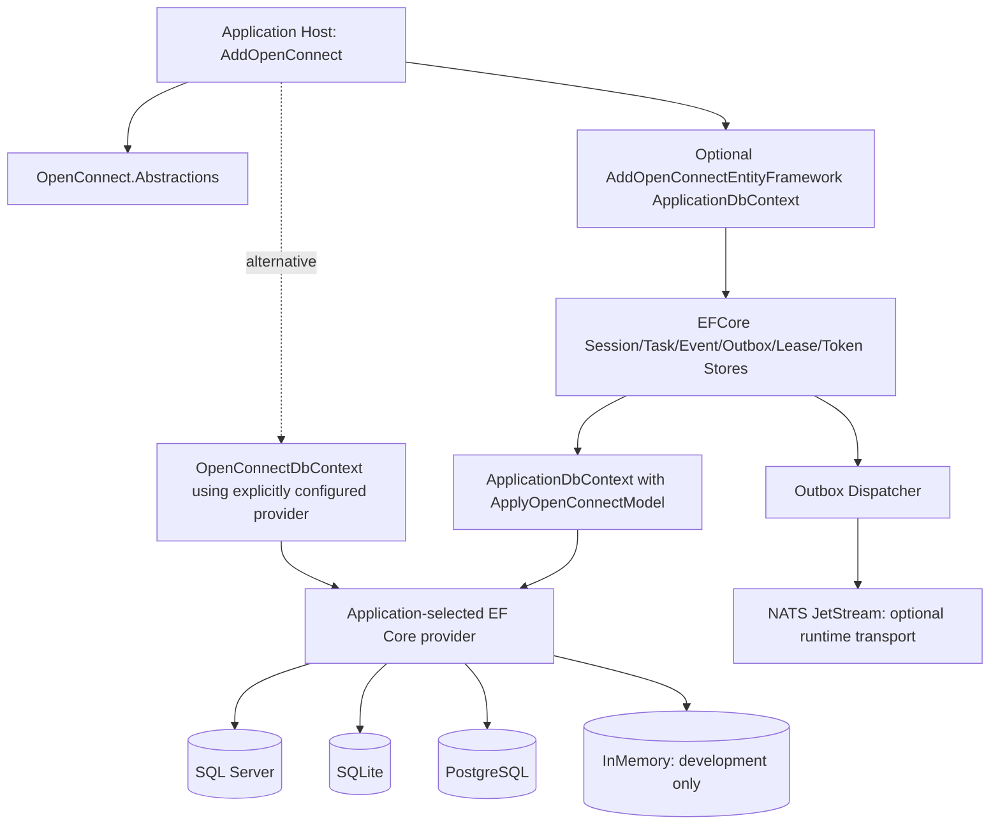
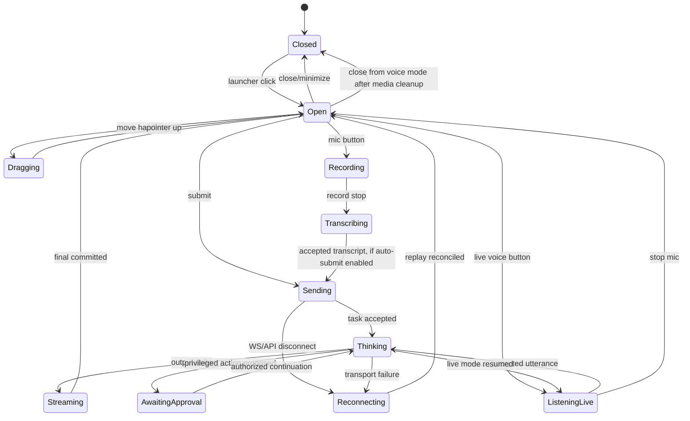
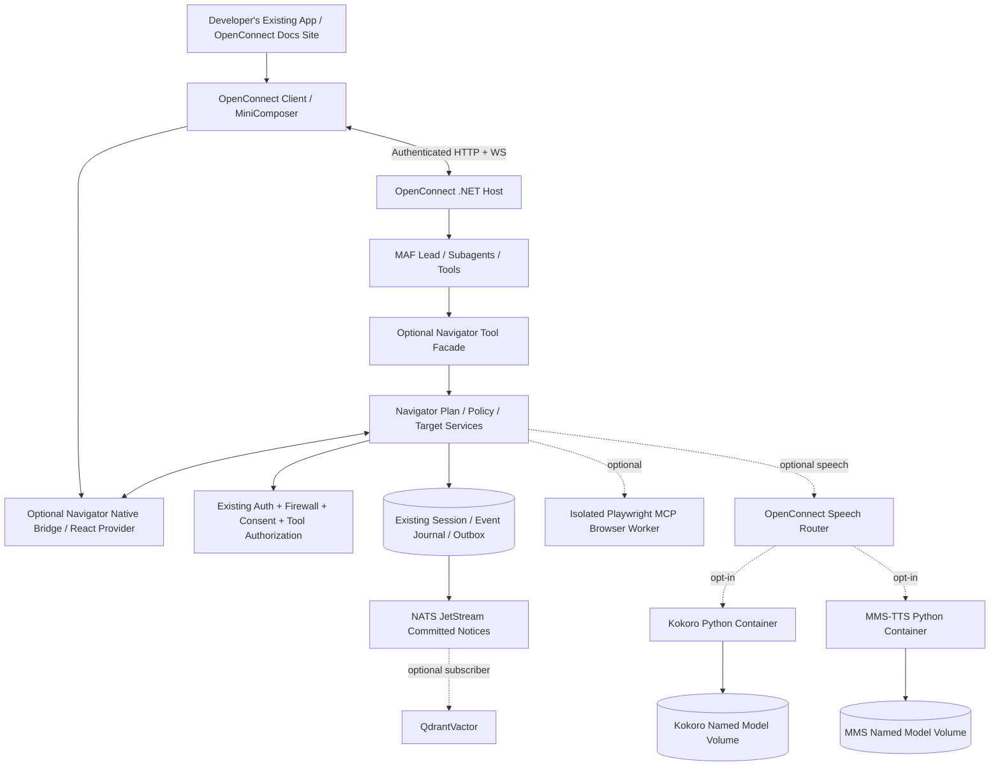
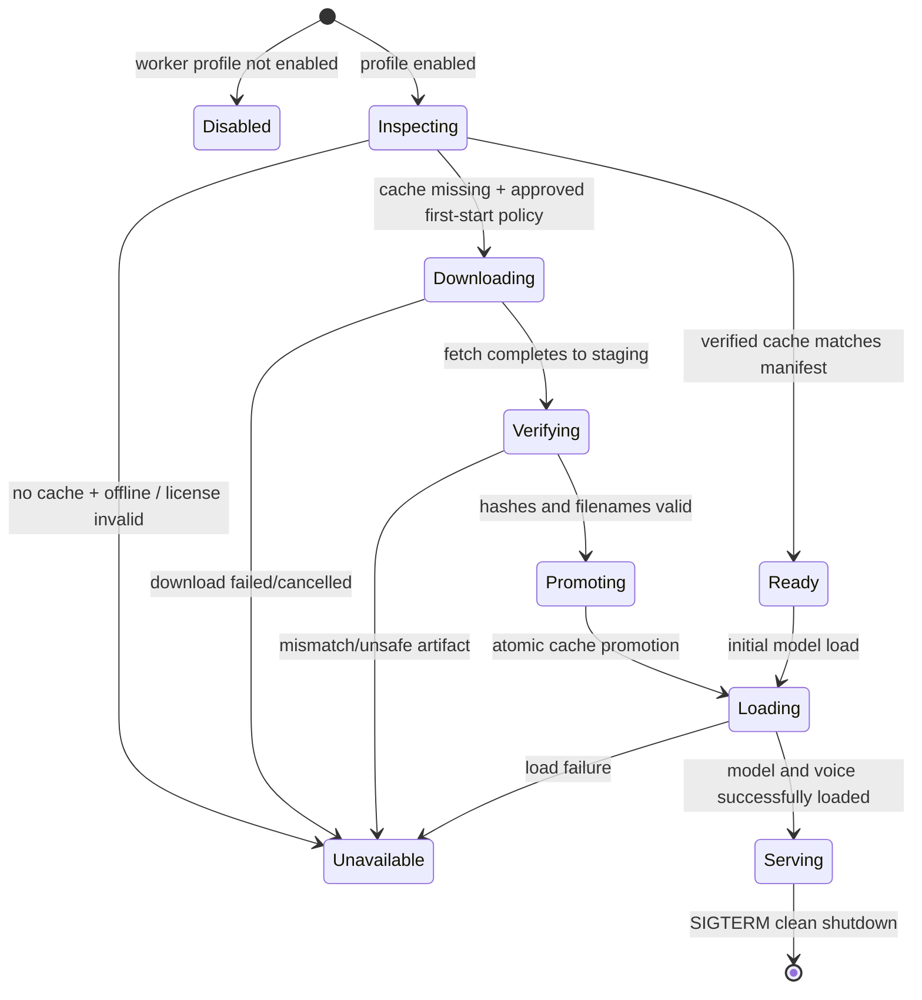
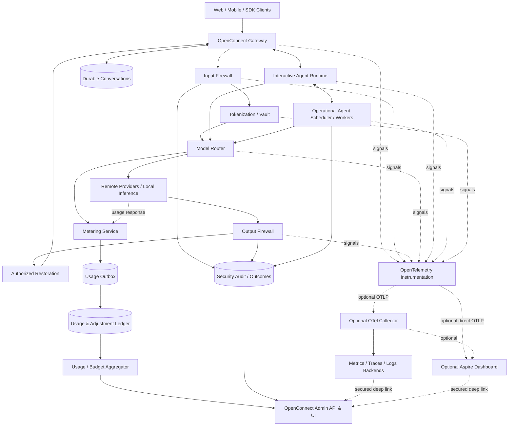
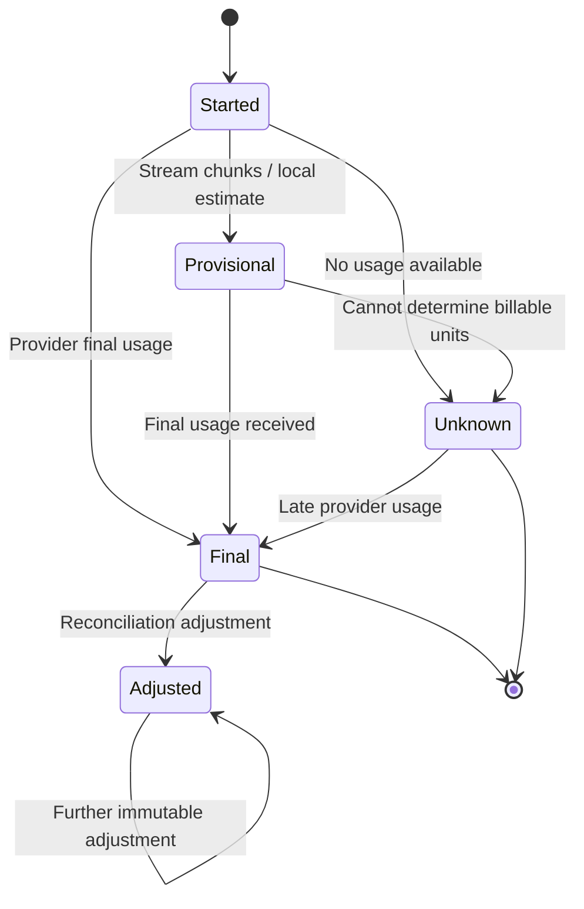
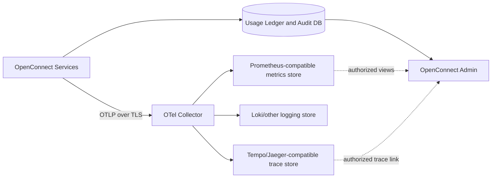

# OpenConnect — Unified End-to-End Technical Specification and Implementation Plan

**Document:** `spec.md` · **Baseline:** 2026-11-07 · **Status:** Proposed normative implementation specification  
**Companions:** [`requirements.md`](./requirements.md), [`checklist.md`](./checklist.md).  
**Implementation philosophy:** preserve full functional scope, use small testable PRs and independent optional extension packages; do not confuse plans with implemented or released code.

## 0. Authority and traceability

`requirements.md` canonical §§0–6 is the product contract. This document canonical §§0–21 defines the implementation contract. `checklist.md` schedules implementation and records evidence. The preserved source specifications in this document's Part II remain detailed work items, **subject to the explicitly reconciled choices below**. A developer/agent MUST inspect actual source, pinned Microsoft Agent Framework/EF/MudBlazor version, and compilation tests before adapting any sample signature. When original documents conflict, retain required behavior and adjust obsolete dependency/API assumptions rather than dropping functionality.

## 1. Reference architecture and runtime graph

```text
Existing Developer Product (Blazor / browser JS/React / Node headless)
  ├─ OpenConnect.Client / @openconnect/client  [authenticated HTTP(S) + WS(S)]
  ├─ OpenConnectProvider -> MiniComposer [tiny FAB + anchored bubble]
  ├─ IOpenConnectComponent discovery/suggestions/allowlisted renderers
  └─ Optional Navigator native bridge / highlighter / consented capture
                         │
ASP.NET Core: AddOpenConnect() / MapOpenConnect()
  ├─ Authentication, tenant, scoped user/workload context, authorization
  ├─ MAF lead agent, subagent registry, workflows, tool/MCP broker, runtime.md
  ├─ OpenConnect.Privacy: input/output/tool/worker egress gates
  │    ├─ optional Python Security Worker: rules (baseline), opt-in GLiNER,
  │    │    DeBERTa, Qwen3Guard, PaddleOCR, YuNet
  │    └─ encrypted, per-scope token vault + optional Infisical key wrapping
  ├─ Capability registry, model routing, speech adapters
  ├─ IEventJournal + durable session/task/turn + EF transaction/outbox
  │    └─ OpenConnect.Persistence.EFCore (optional adapter; app provider)
  │          SQL Server | SQLite | PostgreSQL | EF InMemory [dev only]
  ├─ OperationalAgentSupervisor : BackgroundService (workload identity)
  ├─ Shared NATS JetStream transport (configured durable distributed mode)
  │    ├─ sanitized committed agent/worker/run events, durable consumers
  │    └─ optional QdrantVactor subscriber (local/approved embeddings)
  ├─ OpenTelemetry primitives; optional OTLP/Aspire/Admin API & UI
  └─ Optional docs read-only assistant tools
                         │
Opt-in Python Docker workers (independently deployed)
  security | classification | nllb | inference | transcription |
  realtime-voice | kokoro | mms-tts
  (health/ready; pinned models; explicit permissions; persistent model cache)
                         │
Official OpenConnect documentation website (Astro Starlight, static-first)
  optional OpenConnect docs API + docs-grounded interactive assistant
```

**No dependency inversion violations:** Abstractions must not reference EF Core, MudBlazor, Python, Qdrant, Infisical, Aspire, NATS or browser DOM. The ASP.NET host composes optional adapters. Python worker packages do not reference application auth databases or .NET privacy vault keys. The website does not define its own agent/session framework. Node SDK remains DOM-free.

## 2. Package ownership and dependency table

| Artifact / module | Responsibility | Dependency constraint |
|---|---|---|
| `OpenConnect.Abstractions` | IDs, event/schema DTOs, persistence/agent/capability/tool/privacy interfaces | Zero concrete hosting/database/model packages |
| `OpenConnect.Core`, `OpenConnect.Agents`, `OpenConnect.Tools` | default lead, MAF adapter, user/workload context, allowlisted tools/MCP | MAF supported API, no new orchestration engine |
| `OpenConnect.Hosting.AspNetCore` | authenticated task, session, event, operational and optional feature endpoints | Does not require chosen EF provider or UI |
| `OpenConnect.Privacy` | host policy, egress interlock, tokenizer, AES-GCM vault and authorized restorer | Python worker optional deployment; no plaintext in NATS |
| `OpenConnect.Persistence.EFCore` | EF entities, mapping, stores, transactions, outbox, lease dialects | No SQLServer/SQLite/Npgsql/InMemory provider packages transitively |
| `OpenConnect.Transport.Nats` | JetStream outbox publisher and committed event subscriptions | Broker internal; never browser-facing |
| `OpenConnect.Client`, `OpenConnect.Components.Contracts` | typed .NET task client, component metadata | No MudBlazor in contracts |
| `OpenConnect.Components.Blazor` | `OpenConnectProvider`, `MiniComposer` and safe renderers | MudBlazor adapter; style isolation |
| `@openconnect/client` | typed ESM/Node/browser API/WS client | No DOM import required for Node |
| `@openconnect/composer` | framework-neutral compact bubble + FAB DOM renderer | SSR-safe import; depend on existing client |
| `@openconnect/react` | optional React wrappers | No duplicate core client/session |
| `OpenConnect.Navigator*`, `@openconnect/navigator*` | semantic UI, tours and optional Playwright actions | Opt-in; no private agent or task bus |
| `OpenConnect.Speech` and adapters | typed TTS/STT/router metadata and safe audio streams | Optional workers; text fallback |
| `OpenConnect.QdrantVactor` | optional committed-event projection, embeddings, search | Never required or raw event journal scans |
| `OpenConnect.Cryptography.Infisical` | optional key-wrap/unwrap provider | Does not own token values or restoration policy |
| `OpenConnect.Observability*`, `OpenConnect.Metering*` | OTel instrumentation, durable usage/accounting, optional exporters | No Aspire or vendor requirement in core |
| `OpenConnect.Hosting.Aspire`, `OpenConnect.Admin.*` | optional development orchestration and embeddable ops dashboard | NOT a separate official public-facing application |
| `workers/security`, `classification`, `nllb`, `inference`, `transcription`, `realtime-voice`, `kokoro`, `mms-tts` | separate Python services and model manifests | Individually enabled; no default download |
| `site` / `docs/site` | static Astro Starlight docs + optional OpenConnect docs API | Static site builds even when backend absent |

Do not create an empty placeholder project just to match this table. Publish packages when they contain tested functionality, and keep independent optional dependencies out of the `AddOpenConnect()` default dependency graph.

## 3. Canonical strongly typed configuration

```csharp
// Illustrative desired API. Validate against actual implementation before claiming compile success.
builder.Services.AddOpenConnect(options =>
{
    options.Agents.RegisterLeadAgent = true;
    options.Agents.DefaultExecutionMode = AgentExecutionMode.Interactive;
    options.Transport.Mode = OpenConnectTransportMode.JetStream;
    options.Runtime.InstructionsPath = "agent-runtime.md";
    options.Privacy.Enabled = true;
    options.Privacy.Mode = FirewallMode.StrictLocal;
    options.Privacy.OnFailure = FirewallFailureAction.Deny;
    options.Privacy.Detectors.Rules.Enabled = true;
    options.Privacy.Detectors.GlinerPii.Enabled = false;
    options.Privacy.Detectors.DebertaInjection.Enabled = false;
    options.Privacy.Detectors.Qwen3Guard.Enabled = false;
    options.Privacy.Detectors.PaddleOcr.Enabled = false;
    options.Privacy.Detectors.YuNet.Enabled = false;
});

builder.Services.AddOpenConnectEntityFramework<ApplicationDbContext>(options =>
{
    options.Schema = "openconnect";
    options.Migrations = OpenConnectMigrationMode.Manual;
});

// Only when needed:
// builder.Services.AddOpenConnectNats(...);
// builder.Services.AddOpenConnectSecurityWorker(...);
// builder.Services.AddQdrantVactor(...);
// builder.Services.AddOpenConnectNavigator(...);
// builder.Services.AddOpenConnectObservability(...);
```

**Configuration precedence:** strongly typed defaults < application trusted configuration providers < explicit developer registration overrides (as defined by host builder) < policy revision constraints; never let agent Markdown, model outputs, browser requests or worker-reported states loosen a security policy. C# enums use stable wire strings with cross-language C#/TS/Python JSON/YAML schemas; reject numeric and unknown enum values. `IValidateOptions` and `ValidateOnStart` fail invalid dependencies/mode mismatches. Explicitly distinguish `Mode=StrictLocal` from protection `requiredCoverage`/`achievedCoverage`. A disabled detector has no memory allocation, model download or advertised capability. Never turn optional model availability into a global startup failure unless required by configured egress policy.

## 4. Application EF Core integration and migration contract

**Primary API:** `AddOpenConnectEntityFramework<ApplicationDbContext>(options => { options.Schema = "openconnect"; options.Migrations = OpenConnectMigrationMode.Manual; })`. Developer registers `ApplicationDbContext` via their chosen `UseSqlServer`, `UseSqlite`, `UseNpgsql`, or `UseInMemoryDatabase`, and adds `modelBuilder.ApplyOpenConnectModel(...)` in `OnModelCreating`. Internal EF stores use `context.Set<TEntity>()`; no user `DbSet<T>` properties needed. The model extension explicitly registers all OpenConnect entities and optional activated module mappings. Avoid assembly scanning of business entities.

**Separate context:** optional `OpenConnectDbContext` with explicitly configured provider and context-owned migration history. Same connection string != same physical context or ACID transaction. To atomically commit app business and OpenConnect outbox writes, use one scoped DbContext/transaction owner or explicitly tested provider-supported connection+transaction sharing. Independent databases imply eventual consistency/saga. No `Database.Migrate`, `EnsureCreated`, `EnsureDeleted` during DI registration.

| Mode | Schema/migration policy | Outbox and operational run guarantees |
|---|---|---|
| SQL Server | `openconnect` schema, app-owned shared-context migrations | Durable conditional on proven transaction/CAS/lease tests |
| PostgreSQL | `openconnect` schema, app-owned shared-context migrations | Durable conditional on proven tests; `SKIP LOCKED` optimization optional |
| SQLite | `oc_` prefix, reviewed app migrations, single-writer constraints | Durable single-node/supported contention profile |
| EF InMemory | no DDL/migration, dev-only | No crash-durable outbox/multi-host operational leases |

**Outbox protocol:** single transaction persists accepted task+session/turn+committed event+sanitized outbox. Dispatcher acquires short fenced lease, commits claim, publishes NATS message, awaits broker ACK, then marks delivered in a new short transaction. Crash between ACK and marking means redelivery; consumers deduplicate. No DB transaction is held across network. Always validate current authorization on projection reference and on restoration. Reject duplicate clientTaskId with changed payload, and stale lease owner mutation. Expose schema/version readiness validation and typed error codes without connection-string leakage.

**Canonical entities:** Session, Task, Turn, Event, Outbox, Lease, Approval, PrivacyToken, OperationalAgent/Run/Schedule/Checkpoint/Review, component proposals, usage ledger/attempt/schedule/adjustment/budget, optional Navigator/capture/module checkpoint; map module-specific tables only when registered. EF crypto service encrypts token values before persistence; Infisical only wraps/unwraps DEK when selected.

## 5. Authentication, interactive agents and operational scheduler

**Interactive:** client HTTP/WS task arrives under authenticated user; server derives tenant/principal/scopes and immutable execution-policy snapshot; task/subagent limited to same-or-less authority. Reauthorization before every consequential tool, approvals bound to normalized args hash and expiry. Auth revocation prevents future actions. Browser network errors cannot change rights.

**Operational:** explicit agent definition with workload-identity reference, schedule/timezone/misfire/concurrency/recovery policy, budget, tool allowlist and tenant scope. .NET `OpenConnectOperationalAgentSupervisor : BackgroundService` claims due jobs via durable store+fencing and outbox/JetStream notices; idempotent retries, checkpoints, human review, RBAC control endpoints and health. Never pass `HttpContext`, active user's bearer token/cookie, or latest-user identity into operational execution. Cross-mode transitions are explicitly authorized durable enqueue/review only.

**Common:** actual MAF integration, registered `agent-runtime.md` behavior instructions without policy authority, agent-scoped tool discovery and MCP interface, truthful capability map. Rendering a component or running Navigator UI must not be a side effect of merely emitting a tool-like string.

## 6. Firewall, tokenization and optional security models

Inline outbound pipeline: validate/MIME/rate limits -> route trusted policy -> local security worker when required -> span/confidence and coverage validation -> .NET host policy `Allow/Mask/Redact/Block/Review` -> tokenization (random opaque tokens, scoped encrypted mapping) -> output scrub -> approved model/tool/worker; inbound response and tool results undergo output firewall -> authorized field-level restoration -> client projection.

Detectors: **Rules** on by lightweight default; **GLiNER** semantic PII, **DeBERTa** prompt injection, **Qwen3Guard** text content safety, **PaddleOCR** OCR boxes, **YuNet** faces individually opt-in. Worker is separately deployed Python, authenticated, no token vault/key access, no authority to grant tool/tenant rights; only selected model manifests loaded. Required unavailable coverage causes block/review only when a real durable review flow exists, or specifically verified local-only route. Never allow external image/audio egress in strict-local mode if requested modality privacy has no verified implementation.

Encrypted token mappings with AES-256-GCM envelope encryption, persistent protected local KEK or optional `IKeyEncryptionProvider` Infisical adapter, nonce uniqueness, binding to tenant/principal/workload/session/turn/purpose, TTL/rotation and audited restoration. Store ciphertext/wrapped key metadata in EF vault or custom store, not plaintext anywhere. Streaming restorer handles split placeholders and reconnect; output scanner catches newly generated sensitive literals. Never restore into external LLM prompts, untrusted tools or logs without explicit permitted purpose and authorization.

## 7. Core API, event types, NATS and optional subscriber extension

Use versioned `/openconnect/v1` routes: POST tasks, GET/cancel task, create/read sessions, bounded session event replay cursor, capability/component descriptor retrieval, authenticated WS event stream, optional operational-agent control routes and approved extension endpoints. All endpoints derive tenant/owner server-side. Reconnect resumes committed per-session sequence; ephemeral output delta is not authoritative. WebSocket never connects to NATS directly.

Provide `IEventJournal.ReplayAsync(SessionId, ...)` (session-scoped) and **separate** `IAgentEventSubscription` for committed events. Publisher reads DB outbox only after commit, safe metadata/ref, `Nats-Msg-Id`, explicit consumer ACK. `EventRecord` need not contain vectors, global journal enumeration or direct execution callback. Optional `.AddQdrantVactor()` installs durable subscriber, authorized projection reader, privacy policy gate, embedding provider, idempotent Qdrant writer/retriever and deletion/reindex processing. Subscriber outage does not fail interactive or operational execution.

## 8. MiniComposer: visual and functional replication contract

Public two-part component structure: fixed bottom-right FAB (source 2.75rem; target 44–56px touch area), opened compact popover bubble (~23.5–24rem bounded to viewport) anchored above with tail. Header: handle (keyboard arrows 24px, Home reset), Settings, Stop session, Close. Editor: `Message {AssistantName}`, `Ask {AssistantName}…`, 1–5 lines, max 8000 chars target; mic/stop plus live-voice or Send contextually. Latest sent/message, latest response and partial transcript use bounded internal scroll. Footer: three-bar animated status with `Ready/Connecting/Thinking/Listening/Speaking/Reconnecting/Waiting/Failed`, optional independent voice and mic toggles. No full chat drawer or workspace reflow by default.

Original reference launcher used `20vh`; OpenConnect default is **bottom-right** with `LegacyViewport20Vh` option. Attached/in-flow mode shares same editor/status logic for Navigator tours and hides launcher/tail/drag. CSS isolated (`::deep` scoped for MudBlazor, namespaced/Shadow DOM opt-in for browser); renderer shares canonical C#/TS state schema and view-model reducer. Enter submits, Shift+Enter newline, IME/held Enter ignored; ensure no stale DOM binding and duplicate task. Close minimizes without cancelling accepted durable task; Stop sends task cancellation and waits for receipt. Auth switch clears user-scoped UI, media streams and listeners. Optional speech workers missing => text-only normal operation. Visual screenshot regression against user-supplied image with fixed deterministic viewport and manual semantic review.

## 9. Discoverable UI contracts and optional Navigator

`IOpenConnectComponent` metadata contract: ID/version, description, JSON input/output schema, capabilities, permission/sensitivity, suggestions, renderer ID. Agent proposes registered component ID + bounded schema-checked props; local client resolution cannot load arbitrary HTML/Razor/JS or grant actions. Host checks entitlement; mutations require exact-grant/human approval. MiniComposer shows concise suggested actions; larger UI renders in a host-approved component surface.

`.AddOpenConnectNavigator()` registers semantic targets/tours and an optional native bridge, not a new agent scheduler or event system. Read-only tours/highlights operate with no Playwright/TTS. Playwright MCP operational worker is optional: curated tool mapping, isolated browser, origin/SSRF restrictions, workload identity and no unrestricted `browser_evaluate`. Capture consent independent of mutation approval; redact actual pixels/metadata or block. Existing auth+firewall applies to untrusted DOM, MCP outputs and proposed actions.

## 10. Independently deployed Python workers and voice

All Python workers share approved envelope, machine identity, capability manifest, health/live and true readiness, bounded resources/timeout, model rev/license/hash, graceful shutdown. Worker image/profile does **not** automatically start via `.AddOpenConnect()` or `.AddOpenConnectClient()`.

Kokoro `workers/kokoro` (default English `af_heart` when healthy) and MMS-TTS `workers/mms-tts` (only opted-in approved language checkpoints) MUST be separate images, profile names and persistent model volumes. First **enabled** startup checks pinned artifact manifest: verified cache -> reuse offline; missing approved assets -> locked download into staging -> checksum/size/license validation -> atomic promotion -> load -> ready; no request-time auto-download; offline missing cache -> unavailable/text-only. Kokoro/MMS never depend on each other's image or cache. Respect independent model and voice licenses, particularly MMS licensing restrictions for commercial use. Other worker profiles (security, inference, classification, NLLB, STT, real-time voice) remain optional and independently tested.

Speech APIs advertise actual locale, voice, codec, sample rate and streaming support. Microphone permission only after user gesture; recorded STT, live VAD turns, synthesis, audio playback acknowledgment, barge-in epoch fencing. Text and MCP always usable without audio. Sensitive audio cannot reach external speech provider under strict-local without authorized verified local preprocessing.

## 11. Observability, model cost and operator experience

Primitive .NET `ActivitySource`, `Meter`, `ILogger`, provider-agnostic OpenTelemetry exporter configuration, version-pinned GenAI semantic conventions and W3C traceparent. Prevent duplicate instrumentation when Aspire service defaults already registered. Default metadata-only, no prompts/completions/PII/token vault values, bounded cardinality. Optional OTLP exporter, collector, Aspire AppHost, standalone dashboard and external backends. Exporter failure does not disable model operations or weaken firewall; durable ledger may separately enforce configured budget accounting failure policy.

Every provider attempt has durable identity, reported/estimated/unknown usage provenance, immutable effective-dated price schedule, currency, decimal cost and adjustment/reconciliation. Retry/late usage must not double bill, and zero is never assumed when usage unknown. Distinguish sampled tracing/operational estimates from financial truth. Hard budgets use atomic reservation and settlement. Admin API/UI supports authorized aggregate usage/cost, firewall/detector states, error/latency, agent activity, audit/exports and alerts. Admin UI is a reusable optional operator component inside integrating products, not another official OpenConnect website.

## 12. Documentation website and developer assistant

Use Astro Starlight + Markdown/MDX, Pagefind/Starlight search, API docs from actual source via DocFX, OpenAPI reference, Mermaid diagrams, versioned guides, responsive light/dark, accessible copyable C# configuration samples, repo-linked edits and verified content. Static site build and browsing independent of API/AI worker. Optional `OpenConnect.Docs.Api` only when existing OpenConnect host cannot expose docs tools cleanly. Docs assistant uses default interactive lead and read-only version-filtered retrieval, cites real docs, never invents APIs, respects anonymous quota/privacy/rate limits, and reuses MiniComposer and task/event transport. Background indexing uses operational agent with workload identity only when explicitly configured.

## 13. CI, test and release implementation architecture

GitHub Actions PR checks: locked .NET build/tests/format; EF provider matrix SQL Server/PostgreSQL/SQLite/InMemory; NATS+outbox restart/replay; C#/TS/Python JSON schema parity; Python uv/ruff/mypy/pytest dummy-model jobs; browser Playwright/bUnit accessibility and visual screenshot; strict privacy canary/injection/auth tests; observability costs and ledger idempotency; Astro/DocFX/link checks; package-consumer smoke, dependency/license/secret/image scans and SBOM. Large models and GPU tests scheduled/manual and mandatory only before declaring each model capability stable.

Release from protected tag after CI and approvals: `dotnet pack` NuGet and symbols, npm build/pack, independent GHCR worker images with pinned models not bundled, checksums/SBOM/provenance, OIDC trusted publishing where supported; verify installation from registries in clean apps, then GitHub Release and matching versioned documentation. Immutable artifact failures require visible partial state and corrective recovery; never claim successful release based on staged mock artifacts.

## 14. Canonical work sequencing (full scope, modular execution)

| Phase | Dependency gate | Deliverable workstreams |
|---|---|---|
| P0 source and contracts | Source/third-party provenance, licenses, security threat model | Canonical schemas, typed options/enums, package graph, MAF proof |
| P1 core identity and policy | P0 | default lead; interactive identity; subagent registry; tool/MCP permissions; privacy policy adapters |
| P2 relational durability | P0/P1 | EF Core provider-neutral mappings, transactions, outbox, lease, NATS, HTTP/WS, replay, operational agent supervisor |
| P3 security worker/vault | P1/P2 | rules + optional detectors, encrypted vault, restoration, strict egress, image/audio scope gating |
| P4 client UX | P1/P2 | Blazor and browser SDK, compact composer, component discovery, streaming, tests |
| P5 optional extensions | P1–P4 as relevant | Navigator, Playwright MCP, QdrantVactor, Infisical KMS, TTS/STT/inference/NLLB/classifier workers |
| P6 observability/admin | P1/P2 | durable ledger, pricing, budgets, OTel/Aspire, admin operator UI |
| P7 documentation | P4 and verified source | Astro Starlight, DocFX, docs assistant powered by OpenConnect |
| P8 release | capability-specific acceptance evidence | CI, OIDC NuGet/npm, GHCR, real consumer tests, docs deployment |

Phases overlap; no deadline is reason to remove work. Each task PR must record requirement IDs, changed paths, exact test commands, results, target framework/provider, license decisions and deferred features. A subfeature can ship experimental or unavailable but cannot be advertised as production-safe until its acceptance test passes.

## 15. Cross-module acceptance and failure cases

- Disabling all optional Python inference/speech workers and Navigator leaves configured hosted-model interactive tasks, permitted MCP and text composer functional.
- Rules-only default does not advertise semantic PII; required semantic/image/audio coverage fails closed, no remote original egress.
- Database provider change does not alter public API or client event contracts; InMemory rejects production durability but supports dev flows.
- Browser reconnect and NATS redelivery do not duplicate committed turns; Qdrant indexing and OTLP exporter outages do not block agent tasks.
- Cross-tenant/interactive vs workload identity boundary cannot be crossed via tool, component, session, vault token, event projection or admin API.
- Blazor/browser composer remain visually equivalent and behave correctly without microphone/speech worker.
- Docker TTS first-start controlled download + persisted verified offline restart; individual image/container absence degrades only that capability.
- Usage-ledger attempts/retries/late usage do not duplicate billing; sampling does not lose charges.
- Official static docs continue serving when backend or assistant unavailable.
- No package auto-creates database schema or installs a concrete EF provider or launches Docker at DI registration.

## 16. Discrepancies and implementation notes

Earlier source designs mandate PostgreSQL-specific stores, name an `OpenConnect.Gateway` project, place 20vh FAB by default, define an additional Admin Web UI, sometimes require NER at worker startup, and show hardcoded provider/metering names. These clauses are **superseded in their conflicting details** by the canonical requirements. The original functional commitments (durable stores, gateway endpoints, admin analysis, model-based PII coverage, compact UI and tests) remain valid and required. Old source annexes are kept for exact work breakdown and specialist technical details; update linked source code/examples in implementation PRs and record an ADR when changing externally consumed APIs.

---

# Part II — Preserved technical source specifications and original implementation plan

The complete original specialist technical specifications and implementation plan follow as labeled annexes. The canonical architecture above overrides conflicting former package names, single-provider assumptions, global worker requirements and other points documented in `requirements.md` §4. These annexes are intentionally retained at their original level of detail; their inclusion does not mean the code or test results already exist.


---

## Annex 1: Original OpenConnect framework specification

**Preserved source:** `spec(2).md` · **SHA-256:** `4fc399c8fd8105c471d6f71bd1106d3884e32fc532a01624a86e9b5dbec6d9e2` · **Content retained verbatim below.**

# OpenConnect — Product and Technical Specification

**Document:** `spec.md`  
**Status:** Normative implementation target (proposed; not evidence of implemented features)  
**Version:** 1.1-draft | **Date:** 2026-11-06  
**Companion documents:** `implementation.md`, `checklist.md`, `firewall.md`, `configuration.md`, `firewall.md`  
**Reference implementation:** https://github.com/Vuminkosi/Swift-Aid (default branch `master`; inspect and pin source commit before migration)

## 0. Reading and execution rules

- SHALL/MUST: release-blocking requirement; SHOULD: default unless documented exception; MAY: optional extension.
- Requirement identifiers `OC-<AREA>-NNN` are stable. Implementation tasks use `IMP-NNN`; verification uses `AT-NNN`. Every code agent must preserve references in commits, PRs, tests and checklist.
- This is a new **developer framework**, not a hosted SaaS application. The official website, documentation and OpenConnect-powered documentation assistant are the only official product-facing app. Samples/tests are permitted but not separately marketed applications.
- **Source-derived vs proposed:** Swift-Aid source locations in §2 were observed in its repository; all OpenConnect APIs, schemas, package names and protocols below are **design proposals** to implement and validate, not claims that Swift-Aid already exposes them.
- Never copy clinical/public-health domain policies, case-specific authorization, patient data, production secrets, existing cloud credentials or proprietary content into a generic framework.

## 1. Product scope

OpenConnect is an **open-source, privacy-first, .NET-first, configuration-driven AI application framework** layered on Microsoft Agent Framework (MAF). Developers register a lead agent (included by default), agents/subagents, `agent-runtime.md`, tool adapters and explicit capability maps. The framework handles safe initialization, agent-scoped discovery, delegation integration, privacy boundaries, sessions, event transport, streaming, optional Python worker dispatch, and component-aware UI projections. Framework APIs are extensible but the happy path requires minimal code.

### 1.1 In scope

1. `services.AddOpenConnect()` registers a default lead agent and enabled privacy firewall; **security authorization always remains active** even if privacy masking is explicitly disabled.
2. Declarative runtime instructions and agent/subagent registry with stable IDs, versions, routing rules, budgets and capability maps.
3. Agent-scoped tool discovery, schema validation, deterministic authorization and human approval for side effects.
4. MAF-native agent instances/workflows/tool execution; OpenConnect must not implement a duplicate LLM agent orchestrator.
5. HTTP task API and WS event transport, durable conversation state/outbox and NATS JetStream event backbone.
6. Separately deployed Python worker containers, including a security detector required for strict-mode protected external egress, and optional MMS-TTS, NLLB translation, classification, self-hosted inference, transcription and real-time voice dialog; worker-specific optional models, languages and hardware declared dynamically.
7. `AddOpenConnectClient()` .NET client, `<OpenConnectProvider />`, `<MiniComposer />` MudBlazor floating action button (bottom-right default), discoverable `IOpenConnectComponent` metadata/rendering model.
8. TypeScript SDK published as `@openconnect/client`; initial no-React dependency. Website/docs and documentation assistant reuse the packages.
9. Observability, local-first privacy policies, tests, CI, package publishing and secure releases.

### 1.2 Explicitly out of scope for core v1

A generic commercial AI app, domain-specific workflows (health/cases), mandatory model downloads, browser-side direct NATS, implicit agent self-granted authority, automatic remote PII detection in strict-local mode, mandatory React components, automatic GPU provisioning, promise of no code for custom business tools, distribution of unlicensed model weights. Speech workers may launch in staged releases but must meet the same contracts before labeled stable.

## 2. Verified Swift-Aid extraction inventory

Source observed in `Vuminkosi/Swift-Aid` default branch `master` (not yet pinned by commit). Review implementations and tests before extraction. **Extraction is not a blind namespace rename.**

| Swift-Aid path / observed artifact | Candidate reusable concept | OpenConnect destination | Migration action |
|---|---|---|---|
| `src/SwiftAid.Application/Ellai/EllaiSessionService.cs` | Session version, fencing, accepted-turn idempotency/outbox | `OpenConnect.Sessions` | Abstract principal/tenant, replace case-specific modes; port race tests |
| `src/SwiftAid.Infrastructure/Persistence/Ellai/PostgresEllaiSessionStore.cs` | PostgreSQL durable state | `OpenConnect.Persistence.Postgres` | New generic schema/migrations, do not copy SwiftAid DB |
| `src/SwiftAid.Application/Ellai/Specialists/EllaiSpecialistRegistry.cs` | Named specialists and tool allowlists | `OpenConnect.Agents` | Replace hardcoded domain catalog with registration + policy |
| `src/SwiftAid.Application/Ellai/Tools/EllaiToolBroker.cs` | Tool boundary and dispatch | `OpenConnect.Tools` | Extract schema-bound enforcement; remove case authorizations |
| `src/SwiftAid.Application/Ellai/UiIntelligence/EllaiUiRegistry.cs` | Bounded permission-filtered UI registry | `OpenConnect.Components.Contracts` | Rework feature IDs to generic component/capability IDs |
| `src/SwiftAid.Application/Ellai/UiIntelligence/EllaiGuidanceProposalAdmission.cs` | UI proposal admission | `OpenConnect.Components.Blazor` + Core | Port admission logic; keep UI actions non-authoritative |
| `src/SwiftAid.Infrastructure/Messaging/JetStreamPublisher.cs` | JetStream publish receipt/dedup | `OpenConnect.Transport.Nats` | Change subjects/contracts; preserve ACK checks |
| `src/SwiftAid.Application/Ellai/Voice/EllaiVoiceTurnCoordinator.cs` | Voice turn and interruption fences | `OpenConnect.Voice` | Adapt from domain session to generic voice session |
| `src/SwiftAid.Gateway/Ellai/EllaiVoiceWebSocketEndpoint.cs` | Authenticated voice WS endpoint | `OpenConnect.Hosting.AspNetCore` | Version protocol; remove application-specific identity |
| `src/SwiftAid.Gateway/Ellai/Voice/SileroOnnxVoiceActivityDetector.cs` | VAD implementation and model notice | optional `OpenConnect.Voice` adapter | Assess whether C# code should stay host-side despite Python worker policy; make dialog-worker VAD Python for worker plane |
| `workers/src/swiftaid_workers/classification/` | Python classification worker, consumer, provisioning and health | `workers/classification` | Extract with generic task envelope/claim/commit, retain model provenance |
| `workers/src/swiftaid_workers/jobs/consumer.py` | Generic NATS consumer pattern | `workers/common` | Generalize ACK-after-commit behavior |
| `infra/ellai-tts/` | Python MMS-TTS HTTP service, voice profiles, tests and Dockerfiles | `workers/mms-tts` | Consolidate into Python worker layout; preserve model checks and notices |
| `infra/nats.conf`, `infra/compose.yml` | Broker ACL/config and deployment patterns | `infra/nats`, `infra/compose` | New isolated subjects, credentials and streams |
| `.github/workflows/verify.yml`, `workers/uv.lock` | CI conventions and reproducible Python builds | `.github/workflows/ci.yml`, worker locks | Port pattern, not domain-specific targets |

The referenced repository's Python `workers/pyproject.toml` specifies Python **3.12** and `uv`; its classification extra includes pinned Torch/Transformers. `infra/ellai-tts` independently contains Python sources, tests, and a lockfile. **NLLB, self-hosted inference, transcription and real-time dialog were not verified as standalone Python workers in `workers/src`; treat them as new adapter implementations or separately audited Swift-Aid code, not ready-made extracted services.**

For each extracted file create `docs/migration/swiftaid-inventory.csv` with source path, pinned SHA, destination, copyright/license, test coverage, retained behavior, modifications and disposition (copy/adapt/rewrite/reject). Confirm original repository and third-party dependency/model licenses before redistribution and preserve attribution. Existing files within the user's repository do not imply every dependency/model is redistributable.

## 3. Architecture and process boundaries

```text
Developer product (existing Blazor / .NET / other HTTP client)
  |- OpenConnect.Client / OpenConnect.Components.Blazor
  |    |- OpenConnectProvider, MiniComposer, IOpenConnectComponent catalogue
  |    |- HTTP(S) task management, WebSocket event playback
  v
ASP.NET Core host: AddOpenConnect(), MapOpenConnect()
  |- AuthN/AuthZ + principal/tenant scope [always on]
  |- task admission, durable session + outbox (PostgreSQL adapter)
  |- LeadAgent -> Microsoft Agent Framework agents/workflows/subagents
  |- policy-bound tool broker and component proposal admission
  |- privacy firewall at model, tool, worker and output boundaries [default on]
  |- capability registry, worker routing and observability
  |- NATS JetStream publisher/consumers
  v
NATS JetStream (internal event backbone; never browser-exposed)
  |- durable task/work events (metadata; no raw sensitive prompts)
  |- worker claim and commit control plane
  v
Python worker Docker images (opt-in separately deployed, no host DB credentials)
  |- mms-tts | nllb | classification | inference | transcription | realtime-voice
  v
Model endpoints or local pinned model assets (capability-specific)
```

**OC-ARC-001** Core abstractions MUST have no ASP.NET, Blazor, NATS, PostgreSQL, Python or cloud-provider dependency.  
**OC-ARC-002** MAF adapters MUST use supported Microsoft Agent Framework APIs, pinned and verified by a compilation smoke test; do not invent unsupported MAF APIs.  
**OC-ARC-003** Host MUST own session persistence, policy, authority and durable task outcomes. Workers SHALL be untrusted for authorization.  
**OC-ARC-004** Optional missing workers SHALL be advertised as unavailable, not silently replaced.  
**OC-ARC-005** NATS outage SHALL not cause accepted turns to be lost: use a database outbox for durable admission and later dispatch.  
**OC-ARC-006** If durable mode enabled, PostgreSQL and NATS are required operational dependencies; `.AddOpenConnect()` registers services but NEVER launches infrastructure automatically. For local tests explicitly opt into in-memory adapters; do not present them as durable.  
**OC-ARC-007** Transports MUST support cancellation, timeout, bounded payload sizes, backpressure, correlation and version negotiation.

## 4. Public .NET configuration contract

**OC-CFG-001** Server baseline:

```csharp
builder.Services.AddOpenConnect(options =>
{
    options.Privacy.Enabled = true; // default; explicit disable allowed
    options.Runtime.InstructionsPath = "agent-runtime.md";
    options.Transport.Mode = OpenConnectTransportMode.JetStream;
});
builder.Services.AddOpenConnectPostgres(builder.Configuration.GetConnectionString("OpenConnect")!);
builder.Services.AddOpenConnectNats(builder.Configuration["Nats:Url"]!);

var app = builder.Build();
app.UseAuthentication();
app.UseAuthorization();
app.MapOpenConnect();
app.Run();
```

Illustrative intended fluent API; finalize namespace/type names in `OpenConnect.Abstractions` before implementation. Security bindings MUST follow authenticated host principal, not `tenantId` supplied by the browser. Default agent should exist even with no YAML, using safe built-in defaults; external model execution without configured credentials fails clearly.

**OC-CFG-002** `agent-runtime.md` defines operating behavior, response conventions, delegation guidance and instruction hierarchy. It MUST NOT grant tools, override policies, disable privacy, change tenant or create arbitrary model endpoints.

**OC-CFG-003** Optional declarative config in yaml/json:

```yaml
schemaVersion: openconnect/v1
runtime:
  instructions: ./agent-runtime.md
  leadAgent: lead
agents:
  lead:
    instructions: ./agents/lead.md
    model: default-chat
    delegates: [researcher]
    capabilities: [chat, ui.discovery]
    budgets: {maxModelCalls: 12, maxToolCalls: 20, timeoutSeconds: 120} 
  researcher:
    instructions: ./agents/researcher.md
    model: default-chat
    tools: [docs.search, docs.read]
    capabilities: [docs.lookup]
models:
  default-chat: {provider: configured, capability: chat}
privacy: {enabled: true, mode: strict-local, onFailure: deny}
components: {allowClientDiscovery: true, maxDescriptors: 20}
workers: {required: [], optional: [classification, mms-tts, nllb]}
```

Schema MUST validate unknown keys in strict mode, references, cycles, collisions, budgets and version compatibility at startup. No YAML secrets; resolve configuration values via secure host secret providers. Hot reload optional, must be atomic and must not retroactively broaden existing task grants.

## 4A. Strongly typed options and dual agent execution modes (v1.1 normative amendment)

**`configuration.md` is normative** for `OC-CFG-010–029`, `OC-AGT-020–039` and detector policy requirements `OC-FW-049–064`. It refines, and where conflicting supersedes, illustrative configuration in §§4–7.

**OC-CFG-010–015:** Every closed choice MUST be an enum exposed through strongly typed .NET options and stable wire-name converters: agent execution/activation/identity, scheduling and concurrency, privacy, policy actions, detector types/devices/loading, failure behavior, model location and transport. JSON/YAML/typed fluent configuration MUST round-trip to the same validated model. Unknown/numeric enum values, invalid cross-option combinations and agent-defined privilege escalation MUST fail validation on startup. Use `IValidateOptions`/`ValidateOnStart` and immutable per-run policy revisions. User-defined IDs and model references remain validated strings, not arbitrary enum values.

**OC-CFG-016–020:** `.AddOpenConnect()` MUST register a default **interactive** lead agent, default-enabled host privacy enforcement, and typed services; it MUST NOT download models or launch Docker. The default low-resource security-worker profile enables deterministic **rules only**. GLiNER, DeBERTa, Qwen3Guard, PaddleOCR and YuNet are each disabled until the operator opts in. Enabling a model MUST require a pinned licensed checkpoint/capability handshake and must not silently change egress policy. Strict-local governs processing location, while coverage policy determines which detector categories are mandatory for a particular egress. Rules-only MUST NOT be represented as comprehensive PII or multimodal coverage.

**OC-AGT-020–027 Interactive:** `AgentExecutionMode.Interactive` assumes only the **current authenticated user's validated rights**; server derives a scoped immutable auth snapshot at task admission and reauthorizes before sensitive calls. Agents/subagents NEVER receive raw bearer credentials and cannot expand tenant/tool scope. Browser disconnect/reconnect does not grant new rights. UI activation is user-authorized and capability-filtered.

**OC-AGT-028–039 Operational:** `AgentExecutionMode.Operational` MUST be an explicit registration managed by `OpenConnectOperationalAgentSupervisor : BackgroundService`, with due schedules/events, lease/fencing, durable runs, NATS/outbox, alerting, retries and monitoring. Operational calls run under a **dedicated constrained workload identity**, not `HttpContext`/active-user identity even if a user triggered the work; audit stores initiator only as provenance. Provide enable/pause/resume, scheduling misfire, bounded concurrency, budget, workload credential provider, scoped tools, human review for consequential actions, and RBAC-protected control API. Cross-mode transitions MUST be explicit authorized enqueues or reviews, never implicit delegation. Must avoid duplicate side effects on redelivery.

**OC-PRV-015–019:** A disabled optional detector is NOT an error unless a request's trusted coverage policy requires it; if required coverage is unavailable, block (or use specifically authorized local-only processing/review). Python worker MUST not load, download or advertise disabled models. Ready manifests expose actual per-detector state, model revision, privacy zone and supported modalities. Operator resource budgets and CPU-only constraints are validated, never guessed from expected model sizes.

**Acceptance:** AT-031–042 MUST run and be tracked in `checklist.md`. Stable v1 gates include AT-031–040 and AT-042 for advertised core functionality; AT-041 required for documented minimal deployment profile. Existing `AT-022` local NER requirements apply only to builds that **enable or advertise semantic PII detection**, and should not force GLiNER into the rules-only profile. External free-text egress requiring semantic coverage remains blocked without it.


## 5. Agent runtime, delegation, tool discovery

**OC-AGT-001** Register a default `lead` agent automatically; user may replace its instructions/model within policy, or explicitly register additional named lead profile. Only one resolved lead per request.  
**OC-AGT-002** Subagents require unique ID, semver-compatible definition version, model capability requirements, instructions, bounded delegation depth, tool allowlist, budget and timeout.  
**OC-AGT-003** Delegate through MAF agent/workflow mechanisms; project actual runtime events into an observable parent-child trace. Never claim a subagent executed when merely mentioned in generated text.  
**OC-AGT-004** Discover tools from registered .NET adapters/MCP connectors with explicit JSON Schema input/output, description, side-effect level (`read`, `write`, `external`), owner, scopes and approval policy. Discover only tools satisfying agent allowlist ∩ principal scopes ∩ tenant policy ∩ task context.  
**OC-AGT-005** Untrusted instructions and tool results cannot modify tool permissions, system policy or other agents' capabilities.  
**OC-AGT-006** Before executing a tool, validate typed args, reauthorize server-side, apply privacy rules, check idempotency/approvals, execute under cancellation deadline and record a redacted audit event. Approval receipts must be bound to exact normalized args hash, principal, tenant, session and expiry.  
**OC-AGT-007** Tool discovery SHALL support bounded, ranked results and machine-readable versioned descriptors; no unbounded model prompt catalog dumps.  
**OC-AGT-008** Fail denied calls with stable errors (`tool_not_allowed`, `approval_required`, `capability_unavailable`, `privacy_blocked`).

## 6. Capability map and worker registry

A `CapabilityDescriptor` contains `id`, `kind`, `version`, `features`, `modalities`, `languages`, `streaming`, `inputSchema`, `outputSchema`, `resourceRequirements`, `privacyClass`, `providerId`, `health`, `limits`, `lastSeen`, `contractVersion`. Advertise *actual* capabilities. A worker announces only installed/model-verified capabilities and readiness. Startup validation matches agent requirements to model/worker capability maps.

**OC-CAP-001** Router MUST not assume every LLM supports tools, streaming, structured outputs or vision.  
**OC-CAP-002** Worker registration SHALL require authenticated machine identity and scoped allowed worker kinds; registry/health TTL removes stale workers from new dispatch, while existing tasks preserve lease rules.  
**OC-CAP-003** Support location constraints: `local-only`, `self-hosted`, `remote-allowed`, plus deployment/network trust zones.  
**OC-CAP-004** No implicit fallback between providers/workers when it changes privacy, language, cost or behavior; configurable fallback is explicit and audited.  
**OC-CAP-005** Python worker image matrix:

| Image candidate | Purpose | Required task contracts | Notes |
|---|---|---|---|
| `ghcr.io/<owner>/openconnect-worker-mms-tts` | Multilingual TTS | synthesize, audio metadata, interrupt/cancel best effort | Port `infra/ellai-tts`; model license/checkpoint verification |
| `.../openconnect-worker-nllb` | Translation | translate, detect/validate languages | Explicit supported language pairs, no promised universal coverage |
| `.../openconnect-worker-security` | Local privacy detection | scan text/structured fields, optional local NER, optional image/OCR | Required to be healthy for strict external egress; optional Docker deployment, fail closed when absent |
| `.../openconnect-worker-classification` | Classification | classify, abstain, model revision | Port `workers/src/swiftaid_workers/classification` |
| `.../openconnect-worker-inference` | Self-hosted LLM | chat/stream/tools/embeddings only if runtime supports them | Python adapter; model serving engine configurable |
| `.../openconnect-worker-transcription` | Recorded/stream STT | transcribe, partial/final if available | Model-language and latency metadata |
| `.../openconnect-worker-realtime-voice` | Live dialogue | VAD, turn frames, barge-in, speech state | Worker owns live turn state, gateway controls durable accepted turns |

**OC-CAP-006** All workers are Python 3.12+ projects with `uv.lock`, isolated extras, health/readiness endpoints, model manifest + checksums, reproducible Dockerfiles, nonroot user, read-only mounts where practical, startup-only model loading (no unapproved request-time downloads), structured redacted metrics, graceful shutdown and distinct CPU/GPU profile tags as applicable.

## 7. Privacy-first security model

`firewall.md` is the normative, detailed specification of the security-worker architecture, detection, reversible masking, boundaries, policy, token vault, streaming restoration, modalities, Docker distribution, threat tests and operational behavior. The obligations in that file refine the OC-PRV requirements below; neither document may be used to weaken the other.

**OC-PRV-010** The security detector runs in a self-hosted Python `openconnect-worker-security` container deployed explicitly by the operator; `AddOpenConnect()` continues to register the default-on .NET enforcement boundary even when the container is absent. Strict mode MUST fail closed on missing, stale or unready required detector.

**OC-PRV-011** Detection, including local rules and NER, is executed in the security worker; host .NET owns final policy decisions, per-scope tokenization, encrypted vault, outbound egress interlocks and authorization-bound restoration. Security worker has no vault keys, tenant-wide database credentials or authority to grant tools.

**OC-PRV-012** Raw content MUST never be present in NATS notices; host-to-worker plaintext scanning uses authenticated private point-to-point transport within an approved local trust zone. External LLM/tool providers see only policy-authorized sanitized payloads. No external detector/OCR receives original input in strict-local mode.

**OC-PRV-013** Supported text/image/audio privacy capabilities are separate health-checked declarations. Unsupported modalities MUST be refused under strict-local settings rather than silently falling back to remotely processed original data.

**OC-PRV-014** Worker image GHCR release, Pydantic and C# contract parity, synthetic canary/leakage evaluation, Docker smoke, SBOM, licensing and security review are release gates as defined by `firewall.md` (IMP-080–089; AT-021–030).


**OC-PRV-001** `AddOpenConnect()` enables firewall by default; explicit `Privacy.Enabled=false` allowed only in trusted server config and MUST emit a security warning/metric and documentation banner. It never disables basic security.  
**OC-PRV-002** Strict-local mode must detect/mask protected text *locally before* remote LLM, remote tool, remote STT, or remote detector receives originals. Transcripts masked only after remote audio transfer are not private by this definition.  
**OC-PRV-003** Masking tokens scoped to tenant + principal + session + turn; cryptographically protected mapping stored via injectable encrypted vault, TTL and key rotation. No cross-tenant restoration.  
**OC-PRV-004** Privacy gates: ingress validation -> local detection -> reversible tokenization -> model/tool/worker egress check -> schema-aware tool restoration only on authorized fields -> output restoration under policy -> redacted audit.  
**OC-PRV-005** No raw sensitive payloads in NATS messages, metrics, traces, logs, error responses, UI registry snapshots or worker diagnostic events. Use opaque reference IDs; trusted host retrieves data after authorization, with bounded retention.  
**OC-PRV-006** Policy-required detection failures MUST fail closed (`privacy_blocked`) or explicitly select proven local-only processing; never silent pass-through. Masking is pseudonymization, not guaranteed anonymization.  
**OC-PRV-007** Tool results, image attachments and audio require modality-specific boundaries; unsupported strict-local modality SHALL be blocked.  
**OC-PRV-008** Test adversarial prompts, placeholder collisions, token replay, cross-tenant read/restoration, log leakage, SSRF, prompt injection, malicious component payloads and worker compromised response.  
**OC-PRV-009** Privacy-disabled mode still enforces authentication, authorization, tool allowlists, schema checking, tenant isolation and output safety limits.

## 8. Task, sessions, events and transport contracts

**OC-API-001** Version prefix `/openconnect/v1`. Example HTTP routes:

| Method | Route | Purpose |
|---|---|---|
| `POST` | `/tasks` | Create accepted task (idempotency key required) |
| `GET` | `/tasks/{taskId}` | Read authorized state/result |
| `POST` | `/tasks/{taskId}/cancel` | Request cancellation |
| `GET` | `/sessions/{sessionId}` | Read authorized session projection |
| `POST` | `/sessions` | Create session |
| `GET` | `/sessions/{sessionId}/events?after={sequence}` | Bounded authorized replay |
| `GET` | `/capabilities` | User-visible capability projection |
| `GET` | `/components` | Permission-filtered UI descriptor projection |
| `GET` | `/health/ready` | Authenticated operational readiness |
| `WS` | `/events` | Authenticated event stream with resume cursor |

Final endpoint naming and HTTP status/error schema are OpenAPI source-of-truth, generated and compatibility-tested. Browser WS auth via same-origin cookies or short-lived single-purpose tickets; no bearer token in URL logs. Check `Origin`, connection scope, reauth expiry and rate limits.

**OC-API-002** `POST /tasks` receives `sessionId`, `agentId?`, `input` (typed content), `clientTaskId`, `capabilityHints?` and `metadata?`; server supplies tenant/principal and new task ID. Repeat idempotency key in same scope with same canonical input returns original task; different payload returns 409.

**OC-EVT-001** Shared event envelope:

```json
{
  "schemaVersion": "openconnect.event/v1",
  "eventId": "018f...",
  "eventType": "task.output.delta",
  "tenantScope": "opaque-scope-id",
  "sessionId": "session-id",
  "taskId": "task-id",
  "agentId": "lead",
  "parentExecutionId": null,
  "executionId": "execution-id",
  "sequence": 21,
  "occurredAt": "2026-11-06T12:00:00Z",
  "correlationId": "trace-id",
  "payload": {"text": "safe output"}
}
```

`tenantScope` is internal metadata; omit from public projection unless needed. Public fields are allowlisted. Sequence is **monotonic per session**, assigned by durable store; JetStream broker sequence is not the public cursor.

**OC-EVT-002** Event types: `session.created`, `task.accepted`, `task.started`, `agent.started`, `agent.delegated`, `tool.approval.requested`, `tool.started`, `tool.completed`, `task.output.delta`, `component.proposed`, `worker.progress`, `audio.transcript.partial`, `audio.transcript.final`, `audio.output.chunk`, `task.completed`, `task.failed`, `task.cancelled`; every event type has versioned JSON schema and PII classification.

**OC-EVT-003** At-least-once delivery: persist task outcome and outbox atomically; publish opaque notices to JetStream with `Nats-Msg-Id` dedup, ack only after host has durably committed outcome; replay idempotently by event/task ID; bounded DLQ/quarantine with digest-only metadata. Recovery from broker or host restart MUST avoid duplicate committed turns.

**OC-EVT-004** WS handshake negotiates protocol version, session permissions and `afterSequence`; messages carry `ack?`, `ping/pong`, `heartbeat`, `resume` and clear bounded backpressure policy. Broken WS never cancels accepted work by itself. Long-running tasks require separate cancel.  
**OC-EVT-005** Retain event projections with TTL configurable independently of session history and privacy-token vault TTL. Cursor older than retention returns `replay_window_expired` and a resnapshot instruction.  
**OC-EVT-006** NATS subjects proposed: `oc.v1.task.accepted`, `oc.v1.worker.<kind>.request`, `oc.v1.worker.<kind>.status`, `oc.v1.execution.event`; stream declarations and consumer/ACL identities operator-provisioned and validated, NEVER implicitly deleted/recreated. Subject allowlists prevent wildcard privilege leakage.  
**OC-EVT-007** Large prompts/audio stay in authorized short-lived encrypted object storage or bounded streaming channels; JetStream contains only references and safe metadata.

## 9. Client SDK and discoverable Blazor components

**OC-CLI-001** `AddOpenConnectClient()` configures HTTPS base address, WSS endpoint, auth handler, task APIs, WS reconnect/backoff, event replay, typed errors and service lifetime suitable for Blazor Server/WebAssembly. Validate secure schemes in production.

```csharp
builder.Services.AddOpenConnectClient(options =>
{
    options.ApiBaseAddress = new Uri("https://localhost:7001/openconnect/v1/");
    options.WebSocketAddress = new Uri("wss://localhost:7001/openconnect/v1/events");
});
```

**OC-CLI-002** Layout and body usage:

```razor
@inherits LayoutComponentBase
<MudThemeProvider />
<MudPopoverProvider />
<MudDialogProvider />
<MudSnackbarProvider />
<OpenConnectProvider />
@Body

<!-- Inside a page body -->
<MiniComposer />
```

`OpenConnectProvider` implemented as a cascading/provider bridge with shared scoped client coordinator; ensure provider wraps descendants if cascading values are used (example placement may need provider child-content around `@Body`). Provide validated working examples for every Blazor render mode; avoid duplicate Mud providers when host already supplies them.

**OC-CLI-003** MiniComposer MUST render a MudBlazor FAB fixed bottom-right by default (theme-aware 16–24px safe area offsets), expand/minimize/hide, keyboard and screen-reader support, theme and responsive viewport behavior. One composer per UI region unless explicitly configured. No global CSS collisions.  
**OC-CLI-004** `IOpenConnectComponent` describes `Id`, `Version`, `Description`, supported capabilities, bounded suggestions, input/output JSON schemas, UI representation metadata and security requirements. Separate `IOpenConnectComponentDescriptor` (shared/contracts) from Blazor `IComponent` renderer to avoid server UI dependencies.  
**OC-CLI-005** Agent may propose a registered component ID plus validated props; client resolves only allowlisted local types, validates schema and principal entitlement, and requires a human action for any privileged navigation/write. No model-generated arbitrary Razor/HTML/JS or reflection-loaded assembly.  
**OC-CLI-006** Client suggestions are hints, not automatic tool invocations; suggestion submission is routed through normal task admission and authorization.  
**OC-CLI-007** `@openconnect/client` implements same OpenAPI/event schemas with browser/Node fetch + WebSocket adapters, abort signals, reconnect/resume and tree-shakeable ESM. Publish TypeScript declarations; optional React package post-v1.

## 10. Voice state machine

**OC-VOI-001** States `idle -> listening -> transcribing -> reasoning -> speaking -> completed` with `interrupted`, `cancelled`, `failed` transitions. Separate acoustic segments, final transcripts, accepted turns, generated text, synthesized chunks and delivered chunks.  
**OC-VOI-002** On interruption, increment speech epoch, cancel generation/TTS where possible, reject late chunks from older epoch and never resume stale playback.  
**OC-VOI-003** Real-time dialog worker uses Python, handles VAD, turn timing, streaming STT/TTS adapters and reconnect deadlines; gateway is authority for accepted turn and session owner.  
**OC-VOI-004** Audio metadata includes codec/sample rate/channels/chunk index/epoch/turn ID. Reject incompatible audio, oversized frames and unauthenticated streams.  
**OC-VOI-005** Strict local privacy cannot promise pre-remote-audio protection unless audio processing stays local or a tested local redaction technology enforces it; expose privacy classification per voice provider.

## 11. Data model (normative minimum)

PostgreSQL schema (EF Core migrations): `oc_sessions` (tenant, owner, version, context checkpoint); `oc_tasks` (client ID uniqueness, state, canonical hash, lease/fence, result ref); `oc_turns` (accepted/finalized); `oc_events` (session sequence, dedup event ID, sanitized payload); `oc_outbox` (delivery state, retry/nextAttempt); `oc_agent_definitions` (id/revision/config hash); `oc_approvals` (bound signed receipt/expiry); `oc_component_proposals` (descriptor version + safe args); `oc_worker_leases` (worker ID, capability, expiry); `oc_privacy_tokens` (encrypted mapping, TTL, key ID) or an external vault adapter. The security worker is not permitted to access this store directly. Index all tenant+owner+session/task lookups, enforce unique client task IDs per tenant/principal and optimistic/fencing concurrency. Retention policies documented and migrations tested against disposable PostgreSQL.

## 12. Observability and developer experience

**OC-OBS-001** OpenTelemetry traces: HTTP request -> session admission -> MAF agent/subagent -> tool/worker -> NATS -> client event; correlation IDs propagated as safe metadata.  
**OC-OBS-002** Metrics: accepted/completed/failed tasks, event lag, consumer redeliveries, active workers, provider errors, model latency, policy blocks, tool denials, audio interruption rate. No prompt text or raw PII labels.  
**OC-DOC-001** Website provides installation/first task, agent config, `agent-runtime.md`, worker deployment, privacy threat model, capability map, MiniComposer/components, API reference, migration and troubleshooting. Documentation assistant uses OpenConnect packages and only authorized documentation retrieval tools.  
**OC-DOC-002** Samples must be copy/paste runnable; create a compatibility matrix of .NET SDK, MAF version, MudBlazor, NATS, Python, Node and browsers.

## 13. Package and image distribution

NuGet public packages initially: `OpenConnect.Abstractions`, `OpenConnect.Core`, `OpenConnect.Agents`, `OpenConnect.Privacy`, `OpenConnect.Sessions`, `OpenConnect.Hosting.AspNetCore`, `OpenConnect.Transport.Nats`, `OpenConnect.Persistence.Postgres`, `OpenConnect.Client`, `OpenConnect.Components.Blazor`, `OpenConnect.Observability`; avoid packages without real functionality. Optional `OpenConnect.Workers.Contracts`, `OpenConnect.Voice`. npm `@openconnect/client` initially; later optional `@openconnect/react`. Docker GHCR images from §6, independent capability tags and pinned digest references in docs.

**OC-REL-001** SemVer with aligned framework release version and explicit per-worker image versions; protocol/schema changes compatibility-gated.  
**OC-REL-002** CI on PR: dotnet restore/build/format/tests, Python uv locked lint/type/test, npm ci/typecheck/build/test, schema validation, Docker smoke and secret/dependency scans.  
**OC-REL-003** Release only from protected signed/approved tags after full CI, same source commit and immutable artifacts. NuGet and npm trusted OIDC publishing preferred; GHCR OIDC/token permissions limited, images signed/attested and SBOM emitted.  
**OC-REL-004** Publish packages into disposable consumers and install from registry prior to declaring success; verify package content, symbols, README, license, icon rights, provenance, source-link and XML docs.  
**OC-REL-005** Never overwrite immutable versions; partial release failure requires documented recovery (publish missing artifacts at same version only where allowed, or new patch with deprecation notes). Release audit includes checksums, Git SHA, artifacts, model notices and smoke results.

## 14. Release acceptance scenarios

| ID | Acceptance scenario |
|---|---|
| AT-001 | Minimal ASP.NET app uses `AddOpenConnect`; lead and privacy default active |
| AT-002 | Privacy explicitly disabled produces warning; auth/tool policy still active |
| AT-003 | Agent runtime config loads, validates; invalid grant via Markdown rejected |
| AT-004 | Unauthorized tool and unauthorized subagent denied before execution |
| AT-005 | Task accepted once across replay/retry with same client ID |
| AT-006 | Gateway restart resumes persistent session and committed output without duplication |
| AT-007 | JetStream retry/consumer crash ACK only after durable commit |
| AT-008 | Cross-tenant token/response/UI discovery leakage tests yield zero violations |
| AT-009 | Worker health/capability discovery accurately handles absent model/worker |
| AT-010 | Classification Python worker real integration with sanitized payload and committed receipt |
| AT-011 | MMS-TTS real model smoke plus pinned checkpoint and audio metadata |
| AT-012 | NLLB, inference and transcription model-backed tests before stable labeling |
| AT-013 | Five voice turns, one barge-in; no stale audio after interruption |
| AT-014 | Blazor `AddOpenConnectClient` + Provider + MiniComposer works in tested render modes |
| AT-015 | Component capability/schema/authorization filtering and safe proposal renderer |
| AT-016 | Browser disconnect and resume sequence without duplicate committed messages |
| AT-017 | TS SDK interoperates with same gateway and published API contract |
| AT-018 | Website assistant runs via public packages, displays real agent events |
| AT-019 | PR CI blocks on all required tests, scans and contract breaking changes |
| AT-020 | NuGet/npm releases install cleanly in new applications; GHCR digests smoke test |
| AT-021–AT-030 | Security-worker authentication, local detector accuracy, vault, egress, streaming, modality restrictions, Docker, CI and signed image verification (see `firewall.md`) |

## 15. References and normative documentation

- `firewall.md` — required security-worker design, privacy threat boundaries, implementation and acceptance matrix.
- Swift-Aid local directory source: C:\DevOps\SwiftAidv2
- Swift-Aid source: https://github.com/Vuminkosi/Swift-Aid
- Swift-Aid workers: https://github.com/Vuminkosi/Swift-Aid/tree/master/workers
- Swift-Aid MMS-TTS service: https://github.com/Vuminkosi/Swift-Aid/tree/master/infra/ellai-tts
- Microsoft Agent Framework: https://learn.microsoft.com/en-us/agent-framework/overview/
- NuGet trusted publishing: https://learn.microsoft.com/en-us/nuget/nuget-org/trusted-publishing
- npm trusted publishing: https://docs.npmjs.com/trusted-publishers/

Before implementing pin versions by actual restore/install; all snippets illustrate target contracts rather than verified compilable code.


---

## Annex 2: Original OpenConnect implementation plan

**Preserved source:** `implementation(2).md` · **SHA-256:** `66454471d4e399830732f3ee0b585ae8bb139fd1742f540adc4aa7200d34a199` · **Content retained verbatim below.**

# OpenConnect — End-to-End Implementation Plan

**Status:** Executable engineering plan (target, not a status report)  
**Version:** 1.1-draft | **Date:** 2026-11-06  
**Source of truth:** `spec.md` and `firewall.md` requirement IDs. Track execution and evidence in `checklist.md`.

## 1. Instructions for Codex / Muse / DeepSeek / any coding agent

1. Read `spec.md`, then `firewall.md`, then this file, then `checklist.md`, then the changed area's Swift-Aid source and tests. Never treat plans as implemented code.
2. Work **one `IMP-*` unit per PR** (or cohesive small group), with contract test first. Do not create dozens of placeholders or claim success based on compilation alone.
3. Every completed task produces code, tests, docs, evidence (`command -> result`), updated checklist and any new ADR. Mark blocked work honestly.
4. Source tree is new OpenConnect; Swift-Aid(C:/DevOps/SwiftAidv2) is a read-only reference. First pin its actual commit SHA with `git rev-parse HEAD` or GitHub API and record it in `docs/migration/SOURCE-LOCK.md`. Avoid importing Swift-Aid `implementation.md` wholesale: its requirements are domain-specific.
5. Test first against fakes, then Docker services, then real models, then packaged consumers. No simulated successful real-model claims.
6. Changes to `contracts/`, package locks, solution configuration, EF migrations, `.github/workflows/`, `Directory.Packages.props`, or release settings require designated single PR ownership and explicit code review.
7. Separate trusted runtime policy from Markdown/prompts and model outputs. Secure failure is more important than a polished demo.
8. Never commit secrets, customer data, protected prompts, production tokens, model artifacts without licensing, or historical Swift-Aid patient/case records.
9. Never release/publish without explicit maintainer approval and protected GitHub Environment; CI is safe to run unattended, release workflows require configured approvals.

## 2. Definition of done for each task

A task is DONE only if: acceptance criteria from spec pass; `dotnet build/test` or corresponding Python/npm commands pass; new public APIs have XML docs/schema examples; failure/authorization tests included; no unintended dependencies introduced; migration/source attribution recorded where relevant; checklist evidence contains exact commands and outputs (or linked CI job); agent provides changed-path summary and known limitations. Tasks that touch external systems need integration evidence. If blocked by model license/registry/account, mark BLOCKED and continue unrelated work.

## 3. Target repository tree

```text
openconnect/
  AGENTS.md                      # coding-agent hard rules and task protocol
  spec.md  implementation.md  checklist.md  firewall.md  LICENSE  README.md
  global.json  Directory.Build.props  Directory.Packages.props
  OpenConnect.slnx
  .github/
    CODEOWNERS  dependabot.yml
    workflows/{ci.yml,contract-compat.yml,release.yml,publish-workers.yml,docs.yml,security.yml}
  src/
    OpenConnect.Abstractions/
    OpenConnect.Core/
    OpenConnect.Agents/
    OpenConnect.Privacy/
    OpenConnect.Sessions/
    OpenConnect.Tools/
    OpenConnect.Workers.Contracts/
    OpenConnect.Transport.Nats/
    OpenConnect.Persistence.Postgres/
    OpenConnect.Hosting.AspNetCore/
    OpenConnect.Client/
    OpenConnect.Components.Contracts/
    OpenConnect.Components.Blazor/
    OpenConnect.Observability/
    OpenConnect.Voice/            # optional after foundation
  packages/
    client-ts/                    # @openconnect/client
  workers/
    common/                       # shared Python package (envelope, leases, auth, health)
    classification/
    security/                     # local-only privacy detection worker
    mms-tts/
    nllb/
    inference/
    transcription/
    realtime-voice/
  contracts/
    openapi/openconnect.v1.yaml
    jsonschema/{agent-definition.v1.json,capability.v1.json,worker-envelope.v1.json,event.v1.json,component.v1.json,security-scan.v1.json,security-scan-response.v1.json}
    fixtures/{valid,invalid}/
  infra/
    compose.yaml
    compose.dev.yaml
    nats/{nats.conf,provision-streams.py,acl.md}
    postgres/  otel/
    docker/                       # reusable Docker build patterns
  site/                           # docs/marketing website and AI docs assistant
  docs/
    architecture/adr/
    migration/{SOURCE-LOCK.md,swiftaid-inventory.csv,LICENSE-AUDIT.md}
    getting-started/ security/ workers/ clients/ api/ release/
  examples/
    minimal-host/                 # developer SDK smoke, not standalone product
    minimal-blazor/               # developer integration smoke
  tests/
    Unit/ Integration/ Contracts/ Security/ PropertyBased/ E2E/ PackageConsumers/
  scripts/
    verify.sh  verify.ps1  validate-contracts.py  package-smoke.sh  release-verify.sh
```

Packages listed above are logical modules; only create a physical project when it contains meaningful code. Choose .NET target framework supported by pinned MAF/MudBlazor and tested build agents (prefer current supported LTS after verifying), and Python 3.12 initially to maximize source compatibility.

## 4. Dependency and release graph

```text
Abstractions
  -> Core -> Agents -> Hosting.AspNetCore
  -> Tools -> Agents
  -> Privacy -> Core/Hosting adapters
  -> Sessions -> Persistence.Postgres
  -> Workers.Contracts -> Transport.Nats -> Hosting.AspNetCore
  -> Components.Contracts -> Components.Blazor -> Client
Client <- OpenAPI contracts
@openconnect/client <- OpenAPI contracts
workers/common <- JSON schema + worker protocol
workers/* <- workers/common
site <- public NuGet SDK + @openconnect/client where applicable
```

Prevent circular project references; align package versions for a single framework release. `Components.Contracts` should not reference Blazor; Core should not reference MudBlazor. Worker protocol and client protocol share schema version rules, not assumptions about runtime language.

## 5. Workstream 0: audit, licensing and baseline (IMP-001 through IMP-006)

**IMP-001 Repository setup:** initialize clean OpenConnect git repository, branching rules, `.editorconfig`, deterministic NuGet restore, central packages, locked dependencies, Python uv workspaces or per-worker locks, npm lock, conventional commits, reusable local verification script. `AGENTS.md` mandates evidence and security rules. **Accept:** clean checkout builds minimal solution + test harness.

**IMP-002 Swift-Aid source lock:** using GitHub connector or local clone, pin `master` SHA, enumerate files in `src/SwiftAid.Application/Ellai`, `src/SwiftAid.Infrastructure/Messaging`, `src/SwiftAid.Infrastructure/Persistence/Ellai`, `src/SwiftAid.Gateway/Ellai`, `workers/src/swiftaid_workers`, `infra/ellai-tts`, test files. Record path, observed behavior, license, dependencies, risk and unit tests in CSV. **Accept:** every proposed copy links source SHA/path and engineer decision.

**IMP-003 Legal audit:** verify Swift-Aid repo LICENSE, copyright, copied file headers, dependencies, MMS/NLLB/classifier model terms, Silero ONNX notice and redistribution restrictions. If license unclear, **rewrite instead of copying** until rights established; preserve attribution. Never bundle model weights automatically. **Accept:** `LICENSE-AUDIT.md` with artifact decisions and third-party notices.

**IMP-004 Contract governance:** design versioned OpenAPI, event JSON schema, component schemas, worker envelope and fixture corpus. Introduce tooling for C# JSON serialization, TS types and Pydantic validations generated/verified against canonical JSON schema. Include schema compatibility diff test. **Accept:** valid fixtures accepted identically by all three runtimes; invalid rejected.

**IMP-005 Threat model:** STRIDE/LINDDUN-style boundary matrix for host, browser, WS, NATS, Postgres, tool adapter, PII vault and Python workers. Explicit cross-tenant, prompt injection, SSRF, replay, model data leakage and worker compromise. **Accept:** tests linked to each high-risk boundary.

**IMP-006 Build baseline:** tests + formatting/security scanning workflow initial branch. Pin actions to reviewed SHAs in production or use centrally approved versions; never introduce release credentials into PR jobs. **Accept:** failed test blocks protected branch.

## 6. Workstream 1: contracts and core DI (IMP-010–IMP-019)

**IMP-010 Abstractions:** define IDs as strongly typed value objects (tenant/principal/session/task/agent/execution/capability), DTO validation, `IClock`, `IIdGenerator`, `IPrivacyPolicy`, `ICapabilityRegistry`, `IAgentDefinitionRegistry`, `IToolCatalog`, `ITaskStore`, `IEventJournal`, `IOutboxStore`, `IWorkerRouter`, `IModelBoundary`, `IEventSink` and errors. Never embed framework-specific agents in transport DTOs. **Tests:** serialization golden fixtures and argument validation.

**IMP-011 Composition:** `AddOpenConnect(Action<OpenConnectOptions>?)` idempotently registers safe lead agent and privacy firewall enabled by default, options validation on startup. No background Docker launching. `MapOpenConnect()` maps versioned endpoints; fail helpfully when production persistence/transport missing. **Tests:** repeated DI registration, missing model, privacy on/off.

**IMP-012 Runtime instructions:** load `agent-runtime.md` from configured content root and resolve agent-specific instruction files with path traversal prevention, UTF-8 validation, size limit, hash revision and safe reload; markdown instructions have no authority to alter security config. **Tests:** malicious Markdown, path escape and invalid encodings.

**IMP-013 YAML parser:** schema-versioned options; resolve agents, delegates, cap requirements and tool references. Validate cycles, duplicate IDs, unknown capability, unsupported model semantics, timeouts/depth/budget. Do not allow YAML-authored secrets. **Tests:** negative fixture set.

**IMP-014 MAF adapter:** inspect installed Microsoft Agent Framework actual APIs and compile a small lead-agent + tool-calling test; implement adapter to MAF agents/workflows; do not fork agent runtime. Translate real MAF lifecycle events to execution trace records. **Tests:** actual delegation and parent-child events, no fake nodes.

**IMP-015 Capability registry:** registration, TTL/health, bounded allowlisted projection, model modality mapping, privacyClass and worker matching. Capability map versioning. **Tests:** invalid claims and missing workers.

**IMP-016 Tool broker:** descriptors, input/output schemas, dynamic discovery filtered by agent allowlist ∩ authenticated scope ∩ tenant policy ∩ task. Server reauth before invocation, bounded tool calls, approval binding to canonical arguments hash. **Tests:** cross-tenant/tool escalation, typed invalid args, expired approval.

**IMP-017 Host privacy enforcement (REVISED):** establish default-on immutable policy, .NET interception at model/tool/worker/output/NATS boundaries, strict fail-closed behavior and encrypted token-vault interfaces. All Python detection and local NER belong in `workers/security`, not embedded in .NET. Link implementation to `firewall.md` OC-FW-001–048 and follow-on IMP-080–089. Reversible placeholders never become authorization tokens. **Tests:** tenant isolation, unauthorized egress blocked when security worker is missing, collision, tool restoration and leakage fixtures.

**IMP-018 Provider adapter:** use MAF's `IChatClient` integration where applicable, register model metadata and expose only supported capabilities; hosted/local provider adapters are explicit. **Tests:** two providers with matching contract; unsupported tool-call fail.

**IMP-019 Runtime smoke:** minimal .NET host with `AddOpenConnect`, one permitted safe read tool, one subagent and redaction. **Accept:** real task returns safe result and trace; no domain-specific SwiftAid dependencies.

## 6A. Strongly typed configuration and dual-mode agent runtime (IMP-090–IMP-099)

**Read `configuration.md` before coding.** This is a normative extension and supersedes earlier string-only examples or an assumption that all security models must be loaded. Explicitly resolve compatibility between options and `openconnect.yaml`/JSON schemas before implementing agents. A typed enum is not a trust decision: only host-controlled policy grants authority.

**IMP-090 — Enum and wire taxonomy:** implement `AgentExecutionMode`, `AgentActivationMode`, `AgentIdentityMode`, operational run states, privacy/policy/detector/device/load enums, side effects, transport and model location in core types. Stable string mapping, reject numeric/unknown, JSON Schema and Pydantic parity, versioned fixtures. **Gate AT-031.**

**IMP-091 — Options composition and validation:** implement `OpenConnectOptions`, nested typed `PrivacyOptions`, `SecurityDetectorOptions`, `AgentRegistryOptions`, `OperationalAgentOptions`, scheduling options; support DI lambda, strongly typed registration helpers, configuration binding and `IValidateOptions` on startup. Validate mode/identity match, schedule, required detector coverage, review queue and NATS durable dependencies. Default lead interactive, privacy enabled, rules-only model profile; no Docker launch on DI. **Gate AT-032.**

**IMP-092 — Interactive execution context:** make current authenticated principal/tenant authorization snapshot a server-owned `AgentExecutionContext`, never an injectable client value. Carry scoped task and session IDs through MAF without raw bearer/cookies; delegate with equal-or-narrower tool grants; reauthorize at every protected call and scope change. Cancellation/reconnect must not revive prior privileges. **Gates AT-033/034.**

**IMP-093 — Operational agent supervisor:** add `OpenConnectOperationalAgentSupervisor : BackgroundService`; registry of explicitly enabled operational agents with schedules or event triggers; short-lived workload identity, stable revision, time zone, misfire, concurrency, retries, budgets, heartbeat, lease monitoring, paused/failed states and alerts. Do not access `HttpContext` or silently inherit the triggering user's rights. **Gates AT-035/036.**

**IMP-094 — Durable operational runs:** PostgreSQL run/schedule/review/lease tables, CAS/fencing, transactional outbox, NATS work events and idempotent run/side-effect semantics. Reconcile after restart and stale leases; ACK only after durable outcome. **Gate AT-037.**

**IMP-095 — Control plane and monitoring:** typed operational status and authorized trigger/pause/resume/cancel/review APIs, operator RBAC, immutable auditable approval argument hashes, redacted OTel metrics and separation of initiator provenance from workload identity. Mixed mode transitions require explicit authorized enqueue or review. **Gate AT-038.**

**IMP-096 — Optional detector loaders:** Python `workers/security` Pydantic enum/settings parity; independent rules/GLiNER/DeBERTa/Qwen3Guard/PaddleOCR/YuNet enabling with checkpoint and resource budgets. Off means zero import-time load, requests, downloads or advertised capability. Implement disabled/loading/ready/degraded/failed lifecycle. **Gate AT-039.**

**IMP-097 — Coverage-aware policy:** determine mandatory coverage per content class, destination and trust zone, use actual worker manifest to compute achieved coverage; policy actions `Allow/Mask/Redact/Block/Review`; required-unavailable block or real review or verified local-only. No implicit fallback. Host is final policy engine. **Gate AT-040.**

**IMP-098 — Lean Docker profiles:** CPU rules-only Compose and opt-in per-detector model mounts, quotas, nonroot, read-only artifacts, model hashes, startup readiness, no request-time downloads, tested cold-start and SIGTERM. Avoid shipping all models by default. **Gate AT-041.**

**IMP-099 — Distribution/CI:** extend required CI for enum schema compatibility, invalid configuration, interactive user scope, operational workload isolation, supervisor crash/lease/replay, detector toggles/resource bounds; NuGet XML docs and npm TS enum string parity, site quickstarts, signed security image/release manifest. **Gate AT-042.**

**Execution DAG:** IMP-090 -> 091 -> [092, 093, 096]; IMP-092 requires IMP-014/016/020/026; IMP-093 -> 094 -> 095 require IMP-020–024; IMP-096 requires IMP-081, and -> 097 -> 098 requires IMP-083/084; IMP-099 depends on 090–098 and baseline release tasks. DO NOT mark the earlier mandatory NER claim in IMP-082/AT-022 as required for a rules-only profile: it is mandatory only for configurations that advertise semantic PII coverage. Publish actual tested capability subsets.


## 7. Workstream 2: durable sessions, NATS and API (IMP-020–IMP-029)

**IMP-020 PostgreSQL:** new EF migrations for sessions, accepted turns, tasks, sanitized event journal, outbox, agent revisions, approvals and token mapping; expected-version CAS and proper indexes. Use testcontainers PostgreSQL; do not import Swift-Aid production schema. **Tests:** concurrent accept, duplicate request and failed migration recovery.

**IMP-021 Idempotent admission:** `clientTaskId` and canonical content hash scoped to authenticated tenant+principal; commit task + acceptance event + outbox in one transaction. Reply 202 with task/session IDs, duplicate identical request returns same resource, differing payload 409. **Tests:** retry races.

**IMP-022 NATS transport:** copy ideas from Swift-Aid `JetStreamPublisher.cs`, not its subject naming. Provision/verify streams out-of-band with least-privilege admin account; publisher `Nats-Msg-Id`, bounded payloads and ACK receipts. Workers cannot create streams. **Tests:** broker down, mismatched config, dedup receipt.

**IMP-023 Outbox dispatcher:** poll/claim outbox with lease/skip-locked and fencing, publish and mark delivered only after broker ACK; recover after crash. Domain event outbox data must not contain sensitive raw text. **Tests:** NATS disconnect/restart, duplicate publish and delay.

**IMP-024 Worker completion protocol:** NATS notice -> authenticated host `claim` -> scoped payload fetch -> model execution -> `complete/fail` -> durable transaction -> JetStream ACK. Use lease ID and attempt counters; expired lease cannot commit, retries are idempotent. **Tests:** completion response lost, worker kill, invalid digest, poison quarantine.

**IMP-025 Session projection/replay:** per-session sequence allocated under transaction; sanitized durable replay and bounded event retrieval; cursor expiry and resnapshot. **Tests:** out-of-order broker events; repeated event IDs.

**IMP-026 HTTP endpoints:** implement OpenAPI routes and typed errors/ProblemDetails; auth policies and quotas; authentication inherited from ASP.NET host, not embedded identity service. Server never trusts body tenant. **Tests:** unauthenticated, wrong tenant, size limits and malformed messages.

**IMP-027 WS endpoint:** authenticated `/events`, session-scoped subscriptions, short-lived ticket for cross-site where required, origin check, bounded send queues, resume cursor and heartbeat, safe cancellation. **Tests:** reconnect, slow consumer and expired auth.

**IMP-028 Observability:** OTel activity/spans and redacted event metrics, correlation across HTTP/NATS/worker; no actual prompt text in log fields. **Tests:** sensitive canary absent from logs/spans.

**IMP-029 Crash recovery demo:** launch Compose Postgres + NATS + host; create session, accept 10 turns, restart host, reconnect and replay without committed duplicates. **Accept:** AT-005, 006, 007, 016 pass.

## 8. Workstream 3: Python worker unification (IMP-030–IMP-039)

**IMP-030 Shared Python worker kit:** Python 3.12 `uv` locked dependency management; `openconnect_worker_common` Pydantic event/claim/commit models; auth, health/readiness, redacted logging, model manifest, NATS pull consumer, lease renewal, cancellation, timeout and durable completion semantics. Build CPU CI harness using dummy executor, not large model downloads. **Tests:** pytest/ruff/mypy, schema parity and fault injection.

**IMP-031 Classification extraction:** audit `workers/src/swiftaid_workers/classification` source; remove case/workspace disease semantics; abstract class labels, schema, language gating, abstention and model revision. Port BART classification only if checkpoint/license cleared, otherwise pluggable engine. **Tests:** retained unit tests + real model smoke gated on model cache.

**IMP-032 MMS-TTS extraction:** move/adapt `infra/ellai-tts` Python application into `workers/mms-tts`, preserve voice pool, LRU model limits, auth, pinned checksums, sample rate, cancellation semantics and tests. Remove SwiftAid header/prefix without breaking metadata version compatibility (new v1 protocol). **Tests:** existing synthetic tests + actual checkpoint smoke.

**IMP-033 NLLB:** implement Python adapter for pinned NLLB model, explicit src/tgt language support, bounded token length, known language mappings, resource monitoring and translation quality test corpus. Do not claim already in `workers/src`. **Tests:** valid pair, invalid pair, load failure, real inference opt-in.

**IMP-034 Self-hosted inference:** Python adapter for configured serving engine (e.g., compatible local endpoint or Python inference backend), define chat/stream/tool/embeddings separate capability descriptors; do not emulate missing features. Provide CPU fixture mode and GPU optional Compose profile. **Tests:** inference, cancellation, capability mismatch, actual engine smoke.

**IMP-035 Transcription:** Python STT worker providing recorded audio and streaming when supported, explicit codec/rate/language metadata, bounded upload/storage and privacy zone classification. **Tests:** synthetic fixtures and real speech smoke.

**IMP-036 Realtime dialogue:** Python voice dialog worker with VAD, speech epochs, barge-in and turn state, STT/TTS adapters, queue cancellation and metrics; gateway remains durable source of accepted turns. **Tests:** stale chunk rejection, network interruption, 5-turn live smoke.

**IMP-037 Docker standardization:** one Dockerfile per worker, non-root, multi-stage/uv-locked, pinned base digests, no model weights in published images unless licensed; supply cache mounts and pinned model manifests. Each image has liveness vs real readiness distinct. **Tests:** container smoke + startup-no-model readiness false + SIGTERM.

**IMP-038 Capability handshake:** authenticate worker registration, publish actual ready model/language/task capability descriptors with TTL; no fake advertised support. **Tests:** worker dies/stale registration/new worker matching.

**IMP-039 Compose infrastructure:** base Postgres/NATS/host, profile per worker (`security`, `classification`, `mms-tts`, `nllb`, `inference`, `transcription`, `realtime-voice`), optional CUDA profiles; sample secret `.env.example` contains placeholders only. Docs: ports, volumes, memory, GPU, model acquisition/licensing, rollback, cold-start and requirements. **Accept:** base works without workers; each opt-in profile independently smoke-tested.

## 8A. Workstream 3A: dedicated security worker and firewall (IMP-080–IMP-089)

**Normative detail:** `firewall.md` controls the exact Python security-worker architecture, `.NET` policy/evaluation boundary, JSON schema, multi-modal confidentiality rules, local detection, data vault and test suite. This workstream is a dependency of any stable privacy-first claim, not an optional untested enhancement. An unavailable worker MUST prevent unmasked external egress in strict mode. The runtime MUST NOT automatically start Docker.

**IMP-080 Security contract and threat-model refinement:** create `security-scan.v1.json`, `security-scan-response.v1.json`, content classification taxonomy, synthetic positive/negative fixture suite, license/model provenance evaluation and security tests per `firewall.md`. **Accept:** C#/Python contract parity, threat-model review, approved model acquisition plan.

**IMP-081 Python security-worker bootstrap:** `workers/security` with Python/uv, bounded private authenticated scan API, `GET /health/live`, true detector-dependent `GET /health/ready`, capability manifest and resource caps. Worker does not hold vault access or infer authorization. **Accept:** mTLS/machine identity, bogus identity denied, model unavailable returns unready, no raw logs.

**IMP-082 Local rules + opt-in NER:** implement checksum/rule/known-values detection, an optional pinned local NER checkpoint, Unicode span validation, deterministic overlap resolution, secrets priority and language-gated capability claims. **Accept:** golden fixtures, licensed pinned model, multilingual/financial blind regression report and readiness truthfulness.

**IMP-083 Host adapter, tokenization and encrypted vault:** host-side .NET scan client validates worker spans and applies immutable tenant policy; issue cryptographically random placeholders with per-tenant+principal+session+turn TTL-scoped encrypted values and host-only key material. **Accept:** key rotation/expiry, cross-tenant replay denial, worker never granted restoration.

**IMP-084 Egress & streaming integration:** enforce at every MAF model invocation, subagent, retrieval, tool argument/result, Python worker dispatch, output, WebSocket, NATS and telemetry path; require explicit field-scoped restoration; test chunk splits and reconnect. **Accept:** no raw canary reaches an unauthorized sink, no unauthorized tool restore, no partial-token streaming leak.

**IMP-085 Local multimodal image/document protection:** add optional local OCR, segmentation and metadata sanitization. Unsafe or unavailable modality blocks strict-mode external egress. Do not send original images to hosted detectors. **Accept:** image/PDF hidden text/EXIF adversarial fixtures and actual local image model tests before stable label.

**IMP-086 Audio privacy constraints:** enforce local STT/audio processing in strict mode or block unsupported external audio tasks; gate TTS and realtime voice paths. **Accept:** real audio boundary tests; no false privacy promise based on post-transcription masking.

**IMP-087 Worker Docker profile:** dedicated `security` Compose profile, non-root locked image, pinned local model manifest/checksum, no request-time download, minimal network egress, readiness and resource limits. **Accept:** clean-host start, absent model unready, pinned model ready, worker restart blocks/recoverably resumes egress.

**IMP-088 Security CI and evaluation:** implement required `security-worker-unit`, `security-worker-contracts`, `firewall-integration`, `firewall-adversarial`, `firewall-image` jobs plus scheduled model-backed tests; synthetic canaries and cross-tenant zero-violation gates. **Accept:** deliberate security regression fails protected PR CI, real evidence in checklist.

**IMP-089 Release and operations:** publish signed `openconnect-worker-security` GHCR image with SBOM/digest; smoke against actual host + worker, write operator docs/model notices/failure/incident procedures, include manifest in coordinated release. **Accept:** AT-021–030 according to feature labels; image/audio can remain unavailable, but text firewall and fail-closed gate must pass before stable v1.

**Workstream dependency correction:** Contracts/security worker bootstrap (IMP-080–082) can proceed alongside core (IMP-010–016), but host IMP-017 / IMP-083–084 and strict-mode live integration MUST pass before AT-001, AT-008, stable website claims, or publishing any NuGet packages branded privacy-first.

## 9. Workstream 4: .NET client, Blazor UI and npm (IMP-040–IMP-049)

**IMP-040 C# task client:** typed `IOpenConnectClient`, `CreateTaskAsync`, `CancelTaskAsync`, `GetTaskAsync`, `GetSessionAsync`, `GetCapabilitiesAsync`, `SubscribeEventsAsync`, cancellation and reasonable retry only for safe/idempotent operations. Typed failures + telemetry.

**IMP-041 `AddOpenConnectClient`:** DI registers named HttpClient and WS transport with base HTTPS/WSS URLs, auth bearer/cookie handler integration and per-render-mode constraints. No NATS client in browser. **Tests:** URL validation, auth renewal, client disposal.

**IMP-042 Blazor provider:** `OpenConnectProvider` coordinates cascading client state, active session, component catalogue, suggestions and event listeners; ensure markup actually wraps child content or uses scoped services. Provide working layout for interactive server and WebAssembly render modes.

**IMP-043 MiniComposer:** MudBlazor FAB bottom-right; popover/dialog/panel conversation, input submit, stream deltas, loading/error/cancel, suggestion chips, default responsive placement, focus and ARIA, double-click idempotence. Do not assume MudBlazor providers absent in host. **Tests:** bUnit/Playwright, keyboard, mobile viewport and disposal.

**IMP-044 Component descriptor:** `IOpenConnectComponentDescriptor` + Blazor renderer registration `AddOpenConnectComponent<T>()`; JSON schemas, capability map, suggested actions, safety classification, immutable ID/version. Keep metadata in `Components.Contracts`; rendering in Blazor only. **Tests:** ID collision, schema mismatch, unauthorized visibility.

**IMP-045 Dynamic proposal admission:** verify server-issued component descriptor ID/version, authorized capability and bounded validated props; map ID to registered Blazor renderer. No arbitrary code/HTML/JS/script injection. Suggestions use task API, privileged writes require confirmation. **Tests:** 100+ malicious proposal fixtures.

**IMP-046 UI execution tree:** consume actual agent/tool/worker events, parent-child, statuses, duration, privacy-safe metadata, replay from journal. No synthetic agent execution traces. **Tests:** cancellation and nested traces.

**IMP-047 TypeScript client:** derive types from OpenAPI/events, ESM build with `.d.ts`, browser and Node transport adapters, reconnect/resume/AbortSignal, API parity with C# client. `npm ci`, strict type check, Vitest/Node tests, browser Playwright. **Tests:** same gateway contracts and two-turn conversation.

**IMP-048 Package-consumer examples:** minimal external Blazor and TS Node apps consuming local NuGet and npm tarballs, never project references; verify published public surface. **Tests:** install, compile, run.

**IMP-049 Browser E2E:** authenticated demo, MiniComposer task send, stream, component proposal, reconnection, auth expiry, XSS probes, screenshot accessibility checks. **Accept:** AT-014/015/016/017.

## 10. Workstream 5: website, documentation and assistant (IMP-050–IMP-055)

**IMP-050 Website:** static-first documentation/marketing site, searchable versioned docs, examples, packages, workers, privacy policy/threat model, troubleshooting, API reference, release notes and changelog. Site should be independent of inference outages.

**IMP-051 Assistant:** docs-only lead and `docs.search`/`docs.read` subagent/tools with strict read-only access; uses published OpenConnect host/client; uses public docs index. Source-cited responses, no hidden privileged repo access. Should be an authentic dogfood implementation, not hand-authored mock outputs.

**IMP-052 Getting started:** 5-minute minimal-host and Blazor tutorials, Docker Compose Quickstart and worker opt-in recipes; no mandatory worker if hosted model supplied. Copy/paste compile/run tests.

**IMP-053 Reference:** generated OpenAPI, all JSON schemas, `agent-runtime.md` example, permission matrix, capability descriptor docs, event replay and component examples; docs source linked in CI.

**IMP-054 Migration:** explicit Swift-Aid provenance and boundaries; show code intentionally rejected, copied-with-attribution or rewritten.

**IMP-055 Publish site:** PR previews without production secrets, protected deploy environment, link checker and assistant smoke; stable docs version tied to framework release.

## 11. CI pipeline design (IMP-060–IMP-066)

Use GitHub Actions; create workflows as runnable files in repo. **Do not claim YAML snippets are already verified**. Pin workflow actions to audited commit SHAs when finalizing. Required PR checks and branch protections: `dotnet`, `python-workers`, `typescript`, `contracts`, `integration`, `security`, `package-consumers`, and `docs` where relevant. Cache only dependency inputs keyed to locks; publishing jobs avoid shared untrusted caches.

**IMP-060 `ci.yml` trigger:** `pull_request`, `push` to `main`, `workflow_dispatch`. `permissions: contents: read`; concurrency cancel superseded PR runs. Jobs:

```yaml
name: CI
on:
  pull_request:
  push:
    branches: [main]
  workflow_dispatch:
permissions:
  contents: read
jobs:
  dotnet:
    runs-on: ubuntu-latest
    steps:
      - uses: actions/checkout@v4   # PIN to reviewed immutable SHA before merge
      - uses: actions/setup-dotnet@v4 # PIN
        with:
          global-json-file: global.json
      - run: dotnet restore OpenConnect.slnx --locked-mode
      - run: dotnet format OpenConnect.slnx --verify-no-changes --no-restore
      - run: dotnet build OpenConnect.slnx -c Release --no-restore -warnaserror
      - run: dotnet test OpenConnect.slnx -c Release --no-build --logger trx
  typescript:
    runs-on: ubuntu-latest
    steps:
      - uses: actions/checkout@v4 # PIN
      - uses: actions/setup-node@v4 # PIN
        with: {node-version: '24', cache: npm, cache-dependency-path: packages/client-ts/package-lock.json}
      - run: npm ci
        working-directory: packages/client-ts
      - run: npm run lint && npm run typecheck && npm test && npm run build && npm pack --dry-run
        working-directory: packages/client-ts
```

**IMP-061 Python matrix:** jobs for `workers/common`, `security`, `classification`, `mms-tts`, `nllb`, `inference`, `transcription`, `realtime-voice`; use `astral-sh/setup-uv` pinned, `uv sync --locked`, `uv run ruff check .`, `uv run mypy src`, `uv run pytest -q`; huge models omitted from PR CI; opt-in real-model scheduled/manual GPU checks. Adapt command to final per-worker pyproject structure.

**IMP-062 Contract compatibility:** validate JSON Schema via `check-jsonschema`/Python jsonschema; generated TS/C# schema files match checked-in originals; OpenAPI lint (Spectral or equivalent); backwards compatibility check against last release; negative fixtures, event snapshots, privacy log canaries. Breaking changes require version bump and formal approval.

**IMP-063 Integration:** Linux Docker with Postgres and NATS testcontainers/Compose; run DB migrations, NATS stream bootstrap/ACL validation, crash/replay tests, Python dummy worker cross-language, minimal external consumer. Poll health instead of sleeping fixed times; publish isolated logs and test results with redaction.

**IMP-064 Security:** Dependabot, CodeQL for C#/JS/Python as applicable, `dotnet list package --vulnerable`, `npm audit --omit=dev` (with reviewed policies), `pip-audit` or `osv-scanner` for locked Python dependencies, secret scan (Gitleaks), container Trivy/Grype scan, SBOM SPDX/CycloneDX, license report, SAST. Never blindly fail open on scanner outage; document conditional blocking policy.

**IMP-065 Docs:** markdown lint, link validation, code snippet compile/run, website build, basic browser E2E and accessibility checks. Site preview uses no privileged production assistant credentials.

**IMP-066 Nightly:** expensive model-backed verification, soak (1000 events), fault injection (NATS/host restarts, worker kill), CPU/GPU workload matrix where hardware exists, model hash/provenance checks, package install canary. Report skipped capability explicitly.

## 12. NuGet, npm and Docker release workflows (IMP-070–IMP-079)

### 12.1 Release policy and versioning

- Version `vMAJOR.MINOR.PATCH` is one coordinated framework release. Packages share version even when unchanged; do not publish an empty package. Schema major changes require explicit protocol major increment and compatibility test.
- Git tag + protected `release` environment + approving maintainer + full green checks; no publication from `pull_request`, no secrets in untrusted checkout, no direct manual developer pushes to package registries.
- Use repository-hosted GitHub Actions and OIDC trusted publishers for NuGet/npm where registry account supports it. Check account/workflow name/scope setup before first publish.
- `CHANGELOG.md` by change category; generate release manifest with Git SHA, version, package list, image digests, checksums, SBOM, attestation references and provenance.
- Prepare pre-release packages on `vX.Y.Z-rc.N`, publish with npm `next` dist-tag and NuGet prerelease suffix; stable tagged `vX.Y.Z` publishes npm `latest`.

### 12.2 `release.yml` architecture (do not blindly copy without config)

**IMP-070 Preflight:** `on: push: tags: ['v*']` or `workflow_dispatch` with explicit version; verify annotated tag, protected ref, `git describe`, package metadata vs tag version, changelog, repo clean, tag commit CI green, uniqueness via registries, required approvals, license audit and signing policies. Refuse duplicate release.

**IMP-071 Build once:** one release job with `contents: read` builds NuGet `.nupkg`+`.snupkg`, npm `.tgz` per package and SBOM as immutable workflow artifacts with SHA256. Do not recompile package source separately in publish jobs; use artifact provenance/digest verification. Pack commands:

```bash
dotnet restore OpenConnect.slnx --locked-mode
dotnet test OpenConnect.slnx -c Release
dotnet pack OpenConnect.slnx -c Release --no-build -p:PackageVersion="$VERSION" -o artifacts/nuget
cd packages/client-ts
npm ci && npm run build
npm pack --pack-destination ../../artifacts/npm
```

Pin deterministic NuGet metadata: `PackageId`, `Authors`, `Description`, `PackageLicenseExpression` (when applicable), `RepositoryUrl`, `PackageReadmeFile`, `PackageTags`, `IncludeSymbols=true`, `SymbolPackageFormat=snupkg`, `PublishRepositoryUrl`, `ContinuousIntegrationBuild`. Every `.nupkg` name/version checked against manifest.

**IMP-072 NuGet publish:** configure nuget.org Trusted Publishing policy matching `owner/repo`, exact release workflow filename (`release.yml`) and optional GitHub environment `release`. Request `id-token: write` **only on publisher job**; use `NuGet/login@v1` and exchange OIDC for short-lived `NUGET_API_KEY`, then:

```yaml
- name: NuGet OIDC login
  id: nuget
  uses: NuGet/login@v1  # pin to reviewed SHA
  with:
    user: ${{ secrets.NUGET_USER }}
- name: Publish NuGet
  shell: bash
  env:
    NUGET_API_KEY: ${{ steps.nuget.outputs.NUGET_API_KEY }}
  run: |
    set -euo pipefail
    for pkg in artifacts/nuget/*.nupkg; do
      dotnet nuget push "$pkg" --api-key "$NUGET_API_KEY" --source https://api.nuget.org/v3/index.json
    done
    for sym in artifacts/nuget/*.snupkg; do
      [ -e "$sym" ] || break
      dotnet nuget push "$sym" --api-key "$NUGET_API_KEY" --source https://api.nuget.org/v3/index.json
    done
```

Avoid `--skip-duplicate` as silent success in first release; on retry, explicitly compare published version/hash and record partial state. Acquire OIDC credential near push (short-lived). Avoid exposing secret in script tracing.

**IMP-073 npm publish:** configure npm Trusted Publisher for each `@openconnect/*` package with exact GitHub repo/workflow/environment. Use Node 24 and npm **>=11.5.1**, GitHub-hosted runner, `id-token: write`, `contents: read`. Publish from verified extracted pack contents or verified source tree with corresponding digest; **npm publish of a tarball must be tested with your npm/OIDC tooling** (prefer `npm publish ./artifacts/npm/name-version.tgz --access public --tag latest` when supported). Confirm current npm registry rules; do not set `NODE_AUTH_TOKEN` if using OIDC.

```yaml
- uses: actions/setup-node@v4 # pin to reviewed SHA
  with:
    node-version: '24'
    registry-url: 'https://registry.npmjs.org'
    package-manager-cache: false
- run: npm --version
- name: Publish npm (OIDC)
  env:
    TAG: ${{ startsWith(github.ref_name, 'v') && contains(github.ref_name, '-') && 'next' || 'latest' }}
  run: npm publish ./artifacts/npm/openconnect-client-*.tgz --access public --tag "$TAG"
```

Make glob resolve to exactly one tarball (shell explicit count); if not, fail. Trusted publisher provenance is automatic for supported public GitHub repos; verify provenance on registry. Multi-package releases publish in dependency order, no parallel mutable dist-tags.

**IMP-074 Docker GHCR:** `publish-workers.yml` triggered by approved tag/dispatch after worker tests; buildx multi-platform where dependencies support it, one image per worker with separate context, immutable tag `vX.Y.Z` and SHA, push to GHCR with `GITHUB_TOKEN` (`packages: write`, `contents: read`), no exposed private model assets. Build remote supply-chain attestations/SBOM; sign digest with keyless cosign when permitted. Use `docker/build-push-action` pinned; `docker/metadata-action` pinned. Validate images run as nonroot, health/readiness, verify model optional asset behavior. No overwrite of release tags.

**IMP-075 Smoke after public distribution:** clean .NET consumer `dotnet add package OpenConnect.Hosting.AspNetCore --version X.Y.Z`, clean Blazor consumer `dotnet add package OpenConnect.Components.Blazor`, clean TS consumer `npm install @openconnect/client@X.Y.Z`, pull images by digest; compile/run against disposable Postgres/NATS with live selected provider. Registry propagation may require bounded retry and clear failure; don't mark release complete if package unavailable.

**IMP-076 GitHub Release:** only after verification, release notes, manifest, checksums, SBOM, signed attestation/links and quickstart; tag considered incomplete if any channel failed. Do not hide partial release.

**IMP-077 Rollback:** NuGet/npm versions typically immutable; release corrective patch, deprecate affected npm packages if necessary and record rollback advisories. Roll back deployments by pinned previous image digest, not deleting streams/DB; migrations forward-only unless explicit recovery plan.

**IMP-078 Branch and registry protection:** GitHub `main` PR-only, required status checks, CODEOWNERS for security/contracts/workflows, release environment approvals, trusted publisher workflow scope, secret scanning; release bots restricted permissions and release concurrency one-at-a-time.

**IMP-079 Supply chain:** SPDX SBOM, dependency license audit, third-party model artifacts provenance, image scan severity policy, attest artifact SHA, package metadata and checksum manifest; actions pinning and release workflow review gates.

### 12.3 Suggested GitHub Actions job DAG

```text
preflight -> [dotnet, python, typescript, contracts, security, integration]
          -> pack-artifacts -> [publish-nuget, publish-npm, publish-ghcr]
          -> verify-registry-consumers -> publish-github-release -> deploy-versioned-docs
```

`publish-*` jobs must read immutable built artifact outputs from `pack-artifacts`, not mutable branches, and use protected release environment approval. Consider staged sequential channels if atomic coordination isn't possible; record partial status automatically. Reserve `id-token: write` for OIDC jobs and `packages: write` only for GHCR publisher.

## 13. Commands / developer workflow

```bash
# Repo
./scripts/verify.sh
# .NET
dotnet restore OpenConnect.slnx --locked-mode
dotnet build OpenConnect.slnx -c Release --no-restore
dotnet test OpenConnect.slnx -c Release --no-build
# Python (example per-worker path)
cd workers/classification
uv sync --locked
uv run ruff check .
uv run mypy src
uv run pytest -q
# npm
cd ../../packages/client-ts
npm ci
npm run lint && npm run typecheck && npm test && npm run build
# Infrastructure (base services no workers)
docker compose -f infra/compose.yaml up -d nats postgres
# Worker profile example
docker compose -f infra/compose.yaml --profile classification up -d classification
```

Every task PR description template:

```markdown
## Task
IMP-XXX / OC-AREA-XXX / AT-XXX
## Swift-Aid source references
SHA, files, license decision, changed semantics
## Changes
Concrete files/packages/contracts
## Tests and evidence
Command -> result -> CI link, real model? yes/no
## Security/privacy review
Boundary, authorization, PII/secret/log effects
## Compatibility
Schemas, NuGet/npm/image, migrations
## Known limitations / follow-up
Explicitly documented
```

## 14. Work order and stage gates

| Stage | Minimum tasks | Gate |
|---|---|---|
| S0 Audit | IMP-001–006 | Attribution + source SHA + CI + schemas established |
| S1 Core | IMP-010–019 and IMP-080–084 | Lead, host privacy interlock, Python security scan, token vault, tools, real MAF delegation |
| S2 Durable | IMP-020–029 | Ten turns; crash/resume; NATS redelivery safe |
| S3 Blazor/client | IMP-040–049 | MiniComposer and component contracts end-to-end |
| S4 Workers | IMP-030–039 plus IMP-085–089 | Security worker first for strict-mode egress; classification/MMS extraction; other modalities individually gated |
| S5 Docs | IMP-050–055 | Docs assistant truly uses framework packages |
| S6 Release | IMP-060–079 | CI + package-install smoke + trusted OIDC publishing |

These stages can partially overlap but contracts/security/durability are blocking prerequisites for external release. Worker features are independently releasable as `experimental` until their real model acceptance evidence exists.

## 15. Known design risks and mitigation

| Risk | Mitigation |
|---|---|
| Swift-Aid domain logic contaminates framework | Extraction ledger and generic contract tests before copy |
| MAF API changes | Pin tested versions; adapter isolation + compilation smoke |
| At-least-once NATS produces duplicate user output | DB dedup + per-session seq + committed ACK rules |
| Privacy disabled interpreted as no security | Separate always-on authN/authZ and negative tests |
| Masked prompts still leak surrounding facts | Threat model, fail-closed strict mode and documentation |
| Huge GPU images/model licensing | Separate optional tags, downloads through approved pinned model volumes |
| WS cursor inconsistency | DB-generated per-session sequence, replay expiry handling |
| Untrusted component activation | Local allowlist, schemas, bounded props, approval for writes |
| Registry trusted publisher unavailable | BLOCK release; configure official account policy instead of leaking permanent API key |
| Partial multi-registry release | Signed release manifest, explicit recovery/re-publish plan |

## 16. Final first stable release criteria

All P0 items (lead, defaults, privacy with healthy local security worker and host-owned fail-closed enforcement, tool security, MAF integration, durable sessions, NATS, HTTP/WS, Blazor MiniComposer, component registry and .NET client) pass their AT tests; TS SDK either passes or is explicitly deferred/version-labeled; at least one real Python worker demonstrates claim/commit and model inference; docs assistant actually uses OpenConnect; package consumers install released NuGet/npm versions; CI and OIDC release channels verified. No privacy/tenant isolation violations in adversarial tests. All unsupported worker modalities explicitly marked experimental/unavailable.

## 17. External references

- `firewall.md` — normative security worker, policy, vault, streaming, CI and release instructions.

- https://github.com/Vuminkosi/Swift-Aid
- https://github.com/Vuminkosi/Swift-Aid/tree/master/workers
- https://github.com/Vuminkosi/Swift-Aid/tree/master/infra/ellai-tts
- https://learn.microsoft.com/en-us/agent-framework/overview/
- https://learn.microsoft.com/en-us/nuget/nuget-org/trusted-publishing
- https://docs.npmjs.com/trusted-publishers/


---

## Annex 3: Firewall and security worker specification

**Preserved source:** `firewall(1).md` · **SHA-256:** `fb41f6ac6eb1a98116b7012d66623d681e47e3f841e0aae87e008fd165fc2c1e` · **Content retained verbatim below.**

# OpenConnect — Privacy Firewall and Security Worker Specification

**Document:** `firewall.md`  
**Version:** 1.1-draft | **Status:** Normative implementation target; no feature is considered implemented without test evidence  
**Owner:** Security / framework runtime / Python worker maintainers  
**Companions:** `spec.md`, `implementation.md`, `checklist.md`, `configuration.md`  
**Traceability:** OC-FW-001–OC-FW-064; IMP-017 and IMP-080–IMP-089; AT-008 and AT-021–AT-030

## 0. Goal and non-negotiable boundaries

OpenConnect MUST ship a **privacy firewall enabled by default** when an application registers `services.AddOpenConnect()`. Its detection engine is an **optional self-hosted Python security worker** delivered as a separate Docker image, but the .NET enforcement boundary **is mandatory when privacy is enabled**. Installing a NuGet package MUST NOT silently launch Docker or download models. At startup, strict mode MUST refuse protected external inference when an authorized, healthy, local detector is unavailable. The application MAY explicitly disable privacy through trusted host configuration, without disabling authentication, tenant isolation, authorization, tool approvals, schema validation, or audit protections.

The core design separates **policy and enforcement** (trusted .NET host) from **classification/detection** (isolated Python worker). A compromised worker must not be able to authorize a tool call, resolve tokens, change a privacy policy, grant access, or select a remote endpoint. Private prompt data MUST NOT be published directly to NATS JetStream. Only controlled, authenticated point-to-point worker transport inside a documented trusted processing zone may carry plaintext for local scanning. The security worker MUST NOT have PostgreSQL credentials or decrypt the token vault.

**Pseudonymization is not anonymization.** Detection quality is measured, not presumed; even masked content may reveal sensitive information through context. Every publicly claimed supported language or media modality requires its own passing evaluation evidence. Do not copy an external repository's code, model weights, datasets, or benchmark results into the product without an approved license/provenance review; original implementation is the default.

### 0.1 Source-of-truth and agent execution rules

- Normative product behavior: this document plus `spec.md`. Work order: `implementation.md`. Evidence: `checklist.md`.
- Agents implement one `IMP-*` work package per pull request, write negative security tests before implementation, and record exact CI/test artifacts.
- Security boundaries are host-owned and must not be delegated to model-generated text, Markdown instructions, a client-provided tenant ID, or worker metadata.
- No passing mock unit test is evidence of real OCR, NER, audio redaction, production encryption, or a published image.
- Do not put names or code snippets from external research projects in product runtime source or public-facing docs. Maintain required source and model license notices in the dedicated legal inventory if actual third-party material is incorporated; legal obligations override a preference to omit credits.

## 1. Deployment and logical design

```text
Client / SDK / MiniComposer / authorized tool
                 |
        ASP.NET Core OpenConnect host
        + AddOpenConnect(): privacy ON
        + policy evaluator and egress interlock
        + tenant / principal / session resolver
        + local encrypted token vault adapter
                 |
      ┌──────────┴───────────┐
      |                      |
 Text/JSON/tool boundary     Image/audio/document boundary
      |                      |
  Authenticated LOCAL security-worker channel
      |                      |
      +---- Python Security Worker (Docker, opt-in deployment)
            - rules, checksums, secrets detection
            - pinned on-device NER
            - optional local OCR, local image segmentation
            - per-modality status and readiness
            - no vault keys, no authz or external inference authority
      |                      |
      +---- detections / masks / confidence / policy-relevant diagnostics
                 |
      .NET policy engine: validate -> tokenize -> encrypt mappings
                 |
   outbound egress gate -> approved model / tool / worker endpoint
                 |
   scoped response restoration -> validated client projection
```

The security worker is different from the `classification` worker: classification labels application content for the user's task; security detects protected entities and proposes spans to mask. Neither classification results nor LLM output may override an egress decision.

**OC-FW-001:** `OpenConnect.Privacy` supplies `IPrivacyFirewall`, immutable policy evaluation, egress interlocks, redaction result models, restoration gates, and auditable decisions without bundling Python models.

**OC-FW-002:** The `openconnect-worker-security` image contains Python 3.12+ and follows `workers/common` conventions: `uv.lock`, Pydantic contracts, nonroot execution, pinned base image, model provenance, liveness, true readiness and structured redacted logs.

**OC-FW-003:** `.AddOpenConnect()` registers the lead agent and firewall even if the security worker is not running. Missing required detector causes `privacy_dependency_unavailable` / `privacy_blocked` before external egress, NOT implicit disable.

**OC-FW-004:** Host always retains policy, token issuance and resolution, tenant authority and final allow/deny decision. Worker output is advisory detection data, verified against original input bounds before use.

**OC-FW-005:** Strict-local means unmasked content never leaves the operator-controlled trusted boundary for remote OCR, model classification, remote speech processing, hosted detection or telemetry. An operator-hosted local network worker can receive originals if authenticated and inside the documented trust zone. A remotely hosted worker is NOT strict-local even if self-managed, absent explicit trust-zone declaration and data-location approval.

**OC-FW-006:** Host and worker are independently versioned by contract major; incompatible worker versions are unavailable, not auto-downgraded.

### 1.1 Deployment modes

| Mode | Detector location | External model egress | Missing detector | Allowed default |
|---|---|---|---|---|
| `strict-local` | Local rules; optional healthy local NER or other detectors when explicitly required by coverage policy | Only sanitized payload | Block / optionally route to verified local-only processing with explicit policy | **Yes** |
| `local-only` | Local detection | No remote model egress | Local application may fail or remain local; never silently bypass required policy | Optional |
| `policy-controlled` | Local by default; approved additional detectors only after explicit boundary disclosure | Policy-defined, auditable | Configured deny or approved local-only route | Explicit opt-in |
| `disabled` | None required | Ordinary model flow | Privacy enforcement bypassed by trusted config only | **No** |

No request header, client-side setting, agent instruction, or worker result may select `disabled` or weaken a tenant's deployment policy.

## 2. Host registration and configuration contracts

```csharp
// Proposed API; verify actual Microsoft Agent Framework and DI types when coding.
builder.Services.AddOpenConnect(options =>
{
    options.Privacy.Enabled = true; // default
    options.Privacy.Mode = PrivacyMode.StrictLocal;
    options.Privacy.OnFailure = PrivacyFailureAction.Deny;
    options.Privacy.RequireLocalSecurityWorker = true;
});

builder.Services.AddOpenConnectSecurityWorker(options =>
{
    options.BaseAddress = new Uri("https://security-worker.internal/");
    options.RequireMutualTls = true;
    options.Timeout = TimeSpan.FromSeconds(8);
});
```

```json
{
  "OpenConnect": {
    "Privacy": {
      "Enabled": true,
      "Mode": "strict-local",
      "OnFailure": "deny",
      "Detectors": ["rules"],
      "ProtectedEntities": ["person", "email", "phone", "address", "id", "financial", "secret"],
      "Restore": { "Default": "deny", "AllowFinalUserText": true },
      "SecurityWorker": {
        "Required": true,
        "Endpoint": "https://security-worker.internal/",
        "Protocol": "openconnect.security/v1"
      }
    }
  }
}
```

Secrets, mTLS identities and encryption keys are resolved from host secret stores, never from `agent-runtime.md`, YAML prompts or checked-in configuration. Settings above are illustrative contracts subject to type/API verification.

**OC-FW-007:** `Enabled=false` MUST be explicit in server-owned config and logged only as a Boolean security-status event. A prominent diagnostic warning and metric MUST be emitted on startup and configuration changes. AuthN/AuthZ/tenant/tool policy remain active.

**OC-FW-008:** Startup configuration validation rejects `OnFailure=allow` in strict mode, unknown detector names, missing required local processing, forbidden model egress zones and unsupported image/audio modalities configured as mandatory.

**OC-FW-009:** Requests cannot expand the available entity categories, relaxation rules or permitted network destinations. Tenant policies may tighten global policy, never loosen it.

**OC-FW-010:** For each request, compute an immutable `PrivacyPolicySnapshot` with policy revision, tenant scope, principal scope, session, turn, modalities, destination class and restoration rules. Persist only safe identifiers/revisions in audit records.

## 2A. Optional detector matrix, typed configuration and coverage policy (v1.1 normative amendment)

This amendment supersedes earlier examples that imply NER is always enabled. Read `configuration.md` §§2–4 and 7 before implementing any `IMP-08*` work. **Privacy firewall enabled is not equivalent to all detector models enabled.**

| Detector / `SecurityDetectorKind` | Default | Pipeline | Decisions supported | Disabled behavior |
|---|---|---|---|---|
| `Rules` | ON | Text | `Mask`, `Redact`, `Block` for supported patterns | Rules never initialized if explicitly off; relevant coverage unavailable |
| `GlinerPii` | OFF | Text semantic PII | `Mask`, `Redact`, `Review` | No GLiNER memory, import-time checkpoint load or download |
| `DebertaInjection` | OFF | Text injection | `Block`, `Review`, mark untrusted (bounded metadata) | No injection-model claim |
| `Qwen3Guard` | OFF | Input/output text safety | `Allow`, `Block`, `Review` (policy-owned) | No model-safety claim |
| `PaddleOcr` | OFF | Images/documents OCR | Extract coordinates then apply rules/GLiNER | No image-text protection claim |
| `YuNet` | OFF | Face identification regions | Face blur/opaque mask per policy | No face-masking claim |

**OC-FW-049:** Each detector MUST have typed `DetectorOptions` (`Enabled`, model ID/revision/hash, `DetectorDevice`, `DetectorLoadPolicy`, concurrency, memory budget, timeout and any tested threshold). Public closed values MUST be enums; serializations use validated stable strings. Python Pydantic schemas and C# options MUST pass golden contract parity. Do not build a runtime that uses arbitrary detector class names from configuration.

**OC-FW-050:** Disabled detectors MUST NOT download weights, load Python model modules with side-effect allocations, initialize CPU/GPU sessions, reserve a model cache, or advertise capabilities. `LazyOnFirstUse` is allowed for selected detectors only if policy explicitly permits the cold-start readiness behavior, and external egress is held until required detector becomes READY.

**OC-FW-051:** Host MUST compute `requiredCoverage` and `achievedCoverage` per request modality, destination/trust zone, tenant data class and exact operation. `FirewallMode.StrictLocal` specifies local execution; it does **not** by itself guarantee semantic PII detection, injection resistance, safety moderation, or protected image processing. Missing required coverage => `Block`, a durable, human `Review` if provisioned, or a **verified and approved** local-only route. No downgrade from GLiNER to rules-only when policy requires semantic PII.

**OC-FW-052:** Python worker returns per-detector readiness and capability manifest with checkpoint hash, supported entities, languages, modality, privacy zone, resource state and contract version. Detector results are **signals** for deterministic host policy, not autonomous approvals. A GLiNER or DeBERTa score must not grant authority; thresholds need model-specific evaluation before stable claims.

**OC-FW-053:** For lightweight rules-only deployments, structured PII requests are allowed only if relevant policy accepts that scope. Unstructured external egress requiring freeform-person detection must block or remain locally processed. Off-by-default prompt injection/safety detectors mean those model-based protections are unprovided; independent tool validation and authorization remain always on.

**OC-FW-054:** Docker models must use pinned manifests, resource admission, startup profiles and opt-in local volumes. The security-worker image itself MUST remain independent from downloading every optional model. Tests inspect disabled-detector import paths, network calls, memory initialization and loaded capability list. No numeric memory requirement is a guarantee before measurement.

**OC-FW-055–064:** Apply typed options consistently across host privacy middleware, operational and interactive tasks, agent tool-output inspection, WS streaming, images, auditable `Review`, CI, GHCR images and docs. Preserve immutable policy snapshot/fencing across runtime detector reconfiguration, with current requests using their approved snapshot. Unknown enum/config version fails closed on protected paths. `Privacy.Enabled=false` remains explicit trusted-host-only override; it does not disable identity/authorization policy. Read `configuration.md` for operational/interactive principal separation and acceptance AT-031–042.


## 3. Detection pipeline and entity taxonomy

**OC-FW-011:** Pipeline is: validate content and size -> canonicalize without changing semantics -> extract visible text/structured fields -> deterministic validators (email, phone, payment cards, IDs, secrets, known-values) -> optional enabled local NER -> overlap/type resolution -> confidence/risk classification -> policy decision -> placeholder mapping -> outbound sanitized schema reconstruction -> second-pass egress validation.

**OC-FW-012:** Entity categories MUST include at minimum: `PERSON`, `EMAIL`, `PHONE`, `ADDRESS`, `DATE_OF_BIRTH`, `GOVERNMENT_ID`, `ACCOUNT_NUMBER`, `PAYMENT_CARD`, `IP_ADDRESS`, `SECRET`, `ORG_SENSITIVE`, and `CUSTOM`. Each detector reports `entityType`, start/end Unicode-safe offsets (contract defines unit), detector ID/version, confidence, and policy decision candidate. Never label a probabilistic score as a calibrated probability without calibration evidence.

**OC-FW-013:** Rules validate checksums and contextual indicators for appropriate ID formats, and use language-specific packs for high-precision regional identifiers. Keep rules deterministic and unit tested with synthetic positive/negative examples. Known values supplied by trusted host are scoped per request and never logged.

**OC-FW-014:** When enabled, NER is ON-DEVICE in the Python security worker. The pinned model, revision hash, tokenizer files, license, intended languages, supported platforms, model-load status and test corpus results must appear in the manifest. Rules-only mode MUST NOT advertise reliable free-form name detection. A model download at request time is forbidden.

**OC-FW-015:** Define precise offset semantics (`Unicode scalar offsets` is recommended after canonical normalization) and provide C#–Python golden fixtures for emoji, combining accents, multilingual text, repeated entities, substrings and overlapping spans. An out-of-bounds span, invalid type or detector contract violation fails the scan; do not trust worker-reconstructed text as authoritative.

**OC-FW-016:** Overlapping spans resolve deterministically based on policy severity, validated identifier type, detector quality and stable offset ordering. No nested placeholder corruption; preserve original punctuation and syntax when safely possible.

**OC-FW-017:** Detection for passwords, API keys, access tokens and credentials has highest egress severity. Secrets MUST NEVER be restored into model output, external tool arguments, client suggestions, logs or telemetry merely because a generic text-restoration policy is enabled.

**OC-FW-018:** Developer custom detectors implement a versioned interface plus tests, are hosted in the same trusted processing zone, cannot alter security policy and must declare supported language/modality. Failure of a required detector blocks the request.

## 4. Tokenization, vault and restoration

**OC-FW-019:** Issue unpredictable opaque placeholders (for example `[[OC_PERSON_7d9f2b...]]`, illustrative only), cryptographically random and sufficiently long to prevent guessing. Tokens include NO raw value, tenant ID, actual username, reversible encoding of a secret, or discernible stable account identifier. Prefer keyed lookup keys and collision-resistant random identifiers.

**OC-FW-020:** Store original values exclusively in an authorized encrypted vault adapter (minimum envelope encryption with authenticated encryption, e.g. AES-256-GCM via approved library and per-record random nonce). Key material comes from a KMS/secret provider; never return keys to the worker. Bind each mapping to tenant, principal, session, turn, entity classification, policy revision, creation/expiry and key version. No cross-scope token resolution.

**OC-FW-021:** Persistence MUST support transactionally consistent creation with admitted turns, TTL expiry, purge, key rotation, concurrency tests, and secure failure on vault unavailability. No plaintext token values in database read models, backups, Redis/NATS, traces or exception messages. Evaluate actual backup encryption separately.

**OC-FW-022:** Stability across turns is OPTIONAL only under a policy-controlled session alias map, still scoped to principal+tenant+session; default mappings remain turn-bound and must not be globally stable across customers.

**OC-FW-023:** Restoration is an explicit operation requiring an authorized destination and exact field-path allowlist. Restore in approved final user-visible response fields only after policy evaluation, never in system prompts, audit records or untrusted transport payloads. Treat tokens present in attacker-supplied input as inert literals; do not resolve unissued or unbound placeholders.

**OC-FW-024:** Tool restoration is schema-aware and only occurs immediately before a trusted, authorized tool invocation. Read/write/external tool classes have distinct policies. The tool broker independently authorizes the operation, validates canonical arguments and binds approvals to the approved values; no unmasked value may bypass the tool policy by being embedded in another field.

**OC-FW-025:** Streaming restoration must support placeholders split across arbitrary chunks, UTF-8 split boundaries and reconnect/replay. Buffer the smallest bounded prefix needed to disambiguate a token, cap maximum token bytes and stale-buffer time, reject malformed token-like sequences when policy requires, and never emit partial sensitive content before authorization. Persist user-visible stream projections only after safe restoration decision and with tenant-scoped protections.

**OC-FW-026:** The final response scanner MUST detect unmasked sensitive values not authorized for output; deny or redact unsafe spans. Models sometimes emit literal values they inferred independently; placeholder-only logic is insufficient.

## 5. Every trust boundary and data-flow policy

| Boundary | Scan before leaving? | Plaintext recipient | Restoration default | Failure behavior |
|---|---|---|---|---|
| Client ingress -> host | Validate, authorize, scan before processing outside trusted local boundary | Host only | n/a | Deny sensitive external tasks when required scan unavailable |
| Host -> external LLM | **Always** if enabled | None: masked request only | Never | Deny |
| Host -> local inference worker | Policy decision based on declared trusted zone | Permitted local worker | Never automatically | Deny or permitted local-only path |
| Host -> external tool | Schema-aware scan | Masked only unless explicit data-sharing approval | Deny | Deny |
| Host -> trusted local tool | Schema-aware scan | Only approved tool argument fields | Exact fields only | Deny |
| Tool response -> model | **Always** | Model receives sanitized result | Never | Deny |
| Host -> NATS JetStream | Sanitize before envelope creation | Metadata/reference only | Never | Deny publish |
| Host -> Python task worker | Validate capability, zone and purpose | Allowed only for trusted local worker | Never by worker itself | Deny |
| Generated response -> user | Output scan + field-allowlisted restoration | Authenticated owner only | Policy-controlled | Redact/deny |
| Telemetry/logs/audit | Structured sanitized events only | Safe metadata | Never | Drop unsafe event / fail protected flow if required |
| Component proposals/suggestions | Validate schema, entitlement and props | Sanitized metadata only | No | Reject proposal |

**OC-FW-027:** All MAF model invocations MUST pass through a single enforceable model egress adapter; direct raw provider SDK bypasses require explicit security review and should be forbidden by integration tests/architectural rules. Tool calls, agent handoffs, context providers, retrieval and optional prompt caching must use equivalent gates.

**OC-FW-028:** If a worker needs plaintext to do its legitimate local task (classification, STT, TTS), use the explicit zone policy and an authenticated host reference-fetch with short TTL and purpose-specific scope. Never send plaintext in NATS messages, URLs, error bodies or GET query parameters.

**OC-FW-029:** No destination is considered local solely because its hostname says `localhost` or because it uses Docker. Enforce registered endpoint identity, TLS, network policy, allowed namespaces and threat-modelled host/worker placement.

## 6. Images, documents, audio and multimodal handling

**OC-FW-030:** Image protection requires local OCR for text, local face/signature/document segmentation where enabled, redaction on ORIGINAL pixel data, and a follow-up local verification scan before any external image egress. Remove or normalize sensitive EXIF and embedded metadata. Rasterization, PDF embedded layers, thumbnails, previews and page images need separate analysis. If any required detector is unavailable, strict mode refuses to transmit the image. Never send originals to a remote detector under strict-local rules.

**OC-FW-031:** Support explicit content-type allowlists, decompression bomb limits, page/pixel/file-size quotas, format validation and safe media decoding in a sandbox. OCR misses and partial redactions are measurable failure classes; a visual rectangle over a PDF is not sufficient if hidden text remains extractable.

**OC-FW-032:** Recorded and live audio cannot be promised protected before remote STT unless the original audio remains inside the approved trusted zone until sensitive content is removed or redacted by a validated local audio pipeline. Transcribing remotely then masking the transcript DOES NOT satisfy strict-local. Treat speaker biometrics as sensitive where configured.

**OC-FW-033:** Real-time speech shall maintain turn/speech epochs, isolate chunks by user/session, prevent stale audio playback after interruption, and gate outbound audio/TTS text by the same policy. When strict real-time audio redaction is not yet technically validated, advertise capability as unavailable rather than pretending transcript masking suffices.

**OC-FW-034:** Multimodal capabilities are independently advertised (e.g., `security.text.v1`, `security.image-ocr.v1`, `security.image-face.v1`, `security.audio-transcript.v1`). A healthy text detector does not imply safe image or audio processing.

## 7. Security worker API and protocol

**OC-FW-035:** Security worker participates in capability registry with authenticated machine identity and short TTL, but its scan endpoint is point-to-point on a private authenticated host-to-worker channel. NATS can carry only safe scan-request notices/operational status with opaque refs; the host must retrieve sensitive input through protected transport. Prefer no broker route for latency-sensitive scans. If a durable worker path is required, it MUST preserve confidentiality, leases and ACK-after-host-commit semantics.

Proposed routes (not public client API):

| Method | Route | Purpose |
|---|---|---|
| `GET` | `/health/live` | Process liveness only |
| `GET` | `/health/ready` | Rules/NER/modality models loaded, auth and limits validated |
| `GET` | `/internal/security/v1/capabilities` | Signed/authorized capability and detector manifest |
| `POST` | `/internal/security/v1/analyze` | Classify bounded text or authorized content payload; no vault token issuance |
| `POST` | `/internal/security/v1/analyze-image` | Optional verified local image scan/redaction, content by protected upload/ref |

Representative request (synthetic only; no live secrets):

```json
{
  "schemaVersion": "openconnect.security/v1",
  "scanId": "scan_01",
  "policyRevision": "sha256:policy-revision",
  "contentType": "text/plain",
  "localeHint": "en",
  "text": "Contact Ada Demo at ada@example.test",
  "maxEntities": 128
}
```

Representative response:

```json
{
  "schemaVersion": "openconnect.security/v1",
  "scanId": "scan_01",
  "status": "completed",
  "detectorRevision": "rules-1+ner-pinned",
  "offsetUnit": "unicode-scalar",
  "entities": [
    {"start": 8, "end": 16, "entityType": "PERSON", "confidence": 0.97, "detector": "local-ner"},
    {"start": 20, "end": 36, "entityType": "EMAIL", "confidence": 1.0, "detector": "email-rule"}
  ],
  "warnings": []
}
```

**OC-FW-036:** Host assigns tenant/principal/session/turn authorization based on server context, not worker request fields. Worker does not receive a tenant-wide vault-access token. Avoid echoing raw text in responses. Text field example is for illustration of contract only; production logs MUST never record it.

**OC-FW-037:** Auth uses mutually authenticated TLS or equivalent managed workload identity, rotated credentials, allowlisted host origin and independently scoped machine permissions. Rate limits, maximum text bytes, max entities, CPU/memory limits, deadlines, circuit breaker and clean cancellation are mandatory. Reject unauthorized requests before parsing large payloads.

**OC-FW-038:** Detector response spans are validated against host-owned input; worker can be faulty or hostile. Reject duplicate/out-of-bounds/nonconforming entities and unknown detector revision. Never let worker claim `allowed=true` to override host policy.

**OC-FW-039:** Readiness requires actual loaded mandatory detector and model hash verification, not merely an HTTP process. Capability registry expires stale entries; a required failed worker blocks outbound operations.

## 8. Docker build, operations and performance

```text
workers/
  common/
  security/
    pyproject.toml
    uv.lock
    Dockerfile
    src/openconnect_security/
      app.py
      config.py
      schemas.py
      detect/{rules.py,ner.py,resolve.py,validators.py}
      media/{ocr.py,images.py,audio.py}
      health.py
    models/MANIFEST.json             # references hashes; weights by approved volume
    tests/{unit,contracts,security,integration}/
infra/
  compose.yaml                        # security profile, optional service deployment
  security/{README.md,policy.example.json,model-notices.md}
contracts/jsonschema/
  security-scan.v1.json
  security-scan-response.v1.json
```

**OC-FW-040:** Image tag: `ghcr.io/<owner>/openconnect-worker-security:<version>`. Use a nonroot multi-stage Docker build and pinned base digest, reproducible `uv` lock, mandatory filesystem restrictions and bounded shared-memory/resource limits. Model downloads occur through a separate approved provisioning command, with pinned SHA/revision and read-only mounted volume; no runtime auto-download.

**OC-FW-041:** Publish CPU variant first; optional GPU variant only after hardware smoke. Apply network egress restriction to detector container: no external outbound requests in strict-local deployment. Map only private/loopback networks; do not publish worker ports to the public internet. Encrypt host-to-worker traffic when crossing namespaces/hosts.

**OC-FW-042:** Health metrics may include latency bucket, detector version, failed scan count, blocked policy decisions and queue utilization; never content, entity values or reversible tokens. Set explicit SLO targets after actual measurement, not inherited from third-party benchmarks.

**OC-FW-043:** On startup missing model, wrong hash, unsupported language pack, incompatible worker schema, worker crash, timeout or circuit-open state makes required capability `unavailable`; maintain structured failure reason code without echoing prompt text.

## 9. Security and privacy verification / release gates

Run full deterministic CI on synthetic fixture data with no external network/model downloads. Keep large-model and image/audio live gates separate but mandatory before declaring those capabilities stable.

**OC-FW-044:** Required adversarial test matrix:

| Category | Test conditions | Required outcome |
|---|---|---|
| Entity detection | IDs, email, names, aliases, secrets, multilingual/Unicode/overlap | Deterministic spans; measured miss/overmask report |
| Privacy enforcement | Missing worker, exception, timeout, NER load failure, invalid spans | No unauthorized external egress; stable failure code |
| Vault | Cross-tenant/principal/session/turn guesses, token collision, replay, expiry, key rotation | Zero unauthorized restoration |
| Tool | JSON property injection, malicious nested args, model tool escalation, expired approval | Zero unauthorized tool execution/unmask |
| Streaming | Placeholder split at every offset, random chunk boundaries, reconnect, cancellation | No partial leakage, deterministic restored output |
| Messaging | Outbox/NATS/downstream logs with secret canaries; redelivery | Zero raw canaries in persisted/public envelopes |
| Worker | Forged identity, wrong signature, oversized request, drifted schema, stale registry | Reject and report unavailable |
| Media | OCR hidden PDF layers, EXIF, faces/signatures, malformed images, speech privacy | Deny unsupported/unsafe egress |
| Configuration | Agent/runtime text attempts to disable or modify policy | Denied; trusted server option only |
| Disabled mode | Firewall off but auth, tool permissions and tenant checks active | Zero security bypass |

**OC-FW-045:** Required benchmark methodology records dataset source/license, synthetic-vs-real provenance, languages, task mixes, entity-level full leakage, partial leakage, overmasking, latency p50/p95, CPU/RAM, false negatives/positives, model revisions, confidence intervals where useful and hardware. No benchmark reported as product performance until reproduced. Include finance and non-English blind fixtures because performance varies across categories/languages.

**OC-FW-046:** Stable text firewall gate requires zero deliberate canary transmission in threat-boundary suites, zero cross-scope restoration, zero authorization bypass, and an explicit per-language detection regression budget approved by maintainers. These are **test criteria**, not guarantees of universal zero PII leakage.

**OC-FW-047:** CI jobs: `security-worker-unit` (uv locked, Ruff, mypy, pytest), `security-worker-contracts` (C#/Python schema/Unicode offsets), `firewall-integration` (Postgres, authenticated local worker, controlled fake model sink, NATS leakage probes), `firewall-adversarial` (property/fuzz), `firewall-image` (build/publish image scans, SBOM, license), and manual/scheduled `firewall-live-model` for supported text/media model sets. Add required status checks for first five; real media features only released when their live validation passes.

**OC-FW-048:** Publishing: security-worker image included in GHCR version/digest manifest, SBOM, signed provenance and vulnerability scan. Verify pulling by digest on clean host, startup without model -> unready, with pinned approved detector -> ready, scan result -> host masking -> authorized restoration, and scan outage -> blocked egress. Publish security contracts with NuGet framework and npm SDK only where needed; never put NER weights or tokens in npm/NuGet.

## 10. Implementation work packages and dependencies

| Task | Exact deliverable | Dependencies | Acceptance |
|---|---|---|---|
| IMP-017 | Host .NET egress enforcement, policy snapshot, default-on DI, token/vault interfaces; later integrate security worker | IMP-010, 011, 016 | AT-001, 002, 008 |
| IMP-080 | Security threat model, contract JSON Schema, Python model/legal evaluation, component inventory | IMP-002–005 | Published schema, license decision, synthetic fixtures |
| IMP-081 | `workers/security` Python project with uv, liveness, readiness, mTLS, policy-independent scan API | IMP-030, 080 | AT-021 |
| IMP-082 | Rules, checksums, secrets, known-values, Unicode span resolver, opt-in local NER | IMP-081 | AT-022 |
| IMP-083 | .NET security-worker adapter + host-side validation, vault, reversible placeholders | IMP-017, 020, 081, 082 | AT-023 |
| IMP-084 | Model/tool/retrieval/worker/output/NATS gate and restoration, chunk-safe streaming | IMP-083, 014, 016, 024, 025 | AT-024, 025 |
| IMP-085 | Local image/OCR/document scanning and safe image output (experimental until validated) | IMP-082, 084 | AT-026 |
| IMP-086 | Audio/voice strict-mode enforcement and modality registry (no unproven audio redaction) | IMP-084, 035, 036 as needed | AT-027 |
| IMP-087 | Docker security profile, provisioning, net restrictions, health & model manifest | IMP-081, 082, 037–039 | AT-028 |
| IMP-088 | Cross-language, adversarial, benchmark and performance tests; CI required gates | IMP-082–087 | AT-029 |
| IMP-089 | Signed GHCR image, license/SBOM/provenance and deployed-consumer integration docs | IMP-074, 075, 079, 088 | AT-030 |

### 10.1 Detailed implementation handoff

1. Implement `security-scan.v1.json` and response schema with Python and C# parity fixtures. Fix offset units and invalid-data policy before building detection.
2. Implement worker process with a synthetic rule-based detector first, strict resource quotas, identity/auth, and readiness false without any required detector.
3. Add deterministic rules, checksums and entity resolution. Pin a local NER checkpoint only after provenance/license review and truthfully limit supported languages.
4. Add the host's immutable policy snapshot, encrypted token vault, C# scan client and egress interlock. Prove no outbound HTTP/MAF model invocation when scanner unavailable.
5. Add tool and model boundary adapters; treat outbound tools, tool results, memory/context, web retrieval, subscriptions and event payloads as separate egress surfaces.
6. Add streaming restoration using adversarial chunk split property tests, then real WS reconnect/authorized replay tests.
7. Implement optional local media features independently. No remote image/OCR calls under strict mode; refuse unavailable media tasks rather than downgrade.
8. Wire optional worker Compose deployment and required host fail-closed readiness. Build container smoke and release digest verification.
9. Run synthetic canary suites against a controlled fake external model sink and event capture. File failures as blockers; do not simply lower detector confidence thresholds to make tests pass.
10. Publish operational docs explaining installation, model provision, threat boundaries, policy toggles, fallback restrictions and incident response; release only after evidence logs.

### 10.2 Required CLI examples (targets; verify once implemented)

```bash
# No model download in ordinary PR CI
cd workers/security
uv sync --locked
uv run ruff check .
uv run mypy src
uv run pytest -q

# Optional service; core package registration never starts Docker
cd ../..
docker compose -f infra/compose.yaml --profile security up -d security-worker

# Test .NET integration with disposable Postgres + NATS and local worker
# Actual script paths must be created during IMP-088.
dotnet test OpenConnect.slnx -c Release --filter Category=PrivacyFirewall
```

## 11. Test case IDs, durable evidence and status

| ID | Scenario | Status | Evidence |
|---|---|---|---|
| AT-021 | Authenticated worker contract, missing-model readiness and strict-mode blocking | NOT RUN | — |
| AT-022 | Local rules + optional NER when advertised, offset parity and multilingual regression | NOT RUN | — |
| AT-023 | Encrypted mapping, collision resistance, TTL and cross-tenant restoration denial | NOT RUN | — |
| AT-024 | External model/tool/worker/NATS egress intercepts + secret-canary exclusion | NOT RUN | — |
| AT-025 | Streaming split-token, interruption and reconnect authorized restoration | NOT RUN | — |
| AT-026 | Local OCR/image/PDF redaction and no remote original upload | NOT RUN | — |
| AT-027 | Audio never reaches remote STT unmasked under strict mode; unsupported blocked | NOT RUN | — |
| AT-028 | Docker nonroot, no model image layer, readiness/health and egress restriction | NOT RUN | — |
| AT-029 | Security fuzz/benchmark, no cross-scope restoration and CI fails on negative test | NOT RUN | — |
| AT-030 | Signed image digest, license/SBOM audit, fresh-host worker/host failure smoke | NOT RUN | — |

### Exit criteria

Stable **text** firewall requires AT-021, AT-023–025, AT-028–030, AT-008 and AT-039–040; AT-022 is additionally required when semantic NER is advertised; image and audio capabilities (AT-026/027) can remain experimental/unavailable, but MUST not be advertised as protected or enabled by default. Existing core P0 release tasks must not claim privacy-first production behavior until strict text detection and egress enforcement work with a real pinned local detector. A disabled firewall is a documented exception and never a default fallback.

**No checkboxes in `checklist.md` should be marked complete until test, review and release evidence actually exists.**


---

## Annex 4: Entity Framework Core technical specification

**Preserved source:** `entityframework-spec(1).md` · **SHA-256:** `376ee27d0acdcd196fa5dbb555932748b351fa744759d67a78213fe20c7d9b62` · **Content retained verbatim below.**

# OpenConnect — Entity Framework Core Adapter Technical Specification

**File:** `entityframework-spec.md`  
**Version:** 1.0-draft | **Date:** 2026-11-07  
**Status:** Proposed implementation, to be validated in source and CI  
**Companion:** `entityframework-requirements.md`  
**Primary developer API:** `.AddOpenConnectEntityFramework<ApplicationDbContext>(options => ...)`  
**Implementation IDs:** `EF-IMP-001`–`EF-IMP-016`  
**Acceptance:** `EF-AT-001`–`EF-AT-030`

## 0. Instructions for coding agents

1. Inspect current OpenConnect persistence abstractions, existing PostgreSQL `DbContext`, entity definitions, stores and migrations before implementing anything. Preserve stable public contracts and event/session semantics. Existing storage names and namespaces are not assumed to match this proposed design.
2. Implement provider-neutral interfaces first; do not make EF Core a dependency of `AddOpenConnect()`. Use a dedicated NuGet `OpenConnect.Persistence.EFCore` with only needed EF Core library dependencies. A test host installs its own provider.
3. Never execute `Database.Migrate()`, `EnsureCreated()`, `EnsureDeleted()` or schema DDL at DI-registration time. Migration mode defaults to `Manual`; shared app contexts do not get automatic migrations.
4. A successful compilation without SQL Server, SQLite and PostgreSQL integration tests is not provider compatibility evidence. Use real relational test instances and provider-specific concurrency/failure scenarios.
5. `EF-AT` items start **NOT RUN**. Do not claim success, mark complete or publish an API until tests and documentation are verified.
6. Work one `EF-IMP-*` task or tightly related group per PR. Update the existing OpenConnect implementation/checklist with task IDs and test evidence. Include threat-model changes for PII-token storage and shared app context behavior.
7. Do not copy application/domain data from the reference implementation, regenerate destructive migrations or issue database queries requiring production credentials.

## 1. Target architecture



Architecture rules:

- `OpenConnect.Abstractions` owns `IEventJournal`, `ISessionStore`, `ITaskStore`, `IOutboxStore`, `ILeaseStore`, `IPrivacyTokenVault` and a transactional unit-of-work contract. It has **no** EF Core dependency.
- `OpenConnect.Persistence.EFCore` owns EF persistence entities, mappings, stores, model-builder extension, DI and provider-neutral transaction/outbox coordination.
- The application owns its EF Core provider and **its own shared-context migrations**.
- A dedicated context is separately configurable and shares the same physical database *only when the developer explicitly configures it so*.
- `OpenConnect.Transport.Nats` publishes committed outbox records; the EF package does not depend on the NATS implementation.
- QdrantVactor, Navigator, MiniComposer and other extension packages remain independent and consume committed events through common abstractions.

## 2. Project and package layout

```text
src/
  OpenConnect.Abstractions/
    Persistence/{IEventJournal,ISessionStore,ITaskStore,IOutboxStore,ILeaseStore}.cs
    Persistence/IOpenConnectPersistenceUnitOfWork.cs
    Privacy/IPrivacyTokenVault.cs
  OpenConnect.Persistence.EFCore/
    OpenConnect.Persistence.EFCore.csproj
    Configuration/{OpenConnectEfOptions,Enums,OptionsValidator}.cs
    DependencyInjection/OpenConnectEfServiceCollectionExtensions.cs
    Model/OpenConnectModelBuilderExtensions.cs
    Model/OpenConnectModelOptions.cs
    Entities/{SessionEntity,TaskEntity,TurnEntity,EventEntity,OutboxEntity,LeaseEntity,
      ApprovalEntity,PrivacyTokenEntity,OperationalRunEntity}.cs
    EntityConfigurations/{SessionConfiguration,TaskConfiguration,TurnConfiguration,
      EventConfiguration,OutboxConfiguration,LeaseConfiguration,ApprovalConfiguration,
      PrivacyTokenConfiguration,OperationalRunConfiguration}.cs
    Context/OpenConnectDbContext.cs
    Context/OpenConnectModelCacheKeyFactory.cs
    Stores/{EfSessionStore,EfTaskStore,EfEventJournal,EfOutboxStore,
      EfLeaseStore,EfApprovalStore,EfPrivacyTokenVault}.cs
    Transactions/{EfUnitOfWork,EfTransactionCoordinator}.cs
    Outbox/{EfOutboxDispatcher,EfOutboxClaimCoordinator,ClaimResult}.cs
    Providers/{IEfProviderCapabilities,IEfOutboxClaimDialect,SqlServerClaimDialect,
      PostgreSqlClaimDialect,SqliteClaimDialect,InMemoryDevelopmentDialect}.cs
    Health/{EfSchemaHealthCheck,EfRuntimeModelValidator}.cs
  # Provider-specific migration samples SHOULD be separate implementation/test projects,
  # not transitively installed EF provider packages.
tests/
  OpenConnect.Persistence.EFCore.UnitTests/
  OpenConnect.Persistence.EFCore.ContractTests/
  OpenConnect.Persistence.EFCore.IntegrationTests/
  OpenConnect.Persistence.EFCore.MigrationsTests/
  OpenConnect.Persistence.EFCore.PackageConsumers/
examples/
  existing-context-sqlserver/
  existing-context-postgres/
  existing-context-sqlite/
  in-memory-development/
  dedicated-context/
```

Only create concrete projects where they contain real functionality. The EF adapter's project dependency should be OpenConnect abstractions + tested compatible EF Core packages (base/relational where needed); **not** `Microsoft.EntityFrameworkCore.SqlServer`, `Microsoft.EntityFrameworkCore.Sqlite`, `Npgsql.EntityFrameworkCore.PostgreSQL` or `Microsoft.EntityFrameworkCore.InMemory`. In provider-specific development test projects, normal package references are expected and required.

## 3. Public typed options

```csharp
public enum OpenConnectEfIntegrationMode
{
    ExistingDbContext,
    DedicatedDbContext
}

public enum OpenConnectMigrationMode
{
    None,
    Manual,
    ApplyOnStartup
}

public enum OpenConnectSchemaValidationMode
{
    None,
    ValidateModel,
    ValidateSchemaAndVersion
}

public enum OpenConnectPersistenceConsistency
{
    DevelopmentOnly,
    DurableSingleDatabase
}

public enum OpenConnectOutboxClaimStrategy
{
    Auto,
    OptimisticConcurrency,
    ProviderOptimized
}

public sealed class OpenConnectEfOptions
{
    public OpenConnectEfIntegrationMode IntegrationMode { get; set; }
        = OpenConnectEfIntegrationMode.ExistingDbContext;

    public string Schema { get; set; } = "openconnect";
    public string SqliteTablePrefix { get; set; } = "oc_";
    public OpenConnectMigrationMode Migrations { get; set; }
        = OpenConnectMigrationMode.Manual;
    public OpenConnectSchemaValidationMode ValidateSchema { get; set; }
        = OpenConnectSchemaValidationMode.ValidateModel;
    public OpenConnectPersistenceConsistency Consistency { get; set; }
        = OpenConnectPersistenceConsistency.DurableSingleDatabase;
    public OpenConnectOutboxClaimStrategy OutboxClaimStrategy { get; set; }
        = OpenConnectOutboxClaimStrategy.Auto;
    public TimeSpan OutboxPollingInterval { get; set; }
        = TimeSpan.FromSeconds(2);
    public TimeSpan OutboxLeaseDuration { get; set; }
        = TimeSpan.FromSeconds(30);
    public int OutboxBatchSize { get; set; } = 50;
    public int MaxOutboxDispatchers { get; set; } = 2;
    public int OutboxMaxAttempts { get; set; } = 12;
    public bool RequireExistingContextModelRegistration { get; set; } = true;
}
```

The enums use strongly typed .NET APIs and a stable wire converter for JSON/YAML. Unknown/numeric enum strings and invalid combinations fail at startup. Example invariant validation:

```csharp
// Pseudocode; implement with IValidateOptions<OpenConnectEfOptions>.
if (options.Migrations == OpenConnectMigrationMode.ApplyOnStartup &&
    options.IntegrationMode == OpenConnectEfIntegrationMode.ExistingDbContext)
    return ValidateOptionsResult.Fail(
        "ApplyOnStartup cannot migrate an existing application's DbContext.");

if (provider == KnownEfProvider.InMemory &&
    options.Consistency == OpenConnectPersistenceConsistency.DurableSingleDatabase)
    return ValidateOptionsResult.Fail(
        "EF InMemory cannot implement a durable transactional outbox.");
```

Other validations: schema injection/length/identifier checks; SQLite schema translated to prefix; contradictory provider identity vs EF context; missing registration; missing entity types; lease/poll/batch bounds; multi-host SQLite configuration; schema drift; duplicate conflicting DI registration; more than one selected context without named-store support.

## 4. The requested fluent API: existing application context

```csharp
using Microsoft.EntityFrameworkCore;

builder.Services.AddDbContext<ApplicationDbContext>(db =>
    db.UseSqlServer(builder.Configuration.GetConnectionString("Default")));

builder.Services.AddOpenConnect();

builder.Services.AddOpenConnectEntityFramework<ApplicationDbContext>(options =>
{
    options.Schema = "openconnect";
    options.Migrations = OpenConnectMigrationMode.Manual;
});
```

In the application's existing context:

```csharp
public sealed class ApplicationDbContext : DbContext
{
    public ApplicationDbContext(DbContextOptions<ApplicationDbContext> options)
        : base(options) { }

    public DbSet<Customer> Customers => Set<Customer>();
    public DbSet<Order> Orders => Set<Order>();

    protected override void OnModelCreating(ModelBuilder modelBuilder)
    {
        base.OnModelCreating(modelBuilder);
        modelBuilder.ApplyOpenConnectModel();
    }
}
```

**Contract:** `AddOpenConnectEntityFramework<TContext>()` selects this existing registered context. `ApplyOpenConnectModel()` registers OpenConnect internal entity configurations. Host context **does not** need a single `DbSet<OpenConnectEntity>` property. EF Core already includes entities registered in `OnModelCreating`. The runtime store calls `context.Set<TEntity>()` and resolves internal types because the adapter assembly owns them.

**Important model-options caveat:** EF's `OnModelCreating` must know the same schema/table configuration as the DI adapter. A parameterless model extension may read a scoped context model configuration injected into the context's constructor or use a consistent public `OpenConnectModelOptions` supplied explicitly. Do not assume options configured in DI automatically appear inside `ModelBuilder`; create an explicit bridge. For simplest initial integration, the parameterless `ApplyOpenConnectModel()` uses the standard schema/prefix, and custom schemas require explicit model options or a validated model-options accessor. At runtime compare actual `GetTableName()`/`GetSchema()` with intended options and fail before queries if they differ.

**Canonical custom-schema example:**

```csharp
// App can supply the same immutable model settings through DI or a constant.
protected override void OnModelCreating(ModelBuilder modelBuilder)
{
    base.OnModelCreating(modelBuilder);
    modelBuilder.ApplyOpenConnectModel(new OpenConnectModelOptions
    {
        Schema = "openconnect", SqliteTablePrefix = "oc_"
    });
}
```

It is acceptable for the sample context to use the parameterless extension for the defaults, while custom mappings require the explicit overload. The adapter must catch mismatch rather than silently query the wrong schema.

## 5. Entity registration without DbSet properties

### 5.1 Model builder extension

```csharp
public static class OpenConnectModelBuilderExtensions
{
    public static ModelBuilder ApplyOpenConnectModel(
        this ModelBuilder modelBuilder,
        OpenConnectModelOptions? options = null)
    {
        var mapping = options ?? OpenConnectModelOptions.Default;

        modelBuilder.ApplyConfiguration(new SessionEntityConfiguration(mapping));
        modelBuilder.ApplyConfiguration(new TaskEntityConfiguration(mapping));
        modelBuilder.ApplyConfiguration(new TurnEntityConfiguration(mapping));
        modelBuilder.ApplyConfiguration(new EventEntityConfiguration(mapping));
        modelBuilder.ApplyConfiguration(new OutboxEntityConfiguration(mapping));
        modelBuilder.ApplyConfiguration(new LeaseEntityConfiguration(mapping));
        modelBuilder.ApplyConfiguration(new ApprovalEntityConfiguration(mapping));
        modelBuilder.ApplyConfiguration(new PrivacyTokenEntityConfiguration(mapping));
        modelBuilder.ApplyConfiguration(new OperationalRunEntityConfiguration(mapping));
        return modelBuilder;
    }
}
```

### 5.2 Example internal entity

```csharp
internal sealed class OutboxEntity
{
    public Guid Id { get; set; }
    public string TenantScope { get; set; } = null!;
    public string EventId { get; set; } = null!;
    public string Subject { get; set; } = null!;
    public string SanitizedPayload { get; set; } = null!;
    public long FencingVersion { get; set; }
    public string? LeaseOwner { get; set; }
    public DateTime? LeaseExpiresUtc { get; set; }
    public DateTime CreatedUtc { get; set; }
    public DateTime? PublishedUtc { get; set; }
    public DateTime NextAttemptUtc { get; set; }
    public int Attempts { get; set; }
}
```

The final model SHALL include index on publish status/nextAttempt, eventId uniqueness appropriate to tenant scope, and (tenant, session, sequence) uniqueness on event journal. Prefer UTC `DateTime` or a normalized Unix-time representation for sortable times, because SQLite has translation limitations for `DateTimeOffset` ordering. Don't implement global `rowversion` as required property: SQLite does not support database-generated rowversion. Use application-managed numeric concurrency tokens and increments where provider transactions guarantee compare-and-swap.

### 5.3 Provider-neutral table mapping

```csharp
internal sealed class OutboxEntityConfiguration
    : IEntityTypeConfiguration<OutboxEntity>
{
    private readonly OpenConnectModelOptions _mapping;
    public OutboxEntityConfiguration(OpenConnectModelOptions mapping) => _mapping = mapping;

    public void Configure(EntityTypeBuilder<OutboxEntity> builder)
    {
        // Final implementation must be aware of effective EF provider.
        var table = _mapping.UseSqlitePrefix ? "oc_outbox" : "Outbox";
        var schema = _mapping.UseSqlitePrefix ? null : _mapping.Schema;
        builder.ToTable(table, schema);
        builder.HasKey(x => x.Id);
        builder.Property(x => x.TenantScope).HasMaxLength(128).IsRequired();
        builder.Property(x => x.FencingVersion).IsConcurrencyToken();
        builder.HasIndex(x => new { x.TenantScope, x.EventId }).IsUnique();
        builder.HasIndex(x => new { x.PublishedUtc, x.NextAttemptUtc });
    }
}
```

`UseSqlitePrefix` is a computed immutable mapping choice derived from provider capability at design time and startup; never a free-form client toggle. For the InMemory provider use logical mapping and no relational schema assumptions. Model options that alter mappings require a provider/mapping-sensitive EF model cache key when multiple configurations share the context type and service provider.

## 6. Default database schema and entity relationships

| Entity | Logical table (SQL Server/PostgreSQL) | SQLite | Essential keys / indexes |
|---|---|---|---|
| SessionEntity | `openconnect.Sessions` | `oc_sessions` | PK SessionId; tenant/owner/version; TTL |
| TaskEntity | `openconnect.Tasks` | `oc_tasks` | PK TaskId; unique tenant+principal+clientTaskId; state |
| TurnEntity | `openconnect.Turns` | `oc_turns` | PK TurnId; session+sequence unique |
| EventEntity | `openconnect.Events` | `oc_events` | PK EventId; unique session+sequence; type and time |
| OutboxEntity | `openconnect.Outbox` | `oc_outbox` | PK Id; safe EventId unique; publish due+status |
| LeaseEntity | `openconnect.Leases` | `oc_leases` | unique resource scope/key; owner/fence/expiry |
| ApprovalEntity | `openconnect.Approvals` | `oc_approvals` | PK approval; scope/expires; bound argument hash |
| PrivacyTokenEntity | `openconnect.PrivacyTokens` | `oc_privacy_tokens` | token+scope unique, encrypted mapping, TTL |
| OperationalRunEntity | `openconnect.OperationalRuns` | `oc_operational_runs` | workload scope+runId; status and fence |

Optional module tables (Navigator sessions, vector projection checkpoints, etc.) should be registered through explicit module extension callbacks, not by indiscriminate assembly scanning. For a new optional module, adding mappings to an existing shared context requires the application to create a new migration. The persistence package must be conscious of schema drift between modules and versions.

### 6.1 Privacy-token columns

`PrivacyTokenEntity` must include `TenantScope`, `PrincipalOrWorkloadScope`, `SessionId`, `TurnId`, `TokenId`, `EntityType`, `EncryptedValue`, `Nonce`, `AuthenticationTag`, `WrappedDataKey`, `KeyProviderId`, `KeyVersion`, `CreatedUtc`, `ExpiresUtc` and a stable binding digest. Actual vault crypto is performed by .NET privacy services before EF storage; the EF adapter never decrypts implicitly or exposes plaintext in logs. Optional Infisical can implement key wrapping, but is not a database provider or mandatory dependency.

### 6.2 Delete, retention, and ownership

Configure foreign key delete behavior explicitly. Prefer an explicit tenant-scoped purge worker with bounded batches and legal-retention decisions over unconditional cascade deletion of long session trees. Session deletion must also trigger policy-approved removal of derived vector projections and captures via committed safe events. Expired privacy mappings should be purged under vault policy even when session history remains retained.

## 7. EF Core repositories, DbContext lifetime, and DI

### 7.1 Repository implementation

```csharp
internal sealed class EfEventJournal<TContext> : IEventJournal
    where TContext : DbContext
{
    private readonly TContext _db;
    public EfEventJournal(TContext db) => _db = db;

    public async Task<IReadOnlyList<EventRecord>> ReplayAsync(
        SessionId sessionId, long afterSequence, CancellationToken ct)
    {
        // Implement: resolve authenticated scope from server context and
        // verify access BEFORE querying. Only load a bounded event window.
        var rows = await _db.Set<EventEntity>()
            .AsNoTracking()
            .Where(x => x.SessionId == sessionId.Value && x.Sequence > afterSequence)
            .OrderBy(x => x.Sequence)
            .Take(200)
            .ToListAsync(ct);
        return rows.Select(MapSafeEvent).ToList();
    }

    private static EventRecord MapSafeEvent(EventEntity entity) =>
        throw new NotImplementedException("Implement approved DTO mapping");
}
```

Above is pseudocode: enforce tenant+principal authorization on the database query too, not just a comment in production code. Explicitly avoid exposing `IQueryable` or entities to clients. Use scoped DbContext lifetime and fresh scopes for background dispatcher instances; NEVER cache one `DbContext` in a singleton/background worker. If app uses `AddDbContextPool`, test that configuration/mapping state does not leak between tenant scopes.

### 7.2 DI and lifetime

- `AddOpenConnectEntityFramework<TContext>` must validate `TContext` is registered via `DbContext` DI and exposes all mandatory mapped entities.
- Register stores `Scoped` and `EfOutboxDispatcher` as `HostedService` only if an outbox publisher/transport is registered and mode supports it; the dispatcher creates a fresh `IServiceScope`/`TContext` per batch.
- DI registration is additive, idempotent and no DB connection until validation/readiness is explicitly requested.
- `AddDbContextFactory<TContext>`-only registrations MAY be supported via a separate validated overload; do not silently assume scoped `TContext` exists.
- If app has several DbContexts, require explicit generic parameter; do not guess which context owns the OpenConnect model.

## 8. Transaction semantics — critical implementation boundary

### 8.1 Same context: the recommended atomic transaction

```csharp
// Illustrative shared-context transaction; no external network in the transaction.
await using var tx = await appDb.Database.BeginTransactionAsync(ct);

appDb.Customers.Add(customer);
await taskStore.StageAcceptedTaskAsync(task, ct); // same appDb instance
await eventJournal.StageAppendAsync(evt, ct);
await outboxStore.StageEnqueueAsync(outbox, ct);

await appDb.SaveChangesAsync(ct); // one EF transaction and SaveChanges
await tx.CommitAsync(ct);        // sole commit owner
```

`Stage*` methods are proposed in this example: existing OpenConnect store interfaces may be narrower. Implement a consistent `IOpenConnectPersistenceUnitOfWork` exposing `ExecuteInTransactionAsync(...)` and a scope-bound staging API. **Do not let a repository call `SaveChanges` and commit early** if this scenario needs atomicity. A successful `SaveChanges` inside an explicit transaction is still not visible as committed until the owner commits. The outbox dispatcher sees published work only after commit.

### 8.2 Proposed unit-of-work contract

```csharp
public interface IOpenConnectPersistenceUnitOfWork
{
    Task<TResult> ExecuteAsync<TResult>(
        Func<CancellationToken, Task<TResult>> work,
        CancellationToken cancellationToken = default);
}
```

In the implementation, `work` is executed with a scoped shared `DbContext`, a suitable EF execution strategy, and an explicit transaction if durable relational mode. If caller already owns a context transaction, it must be able to choose an external/ambient transaction mode without nested commits. The interface needs an explicit way to retrieve/use the transaction-scoped OpenConnect repositories; the exact shape must be locked in a contract test so there is no accidental second `DbContext` instance.

### 8.3 Separate context but same physical database

Two contexts may use the same connection string and still create separate connections/transactions. Only provider-supported cross-context transaction sharing with a common `DbConnection` and `DbTransaction`, plus `UseTransaction(...)`, can join the same local transaction. Don't inject a shared SQL `TransactionScope` as blanket provider-neutral behavior; provider support differs, and distributed transactions have platform constraints. If the contexts cannot truly share one transaction, operate in `EventualConsistency` configuration (new explicit mode only after design approval) with compensation and clear non-atomicity.

### 8.4 Dedicated database

Independent database changes and application business changes are not atomically committed. OpenConnect can still durably save its own event/outbox records, but cannot claim those records are in the same ACID transaction as unrelated business data in the other DB. Explicit saga/outbox handoff is required for cross-store workflows.

## 9. Outbox dispatcher and provider-specific concurrency

### 9.1 Outbox dispatch algorithm

1. Select due, uncommitted/pending messages ordered by due UTC and stable identifier, bounded by batch size.
2. Claim each row in a short transaction using a concurrency token/fencing version and lease owner/expiry; *only the claim winner* proceeds.
3. Commit claim transaction, then publish safe envelope to NATS with eventId as `Nats-Msg-Id`.
4. Wait for broker acknowledgment, then in a new short EF transaction compare lease/fencing and mark delivered.
5. On broker failure, increment attempts and schedule bounded backoff when lease still owned; after max attempts mark quarantined with a sanitized reason and expose operator repair flow.
6. If crash occurs after publish but before mark delivered, lease expires and second publish may occur. Consumers deduplicate by eventId and idempotently commit.
7. If another lease owner has advanced version, stale process MUST NOT mark delivered or alter the newer owner's state.
8. On session/tenant deletion or privacy revocation, validate that payload reference is still authorized before publish; drop or tombstone according to policy.

**Never** keep a database transaction open while waiting on NATS or an embedding provider.

### 9.2 Claim dialect interface

```csharp
public interface IOpenConnectOutboxDialect
{
    Task<IReadOnlyList<OutboxClaim>> ClaimBatchAsync(
        DbContext context,
        OutboxClaimRequest request,
        CancellationToken ct);
    Task<bool> CompleteClaimAsync(
        DbContext context,
        OutboxClaim claim,
        CancellationToken ct);
}
```

Suggested implementations (all must be validated with real DB integration tests):

| Dialect | Recommended approach | Things to avoid |
|---|---|---|
| SQL Server | Short transactional candidate selection/claim, optimistic version or provider-optimized lock hints tested under isolation | Assuming `SKIP LOCKED` PostgreSQL syntax works |
| PostgreSQL | Short transactional row claim with `FOR UPDATE SKIP LOCKED` or atomic compare-and-swap | Holding row lock while publishing remotely |
| SQLite | `BEGIN IMMEDIATE`/serialized single-writer or CAS update; busy timeout and retry; one primary dispatcher recommended | Assuming row-level locks / named schemas / `rowversion` |
| InMemory | Dedicated development-only queue simulation, no DB transaction semantics | Advertising durable distributed outbox |

The `ProviderOptimized` claim strategy is only enabled after provider-specific test suite passes. The default `Auto` can choose conservative CAS for small deployments; if provider is unrecognized or lacks verified transaction capabilities, reject durable mode. Because the EF adapter cannot require provider packages, use EF Relational APIs or a small provider-specific add-on for any provider SDK-specific lock primitive. All raw SQL must parameterize values and validate identifiers at registration.

### 9.3 Isolation, concurrency and idempotency tests

Test two host processes claiming same event; lose ACK after broker receives; worker death before/after mark; lock timeout; clock skew (prefer DB UTC time or bounded skew); lease expiration; forced serialization conflicts; retry storms; long-running stuck worker; duplicate `clientTaskId`; per-session monotonic sequence; tenant-scope crossover. Measure throughput p95, duplicate suppression and lock contention on each real provider.

## 10. Migrations and schema ownership

### 10.1 Shared application context: Manual (default)

```bash
# In the host's migration project; review SQL before applying.
dotnet ef migrations add AddOpenConnectTables \
  --context ApplicationDbContext \
  --project ./src/MyApplication.Data \
  --startup-project ./src/MyApplication.Web

dotnet ef migrations script \
  --context ApplicationDbContext \
  --project ./src/MyApplication.Data \
  --startup-project ./src/MyApplication.Web \
  --output ./artifacts/add-openconnect-tables.sql

# Only after application team reviews the generated migration:
dotnet ef database update \
  --context ApplicationDbContext \
  --project ./src/MyApplication.Data \
  --startup-project ./src/MyApplication.Web
```

These commands are examples; adjust paths and design-time factories. The developer's migrations history remains owned by `ApplicationDbContext`, and OpenConnect's entity mappings become part of its snapshot. No migration runs simply because `.AddOpenConnectEntityFramework` was called. If `ApplyOpenConnectModel` wasn't added, runtime model validation fails before executing OpenConnect stores.

### 10.2 Dedicated OpenConnect context

```csharp
// Registration API idea: developer explicitly configures provider.
builder.Services.AddDbContext<OpenConnectDbContext>(db =>
    db.UseNpgsql(builder.Configuration.GetConnectionString("Default"), sql =>
        sql.MigrationsHistoryTable("__OpenConnectMigrationsHistory", "openconnect")));

builder.Services.AddOpenConnect();
builder.Services.AddOpenConnectEntityFramework<OpenConnectDbContext>(options =>
{
    options.IntegrationMode = OpenConnectEfIntegrationMode.DedicatedDbContext;
    options.Schema = "openconnect";
    options.Migrations = OpenConnectMigrationMode.Manual;
});
```

Dedicated migrations may live in an application-selected migration assembly/project. Provider-specific migrations cannot be assumed identical for SQL Server, SQLite and PostgreSQL, especially schema creation, column types, sequences and SQL. Provide tested samples rather than shipping a universal raw SQL file. For SQLite use `__OpenConnectMigrationsHistory` in the main SQLite database without schema.

### 10.3 ApplyOnStartup restrictions

```csharp
options.Migrations = OpenConnectMigrationMode.ApplyOnStartup;
```

**Only** valid in an explicit dedicated context, with a tested migration assembly and coordination strategy. Calling `Database.MigrateAsync()` on an arbitrary shared application context could run the application's unrelated migrations, so it MUST be rejected. In production prefer a deployment migration bundle/job and `Manual`. For replicated host deployments, concurrent `MigrateAsync` needs a validated EF-version/provider migration lock or a single-replica deployment job; if unavailable, refuse to run automatically. `None` means no migration execution and no automatic `EnsureCreated`.

### 10.4 SQLite differences

SQLite does not support relational named schemas; map names as `oc_sessions`, `oc_outbox`, etc. Some EF SQLite schema changes require table rebuild and migration review. Use UTC sortable `DateTime` and application-managed numeric concurrency token rather than SQL Server-style `rowversion`. SQLite in-memory is a **real relational SQLite database** but only persists while its connection remains open. EF's InMemory provider is distinct and non-relational.

### 10.5 Schema readiness check

At startup or readiness, verify mapping model contains all essential entities, no duplicate table names, supported provider, and optional DB schema existence/version. For `Manual` when schema hasn't been migrated: surface `ef_schema_missing` and fail durable host readiness, **without creating objects**. Distinguish model-only preflight from DB network availability; provide configurable `OpenConnectSchemaValidationMode`.

## 11. SQL Server, PostgreSQL, SQLite and InMemory examples

### 11.1 SQL Server

```csharp
builder.Services.AddDbContext<ApplicationDbContext>(db =>
    db.UseSqlServer(builder.Configuration.GetConnectionString("Default")));
builder.Services.AddOpenConnectEntityFramework<ApplicationDbContext>(o =>
{
    o.Schema = "openconnect";
    o.Migrations = OpenConnectMigrationMode.Manual;
});
```

### 11.2 PostgreSQL

```csharp
builder.Services.AddDbContext<ApplicationDbContext>(db =>
    db.UseNpgsql(builder.Configuration.GetConnectionString("Default")));
builder.Services.AddOpenConnectEntityFramework<ApplicationDbContext>(o =>
{
    o.Schema = "openconnect";
    o.Migrations = OpenConnectMigrationMode.Manual;
});
```

### 11.3 SQLite

```csharp
builder.Services.AddDbContext<ApplicationDbContext>(db =>
    db.UseSqlite("Data Source=my-app.db"));
builder.Services.AddOpenConnectEntityFramework<ApplicationDbContext>(o =>
{
    o.Schema = "openconnect";        // intent; mapped to SQLite prefix
    o.SqliteTablePrefix = "oc_";
    o.Migrations = OpenConnectMigrationMode.Manual;
    o.MaxOutboxDispatchers = 1;
});
```

### 11.4 EF InMemory — only explicitly non-durable mode

```csharp
builder.Services.AddDbContext<ApplicationDbContext>(db =>
    db.UseInMemoryDatabase("openconnect-dev"));
builder.Services.AddOpenConnectEntityFramework<ApplicationDbContext>(o =>
{
    o.Migrations = OpenConnectMigrationMode.None;
    o.Consistency = OpenConnectPersistenceConsistency.DevelopmentOnly;
    o.ValidateSchema = OpenConnectSchemaValidationMode.ValidateModel;
});
```

Install the appropriate EF provider in the **developer app** only. InMemory is not suitable for production task durability or multi-replica operational agents. The examples assume `ApplicationDbContext.OnModelCreating` calls `ApplyOpenConnectModel()`.

## 12. Integration with agent modes and privacy worker

- **Interactive agent:** the server derives tenant/principal and persists scoped session, task and event. OpenConnect EF stores must never use a client-supplied actor as authorization. If active user revocation occurs, tool and restoration authorization are still handled outside the DB adapter.
- **Operational agent:** the .NET background supervisor uses dedicated workload identity, durable scheduled run/checkpoint/lease, outbox and NATS. InMemory not supported in production; SQLite operational mode limited to validated single-node configurations.
- **Privacy firewall:** the Python detector worker never connects to the EF token store. Host .NET privacy services encrypt original token mappings before using `IPrivacyTokenVault`; optional Infisical wraps keys only when selected.
- **QdrantVactor:** optional subscriber to committed events; no vector columns required in event rows and no journal-wide session enumeration API.
- **MiniComposer/Navigator:** remain clients of HTTP/WS events and capabilities; DB choice never changes the client contract.

## 13. Errors, diagnostics, health and operations

Proposed stable error codes: `ef_context_missing`, `ef_model_missing`, `ef_provider_unsupported`, `ef_schema_missing`, `ef_schema_mismatch`, `ef_migration_not_allowed`, `ef_transaction_unavailable`, `ef_outbox_claim_conflict`, `ef_lease_expired`, `ef_persistence_unavailable`, `ef_inmemory_not_durable`, `ef_concurrency_conflict`. No connection strings, query parameter values or sensitive entity content in error bodies/logs.

Telemetry: EF provider family, data operation, duration, execution strategy retries, outbox pending count/age, attempts, lease claim conflicts, batch size, publish lag, schema version, safe error category. Health check separately reports model registration, database connectivity, schema readiness and dispatcher lag. Avoid high-cardinality tenant/user IDs as metric labels.

Operational runbooks must cover DB backups, migration review, schema drift, active outbox drains, poisoned messages, retry escalation, lease repair and retention. Schema changes require backwards/forwards compatibility tests when rolling upgrades are supported.

## 14. Testing, CI and release workflows

### 14.1 Implementation tasks

| Task | Work | Acceptance |
|---|---|---|
| EF-IMP-001 | Inventory current PostgreSQL store, event/outbox/lease contracts and migrations; freeze migration plan | EF-AT-001 |
| EF-IMP-002 | Extract provider-independent persistence behavior and error contracts into abstractions | EF-AT-002 |
| EF-IMP-003 | Build `OpenConnect.Persistence.EFCore` project with zero provider refs and strongly typed options/validators | EF-AT-003–004 |
| EF-IMP-004 | Create internal entities, shared `IEntityTypeConfiguration<T>` mappings and model builder extension | EF-AT-005–006 |
| EF-IMP-005 | Implement generic `AddOpenConnectEntityFramework<TContext>` DI and runtime model/provider validation | EF-AT-007–009 |
| EF-IMP-006 | Add optional `OpenConnectDbContext`, provider-supplied registration and migration ownership policy | EF-AT-010–011 |
| EF-IMP-007 | Implement session/task/turn/event stores + authorization scoped queries and idempotency | EF-AT-012–014 |
| EF-IMP-008 | Implement real relational unit-of-work staging/commit and cross-context transaction limits | EF-AT-015–016 |
| EF-IMP-009 | Implement outbox entity/store, dispatcher/fences/claims, provider dialect strategy and retry | EF-AT-017–021 |
| EF-IMP-010 | Operational-agent leases/schedules and approvals on shared EF persistence | EF-AT-022 |
| EF-IMP-011 | Encrypted privacy token vault adapter, expiry/rotation storage behavior and tenant scoping | EF-AT-023–024 |
| EF-IMP-012 | Migrations: shared app manual, dedicated manual/startup gated, separate histories, schema validator | EF-AT-025–027 |
| EF-IMP-013 | Provider matrix SQL Server, SQLite, PostgreSQL, EF InMemory and fault injection | EF-AT-028 |
| EF-IMP-014 | Add representative external ASP.NET app sample with business entities, no OpenConnect DbSet fields | EF-AT-029 |
| EF-IMP-015 | Add CI matrix, migration checks, security/vulnerability scan, OTel docs and baseline benchmarks | EF-AT-001–029 |
| EF-IMP-016 | NuGet `OpenConnect.Persistence.EFCore` OIDC release, external consumer install and compatibility test | EF-AT-030 |

### 14.2 Acceptance matrix — all tests initially NOT RUN

| ID | Test | Status |
|---|---|---|
| EF-AT-001 | Inventory legacy PostgreSQL contracts and migration provenance | NOT RUN |
| EF-AT-002 | `OpenConnect.Abstractions` compiles with no EF dependency | NOT RUN |
| EF-AT-003 | EF adapter `.nupkg` has no SQL Server/SQLite/Postgres/InMemory provider package references | NOT RUN |
| EF-AT-004 | Typed options/unknown enums/config conflicts fail at startup | NOT RUN |
| EF-AT-005 | Existing DbContext with **zero** OpenConnect DbSet properties includes all OpenConnect entities | NOT RUN |
| EF-AT-006 | SQLite prefix and SQL Server/Postgres schema mapping correct | NOT RUN |
| EF-AT-007 | Generic DI resolves all stores with exact intended context; unrelated tables unaffected | NOT RUN |
| EF-AT-008 | Missing `ApplyOpenConnectModel()` causes actionable `ef_model_missing` | NOT RUN |
| EF-AT-009 | No EF provider absent adapter registration; no implicit connection/migration on DI | NOT RUN |
| EF-AT-010 | Dedicated context shares same physical DB only when explicitly configured | NOT RUN |
| EF-AT-011 | Separate context same connection string not misrepresented as atomic shared transaction | NOT RUN |
| EF-AT-012 | Scoped session/task/turn persist/read/replay for each relational provider | NOT RUN |
| EF-AT-013 | Concurrent identical client request accepted once, differing payload 409 | NOT RUN |
| EF-AT-014 | User/tenant/workload scope violations denied before data disclosure | NOT RUN |
| EF-AT-015 | Shared-context transaction rolls back business change and outbox together | NOT RUN |
| EF-AT-016 | Cross-context transaction sharing only when verified connection/transaction sharing supported | NOT RUN |
| EF-AT-017 | Multiple dispatchers claim once, fencing prevents stale completion | NOT RUN |
| EF-AT-018 | Crash after JetStream publish produces safe idempotent redelivery | NOT RUN |
| EF-AT-019 | Publish failure retries, exponential backoff and quarantine | NOT RUN |
| EF-AT-020 | Per-session journal ordering remains deterministic across restarts | NOT RUN |
| EF-AT-021 | SQLite busy/lock contention and documented single-writer limitations verified | NOT RUN |
| EF-AT-022 | Operational workload leases, pause/retry/restart work without interactive identity leakage | NOT RUN |
| EF-AT-023 | Encrypted vault, scoped lookups and expired token deletion; no plaintext logs | NOT RUN |
| EF-AT-024 | Optional KMS key-rotation/decryption failure blocks protected restoration | NOT RUN |
| EF-AT-025 | Migration mode Manual adds no schema until explicit migration apply | NOT RUN |
| EF-AT-026 | ApplyOnStartup forbidden on shared app context, limited and coordinated on dedicated | NOT RUN |
| EF-AT-027 | Host business tables and migration history unchanged except reviewed additions; SQLite schema mapping correct | NOT RUN |
| EF-AT-028 | Provider matrix: SQL Server+Postgres actual containers, SQLite file, InMemory dev; faults tested | NOT RUN |
| EF-AT-029 | Clean external ASP.NET consumer with existing DbContext + provider installs EF adapter and runs task | NOT RUN |
| EF-AT-030 | NuGet release package installs with one chosen provider; no unwanted transitive provider, source links/SBOM validated | NOT RUN |

### 14.3 GitHub Actions CI plan

- **`efcore-unit`**: build/test adapter with common EF packages, validate entity config, options and no provider references.
- **`efcore-contracts`**: test events/tasks/session persistence interfaces and serialized golden fixtures.
- **`efcore-sqlite`**: SQLite file and relational in-memory tests with locking/transaction failure; migration generation and prefix.
- **`efcore-sqlserver`**: run disposable SQL Server instance, verify EF migration, transaction and multi-dispatcher lease races.
- **`efcore-postgres`**: run disposable PostgreSQL instance, verify EF migration, transaction and outbox claim races.
- **`efcore-inmemory`**: development-only behavior and required durable-mode startup rejection.
- **`efcore-migrations`**: generate SQL scripts, review known-owned table changes, validate separate migration history and no application table mutation.
- **`efcore-package-consumer`**: install local `.nupkg` into clean app with one provider at a time and use existing DbContext without OpenConnect DbSet properties.
- **`efcore-security`**: tenant isolation, encrypted token canaries, missing schema/invalid identifiers, query diagnostics, dependency scanning.

All jobs must return a green CI status before release. Do not run production migrations in CI; disposable test DB only. Required PR checks must be configured at branch protection. Use pinned GitHub Actions revisions and least-privilege credentials, no database secrets in workflow logs.

### 14.4 NuGet release integration

Publish only `OpenConnect.Persistence.EFCore` (and genuinely necessary compatible abstractions) using existing OpenConnect trusted publisher workflow. NuGet package dependency graph may include compatible `Microsoft.EntityFrameworkCore` and `Microsoft.EntityFrameworkCore.Relational` packages; it MUST NOT ship `SqlServer`, `Sqlite`, `Npgsql.EntityFrameworkCore.PostgreSQL`, or `InMemory` transitively. Verify package symbols/XML docs/source link/license, `PackageReadmeFile`, deterministic build and source SHA. Consumers select a provider explicitly.

Release is **not complete** until a clean host installs the published package and its existing provider (independently) and passes a task/outbox/replay scenario. Versioned documentation includes migration and provider capability matrix. A provider with failing integration tests must be excluded from advertised stable support, not quietly labeled supported.

## 15. Stage gates and handoff

1. **EF foundation:** EF-IMP-001–005, requirements EF-AT-001–009. Public API compiles against actual EF Core version, model loads without DbSets.
2. **Durable foundation:** EF-IMP-007–009, EF-AT-012–021. SQL Server/Postgres/SQLite real relational tests prove transaction/outbox, under documented concurrency limits.
3. **Identity + security:** EF-IMP-010–011, EF-AT-022–024. Operational leases and encrypted privacy mappings correctly scoped.
4. **Migration + portability:** EF-IMP-006,012–014; EF-AT-010–011,025–029. Host business migrations isolated; dedicated context behavior explicit.
5. **Release:** EF-IMP-015–016, EF-AT-030 and required previously passed gates; published NuGet smoke verified.

**Coding agent instructions:** Implement tests before changing legacy persistence files. Favor narrow adapters and preserve existing `IEventJournal` session-scoped replay. Use common NATS JetStream publication abstraction; do not insert vector fields into events or force Qdrant. Preserve no-Python/no-worker behavior for core. Record any change to session/turn/event contract in the common schema compatibility suite.

## 16. Official EF Core references

- Entity types, `OnModelCreating`, model registration: https://learn.microsoft.com/en-us/ef/core/modeling/entity-types
- Transactions, execution strategy, cross-context `UseTransaction`: https://learn.microsoft.com/en-us/ef/core/saving/transactions
- Concurrency tokens: https://learn.microsoft.com/en-us/ef/core/saving/concurrency
- Migration lifecycle: https://learn.microsoft.com/en-us/ef/core/managing-schemas/migrations/managing
- Separate migrations projects: https://learn.microsoft.com/en-us/ef/core/managing-schemas/migrations/projects
- Custom migration history: https://learn.microsoft.com/en-us/ef/core/managing-schemas/migrations/history-table
- SQLite limitations: https://learn.microsoft.com/en-us/ef/core/providers/sqlite/limitations
- InMemory provider cautions: https://learn.microsoft.com/en-us/ef/core/testing/choosing-a-testing-strategy

**Final engineering constraint:** registration, model mapping, migration generation, migration execution and durable outbox operation are five separate concepts. Do not combine them into an implicit side effect of `.AddOpenConnectEntityFramework<TContext>()`.


---

## Annex 5: Anchor MiniComposer technical specification

**Preserved source:** `composer-spec(1).md` · **SHA-256:** `13515fb59e705ebd909dfaf17b2ffa12b344e1b96d2c9d26a2d73a4fa0f97a43` · **Content retained verbatim below.**

# OpenConnect Anchor Composer — Technical Design, Replication & Implementation Specification

**Document:** `composer-spec.md`  
**Version:** 1.0-draft · **Date:** 2026-11-07 · **Status:** Proposed, implementation-ready target  
**Companion:** [`composer-requirements.md`](./composer-requirements.md)

## 0. Coding-agent rules and implementation priority

1. **Read `composer-requirements.md` first.** Match the reviewed reference anatomy and interaction semantics before inventing a new design. The reference UI screenshot is the design target, not permission to copy application-specific behavior.
2. **Pin source commit** `1c98e0a1efc94ac517805a6454216fde7b6e8743` of `Vuminkosi/Swift-Aid`. Audit and adapt `EllaiCompactComposer.razor` and CSS, `EllaiLauncherMenu`, `EllaiStatusLine`, `EllaiComposerPosition`, `ellai-composer-drag.js`, `ellai-composer-input.js`, `EllaiGuidanceHost` integration and the corresponding voice/UI tests. Verify original license, copied-file attribution and dependency rights. Avoid copying a 134 KB domain-specific host component wholesale.
3. **Implement one shared contract** with two renderers: Blazor/MudBlazor and browser DOM/optional React; Node SDK remains headless. Neither renderer may own session, identity, firewall, tool broker or durable event logic.
4. **Do not claim pixel parity on source inspection alone.** Build a golden reference fixture, run screenshot comparisons on pinned browsers/fonts and manually review all dynamic controls. Full screenshot 634×326 contains a cropped host page and the composer; do not infer physical CSS size directly from bitmap pixels.
5. **Reuse OpenConnect runtime** for task, auth, component discovery, voice capability router, operational/interactive agent context, HTTP/WS transport and JetStream committed event projections. Text-only works when all optional workers are absent.
6. **Evidence for every task**: code paths, tests/commands, screenshots/diffs, missing features and traced requirement IDs. Proposed code below requires adaptation to actual public types/MudBlazor version and compilation before describing as shipped.

## 1. Reference implementation inventory — verified source behavior

| Source path (relative to repo root) | Behavior to preserve | Migration target |
|---|---|---|
| `src/SwiftAid.UI/Ellai/Components/EllaiCompactComposer.razor` | single compact user interface, header move/settings/stop/close, one growing input, dynamic mic/live/send, latest response & partial transcript, footer voice/mic, lifecycle | `OpenConnect.Components.Blazor/Composer/MiniComposer.razor` |
| `.../EllaiCompactComposer.razor.css` | 24rem bounded width, subtle card/tail, compact rows and overflow, handle-only movement, theme tokens | `MiniComposer.razor.css` |
| `.../EllaiLauncherMenu.razor` | one `MudFabMenu` with SmartToy icon and actions | `MiniComposerLauncher.razor` |
| `.../EllaiLauncherMenu.razor.css` | launcher fixed placement, 2.75rem FAB, focus and menu styling | isolated launcher CSS |
| `.../EllaiStatusLine.razor(.css)` | 3 bars, status and activity, safe rich text, capped lines, reduced motion | `ComposerStatusLine` renderer |
| `.../Ellai/EllaiComposerPosition.cs` | viewport XY clamp and 24px keyboard increments | `ComposerPosition` typed value object |
| `.../wwwroot/js/ellai-composer-drag.js` | handle-only interact.js move, viewport clamp, resize updates and dispose safety | `composer-drag.js` or dependency-free pointer bridge |
| `.../wwwroot/js/ellai-composer-input.js` | Enter to submit, Shift+Enter newline, IME/keydown-repeat protection, current DOM value, detach | `composer-input.js`/browser event handler |
| `.../Ellai/Guidance/EllaiGuidanceHost.razor(.css)` | floating versus attached mode, latest-user/latest-response/status, cancellation, voice callbacks, optional tour integration | small `OpenConnectProvider`/coordinator adapter, NOT copy full host |
| `tests/voice/ellai-composer-{drag,input}.test.mjs`, `tests/SwiftAid.Ui.Tests/EllaiSurfaceLogicTests.cs` | regression ideas for attach/detach, stale async loading, input submit gating, position | `tests/Composer.*` |

Source also uses `inset-block-end: 20vh` for launcher and `calc(20vh + 4rem)` for floating composer, with `inset-inline-end: max(1rem, env(safe-area-inset-right))`. OpenConnect's default launcher will be **bottom right** with safe inset spacing (per product decision); create `LegacyViewport20Vh` preset for behavior-level source fidelity. The screenshot shows the compact bubble above a green launcher and is not evidence that `20vh` is suitable for every host app.

## 2. Reference composition and component structure

```text
OpenConnectProvider (one scoped client coordinator)
 └── ComposerHost (one per browser app root)
     ├── AnchorLayer (fixed, pointer-events-none outside active surfaces)
     │   ├── MiniComposerLauncher [FAB / optional capability menu]
     │   └── AnchorBubble (conditionally open)
     │       ├── Header: DragHandle | Settings | Stop | Close
     │       ├── Editor: label + growing textarea | Record/Stop + Live/Send
     │       ├── SentSnippet (optional, capped)
     │       ├── ResponseSnippet (optional, capped)
     │       ├── PartialTranscript (optional, capped)
     │       └── Footer: StatusLine | SpeechToggle | MicrophoneToggle
     └── Optional attach outlet for Navigator/IOpenConnectComponent
```

**Crucial ownership:** The FAB and bubble are *separate elements* sharing an anchor-state coordinator. Do not put FAB inside composer card, do not render a full conversation list by default. The `AnchorBubble` is fixed or portal-positioned and should visually have a tail pointing toward FAB only when attached to anchor. In dragged/free mode, detach or adjust tail: never leave a misleading tail pointed away from launcher. In an in-flow Navigator card, suppress FAB/tail/drag, keep identical editor/status content.

## 3. Visual specification — exact reference-aligned layout

### 3.1 Reference image interpretation

User image `example-openconnect-compact-composer.png` measures **634×326 RGBA**. The image shows a bubble occupying almost the full width of this *cropped image*, approximately x=4–628, y=5–220, and a circular green FAB partially cut off near x=555–628, y=253–326. **These are screenshot crop coordinates, not canonical CSS dimensions.** The screenshot does not show a full viewport; geometry must derive from reviewed CSS plus new acceptance rules.

Header: four-way move glyph upper left; settings gear, red stop-circle, close X at upper right. Input label appears “Message Ellai” (replace with dynamic `Message {AssistantName}`), placeholder “Ask Ellai…”; the input occupies nearly whole bubble width; active recording stop and waveform appear on right in the screenshot. A thin dotted field separator separates editing from footer. Bottom row: three green bars, `Ready` at left; speaker icon + `Voice on` and green microphone icon + `Mic on` at right. Below/right is a small bot FAB.

### 3.2 Proposed theme token defaults

These are **target tokens to tune against screenshots**, not values confirmed in the source screenshot:

```css
:host, .oc-composer-root {
  --oc-composer-width: 23.5rem;         /* source host width; source card width 24rem */
  --oc-composer-max-width: calc(100vw - 2rem);
  --oc-composer-padding: .625rem;
  --oc-composer-radius: .75rem;
  --oc-composer-surface: var(--mud-palette-surface, #fff);
  --oc-composer-text: var(--mud-palette-text-primary, #23272c);
  --oc-composer-muted: var(--mud-palette-text-secondary, #777d84);
  --oc-composer-border: var(--mud-palette-divider, #dedfe3);
  --oc-composer-accent: var(--mud-palette-primary, #00875f);
  --oc-composer-danger: var(--mud-palette-error, #c62828);
  --oc-composer-shadow: 0 4px 16px rgb(0 0 0 / .12);
  --oc-composer-fab-size: 2.75rem;   /* reviewed source: 44 CSS px at base root */
  --oc-composer-anchor-edge: max(1rem, env(safe-area-inset-right));
  --oc-composer-anchor-bottom: max(1rem, env(safe-area-inset-bottom));
  --oc-composer-anchor-gap: .875rem;
  --oc-composer-status-font: .75rem;
  --oc-composer-max-response-height: 12rem;
  --oc-composer-max-sent-height: 4.5rem;
  --oc-composer-max-partial-height: 4.5rem;
  --oc-composer-layer-z: 1400; /* resolve relative to host MudPopover/dialog layers */
}
```

Always use CSS logical properties (`inset-inline-end`, `inset-block-end`), theme variables, `max-width` and `max-height`; support dark/light and RTL. Do not hardcode a universal z-index above consent dialogs or app security overlays. For Blazor CSS isolation, scope Mud internals via `::deep` narrowly, matching source strategy. For web use a namespaced stylesheet or ShadowRoot and explicitly map host CSS variables; avoid polluting page styles.

### 3.3 Layout rules

| Element | Desktop intended | Mobile intended | Interaction |
|---|---|---|---|
| FAB | 2.75rem face, ≥44px hit area | 44–56px hit area | Toggle open; optional vetted capability menu |
| Bubble | inline-size min(23.5rem, viewport−2rem) | fit visual viewport, 1rem margin | Anchored above FAB; no reflow |
| Header | single compact row | never hide close | drag handle and 3 icons |
| Input | 1 auto-grow row, max 5 | 1–5; keyboard aware | max 8000 characters by default |
| Field actions | aligned inline end/bottom | stay within editor | record/stop + live/send context |
| Sent snippet | cap 4.5rem | same | only last message; scroll inside |
| Response | cap 12rem | smaller based on viewport | latest streamed response |
| Partial STT | cap 4.5rem | same | transient; not duplicated as accepted turn |
| Footer | status left, speech right | allow wrap or compact icon label if narrow | states always perceivable |
| Tail | 1rem notch near FAB | hide if detached/near viewport edge | decorative pointer |

Max bubble height MUST be bounded by `visualViewport.height - 2 * safeMargin - fab/gap`, with inner scroll regions. Never let bottom footer controls disappear below mobile keyboard. When expanded content is long, show user-controlled `View conversation` action or internal scroll; do not continuously grow into a half-screen drawer unless the user explicitly requests another view.

### 3.4 Launcher and menu modes

OpenConnect equivalent of source `MudFabMenu` uses a SmartToy/assistant icon and explicit `Ask` default. Conditional extra modes based on authorized capabilities: `Show Me` (Navigator observe), `Guide Me` (Navigator tour), `Help Me Work` (authorized tools), `Explore` (agent collaboration). Do not expose application-specific `Review Evidence` unless developer registered that capability. If one mode, FAB opens composer directly. If multiple modes, offer accessible menu or long-press action configured by typed option. Menu and bubble are not simultaneously stacked in ways that obscure host actions.

## 4. Shared strongly typed public APIs

### 4.1 Configuration enums

```csharp
public enum ComposerPlacement { BottomRight, BottomLeft, TopRight, TopLeft, Custom, LegacyViewport20Vh, Attached }
public enum ComposerDisplayState { Hidden, Closed, Opening, Open, Dragging, Closing }
public enum ComposerCloseBehavior { MinimizeOnly, CancelActiveTask, EndSession }
public enum ComposerInputAction { LiveVoiceOrSend, SendOnly, RecordedVoiceOrSend }
public enum ComposerTaskPhase { Ready, Connecting, Sending, Thinking, ToolExecuting, AwaitingApproval, Streaming, Reconnecting, Completed, Cancelling, Cancelled, Failed }
public enum ComposerMicrophoneState { Unavailable, Off, PermissionRequested, Recording, ListeningLive, Transcribing, Stopping, Failed }
public enum ComposerSpeechState { Unavailable, Off, On, Buffering, Playing, Paused, Failed }
public enum ComposerHistoryPresentation { LatestOnly, OnDemandHistory }
public enum ComposerUiIntegration { Floating, Attached }
```

All closed choices are validated typed enums, JSON wire values stable strings and never numeric. Voice/agent labels, custom target IDs, colors, model voice/language and URL strings remain validated extensible values. Missing optional speech components must not cause options validation to fail when text-only mode is selected.

### 4.2 Proposed Blazor registration and markup

```csharp
builder.Services.AddOpenConnectClient(options =>
{
    options.ApiBaseAddress = new Uri("https://host.example.test/openconnect/v1/");
    options.WebSocketAddress = new Uri("wss://host.example.test/openconnect/v1/events");
});

builder.Services.AddOpenConnectComposer(options =>
{
    options.AssistantName = "Assistant";
    options.Placement = ComposerPlacement.BottomRight;
    options.CloseBehavior = ComposerCloseBehavior.MinimizeOnly;
    options.History = ComposerHistoryPresentation.LatestOnly;
    options.Input.MaxCharacters = 8000;
    options.Input.MaxLines = 5;
    options.Voice.ShowWhenAvailable = true;
    options.InitiallyOpen = false;
});
```

```razor
@inherits LayoutComponentBase
<MudThemeProvider />
<MudPopoverProvider />
<MudDialogProvider />
<MudSnackbarProvider />
<OpenConnectProvider>
    @Body
    <MiniComposer />
</OpenConnectProvider>
```

**Implementation note:** If existing `OpenConnectProvider` is a service-host sibling rather than a cascading content component, use the *real* supported pattern and document it. Do not add duplicate Mud providers when host already defines them. `MiniComposer` must render one FAB and one conditional bubble and consume scoped `IOpenConnectClient`, event coordinator and capability registry.

### 4.3 Browser SDK and React adapter

```typescript
import { createOpenConnectClient } from '@openconnect/client';
import { createMiniComposer } from '@openconnect/composer';

const client = createOpenConnectClient({
  apiBaseUrl: 'https://host.example.test/openconnect/v1',
  eventsUrl: 'wss://host.example.test/openconnect/v1/events',
  auth: authProvider,
});
const composer = createMiniComposer({
  client, assistantName: 'Assistant', placement: 'bottom-right',
  initiallyOpen: false, closeBehavior: 'minimize-only',
});
composer.mount(document.getElementById('assistant-root')!);
// on logout/unmount: composer.dispose(), client auth lifecycle clears subscriptions
```

```tsx
<OpenConnectProvider client={client}>
  <Application />
  <MiniComposer assistantName="Assistant" placement="bottom-right" />
</OpenConnectProvider>
```

`@openconnect/client` is safe for browser/Node and **never imports DOM**. `@openconnect/composer` supports browser DOM only on `mount` (SSR import safe); `@openconnect/react` is optional adapter, not part of core `client.ts`. Reuse provided core client and task events. No extra realtime backend route necessary.

### 4.4 Composer options and interfaces

```csharp
public sealed class OpenConnectComposerOptions
{
    public string AssistantName { get; set; } = "Assistant";
    public ComposerPlacement Placement { get; set; } = ComposerPlacement.BottomRight;
    public ComposerCloseBehavior CloseBehavior { get; set; } = ComposerCloseBehavior.MinimizeOnly;
    public ComposerHistoryPresentation History { get; set; } = ComposerHistoryPresentation.LatestOnly;
    public ComposerInputOptions Input { get; } = new();
    public ComposerVoiceOptions Voice { get; } = new();
    public ComposerAppearanceOptions Appearance { get; } = new();
    public bool InitiallyOpen { get; set; }
    public bool PersistPosition { get; set; } = true;
}
public sealed class ComposerInputOptions
{
    public int MaxCharacters { get; set; } = 8000;
    public int MaxLines { get; set; } = 5;
    public ComposerInputAction Action { get; set; } = ComposerInputAction.LiveVoiceOrSend;
}
public sealed class ComposerVoiceOptions
{
    public bool ShowWhenAvailable { get; set; } = true;
    public bool AllowRecorded { get; set; } = true;
    public bool AllowLive { get; set; } = true;
    public bool EnableAutoplayAfterGesture { get; set; }
}
```

Prefer a reducer/state store to hand-coded scattered `bool` flags. Suggested platform-neutral interfaces: `IComposerStateStore`, `IComposerTaskController`, `IComposerVoiceController`, `IComposerPositionStore`, `IComposerCapabilityProjection`, `IComposerSettingsPresenter`, `IComposerComponentProposalRouter`, `IComposerViewportAdapter`, `IComposerUiHost`. The coordinator is scoped to authenticated user/application and must not persist server credentials in browser storage.

## 5. Deterministic composer state machine



Treat **UI display state**, **task phase**, **microphone state** and **speech playback state** as **orthogonal state axes**. Example `Open` + `Thinking` + `ListeningLive` + `SpeechOff` is valid. This avoids impossible combinatorial flags and reduces inconsistent buttons. Source currently uses multiple booleans; new implementation should normalize them through a shared cross-platform reducer with golden state fixtures.

### 5.1 Control rendering truth table

| Input | Microphone | Live supported? | Right control | Recorded control | Footer speech |
|---|---|---|---|---|---|
| Empty | Off | Yes | `Live voice` waveform | `Mic` | off/on if TTS healthy |
| Nonempty | Off | Any | `Send` | `Mic` if allowed | off/on if available |
| Empty | Off | No | Disabled/omitted live action | mic if recorded STT supported | no fake live icon |
| Any | Recording | Any | `Stop recording` / live control only if applicable | stop | independent |
| Any | ListeningLive | Yes | active waveform `Stop live` | stop | independent |
| Any | Unavailable | No | Send if text | omitted / truthful disabled | hidden if no TTS |
| Any | PermissionRequested | Any | no duplicate start | pending feedback | independent |
| Any | Transcribing | Any | processing feedback | disabled | independent |

**Priority order:** session cancel/close always accessible; active capture stop overrides start; during live capture text may be temporarily disabled; if text nonempty and capture inactive, Send overrides live action; if no input, live action present only with supported capabilities. Exactly one primary right-side action at a time; the reference may visually show additional record/stop when capture active. Use separate action IDs/ARIA rather than relying on icon position.

### 5.2 Status projection

Map real event types to `ComposerTaskPhase`: `task.accepted`→Sending/Thinking, `agent.started`→Thinking, `tool.started`→ToolExecuting, `task.output.delta`→Streaming, `tool.approval.requested`→AwaitingApproval, `task.completed`→Ready/Completed, `task.failed`→Failed, `task.cancelled`→Cancelled, `ws.disconnect`→Reconnecting, `ws.resume`→resnapshot state, voice events→Listening/Speaking. Store durable event sequence and de-duplicate by event ID. Never infer completion from audio synthesis or UI animation. Status line supports themed three bars with reduced motion and sanitized rich text (plain, emphasis, code and allowlisted links only). Avoid sanitizing by generic `dangerouslySetInnerHTML`.

### 5.3 Close/stop and auth

`Close` default `MinimizeOnly`: hide bubble and stop active device capture if policy requires; do not cancel accepted durable task. `Stop` applies configured scoped active-task/session cancel, obtains gateway receipt; do not show success until confirmed. If cancel outcome unknown, show status with reconcile action instead of silently replaying. Log out/unmount fully disposes capture, streaming subscriptions and per-user state. Interactive agent scope is from authenticated server principal, never user-entered tenant ID. Operational-agent events are shown only when separately authorized and explicitly opened, never automatically hijack composer.

## 6. Positioning and dragging implementation

### 6.1 Anchor positioning algorithm

Use one positioning utility on both Blazor JS and browser UI. Resolve CSS logical anchor (default bottom-right), visualViewport offsets, safe insets and keyboard occlusion. Bounds:

```typescript
function clampComposerPosition(x: number, y: number, viewport: DOMRectReadOnly, size: {width:number;height:number}, margin = 16) {
  const maxX = Math.max(margin, viewport.x + viewport.width  - size.width  - margin);
  const maxY = Math.max(margin, viewport.y + viewport.height - size.height - margin);
  return {
    x: Math.min(Math.max(x, viewport.x + margin), maxX),
    y: Math.min(Math.max(y, viewport.y + margin), maxY),
  };
}
```

This illustrates geometry only; validate narrow viewport where component itself may exceed remaining content space, and clamp after its responsive reflow. Use `ResizeObserver`/`visualViewport` events with throttling; prevent bounce loops and memory leaks. Persist normalized relative position, not stale absolute pixels; verify stored position belongs to same user, layout and viewport class. Keyboard arrows move 24px (configurable), Home resets, Escape closes. Pointer events originate only from handle; touch drag must not scroll browser accidentally. No external `interact.js` dependency required if native Pointer Events can meet behavior; if reused, pin version/license and lazy-load it.

### 6.2 Bubble tail positioning

When anchored, tail is a 1rem rotated notch at bottom on the side nearest FAB. Align within host bubble bounds and avoid drawing a second border at corner. The reference CSS uses a skewed 1rem square and right/bottom borders. When freely dragged far away, hide tail or position toward the launcher only if it still accurately indicates anchor. When attached to tour flow, hide tail. Test against clipping ancestor, portal and mobile safe area; portal to root overlay if necessary.

### 6.3 No host interference

Root overlay container `pointer-events:none`, FAB and composer `pointer-events:auto`. Do not trap scrolling, disable page pointer events, or override global body overflow. Protect host FABs and dialogs via configurable anchor/z-index conflict strategy. The unobtrusive behavior is a measured product goal: no blocked clicks outside actual bubble, no viewport resize, no visual content shift, no input interception elsewhere.

## 7. Input events and keyboard behavior

Replicate reviewed JS `ellai-composer-input.js` precisely as the baseline: attach a delegated listener only to composer textarea/input; `Enter` submits, except Shift+Enter, `isComposing`, `keyCode===229`, key repeat, disabled field, empty field or pending previous submit. `preventDefault` on supported Enter. Use DOM current value at gesture and then update shared state before sending; guards must also run server-side and in .NET component callback (`CanSend`, length, active task mode). `Ctrl+Enter` can be an optional future shortcut but should not silently differ between SDKs. Tests must verify no duplicate submits across Blazor rerender/React StrictMode and that keyboard input in host app isn't affected.

## 8. Speech features and dependencies

The composer is a **presentation and input controller**; speech is an optional OpenConnect capability managed by shared speech router and independently enabled Kokoro/MMS-TTS, recorded STT and real-time dialog workers. No Python download or Docker startup from composer render/registration. `Voice on` controls audio playback only; `Mic on` controls captured input separately. Default voice `af_heart` only where Kokoro available/verified; MMS language cannot be assumed. UI asks for browser mic permission only on user gesture and uses real capability registry and permission status. If worker missing, still render text send, status and task results. If voice becomes unavailable mid-turn, stop epoch, release device and show subtle failure feedback; never block core session.

For live voice: mic on -> input audio frame stream -> local VAD/approved STT -> accepted turn through normal task API -> response text/output TTS -> playback acknowledgement; continue listening until stop, user consent permitting. State transitions and transcripts are tied to real stream event IDs, and stale audio chunks are discarded on barge-in. Do not treat a WAV chunk pushed to browser as proof audio was heard. Browser autoplay requires explicit user gesture. Audio content must not appear in JetStream/analytics, and strict local privacy gates external speech providers.

## 9. Canonical client protocol and component discovery

`MiniComposer` does not need new server endpoints. Use `/openconnect/v1/tasks`, `/sessions`, `/capabilities`, `/components`, authorized session event replay, and `/events` WS as defined by core OpenConnect. For optional voice, reuse existing speech stream path and capability descriptors. Client sends `clientTaskId` to enforce idempotency; host derives tenant/principal. `OpenConnectProvider` manages subscriptions and projections; composer consumes a single scoped state. `IOpenConnectComponent` allows descriptions/suggestions/contract-rendered UI; composer shows at most small suggestion chips or a “View result” affordance, never mounts unbounded business UI inside bubble. Discovery must be filtered per user/agent/tool rights. Navigator may attach the composer content to its tour card; do not instantiate a second active client session.

### 9.1 Shared presentation-only wire state

```json
{
  "schemaVersion": "openconnect.composer/v1",
  "displayState": "open",
  "phase": "ready",
  "inputText": "",
  "sentPreview": null,
  "responsePreview": null,
  "partialTranscript": null,
  "voice": { "available": true, "enabled": true, "playing": false },
  "microphone": { "available": true, "state": "listening-live" },
  "session": { "id": "opaque-session", "active": true },
  "capabilities": ["chat", "speech.output", "speech.live"],
  "status": { "label": "Ready", "detail": null }
}
```

This is a **UI projection**, not a request granting client authority and not a mandate to persist raw text in broker events. Persist session/history on server; client may hold previews in memory only. Stable enum values share JSON fixtures across C# and TypeScript.

## 10. Security, authorization, privacy and accessibility

- Use host auth/session identity. On user switch/logout, clear local preview and scoped UI preferences; disallow cross-user restoration of state or autocomplete.
- Permit no model-generated arbitrary button callbacks, HTML, CSS, JS or navigation. Only known local action IDs and typed component props are accepted after server policy checks.
- Settings is for user-local UI preferences and authorized host-approved options; no direct toggling of privacy enforcement or operational roles.
- Output text, status rich text and tool activity are sanitized and safe-link allowlisted. No external links open without explicit gesture.
- Microphone permission requested only after click; `aria-pressed` on voice/mic toggles, `aria-label` on all icon buttons, status `role=status` and `aria-live=polite`. Partial STT should avoid noisy live announcements; final transcript may be announced.
- Reduced motion turns off bar-wave/glow animation. Header move handle keyboard focus and descriptive label. Focus return on close; no keyboard traps.
- `Capture`/Navigator actions, when available, are separately consented and authorized; tiny composer is not a consent substitute.
- Backend and frontend telemetry log only safe event type, duration, phase, known error and optional pseudonymous correlation; no DOM values, prompts, response raw PII, audio bytes or credentials.

## 11. Implementation work breakdown (Codex/Muse/DeepSeek)

| Task | Deliverable | Tests / evidence |
|---|---|---|
| CMP-IMP-001 | Audit pinned source/bitmap and rights; identify reused versus rewritten files | Source ledger with SHA, screenshots, reviewed CSS/JS |
| CMP-IMP-002 | Freeze schema, typed enums, state axes, cross-platform golden fixtures | C#/TS schema parity, invalid state rejects |
| CMP-IMP-003 | `ComposerHost` layout and launcher, card, tail + theme tokens | Reference-like screenshot and no host reflow |
| CMP-IMP-004 | Blazor `MiniComposer`, MudFabMenu, header, editor, response and status | bUnit controls + CSS isolation |
| CMP-IMP-005 | Browser `@openconnect/composer` DOM implementation; React adapter | Vite/Next/browser + SSR import |
| CMP-IMP-006 | Positioning/dragger, keyboard and cleanup adapters | JS pointer/resize/drag/detach/zoom tests |
| CMP-IMP-007 | Enter/IME/input submit handling and task API integration | Double-click/idempotency/Shift+Enter tests |
| CMP-IMP-008 | Scoped provider, WS event mapping, reconnect/replay, close vs stop | ASP.NET integration and real task/status event tests |
| CMP-IMP-009 | Recorded/live mic + independent voice state + epoch fences | Fake worker + real worker gated voice smoke |
| CMP-IMP-010 | Dynamic capability/action menu and `IOpenConnectComponent` suggestions | Disabled capability and authorization negatives |
| CMP-IMP-011 | Attached Navigator mode using same core content, lifecycle | Tour mount/switch without duplicate subscriptions |
| CMP-IMP-012 | Settings, theming, dark/RTL/mobile/zoom/a11y | WCAG scans + manual keyboard/screen reader |
| CMP-IMP-013 | Cross-render screenshot parity and regression baselines | Pixel diff + approved manual visual evaluation |
| CMP-IMP-014 | CI, package consumers, NuGet/npm release/docs and migration notes | Clean registry/package install, screenshot artifact and security jobs |

### 11.1 Stage gates

**Stage 0 — source audit:** screenshot and checked source mapped to portable design anatomy, license audit complete. **Stage 1 — text-only composer:** launcher/card/drag/input/footer, real task, two SDK renderers, no workers; CMP-AT-001–009/013–019/022/024 relevant tests pass. **Stage 2 — optional voice:** conditional record/live/playback controls, no-workers behavior, permission handling, live stream and epoch; CMP-AT-010–012 pass where enabled. **Stage 3 — components/attached mode:** CMP-AT-020 and safe discovery/authorization. **Stage 4 — release:** CMP-AT-021/023, visual+security matrix and clean consumers.

### 11.2 Reference screenshot test harness

Create a minimal static/Blazor/browser fixture page with neutral host layout, pinned CSS variables and fixed test viewport in CSS pixels; capture (a) Closed only FAB, (b) Open idle/no voice, (c) Open with `Voice on`/`Mic on` and active waveform/stop, (d) Processing with latest response, (e) Dragged, (f) Attached. Use user screenshot as a **visual review reference**. Because screenshot may be an image crop with unknown pixel scale, create new canonical golden files from OpenConnect implementations under a documented deterministic viewport/font/browser; review golden images side-by-side with source reference, not a blind exact hash match. Screenshot diff thresholds must be scoped to expected controls, with a separate geometry/semantic assertion test so visual diffs cannot be masked by permissive thresholds.

### 11.3 CI matrices

- `.NET`: locked restore, `dotnet build/test`, bUnit, Blazor Server/WebAssembly browser fixture; verify no JS invocation before hydration and correct Mud provider composition.
- `npm`: `npm ci`, ESLint, TypeScript strict, Node SSR import, Vitest tests for state reducer, browser Playwright snapshots, bundle-size report, `npm pack` smoke and clean external Next/Vite apps.
- `contracts`: openconnect.composer/v1 JSON schema valid/invalid fixtures, C#/TS serialized enum values, event cursor and voice states.
- `integration`: authenticated disposable gateway + NATS/Postgres where configured, tool/privacy injection negatives, reconnect/stop/idempotency, voice unavailable fallback.
- `security/a11y`: XSS, untrusted status rich text, cross-user local preview, client logout, CSP, keyboard controls, reduced motion/contrast, 200% zoom/mobile safe-area.
- `release`: signed/approved tag, protected OIDC trusted NuGet/npm publishing, package integrity and fresh consuming app screenshots; never publish from untrusted PRs.

## 12. Acceptance matrix (all NOT RUN until evidenced)

| ID | Automated test or review | Status |
|---|---|---|
| CMP-AT-001 | Closed FAB only | NOT RUN |
| CMP-AT-002 | Anchor bubble/tail and no overflow | NOT RUN |
| CMP-AT-003 | Reference anatomy parity | NOT RUN |
| CMP-AT-004 | Close versus Stop semantics | NOT RUN |
| CMP-AT-005 | Drag/keyboard/clamp/reset | NOT RUN |
| CMP-AT-006 | Enter/current-value/IME/idempotency | NOT RUN |
| CMP-AT-007 | Text-only no workers | NOT RUN |
| CMP-AT-008 | Dynamic controls table | NOT RUN |
| CMP-AT-009 | Status real event mapping | NOT RUN |
| CMP-AT-010 | Voice/mic independent | NOT RUN |
| CMP-AT-011 | Real voice supported worker | NOT RUN |
| CMP-AT-012 | Permission/capability absence | NOT RUN |
| CMP-AT-013 | Latest response bounds | NOT RUN |
| CMP-AT-014 | WS retry/replay | NOT RUN |
| CMP-AT-015 | User switch/logout | NOT RUN |
| CMP-AT-016 | Blazor consumer | NOT RUN |
| CMP-AT-017 | TS/React consumer and Node SSR | NOT RUN |
| CMP-AT-018 | Accessibility | NOT RUN |
| CMP-AT-019 | Mobile/RTL/zoom | NOT RUN |
| CMP-AT-020 | Navigator/Component proposals | NOT RUN |
| CMP-AT-021 | Privacy and telemetry | NOT RUN |
| CMP-AT-022 | Session/event reconciliation | NOT RUN |
| CMP-AT-023 | Pack/registry release smoke | NOT RUN |
| CMP-AT-024 | Unmount/mount cleanup | NOT RUN |

## 13. Final engineering directive

**Do not replace the compact reference with a generic chat widget.** Implement the **single anchored FAB + compact bubble + thin status footer** as a reusable, brand-neutral and text-first UI primitive. Preserve the source's meaningful keyboard, drag, voice, status, cancellation and disposal behaviors, while improving state ownership, security, cross-client parity and source-independent customization. Keep optional speech/Navigator/Playwright completely detached from core task and MCP availability. The final developer integration must be possible with `AddOpenConnectClient`, a provider, and `MiniComposer`, without modifying the host page beyond explicitly chosen placement.

## 14. Sources and implementation limitations

Reviewed public source tree: https://github.com/Vuminkosi/Swift-Aid/tree/1c98e0a1efc94ac517805a6454216fde7b6e8743 — exact component/JS paths listed in §1. Supplied `example-openconnect-compact-composer.png` is the visual reference. The reviewed source is Blazor/MudBlazor, **not a ready-made Node or React component**, so browser/React implementation and visual equivalence are new engineering work. No released package, running UI or integration behavior has been independently executed in this document-generation step. License/attribution must be audited before copying source.


---

## Annex 6: Navigator technical specification

**Preserved source:** `navigator-spec(3).md` · **SHA-256:** `6edd56ed18d1599e23883f478e895baf68546ff66daa31f5165fc9f511933e98` · **Content retained verbatim below.**

# OpenConnect.Navigator — Framework-Aligned End-to-End Technical Specification

**Version:** 2.0-draft · **Date:** 2026-11-07 · **Status:** Proposed implementation, not verified implementation  
**Companion:** `navigator-requirements.md` · **Reference platform:** OpenConnect `spec.md`, `implementation.md`, `checklist.md`, `configuration.md`, `firewall.md`  
**Intended readers:** Codex, Muse, DeepSeek and maintainers implementing NuGet/npm packages and optional Docker workers.

## 0. Execution contract for coding agents

1. Inspect existing OpenConnect public interfaces, `AddOpenConnect()`, `AddOpenConnectClient()`, `IOpenConnectComponent`, `IEventJournal`, committed event subscriptions, operational background agents and the worker protocol. Implement as extensions, not replacements; APIs here are proposed until real source confirms signatures.
2. Inspect `C:\DevOps\SwiftAidv2` **only if accessible on the implementation machine**; otherwise pin the equivalent `Vuminkosi/Swift-Aid` Git commit and audit the same files there. The source review for this document used the public GitHub Swift-Aid Python speech files. Do not claim local C: access was performed.
3. Keep existing model/tool auth, user-scoped interactive execution, workload-scoped operational execution, security firewall, NATS JetStream, session persistence and OpenTelemetry authoritative. Preserve strong enum-based options and validate them before host startup.
4. Prefer one cohesive implementation/task/PR with test evidence at a time. Record exact commands, results, source SHA, package metadata, license verdict and any discrepancy in an ADR/checklist. No placeholder packages without behavior or synthetic claims of real inference.
5. Do not silently change OpenConnect's common protocol from HTTP/WS + JetStream to a Navigator-only SignalR bus. Optional adapters must project onto common contracts.
6. The **minimum acceptance experience is text-only**: interactive agents and MCP work; Navigator can highlight/show tours; no TTS or Playwright model worker is installed. Voice and isolated browser automation are enhancements.

## 1. Architectural composition: where Navigator belongs



**Invariant:** disabling Navigator has no effect on lead-agent execution, MCP, provider routing, privacy, sessions or client streaming. Disabling Playwright or speech has no effect on Navigator text tours. QdrantVactor never gates task or presentation readiness.

### 1.1 Component ownership matrix

| Concern | Existing OpenConnect owner | Navigator-specific responsibility |
|---|---|---|
| Agent lifecycle/lead/subagents | MAF integration + OpenConnect.Agents | Scoped Navigator tools and typed step proposal only |
| Interactive identity | ASP.NET host auth + execution context | Live bridge pairing/command grants; no duplicated identity system |
| Operational identity | Existing operational agent background worker | Optional Navigator job handler + isolated browser lease |
| Tool discovery/permissions | OpenConnect tool catalog/broker | Navigator capability descriptors and explicit allowlist |
| UI capability metadata | `IOpenConnectComponent` / component registry | Target/route/tour descriptors projected through same discovery |
| MiniComposer | OpenConnect client | Suggestions to navigate/highlight; text tour opens alongside composer |
| Security/firewall | OpenConnect .NET gateway/security worker | Treat DOM/MCP/capture as untrusted, call existing policy gates |
| HTTP/WS task/events | OpenConnect gateway and client | Typed Navigator messages over common authenticated channel |
| Durable events | PostgreSQL journal + outbox + NATS | Navigator event types, subscribers; not global journal enumeration |
| Semantic vector projections | Optional QdrantVactor | Optional approved summaries; no Qdrant dependency |
| Speech routing | OpenConnect shared worker registry | Request narration by capability, sync playback to steps |
| Speech inference | Independent Python TTS worker images | No direct model/framework dependence in Navigator |
| Observability | Existing OpenTelemetry/Aspire adapters | Navigator-specific activities and safe metrics |

## 2. Packages and dependencies

Suggested modules; create actual package only when it has concrete implementation:

```text
src/
  OpenConnect.Navigator/                  # typed options, contracts, plan/policy/tour logic, DI
  OpenConnect.Navigator.AspNetCore/       # endpoint extension, authenticated WS message handlers
  OpenConnect.Navigator.Playwright/       # optional MCP allowlist adapter
  OpenConnect.Navigator.Blazor/           # optional renderer integration for existing client
  OpenConnect.Speech/                     # shared TTS routing contracts if not already present
  OpenConnect.Workers.Contracts/          # shared Python worker envelope/capability contracts
packages/
  navigator/                              # @openconnect/navigator (framework neutral, SSR-safe)
  navigator-react/                        # @openconnect/navigator-react (optional view adapter)
workers/
  common/                                 # shared Python auth, schema, readiness/provisioning
  kokoro/                                 # independent package/image/cache
  mms-tts/                                # independent package/image/cache
  navigator-playwright/                    # Node/Chromium isolated browser service, OPTIONAL
infra/
  compose.yaml                            # base host/NATS/Postgres; optional profiles
  model-manifests/{kokoro.json,mms-eng.json}
  scripts/                                 # model cache verification/provisioning tests
contracts/
  navigator/v1/{session,step,command,receipt,observation,speech}.schema.json
  workers/v1/{capability,model-manifest,speech-request,speech-chunk}.schema.json
examples/
  navigator-minimal-web/                  # sample integration only, not another product
  navigator-blazor/                       # optional example
```

**Dependencies:** Navigator.Core -> OpenConnect.Abstractions and policy/tool interfaces, never MudBlazor; Navigator.Blazor -> existing OpenConnect.Client/Components.Blazor; TS navigator -> `@openconnect/client` as peer dependency; React provider -> TS navigator as peer dependency. `OpenConnect.Speech` and model workers are optional. Core build MUST pass without package refs to Playwright, Python, Kokoro, MMS or Qdrant.

## 3. Strongly typed server configuration

### 3.1 Enums and options (proposed C# API)

```csharp
public enum NavigatorMode { Interactive, Operational, InteractiveAndOperational }
public enum NavigatorBrowserProvider { Disabled, PlaywrightMcp, Custom }
public enum NavigatorHighlightProvider { Native, Custom }
public enum NavigatorSpeechProvider { Disabled, Kokoro, MmsTts, Custom }
public enum NavigatorSpeechFallback { TextOnly, ExplicitAlternative }
public enum NavigatorCaptureMode { None, Semantic, Element, MaskedScreenshot, WorkflowEvents }
public enum NavigatorActionType { Observe, Explain, Highlight, Focus, Scroll, Navigate,
    Click, Fill, Select, Toggle, InvokeRegisteredAction, Capture, Speak }
public enum NavigatorActionRisk { ReadOnly, Navigation, Interaction, Mutation, Sensitive, Forbidden }
public enum NavigatorSessionState { Created, Pairing, Ready, Running, AwaitingApproval,
    Paused, Completing, Completed, Failed, Cancelled, Expired }
public enum SpeechModelProvisioning { Disabled, FirstStartIfMissing, VerifyExistingOnly }
public enum SpeechCacheFailurePolicy { FailWorker, ReprovisionApprovedManifest }

public sealed class NavigatorOptions
{
    public bool Enabled { get; set; } = true; // opt-in registration; absent package means disabled
    public NavigatorMode Mode { get; set; } = NavigatorMode.Interactive;
    public NavigatorBrowserOptions Browser { get; set; } = new();
    public NavigatorOnboardingOptions Onboarding { get; set; } = new();
    public NavigatorCaptureOptions Capture { get; set; } = new();
    public NavigatorSpeechOptions Speech { get; set; } = new();
    public NavigatorLimitsOptions Limits { get; set; } = new();
}
public sealed class NavigatorBrowserOptions
{
    public NavigatorBrowserProvider Provider { get; set; } = NavigatorBrowserProvider.Disabled;
    public Uri? WorkerEndpoint { get; set; }
    public string[] AllowedOrigins { get; set; } = [];
    public int MaxConcurrentBrowsers { get; set; } = 1;
}
public sealed class NavigatorOnboardingOptions
{
    public bool Enabled { get; set; } = true;
    public bool AllowDynamicTours { get; set; } = false;
    public NavigatorHighlightProvider Highlighter { get; set; } = NavigatorHighlightProvider.Native;
    public int MaxSteps { get; set; } = 25;
}
public sealed class NavigatorCaptureOptions
{
    public bool Enabled { get; set; } = false;
    public NavigatorCaptureMode[] AllowedModes { get; set; } = [NavigatorCaptureMode.Semantic];
    public TimeSpan ArtifactTtl { get; set; } = TimeSpan.FromHours(1);
}
public sealed class NavigatorSpeechOptions
{
    public bool Enabled { get; set; } = false;
    public NavigatorSpeechProvider PreferredProvider { get; set; } = NavigatorSpeechProvider.Kokoro;
    public NavigatorSpeechFallback Fallback { get; set; } = NavigatorSpeechFallback.TextOnly;
    public string DefaultVoice { get; set; } = "af_heart";
    public string DefaultLanguage { get; set; } = "en-US";
    public int MaxCharacters { get; set; } = 1500;
}
public sealed class NavigatorLimitsOptions
{
    public int MaxObservationNodes { get; set; } = 500;
    public int MaxObservationBytes { get; set; } = 65536;
    public int MaxPlanSteps { get; set; } = 25;
    public int MaxConcurrentMutationsPerSession { get; set; } = 1;
}
```

A false `Speech.Enabled` SHALL completely bypass worker discovery/connection. `Browser.Provider == Disabled` SHALL bypass Playwright. No options shall expose a working `AllowUnrestrictedEval=true` or `AllowOperationalUserImpersonation=true` escape hatch in v1. Mutations/capture cannot bypass policy via options.

### 3.2 Minimal .NET integration

```csharp
builder.Services.AddOpenConnect(options =>
{
    options.Privacy.Enabled = true; // inherited default
});

// Optional: navigator enriches existing agent tools/UI discovery.
builder.Services.AddOpenConnectNavigator(options =>
{
    options.Mode = NavigatorMode.Interactive;
    options.Onboarding.Enabled = true;
    options.Speech.Enabled = false;
    options.Browser.Provider = NavigatorBrowserProvider.Disabled;
    options.Capture.Enabled = false;
});

var app = builder.Build();
app.UseAuthentication();
app.UseAuthorization();
app.MapOpenConnect();
app.MapOpenConnectNavigator(); // optional, shares host authentication and event channel
```

### 3.3 Optional speech routing / worker registrations

```csharp
// Opt-in only where the developer has deployed the corresponding Docker worker.
builder.Services.AddOpenConnectSpeech(options =>
{
    options.Provider = SpeechProviderSelection.PreferredAvailable; // proposed enum
    options.UnavailableBehavior = SpeechUnavailableBehavior.TextOnly;
});
builder.Services.AddKokoroWorker(options =>
{
    options.Endpoint = new Uri("http://kokoro:8091");
    options.DefaultVoice = "af_heart";
});
builder.Services.AddMmsTtsWorker(options =>
{
    options.Endpoint = new Uri("http://mms-tts:8092");
});
```

Actual names must reuse existing worker routing APIs when present, not introduce duplicated workers framework. If neither speech adapter is registered, speech capabilities are unavailable and every text-oriented SDK API remains usable.

### 3.4 TS / React / Blazor composition

```typescript
import { createOpenConnectNavigator } from "@openconnect/navigator";
const navigator = createOpenConnectNavigator({
  client: openConnectClient, // already authenticated @openconnect/client
  speech: { enabled: false },
  capture: { enabled: false }
});
// Start only after authentication and browser hydration:
await navigator.start();
// Dispose on logout, user switch or unmount:
await navigator.dispose();
```

```tsx
<OpenConnectProvider client={client}>
  <OpenConnectNavigatorProvider navigator={navigator}>
    <ApplicationLayout />
    <MiniComposer />
  </OpenConnectNavigatorProvider>
</OpenConnectProvider>
```

*Composition above is conceptual: follow actual existing OpenConnectProvider API (Blazor uses `<OpenConnectProvider />` in its existing layout). The TS/React provider MUST NOT alter host MiniComposer registration or duplicate root providers.*

## 4. Functional contracts and UI capability discovery

### 4.1 Target descriptor

```json
{
  "schemaVersion": "openconnect.navigator.target/v1",
  "targetId": "docs.installation.copy",
  "componentId": "docs.installation",
  "componentVersion": 1,
  "label": "Copy install command",
  "description": "The installation command's copy control",
  "routeId": "docs.install",
  "allowedActions": ["observe", "highlight", "focus"],
  "requiredCapabilities": ["ui.navigator.guide"],
  "sensitivity": "public",
  "suggestions": [{"id": "show-install", "text": "Show me how to install"}]
}
```

The metadata MUST be compatible with `IOpenConnectComponent` registration. Component descriptor is discoverability, **not authorization**. A proposed action is checked against existing tenant, agent, principal, current route, host component policy and command grant, then host API if it affects server state.

### 4.2 Navigator tool facade

Proposed operations: `navigator.observe`, `navigator.find-target`, `navigator.highlight`, `navigator.start-tour`, `navigator.request-action`, `navigator.capture-request`, `navigator.speak`. Agent catalog grants only explicitly enabled operations; `navigator.speak` is absent when speech disabled, or returns capability unavailable with text fallback. Expose bounded user-scope capability maps through the existing tool broker. No raw `browser_*` MCP handles in model tools.

### 4.3 Semantic observation/target resolution

1. Client registers mounted target ID/element and current route; updates revision on DOM remount and route transition.
2. Agent asks for goal-relevant descriptors; server checks current scope and max result bound.
3. Client produces bounded visible semantic snapshot. Strip hidden, inputs, raw HTML/JS, credentials, page storage, inaccessible frames, unrelated content.
4. Route snapshot through configured firewall and policy to model. Treat UI content as untrusted data.
5. Resolve registered target first, then scoped accessible-role/name for explanation only. Do not best-guess mutating targets.
6. Before action, check element still mounted/actionable/visible, route/revision unchanged and grant valid.
7. Record receipt and postcondition; unknown mutation outcome gets `OutcomeUnknown` and user reconciliation.

### 4.4 Tour/command schemas

`NavigatorTour` = `{tourId, version, steps[], locale, scope, origin, maxDuration}`. Step union = `Explain|Navigate|Locate|Highlight|Focus|WaitFor|RequestApproval|Execute|Narrate|Capture|Complete`; dynamic proposal has source `Agent` and authorizing policy revision. Static/dynamic tours share validator and executor. Commands have `{commandId, navigatorSessionId, sequence, action, targetId, targetRevision, args, normalizedDigest, grant, expiresAt, preconditions, postconditions}`. Client may narrow a grant but never upgrade it. Persist before sending a mutating command. Never treat command ACK as action completion.

### 4.5 UX and accessibility

Native highlighter: fixed overlay, computed target bounding box, tooltip/sidebar, progress, Escape/Skip/Back/Next/Pause, focus restore, reduced-motion, RTL. MiniComposer remains the interaction entry; tours are rendered alongside or in an explicitly registered `IOpenConnectComponent` surface. Speech playback is optional; subtitles always present. Capture and mutation surfaces require separate prominent confirmation. No global CSS collisions.

## 5. Identity and operational/interactive execution

### 5.1 Interactive

- Use active `ClaimsPrincipal` and existing `AgentExecutionMode.Interactive` context; model cannot supply tenant or role.
- Bind bridge to a verified short-lived session challenge + client instance + origin + user; reauthenticate on reconnect and auth changes.
- Approvals are one-shot, exact payload-digest-bound and time-limited. An action still invokes the host API's own authorization.
- When browser not paired, return pause/unavailable and do not change app UI; text explanation can still complete.

### 5.2 Operational

- Existing OpenConnect operational `BackgroundService` / durable lease manager activates jobs under configured workload identity, not under a past user session.
- Navigator registers an *optional handler* that can run bounded tours in isolated Playwright MCP browser contexts. It does not create another scheduler or independent operational-agent mode.
- Job contains `tenantScope`, `servicePrincipalRef`, `planId`, `applicationAllowlist`, `executionId`, `deadline`, `idempotencyKey`, `policyRevision`. Host resolves identity and grants from trusted storage; job data alone cannot authenticate.
- Before job: lease/fencing, capability check, origin egress check; while running: timed steps, cancellation, limited MCP tools, lease renewal; after: sanitized receipts/checkpoints, cleanup profile/files, and no leaked credentials.
- Any uncertain write status is reconciled, never auto-replayed. Reviewable capture requires separate approval from source application/tenant and retention policy.

## 6. Transport and event integration

### 6.1 Shared transport, no duplicate bus

Existing client uses HTTP/HTTPS task APIs and WS/WSS event stream; reuse auth, reconnection and event cursor. Do not require SignalR for Navigator v2. If a host needs SignalR, implement adapter translating to the same protocol without new policy authority. The browser never connects to NATS. JetStream is used for *committed, sanitized* lifecycle events only. High-volume audio bytes flow over bounded authenticated private streams, not individual JetStream messages.

### 6.2 Event catalog

`navigator.session.created`, `navigator.session.started`, `navigator.tour.step.started`, `navigator.tour.step.completed`, `navigator.command.approval.requested`, `navigator.command.dispatched`, `navigator.command.completed`, `navigator.command.outcome_unknown`, `navigator.capture.consent`, `navigator.speech.requested`, `navigator.speech.playback.completed`, `navigator.session.completed`, `navigator.session.failed`. Events share OpenConnect `eventId`, `sessionId`, `taskId`, `executionId`, parent ID, tenant scope, type, version, per-session sequence, correlation, policy-safe payload. Raw DOM/screenshots/audio/PII must never be attached. Publish after DB commit through transactional outbox; JetStream consumer ACK is after durable outcome. Progress events that are ephemeral are marked non-durable and are not replayed as authoritative state.

### 6.3 Optional QdrantVactor

QdrantVactor can subscribe to *committed* events using the shared `IAgentEventSubscription` (or actual existing equivalent) but Navigator must not reference its assemblies. `IEventJournal` remains a session-scoped replay store and is not turned into global scanning API. A vector projection requires a separately authorized, sanitized text projection and a local/approved embedding provider; no embedding is part of `EventRecord`. Lifecycle or audio chunk events should not be embedded. Deletion/revocation propagate to derived vectors; indexing failure never blocks navigation.

## 7. Security, capture and approval boundary

| Input/action | Control |
|---|---|
| DOM/accessible text, MCP outputs | Untrusted, bounded, sanitized, firewall-checked |
| Browser command | Server schema, grant, tenant, route, risk, TTL, user/workload authorization |
| Navigation | Registered internal route/origin allowlist, redirect/DNS/IP egress controls |
| Mutation | Exact approval when needed, independent host resource reauthorization |
| Capture | Per-scope consent, client rasterized redaction where possible, server reinspection |
| Speech text | Local privacy policy, sanitized narration, no raw token vault access |
| Audio/DOM telemetry | Only safe metadata and timings, no raw content |
| Model/worker capability | Signed/scoped registration, health + actual installed model/voice |

Capture defaults disabled. Standard DOM APIs do not grant full screenshots. Use only a consented capture mechanism with demonstrated pixel redaction, or isolated Playwright in its own context. An HTML overlay is not adequate to redact captured pixels. Secrets/input values, hidden content and cross-origin inaccessible frames must be excluded or capture denied. Persist encrypted artifacts only with explicit purpose, user/tenant permission and TTL. Disabling the optional GLiNER/DeBERTa/Qwen3Guard detectors never bypasses deterministic schema, approval or tenant authorization.

## 8. Playwright MCP: optional browser adapter

### 8.1 Curated mapping

| Navigator command | MCP mapping (only when enabled) | Notes |
|---|---|---|
| Observe | `browser_snapshot` | Trim/label untrusted text |
| Navigate | `browser_navigate` | Validated destination/origin |
| Click | `browser_click` | Explicit target, risk review; never guess |
| Fill | `browser_type`/`browser_fill_form` | Deny credentials and private fields by default |
| Select | `browser_select_option` | Enumerated allowed options |
| Wait | `browser_wait_for` | Bounded time |
| Capture | `browser_take_screenshot` | Requires consent and approved redaction |
| Other MCP actions | Deny | Requires explicit future security review |

Never delegate `browser_evaluate`, unrestricted code execution, network/debug/storage/file tools to the model. Pin Playwright MCP version and Chromium build. Operational contexts must be isolated by job/tenant; enforce real network egress rules beyond Docker `internal` networking, block metadata/loopback/link-local/redirect/DNS rebinding, and provide CPU/memory/time limits. An MCP tool name supplied by a model is never used directly as a dispatch string.

## 9. Shared optional speech architecture

### 9.1 Provider-independent speech contract

The Navigator narration component invokes `ISpeechCapabilityRouter` (or repository's actual shared abstraction), which resolves `speech.synthesize` capability from healthy registered workers. It does not reference Python or specific model libraries. Provider selection is explicit; preferred Kokoro with `af_heart` if enabled, installed and suitable. MMS is a distinct worker and optional route, not a fallthrough from Kokoro by changing an environment variable. A capability response contains `{providerId, workerId, modelId, modelRevision, voiceId, languages[], formats[], sampleRates[], maxCharacters, concurrency, licenseStatus, readiness}`.

Request fields: `{requestId, tenantScopeRef, taskId, sessionId, turnId, narrationId, textReference or sanitizedText, locale, voiceId, requestedFormat, speechEpoch, deadline}`; the host performs authorization/sanitization before granting worker access. Response frames: `Started`, `AudioChunk(index, epoch, bytes, codec, sampleRate, channels)`, `Completed(duration, chunks)`, or typed `Error`. Binary chunks travel through authenticated stream; status metadata may be published as sanitized events. First emitted chunk can only play when it matches current speech epoch. A speech failure leaves tour state text-readable.

### 9.2 Separate Python workers

| Component | Kokoro | MMS-TTS |
|---|---|---|
| Directory | `workers/kokoro` | `workers/mms-tts` |
| Image | `ghcr.io/<owner>/openconnect-worker-kokoro` | `ghcr.io/<owner>/openconnect-worker-mms-tts` |
| Compose profile | `kokoro` | `mms-tts` |
| Private port (example) | 8091 | 8092 |
| Model volume | `oc_kokoro_models` | `oc_mms_models` |
| Default deployment | Not started | Not started |
| Default voice/language | `af_heart`, English after validated provisioning | Explicit pinned allowed language/voice |
| Model framework | Kokoro Python backend | MMS VITS/Transformers as pinned per checkpoint |
| Licensing | Kokoro model card Apache-2.0; audit deps/voices | Public MMS model cards CC BY-NC 4.0; commercial restrictions |
| Cache | Model + config + voices + linguistic assets | Checkpoint + tokenizer/config + selected language artifacts |
| Isolation | Non-root, model runtime offline | Non-root, model runtime offline |

Both can be independently started/stopped or scaled. Do not put Kokoro as English mode inside MMS worker and do not require MMS as Kokoro's base image. Share only generic model-download/lock/audit/health libraries if actually reusable.

### 9.3 Swift-Aid extraction map (observed source)

The public Swift-Aid repo currently contains `infra/ellai-tts/kokoro_voice.py` with `KokoroVoice`, pinned asset hashes, `af_heart` voice, 24kHz output, CPU runtime and offline inference behavior. Its `app.py` combines MMS/VITS loading and Kokoro selection in a single process. `voice_pool.py` manages profiles and locks; `audio_processing.py` optional clarity processing. `Dockerfile.kokoro` inherits a preexisting MMS runtime image and copies English assets from an independent image; `Dockerfile` is primarily an MMS base. This coupling must be **removed** for OpenConnect.

| Source (pin commit first) | Target | What to preserve / change |
|---|---|---|
| `infra/ellai-tts/kokoro_voice.py` | `workers/kokoro/src/openconnect_kokoro/engine.py` | Preserve pinned hashes, voice selection, bounded synthesis; generalize identity and remove hardcoded local asset-image requirement |
| `infra/ellai-tts/app.py` | Split provider-specific handlers | Extract MMS `VitsModel` loader to MMS only; Kokoro endpoints to Kokoro only; new shared worker v1 schemas |
| `infra/ellai-tts/voice_pool.py` | Shared abstraction or per-worker pool | Retain mutex/lock/cache behavior, no cross-worker model switching |
| `infra/ellai-tts/audio_processing.py` | Optional shared speech audio helper | Preserve sample rate and safety tests, do not falsely normalize native formats |
| `infra/ellai-tts/Dockerfile.kokoro` | `workers/kokoro/Dockerfile` | Replace dependent image layering with standalone locked build + first-run provisioner |
| `infra/ellai-tts/Dockerfile` | `workers/mms-tts/Dockerfile` | Remove Kokoro dependency and build independent VITS image |
| `infra/ellai-tts/pyproject.toml`, `uv.lock` | Per-worker pins/locks | Split dependency extras to reduce image size, Python 3.12 initially |
| `infra/ellai-tts/tests/*` | Each worker's tests | Preserve functional/quality fixtures where license and expected semantics permit; add provisioning tests |

The source path `C:\DevOps\SwiftAidv2` is user-provided and must be inspected by an implementing agent *on that machine*. This document did not access it. Review model/voice/dependency licenses and file notices before copying. Record `docs/migration/swiftaid-speech.csv` with pinned commit, source SHA/file, disposition, license, changed path, test mappings.

## 10. First-start model provisioning and persistent reuse

### 10.1 Lifecycle state machine



Only `Serving` is health `/ready` and advertises `speech.synthesize`. `health/live` only proves responsive process. Provisioning should be visible as a distinct status, not `ready`. A verified cache can be used offline after restart; the initializer MUST verify manifest/hash before model load. `docker compose down` preserves named volumes, while `down -v` deletes them and must be documented as destructive.

### 10.2 Pinned model manifests

A manifest is deployment-owned, versioned, hashed and allowlisted. Example (illustrative IDs/hashes MUST be populated with verified artifacts; do not use dummy digests for production):

```json
{
  "schemaVersion": "openconnect.speech.model/v1",
  "provider": "kokoro",
  "modelId": "hexgrad/Kokoro-82M",
  "revision": "PIN_EXACT_COMMIT_SHA",
  "licenseId": "Apache-2.0",
  "approvedForDeployment": true,
  "artifacts": [
    {"path": "kokoro-v1_0.pth", "sha256": "PIN_VERIFIED_SHA256", "sizeBytes": 0},
    {"path": "config.json", "sha256": "PIN_VERIFIED_SHA256", "sizeBytes": 0},
    {"path": "voices/af_heart.pt", "sha256": "PIN_VERIFIED_SHA256", "sizeBytes": 0}
  ],
  "maxDownloadBytes": 1073741824
}
```

Actual provisioning manifests MUST also enumerate tokenizer/linguistic dependencies (e.g. English language pack) and full file hashes, plus license notices. Artifacts whose digest/size is unknown MUST NOT be used for production. Source URL is never user-supplied on a speech request. Default model download mode is `FirstStartIfMissing` **only for explicitly enabled worker deployments**; `VerifyExistingOnly` supports strictly offline installations. `Disabled` means no downloading and no cache if not already populated.

### 10.3 Provisioning algorithm

1. Container starts with distinct runtime user, minimal secrets and writable mounted model volume. Entrypoint invokes shared `model-cache-provision` before serving. All network retrieval is restricted to preapproved model domain/repository and pinned revision; forbid HTTP redirects to arbitrary hosts or private/metadata IPs.
2. Check explicit `licenseAccepted`/`licensePolicy` and operator approval for selected manifest. MMS noncommercial terms require explicit eligible usage; a config bool does not create commercial licensing rights.
3. Lock per `(provider, modelId, revision)` using safe filesystem locking on the mounted volume, or a dedicated single-replica init container when shared filesystem locking is unreliable. Another replica waits or exits unready.
4. Resolve cache folder `/models/<model-id-safe>/<revision>/`, verify manifest signature/config provenance plus every artifact checksum, size, file mode and path containment. Reject symlinks, `../` and unsafe file extensions where possible. If valid, skip network entirely.
5. Otherwise, if provisioning not allowed or egress unavailable, return `model_unavailable`, do not start inference, and let Gateway mark speech unavailable without breaking core.
6. Download exact pinned artifacts into a separate `.staging/<random-id>/` within the same persistent filesystem; enforce total bytes, timeout, retries and separate cache free-space budget. Never overwrite active verified cache in place.
7. Hash-check all bytes and verify model config/revision/expected voice and tokenizer IDs. Fetch/record license notices. Perform optional local safe-format/model load validation before promotion. Do not load arbitrary untrusted pickled weights without reviewing their format/provenance.
8. Atomically rename validated directory into revisioned cache and write/rename a small verified manifest marker last. `fsync` as appropriate for crash consistency. Previous revision remains intact for rollback.
9. Drop write access or use read-only runtime mount where practical; run model in network-disabled/offline mode (`HF_HUB_OFFLINE=1`, `TRANSFORMERS_OFFLINE=1`) with `local_files_only=True` when supported. Model and voice load from validated local paths only.
10. Report model readiness with exact manifest/revision/checksum. On SIGTERM, stop new calls, complete/cancel outstanding within timeout and release locks. Never delete verified volume on normal shutdown.

**Security nuance:** a writable model cache and model artifact downloads are a supply-chain boundary. Hash pinning is a necessary check, not automatic assurance that arbitrary Python checkpoints are safe. Prefer safetensors or validated reviewed artifacts and isolated provisioner privileges.

### 10.4 Configuration environment (example)

```text
OC_SPEECH_MODEL_PROVISIONING=FirstStartIfMissing
OC_SPEECH_MODELS_ROOT=/models
OC_SPEECH_MANIFEST=/etc/openconnect/models/kokoro.json
OC_SPEECH_LICENSE_POLICY=ExplicitApprovedManifest
OC_SPEECH_DOWNLOAD_TIMEOUT_SECONDS=600
OC_SPEECH_CACHE_MAX_BYTES=2147483648
OC_SPEECH_MODEL_NETWORK=ProvisioningOnly
OC_SPEECH_RUNTIME_OFFLINE=true
```

Environment values are deployment config bound into Pydantic enums, not unvalidated free-text switches. Production secrets and HF tokens come from the host's approved secret provider/secret mount; never bake in Docker layers or commit Compose secrets.

### 10.5 Failure handling

| Failure | Worker behavior | Navigator/Core behavior |
|---|---|---|
| Worker profile absent | No process/capability | Text tour and normal MCP/agent tasks |
| Internet down + verified volume | Load cache offline | Speech works; no download |
| Internet down + empty volume | Worker `unavailable` | Text-only |
| Wrong manifest SHA | Reject cache/download | Text-only, security event |
| Partial `.staging` on crash | Safe cleanup/retry; do not promote | Text-only until ready |
| License unapproved | Deny provisioning/model load | Text-only; do not silently fallback to MMS |
| Worker killed during synthesis | Cancel audio epoch | Preserve step/tour progress |
| Wrong voice or language | Typed unsupported error | Display text, optional explicit alternative |
| Full disk | Bounded failure, no destructive removal | Text-only, operator alert |
| Model revision updated | New versioned cache, checksum verify; old cache retained | Switch only on readiness/approved config |
| Multiple replicas startup | Per-model exclusive lock / init job | No partial model reads |

## 11. Docker Compose: distinct optional profiles

The following is a **design sample**, not a verified runnable YAML file against the current OpenConnect repo. Pin actual image digests, port conventions, model manifests and validated environment variables during implementation.

```yaml
services:
  # Host, PostgreSQL and NATS are defined in OpenConnect's existing base Compose.
  # These two speech services do not start without the relevant --profile.
  kokoro:
    profiles: [kokoro]
    image: ghcr.io/OWNER/openconnect-worker-kokoro:${OC_VERSION:-dev}
    build:
      context: ../workers/kokoro
    environment:
      OC_SPEECH_MODEL_PROVISIONING: FirstStartIfMissing
      OC_SPEECH_MANIFEST: /etc/openconnect/models/kokoro.json
      OC_SPEECH_MODELS_ROOT: /models
      OC_SPEECH_RUNTIME_OFFLINE: "true"
    volumes:
      - oc_kokoro_models:/models
      - ./model-manifests/kokoro.json:/etc/openconnect/models/kokoro.json:ro
    expose: ["8091"]
    networks: [speech-private, model-provisioning]
    security_opt: ["no-new-privileges:true"]
    restart: unless-stopped

  mms-tts:
    profiles: [mms-tts]
    image: ghcr.io/OWNER/openconnect-worker-mms-tts:${OC_VERSION:-dev}
    build:
      context: ../workers/mms-tts
    environment:
      OC_SPEECH_MODEL_PROVISIONING: FirstStartIfMissing
      OC_SPEECH_MANIFEST: /etc/openconnect/models/mms.json
      OC_SPEECH_MODELS_ROOT: /models
      OC_SPEECH_RUNTIME_OFFLINE: "true"
    volumes:
      - oc_mms_models:/models
      - ./model-manifests/mms.json:/etc/openconnect/models/mms.json:ro
    expose: ["8092"]
    networks: [speech-private, model-provisioning]
    security_opt: ["no-new-privileges:true"]
    restart: unless-stopped

networks:
  speech-private:
    internal: true
  model-provisioning: {} # network membership alone is NOT egress security
volumes:
  oc_kokoro_models: {}
  oc_mms_models: {}
```

**Critical Compose implementation caveats:** `model-provisioning` network membership alone does not limit outbound sites; enforce a real egress proxy/NetworkPolicy and disable inference-stage network access using an init-service-to-runtime split or equivalent enforceable controls. `OC_SPEECH_RUNTIME_OFFLINE=true` must not prevent *approved provisioner* downloads, and is not itself a network firewall. Use model init containers or entrypoint provisioning, then a read-only cache mount for final inference where possible. Do not declare cache volume read-only on a process expected to download into it. Compose `profiles` are opt-in; the base host must neither `depends_on` nor await `kokoro`/`mms-tts` by default. Worker healthchecks `/health/live` and `/health/ready` must be wired after implementation, not assumed. CPU/GPU-specific images/limits are optional and separately benchmarked.

### 11.1 Recommended two-stage production variant

**Kokoro:** `kokoro-model-init` runs once in profile `kokoro`, with network access and writable volume; `kokoro` runs network-restricted with same volume mounted read-only. **MMS:** independent `mms-model-init` and `mms-tts`, separate language manifests/volumes. If operational constraints require one-container bootstrap, restrict network at infrastructure level after provisioning and document the weaker isolation. In all cases repeat starts must consult verified cached assets before requesting network access.

### 11.2 Deployment commands

```bash
# Core + Navigator without optional workers (existing app works text-only)
docker compose -f infra/compose.yaml up -d nats postgres openconnect-host

# Enable only Kokoro English narration; first run provisions approved model
docker compose -f infra/compose.yaml --profile kokoro up -d kokoro

# Independently enable only selected MMS language(s)
docker compose -f infra/compose.yaml --profile mms-tts up -d mms-tts

# Offline reuse check: block model-host egress, recreate (not down -v)
docker compose -f infra/compose.yaml --profile kokoro up -d --force-recreate kokoro
```

Commands are examples; adapt actual Compose service names and startup initializer design. Production deployment instructions must explain model license consent, hashes, required disk/memory, cold-start time, volume backup, offline startup, upgrade and cache cleanup.

## 12. Python worker protocol, models and runtime

### 12.1 Shared lightweight library

Use `workers/common` for Pydantic v2 contracts, work identity, machine authentication, safe error codes, health, model manifest reading, SHA verification, atomic provisioning helpers, metrics and cancellation. No database credentials. Python 3.12 initially for Swift-Aid compatibility, `uv.lock` committed, optional CPU/GPU dependencies isolated; `uv sync --locked` in CI and Docker. Do not force Triton/CUDA/large Torch wheels into base OpenConnect host or TS packages.

### 12.2 HTTP endpoints (private only)

- `GET /health/live`: process alive, even while model provisioning.
- `GET /health/ready`: 200 only after verified model and worker loaded; 503 for provisioning/corrupt/missing/license denied.
- `GET /v1/capabilities`: authenticated model/voice/language/format/status, versioned schema.
- `POST /v1/speech/synthesize`: authenticated bounded sanitized text (or authorized transient reference), typed request/response; streaming audio frames with metadata.
- `POST /v1/speech/{requestId}/cancel`: cancel best effort; host/client speech epoch always authoritative for stale chunk rejection.

For durable background synthesis, reuse existing OpenConnect worker lease/claim/commit protocol with JetStream opaque notice + authorized payload retrieval + ACK after committed host outcome. For immediate interactive speech, private authenticated streaming HTTP can bypass JetStream per-frame while delivering sanitized lifecycle events into the existing journal. Do not force a blocking JetStream round trip for every low-latency audio frame.

### 12.3 Model/resource policy

Kokoro `af_heart` is preferred for English only when installed and healthy. MMS requires explicit allowed language list and license review; language codes must be cross-checked against pinned checkpoint. Both workers support capped characters/audio seconds, one or few concurrent inference calls per CPU, queue boundedness, cancellation, backpressure, sample-rate validation and no hallucinated audio success. Output sample rate must come from actual model. Return safe error codes `speech_model_unavailable`, `speech_license_denied`, `speech_voice_unsupported`, `speech_capacity`, `speech_cancelled`, `speech_invalid_audio`, `speech_model_hash_mismatch`.

## 13. Persistence, command state and recovery

Use existing OpenConnect stores/transactional outbox; add Navigator-specific entities only where necessary: `navigator_sessions`, `navigator_plans`, `navigator_commands`, `navigator_receipts`, `navigator_consents`, `navigator_captures` (metadata), `navigator_tour_progress`. Tenant + principal/workload scoped rows, expected-version CAS, per-session sequence, command idempotency and expiry. Persist minimized structured tour/commands, not raw DOM or hidden form content. Audio caches disabled for personal narration by default. Retention/deletion cascade from owning session to captures and derived optional Qdrant vectors. Browser contexts ephemeral. Unknown write outcome must remain explicit until externally reconciled.

## 14. Telemetry, health and cost

Use existing OpenTelemetry/Aspire optionally, with `OpenConnect.Navigator` span source and speech worker spans correlated through existing trace context. Metrics: navigator sessions/steps/denials/approval waits, bridge reconnect, browser executions, cache hits/misses/download bytes/verified failures, Kokoro/MMS cold start, speech first audio time, synthesis duration/chunk count, active model memory, fallback count. Log only model IDs/revisions, safe bounded error codes, coarse tenant-safe metadata; never prompt/DOM/PII/audio bytes, vault keys or source secret URLs. Distinguish provider billed token cost from estimated local inference cost. A missing optional worker is a capability health issue, not gateway global-down status.

## 15. Verification plan and acceptance evidence

### 15.1 Test pyramid

- **C# unit:** DI option validation, tool grants, identity mode separation, risk policy, tour state/step validator, action/receipt idempotency.
- **C# integration:** current host authentication, actual MAF lead/subagent delegation to Navigator tool, persisted events/outbox/WS replay; no duplicate event bus.
- **TS/React:** safe SSR imports, bridge pairing, target registry, accessible tours/highlight, first render with MiniComposer, unmount cleanup, auth revoke.
- **MCP:** pinned Playwright MCP integration, denied raw tool names, disallowed origins/SSRF/rebinding, session/profile isolation, uncertain mutation recovery.
- **Worker fake-model CI:** schemas, SHA cache checks, first-run manifest policy, licenses, lock race, interrupted downloads, atomic promote, expiry, no-network reuse, speech fallback; no large model download in PR CI.
- **Real Kokoro manual/nightly:** exact model/voice checksums and licensed linguistic assets; play real audio on declared CPU; verify first start and restart offline.
- **Real MMS manual/nightly:** explicitly licensed language checkpoint, checksum, actual inference, invalid language reject, model cache offline replay, CPU/GPU only where tested.
- **Deployment E2E:** Compose with core only, Navigator alone, Kokoro-only, MMS-only, both, no worker; forced failure in each case demonstrates interactive/MCP uninterrupted.
- **Supply-chain:** dependency scan, model notices and licensed artifacts, GHCR SBOM/signing, immutable image digests; NuGet/npm clean consumers.

### 15.2 Traceability table

| Requirement group | Implementation work package | Acceptance IDs |
|---|---|---|
| Product fit/optional dependencies | NAV-IMP-001–003 | NAV-AT-001,002,009,017,024 |
| Identity and two agent modes | NAV-IMP-004–005 | NAV-AT-003,004,006 |
| Native bridge, UI targets, tours | NAV-IMP-006–008 | NAV-AT-002,005,007 |
| Event/transport, Qdrant optionality | NAV-IMP-009 | NAV-AT-008,024 |
| Browser MCP/operational job | NAV-IMP-010–011 | NAV-AT-009,023 |
| Speech contracts/router | NAV-IMP-012 | NAV-AT-017–019 |
| Source audit and independent Python workers | NAV-IMP-013–015 | NAV-AT-011–014,022 |
| Model provisioning and volumes | NAV-IMP-016–017 | NAV-AT-011–016 |
| Capture/privacy integration | NAV-IMP-018 | NAV-AT-010,021 |
| CI/release, docs site proof | NAV-IMP-019–020 | NAV-AT-020–022 |

### 15.3 Implementation order for coding agents

**NAV-IMP-001:** Inspect current OpenConnect packages and contracts; write compatibility ledger, no speculative duplicate services.  
**NAV-IMP-002:** Establish new `navigator/v1` JSON schemas, options and golden C#/TS fixtures.  
**NAV-IMP-003:** DI registration + capability registration; prove host/core/MCP works with all Navigator providers absent.  
**NAV-IMP-004:** Interactive context/pairing/grant/authorization through shared tool broker, negative auth tests.  
**NAV-IMP-005:** Operational handler on existing BackgroundService, leases and workload identity; avoid a second scheduler.  
**NAV-IMP-006:** Framework-neutral TS native bridge, route/target registry, sanitized observations and command receipt protocol.  
**NAV-IMP-007:** React provider (optional Blazor adapter) and `IOpenConnectComponent` integration, highlighter and MiniComposer compatibility.  
**NAV-IMP-008:** Static/dynamic tours with versioning, re-resolve/pause, approvals and accessibility tests.  
**NAV-IMP-009:** Committed event journal/outbox/JetStream projection and WS notification mapping; optional Qdrant listener unaffected.  
**NAV-IMP-010:** Curated Playwright MCP facade, deny dangerous tools, enforce origin/egress isolation.  
**NAV-IMP-011:** Operational isolated browser job, leases, cleanup, durable status and safe unknown-action recovery.  
**NAV-IMP-012:** Shared TTS capability router/protocol, client audio playback, epoch and text fallback.  
**NAV-IMP-013:** Pin local Swift-Aid source commit; audit/attribute Kokoro/MMS source/tests/dependencies/licenses.  
**NAV-IMP-014:** Extract independent `workers/kokoro` Python project/image with voices/config/linguistic artifacts and fake/real tests.  
**NAV-IMP-015:** Extract independent `workers/mms-tts` Python project/image with pinned language profiles, noncommercial license gate and tests.  
**NAV-IMP-016:** Build shared verified first-run model provisioner (approved manifest, SHA, safe download, lock, staged atomically promoted cache).  
**NAV-IMP-017:** Build Compose profiles and named volumes; test offline reuse, eviction/revision changes, SIGTERM and no-worker mode.  
**NAV-IMP-018:** Consent/redaction/capture with host firewall, safe storage, retention deletion and attacks.  
**NAV-IMP-019:** GitHub Actions .NET/npm/Python matrix, contract/consumer tests, image build/scan/SBOM, gated model integration.  
**NAV-IMP-020:** Versioned NuGet/npm/GHCR releases, docs quickstarts, real site assistant dogfooding, verification and rollback instructions.

Each task definition of done: implementation + focused passing tests + security negatives + docs + traceability in `checklist.md` + an exact evidence record (commands, hardware, environment, model SHA, CI link). If the main checklist is not modified in the same PR, link a Navigator task-specific checklist; do not mark future capabilities complete.

### 15.4 CI and release policy

PR workflow: `dotnet restore --locked-mode`/format/build/test; TypeScript `npm ci`, lint/typecheck/test/build/pack; Python each worker `uv sync --locked`, Ruff/mypy/pytest; OpenAPI/JSON schema parity, security checks and package consumers. No GPU or model download required in PR. Scheduled/manual gated jobs exercise real first-run model acquisition with explicit license approval, offline cache reuse and audio playback. Release tagged artifacts: `OpenConnect.Navigator*` on NuGet, `@openconnect/navigator*` on npm and separate `ghcr.io/<owner>/openconnect-worker-kokoro`/`...mms-tts` on GHCR; immutable digests, provenance, SBOM/license manifest and clean external consumer smoke. Follow existing OpenConnect protected/OIDC release workflows rather than inventing a second release system. Never ship unlicensed MMS models or duplicate recompiled artifacts on publish.

## 16. Release gates and exclusions

**Core Navigator stable gate:** NAV-AT-001–010,017,019,021,024 plus relevant auth/CI tests. Kokoro and MMS can remain experimental/absent without preventing the core Navigator release. **Kokoro stable gate:** NAV-AT-011,012,015,016,018,020,022 with actual pinned model run. **MMS stable gate:** NAV-AT-013–016,018,020,022 with actual permissible license and model run. **Operational Playwright stable gate:** NAV-AT-004,009,023 and browser security suite. Any failed capability is advertised unavailable/experimental; do not silently rebrand a worker as stable.

## 17. References and verified limits

- Swift-Aid source: https://github.com/Vuminkosi/Swift-Aid — public `infra/ellai-tts` contains Python Kokoro/MMS code in a shared service; proposed split is **new engineering work**, not current source behavior.
- Kotlin/Android and SwiftAid business application logic are not part of Navigator extraction.
- `hexgrad/Kokoro-82M`: https://huggingface.co/hexgrad/Kokoro-82M — model card lists Apache-2.0, voice `af_heart` available in Swift-Aid source; verify every deployed artifact/voice/dependency separately.
- `facebook/mms-tts`: https://huggingface.co/facebook/mms-tts — model card lists CC BY-NC 4.0; license review blocks unrestricted commercial deployment.
- Playwright MCP: https://github.com/microsoft/playwright-mcp — optional isolated-browser integration, not an agent authorization boundary.
- MAF: https://learn.microsoft.com/en-us/agent-framework/overview/
- NATS JetStream: https://docs.nats.io/nats-concepts/jetstream
- OpenTelemetry: https://opentelemetry.io/docs/

**Implementation note:** No public code snippet in this draft is claimed compiled, no Docker sample is claimed deployed, and no model is claimed downloaded/tested in this OpenConnect architecture. Apply and verify against actual repository source and environment.


---

## Annex 7: Observability technical specification

**Preserved source:** `observability-spec(1).md` · **SHA-256:** `3bd31ee943b3dee486fb373381c929a39ce8417b5acb73d6608e181f405a52ef` · **Content retained verbatim below.**

# OpenConnect — End-to-End Observability Technical Specification

> **File:** `observability-spec.md`  
> **Status:** Proposed implementation specification  
> **Version:** 1.0.0  
> **Date:** 2026-11-06  
> **Related requirements:** [`observability-requirements.md`](./observability-requirements.md)  
> **Primary runtime:** .NET / ASP.NET Core / Microsoft Agent Framework  
> **Standards:** OpenTelemetry API/SDK, OTLP, W3C Trace Context; version-pinned GenAI semantic conventions

## 1. Decisions and invariants

| Decision | Specification |
|---|---|
| Canonical telemetry API | .NET `System.Diagnostics.ActivitySource`, `System.Diagnostics.Metrics.Meter`, and `ILogger<T>` |
| Standard export | OpenTelemetry SDK to OTLP; exporter is optional |
| Aspire integration | Optional hosting/sample package; never required by core runtime |
| Financial truth | OpenConnect **durable usage ledger**, independent of traces, metrics, collector and dashboards |
| Audit truth | Dedicated audit store/event stream, distinct from sampled traces |
| Dashboard | Tenant-authorized OpenConnect Admin API and UI; Aspire for operational diagnostics |
| Privacy | Metadata-only default; no raw prompts, completions, secrets, restored PII or vault mappings |
| Firewall execution | Independently enabled detectors, no implicit downloads, bounded queues/concurrency |
| Semantic conventions | Versioned GenAI convention compatibility profile, with explicit internal mapping |
| IDs in metrics | No tenant/user/request/conversation/agent-execution IDs as metric labels |
| Usage prices | Decimal values, immutable effective-dated schedules, known provenance and adjustment history |
| Failure isolation | OTLP downtime never bypasses firewall or fails healthy model traffic; ledger failure uses explicit policy |
| Agent ownership | Interactive = active authorized user; operational = scheduler/service identity |

**Important terminology:** An OpenTelemetry event or a Prometheus metric is **not** a guaranteed financial posting. A model *logical operation* may contain several provider *attempts*. Each attempt can be billable, even when its parent operation fails. Detector runtime expense is a **local operating-cost estimate** unless a billable service specifically returns charges.

## 2. Architecture



### 2.1 Control planes and data planes

1. **Request data plane:** gateway, detectors, vault, provider adapters, response pipeline; may perform synchronous budget reservation and a bounded durable accounting enqueue.
2. **Telemetry data plane:** `ActivitySource`, `Meter`, `ILogger`, OpenTelemetry processors/exporters; must be non-blocking or bounded and lossy by design where necessary.
3. **Accounting data plane:** durable event outbox and idempotent ledger commits; never sampled; statefully replayable.
4. **Administration control plane:** authenticated queries, aggregation, reporting, budgets, configuration and auditing; failure must not impair the firewall's security decision.
5. **Development tooling:** Aspire AppHost and dashboard; optional and isolated from production runtime requirements.

### 2.2 Reference request flow

1. Authenticate and authorize inbound call; derive stable tenant/application scope.
2. Start server span; assign `request_id` and an independently generated `operation_id`.
3. Evaluate request policy; run only selected and installed input detectors, concurrently where policy permits.
4. Record detector attempts and one aggregate input-policy outcome; block before provider invocation when policy requires.
5. Tokenize via configured vault provider; redact content before any diagnostic layer sees it.
6. Route model; reserve budget where hard limits apply; open a model attempt and inference span.
7. Call model provider; measure duration/TTFT/stream status; normalize returned or estimated usage.
8. Persist a provisional/final billable attempt via durable metering outbox; settle budget reservation.
9. Apply output firewall and authorize restoration; record final policy action.
10. Return/stream response; finalize request span, service-level metrics, and independent audit event.
11. In background, aggregate ledger and evaluation data into administrative read models; export telemetry asynchronously.

The firewall can block before a model call, but the request still receives a durable security outcome record. A blocked request need not produce a model usage record. When a detector itself calls an external paid service, that service attempt is a separately attributed billable operation.

## 3. Solution and package layout

```text
src/
  OpenConnect.Abstractions/
  OpenConnect.Gateway/
  OpenConnect.Firewall/
  OpenConnect.Agents/
  OpenConnect.Workers/
  OpenConnect.ModelRouting/
  OpenConnect.Vault/
  OpenConnect.Observability/
    Instrumentation/
    Semantics/
    Configuration/
    Correlation/
  OpenConnect.Observability.OpenTelemetry/
    DependencyInjection/
    Exporters/
    ResourceConfiguration/
  OpenConnect.Metering/
    Contracts/
    Pricing/
    Ledger/
    Budgets/
    Reconciliation/
  OpenConnect.Metering.EntityFrameworkCore/
  OpenConnect.Hosting.Aspire/
  OpenConnect.Admin.Api/
  OpenConnect.Admin.Web/
  OpenConnect.Evaluations/
examples/
  OpenConnect.Sample.AppHost/
  OpenConnect.Sample.StandaloneDashboard/
  OpenConnect.Sample.Minimal/
deploy/
  compose/
  otel-collector/
  kubernetes/
tests/
  Observability.UnitTests/
  Observability.ContractTests/
  Observability.IntegrationTests/
  Observability.SecurityTests/
  Observability.PerformanceTests/
```

**Dependency rule:** runtime libraries may depend on `OpenConnect.Observability` interfaces/primitive instrumentation only. The optional OpenTelemetry registration and Aspire packages depend inward, not the reverse. Billing code does not depend on Aspire, OTel exporters, or a particular admin UI.

## 4. Configuration model

### 4.1 Strongly typed enums and options

```csharp
public enum ObservabilityProfile { Minimal, Standard, Full }
public enum ObservabilityMode { Disabled, MetricsOnly, Standard, Full }
public enum TelemetryExporterKind { None, Otlp, Console, AzureMonitor }
public enum OtlpTransport { Grpc, HttpProtobuf }
public enum SensitiveContentMode { None, MetadataOnly, RedactedDiagnostics }
public enum MeteringStoreKind { Sqlite, PostgreSql, Custom }
public enum MeteringFailurePolicy { RejectNewBillableOperations, BufferedBestEffort }
public enum UsageProvenance { ProviderReported, ProviderFinalized, Estimated, Unknown }
public enum CostState { Unknown, Provisional, Final, Adjusted }
public enum BudgetEnforcement { Disabled, AlertOnly, HardReject }
public enum DetectorExecutionState
{
    Disabled, NotInstalled, NotApplicable, SkippedByPolicy,
    SkippedByBudget, Executed, TimedOut, Failed, Cancelled
}
public enum FirewallAction
{
    Allow, Block, Review, Redact, Tokenize,
    Sanitize, Quarantine, Error
}
public enum AgentExecutionMode { Interactive, Operational }

public sealed class OpenConnectObservabilityOptions
{
    public const string SectionName = "OpenConnect:Observability";
    public ObservabilityProfile Profile { get; set; } = ObservabilityProfile.Minimal;
    public ObservabilityMode Mode { get; set; } = ObservabilityMode.MetricsOnly;
    public TelemetryExporterKind Exporter { get; set; } = TelemetryExporterKind.None;
    public OtlpTransport Protocol { get; set; } = OtlpTransport.Grpc;
    public Uri? Endpoint { get; set; }
    public double TraceSamplingRatio { get; set; } = 0.1;
    public SensitiveContentMode ContentMode { get; set; } = SensitiveContentMode.MetadataOnly;
    public bool InstrumentFirewall { get; set; } = true;
    public bool InstrumentModelCalls { get; set; } = true;
    public bool InstrumentAgents { get; set; } = true;
    public bool InstrumentWorkers { get; set; } = true;
    public bool InstrumentVault { get; set; } = true;
    public string SemanticConventionProfile { get; set; } = "genai-pinned-v1";
}

public sealed class OpenConnectMeteringOptions
{
    public const string SectionName = "OpenConnect:Metering";
    public bool Enabled { get; set; } = true;
    public MeteringStoreKind Store { get; set; } = MeteringStoreKind.Sqlite;
    public MeteringFailurePolicy FailurePolicy { get; set; }
        = MeteringFailurePolicy.RejectNewBillableOperations;
    public bool EnableInfrastructureEstimates { get; set; } = false;
    public BudgetEnforcement BudgetEnforcement { get; set; } = BudgetEnforcement.AlertOnly;
    public string DefaultCurrency { get; set; } = "USD";
}
```

**Normative:** `ObservabilityMode.Disabled` disables nonessential instrumentation/export; it does **not** disable `OpenConnectMeteringOptions.Enabled`, and any decision to disable metering under a billed multi-tenant deployment must require an explicit platform override. `BufferedBestEffort` is inappropriate for strict-billing environments unless backed by a proven durable local buffer.

### 4.2 Example `appsettings.json`

```json
{
  "OpenConnect": {
    "Observability": {
      "Profile": "Standard",
      "Mode": "Standard",
      "Exporter": "Otlp",
      "Protocol": "Grpc",
      "Endpoint": "http://otel-collector:4317",
      "TraceSamplingRatio": 0.1,
      "ContentMode": "MetadataOnly",
      "InstrumentFirewall": true,
      "InstrumentModelCalls": true,
      "InstrumentAgents": true,
      "InstrumentWorkers": true,
      "InstrumentVault": true,
      "SemanticConventionProfile": "genai-pinned-v1"
    },
    "Metering": {
      "Enabled": true,
      "Store": "PostgreSql",
      "FailurePolicy": "RejectNewBillableOperations",
      "EnableInfrastructureEstimates": false,
      "BudgetEnforcement": "AlertOnly",
      "DefaultCurrency": "USD"
    },
    "Firewall": {
      "Detectors": {
        "GlinerPii": { "Enabled": true },
        "DebertaInjection": { "Enabled": true },
        "Qwen3Guard": { "Enabled": false }
      }
    }
  }
}
```

This is a **configuration contract proposal**, not a claim that these option bindings already exist in the repository. Secrets (OTLP authorization, SQL connection strings, vault provider credentials) MUST use trusted configuration providers or secret stores. Detector options are shown only to emphasize independent enablement; their authoritative settings belong to the firewall module.

### 4.3 Validation

Use `IValidateOptions<T>` and `ValidateOnStart()`. Validate enum definedness, sample ratio between 0 and 1, OTLP endpoint for OTLP export, transport/scheme consistency, non-negative resource budgets, retention windows and currency code. In production, reject insecure public OTLP destinations; log a **sanitized** configuration error. All values reloaded at runtime must pass equivalent checks. Make exporter setup idempotent when Aspire Service Defaults have already registered OTel.

### 4.4 Preset resolution

Presets establish defaults but do not hide explicit overrides. Minimal defaults to metrics-only and no exporter; Standard defaults to sampled traces and optional OTLP; Full defaults to enabled production export, ledger and advanced analytics. A preset SHALL NOT implicitly enable detector models or content capture.

## 5. OpenTelemetry instrumentation contract

### 5.1 Sources, meters and logging

| Signal source | .NET name | Ownership |
|---|---|---|
| Gateway | `OpenConnect.Gateway` | Request and routing |
| Firewall | `OpenConnect.Firewall` | Pipeline and detector timings |
| Models | `OpenConnect.GenAI` | Logical model calls and provider attempts |
| Agents | `OpenConnect.Agents` | Execution, steps and tools |
| Worker | `OpenConnect.Workers` | Background jobs and queue state |
| Vault | `OpenConnect.Vault` | Tokenization and restoration |
| Metering | `OpenConnect.Metering` | Posting/aggregation health, not billing truth |

Use `ActivitySource` spans with appropriate `ActivityKind` (`Server`, `Client`, `Internal`, `Producer`, `Consumer`), `Meter` instruments for aggregations, `ILogger<T>` for sanitized operational events. Prefer stable constant tag names and record library versions via instrumentation scope. Service resource fields: `service.name`, `service.namespace`, `service.version`, `service.instance.id`, `deployment.environment.name` and hosting metadata as available.

### 5.2 Trace topology

```text
SERVER OpenConnect.Gateway request
 ├─ INTERNAL auth.authorize
 ├─ INTERNAL firewall.input
 │   ├─ INTERNAL detector.gliner
 │   ├─ INTERNAL detector.deberta
 │   ├─ INTERNAL detector.qwen3guard [only when enabled]
 │   └─ CLIENT vault.tokenize [if remote]
 ├─ INTERNAL model.route
 ├─ CLIENT gen_ai inference attempt [with pinned GenAI semantic attributes]
 │   ├─ CLIENT HTTP provider request [automatic HTTP instrumentation]
 │   └─ INTERNAL usage.normalize / budget.settle
 ├─ INTERNAL firewall.output
 ├─ CLIENT vault.restore [when authorized and remote]
 ├─ INTERNAL conversation.persist
 └─ INTERNAL response.complete
```

Model provider inference spans should follow the chosen official GenAI convention (`gen_ai.client.inference` where supported), with OTel span kind `CLIENT` for remote providers or `INTERNAL` for same-process inference. Avoid double counting HTTP child spans as separate inference requests. Record the inference result once per provider attempt.

### 5.3 Span attributes and prohibited fields

| Attribute | Scope | Cardinality / policy |
|---|---|---|
| `gen_ai.provider.name` | Inference | Public provider identifier |
| `gen_ai.request.model` | Inference | Model catalog name (bounded configuration) |
| `gen_ai.operation.name` | Inference | Standard logical operation |
| `openconnect.policy.id` / `.version` | Firewall span | Configured bounded identifiers |
| `openconnect.detector.type` / `.version` | Detector span | Bounded, no weights or payload |
| `openconnect.detector.state` | Detector span | Fixed enum |
| `openconnect.firewall.action` | Firewall span | Fixed enum |
| `openconnect.agent.mode` | Agent span | `interactive` / `operational` |
| `openconnect.model.attempt_index` | Inference span | Integer, trace-only |
| `openconnect.usage.source` | Inference span | Fixed enum |
| `openconnect.request.id` | Request trace detail | Trace-only, not metric label; classified |
| `openconnect.tenant.scope` | Trace detail | Internal pseudonymous scope if needed; never forwarded unfiltered |
| `error.type` | Failed spans | Sanitized bounded error type |

Never attach raw prompts, completions, cookies, authorization headers, full request bodies, PII entities/values, token vault identifiers or key material. **No user ID, tenant ID, request ID, conversation ID, trace ID, run ID, arbitrary URL, or dynamically created detector instance ID in metric tags.** Tenant-scoped reports come from the authorized ledger/read model, not a per-tenant Prometheus series explosion.

### 5.4 GenAI semantic convention compatibility

Current OpenTelemetry GenAI conventions have evolving revisions, including older client token usage histogram metrics and newer inference-specific usage counters. The implementation SHALL select a single named **semantic profile** per emission pipeline and ship tests against an explicitly pinned document/package version. Mappings SHALL be maintained centrally, not repeated in providers.

| Concept | Compatibility mapping |
|---|---|
| Model requested | `gen_ai.request.model` |
| Provider name | `gen_ai.provider.name` |
| Operation | `gen_ai.operation.name` |
| Input tokens | `gen_ai.usage.input_tokens` span attribute where specified; appropriate pinned token usage metric |
| Output tokens | `gen_ai.usage.output_tokens` span attribute where specified; appropriate pinned token usage metric |
| Inference time | `gen_ai.client.inference.duration` where supported |
| Input/output usage counters | `gen_ai.client.inference.usage.input_tokens` / `.output_tokens` in the selected newer profile |
| Cached and reasoning token subsets | Profile-specific counters/attributes; never additive to inclusive totals |
| Older token histogram | `gen_ai.client.token.usage` only when matching selected prior profile |

Use the current selected GenAI convention's token modality rules. If a provider reports an unknown modality, classify it as `unknown`, not text. `gen_ai.client.inference.operation.*` histograms describe **per-operation distributions**, not total token accumulation. All ledger totals are calculated independently from normalized usage records. Do not send both older and newer instruments by default if it will make downstream dashboards double count.

### 5.5 Proposed OpenConnect metrics

Names below are OpenConnect-owned and intentionally independent of evolving GenAI conventions. Units use SI seconds, bytes, USD (for USD-only instrument), or `{request}`/`{operation}` as appropriate to the chosen OpenTelemetry SDK unit convention.

| Name | Instrument | Unit | Allowlisted attributes |
|---|---|---|---|
| `openconnect.gateway.requests` | Counter<long> | `{request}` | route template, outcome, environment |
| `openconnect.gateway.duration` | Histogram<double> | `s` | route template, outcome |
| `openconnect.gateway.inflight` | UpDownCounter<long> | `{request}` | route template |
| `openconnect.gateway.ttfb` | Histogram<double> | `s` | route template, streaming type |
| `openconnect.routing.failovers` | Counter<long> | `{operation}` | provider category, reason |
| `openconnect.firewall.evaluations` | Counter<long> | `{request}` | stage, final action, policy version |
| `openconnect.firewall.duration` | Histogram<double> | `s` | stage, action |
| `openconnect.firewall.detector.executions` | Counter<long> | `{operation}` | detector type/version, execution state |
| `openconnect.firewall.detector.duration` | Histogram<double> | `s` | detector type/version, outcome |
| `openconnect.firewall.detector.queue_duration` | Histogram<double> | `s` | detector type/version |
| `openconnect.firewall.detector.inflight` | UpDownCounter<long> | `{operation}` | detector type |
| `openconnect.firewall.findings` | Counter<long> | `{finding}` | category, detector type |
| `openconnect.firewall.fail_open` | Counter<long> | `{event}` | stage, bounded reason |
| `openconnect.vault.operations` | Counter<long> | `{operation}` | provider type, action, outcome |
| `openconnect.vault.duration` | Histogram<double> | `s` | provider type, action |
| `openconnect.agent.executions` | Counter<long> | `{operation}` | mode, outcome |
| `openconnect.agent.execution.duration` | Histogram<double> | `s` | mode, outcome |
| `openconnect.worker.queue.depth` | ObservableGauge<long> | `{item}` | queue name (bounded) |
| `openconnect.worker.execution.duration` | Histogram<double> | `s` | worker kind, outcome |
| `openconnect.metering.persist.errors` | Counter<long> | `{event}` | store kind, error class |
| `openconnect.metering.outbox.pending` | ObservableGauge<long> | `{item}` | store kind |
| `openconnect.metering.ingest.lag` | Histogram<double> | `s` | store kind |
| `openconnect.model.cost.usd` | Counter<double> | `USD` | provider, model tier, cost state (optional **nonbilling** approximation) |

`openconnect.model.cost.usd` is a **derived, best-effort operational indicator only**; its scope MUST say `estimated/telemetry` and it SHALL never be used for invoice totals. For accurate cost dashboards, query the ledger aggregation API. Avoid model names in metrics when cardinality exceeds configured threshold; use allowlisted `model_tier` or `model_family` instead.

### 5.6 Timing rules

- Use monotonic `Stopwatch` duration, store UTC wall-clock timestamps for querying.
- Stage wall-clock latency is `stage_end - stage_start`; individual concurrent detector latencies may overlap.
- Detector total execution time is a resource-consumption measure, **not** added gateway wall-clock latency.
- A request can have `inference.duration`, `ttft`, full streaming duration, and queue duration with clearly defined start/stop points.
- Durations MUST be recorded on exception and cancellation as appropriate; use bounded standardized error classes.
- Use histogram bucket boundaries appropriate to low-latency detector work and longer model operations; test queries for p95 accuracy.

## 6. .NET registration reference

The following is an **illustrative starter implementation**. Align exact dependency/package versions and GenAI instrumentation with the pinned dependency lockfile during implementation.

```csharp
using System.Diagnostics;
using System.Diagnostics.Metrics;
using Microsoft.Extensions.DependencyInjection;
using Microsoft.Extensions.Options;
using OpenTelemetry.Metrics;
using OpenTelemetry.Resources;
using OpenTelemetry.Trace;

public static class OpenConnectInstrumentation
{
    public static readonly ActivitySource Gateway = new("OpenConnect.Gateway");
    public static readonly ActivitySource Firewall = new("OpenConnect.Firewall");
    public static readonly ActivitySource GenAI = new("OpenConnect.GenAI");
    public static readonly Meter FirewallMeter = new("OpenConnect.Firewall");
    public static readonly Histogram<double> FirewallDuration =
        FirewallMeter.CreateHistogram<double>("openconnect.firewall.duration", "s");
}

public static class OpenConnectObservabilityRegistration
{
    public static IServiceCollection AddOpenConnectObservability(
        this IServiceCollection services,
        IConfiguration configuration)
    {
        services.AddOptions<OpenConnectObservabilityOptions>()
            .Bind(configuration.GetSection(OpenConnectObservabilityOptions.SectionName))
            .ValidateOnStart(); // Add custom IValidateOptions<T> registration.

        // Register SDK exactly once in host composition. If Aspire Service Defaults
        // already configured it, extend the same builder without duplicating exporters.
        services.AddOpenTelemetry()
            .ConfigureResource(resource => resource.AddService("openconnect-gateway"))
            .WithTracing(tracing => tracing
                .AddSource("OpenConnect.Gateway", "OpenConnect.Firewall", "OpenConnect.GenAI")
                .AddAspNetCoreInstrumentation()
                .AddHttpClientInstrumentation())
            .WithMetrics(metrics => metrics
                .AddMeter("OpenConnect.Gateway", "OpenConnect.Firewall", "OpenConnect.GenAI")
                .AddAspNetCoreInstrumentation()
                .AddRuntimeInstrumentation());

        // Conditionally add exporters based on validated options in the host
        // composition root (OTLP, console, Azure Monitor, or none).
        return services;
    }
}
```

Register the remaining agent/worker/vault meters and tracing sources in the completed implementation. Add metrics only for sources that actually publish them. Register OpenTelemetry logging through the host's logging builder with sanitized filtering and matching exporter policy. The code above shows the core pattern, not a complete package-ready compiled library: required package references and namespaces must be supplied.

## 7. Durable model metering specification

### 7.1 Core contracts

```csharp
public sealed record UsageQuantity(
    string Unit, decimal Amount, string? Modality = null);

public sealed record NormalizedModelUsage(
    long? InputTokens,
    long? OutputTokens,
    long? CacheReadInputTokens,
    long? CacheWriteInputTokens,
    long? ReasoningOutputTokens,
    IReadOnlyList<UsageQuantity> OtherBillableUnits,
    UsageProvenance Provenance,
    string? ProviderUsageReference);

public sealed record ModelUsageEvent(
    Guid EventId,
    Guid LogicalOperationId,
    Guid AttemptId,
    string TenantId,
    string ApplicationId,
    string ProviderId,
    string ModelId,
    string? AgentExecutionId,
    DateTimeOffset StartedAt,
    DateTimeOffset RecordedAt,
    string OperationName,
    string Outcome,
    NormalizedModelUsage Usage,
    string? PriceScheduleId,
    CostState CostState,
    string? TraceId);

public interface IModelUsageMeter
{
    ValueTask RecordAsync(ModelUsageEvent usage, CancellationToken ct = default);
}

public interface IUsageLedger
{
    ValueTask AppendIdempotentAsync(ModelUsageEvent usage, CancellationToken ct);
    ValueTask AppendAdjustmentAsync(UsageAdjustment adjustment, CancellationToken ct);
}

public interface IPriceCatalog
{
    ValueTask<PriceSchedule?> ResolveAsync(
        string providerId, string modelId,
        DateTimeOffset effectiveAt, CancellationToken ct);
}
```

Types such as `UsageAdjustment` and `PriceSchedule` are domain entities described below and should be defined in the metering assembly. Provider adapters MUST normalize raw responses before passing records to the meter. A usage record is **not** a raw provider response and MUST be safe to persist for authorized analytics.

### 7.2 Attempt lifecycle



Persist events and derived states separately: `Started` is an operation record, `Provisional` a nonfinal estimate, `Final` finalized billable usage, `Adjusted` a ledger event; state changes are versioned. Do not overwrite the original event. An attempt may have an outcome of `Failed` or `Cancelled` but still finalize a nonzero charge.

### 7.3 Idempotency and transaction boundary

- `AttemptId` is created **before** the provider call; retry attempts create distinct IDs.
- `EventId` is immutable and unique for outbox delivery. Unique constraint on `(source, EventId)` prevents replay duplicates.
- Finalization uses a compare-and-set/version constraint per `AttemptId` and final-revision sequence; duplicate identical final updates are no-ops, conflicting finals produce reviewable reconciliation records.
- A transactional outbox records metering work atomically with the nearest durable operation state (when a single database transaction is feasible). For remote provider calls, do not keep a DB transaction open across network inference.
- A local durable write-ahead queue or persisted attempt journal SHALL be used where strict cost completeness is required. The platform's documented failure policy determines whether new paid operations can begin during unavailable accounting storage.
- Aggregators consume committed events at least once and remain idempotent. Avoid exactly-once claims for distributed networks; design for replay.

### 7.4 Pricing data model

`PriceSchedule`: `PriceScheduleId`, provider, model, optional region/tier, currency, valid-from, valid-to, source URI/verification time, pricing units, rate version, and status. A `PriceComponent` identifies mutually exclusive pricing categories (uncached input, cache-read input, cache-write input, output excluding optional separately priced reasoning if applicable, audio input/output, per-image, per-second, tool invocation, etc.). Provider pricing rules must specify which reported counters overlap. Preserve a canonical normalized amount/currency per attempt and the rate snapshot used.

**Example for a compatible per-million-token price profile:**

```text
billable_uncached_input = max(0, total_input - cache_read_input - cache_write_input)
input_cost = billable_uncached_input * input_rate_per_million / 1_000_000
cache_read_cost = cache_read_input * read_rate_per_million / 1_000_000
cache_write_cost = cache_write_input * write_rate_per_million / 1_000_000
output_cost = total_output * output_rate_per_million / 1_000_000
cost = input_cost + cache_read_cost + cache_write_cost + output_cost + other_billable_costs
```

**Caution:** this formula is only for a schedule where cache-read and cache-write categories are disjoint subsets of total input and reasoning is included in the output rate. Some providers charge cache write in addition to ordinary input, apply thresholds, round billable units, or split modality charges. A provider-specific pricing strategy MUST declare overlap and rounding rules; never generalize this example to every provider. Validate `0 <= subset <= inclusive total` where semantics require it. Store amounts as `decimal`, compute with declared rate precision, and round only at configured invoice/reporting boundaries. Never add reasoning tokens to a total output count that already includes them.

### 7.5 Usage provenance, completeness and reconciliation

Prioritize `ProviderFinalized` > `ProviderReported` > `Estimated` > `Unknown`. A streamed response may contain chunk estimates and later authoritative usage. Display both operational provisional estimates and the final confirmed value with a separate completeness indicator. Provider invoices may differ due to hidden billing units, time zone windows, account discounts, volume tiers, taxes or rounding; reconciliation captures differences without rewriting provider history. For local models, track estimated compute cost separately with explicit node-hour and GPU/CPU allocation parameters.

### 7.6 Suggested relational schema

```sql
-- PostgreSQL-flavored sketch; names/types can be adapted for SQLite.
CREATE TABLE model_attempts (
    attempt_id uuid PRIMARY KEY,
    logical_operation_id uuid NOT NULL,
    tenant_id text NOT NULL,
    application_id text NOT NULL,
    agent_execution_id text NULL,
    provider_id text NOT NULL,
    model_id text NOT NULL,
    operation_name text NOT NULL,
    started_at timestamptz NOT NULL,
    finished_at timestamptz NULL,
    outcome text NOT NULL,
    usage_state text NOT NULL,
    trace_id text NULL,
    row_version bigint NOT NULL DEFAULT 0
);
CREATE INDEX ix_attempt_tenant_time ON model_attempts(tenant_id, started_at DESC);
CREATE INDEX ix_attempt_provider_time ON model_attempts(provider_id, started_at DESC);

CREATE TABLE usage_events (
    event_id uuid PRIMARY KEY,
    attempt_id uuid NOT NULL REFERENCES model_attempts(attempt_id),
    revision int NOT NULL,
    event_kind text NOT NULL,
    payload_json jsonb NOT NULL, -- normalized, validated, no prompt or credentials
    created_at timestamptz NOT NULL,
    UNIQUE(attempt_id, revision)
);

CREATE TABLE price_schedules (
    price_schedule_id text PRIMARY KEY,
    provider_id text NOT NULL,
    model_id text NOT NULL,
    currency char(3) NOT NULL,
    valid_from timestamptz NOT NULL,
    valid_to timestamptz NULL,
    components_json jsonb NOT NULL,
    provenance_json jsonb NOT NULL
);

CREATE TABLE ledger_postings (
    posting_id uuid PRIMARY KEY,
    event_id uuid NOT NULL REFERENCES usage_events(event_id),
    attempt_id uuid NOT NULL REFERENCES model_attempts(attempt_id),
    price_schedule_id text NULL REFERENCES price_schedules(price_schedule_id),
    kind text NOT NULL, -- provisional, finalized, adjustment, reversal
    currency char(3) NULL,
    amount numeric(24, 10) NULL,
    cost_state text NOT NULL,
    created_at timestamptz NOT NULL,
    UNIQUE(event_id, kind)
);

CREATE TABLE metering_outbox (
    outbox_id uuid PRIMARY KEY,
    event_id uuid NOT NULL UNIQUE,
    payload_json jsonb NOT NULL,
    enqueued_at timestamptz NOT NULL,
    next_attempt_at timestamptz NOT NULL,
    attempt_count integer NOT NULL DEFAULT 0,
    completed_at timestamptz NULL
);
```

Production migrations MUST include partitioning/archival plans for large installations, tenant-scoped indexes, immutable-write restrictions for ledger entries, narrow repository interfaces, concurrency controls, and PII-safe payload validation. Restrict DB user permissions so standard application roles cannot rewrite historical financial postings. Denormalized daily/hourly aggregates should be rebuildable from the event ledger.

## 8. Budgets, quotas and policy enforcement

### 8.1 Budget entities

`BudgetDefinition`: scope (`Tenant`, `Application`, `Agent`, `Provider`, `Model`), period (`Daily`, `Monthly`, `Rolling`), limit and currency/unit, enforcement policy, alert thresholds, grace amount, unknown-usage handling, effective dates. `BudgetReservation`: reservation ID, operation ID, estimated max exposure, expiry, state. `BudgetSettlement`: actual usage, released surplus, adjustment links.

### 8.2 Hard-limit flow

1. Determine authorized scope and current budget window.
2. Compute conservative maximum expected charge or configured `max_output_tokens` upper bound.
3. Atomically reserve budget using DB transaction/conditional update and concurrency safeguards.
4. Reject with a typed budget error if the reservation cannot be acquired; do not call provider.
5. On final usage, settle reservation to actual; on cancellation or unknown usage, apply the configured conservative liability/expiry policy.
6. Process late finalization as an adjustment and surface overshoot (if any) without hiding it.

Soft alerts can use eventually consistent aggregates; hard budgets **cannot** rely solely on lagging dashboards, OTel metrics, or eventually consistent counters. Avoid applying default price conversion across currencies without an explicit FX policy.

## 9. Firewall instrumentation and analytics

### 9.1 Evaluation entities

`FirewallEvaluation`: `EvaluationId`, `RequestId`, stage, policy ID/version, started/finished UTC, aggregate action, final action reason code, detectors selected/attempted, resource budget and status. `DetectorExecution`: detector ID/type/version, enabled/installed/applicability, execution state, started/ended, queue duration, execution duration, confidence *bucket*, findings/category counts, recommended action, error classification, resource snapshot reference. A final policy action is separate from individual detector recommendations.

### 9.2 Pipeline wrapper pseudocode

```csharp
using var activity = OpenConnectInstrumentation.Firewall.StartActivity(
    "firewall.input", ActivityKind.Internal);
var started = Stopwatch.GetTimestamp();

try
{
    // The detector runner decides which detectors to activate according to
    // installed capability, explicit policy, concurrency and compute budget.
    var result = await firewall.EvaluateAsync(request, cancellationToken);
    activity?.SetTag("openconnect.firewall.action", result.FinalAction.ToString());
    await audit.RecordPolicyOutcomeAsync(result.SafeSummary, cancellationToken);
    return result;
}
catch (OperationCanceledException)
{
    activity?.SetTag("error.type", "cancelled");
    throw;
}
catch (Exception ex)
{
    // Sanitize errors before exporting; execute the configured fail policy.
    activity?.SetTag("error.type", SafeErrorClassifier.Classify(ex));
    throw;
}
finally
{
    var seconds = Stopwatch.GetElapsedTime(started).TotalSeconds;
    OpenConnectInstrumentation.FirewallDuration.Record(seconds,
        new KeyValuePair<string, object?>("stage", "input"));
}
```

The snippet assumes existing domain interfaces (`firewall`, `audit`, `SafeErrorClassifier`); it is a pattern, not a complete standalone C# program. Do not accidentally log exception messages that contain payload fragments.

### 9.3 Execution reasons and policy fallback

A detector is **disabled** by configuration, **not installed** when its model/provider is absent, **not applicable** for unsupported modality, **skipped by policy** when not selected, **skipped by budget** when capacity policy excludes it, or **executed** when invoked. Execution failures are recorded as terminal states and mapped to a separately configured fail policy (`FailClosed`, `FailOpen`, `Review`, `FallbackDetector`) with auditable reason. Default fallback must be established per security policy and sensitivity level; instrumentation can never choose the fallback itself.

### 9.4 Correct performance measures

| Measure | Calculation | Common mistake avoided |
|---|---|---|
| Firewall wall latency | End of firewall stage − start of stage | Summing concurrent detector times |
| Detector service time | Detector finish − start (excluding queue) | Mixing wait and execution |
| Detector queue time | Service start − eligible/enqueued | Hiding saturation |
| Block rate | Distinct requests finally blocked / evaluated requests | Counting each detector recommendation |
| Redaction rate | Requests with final redaction / applicable evaluations | Counting every entity as a request |
| Provider calls prevented | Authorized counterfactual only for requests blocked before model call | Calling it guaranteed money saved |
| Precision | TP/(TP+FP) on labeled set | Calling live detector confidence accuracy |
| Recall | TP/(TP+FN) on labeled set | Treating unseen false negatives as zero |
| Estimated local detector cost | Allocated compute × configured machine rate | Presenting it as an actual provider invoice |

### 9.5 Recommended analysis dimensions

In **database analytics** (not unbounded OTel metric labels): tenant, app, policy version, detector type/version, model family, stage, modality, request size band, outcome and evaluation dataset. Include traffic cohort and language when legally/operationally appropriate. Separate online operations analytics from offline supervised detection-quality evaluation.

## 10. Vault and sensitive-data operations

Instrumentation boundary: start/finish of `Tokenize`, `Redact`, `Resolve`, `Restore`, `Rotate`, `Revoke`, `Lookup` (only as supported). Record vault backend kind (local encrypted store, optional Infisical-compatible provider or other configured provider), outcome, latency, bounded error type and counts; NEVER record plaintext, pseudonyms that resolve to individuals, vault paths, mapping keys, authentication material or restoration payload. Do not add a token count derived from secret length if it can reveal sensitive values. Restoration MUST be executed under explicit authorized request/agent identity, not a privileged telemetry identity.

If Infisical or another secret manager is adopted, distinguish **secret-management integration** from the OpenConnect deterministic token mapping vault. The latter requires its own mapping/restore semantics and access-control boundary; an external secrets manager is an optional encryption/credential provider and must not implicitly become the entire high-volume per-entity token store.

## 11. Agents, worker execution and trace propagation

### 11.1 Interactive agents

Carry authenticated and authorized tenant/application/actor context into execution. Auth tokens remain in request infrastructure only. Use an internal principal reference in durable execution storage when necessary; diagnostics contain limited pseudonymous identifiers and role category only. Child tool/model attempts reference the parent `AgentExecutionId` and `AttemptId`. End-user exposure of agent telemetry is governed by separate API authorization.

### 11.2 Operational agents

Execute under an explicit workload identity. Record `Scheduled`, `Activated`, `LeaseAcquired`, `Running`, `Waiting`, `Checkpointed`, `Retrying`, `Succeeded`, `Failed`, `Cancelled`, `DeadLettered` as durable operational transitions. Scheduler metrics: queue lag, active leases, heartbeat age, retries, failure category, execution duration, token/cost totals per agent kind. Long-running workers should create linked traces per message/job execution rather than one unbounded activity spanning days.

### 11.3 Async context propagation

Propagate `traceparent` and `tracestate` in trusted message envelope metadata; validate extraction and use `ActivityLink` when one job combines multiple origin contexts. Do not blindly propagate untrusted baggage. Use durable `ExecutionId` for correlation across retries, dead-lettering, or trace sampling. Metering attribution must work even when sampling drops the parent trace.

## 12. Multimodal accounting and infrastructure telemetry

| Modality | Usage representation | Additional diagnostics |
|---|---|---|
| Text | Input/output tokens and subsets | TTFT, output throughput, context length band |
| Embeddings | Input tokens or provider billing unit | Batch length, vector count, duration |
| Image | Image count, size/quality tier, optional image tokens | Preprocess, validation, generation latency |
| Speech-to-text | Audio duration or token units per provider | Decode duration, real-time factor, stream interruptions |
| Text-to-speech | Generated duration, chars or tokens per provider | Time to first audio, audio worker queue |
| Video | Duration, frames or provider-specific unit | Decode/encode time, frame sampling, queue |
| Local detectors | Compute time and optional resource allocation estimate | CPU/GPU, warm-up, queue, concurrency, timeouts |

Store `UsageQuantity(Unit, Amount, Modality)` for non-token units and associate its price component; never force image/audio/video costs into an invented equivalent token count. For CPU/GPU metrics, use native .NET/runtime/container monitors and vendor exporters when available; missing instrumentation is an explicit unknown state. GPU model/hardware IDs and instance identity should be controlled to avoid excessive series cardinality.

## 13. Admin API and query model

### 13.1 Proposed protected endpoints

| Endpoint | Purpose | Minimum authorization |
|---|---|---|
| `GET /admin/observability/overview` | KPIs and freshness | Operator or scoped tenant admin |
| `GET /admin/observability/requests` | Request summaries | Scoped operator |
| `GET /admin/observability/requests/{id}` | Request stage timeline | Scoped operator |
| `GET /admin/observability/traces/{traceId}/link` | Authorized backend link | Scoped diagnostics permission |
| `GET /admin/observability/firewall` | Outcomes, timings and findings | Security operator |
| `GET /admin/observability/detectors` | Health, enablement and resource use | Security operator |
| `GET /admin/observability/agents` | Run health, costs, throughput | Agent operator |
| `GET /admin/observability/usage` | Ledger-based usage | Billing viewer |
| `GET /admin/observability/costs` | Currency-safe totals and breakdowns | Billing viewer |
| `GET /admin/observability/usage/{attemptId}` | Specific charge/provenance | Scoped billing viewer |
| `GET /admin/observability/budgets` | Budget status | Billing viewer |
| `POST /admin/observability/budgets` | Create/update budget | Billing administrator |
| `GET /admin/observability/alerts` | Alert summaries | Operator |
| `GET /admin/observability/integrations` | Enabled backends, safe status | Platform operator |
| `GET /admin/observability/audit` | Administrative/security events | Auditor |
| `POST /admin/observability/reports/exports` | Controlled asynchronous export | Explicit export permission |

All routes are **proposed**; public versions should use a versioned prefix (e.g. `/api/v1/...`) and OpenAPI documentation. Authorization scopes must be derived from the principal and applied to database queries. Do not accept a client-supplied tenant ID that broadens access. Admin endpoints require pagination, server-side filter validation, rate limits, anti-CSRF where cookie-authenticated, and structured audited changes.

### 13.2 Query response envelope

```json
{
  "window": {
    "fromUtc": "2026-11-06T00:00:00Z",
    "toUtc": "2026-11-07T00:00:00Z",
    "displayTimezone": "Africa/Mbabane"
  },
  "source": "usage-ledger-aggregation",
  "generatedAtUtc": "2026-11-07T00:01:00Z",
  "dataThroughUtc": "2026-11-07T00:00:30Z",
  "completeness": "partial",
  "currency": "USD",
  "totals": {
    "finalCost": "12.840000",
    "provisionalCost": "0.210000",
    "unknownCostOperationCount": 3
  }
}
```

Amounts are **decimal strings** in public financial JSON to avoid JavaScript floating-point precision loss. This is an illustrative payload, not real system usage. Use UTC internally; display user-selected time zones consistently including daylight saving boundaries.

### 13.3 Admin UI pages

1. **Overview:** traffic, p50/p95/p99 latency, model spend, partial/unknown cost, firewall actions, current incidents.
2. **Request Explorer:** correlation IDs, sanitized stage waterfall, provider attempts, trace deep links, sampling status.
3. **AI Costs:** billed/provisional/unknown values, token categories, pricing schedule, reconciliation, budget pacing.
4. **Firewall:** decisions, policy versions, detector stages, overhead distributions, bypass/fail-open counters.
5. **Detector Fleet:** installed/enabled matrix, loading/warmups, concurrency, queueing, errors, compute consumption.
6. **Agents:** interactive vs operational runs, execution timeline, tool calls, retries, cost per execution.
7. **Vault:** provider availability, secure operation timings, redaction counts, safe failure classes.
8. **Infrastructure:** service/resource health, collectors/exporters, queues, runtime and accelerator status.
9. **Budgets & Alerts:** limits, reservations, settled usage, alert routing and notification history.
10. **Diagnostics & Audit:** controlled trace links, configuration changes, access log and export history.

For each chart, show time range, units, aggregation, selected filter, data recency, and source. Blocked-rate charts must not be labeled accuracy charts. If an external telemetry backend has no retained trace, the detail page should still show ledger and audit data.

## 14. Aspire integration modes

### 14.1 AppHost-based developer experience

`OpenConnect.Hosting.Aspire` SHOULD contain resource helpers and sample AppHost composition: gateway, worker(s), SQL/SQLite configuration, optional collector, optional local model services and dashboard. The example MAY use Aspire service discovery, health checks, and generated resource naming. No production service needs an AppHost to run.

AppHost owns resource lifecycle, so it can show process state, console output and resource controls that a plain OTLP dashboard cannot. Reuse existing Aspire Service Defaults and OpenTelemetry SDK registrations. Do not create a second global provider or double-emit HTTP metrics.

### 14.2 Standalone dashboard

Deploy a standalone Aspire Dashboard or launch it through the Aspire CLI. Configure an OTLP endpoint for OpenConnect with appropriate protocol and authentication. Ports often used by standalone examples are `4317` (gRPC) and `4318` (HTTP); validate the actual deployment mapping and container network names. Starting the dashboard alone does not instrument applications. The standalone view is a diagnostics receiver, **not** the ledger, long-term telemetry store or full AppHost resource-management UI.

### 14.3 Production deployments

Recommended pipeline:



Collector processors MAY enforce attributes filtering, batching, memory limiting, routing, and sampling, but **must not** be used as the sole financial ledger. Use sampling that preserves diagnostics for known incident classes where supported; never assume a sampled trace exists for every charge. Backend brand and transport are replaceable. External diagnostics links SHALL be allowlisted and require independent backend authorization or a secure proxy.

### 14.4 Example collector skeleton

```yaml
receivers:
  otlp:
    protocols:
      grpc:
        endpoint: 0.0.0.0:4317
      http:
        endpoint: 0.0.0.0:4318
processors:
  memory_limiter:
    check_interval: 1s
    limit_mib: 256
    spike_limit_mib: 64
  batch: {}
exporters:
  otlp/backend:
    endpoint: traces-backend:4317
    tls:
      insecure: true # ONLY for an isolated local-development network
service:
  pipelines:
    traces:
      receivers: [otlp]
      processors: [memory_limiter, batch]
      exporters: [otlp/backend]
```

This is an **illustrative traces-only** collector skeleton, not production-hardened multi-signal configuration. Pin collector distribution/version and review exporter availability, TLS, filtering, authentication, retention and metrics/logs pipelines before using in production.

## 15. Security implementation

### 15.1 Classification and suppression matrix

| Data class | Traces | Metrics | Ledger | Security audit |
|---|---|---|---|---|
| Model/provider IDs | Allowed with bounds | Allowed with cardinality policy | Required | Optional |
| Raw prompts/completions | Forbidden by default | Forbidden | Forbidden | Forbidden |
| PII values/restored content | Forbidden | Forbidden | Forbidden | Forbidden |
| Secrets/API keys/vault mappings | Forbidden | Forbidden | Forbidden | Forbidden |
| Request/attempt IDs | Trace-only classified | Forbidden as labels | Required | Reference only |
| Tenant ID | Pseudonymous/allowlisted trace only | Forbidden as labels | Required and protected | Required and protected |
| Token counts/usage quantities | Allowed | Allowed when known | Required if known | Optional summary |
| Detector findings category/count | Allowed | Bounded | Optional analytics | Required safe summary |
| Price schedules and amounts | Optional trace metadata | Operational estimates only | Required | Changes audited |
| User authentication token | Forbidden | Forbidden | Forbidden | Forbidden |

**Defense in depth:** filter at instrumentation creation, OpenTelemetry processors, collector attribute filters, storage access and UI/API response. Do not rely solely on collector redaction because direct exporters and local logs can bypass it. Custom developer instrumentation must use safe APIs and code-review checks. Use test canary strings across exception paths, provider errors and debug logs.

### 15.2 Administrative isolation

Use fine-grained authorization policies such as `Observability.ViewPlatform`, `Observability.ViewTenant`, `Observability.ViewTraces`, `Observability.ViewCosts`, `Observability.ManageBudgets`, `Observability.ManageExporters`, and `Observability.Export`. All tenant-scoped queries must inject an authorized scope predicate. Audit every privileged report/export or policy mutation. If the external dashboard lacks appropriate tenant RBAC, do not expose it directly to tenant users; use backend-neutral OpenConnect summaries instead.

### 15.3 Retention defaults (proposals)

| Dataset | Suggested Minimal | Suggested Standard | Suggested Full |
|---|---|---|---|
| Operational traces | Not stored | 24–72 hours | 7–30 days policy-based |
| Logs | Host-defined short rotation | 7 days | 30 days policy-based |
| Metrics | Host memory | 7–15 days | 30–90 days |
| Usage ledger | 90 days by default | 1 year by default | Contract/legal-policy based |
| Audit events | 90 days | 1 year | Contract/legal-policy based |
| Labeled evaluations | Explicit dataset lifetime | Versioned lifecycle | Versioned lifecycle |

These are **configuration examples, not legal retention advice**. Tenant agreements, data protection requirements, chargeback obligations and applicable jurisdiction take precedence.

## 16. Alerting and SLOs

### 16.1 Core alerts

| Alert | Signal | Initial default policy |
|---|---|---|
| Gateway error spike | 5xx/error rate, sufficient sample volume | Warn if > 5% for 5 min |
| Request latency regression | p95 versus per-route baseline | Warn if > 2x baseline for 10 min |
| Provider failover spike | Count and fraction of routed calls | Warn if > 10% over 10 min |
| Firewall fail-open event | `openconnect.firewall.fail_open` | Immediate security alert |
| Detector saturation | Queue wait/p95, timeouts, in-flight cap | Warn on sustained saturation |
| Vault availability | Error rates/timeouts | Critical if restoration unavailable on critical flow |
| Unreconciled cost | Unknown/provisional operations aged past SLA | Warn above threshold |
| Budget breach | Spend or reserved exposure reaches limit | Soft alert or hard reject per policy |
| Outbox backlog | Pending events and oldest event age | Warn on sustained lag |
| OTLP exporter failure | Export errors/dropped data | Warn; **not** a gateway outage |
| Operational agent stalled | Heartbeat/lease age | Warn after configured lease grace |

Alert thresholds are reference defaults and must be tuned by traffic volume, business criticality and installed detectors. Require a minimum denominator for percentage alerts. Do not claim detector performance benchmarks until measured.

### 16.2 Proposed reliability and performance SLOs

- Metering persistence: all acknowledged events durable under chosen storage configuration; retries idempotent.
- Financial aggregation freshness: p95 under 60 seconds under reference Standard load.
- Standard OpenTelemetry overhead: under 5% additional gateway p95 under a declared reference workload.
- Metrics-only overhead: under 3% p95 under the same reference workload.
- Zero known cross-tenant access violations and zero default-mode PII canary leakage.
- OTLP collector unavailability: no customer request failures solely caused by telemetry export.

Measure these on actual deployment hardware; the specification does not assert that the system currently achieves them.

## 17. Test strategy

### 17.1 Contract and unit tests

- Verify every official/current GenAI attribute/metric mapping against the pinned semantic profile; ensure no double emission.
- Check negative, missing, partial and overlapping token counters and provider-specific cache accounting.
- Verify cost multiplication, decimal rounding, currencies, rate effective dates and immutable adjustment rules.
- Validate every enum, mode, endpoint, and option precedence combination.
- Verify detector states, policy action aggregation, and stage timing under concurrency.

### 17.2 Integration and chaos tests

- Start minimal gateway fully offline, persist billable events in SQLite, restart and verify ledger.
- Start plain ASP.NET Core host + standalone Aspire dashboard, send OTLP and inspect trace and metric ingestion.
- Start Aspire AppHost sample with Service Defaults and assert no duplicated spans.
- Kill OTLP endpoint while sending inference traffic; verify firewall behavior and ledger remain correct.
- Cause provider stream cancellation after partial tokens, then send a late usage report; verify correct correction.
- Replay outbox batch twice; final cost must not double.
- Start 100 concurrent calls against a hard budget; reservation cap should hold transactionally.
- Crash worker between provider response and finalization; recover from durable attempt/outbox journal.
- Run two detectors in parallel; ensure stage latency is wall-clock, not the sum of both durations.
- Test disabled/not-installed detector: no model initialization, no inference, distinct state reported.
- Test operational agent workload identity and interactive principal scope separately.
- Inject secrets/PII canary into exception, model response and vault operations; scan all telemetry and exports for leakage.
- Perform unauthorized cross-tenant cost, trace, export and dashboard-link requests; expect access denied.
- Simulate unavailable GPU counters; UI must show unavailable, not zero.

### 17.3 Reference load profiles

| Profile | Example workload | Expected test output |
|---|---|---|
| Minimal | Single node, local SQLite, selected low-cost detectors | Memory, latency delta, no outbound telemetry |
| Standard | Gateway + one worker, 10% trace sampling, OTLP receiver | Export losses, P95, DB lag, cost accuracy |
| Full | Multi-instance, PostgreSQL, collector, multiple detectors and agent queues | Throughput, storage, cardinality, tenant isolation, alert timeliness |

All reports SHALL publish hardware, model versions, request distributions, load levels, enabled detectors, exporter configuration and storage settings.

## 18. Rollout and implementation work packages

| Phase | Work package | Dependencies | Deliverable / gate |
|---|---|---|---|
| 0 | ADRs and semantic profile | None | Stable source names, access model, ledger policy |
| 1 | Core instrumentation | Phase 0 | Gateway/firewall/agent/vault activities and meters |
| 2 | Durable metering | Phase 0 | Price catalog, adapters, outbox, ledger, reconciliation-ready schema |
| 3 | Firewall analytics | Phases 1–2 | State/event model, detector latency, secure outcomes |
| 4 | Optional Aspire integration | Phase 1 | AppHost example, standalone dashboard guide, double-registration tests |
| 5 | Admin API/read models | Phases 2–3 | Authenticated overview, usage, firewall, traces links |
| 6 | Budgets and alerts | Phases 2 and 5 | Transactional reservations, alerts, runbooks |
| 7 | Production collectors/backends | Phases 1 and 5 | Deployment templates, retention, RBAC, health checks |
| 8 | Evaluation and optimizer | Phase 3 | Labeled detector quality and configuration comparisons |

Suggested issues can be created directly from requirements IDs in the companion document. Do not treat the phases as permission to defer P0 security, tenant isolation or financial correctness.

## 19. Operational runbooks

### 19.1 Model costs look too high

Check period/time zone, final versus provisional state, model/provider alias, retry attempts, cached-token subset treatment, price schedule revision and overlapping modality charges. Compare ledger attempts to provider reports, then append an adjustment. Never edit final postings directly.

### 19.2 Missing traces but costs exist

Confirm tracing mode, head/tail sampling, OTLP endpoint/protocol, service names, exporter queue and collector health. Ledger presence is expected even without traces. Use `AttemptId`/safe request metadata to correlate diagnostics where retained.

### 19.3 Firewall latency spike

Identify stage and detector p95, queue duration, cold starts, concurrent execution and hardware resource saturation. Check policy revision and newly enabled models. Reduce optional detectors only through authorized policy change; a failed exporter is not a reason to disable firewall inspection.

### 19.4 Budget unexpectedly exceeded

Inspect reservation concurrency, unknown usage handling, late finalization, currency conversion, delayed pricing catalog and reconciliation adjustments. Document overshoot rather than deleting events.

### 19.5 Telemetry backend unavailable

Observe local exporter diagnostic counters, buffer pressure and outbox status. Ensure no raw secrets are being written to fallback logs. Verify gateway and firewall continue per policy; only enforce metering failure rules when the ledger, not OTLP, is unavailable.

### 19.6 Suspected data leakage in observability

Disable optional sensitive debugging, restrict affected diagnostic backend, rotate any exposed credentials, preserve controlled audit evidence, purge data according to policy, patch source instrumentation and add a regression canary test before re-enabling export.

## 20. Versioning, migration and compatibility

- **Schema version**: Version all API response schemas, metric/attribute sets, audit event types and persisted ledger events independently.
- **SemConv profile**: Name exact GenAI semantic revision; publish a compatibility table and migration changes.
- **Provider adapters**: Contract tests ensure each version preserves usage provenance and billing-unit normalization.
- **Database migrations**: Use additive fields and backfill/read-model rebuild paths for rolling upgrades; never mutate historical cost basis silently.
- **Metrics transition**: Support a documented deprecation window with distinct names/versioning where meaning changes; do not emit duplicates that distort totals.
- **Dashboard migration**: Detect older backend capabilities and degrade gracefully without losing ledger-based reports.

## 21. Technical acceptance checklist

- [ ] Core gateway runs without Aspire, collector, external APM or vendor SDK.
- [ ] A single OpenTelemetry pipeline is registered and can export to standalone Aspire.
- [ ] No raw prompts, completions, credentials, vault tokens or restored values are emitted.
- [ ] Usage ledger records every billable attempt independently of trace sampling.
- [ ] Provider billing units and cache/reasoning overlap rules are covered by tests.
- [ ] Currency, price schedule, provenance and finality are present in every cost summary.
- [ ] Provisional, unknown, final and adjusted costs are displayed distinctly.
- [ ] Failed/aborted/streamed attempts and late provider reports are accounted for.
- [ ] Hard budget concurrency behavior is transactionally tested.
- [ ] Firewall outcomes, disabled/skipped detector states and parallel timings are accurate.
- [ ] Agent mode and identity attribution are correct for interactive/operational workers.
- [ ] Authorized admin API filters cannot cross tenant boundaries.
- [ ] Aspire AppHost and standalone integration examples are validated.
- [ ] Alert thresholds and SLO benchmark methodology are documented.
- [ ] Diagnostic exporter failure does not bypass firewall or corrupt accounting.
- [ ] SQL schema, migrations, telemetry conventions and public APIs have versioned contracts.

## 22. Reference standards and documentation

These are informative references; pin exact versions/packages when implementing:

1. OpenTelemetry GenAI inference spans/metrics: https://github.com/open-telemetry/semantic-conventions-genai/blob/main/docs/gen-ai/client-inference.md
2. OpenTelemetry GenAI token metrics: https://github.com/open-telemetry/semantic-conventions-genai/blob/main/docs/gen-ai/gen-ai-token-metrics.md
3. OpenTelemetry metric conventions: https://opentelemetry.io/docs/specs/semconv/general/metrics/
4. Aspire dashboard: https://learn.microsoft.com/dotnet/aspire/dashboard
5. Standalone Aspire Dashboard: https://learn.microsoft.com/dotnet/aspire/fundamentals/dashboard/standalone
6. OpenTelemetry .NET: https://opentelemetry.io/docs/languages/dotnet/
7. W3C Trace Context: https://www.w3.org/TR/trace-context/
8. OpenTelemetry Collector: https://opentelemetry.io/docs/collector/

---

**Implementation note:** This specification is intended to be repository-ready and testable. All illustrative code, schema and endpoint samples need integration with the actual OpenConnect solution and verified package versions before being called executable production configuration. Architecture changes to billing semantics, tenancy, PII suppression or the event model require accompanying requirement/test updates.


---

## Annex 8: Official website and documentation implementation guide

**Preserved source:** `openconnectsite.md` · **SHA-256:** `48d0725bee0a9cf7743fa68eef3df2d52647256d16e72afd1c5929261485ecbb` · **Content retained verbatim below.**

# Codex Instruction: Build the OpenConnect Documentation Platform with Astro Starlight

## Role

Act as a principal .NET architect, Astro/Starlight engineer, and technical documentation platform architect.

Implement a production-ready documentation website for **OpenConnect**, using **Astro Starlight** as the frontend and reusing OpenConnect's own infrastructure, SDKs, services, and capabilities wherever architecturally appropriate.

The documentation website must be a first-class OpenConnect application and serve as a reference implementation of the framework.

**Do not create a disconnected documentation website that duplicates capabilities already provided by OpenConnect.**

## 1. Repository Discovery

Before implementation:

1. Inspect the complete OpenConnect solution and project structure.
2. Identify existing gateway, authentication, agent, conversation, model routing, firewall, observability, and configuration abstractions.
3. Locate existing documentation, architectural specifications, examples, tests, and sample applications.
4. Identify the public APIs that can be used by the documentation platform.
5. Determine which capabilities are implemented, experimental, or planned.
6. Identify existing frontend integration patterns, hosting conventions, and deployment infrastructure.
7. Follow repository naming, dependency injection, configuration, and architectural conventions.

Do not invent OpenConnect APIs or assume functionality exists without verifying the source code.

Produce a short implementation plan based on actual repository findings, then implement it.

## 2. Technology Stack

Use the following:

| Concern | Technology |
|---|---|
| Documentation frontend | Astro + Starlight |
| Content | Markdown + MDX |
| API backend | ASP.NET Core using OpenConnect |
| AI integration | Existing OpenConnect gateway and SDK |
| AI Firewall | OpenConnect security pipeline |
| AI agents | Microsoft Agent Framework via OpenConnect |
| Conversations | OpenConnect conversation infrastructure |
| Authentication | Existing OpenConnect authentication abstractions |
| Observability | OpenTelemetry + Aspire integration |
| .NET API reference | DocFX |
| HTTP API reference | OpenAPI |
| Architecture diagrams | Mermaid |
| Search | Starlight/Pagefind |
| CI/CD | GitHub Actions |
| Deployment | Static documentation frontend plus optional OpenConnect-backed API service |

Use the current compatible stable versions of dependencies. Respect repository dependency management and version pinning.

Do not add unnecessary frontend frameworks, databases, orchestration platforms, or external SaaS dependencies.

## 3. Core Architecture

Create a documentation platform with two independent deployment components:

### A. Documentation frontend

`docs/site`

Use Astro Starlight to provide:

- Documentation landing page
- Navigation and search
- Tutorials and implementation guides
- API references
- Configuration documentation
- Architecture diagrams
- Deployment guides
- Responsive layouts
- Light and dark themes
- Versioned documentation
- Interactive documentation components

The core documentation website must be statically generated.

It must remain fully usable when the optional interactive backend is unavailable.

### B. OpenConnect documentation API

`src/OpenConnect.Docs.Api` or the repository's equivalent naming convention.

Create this project only if existing applications or services cannot host the required documentation-specific endpoints cleanly.

Use ASP.NET Core and existing OpenConnect packages.

The backend should provide documentation-specific interactive functionality without reimplementing OpenConnect's core features.

Proposed architecture:

```text
Browser
   |
   v
Astro Starlight Documentation
   |
   +-- Static Documentation
   |
   +-- Generated API Reference
   |
   +-- Local Documentation Search
   |
   +-- Interactive Examples
   |        |
   |        v
   |   OpenConnect Docs API
   |        |
   |        +-- Authentication
   |        +-- Rate Limiting
   |        +-- Input Validation
   |        |
   |        v
   |   OpenConnect Gateway
   |        |
   |        +-- AI Firewall
   |        +-- Model Routing
   |        +-- Agents
   |        +-- Conversations
   |        +-- Observability
   |        |
   |        v
   |   Configured Model Providers
   |
   +-- OpenConnect Assistant
```

Use existing OpenConnect endpoints directly if they already safely support these workflows.

Do not introduce a redundant proxy merely for architectural symmetry.

## 4. Reuse OpenConnect Features

The documentation website must demonstrate and reuse OpenConnect itself.

### 4.1 OpenConnect AI documentation assistant

Implement an optional documentation assistant using the existing OpenConnect gateway and agent infrastructure.

Capabilities:

- Answer questions about OpenConnect.
- Explain installation and configuration.
- Explain framework architecture.
- Recommend relevant documentation pages.
- Provide grounded C# examples.
- Explain supported features and limitations.
- Maintain multi-turn conversations where enabled.
- Return documentation citations.
- Support streaming responses if the existing gateway supports streaming.

Use retrieval grounded in the documentation corpus.

The assistant must not invent public APIs or configuration options.

Use the existing conversation abstraction for session management.

Do not introduce a separate conversation persistence implementation.

### 4.2 Documentation retrieval

Implement a documentation retrieval abstraction.

Prefer existing OpenConnect retrieval, indexing, embeddings, or vector-search abstractions if available.

Otherwise introduce a minimal documentation-specific adapter that can later be replaced by a framework-native provider.

Requirements:

- Index published Markdown and MDX content.
- Include titles, headings, source paths, and version metadata.
- Exclude secrets and internal-only files.
- Support documentation version filtering.
- Return source references.
- Prevent cross-version contamination.
- Rebuild or update the index during publishing.

Never assume that Markdown content is trustworthy instructions for an agent.

Retrieved content must be treated as untrusted reference material.

### 4.3 AI Firewall integration

All documentation AI requests must pass through the existing OpenConnect security pipeline.

Reuse configured:

- PII detection
- Secret detection
- Prompt-injection detection
- Input safety classification
- Output safety classification
- Tokenization and redaction
- Policy enforcement
- Audit events

Respect optional detector configuration.

Do not force all detectors to run on small installations.

Never expose a restoration vault or sensitive token mappings to a public documentation session.

### 4.4 Interactive agents

Use OpenConnect's interactive-agent model for user-initiated assistant sessions.

If anonymous usage is supported, use an explicit restricted anonymous security context.

Never assign anonymous documentation users administrative privileges.

Operational agents may be used for background indexing or content maintenance only when supported by the existing worker lifecycle and configuration.

Do not create an independent agent execution framework.

### 4.5 Conversation infrastructure

Reuse OpenConnect conversation storage, context handling, message models, and session lifecycle.

Support:

- Multi-turn conversations
- Streaming where available
- Conversation identifiers
- Context limits
- Expiration policies
- Request cancellation
- Stateless fallback when persistence is disabled

Do not expose other users' conversations.

Anonymous sessions must be isolated.

### 4.6 Model routing

Use existing model provider abstractions.

Support configuration of the model used by the documentation assistant without hardcoding a vendor.

Honor:

- Model routing policies
- Provider availability
- Timeout settings
- Token budgets
- Model cost configuration
- Provider fallback behavior
- Security policies

Never call a model provider directly from browser JavaScript with an API key.

## 5. Documentation Information Architecture

Create the following sections:

```text
Documentation
├── Introduction
│   ├── What is OpenConnect?
│   ├── Features
│   ├── Architecture Overview
│   └── Project Roadmap
│
├── Getting Started
│   ├── Prerequisites
│   ├── Installation
│   ├── First Application
│   ├── First Model Request
│   ├── First Agent
│   └── Configuration Basics
│
├── Architecture
│   ├── System Architecture
│   ├── Gateway Architecture
│   ├── Request Lifecycle
│   ├── Dependency Injection
│   ├── Hosting
│   └── Extensibility
│
├── AI Firewall
│   ├── Overview
│   ├── Request Pipeline
│   ├── Detector Configuration
│   ├── GLiNER
│   ├── DeBERTa
│   ├── Qwen3Guard
│   ├── PII and Secrets
│   ├── Prompt Injection
│   ├── Tokenization and Vaults
│   ├── Restoration
│   └── Policies
│
├── Agents
│   ├── Overview
│   ├── Interactive Agents
│   ├── Operational Agents
│   ├── Authentication Context
│   ├── Agent Lifecycle
│   ├── Orchestration
│   └── Background Workers
│
├── Models and Providers
│   ├── Provider Abstractions
│   ├── Model Routing
│   ├── Local Models
│   ├── Model Configuration
│   └── Fallback Policies
│
├── Multimodal
│   ├── Text
│   ├── Images
│   ├── Audio
│   ├── Speech Workers
│   └── Streaming
│
├── Conversations
│   ├── Conversation Lifecycle
│   ├── Persistence
│   ├── Context Management
│   └── Session Security
│
├── Observability
│   ├── Overview
│   ├── OpenTelemetry
│   ├── .NET Aspire
│   ├── Tracing
│   ├── Metrics
│   ├── Model Cost Metering
│   ├── Firewall Performance
│   └── Dashboards
│
├── Configuration
│   ├── Strongly Typed Options
│   ├── Configuration Enums
│   ├── Environment Variables
│   ├── Validation
│   └── Security
│
├── Deployment
│   ├── Docker
│   ├── Kubernetes
│   ├── Azure
│   ├── Self Hosting
│   └── Production Checklist
│
├── API Reference
│   ├── .NET API
│   ├── REST API
│   └── Integration Contracts
│
└── Community
    ├── Contributing
    ├── Development Guide
    ├── Release Notes
    └── Roadmap
```

Document only verified implementations as available functionality.

Planned features must be clearly differentiated from released functionality.

## 6. Professional Documentation UI

Build a custom Starlight theme consistent with OpenConnect branding.

Requirements:

- Technical, modern developer-focused design
- Responsive layout
- Professional typography
- Dark mode and light mode
- Keyboard-accessible navigation
- Full-text search
- Copyable code blocks
- C#-first examples
- Tabbed code examples
- Architecture diagrams
- Feature overview cards
- Version indicator
- Edit on GitHub links
- Previous/next navigation
- Table of contents
- Release information

Landing-page messaging:

**OpenConnect — Build AI applications. Not infrastructure.**

Supporting description:

"An open-source, .NET-first multimodal AI application stack built on Microsoft Agent Framework, with secure model access, durable conversations, observable agents, and reusable gateway infrastructure."

Show framework capabilities prominently.

Avoid a generic marketing landing page that hides technical documentation.

## 7. Interactive Documentation Components

Implement reusable MDX components for:

- Configuration examples
- Copyable CLI commands
- C# examples
- JSON configuration examples
- Architecture diagrams
- API request demonstrations
- Framework feature comparisons
- Model provider configuration examples
- Optional playground components

Interactive examples must use safe backend-mediated requests.

Do not permit arbitrary user-supplied code execution on the documentation server.

Where interactive execution requires privileged resources, present a local runnable sample instead.

## 8. Generated .NET API Documentation

Use DocFX to generate API references from the actual OpenConnect source code.

Requirements:

1. Extract public .NET APIs.
2. Use XML documentation comments.
3. Group APIs by assembly and namespace.
4. Link API pages from tutorials.
5. Preserve source links where supported.
6. Generate references during CI.
7. Fail appropriately on generation errors.
8. Avoid publishing nonpublic or internal implementation APIs.
9. Clearly identify preview or experimental APIs.
10. Ensure generated API documentation is accessible from the Starlight navigation.

Prefer a unified documentation domain and navigation.

If DocFX HTML cannot be integrated cleanly into Starlight, implement a reproducible metadata-to-MDX generation process or a clearly linked reference section.

Do not build a bespoke documentation parser unless necessary.

## 9. Documentation Assistant UX

Create an optional assistant accessible from the documentation interface.

The assistant should:

- Answer technical questions
- Cite documentation
- Link to relevant guides
- Support follow-up questions
- Explain code snippets
- Prefer C# examples
- Reflect the selected documentation version
- Show loading and error states
- Support cancellation
- Respect request and token limits

Use streaming when available.

Keep the assistant accessible and usable on mobile.

Provide a visible indication when AI responses are unavailable.

The documentation itself must never depend on the assistant being online.

## 10. Security Requirements

Treat the public documentation application as an internet-exposed workload.

Implement:

- Strict CORS configuration
- Request size limits
- Rate limiting
- Anonymous request quotas
- Server-side provider credentials
- Structured input validation
- Secure session isolation
- Output encoding
- Safe Markdown rendering
- Restrictive browser security headers
- Firewall enforcement for AI operations
- Safe failure behavior
- No sensitive telemetry payload capture
- No administrative OpenConnect operations exposed publicly

Do not expose internal operational-agent controls.

Do not expose vault restoration endpoints to public sessions.

Do not provide a generic unrestricted model gateway through the documentation assistant.

Use an allowlisted documentation assistant capability with restricted tools and permissions.

## 11. Observability

Reuse OpenConnect's OpenTelemetry infrastructure.

Instrument documentation-specific operations:

- Documentation API requests
- AI assistant latency
- Model request counts
- Token usage
- Estimated model costs
- Firewall detection outcomes
- Retrieval latency
- Retrieval failures
- Conversation lifecycle
- Rate-limit rejections
- Assistant errors

Use existing metric names and semantic conventions where available.

Ensure all measurements avoid sensitive user content.

Support optional Aspire integration for local development.

Do not require Aspire for production hosting.

## 12. Configuration

All configurable backend behavior must use strongly typed .NET options.

Follow the existing OpenConnect configuration model.

Prefer enums instead of arbitrary strings for closed configuration domains.

Validate configuration on startup.

Provide settings for:

- Assistant enabled/disabled
- Assistant model selection
- Documentation retrieval provider
- Conversation persistence
- Anonymous usage
- Rate limits
- Maximum token budget
- Allowed origins
- Documentation version
- Observability
- Indexing
- Security policies

Use existing framework options wherever possible rather than duplicating settings.

Frontend configuration must not contain credentials.

## 13. CI/CD and Deployment

Implement GitHub Actions workflows that:

1. Restore dependencies.
2. Build affected .NET projects.
3. Run applicable tests.
4. Generate DocFX metadata and reference documentation.
5. Build the Astro Starlight website.
6. Validate navigation and internal links.
7. Validate documentation examples where practical.
8. Perform basic security checks.
9. Publish pull-request previews.
10. Deploy the static site on approved branches or releases.

Support static hosting independently of the API.

The docs API should be deployable separately using existing OpenConnect hosting patterns.

The static documentation deployment must succeed without requiring model provider credentials.

Keep optional AI functionality disabled unless configured explicitly.

## 14. Testing

Add automated tests covering:

### Documentation site

- Successful static build
- Valid navigation
- Valid internal links
- Search indexing
- Markdown/MDX compilation
- Accessibility basics
- API reference generation

### Documentation API

- Authentication boundaries
- Anonymous session isolation
- Rate limiting
- AI Firewall invocation
- Model gateway integration
- Conversation isolation
- Retrieval grounding
- Documentation version filtering
- Request cancellation
- Error handling
- Disabled-feature behavior

Use mocks, fakes, or existing test infrastructure.

Do not make CI tests dependent on paid external AI providers.

## 15. Documentation Quality

Documentation must be implementation-driven.

Every public guide should contain, where applicable:

- Purpose
- Prerequisites
- Installation
- Configuration
- Minimal working example
- Explanation
- Security implications
- Performance considerations
- Troubleshooting
- Related APIs

C# examples must compile against actual OpenConnect APIs where feasible.

Do not generate placeholder APIs, imaginary extension methods, or speculative configuration examples.

Use source-linked explanations.

Provide architecture diagrams based on actual project dependencies.

Clearly identify unimplemented capabilities.

## 16. Deliverables

Implement and commit-ready prepare:

1. Astro Starlight documentation website.
2. Custom OpenConnect branding and landing page.
3. Complete documentation navigation.
4. Substantive initial content generated from verified repository functionality.
5. DocFX API reference generation.
6. OpenAPI reference integration where applicable.
7. Optional OpenConnect-powered documentation assistant.
8. Documentation retrieval/indexing integration.
9. Secure backend integration.
10. Strongly typed backend configuration.
11. OpenTelemetry instrumentation.
12. CI/CD workflows.
13. Docker/deployment support where appropriate.
14. Automated tests.
15. Documentation contributor guide.
16. Local development and deployment instructions.

## 17. Execution Rules

- Inspect before implementing.
- Reuse existing OpenConnect infrastructure.
- Follow established solution architecture.
- Avoid duplicating security, agent, gateway, and conversation functionality.
- Keep the core documentation website fully static.
- Make interactive AI functionality optional.
- Maintain clean separation between frontend, backend, and framework infrastructure.
- Do not introduce unnecessary infrastructure.
- Do not rewrite unrelated projects.
- Do not weaken existing security policies.
- Do not replace existing framework abstractions without clear justification.
- Do not claim tests have passed unless they were executed successfully.
- Do not use placeholder documentation to satisfy completeness requirements.
- Prefer complete vertical slices over broad but nonfunctional scaffolding.

## 18. Implementation Order

Execute in this order:

**Phase 1 — Discovery and architecture**

Inspect the repository, identify reusable components, and establish the documentation integration architecture.

**Phase 2 — Starlight foundation**

Implement the frontend, branding, navigation, MDX components, static search, and foundational documentation.

**Phase 3 — API documentation**

Integrate DocFX and OpenAPI generation, including automated publishing and cross-linking.

**Phase 4 — OpenConnect integration**

Implement the optional documentation assistant through existing OpenConnect gateway, security, agent, conversation, and observability infrastructure.

**Phase 5 — Security and quality**

Complete security controls, integration tests, documentation validation, and error handling.

**Phase 6 — Deployment**

Implement CI/CD, deployment configuration, local development instructions, and production documentation.

## 19. Acceptance Criteria

The implementation is complete when:

- The documentation website builds successfully.
- Static documentation works without a running backend.
- Search functions without external services.
- Documentation navigation covers the framework architecture.
- API references are generated from actual code.
- Documentation examples match implemented APIs.
- The optional assistant uses OpenConnect rather than a separate AI integration stack.
- Assistant requests pass through configured security policies.
- User sessions are correctly isolated.
- AI-related costs and latency are observable.
- No provider credentials are exposed to browsers.
- The documentation API can be disabled independently.
- CI validates documentation and relevant code.
- Deployment is reproducible.
- The system contains no unnecessary duplicated OpenConnect infrastructure.

## Final Instruction

**Build the OpenConnect documentation website as a real OpenConnect-powered application.**

The public site should demonstrate the framework's core value proposition through its implementation, rather than merely describing those capabilities.

Prioritize architecture consistency, developer experience, security, maintainability, and actual working functionality.

Proceed with implementation, verify the results, and provide a final summary of files changed, commands executed, test results, deployment instructions, and any remaining limitations.


---

# Part III — Source integrity manifest for this consolidation

This inventory documents preservation of all uploaded Markdown files in the exactly three master documents. Hashes describe the **original uploaded byte streams**, including their line endings. Copying source material into an annex does not make it authoritative when its old examples conflict with the canonical contract.

| Original source file | Preserved within | Lines | Bytes | SHA-256 |
|---|---|---:|---:|---|
| `configuration.md` | `requirements.md` | 283 | 25346 | `2a295418a44a666954754000686b7622c98560030d31e21c86a84124064f9514` |
| `entityframework-requirements(1).md` | `requirements.md` | 320 | 30421 | `a442a916a927d6d204b0f32b9344fb7217e7423b35fcfc5596eeb393d5a6195a` |
| `composer-requirements(1).md` | `requirements.md` | 158 | 25204 | `426cd8aad111f61bbb3fc36e05b28c8bf7f4ec71fa02935a272428434b0988fa` |
| `navigator-requirements(3).md` | `requirements.md` | 186 | 25388 | `954e304b78daaa4f88ee5b6c7790a5ea6216b985955274de315ad884a92cc52a` |
| `observability-requirements(1).md` | `requirements.md` | 345 | 37605 | `ff90f439e2459b49e680941078f0d9328537cdd9715dbb212f59c4ae678f5db6` |
| `README.md` | `requirements.md` | 15 | 1266 | `1096df9c231d61af4a90be1f3e7a6ff4b21168ff9ebc067c8743ca5b12b440af` |
| `spec(2).md` | `spec.md` | 379 | 39312 | `4fc399c8fd8105c471d6f71bd1106d3884e32fc532a01624a86e9b5dbec6d9e2` |
| `implementation(2).md` | `spec.md` | 503 | 47674 | `66454471d4e399830732f3ee0b585ae8bb139fd1742f540adc4aa7200d34a199` |
| `firewall(1).md` | `spec.md` | 412 | 38649 | `fb41f6ac6eb1a98116b7012d66623d681e47e3f841e0aae87e008fd165fc2c1e` |
| `entityframework-spec(1).md` | `spec.md` | 686 | 44864 | `376ee27d0acdcd196fa5dbb555932748b351fa744759d67a78213fe20c7d9b62` |
| `composer-spec(1).md` | `spec.md` | 423 | 35489 | `13515fb59e705ebd909dfaf17b2ffa12b344e1b96d2c9d26a2d73a4fa0f97a43` |
| `navigator-spec(3).md` | `spec.md` | 656 | 51239 | `6edd56ed18d1599e23883f478e895baf68546ff66daa31f5165fc9f511933e98` |
| `observability-spec(1).md` | `spec.md` | 1036 | 64124 | `3bd31ee943b3dee486fb373381c929a39ce8417b5acb73d6608e181f405a52ef` |
| `openconnectsite.md` | `spec.md` | 725 | 22909 | `48d0725bee0a9cf7743fa68eef3df2d52647256d16e72afd1c5929261485ecbb` |
| `checklist(2).md` | `checklist.md` | 386 | 35722 | `5640b4551cdf0032d8cc0acfbfbe67e5c756b57947076a22906c794334e8b259` |

**Total uploaded Markdown sources preserved:** 15. The uploaded composer screenshot remains the visual acceptance reference described in the Composer annex; its image bytes are not embedded into a Markdown file.
