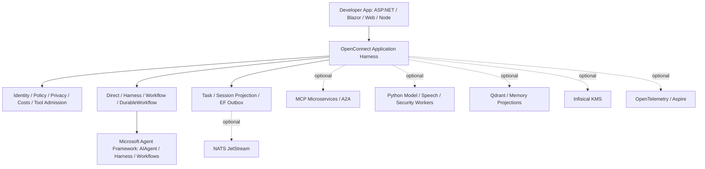
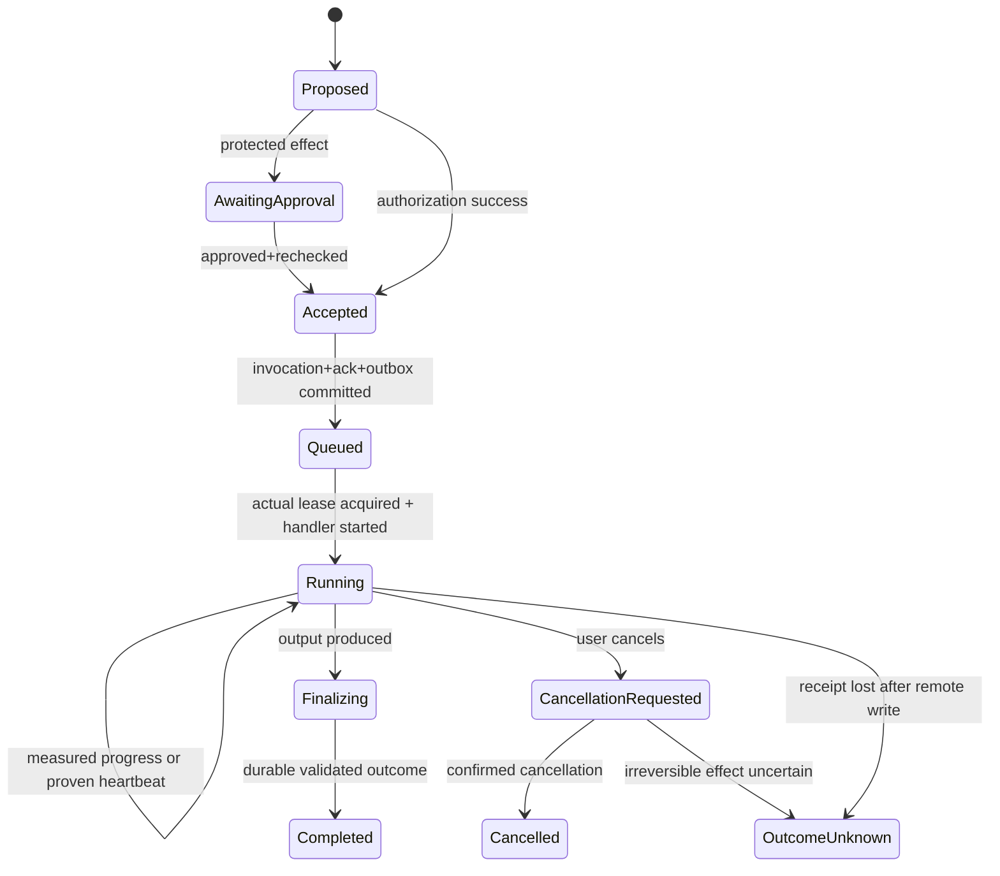

# OpenConnect — Exhaustive MAF-First Application Harness Technical Specification

**Document:** `spec.md`  
**Version:** 2.1-draft · **Updated:** 2026-11-08  
**Status:** Normative implementation *target*, not evidence of completed code, tested APIs, verified models, or published packages.  
**Companions:** `requirements.md`, `implementation.md`, `checklist.md` v2.1, `agents-requirements.md`, `agents-spec.md`.  
**Traceability:** the entire `OC2-D-*` task inventory, `OC2-AT-001–071`, historical test families, and `OC2-IMP-*` implementation packages.  
**Design authority:** Microsoft Agent Framework (MAF) is the agent/harness/workflow engine; OpenConnect is the secure, durable, observable, multimodal application integration harness around it.

## 0. Implementation rules and evidence hierarchy

1. **MAF ownership is hard:** use its native `AIAgent`, Harness Agent (`AsHarnessAgent` where verified), agent session/history providers, context providers, middleware, tool invocation and approval, skills, workflows/graphs/HITL and optional Durable Extension. An OpenConnect component may *compose, restrict, persist or project* these facilities, but MUST NOT silently implement another planner, agent loop or workflow replay engine.
2. Every public C# code block below is a **proposed OpenConnect API**, not evidence of an existing implementation. The MAF API names shown as native are taken from the supplied 2026 Agent Framework reference, but their version/target compatibility still requires an executable `net8.0/net9.0/net10.0` laboratory and a dependency lock.
3. A requirement is fulfilled only if its concrete code, negative tests, provider/runtime target, documentation, artifact and review evidence are attached to the corresponding `OC2-D-*` checkbox in `checklist.md`; partial and blocked states are not PASS.
4. No scope reduction: every optional module remains defined and independently verifiable even when excluded from a particular installation. Missing optional services must not prevent unrelated core functionality; required security coverage must fail closed for the affected protected flow.
5. Architecture precedence: `requirements.md` defines normative *what*, this document defines implementable *how*, `implementation.md` orders dependent tasks, `checklist.md` logs tests and evidence, agent documents provide compatible specialization. Conflicts require an ADR and synchronized corrections. Superseded source examples do not override this specification.
6. No registration method may silently start a Docker process, download a model, create/drop database objects, invent a security principal, provision NATS streams, expose a browser port, or publish a package.
7. Treat tool output, skill instructions, remote MCP schemas, retrieved documents and model output as untrusted data. Authentication, tenant scope, approvals, budgets, privacy configuration and execution permissions must be derived from trusted host configuration and revalidated at the actual effect boundary.
8. Security-sensitive, MAF-version-dependent, and provider-specific cases MUST have adversarial or fault-injection tests, not only happy-path compilation.

### 0.1 Canonical responsibility matrix

| Capability | Single authoritative implementation | OpenConnect integration responsibility | Prohibited duplicate |
|---|---|---|---|
| LLM loop, streaming, function calls | MAF `AIAgent` / `IChatClient` integration | Config, model trust policy, filtering and projected lifecycle | New independent LLM agent loop |
| Planning, todos, harness modes, compaction | MAF Harness Agent | Strongly typed switches, limits, safety, persistence of native state | Custom todo/planning engine |
| Workflow graph, executors, handoff, HITL | MAF Workflow | Compile validated graph templates; enforce runtime grants; expose real events | OpenConnect graph scheduler/replayer |
| Durable workflow execution | Chosen compatible MAF Durable Extension or one validated backend | Durable host identity/effects/outbox and checkpoint-reference storage | Two simultaneous replay authorities |
| MAF sessions/chat history | Native MAF session/history provider | Protected serialization and tenant-scoped storage adapter | Public event journal replayed blindly as model history |
| Context and memory injection | MAF context-provider pipeline | Scope-filtered, consented adapters; optional Qdrant | Competing RAG executor |
| Tool/skill/MCP invocation | MAF tool and official MCP SDK | Allowlist, auth, side effects, approval, progress, data isolation | Unprotected reflective tool dispatch |
| Application task/outcome/event | OpenConnect | ACID admission, event journal, outbox, projection, replay | Treating MAF internal session as business audit log |
| User/workload authority | Host authentication + OpenConnect policy | Effective grants, lease, reauth and revocation | Credential injection into model/agent text |
| PII egress/restoration | OpenConnect .NET privacy engine | Local worker detection, tokenization, key management, auditable restoration | Detector deciding policy / model bypass |
| Client UX / app progress | OpenConnect | HTTP/WS, optional AG-UI, composer and navigator | Fabricated agent activity |
| Distributed transport | Optional NATS JetStream | Committed safe notices, ACK/dedup | Replacing workflow engine with NATS |

**Modes are independent axes:** `AgentExecutionProfile={Direct,Harness,Workflow,DurableWorkflow}` selects native MAF execution; `AgentExecutionMode={Interactive,Operational}` selects authority and lifecycle. Developer-configured maximum delegation depth is **2 edges** (lead 0 → child 1 → grandchild 2); depth and other budgets must be enforced in static graphs and dynamic Harness delegates. Harness background tasks, model-provider background responses, operational agent scheduler jobs and durable MAF workflows are different lifecycle concepts.

## 1. Target architecture, trust zones and deployment profiles



**Trust zones:** browser/mobile is untrusted for tool/tenant/permission claims; the authenticated gateway is the policy authority; model providers and remote MCP/tool/worker services receive only data allowed for their purpose/location; NATS receives sanitized metadata/opaque references; the .NET encrypted vault alone resolves reversible mappings; optional Python detectors cannot approve an action. A deployment marked strict-local must verify the boundary of every scanning/voice/model worker, not infer locality from hostname.

**Profiles and dependencies:**

| Deployment | Expected functionality | Required infrastructure |
|---|---|---|
| Minimal direct | Single native MAF agent, safe local/approved model requests and tool calls | Host and configured model; any policy-required local security capability for protected egress |
| Harness interactive | Native planning/todos/multi-turn and safe tools | Above plus the selected MAF harness features; durable restart requires configured store |
| Workflow interactive | Native MAF sequential/parallel/handoff, bounded role grants | Above plus supported workflow packages; database only if durable task admission selected |
| Durable workflow | Native workflow checkpoint/resume and application task outbox | A validated durable backend and relational persistence; NATS only if distributed transport selected |
| Operational | Constrained workload, schedules, leases and audit | Durable store, workload identity provider; optional NATS/standalone supervisor |
| Text-only UI | SDK, MiniComposer text/status | No TTS, VAD, Navigator, Playwright or GPU |
| Full multimodal | Selected independently provisioned model and browser workers | Only corresponding opt-in Docker profiles, approved model caches and credentials |

**No hidden dependency:** `AddOpenConnect()` must be constructible without EF, NATS, Qdrant, Infisical, Aspire, model weights, `window`, or Docker. Host readiness for an execution profile may report not-ready until its actual selected dependencies exist; it must not globally prevent unrelated ready profiles.

## 2. Assembly, package and artifact graph

```text
src/
  OpenConnect.Abstractions/               # typed IDs, contracts, enum wire definitions
  OpenConnect.Core/                       # composition, scopes, capabilities and policies
  OpenConnect.Agents/                     # typed catalogs and MAF-native profile composition
  OpenConnect.Agents.Microsoft/           # optional isolated MAF version shim, not 2nd runtime
  OpenConnect.Tools/                      # tool governance / progress decorators
  OpenConnect.Mcp.Client/                 # official MCP SDK client integration
  OpenConnect.Mcp.Server/                 # optional secure ASP.NET MCP exposure
  OpenConnect.Mcp.Gateway/                # optional cross-service tool aggregation
  OpenConnect.Mcp.AspNetCore/             # hosting adapter when warranted
  OpenConnect.Sessions/                   # application task projection, event journal abstractions
  OpenConnect.Hosting.AspNetCore/         # HTTP+WS app task endpoints and auth
  OpenConnect.Hosting.AgUi/               # optional AG-UI interop, never authorization authority
  OpenConnect.Hosting.Durable/            # native MAF durable backend binding
  OpenConnect.Persistence.EFCore/         # provider-neutral stores, mappings, outbox
  OpenConnect.Transport.Nats/             # optional JetStream distribution
  OpenConnect.Privacy/                    # .NET policy, redaction, encryption and restoration
  OpenConnect.Speech/                     # voice protocol, auth and segmentation coordination
  OpenConnect.Voice.Silero/               # optional .NET server ONNX VAD
  OpenConnect.Client/                     # HTTP/WS .NET client
  OpenConnect.Components.Contracts/       # safe UI discovery DTOs
  OpenConnect.Components.Blazor/          # MiniComposer and approved renderers
  OpenConnect.Navigator*/                # guided UI optional
  OpenConnect.QdrantVactor/              # optional vector projection consumer
  OpenConnect.Cryptography.Infisical/     # optional DEK wrapping (not token database)
  OpenConnect.Observability*/             # OTel instrumentation and durable metering
  OpenConnect.Hosting.Aspire/             # optional AppHost integration
  OpenConnect.Admin.*/                    # optional embedded operator API/UI
packages/
  client-ts/ composer/ navigator/ navigator-react/ client-vad/
workers/
  common/ security/ classification/ nllb/ inference/ transcription/
  realtime-voice/ kokoro/ mms-tts/ navigator-playwright/
  operational-agents/ outbox/             # optional standalone .NET service hosts
contracts/ openapi/ jsonschema/ fixtures/       # authoritative versioned wire contracts
infra/ compose.yaml  model-manifests/ nats/ docker/
site/                                         # Astro Starlight docs + optional agent API
examples/ minimal-host/ harness/ workflows/ durable/ mcp/ blazor/ typescript/
tests/ unit/ contracts/ integration/ security/ fault/ package-consumers/
```

**Dependency rules:** Abstractions → no MAF, EF Core, NATS, browser, Python, Qdrant, Aspire, Infisical. Agents.Microsoft → MAF but not EF provider or UI. EFCore → only OpenConnect abstraction and EF base/relational, no transitive SqlServer/Npgsql/Sqlite/InMemory providers. Client core → no browser DOM or server dependencies. Worker common → no host DB/vault key access. Physical packages are created only with tested behavior. NuGet per-TFM dependency graph is verified on `net8.0;net9.0;net10.0` instead of assuming one MAF/EF version works everywhere.

## 3. Native MAF feature adoption and exact proof obligations

| Native MAF capability | MAF reference / expected operation | Integration responsibility | Proof before stable API |
|---|---|---|---|
| Direct agent | `AIAgent`, `ChatClientAgent`, `IChatClient`, `RunAsync`/`RunStreamingAsync` | Bind model route, tool wrapper and egress controls | streamed tool execution and cancellation |
| Harness | `AsHarnessAgent()` and native `AgentSession` | Configure planner/todos/modes, content policy, skill sandbox | multi-step todo across turns and restart |
| Native skills | MAF skill sources/skill loaders | allowlisted paths, lifecycle and tool/script permission | malicious skill path and tool escalation rejected |
| Middleware | MAF agent decorators and `IChatClient` middleware | order, enforce prompt/tool/remote data policy | unapproved provider egress attempts never occur |
| History | `AgentSession`, native chat-history provider / provider-managed session IDs | serialized encrypted state, no dual writer | 10 turns and restart no double history |
| Context providers | native `AIContextProvider`, `ChatHistoryProvider` where supported | scoped memory/retrieval injection | cross-tenant query denied |
| Workflows | `WorkflowBuilder`/`Executor`/`AgentWorkflowBuilder` | typed template → native graph; validators | sequential/concurrent/handoff actually runs |
| HITL | MAF approval / workflow pending requests | external user identity, exact args, persistence, policy | denied/pending actions never execute |
| Durable Extension | MAF selected durable backend | transaction bridging, checkpoint refs, explicit capabilities | kill/restart resumes without replaying effects |
| Hosting | MAF hosting registration and workflow-as-agent | host endpoints with auth and policy | no duplicated MAF service container |
| MCP / remote A2A | official SDK / MAF adapters | capability allowlists and destination identity | service tool actually invoked; SSRF denied |
| AG-UI | MAF hosting protocol adapter | bridge to OpenConnect session/event actor scope | auth, approval and streamed events round-trip |
| Evaluations | `Microsoft.Extensions.AI.Evaluation` and MAF eval hooks | stable datasets, provenance, cost/risk gates | deterministic regression report |

**Mandatory lab first:** pin exact MAF package identities/versions and restore lockfiles; write executable demonstrations for Direct/Harness/Workflow/HITL/Durable/Skills/Hosting/MCP. Produce machine-readable adoption record `{capability, nugetPackage, exactVersion, tfm, samplePath, testCase, evidence, limitation}`. Absent feature in a target TFM is `Unavailable` (or explicitly experimental adapter), never a fake no-op API. Do not build an OpenConnect feature before a verified version-specific MAF integration slot exists.

## 4. Strongly typed developer composition and lifecycle

Target C# API shape (*proposal, compile-test before publishing*):

```csharp
builder.Services.AddOpenConnect(options =>
{
    options.Agents.DefaultProfile = AgentExecutionProfile.Harness;
    options.Agents.DefaultExecutionMode = AgentExecutionMode.Interactive;
    options.Agents.MaxDelegationDepth = 2;
    options.Runtime.InstructionsPath = "agent-runtime.md";
    options.Privacy.Enabled = true;
    options.Privacy.Mode = FirewallMode.StrictLocal;
    options.Transport.Mode = OpenConnectTransportMode.InProcess;
});

builder.Services.AddOpenConnectAgentTemplate("researcher", t =>
{
    t.Profile = AgentExecutionProfile.Harness;
    t.Tools.Allow("docs.search");
    t.Context.Sharing = AgentContextSharingMode.TaskSummary;
    t.Limits.MaxToolCalls = 4;
    t.Harness.EnableTodos = true;
});

builder.Services.AddOpenConnectTool<DocumentationSearchTool>("docs.search", t =>
{
    t.Impact = ToolImpact.ReadOnly;
    t.RequiredScopes.Add("docs:read");
    t.Progress = ToolProgressMode.ReportedAndHeartbeat;
});

builder.Services.AddOpenConnectAgent("researcher", agent =>
{
    agent.TemplateId = "researcher";
    agent.IdentityMode = AgentIdentityMode.ActiveUser;
});

builder.Services.AddOpenConnectLeadAgent("lead", lead =>
{
    lead.Profile = AgentExecutionProfile.Harness;
    lead.AllowedSubagents.Add("researcher");
    lead.MaxDelegationDepth = 2;
});

// Explicit per-deployment persistence; not transitively required by AddOpenConnect.
builder.Services.AddOpenConnectEntityFramework<ApplicationDbContext>(o =>
{
    o.Schema = "openconnect";
    o.Migrations = OpenConnectMigrationMode.Manual;
});
```

**Enums:** `AgentExecutionProfile { Direct, Harness, Workflow, DurableWorkflow }`, `AgentExecutionMode { Interactive, Operational }`, `AgentIdentityMode { ActiveUser, WorkloadIdentity }`, `ToolImpact { ReadOnly, Write, ExternalSideEffect }`, `ToolIdempotency { SafeToRetry, RequiresIdempotencyKey, NonIdempotent }`, `ToolProgressMode { None, Reported, HeartbeatOnly, ReportedAndHeartbeat }`, `OpenConnectMigrationMode { None, Manual, ApplyOnStartup }`, `VADMode { Disabled, Client, Server, Hybrid }`, plus mode-specific enum sets. Enum wire format is explicitly versioned lowercase kebab-case; numeric/unknown are rejected in C#, TS, Pydantic and configuration import. User-defined IDs, model references and endpoint URIs are validated strings.

**Registration resolution:** trusted defaults → immutable code templates → validated server configuration → explicit trusted registration overrides → tenant constraints that only narrow → request hints that do not confer authority. Template inheritance depth at most one base, deterministic last-resolved revision, no silent widening; reject duplicate IDs, unknown tools/models, cyclic delegates, depth>2, invalid schedule/identity, incompatible checkpoint backend or missing required model capability. Config reload validates a complete snapshot and commits atomically; existing runs remain bound to old approved revision, but revocation applies at effect boundaries.

**One-time authorization:** service registration does not confer permission to an agent. `agent-runtime.md` and per-agent Markdown are behavior/data, never security policy. No template variable may substitute passwords, access tokens or arbitrary instruction source. Per-run capability catalog and model location are derived server side.

## 5. Agent profiles, graph compiler, depth-2 policy and budgets

**Direct:** register one MAF `AIAgent` with trusted options. The OpenConnect admission layer authorizes request and wraps model/tool calls. Do not implement a direct model loop.

**Harness:** construct the native MAF Harness implementation, exposing verified planning/todo modes, skills, compaction, memory and approval options. Native `AgentSession` retains Harness state. OpenConnect persists that session only through supported serialization or a versioned reference; no separate OpenConnect todo persistence. Harness children/background delegates count toward depth and fan-out budget.

**Workflow:** compile a typed OpenConnect graph definition into a native MAF workflow with `WorkflowBuilder`, executor edges and typed input/output contracts. For sequential, concurrent, handoff and HITL, use the corresponding supported native primitives. Reject unsupported feature/provider combinations instead of simulating workflow results.

**DurableWorkflow:** use the verified MAF Durable Extension (or one explicit compatible alternative backend); record native checkpoint ID/revision/schema and MAF runtime version in application state. Never have both MAF Durable Extension and an OpenConnect replay engine independently advancing one workflow.

```text
lead depth=0
  ├── researcher depth=1
  │     └── extractor depth=2
  └── validator depth=1
        X no child at depth=3
```

Authorization on every actual delegation checks `registeredEdge && nextDepth<=2 && noCycle && actorModeCompatible && effectiveScopes ⊆ parentScopes && childToolAllowlist ⊆ permittedTools && remainingBudget>0`. Parent fan-out and child attempts draw from a *shared remaining budget ledger*; native MAF internals still decide how to execute each permitted agent. Enforce depth at startup and runtime, including tool-generated/harness-background agent launches. Parallel branches get isolated MAF sessions/scratchpads; merger accepts only typed, schema-valid, policy-filtered results and safe refs. Aborted branch effects remain auditable; siblings cannot erase committed effects.

**Limits:** maximum model/tool attempts (not just completed calls), context tokens, output tokens, total cost, simultaneous children, graph fan-out, execution deadline, queue size, max tool payload and per-provider rate limits. Record consumption exactly once per physical provider attempt, and never treat harness summaries as separate billable operations. `TimeSpan` budget defaults should be measured and centrally configured, not implied universal SLOs.

**Interactive identity:** derives user and tenant at authenticated HTTP/WS ingress, reauthorizes before every protected tool/memory/restore/delegation/approval; raw cookies/bearers never enter MAF history or child context. **Operational identity:** uses explicitly configured workload principal and scheduled/durable run lease; initiator is audit provenance, not impersonation credentials. Cross-mode transition is only via authorized durable enqueue or human review.

## 6. MAF tools, MCP microservices, skills and remote agents

A tool descriptor is trusted OpenConnect metadata `{id, version, impact, inputSchemaRef, outputSchemaRef, executionMode, idempotency, requiredScopes, dataClass, destinationClass, approvals, progress, timeout, concurrency}`. The native callable is an `AIFunction`/supported MAF tool adapter around a server-side guard. Each invocation validates canonical arguments, request size, schema, actor grants, tool revision, destination identity, privacy rules, approval nonce/digest/expiry and budget **immediately before execution**, not just at discovery.

```text
MAF invocation candidate
  -> trusted catalog version lookup
  -> effective actor/tenant/run grants
  -> tool+model capability intersection
  -> canonical argument normalization/schema
  -> privacy/egress and destination identity policy
  -> exact-argument HITL approval if required
  -> durable scheduling OR guarded inline native tool
  -> checked output schema, privacy and result projection
```

**Discovery:** local typed .NET tools, registered service factories, official MCP client tools, approved remote A2A participants and worker capabilities project into the same allowlisted descriptor catalog. Discovery provides *candidates*, not grants. Returned tool descriptions are capped and untrusted; name collisions are rejected with stable service-qualified IDs. Service refresh must not silently grant a newly added remote MCP tool.

**MCP:** use official MCP .NET SDK, Streamable HTTP as default remote transport and stdio only for explicitly registered local processes. `OpenConnect.Mcp.Server` uses host ASP.NET authentication and exports allowlisted application service tools; `Client` connects with scoped workload/delegated auth where supported; `Gateway` aggregates namespaced tools with individual service origin/SSRF/DNS-rebinding restrictions, rate limits, versioned schemas, per-invocation reauthorization, response privacy scan and revoked connection handling. Do not tunnel normal service RPC through MCP by default; use HTTP/gRPC for ordinary transactions. Long-running MCP work requires a durable job contract or explicit status tool; MCP progress notifications are not themselves persistent job guarantees.

**Skills:** expose native MAF skill providers with source-root allowlists, revision hashes, size and filename containment, model prompt-injection handling, restricted script execution and tool sandbox. Skills are lower-trust instructions, never policy. Disabled skill providers do not load/execute source. Approved skill execution still goes through tool policies and bounds.

**Remote agents:** model remote A2A agent as a restricted participant with declared trust zone, tool/effect policy, capabilities and observable coverage. Unknown remote internals cannot be presumed inspected: block or limit operations needing in-process per-tool enforcement; never claim complete tool trace visibility for opaque remote agents.

**Approvals:** native MAF/Harness HITL pauses and resumes execution, while OpenConnect owns identity, tenant, exact normalized argument hash, tool revision, nonce, expiry, approval audit and session binding. `Don't ask again` native Harness preference is strictly narrower than OpenConnect host authorization; it never waives mandatory side-effect approval or recovers revoked permission.

## 7. Native sessions, history, memory, compaction and checkpoints

There are **four separate state planes**:

| State plane | Owner | Storage and versioning |
|---|---|---|
| MAF history and Harness plan/todos | MAF | serialized `AgentSession`, provider-native conversation ref |
| MAF workflow execution/checkpoints/HITL | MAF durable backend | native checkpoint ref + version compatibility |
| OpenConnect task/session outcomes, approvals, outbox | OpenConnect | EF provider-neutral store with scoped journal |
| Derived consented memory / vector projection | MAF context providers + optional OpenConnect store | tenant/actor scope, TTL, source provenance and deletion |

**Session resolution:** an OpenConnect `sessionId` is an authenticated application conversation identity and maps to one or more native MAF `AgentSession` references keyed by agent/definition version and provider history mode. Do not blindly copy sanitized WebSocket event text into MAF history; do not attach two history providers to the same agent. Checkpoint records carry serialization version and actual provider/MAF package revision. On restore, reject incompatible blob or initiate an explicit reviewed migration/reconstruction path; never rerun a side-effectful step as an implicit recovery mechanism.

**Context projection:** parent → child receives immutable, versioned, allowlisted task summary and selected artifacts, not every tool prompt or full scratchpad. Label data class, actor, source, lifetime, allowed agents and trust zone; load through native context providers after scope/coverage gate. Concurrent children use independent mutable sessions. Conflicting summaries are merged through approved deterministic reducers; no privilege escalation through memory content.

**Memory:** initial session-scoped, then optional cross-session memory with consent/TTL/provenance/access checks. `IAgentMemoryStore` only provides storage behavior and native context-provider integration; it is not another planner. Optional QdrantVactor consumes *committed policy-approved events* from the separate subscription abstraction, embeds and stores derived vectors; no EventRecord vector, no journal global enumeration, no Qdrant dependency in core. Deletes/revocations must invalidate vector projections before continuing retrieval.

**Compaction:** native MAF Harness performs summarization according to configured budget. OpenConnect can enforce maximum size, allowlisted memory sources, retention and telemetry, but must not implement a second compactor on the same history. A summary is untrusted context; it cannot persist system grants, approval receipts or security policy.

## 8. EF Core, migrations, transactional state and outbox

**Developer API:**

```csharp
builder.Services.AddDbContext<ApplicationDbContext>(db => db.UseSqlServer(connectionString));
builder.Services.AddOpenConnect();
builder.Services.AddOpenConnectEntityFramework<ApplicationDbContext>(options =>
{
    options.Schema = "openconnect";
    options.Migrations = OpenConnectMigrationMode.Manual;
});

// ApplicationDbContext.OnModelCreating:
// modelBuilder.ApplyOpenConnectModel();
```

Entity types are registered with explicit `IEntityTypeConfiguration<T>` through `ApplyOpenConnectModel`, and internal repositories use `db.Set<TEntity>()`; host does not declare `DbSet` members. The application supplies EF provider packages. Supported: SQL Server, PostgreSQL, SQLite (single-node/single-writer constraints), EF InMemory (non-durable development only). SQL Server/Postgres use logical `openconnect` schema; SQLite uses `oc_` prefix. `Manual` migration default: no DDL on DI, no hidden `EnsureCreated`; host existing `DbContext` migration generation is app-owned. Dedicated OpenConnect context is opt-in and needs explicit provider and separate migration history. Sharing a connection string does not share a transaction automatically.

**Minimal authoritative EF entities:** sessions, tasks, turns, safe committed events, outbox, leases, exact-bound approvals, privacy-token ciphertext, operational run/schedule/checkpoint metadata, tool invocation/intents/progress snapshots, agent catalog revisions, MAF serialized session refs, model-usage attempt ledger/price snapshots and optional module-specific tables. Do not persist duplicate MAF todo/harness history unless it is the native serialization blob. Key uniqueness includes scoped `clientTaskId`, per-session sequence, tool invocation idempotency, and provider-billable attempt ID. Tenant and actor/workload keys index all sensitive query paths.

**Transaction owner:** business + OpenConnect task/event/outbox writes are atomic only when they share a real database transaction/context (or explicitly tested cross-context `UseTransaction`). Separate physical stores are eventual consistency. No network calls inside database transactions. Provider-aware optimistic claims/leases/fencing prevent stale worker completion; explicit idempotency and recovery from crash between NATS ACK and outbox delivered-mark. EF InMemory cannot pass these semantics.

**Runtime schema validation:** verify mappings, indexes, provider capabilities and expected schema version without creating tables. Reject inappropriate `ApplyOnStartup` for arbitrary shared context. Include SQLServer/Postgres/SQLite testcontainers/file-backed migrations and startup/no-DDL/rollback tests in CI.

## 9. Long-running tools: durable acceptance before start, truthful progress, continuation



**Durable long tool**: validate tool/args/identity/revision; if required, native MAF HITL approval is obtained **before** queue acceptance; atomically persist `tool.accepted` and outbox with tenant-scoped invocation ID/idempotency key; only after commit dispatch; acquire fenced lease then report `tool.started` on genuine handler start; coalesce measured progress; heartbeat solely from proven liveness; validate schema/privacy/output, commit terminal result, then resume the *same native MAF workflow/request* using supported continuation. No OpenConnect custom agent loop or second checkpoint replay. Tool result must be delivered once logically; transport may retry physically.

**User UX:** HTTP 202 means task durably admitted; `tool.accepted` means scheduled not begun; `tool.started` means begun; `tool.progress` must carry verified phase/count/percent and actual source; `tool.heartbeat` means only alive; `tool.completed` means validated committed tool result, not necessarily end of lead task; `cancel.requested` does not mean confirmed cancellation; `100%` measured progress can remain `Finalizing`. A browser WebSocket receipt is not required for dispatch; offline/reconnect replays latest committed safe status with cursor.

**Inline tool:** executes within native MAF invocation guard; a watchdog may emit "still working" after threshold but cannot retrospectively issue a true pre-start ACK. Mark known long tools durable/background with explicit timeout/idempotency. Non-idempotent uncertain remote effects become `OutcomeUnknown` and pause for reconciliation; no blind retry.

**Event transport:** host emits versioned safe event envelopes keyed by session sequence and invocation ID; `task.accepted`, `agent.started`, `tool.approval.requested`, `tool.accepted`, `tool.started`, `tool.progress`, `tool.heartbeat`, `tool.completed/failed/outcome_unknown`, `agent.completed`, `task.completed`, etc. Public client only receives authorized filtered projections; never broker credentials/raw tool args.

## 10. Privacy firewall, information-flow policy, tokenization and workers

**Enforcement locations:** host request admission, `IChatClient` boundary, agent middleware where applicable, native tool wrappers, MCP request/results, native skills/context sources, worker dispatch, outbox notices, model output/restoration, HTTP/WS projections and telemetry processor. Opaque remote agents/tools require explicit trusted-zone contracts or denial of protected operations if internals are not inspectable. An agent's claim that data is "safe" is not policy evidence.

**Detector architecture:** .NET host owns policy/decisions/coverage/tokenization; optional isolated Python `security` worker detects via independently configured Rules (default lightweight), GLiNER PII, DeBERTa injection, Qwen3Guard, PaddleOCR, YuNet. Disabled detector does not download/load/advertise. Missing required detector blocks only relevant protected egress; unrelated text-only/local workflows continue. Rules-only is not semantic PII protection. Host validates worker span offsets, normalization, overlapping entities and versioned capability manifests; do not trust worker to approve.

**Vault:** unpredictable opaque placeholders and AES-256-GCM envelope encryption, securely sourced/rotated KEK, nonce uniqueness, authenticated binding tenant+actor+session+turn+purpose+TTL. EF stores ciphertext only; optional Infisical wraps/unwraps DEKs only, never receives original PII. Restoration is field-path and destination allowlisted, checked at time of use. Streaming buffering safely handles split placeholders; original sensitive fields never enter NATS, trace attrs, errors or prompt instruction files.

**Media:** images/PDF need local OCR/pixel/hidden-text/metadata checks; audio cannot be claimed strict-local safe solely because a transcript is masked after remote STT. Only enabled licensed model capabilities may declare protection; unsupported media is blocked from protected remote egress. Test with synthetic canaries and real opted-in model smoke before stable claim.

## 11. NATS, HTTP/WS, AG-UI and authoritative events

**Outbox distribution:** DB commit → dispatcher claim/lease → send sanitized notice to optional JetStream with `Nats-Msg-Id` → await broker ACK → mark delivered; crash before mark gives retry/dedup. NATS subscription does not enumerate all sessions; use `IAgentEventSubscription` for committed global notifications, `IEventJournal` for known-session replay only. Streams/ACLs are operator-provisioned; browser never speaks to NATS.

**HTTP APIs** under `/openconnect/v1`: authenticated create/read session, `POST /tasks` idempotent admission, read/cancel task, replay event cursor, capability/component discovery, active tool status/approval, operational run control (RBAC). For public WS subscriptions, validate same-origin or authorized ticket, scope, protocol version and reconnect cursor. `tenantId` from request payload is never authority. Ephemeral deltas labeled non-durable; permanent events replayed from committed store.

**AG-UI** is optional interoperability via the MAF host integration. Map agent/session/progress/approval without a second authorization system and without committing to replacing OpenConnect's durable task API. Verify actual AG-UI protocol support in pinned package; when unavailable keep ordinary HTTP/WS clients functional.

## 12. Client SDK, compact MiniComposer and component discovery

Blazor: `AddOpenConnectClient(HTTP(S), WS(S))`, `OpenConnectProvider` in layout and `MiniComposer` mounted inside its scope. Browser/Node: `@openconnect/client` is headless; optional `@openconnect/composer`, React binding and Navigator browser bridge are SSR-safe and reference one authenticated client. No DOM access during Node import. No direct model API keys in browser.

**UI target:** small bottom-right FAB 44–56px and detached movable ~23.5–24rem anchored bubble, no full-screen drawer/reflow. Handle-only drag and keyboard movement (24px arrow, Home reset), bounded viewport, safe-area, RTL and mobile keyboard. Header has move/settings/stop/close; auto-grow text 1–5 rows, Enter send/Shift+Enter newline/IME safe/duplicate idempotency; last sent/answer and 3-bar status compact; optional separate voice/mic controls. Close minimizes without cancelling durable task; Stop sends scoped cancellation request and waits for authoritative receipt. Status/progress solely from real events; screen reader alerts coalesced. `IOpenConnectComponent` exposes versioned schema/suggestions and only local allowlisted renderer can activate; model-proposed HTML/script never rendered.

**Navigator:** optional semantic targets/tours/highlighter and consented capture; native bridge shares SDK and authorization. Playwright MCP worker isolated per operational job, bounded origin/tool allowlists, no unrestricted browser JS/storage/network. Missing Playwright/TTS does not break live tours or MCP outside browser tasks.

## 13. Voice, VAD and Docker worker architecture

**VAD modes:** Disabled, Client, Server, Hybrid. Browser client may use pinned Silero ONNX/WASM and WebRTC VAD for quick barge-in; Android/iOS native detector optional; gateway .NET Silero ONNX maintains isolated recurrent state per stream and server-authoritative turn boundaries; 24 kHz capture can be resampled to 16 kHz and 512-sample model frames with validated sequences and absolute offsets. Clients only signal acoustic candidates, never force server acceptance. Speech epochs fence stale TTS chunks; microphone permission only on explicit gesture. Server VAD is separate optional .NET library, not mandatory Python worker.

**8 independent Python images**: security, classification, nllb, inference, transcription, realtime-voice, kokoro, mms-tts. **1 Node image**: navigator-playwright. **2 optional standalone .NET images**: operational-agents, outbox (embedded BackgroundServices default for small deployments). All 11 are CI-built, smoke-tested and published by protected release to `matibevuminkosi/openconnect-worker-<name>:<version>` and stable `:latest`, with signed digest manifest; primary registry Docker Hub, GHCR optional mirror.

**Model provision:** per-worker opt-in Compose profile; no models bundled by default; approved pin/license/checksum manifest, first enabled startup locks cache volume, checks verified cache, downloads exact artifacts to staging only if absent and explicitly authorized, verifies then atomically promotes, runs offline from persistent volume. Missing/illegal/incorrect model -> worker unready, unrelated core remains functional; no user-request-time download. Kokoro English voice `af_heart` only if installed; MMS and NLLB per-checkpoint commercial/noncommercial license policy. Workers use authenticated least-privileged machine identity, health/live vs real readiness, bounded CPU/GPU/queue/concurrency, synthetic dummy-model CI and independently gated real-model tests.

## 14. Observability, metering, evaluation and admin

MAF/host ActivitySources and native GenAI semantics must be reused rather than emitted twice. The OpenConnect instrumentation layer adds safe application task, firewall, NATS, tool ACK, approval, VAD and routing observations; OpenTelemetry exporter/Aspire optional. Structured logs and metrics default metadata-only with no prompt, PII, token, raw audio, credentials, high-cardinality tenant/user labels. Durable per-billable-attempt ledger (not sampled) records reported/estimated/unknown units, effective-dated price schedule, currency, decimal cost, cache/reasoning overlap policy, retries, cancellations and immutable corrections. Hard budgets require atomic reservations/settlement; external provider costs are distinct from local infrastructure estimates. Admin API/optional embeddable UI is RBAC and tenant scoped; no separate mandated public app.

Evaluations use MAF/Microsoft.Extensions.AI.Evaluation where version-compatible: fixed labeled input sets and golden expectations for tool selection, task completion, hallucination/grounding, prompt injection, workflow graph correctness, privacy leakage and model cost. Record evaluator version/model, dataset provenance, baseline threshold and CI report. Evaluation does not replace security tests or reclassify untested model quality as achieved.

## 15. .NET compatibility, CI, distribution and website

Libraries multi-target `net8.0;net9.0;net10.0` where dependencies permit, with exact per-TFM package version compatibility (EF Core 8/9/10 and provider versions as tested). .NET 10 recommended for production; .NET 8/9 compatibility-only after Microsoft support ends. Build using pinned SDK; execute tests with each actual runtime and external NuGet package consumers, not just one SDK compiling TFMs. Standalone .NET 10 worker hosts communicate with older client apps via versioned wire protocols.

GitHub Actions: PR build/test/scan all 11 Docker images without push; protected stable tags publish Docker Hub `matibevuminkosi/<containername>:<SemVer>` and `:latest` only after images pass test, scan and digest verification, with optional GHCR mirror. Separate protected NuGet/npm registry publishing, reproducible locks, SBOM/license/attestation, exact source SHA, external consumer install, rollback and partial-release diagnostics. No publishing on PRs, and workflow permissions/secrets strictly scoped.

Astro Starlight static site with versioned MDX/docs and DocFX/OpenAPI generated reference. Docs assistant is optional and built with the actual OpenConnect Harness and read-only version-scoped retrieval; static docs/search work offline without models/worker infrastructure. API examples must compile and distinguish proposed vs shipped features.

## 16. Provider, trust, and failure-mode matrices

| Failure/condition | Required behavior |
|---|---|
| MAF Harness not supported on specific target | Fail profile capability validation; no fake planner |
| MAF Durable backend absent | DurableWorkflow unavailable; ordinary Direct/Harness may work |
| User auth revoked after queued long tool | Deny subsequent protected effects; queued state reconciles and parks |
| External tool effect uncertain | OutcomeUnknown, status/review; no blind retry |
| Tool reports 100% but result commit fails | Finalizing or Failed, never Completed |
| Client disconnect before tool acceptance visible | Durable execution allowed after DB commit; replay on reconnect |
| NATS broker offline | DB outbox persists safe notices; no false publish ACK |
| EF shared context lacks mapping | Startup `ef_model_missing`; never auto-create tables |
| SQLite busy/contended | Bounded retries or clear terminal error, no unsafe double writer assumption |
| InMemory configured durable | Fail startup; in-process dev functions only |
| Privacy worker missing mandatory detector | Block only affected external transfer, not unrelated work |
| Optional TTS/Navigator/Qdrant/Infisical down | Capability unavailable; text/other features continue |
| Worker model cache corrupt/offline missing | Worker unready, no request-time download |
| MCP server rotates tool schema unexpectedly | Quarantine new revision, reapprove catalog; no auto-grant |
| Native MAF checkpoint version mismatch | Safe fail/explicit migration, no speculative workflow replay |
| Invoice usage arrives late | Immutable accounting correction, no double charge |

## 17. Protocol schemas and canonical wire contracts

All messages have `schemaVersion`, stable IDs, timestamps UTC, scope projected from trusted host, policy/definition revisions, stable error codes, and PII-safe payload classification. Canonical source is `contracts/openapi`/`contracts/jsonschema`; C#/TS/Pydantic golden fixtures must round-trip. Reject unknown security enums, stale schema major, invalid result shape and cross-scope envelope references. Do not place browser bearer, tenant-provided authorization, raw original content or vault mappings into broker payloads.

**Event envelope (illustrative):**

```json
{
  "schemaVersion":"openconnect.event/v1",
  "eventId":"evt-opaque",
  "eventType":"tool.progress",
  "sessionId":"session-opaque",
  "taskId":"task-opaque",
  "executionId":"exec-opaque",
  "toolInvocationId":"invoke-opaque",
  "sequence":42,
  "occurredAt":"2026-11-08T00:00:00Z",
  "payload":{"kind":"measured-progress","phaseCode":"processing","completedUnits":12,"totalUnits":40}
}
```

**Security:** event emission is downstream of authorization and privacy projection, and outbox delivery follows DB commit. Progress message keys are host allowlisted, never arbitrary secret-containing tool log messages. Native workflow events may be non-durable; mark persistence semantics in each event type and never claim replay support for unsaved deltas.

## 18. Data retention, deletion, audit and upgrade invariants

Version each MAF session snapshot and checkpoint pointer, tool approval, workflow/task definition and policy revision. Tenant/actor/turn/event/budget keys are stable within scope and never used as public capabilities. Deletion must cover application session journal, sensitive artifacts, encrypted token mappings, optional Qdrant projections and native session refs according to retention/legal policy; a stale outbox notice must not recreate deleted data. Store only minimum necessary redacted audit metadata; immutable financial adjustment ledger may have a separate lawful retention period. Rolling upgrade requires backward-readable schema and provider-specific migration compatibility; do not edit shared application migrations from package registration.

## 19. Verification and documentation status

**NOT RUN** is the starting status of every new `OC2-AT-*` and restored historical acceptance test. Historical source claims can be linked and independently re-verified, but are not automatically current version PASS. A feature's advertised status is driven by capability-specific passing evidence and includes absence/unsupported modes. The detailed `checklist.md` is the authoritative register; the spec below binds each individual task to explicit implementation behavior and expected proof. Nothing in this document should be mistaken for completed source code.


## 19A. Concrete persistence tables, fields and concurrency contracts

The following are **proposed logical field contracts**, not migrations and not an assertion of current EF entity classes. Physical types and indexes vary by provider. Every table carries a validated `TenantScope` where applicable; background work is bound to `WorkloadScope` rather than inferred active user.

| Logical entity | Required columns / semantics | Unique and concurrency constraints |
|---|---|---|
| `Session` | SessionId, TenantScope, OwnerScope, CreatedUtc, LastActivityUtc, Revision, RetentionUntil | scoped session lookup, revision CAS |
| `Task` | TaskId, SessionId, ClientTaskId, InputDigest, AgentDefinitionRevision, ActorKind, Status, DeadlineUtc, Revision | unique `(TenantScope, OwnerScope, ClientTaskId)` |
| `Turn` | TurnId, SessionId, TaskId, TurnSequence, InputRef, OutputRef, CommittedUtc | unique `(TenantScope, SessionId, TurnSequence)` |
| `Event` | EventId, SessionId, TaskId, SessionSequence, EventType, SchemaVersion, SafePayload, OccurredUtc, PolicyRevision | unique `(TenantScope, SessionId, SessionSequence)` and EventId |
| `Outbox` | MessageId, EventId, Destination, SafeEnvelopeRef, DueUtc, AttemptCount, LeaseOwner, LeaseExpiresUtc, Fence, PublishedUtc, Status | unique EventId/destination; claim CAS/fencing |
| `Lease` | ResourceKey, OwnerId, Fence, ExpiresUtc, LastRenewedUtc | unique scoped resource; stale owner cannot commit |
| `Approval` | ApprovalId, ToolInvocationId, ActorScope, PolicyRevision, ToolRevision, CanonicalArgsDigest, Nonce, ExpiresUtc, DecisionUtc, Status | one-shot nonce and revision-bound CAS |
| `ToolInvocation` | InvocationId, TaskId, AgentExecutionId, ToolId, ToolRevision, ArgsDigest, IdempotencyKey, State, DeadlineUtc, LeaseFence, ResultRef | unique logical invocation and remote idempotency scope |
| `ToolProgress` | InvocationId, ProgressSequence, PhaseCode, CompletedUnits, TotalUnits, ObservedUtc, SafeMessageKey | latest durable snapshot, monotonic phase progress |
| `MafSessionReference` | SessionId, AgentId, DefinitionRevision, ProviderId, MafVersion, HistoryOwner, EncryptedStateRef, Revision | unique session+agent+revision; no conflicting writers |
| `WorkflowCheckpointReference` | RunId, BackendId, MafVersion, CheckpointVersion, StateRef, Status | native backend owns checkpoint and replay; OpenConnect stores reference |
| `OperationalRun` | RunId, WorkloadScope, AgentDefinitionRevision, TriggerId, ScheduleOccurrence, Status, LeaseFence, PolicyRevision | unique scheduled occurrence/event trigger idempotency |
| `PrivacyToken` | TokenId, ScopedBindingDigest, EncryptedValue, Nonce, Tag, WrappedKey, KeyVersion, ExpiresUtc | opaque mapping never plaintext; cross-scope restoration denied |
| `ModelAttempt` | AttemptId, LogicalRequestId, ProviderId, ModelId, Input/OutputUsage, UsageProvenance, Currency, PriceVersion, State | per-physical-attempt idempotent usage and immutable adjustments |

**Migration strategy:** existing app `DbContext` imports `modelBuilder.ApplyOpenConnectModel()`, shared app migration history is owned by the app, migration mode `Manual` means no automatic schema edits. Dedicated context has its own explicit provider and history. On SQLite, use `oc_` table names without schema. Do not use SQL Server rowversion as the only concurrency strategy; use application-managed revision/CAS compatible with SQLite and provider-specific claims where proven. Verify absence of any business-data mutations by migration diff.

**Atomicity examples:** accept new task + new safe event + outbox intent in a single owned transaction. Stage application business writes in that same context only if caller explicitly uses one transaction owner; separate contexts do **not** become atomic solely from matching connection strings. Apply conditional update/fencing for asynchronous workers; emit no confirmed task/queued-tool event before commit.

## 19B. Native MAF continuation contract for asynchronous tool execution

**Precondition:** declared `BackgroundDurable` tool, approved exact arguments, native workflow or Harness capability that can *actually* pause and resume at tool result boundary. If the pinned MAF version cannot represent an asynchronous pending tool continuation, the selected profile must fail feature validation or use a separately approved native workflow adapter; do not block an ordinary synchronous invocation while claiming durable continuation.

1. **Validate:** resolve tool revision + actor scope + input schema, model-required capabilities, EgressPolicySnapshot and output/result contract; compute idempotency key from scoped canonical argument hash.
2. **Approve:** only if required; native MAF HITL suspends and awaits one-shot host-bound approval. No work accepted or initiated until approval is validated.
3. **Commit:** persist `ToolInvocation(Accepted)`, `Event(tool.accepted)` and `OutboxMessage` in one database transaction. Persist the native MAF pending request/checkpoint using the documented compatible backend state boundary, with a recovery protocol for the case where the two stores cannot commit atomically.
4. **Dispatch:** claim with lease and fence after commit, commit `Running` only when the real tool handler begins; do not block on browser event delivery.
5. **Observe:** read tool-reported counters/phase; validate strictly monotonic measured progress; coalesce safe events; issue heartbeat only from a confirmed healthy/leased process.
6. **Complete:** persist output receipt and `Completed` state after schema/privacy validation and required side-effect reconciliation; use native MAF request response/checkpoint resume with invocation deduplication. For an uncertain irreversible effect write `OutcomeUnknown`, never auto-replay.
7. **Reconcile:** on restart read OpenConnect application state and *native* MAF pending request/checkpoint, compare effective permission revision and fence, then resume a pending operation only once logically. Completion of the tool does not imply completion of the overall MAF lead task.

**Failure consistency model:** database admission commit is authoritative; NATS and WS delivery are at-least-once projections; native MAF checkpoint serialization might be in a different store and cannot be claimed atomically coupled without a verified transaction implementation. Explicitly document whether the selected durable backend has an atomic checkpoint+intent boundary, or implement a recovery reconciliation ledger with no duplicate external effects.

## 19C. Protocol versioning, errors and compatibility

Every canonical DTO has `schemaVersion` and a change policy. Stable error categories include `profile_unsupported`, `delegation_depth_exceeded`, `tool_not_allowed`, `approval_required`, `approval_mismatch`, `authorization_revoked`, `privacy_blocked`, `required_detector_unavailable`, `checkpoint_incompatible`, `ef_model_missing`, `ef_schema_missing`, `outbox_claim_conflict`, `external_effect_outcome_unknown`, `worker_unavailable`, `cursor_expired`, `budget_exceeded`, and `capability_unavailable`. Codes convey bounded metadata only—never original tool arguments, prompts or secrets. Unknown security-critical enum names fail closed; unknown noncritical additive fields can be tolerated only when schema compatibility policy permits. Provider/model revisions are attached to immutable run snapshots; changed remote MCP descriptors require validation and catalog refresh before exposure.

## 20. Task-by-task engineering contract (all 356 `OC2-D-*` tasks)

**Reading rule:** the task lines below add *normative* implementation obligations to the specific checklist action. They are not completion evidence. Every subsection supplies the owning assembly, invariant, and minimum negative/positive proof. Tasks in `checklist.md` remain separately checkable. In any case where the line-level action requires a different module or a more specific artifact, that specific action takes precedence over the subsection's default assembly.


### 20.1 Governance — 16 independent obligations

**Default owner/artifact:** Repository docs/ADRs and source-lock inventory. **Mandatory invariant:** Record immutable versioned decision with owner, affected APIs, supersession and threat/compatibility effect. **Minimum evidence:** Verify stale document paths or incompatible decisions are detected in doc lint; no quiet overwrites.


**`OC2-D-GOV-001` — Create and verify the six canonical docs (requirements/spec/implementation/checklist/agents-requirements/agents-spec); give each a stable version and matching revision note.**

- **Implementation contract:** Implement only the specific observable behavior stated above through the repository docs/adrs and source-lock inventory; route through existing trusted policy and selected native MAF capability wherever execution occurs. Maintain the typed configuration, tenant/actor scope, versioned contracts, idempotent/abort semantics and resource limits required by §§0–19. If it names a worker, provider, tool or protocol, its absence is an explicit capability state, never a silent substitute.
- **Ownership / forbidden shortcut:** Record immutable versioned decision with owner, affected APIs, supersession and threat/compatibility effect.
- **Acceptance and failure proof:** Verify stale document paths or incompatible decisions are detected in doc lint; no quiet overwrites. Attach exact test identifier(s), command output, environment/TFM/provider/model, changed files, negative-case evidence and CI/review link to `OC2-D-GOV-001` in `checklist.md`. **Initial status: NOT RUN.**


**`OC2-D-GOV-002` — Define document precedence: requirements behavior; spec interfaces and architecture; implementation ordered work; checklist task and evidence status; agents documents specialize without contradicting the four master files.**

- **Implementation contract:** Implement only the specific observable behavior stated above through the repository docs/adrs and source-lock inventory; route through existing trusted policy and selected native MAF capability wherever execution occurs. Maintain the typed configuration, tenant/actor scope, versioned contracts, idempotent/abort semantics and resource limits required by §§0–19. If it names a worker, provider, tool or protocol, its absence is an explicit capability state, never a silent substitute.
- **Ownership / forbidden shortcut:** Record immutable versioned decision with owner, affected APIs, supersession and threat/compatibility effect.
- **Acceptance and failure proof:** Verify stale document paths or incompatible decisions are detected in doc lint; no quiet overwrites. Attach exact test identifier(s), command output, environment/TFM/provider/model, changed files, negative-case evidence and CI/review link to `OC2-D-GOV-002` in `checklist.md`. **Initial status: NOT RUN.**


**`OC2-D-GOV-003` — Create a single ADR registry covering MAF ownership, harness profile, durable backend, EF transaction ownership, MCP transport, privacy trust zones, event ownership, client protocol and release registries.**

- **Implementation contract:** Implement only the specific observable behavior stated above through the repository docs/adrs and source-lock inventory; route through existing trusted policy and selected native MAF capability wherever execution occurs. Maintain the typed configuration, tenant/actor scope, versioned contracts, idempotent/abort semantics and resource limits required by §§0–19. If it names a worker, provider, tool or protocol, its absence is an explicit capability state, never a silent substitute.
- **Ownership / forbidden shortcut:** Record immutable versioned decision with owner, affected APIs, supersession and threat/compatibility effect.
- **Acceptance and failure proof:** Verify stale document paths or incompatible decisions are detected in doc lint; no quiet overwrites. Attach exact test identifier(s), command output, environment/TFM/provider/model, changed files, negative-case evidence and CI/review link to `OC2-D-GOV-003` in `checklist.md`. **Initial status: NOT RUN.**


**`OC2-D-GOV-004` — Record each architecture decision with alternatives, rationale, compatibility impact, approving reviewer and superseded IDs.**

- **Implementation contract:** Implement only the specific observable behavior stated above through the repository docs/adrs and source-lock inventory; route through existing trusted policy and selected native MAF capability wherever execution occurs. Maintain the typed configuration, tenant/actor scope, versioned contracts, idempotent/abort semantics and resource limits required by §§0–19. If it names a worker, provider, tool or protocol, its absence is an explicit capability state, never a silent substitute.
- **Ownership / forbidden shortcut:** Record immutable versioned decision with owner, affected APIs, supersession and threat/compatibility effect.
- **Acceptance and failure proof:** Verify stale document paths or incompatible decisions are detected in doc lint; no quiet overwrites. Attach exact test identifier(s), command output, environment/TFM/provider/model, changed files, negative-case evidence and CI/review link to `OC2-D-GOV-004` in `checklist.md`. **Initial status: NOT RUN.**


**`OC2-D-GOV-005` — Inventory current repository projects and actual public APIs before adding new assemblies; map each proposed package to existing code or a concrete deliverable.**

- **Implementation contract:** Implement only the specific observable behavior stated above through the repository docs/adrs and source-lock inventory; route through existing trusted policy and selected native MAF capability wherever execution occurs. Maintain the typed configuration, tenant/actor scope, versioned contracts, idempotent/abort semantics and resource limits required by §§0–19. If it names a worker, provider, tool or protocol, its absence is an explicit capability state, never a silent substitute.
- **Ownership / forbidden shortcut:** Record immutable versioned decision with owner, affected APIs, supersession and threat/compatibility effect.
- **Acceptance and failure proof:** Verify stale document paths or incompatible decisions are detected in doc lint; no quiet overwrites. Attach exact test identifier(s), command output, environment/TFM/provider/model, changed files, negative-case evidence and CI/review link to `OC2-D-GOV-005` in `checklist.md`. **Initial status: NOT RUN.**


**`OC2-D-GOV-006` — Pin the actual Microsoft Agent Framework packages and NuGet dependency graph for net8, net9 and net10; record exact supported features, not just concepts from documentation.**

- **Implementation contract:** Implement only the specific observable behavior stated above through the repository docs/adrs and source-lock inventory; route through existing trusted policy and selected native MAF capability wherever execution occurs. Maintain the typed configuration, tenant/actor scope, versioned contracts, idempotent/abort semantics and resource limits required by §§0–19. If it names a worker, provider, tool or protocol, its absence is an explicit capability state, never a silent substitute.
- **Ownership / forbidden shortcut:** Record immutable versioned decision with owner, affected APIs, supersession and threat/compatibility effect.
- **Acceptance and failure proof:** Verify stale document paths or incompatible decisions are detected in doc lint; no quiet overwrites. Attach exact test identifier(s), command output, environment/TFM/provider/model, changed files, negative-case evidence and CI/review link to `OC2-D-GOV-006` in `checklist.md`. **Initial status: NOT RUN.**


**`OC2-D-GOV-007` — Pin a Swift-Aid reference commit SHA and audit copyright/licensing before adapting code; preserve attribution in legal notices where required.**

- **Implementation contract:** Implement only the specific observable behavior stated above through the repository docs/adrs and source-lock inventory; route through existing trusted policy and selected native MAF capability wherever execution occurs. Maintain the typed configuration, tenant/actor scope, versioned contracts, idempotent/abort semantics and resource limits required by §§0–19. If it names a worker, provider, tool or protocol, its absence is an explicit capability state, never a silent substitute.
- **Ownership / forbidden shortcut:** Record immutable versioned decision with owner, affected APIs, supersession and threat/compatibility effect.
- **Acceptance and failure proof:** Verify stale document paths or incompatible decisions are detected in doc lint; no quiet overwrites. Attach exact test identifier(s), command output, environment/TFM/provider/model, changed files, negative-case evidence and CI/review link to `OC2-D-GOV-007` in `checklist.md`. **Initial status: NOT RUN.**


**`OC2-D-GOV-008` — Build source-to-destination migration ledger for composer, speech/VAD, gateway, NATS, session persistence and classification worker, with each file's disposition.**

- **Implementation contract:** Implement only the specific observable behavior stated above through the repository docs/adrs and source-lock inventory; route through existing trusted policy and selected native MAF capability wherever execution occurs. Maintain the typed configuration, tenant/actor scope, versioned contracts, idempotent/abort semantics and resource limits required by §§0–19. If it names a worker, provider, tool or protocol, its absence is an explicit capability state, never a silent substitute.
- **Ownership / forbidden shortcut:** Record immutable versioned decision with owner, affected APIs, supersession and threat/compatibility effect.
- **Acceptance and failure proof:** Verify stale document paths or incompatible decisions are detected in doc lint; no quiet overwrites. Attach exact test identifier(s), command output, environment/TFM/provider/model, changed files, negative-case evidence and CI/review link to `OC2-D-GOV-008` in `checklist.md`. **Initial status: NOT RUN.**


**`OC2-D-GOV-009` — Inventory third-party model weights, ONNX/WASM assets, tokenizer packs, speech voices, code license, commercial-use terms and redistribution restrictions.**

- **Implementation contract:** Implement only the specific observable behavior stated above through the repository docs/adrs and source-lock inventory; route through existing trusted policy and selected native MAF capability wherever execution occurs. Maintain the typed configuration, tenant/actor scope, versioned contracts, idempotent/abort semantics and resource limits required by §§0–19. If it names a worker, provider, tool or protocol, its absence is an explicit capability state, never a silent substitute.
- **Ownership / forbidden shortcut:** Record immutable versioned decision with owner, affected APIs, supersession and threat/compatibility effect.
- **Acceptance and failure proof:** Verify stale document paths or incompatible decisions are detected in doc lint; no quiet overwrites. Attach exact test identifier(s), command output, environment/TFM/provider/model, changed files, negative-case evidence and CI/review link to `OC2-D-GOV-009` in `checklist.md`. **Initial status: NOT RUN.**


**`OC2-D-GOV-010` — Publish a full trust-boundary threat model for browser, gateway, agents, MAF providers, MCP, SQL, NATS, workers, vault, memory, and observability.**

- **Implementation contract:** Implement only the specific observable behavior stated above through the repository docs/adrs and source-lock inventory; route through existing trusted policy and selected native MAF capability wherever execution occurs. Maintain the typed configuration, tenant/actor scope, versioned contracts, idempotent/abort semantics and resource limits required by §§0–19. If it names a worker, provider, tool or protocol, its absence is an explicit capability state, never a silent substitute.
- **Ownership / forbidden shortcut:** Record immutable versioned decision with owner, affected APIs, supersession and threat/compatibility effect.
- **Acceptance and failure proof:** Verify stale document paths or incompatible decisions are detected in doc lint; no quiet overwrites. Attach exact test identifier(s), command output, environment/TFM/provider/model, changed files, negative-case evidence and CI/review link to `OC2-D-GOV-010` in `checklist.md`. **Initial status: NOT RUN.**


**`OC2-D-GOV-011` — Define what counts as a released capability versus experimental, disabled, degraded, blocked or planned; publish it in capability manifests.**

- **Implementation contract:** Implement only the specific observable behavior stated above through the repository docs/adrs and source-lock inventory; route through existing trusted policy and selected native MAF capability wherever execution occurs. Maintain the typed configuration, tenant/actor scope, versioned contracts, idempotent/abort semantics and resource limits required by §§0–19. If it names a worker, provider, tool or protocol, its absence is an explicit capability state, never a silent substitute.
- **Ownership / forbidden shortcut:** Record immutable versioned decision with owner, affected APIs, supersession and threat/compatibility effect.
- **Acceptance and failure proof:** Verify stale document paths or incompatible decisions are detected in doc lint; no quiet overwrites. Attach exact test identifier(s), command output, environment/TFM/provider/model, changed files, negative-case evidence and CI/review link to `OC2-D-GOV-011` in `checklist.md`. **Initial status: NOT RUN.**


**`OC2-D-GOV-012` — Create reproducible baseline solution/CI with global.json, central package versions, lockfiles, .editorconfig and deterministic restore.**

- **Implementation contract:** Implement only the specific observable behavior stated above through the repository docs/adrs and source-lock inventory; route through existing trusted policy and selected native MAF capability wherever execution occurs. Maintain the typed configuration, tenant/actor scope, versioned contracts, idempotent/abort semantics and resource limits required by §§0–19. If it names a worker, provider, tool or protocol, its absence is an explicit capability state, never a silent substitute.
- **Ownership / forbidden shortcut:** Record immutable versioned decision with owner, affected APIs, supersession and threat/compatibility effect.
- **Acceptance and failure proof:** Verify stale document paths or incompatible decisions are detected in doc lint; no quiet overwrites. Attach exact test identifier(s), command output, environment/TFM/provider/model, changed files, negative-case evidence and CI/review link to `OC2-D-GOV-012` in `checklist.md`. **Initial status: NOT RUN.**


**`OC2-D-GOV-013` — Set CODEOWNERS and mandatory review for security, workflow graph, public protocol, migrations, release pipeline and external source incorporation.**

- **Implementation contract:** Implement only the specific observable behavior stated above through the repository docs/adrs and source-lock inventory; route through existing trusted policy and selected native MAF capability wherever execution occurs. Maintain the typed configuration, tenant/actor scope, versioned contracts, idempotent/abort semantics and resource limits required by §§0–19. If it names a worker, provider, tool or protocol, its absence is an explicit capability state, never a silent substitute.
- **Ownership / forbidden shortcut:** Record immutable versioned decision with owner, affected APIs, supersession and threat/compatibility effect.
- **Acceptance and failure proof:** Verify stale document paths or incompatible decisions are detected in doc lint; no quiet overwrites. Attach exact test identifier(s), command output, environment/TFM/provider/model, changed files, negative-case evidence and CI/review link to `OC2-D-GOV-013` in `checklist.md`. **Initial status: NOT RUN.**


**`OC2-D-GOV-014` — Prohibit secrets, personal data, hardcoded reference-app branding and unlicensed weights in packages, documentation, fixture recordings and container layers.**

- **Implementation contract:** Implement only the specific observable behavior stated above through the repository docs/adrs and source-lock inventory; route through existing trusted policy and selected native MAF capability wherever execution occurs. Maintain the typed configuration, tenant/actor scope, versioned contracts, idempotent/abort semantics and resource limits required by §§0–19. If it names a worker, provider, tool or protocol, its absence is an explicit capability state, never a silent substitute.
- **Ownership / forbidden shortcut:** Record immutable versioned decision with owner, affected APIs, supersession and threat/compatibility effect.
- **Acceptance and failure proof:** Verify stale document paths or incompatible decisions are detected in doc lint; no quiet overwrites. Attach exact test identifier(s), command output, environment/TFM/provider/model, changed files, negative-case evidence and CI/review link to `OC2-D-GOV-014` in `checklist.md`. **Initial status: NOT RUN.**


**`OC2-D-GOV-015` — Create an append-only verification ledger containing task ID, requirement IDs, test ID, commit, reviewer, environment, exact command, outcome and artifacts.**

- **Implementation contract:** Implement only the specific observable behavior stated above through the repository docs/adrs and source-lock inventory; route through existing trusted policy and selected native MAF capability wherever execution occurs. Maintain the typed configuration, tenant/actor scope, versioned contracts, idempotent/abort semantics and resource limits required by §§0–19. If it names a worker, provider, tool or protocol, its absence is an explicit capability state, never a silent substitute.
- **Ownership / forbidden shortcut:** Record immutable versioned decision with owner, affected APIs, supersession and threat/compatibility effect.
- **Acceptance and failure proof:** Verify stale document paths or incompatible decisions are detected in doc lint; no quiet overwrites. Attach exact test identifier(s), command output, environment/TFM/provider/model, changed files, negative-case evidence and CI/review link to `OC2-D-GOV-015` in `checklist.md`. **Initial status: NOT RUN.**


**`OC2-D-GOV-016` — Audit prior reported PASS evidence against actual repo commit/CI; preserve evidence as historically claimed until verified and never automatically promote it to v2 PASS.**

- **Implementation contract:** Implement only the specific observable behavior stated above through the repository docs/adrs and source-lock inventory; route through existing trusted policy and selected native MAF capability wherever execution occurs. Maintain the typed configuration, tenant/actor scope, versioned contracts, idempotent/abort semantics and resource limits required by §§0–19. If it names a worker, provider, tool or protocol, its absence is an explicit capability state, never a silent substitute.
- **Ownership / forbidden shortcut:** Record immutable versioned decision with owner, affected APIs, supersession and threat/compatibility effect.
- **Acceptance and failure proof:** Verify stale document paths or incompatible decisions are detected in doc lint; no quiet overwrites. Attach exact test identifier(s), command output, environment/TFM/provider/model, changed files, negative-case evidence and CI/review link to `OC2-D-GOV-016` in `checklist.md`. **Initial status: NOT RUN.**


### 20.2 MAF native integration — 22 independent obligations

**Default owner/artifact:** Executable MAF laboratory and pinned version adapter. **Mandatory invariant:** Invoke the real supported MAF type, preserve native session/workflow ownership, and record exact package/version/TFM. Never substitute a simulated OpenConnect agent loop. **Minimum evidence:** Compile/run positive native MAF execution and a feature-absent or misuse negative case.


**`OC2-D-MAF-001` — Create standalone compile/run sample using a real MAF AIAgent and deterministic IChatClient; capture streaming text and structured updates.**

- **Implementation contract:** Implement only the specific observable behavior stated above through the executable maf laboratory and pinned version adapter; route through existing trusted policy and selected native MAF capability wherever execution occurs. Maintain the typed configuration, tenant/actor scope, versioned contracts, idempotent/abort semantics and resource limits required by §§0–19. If it names a worker, provider, tool or protocol, its absence is an explicit capability state, never a silent substitute.
- **Ownership / forbidden shortcut:** Invoke the real supported MAF type, preserve native session/workflow ownership, and record exact package/version/TFM. Never substitute a simulated OpenConnect agent loop.
- **Acceptance and failure proof:** Compile/run positive native MAF execution and a feature-absent or misuse negative case. Attach exact test identifier(s), command output, environment/TFM/provider/model, changed files, negative-case evidence and CI/review link to `OC2-D-MAF-001` in `checklist.md`. **Initial status: NOT RUN.**


**`OC2-D-MAF-002` — Verify MAF native function-tool invocation, tool result handling and middleware invocation order against pinned assemblies.**

- **Implementation contract:** Implement only the specific observable behavior stated above through the executable maf laboratory and pinned version adapter; route through existing trusted policy and selected native MAF capability wherever execution occurs. Maintain the typed configuration, tenant/actor scope, versioned contracts, idempotent/abort semantics and resource limits required by §§0–19. If it names a worker, provider, tool or protocol, its absence is an explicit capability state, never a silent substitute.
- **Ownership / forbidden shortcut:** Invoke the real supported MAF type, preserve native session/workflow ownership, and record exact package/version/TFM. Never substitute a simulated OpenConnect agent loop.
- **Acceptance and failure proof:** Compile/run positive native MAF execution and a feature-absent or misuse negative case. Attach exact test identifier(s), command output, environment/TFM/provider/model, changed files, negative-case evidence and CI/review link to `OC2-D-MAF-002` in `checklist.md`. **Initial status: NOT RUN.**


**`OC2-D-MAF-003` — Create a native HarnessAgent using AsHarnessAgent from a real IChatClient and verify documented configuration hooks.**

- **Implementation contract:** Implement only the specific observable behavior stated above through the executable maf laboratory and pinned version adapter; route through existing trusted policy and selected native MAF capability wherever execution occurs. Maintain the typed configuration, tenant/actor scope, versioned contracts, idempotent/abort semantics and resource limits required by §§0–19. If it names a worker, provider, tool or protocol, its absence is an explicit capability state, never a silent substitute.
- **Ownership / forbidden shortcut:** Invoke the real supported MAF type, preserve native session/workflow ownership, and record exact package/version/TFM. Never substitute a simulated OpenConnect agent loop.
- **Acceptance and failure proof:** Compile/run positive native MAF execution and a feature-absent or misuse negative case. Attach exact test identifier(s), command output, environment/TFM/provider/model, changed files, negative-case evidence and CI/review link to `OC2-D-MAF-003` in `checklist.md`. **Initial status: NOT RUN.**


**`OC2-D-MAF-004` — Run a native Harness plan/execute sequence and inspect actual plan and todo state events without simulated OpenConnect replacements.**

- **Implementation contract:** Implement only the specific observable behavior stated above through the executable maf laboratory and pinned version adapter; route through existing trusted policy and selected native MAF capability wherever execution occurs. Maintain the typed configuration, tenant/actor scope, versioned contracts, idempotent/abort semantics and resource limits required by §§0–19. If it names a worker, provider, tool or protocol, its absence is an explicit capability state, never a silent substitute.
- **Ownership / forbidden shortcut:** Invoke the real supported MAF type, preserve native session/workflow ownership, and record exact package/version/TFM. Never substitute a simulated OpenConnect agent loop.
- **Acceptance and failure proof:** Compile/run positive native MAF execution and a feature-absent or misuse negative case. Attach exact test identifier(s), command output, environment/TFM/provider/model, changed files, negative-case evidence and CI/review link to `OC2-D-MAF-004` in `checklist.md`. **Initial status: NOT RUN.**


**`OC2-D-MAF-005` — Verify Harness state survives additional turns in one AgentSession and document ownership of plan/todo/history.**

- **Implementation contract:** Implement only the specific observable behavior stated above through the executable maf laboratory and pinned version adapter; route through existing trusted policy and selected native MAF capability wherever execution occurs. Maintain the typed configuration, tenant/actor scope, versioned contracts, idempotent/abort semantics and resource limits required by §§0–19. If it names a worker, provider, tool or protocol, its absence is an explicit capability state, never a silent substitute.
- **Ownership / forbidden shortcut:** Invoke the real supported MAF type, preserve native session/workflow ownership, and record exact package/version/TFM. Never substitute a simulated OpenConnect agent loop.
- **Acceptance and failure proof:** Compile/run positive native MAF execution and a feature-absent or misuse negative case. Attach exact test identifier(s), command output, environment/TFM/provider/model, changed files, negative-case evidence and CI/review link to `OC2-D-MAF-005` in `checklist.md`. **Initial status: NOT RUN.**


**`OC2-D-MAF-006` — Verify Harness compaction against a constrained context-window fixture and record source/native state changes.**

- **Implementation contract:** Implement only the specific observable behavior stated above through the executable maf laboratory and pinned version adapter; route through existing trusted policy and selected native MAF capability wherever execution occurs. Maintain the typed configuration, tenant/actor scope, versioned contracts, idempotent/abort semantics and resource limits required by §§0–19. If it names a worker, provider, tool or protocol, its absence is an explicit capability state, never a silent substitute.
- **Ownership / forbidden shortcut:** Invoke the real supported MAF type, preserve native session/workflow ownership, and record exact package/version/TFM. Never substitute a simulated OpenConnect agent loop.
- **Acceptance and failure proof:** Compile/run positive native MAF execution and a feature-absent or misuse negative case. Attach exact test identifier(s), command output, environment/TFM/provider/model, changed files, negative-case evidence and CI/review link to `OC2-D-MAF-006` in `checklist.md`. **Initial status: NOT RUN.**


**`OC2-D-MAF-007` — Verify skill source loading, metadata and progressive disclosure under the chosen native MAF skill API; document unsupported targets.**

- **Implementation contract:** Implement only the specific observable behavior stated above through the executable maf laboratory and pinned version adapter; route through existing trusted policy and selected native MAF capability wherever execution occurs. Maintain the typed configuration, tenant/actor scope, versioned contracts, idempotent/abort semantics and resource limits required by §§0–19. If it names a worker, provider, tool or protocol, its absence is an explicit capability state, never a silent substitute.
- **Ownership / forbidden shortcut:** Invoke the real supported MAF type, preserve native session/workflow ownership, and record exact package/version/TFM. Never substitute a simulated OpenConnect agent loop.
- **Acceptance and failure proof:** Compile/run positive native MAF execution and a feature-absent or misuse negative case. Attach exact test identifier(s), command output, environment/TFM/provider/model, changed files, negative-case evidence and CI/review link to `OC2-D-MAF-007` in `checklist.md`. **Initial status: NOT RUN.**


**`OC2-D-MAF-008` — Verify Harness file-access capability and its sandbox/allowlist boundaries; deny unsafe host filesystem access by default.**

- **Implementation contract:** Implement only the specific observable behavior stated above through the executable maf laboratory and pinned version adapter; route through existing trusted policy and selected native MAF capability wherever execution occurs. Maintain the typed configuration, tenant/actor scope, versioned contracts, idempotent/abort semantics and resource limits required by §§0–19. If it names a worker, provider, tool or protocol, its absence is an explicit capability state, never a silent substitute.
- **Ownership / forbidden shortcut:** Invoke the real supported MAF type, preserve native session/workflow ownership, and record exact package/version/TFM. Never substitute a simulated OpenConnect agent loop.
- **Acceptance and failure proof:** Compile/run positive native MAF execution and a feature-absent or misuse negative case. Attach exact test identifier(s), command output, environment/TFM/provider/model, changed files, negative-case evidence and CI/review link to `OC2-D-MAF-008` in `checklist.md`. **Initial status: NOT RUN.**


**`OC2-D-MAF-009` — Verify native Harness tool-approval prompt and dont-ask-again behavior; record where OpenConnect policy must override or narrow approvals.**

- **Implementation contract:** Implement only the specific observable behavior stated above through the executable maf laboratory and pinned version adapter; route through existing trusted policy and selected native MAF capability wherever execution occurs. Maintain the typed configuration, tenant/actor scope, versioned contracts, idempotent/abort semantics and resource limits required by §§0–19. If it names a worker, provider, tool or protocol, its absence is an explicit capability state, never a silent substitute.
- **Ownership / forbidden shortcut:** Invoke the real supported MAF type, preserve native session/workflow ownership, and record exact package/version/TFM. Never substitute a simulated OpenConnect agent loop.
- **Acceptance and failure proof:** Compile/run positive native MAF execution and a feature-absent or misuse negative case. Attach exact test identifier(s), command output, environment/TFM/provider/model, changed files, negative-case evidence and CI/review link to `OC2-D-MAF-009` in `checklist.md`. **Initial status: NOT RUN.**


**`OC2-D-MAF-010` — Verify native Harness background agent/delegation operation and test constrained child scopes against OpenConnect depth-2 ceiling.**

- **Implementation contract:** Implement only the specific observable behavior stated above through the executable maf laboratory and pinned version adapter; route through existing trusted policy and selected native MAF capability wherever execution occurs. Maintain the typed configuration, tenant/actor scope, versioned contracts, idempotent/abort semantics and resource limits required by §§0–19. If it names a worker, provider, tool or protocol, its absence is an explicit capability state, never a silent substitute.
- **Ownership / forbidden shortcut:** Invoke the real supported MAF type, preserve native session/workflow ownership, and record exact package/version/TFM. Never substitute a simulated OpenConnect agent loop.
- **Acceptance and failure proof:** Compile/run positive native MAF execution and a feature-absent or misuse negative case. Attach exact test identifier(s), command output, environment/TFM/provider/model, changed files, negative-case evidence and CI/review link to `OC2-D-MAF-010` in `checklist.md`. **Initial status: NOT RUN.**


**`OC2-D-MAF-011` — Build a MAF typed functional workflow using real executor bind and WorkflowBuilder edges.**

- **Implementation contract:** Implement only the specific observable behavior stated above through the executable maf laboratory and pinned version adapter; route through existing trusted policy and selected native MAF capability wherever execution occurs. Maintain the typed configuration, tenant/actor scope, versioned contracts, idempotent/abort semantics and resource limits required by §§0–19. If it names a worker, provider, tool or protocol, its absence is an explicit capability state, never a silent substitute.
- **Ownership / forbidden shortcut:** Invoke the real supported MAF type, preserve native session/workflow ownership, and record exact package/version/TFM. Never substitute a simulated OpenConnect agent loop.
- **Acceptance and failure proof:** Compile/run positive native MAF execution and a feature-absent or misuse negative case. Attach exact test identifier(s), command output, environment/TFM/provider/model, changed files, negative-case evidence and CI/review link to `OC2-D-MAF-011` in `checklist.md`. **Initial status: NOT RUN.**


**`OC2-D-MAF-012` — Build a native sequential agent workflow and verify actual step ordering, inputs and outputs.**

- **Implementation contract:** Implement only the specific observable behavior stated above through the executable maf laboratory and pinned version adapter; route through existing trusted policy and selected native MAF capability wherever execution occurs. Maintain the typed configuration, tenant/actor scope, versioned contracts, idempotent/abort semantics and resource limits required by §§0–19. If it names a worker, provider, tool or protocol, its absence is an explicit capability state, never a silent substitute.
- **Ownership / forbidden shortcut:** Invoke the real supported MAF type, preserve native session/workflow ownership, and record exact package/version/TFM. Never substitute a simulated OpenConnect agent loop.
- **Acceptance and failure proof:** Compile/run positive native MAF execution and a feature-absent or misuse negative case. Attach exact test identifier(s), command output, environment/TFM/provider/model, changed files, negative-case evidence and CI/review link to `OC2-D-MAF-012` in `checklist.md`. **Initial status: NOT RUN.**


**`OC2-D-MAF-013` — Build a native concurrent workflow and verify typed merge/fan-in, branch cancellation and no shared unsafe mutable state.**

- **Implementation contract:** Implement only the specific observable behavior stated above through the executable maf laboratory and pinned version adapter; route through existing trusted policy and selected native MAF capability wherever execution occurs. Maintain the typed configuration, tenant/actor scope, versioned contracts, idempotent/abort semantics and resource limits required by §§0–19. If it names a worker, provider, tool or protocol, its absence is an explicit capability state, never a silent substitute.
- **Ownership / forbidden shortcut:** Invoke the real supported MAF type, preserve native session/workflow ownership, and record exact package/version/TFM. Never substitute a simulated OpenConnect agent loop.
- **Acceptance and failure proof:** Compile/run positive native MAF execution and a feature-absent or misuse negative case. Attach exact test identifier(s), command output, environment/TFM/provider/model, changed files, negative-case evidence and CI/review link to `OC2-D-MAF-013` in `checklist.md`. **Initial status: NOT RUN.**


**`OC2-D-MAF-014` — Build native handoff/interactive multi-turn workflow and identify participant session ownership and request-port semantics.**

- **Implementation contract:** Implement only the specific observable behavior stated above through the executable maf laboratory and pinned version adapter; route through existing trusted policy and selected native MAF capability wherever execution occurs. Maintain the typed configuration, tenant/actor scope, versioned contracts, idempotent/abort semantics and resource limits required by §§0–19. If it names a worker, provider, tool or protocol, its absence is an explicit capability state, never a silent substitute.
- **Ownership / forbidden shortcut:** Invoke the real supported MAF type, preserve native session/workflow ownership, and record exact package/version/TFM. Never substitute a simulated OpenConnect agent loop.
- **Acceptance and failure proof:** Compile/run positive native MAF execution and a feature-absent or misuse negative case. Attach exact test identifier(s), command output, environment/TFM/provider/model, changed files, negative-case evidence and CI/review link to `OC2-D-MAF-014` in `checklist.md`. **Initial status: NOT RUN.**


**`OC2-D-MAF-015` — Verify native human-in-the-loop checkpoint pause/restore and that pending action is not executed while unapproved.**

- **Implementation contract:** Implement only the specific observable behavior stated above through the executable maf laboratory and pinned version adapter; route through existing trusted policy and selected native MAF capability wherever execution occurs. Maintain the typed configuration, tenant/actor scope, versioned contracts, idempotent/abort semantics and resource limits required by §§0–19. If it names a worker, provider, tool or protocol, its absence is an explicit capability state, never a silent substitute.
- **Ownership / forbidden shortcut:** Invoke the real supported MAF type, preserve native session/workflow ownership, and record exact package/version/TFM. Never substitute a simulated OpenConnect agent loop.
- **Acceptance and failure proof:** Compile/run positive native MAF execution and a feature-absent or misuse negative case. Attach exact test identifier(s), command output, environment/TFM/provider/model, changed files, negative-case evidence and CI/review link to `OC2-D-MAF-015` in `checklist.md`. **Initial status: NOT RUN.**


**`OC2-D-MAF-016` — Run native workflow checkpoint restart smoke and document checkpoint format/version constraints.**

- **Implementation contract:** Implement only the specific observable behavior stated above through the executable maf laboratory and pinned version adapter; route through existing trusted policy and selected native MAF capability wherever execution occurs. Maintain the typed configuration, tenant/actor scope, versioned contracts, idempotent/abort semantics and resource limits required by §§0–19. If it names a worker, provider, tool or protocol, its absence is an explicit capability state, never a silent substitute.
- **Ownership / forbidden shortcut:** Invoke the real supported MAF type, preserve native session/workflow ownership, and record exact package/version/TFM. Never substitute a simulated OpenConnect agent loop.
- **Acceptance and failure proof:** Compile/run positive native MAF execution and a feature-absent or misuse negative case. Attach exact test identifier(s), command output, environment/TFM/provider/model, changed files, negative-case evidence and CI/review link to `OC2-D-MAF-016` in `checklist.md`. **Initial status: NOT RUN.**


**`OC2-D-MAF-017` — Evaluate Microsoft Agent Framework Durable Extension on a real configured durable store, or mark backend unsupported with compile/test evidence.**

- **Implementation contract:** Implement only the specific observable behavior stated above through the executable maf laboratory and pinned version adapter; route through existing trusted policy and selected native MAF capability wherever execution occurs. Maintain the typed configuration, tenant/actor scope, versioned contracts, idempotent/abort semantics and resource limits required by §§0–19. If it names a worker, provider, tool or protocol, its absence is an explicit capability state, never a silent substitute.
- **Ownership / forbidden shortcut:** Invoke the real supported MAF type, preserve native session/workflow ownership, and record exact package/version/TFM. Never substitute a simulated OpenConnect agent loop.
- **Acceptance and failure proof:** Compile/run positive native MAF execution and a feature-absent or misuse negative case. Attach exact test identifier(s), command output, environment/TFM/provider/model, changed files, negative-case evidence and CI/review link to `OC2-D-MAF-017` in `checklist.md`. **Initial status: NOT RUN.**


**`OC2-D-MAF-018` — Verify MAF hosting registration, keyed agent services, workflow-as-agent support and its compatibility with OpenConnect hosting.**

- **Implementation contract:** Implement only the specific observable behavior stated above through the executable maf laboratory and pinned version adapter; route through existing trusted policy and selected native MAF capability wherever execution occurs. Maintain the typed configuration, tenant/actor scope, versioned contracts, idempotent/abort semantics and resource limits required by §§0–19. If it names a worker, provider, tool or protocol, its absence is an explicit capability state, never a silent substitute.
- **Ownership / forbidden shortcut:** Invoke the real supported MAF type, preserve native session/workflow ownership, and record exact package/version/TFM. Never substitute a simulated OpenConnect agent loop.
- **Acceptance and failure proof:** Compile/run positive native MAF execution and a feature-absent or misuse negative case. Attach exact test identifier(s), command output, environment/TFM/provider/model, changed files, negative-case evidence and CI/review link to `OC2-D-MAF-018` in `checklist.md`. **Initial status: NOT RUN.**


**`OC2-D-MAF-019` — Inspect MAF MCP integration, remote A2A agent adapters and AG-UI protocol adapters; classify reuse, extension and incompatibilities.**

- **Implementation contract:** Implement only the specific observable behavior stated above through the executable maf laboratory and pinned version adapter; route through existing trusted policy and selected native MAF capability wherever execution occurs. Maintain the typed configuration, tenant/actor scope, versioned contracts, idempotent/abort semantics and resource limits required by §§0–19. If it names a worker, provider, tool or protocol, its absence is an explicit capability state, never a silent substitute.
- **Ownership / forbidden shortcut:** Invoke the real supported MAF type, preserve native session/workflow ownership, and record exact package/version/TFM. Never substitute a simulated OpenConnect agent loop.
- **Acceptance and failure proof:** Compile/run positive native MAF execution and a feature-absent or misuse negative case. Attach exact test identifier(s), command output, environment/TFM/provider/model, changed files, negative-case evidence and CI/review link to `OC2-D-MAF-019` in `checklist.md`. **Initial status: NOT RUN.**


**`OC2-D-MAF-020` — Measure which MAF-native metrics/ActivitySources and evaluation hooks are reusable; prevent duplicate instrumentation.**

- **Implementation contract:** Implement only the specific observable behavior stated above through the executable maf laboratory and pinned version adapter; route through existing trusted policy and selected native MAF capability wherever execution occurs. Maintain the typed configuration, tenant/actor scope, versioned contracts, idempotent/abort semantics and resource limits required by §§0–19. If it names a worker, provider, tool or protocol, its absence is an explicit capability state, never a silent substitute.
- **Ownership / forbidden shortcut:** Invoke the real supported MAF type, preserve native session/workflow ownership, and record exact package/version/TFM. Never substitute a simulated OpenConnect agent loop.
- **Acceptance and failure proof:** Compile/run positive native MAF execution and a feature-absent or misuse negative case. Attach exact test identifier(s), command output, environment/TFM/provider/model, changed files, negative-case evidence and CI/review link to `OC2-D-MAF-020` in `checklist.md`. **Initial status: NOT RUN.**


**`OC2-D-MAF-021` — Produce a MAF capability-adoption matrix with exact assembly/API, available TFM, test case, OpenConnect integration point and feature flag.**

- **Implementation contract:** Implement only the specific observable behavior stated above through the executable maf laboratory and pinned version adapter; route through existing trusted policy and selected native MAF capability wherever execution occurs. Maintain the typed configuration, tenant/actor scope, versioned contracts, idempotent/abort semantics and resource limits required by §§0–19. If it names a worker, provider, tool or protocol, its absence is an explicit capability state, never a silent substitute.
- **Ownership / forbidden shortcut:** Invoke the real supported MAF type, preserve native session/workflow ownership, and record exact package/version/TFM. Never substitute a simulated OpenConnect agent loop.
- **Acceptance and failure proof:** Compile/run positive native MAF execution and a feature-absent or misuse negative case. Attach exact test identifier(s), command output, environment/TFM/provider/model, changed files, negative-case evidence and CI/review link to `OC2-D-MAF-021` in `checklist.md`. **Initial status: NOT RUN.**


**`OC2-D-MAF-022` — Fail startup or selected profile explicitly when required native MAF capability is unsupported; no fake Harness/Workflow execution.**

- **Implementation contract:** Implement only the specific observable behavior stated above through the executable maf laboratory and pinned version adapter; route through existing trusted policy and selected native MAF capability wherever execution occurs. Maintain the typed configuration, tenant/actor scope, versioned contracts, idempotent/abort semantics and resource limits required by §§0–19. If it names a worker, provider, tool or protocol, its absence is an explicit capability state, never a silent substitute.
- **Ownership / forbidden shortcut:** Invoke the real supported MAF type, preserve native session/workflow ownership, and record exact package/version/TFM. Never substitute a simulated OpenConnect agent loop.
- **Acceptance and failure proof:** Compile/run positive native MAF execution and a feature-absent or misuse negative case. Attach exact test identifier(s), command output, environment/TFM/provider/model, changed files, negative-case evidence and CI/review link to `OC2-D-MAF-022` in `checklist.md`. **Initial status: NOT RUN.**


### 20.3 Strongly typed composition — 21 independent obligations

**Default owner/artifact:** Trusted DI/catalog options and template compiler. **Mandatory invariant:** Bind one immutable typed configuration snapshot, validate all referenced IDs/capabilities, and reject invalid enums or grant escalation before runtime. **Minimum evidence:** Exercise fluent + JSON/YAML parity, invalid combination and duplicate-registration failure.


**`OC2-D-CONFIG-001` — Define a single canonical enum/type assembly for execution profile Direct/Harness/Workflow/DurableWorkflow and identity mode Interactive/Operational.**

- **Implementation contract:** Implement only the specific observable behavior stated above through the trusted di/catalog options and template compiler; route through existing trusted policy and selected native MAF capability wherever execution occurs. Maintain the typed configuration, tenant/actor scope, versioned contracts, idempotent/abort semantics and resource limits required by §§0–19. If it names a worker, provider, tool or protocol, its absence is an explicit capability state, never a silent substitute.
- **Ownership / forbidden shortcut:** Bind one immutable typed configuration snapshot, validate all referenced IDs/capabilities, and reject invalid enums or grant escalation before runtime.
- **Acceptance and failure proof:** Exercise fluent + JSON/YAML parity, invalid combination and duplicate-registration failure. Attach exact test identifier(s), command output, environment/TFM/provider/model, changed files, negative-case evidence and CI/review link to `OC2-D-CONFIG-001` in `checklist.md`. **Initial status: NOT RUN.**


**`OC2-D-CONFIG-002` — Enforce profile and identity as orthogonal options; reject invalid lifecycle + authority combinations before first request.**

- **Implementation contract:** Implement only the specific observable behavior stated above through the trusted di/catalog options and template compiler; route through existing trusted policy and selected native MAF capability wherever execution occurs. Maintain the typed configuration, tenant/actor scope, versioned contracts, idempotent/abort semantics and resource limits required by §§0–19. If it names a worker, provider, tool or protocol, its absence is an explicit capability state, never a silent substitute.
- **Ownership / forbidden shortcut:** Bind one immutable typed configuration snapshot, validate all referenced IDs/capabilities, and reject invalid enums or grant escalation before runtime.
- **Acceptance and failure proof:** Exercise fluent + JSON/YAML parity, invalid combination and duplicate-registration failure. Attach exact test identifier(s), command output, environment/TFM/provider/model, changed files, negative-case evidence and CI/review link to `OC2-D-CONFIG-002` in `checklist.md`. **Initial status: NOT RUN.**


**`OC2-D-CONFIG-003` — Define stable kebab-case wire names and reject unknown or numeric enum values in JSON, YAML, C# fixture imports and TS/Pydantic parity checks.**

- **Implementation contract:** Implement only the specific observable behavior stated above through the trusted di/catalog options and template compiler; route through existing trusted policy and selected native MAF capability wherever execution occurs. Maintain the typed configuration, tenant/actor scope, versioned contracts, idempotent/abort semantics and resource limits required by §§0–19. If it names a worker, provider, tool or protocol, its absence is an explicit capability state, never a silent substitute.
- **Ownership / forbidden shortcut:** Bind one immutable typed configuration snapshot, validate all referenced IDs/capabilities, and reject invalid enums or grant escalation before runtime.
- **Acceptance and failure proof:** Exercise fluent + JSON/YAML parity, invalid combination and duplicate-registration failure. Attach exact test identifier(s), command output, environment/TFM/provider/model, changed files, negative-case evidence and CI/review link to `OC2-D-CONFIG-003` in `checklist.md`. **Initial status: NOT RUN.**


**`OC2-D-CONFIG-004` — Implement AddOpenConnect registration that creates native MAF default interactive lead and host privacy policy with no DB, Docker or model side effects.**

- **Implementation contract:** Implement only the specific observable behavior stated above through the trusted di/catalog options and template compiler; route through existing trusted policy and selected native MAF capability wherever execution occurs. Maintain the typed configuration, tenant/actor scope, versioned contracts, idempotent/abort semantics and resource limits required by §§0–19. If it names a worker, provider, tool or protocol, its absence is an explicit capability state, never a silent substitute.
- **Ownership / forbidden shortcut:** Bind one immutable typed configuration snapshot, validate all referenced IDs/capabilities, and reject invalid enums or grant escalation before runtime.
- **Acceptance and failure proof:** Exercise fluent + JSON/YAML parity, invalid combination and duplicate-registration failure. Attach exact test identifier(s), command output, environment/TFM/provider/model, changed files, negative-case evidence and CI/review link to `OC2-D-CONFIG-004` in `checklist.md`. **Initial status: NOT RUN.**


**`OC2-D-CONFIG-005` — Ensure AddOpenConnect is idempotent and conflict-aware; repeated different policy registrations fail with precise diagnostics.**

- **Implementation contract:** Implement only the specific observable behavior stated above through the trusted di/catalog options and template compiler; route through existing trusted policy and selected native MAF capability wherever execution occurs. Maintain the typed configuration, tenant/actor scope, versioned contracts, idempotent/abort semantics and resource limits required by §§0–19. If it names a worker, provider, tool or protocol, its absence is an explicit capability state, never a silent substitute.
- **Ownership / forbidden shortcut:** Bind one immutable typed configuration snapshot, validate all referenced IDs/capabilities, and reject invalid enums or grant escalation before runtime.
- **Acceptance and failure proof:** Exercise fluent + JSON/YAML parity, invalid combination and duplicate-registration failure. Attach exact test identifier(s), command output, environment/TFM/provider/model, changed files, negative-case evidence and CI/review link to `OC2-D-CONFIG-005` in `checklist.md`. **Initial status: NOT RUN.**


**`OC2-D-CONFIG-006` — Implement validated AddOpenConnectLeadAgent, AddOpenConnectAgent and template APIs that reuse the MAF hosting builder where appropriate.**

- **Implementation contract:** Implement only the specific observable behavior stated above through the trusted di/catalog options and template compiler; route through existing trusted policy and selected native MAF capability wherever execution occurs. Maintain the typed configuration, tenant/actor scope, versioned contracts, idempotent/abort semantics and resource limits required by §§0–19. If it names a worker, provider, tool or protocol, its absence is an explicit capability state, never a silent substitute.
- **Ownership / forbidden shortcut:** Bind one immutable typed configuration snapshot, validate all referenced IDs/capabilities, and reject invalid enums or grant escalation before runtime.
- **Acceptance and failure proof:** Exercise fluent + JSON/YAML parity, invalid combination and duplicate-registration failure. Attach exact test identifier(s), command output, environment/TFM/provider/model, changed files, negative-case evidence and CI/review link to `OC2-D-CONFIG-006` in `checklist.md`. **Initial status: NOT RUN.**


**`OC2-D-CONFIG-007` — Implement typed template definitions with stable ID, revision, instructions, capability requirements, model route, tools, budgets and context sharing.**

- **Implementation contract:** Implement only the specific observable behavior stated above through the trusted di/catalog options and template compiler; route through existing trusted policy and selected native MAF capability wherever execution occurs. Maintain the typed configuration, tenant/actor scope, versioned contracts, idempotent/abort semantics and resource limits required by §§0–19. If it names a worker, provider, tool or protocol, its absence is an explicit capability state, never a silent substitute.
- **Ownership / forbidden shortcut:** Bind one immutable typed configuration snapshot, validate all referenced IDs/capabilities, and reject invalid enums or grant escalation before runtime.
- **Acceptance and failure proof:** Exercise fluent + JSON/YAML parity, invalid combination and duplicate-registration failure. Attach exact test identifier(s), command output, environment/TFM/provider/model, changed files, negative-case evidence and CI/review link to `OC2-D-CONFIG-007` in `checklist.md`. **Initial status: NOT RUN.**


**`OC2-D-CONFIG-008` — Support deterministic single-base template inheritance, including policy narrowing and prevention of privilege expansion by derived definitions.**

- **Implementation contract:** Implement only the specific observable behavior stated above through the trusted di/catalog options and template compiler; route through existing trusted policy and selected native MAF capability wherever execution occurs. Maintain the typed configuration, tenant/actor scope, versioned contracts, idempotent/abort semantics and resource limits required by §§0–19. If it names a worker, provider, tool or protocol, its absence is an explicit capability state, never a silent substitute.
- **Ownership / forbidden shortcut:** Bind one immutable typed configuration snapshot, validate all referenced IDs/capabilities, and reject invalid enums or grant escalation before runtime.
- **Acceptance and failure proof:** Exercise fluent + JSON/YAML parity, invalid combination and duplicate-registration failure. Attach exact test identifier(s), command output, environment/TFM/provider/model, changed files, negative-case evidence and CI/review link to `OC2-D-CONFIG-008` in `checklist.md`. **Initial status: NOT RUN.**


**`OC2-D-CONFIG-009` — Implement trusted template variable substitution with typed allowlist, escaping and zero secret interpolation in instructions.**

- **Implementation contract:** Implement only the specific observable behavior stated above through the trusted di/catalog options and template compiler; route through existing trusted policy and selected native MAF capability wherever execution occurs. Maintain the typed configuration, tenant/actor scope, versioned contracts, idempotent/abort semantics and resource limits required by §§0–19. If it names a worker, provider, tool or protocol, its absence is an explicit capability state, never a silent substitute.
- **Ownership / forbidden shortcut:** Bind one immutable typed configuration snapshot, validate all referenced IDs/capabilities, and reject invalid enums or grant escalation before runtime.
- **Acceptance and failure proof:** Exercise fluent + JSON/YAML parity, invalid combination and duplicate-registration failure. Attach exact test identifier(s), command output, environment/TFM/provider/model, changed files, negative-case evidence and CI/review link to `OC2-D-CONFIG-009` in `checklist.md`. **Initial status: NOT RUN.**


**`OC2-D-CONFIG-010` — Load agent-runtime.md and per-agent files safely with path containment, UTF8/size limits, immutable SHA revision and atomic reload.**

- **Implementation contract:** Implement only the specific observable behavior stated above through the trusted di/catalog options and template compiler; route through existing trusted policy and selected native MAF capability wherever execution occurs. Maintain the typed configuration, tenant/actor scope, versioned contracts, idempotent/abort semantics and resource limits required by §§0–19. If it names a worker, provider, tool or protocol, its absence is an explicit capability state, never a silent substitute.
- **Ownership / forbidden shortcut:** Bind one immutable typed configuration snapshot, validate all referenced IDs/capabilities, and reject invalid enums or grant escalation before runtime.
- **Acceptance and failure proof:** Exercise fluent + JSON/YAML parity, invalid combination and duplicate-registration failure. Attach exact test identifier(s), command output, environment/TFM/provider/model, changed files, negative-case evidence and CI/review link to `OC2-D-CONFIG-010` in `checklist.md`. **Initial status: NOT RUN.**


**`OC2-D-CONFIG-011` — Validate static delegation DAG with depth0 lead, depth1 child and depth2 grandchild; reject depth3, cycles and self recursion.**

- **Implementation contract:** Implement only the specific observable behavior stated above through the trusted di/catalog options and template compiler; route through existing trusted policy and selected native MAF capability wherever execution occurs. Maintain the typed configuration, tenant/actor scope, versioned contracts, idempotent/abort semantics and resource limits required by §§0–19. If it names a worker, provider, tool or protocol, its absence is an explicit capability state, never a silent substitute.
- **Ownership / forbidden shortcut:** Bind one immutable typed configuration snapshot, validate all referenced IDs/capabilities, and reject invalid enums or grant escalation before runtime.
- **Acceptance and failure proof:** Exercise fluent + JSON/YAML parity, invalid combination and duplicate-registration failure. Attach exact test identifier(s), command output, environment/TFM/provider/model, changed files, negative-case evidence and CI/review link to `OC2-D-CONFIG-011` in `checklist.md`. **Initial status: NOT RUN.**


**`OC2-D-CONFIG-012` — Enforce depth and fan-out limits again at runtime even if native Harness/MAF dynamically proposes new background delegates.**

- **Implementation contract:** Implement only the specific observable behavior stated above through the trusted di/catalog options and template compiler; route through existing trusted policy and selected native MAF capability wherever execution occurs. Maintain the typed configuration, tenant/actor scope, versioned contracts, idempotent/abort semantics and resource limits required by §§0–19. If it names a worker, provider, tool or protocol, its absence is an explicit capability state, never a silent substitute.
- **Ownership / forbidden shortcut:** Bind one immutable typed configuration snapshot, validate all referenced IDs/capabilities, and reject invalid enums or grant escalation before runtime.
- **Acceptance and failure proof:** Exercise fluent + JSON/YAML parity, invalid combination and duplicate-registration failure. Attach exact test identifier(s), command output, environment/TFM/provider/model, changed files, negative-case evidence and CI/review link to `OC2-D-CONFIG-012` in `checklist.md`. **Initial status: NOT RUN.**


**`OC2-D-CONFIG-013` — Enforce independent limits for model calls, tool calls, depth, concurrency, tokens, wall-clock time, queue size and cost.**

- **Implementation contract:** Implement only the specific observable behavior stated above through the trusted di/catalog options and template compiler; route through existing trusted policy and selected native MAF capability wherever execution occurs. Maintain the typed configuration, tenant/actor scope, versioned contracts, idempotent/abort semantics and resource limits required by §§0–19. If it names a worker, provider, tool or protocol, its absence is an explicit capability state, never a silent substitute.
- **Ownership / forbidden shortcut:** Bind one immutable typed configuration snapshot, validate all referenced IDs/capabilities, and reject invalid enums or grant escalation before runtime.
- **Acceptance and failure proof:** Exercise fluent + JSON/YAML parity, invalid combination and duplicate-registration failure. Attach exact test identifier(s), command output, environment/TFM/provider/model, changed files, negative-case evidence and CI/review link to `OC2-D-CONFIG-013` in `checklist.md`. **Initial status: NOT RUN.**


**`OC2-D-CONFIG-014` — Make model capability selection explicit (tools, streaming, structured output, vision, locality and fallback).**

- **Implementation contract:** Implement only the specific observable behavior stated above through the trusted di/catalog options and template compiler; route through existing trusted policy and selected native MAF capability wherever execution occurs. Maintain the typed configuration, tenant/actor scope, versioned contracts, idempotent/abort semantics and resource limits required by §§0–19. If it names a worker, provider, tool or protocol, its absence is an explicit capability state, never a silent substitute.
- **Ownership / forbidden shortcut:** Bind one immutable typed configuration snapshot, validate all referenced IDs/capabilities, and reject invalid enums or grant escalation before runtime.
- **Acceptance and failure proof:** Exercise fluent + JSON/YAML parity, invalid combination and duplicate-registration failure. Attach exact test identifier(s), command output, environment/TFM/provider/model, changed files, negative-case evidence and CI/review link to `OC2-D-CONFIG-014` in `checklist.md`. **Initial status: NOT RUN.**


**`OC2-D-CONFIG-015` — Validate structured outputs before use, including bounded repair/retry and prohibition on invalid output triggering external effects.**

- **Implementation contract:** Implement only the specific observable behavior stated above through the trusted di/catalog options and template compiler; route through existing trusted policy and selected native MAF capability wherever execution occurs. Maintain the typed configuration, tenant/actor scope, versioned contracts, idempotent/abort semantics and resource limits required by §§0–19. If it names a worker, provider, tool or protocol, its absence is an explicit capability state, never a silent substitute.
- **Ownership / forbidden shortcut:** Bind one immutable typed configuration snapshot, validate all referenced IDs/capabilities, and reject invalid enums or grant escalation before runtime.
- **Acceptance and failure proof:** Exercise fluent + JSON/YAML parity, invalid combination and duplicate-registration failure. Attach exact test identifier(s), command output, environment/TFM/provider/model, changed files, negative-case evidence and CI/review link to `OC2-D-CONFIG-015` in `checklist.md`. **Initial status: NOT RUN.**


**`OC2-D-CONFIG-016` — Freeze catalog revision per run and enforce compatibility on resume; hot reload cannot silently add rights or mutate pending approvals.**

- **Implementation contract:** Implement only the specific observable behavior stated above through the trusted di/catalog options and template compiler; route through existing trusted policy and selected native MAF capability wherever execution occurs. Maintain the typed configuration, tenant/actor scope, versioned contracts, idempotent/abort semantics and resource limits required by §§0–19. If it names a worker, provider, tool or protocol, its absence is an explicit capability state, never a silent substitute.
- **Ownership / forbidden shortcut:** Bind one immutable typed configuration snapshot, validate all referenced IDs/capabilities, and reject invalid enums or grant escalation before runtime.
- **Acceptance and failure proof:** Exercise fluent + JSON/YAML parity, invalid combination and duplicate-registration failure. Attach exact test identifier(s), command output, environment/TFM/provider/model, changed files, negative-case evidence and CI/review link to `OC2-D-CONFIG-016` in `checklist.md`. **Initial status: NOT RUN.**


**`OC2-D-CONFIG-017` — Provide developer quickstart for Direct agent with one tool and no database/broker/optional workers.**

- **Implementation contract:** Implement only the specific observable behavior stated above through the trusted di/catalog options and template compiler; route through existing trusted policy and selected native MAF capability wherever execution occurs. Maintain the typed configuration, tenant/actor scope, versioned contracts, idempotent/abort semantics and resource limits required by §§0–19. If it names a worker, provider, tool or protocol, its absence is an explicit capability state, never a silent substitute.
- **Ownership / forbidden shortcut:** Bind one immutable typed configuration snapshot, validate all referenced IDs/capabilities, and reject invalid enums or grant escalation before runtime.
- **Acceptance and failure proof:** Exercise fluent + JSON/YAML parity, invalid combination and duplicate-registration failure. Attach exact test identifier(s), command output, environment/TFM/provider/model, changed files, negative-case evidence and CI/review link to `OC2-D-CONFIG-017` in `checklist.md`. **Initial status: NOT RUN.**


**`OC2-D-CONFIG-018` — Provide developer quickstart for Harness with native plan/todo and AgentSession across multiple turns.**

- **Implementation contract:** Implement only the specific observable behavior stated above through the trusted di/catalog options and template compiler; route through existing trusted policy and selected native MAF capability wherever execution occurs. Maintain the typed configuration, tenant/actor scope, versioned contracts, idempotent/abort semantics and resource limits required by §§0–19. If it names a worker, provider, tool or protocol, its absence is an explicit capability state, never a silent substitute.
- **Ownership / forbidden shortcut:** Bind one immutable typed configuration snapshot, validate all referenced IDs/capabilities, and reject invalid enums or grant escalation before runtime.
- **Acceptance and failure proof:** Exercise fluent + JSON/YAML parity, invalid combination and duplicate-registration failure. Attach exact test identifier(s), command output, environment/TFM/provider/model, changed files, negative-case evidence and CI/review link to `OC2-D-CONFIG-018` in `checklist.md`. **Initial status: NOT RUN.**


**`OC2-D-CONFIG-019` — Provide developer quickstart for typed Workflow with sequential, parallel and HITL nodes.**

- **Implementation contract:** Implement only the specific observable behavior stated above through the trusted di/catalog options and template compiler; route through existing trusted policy and selected native MAF capability wherever execution occurs. Maintain the typed configuration, tenant/actor scope, versioned contracts, idempotent/abort semantics and resource limits required by §§0–19. If it names a worker, provider, tool or protocol, its absence is an explicit capability state, never a silent substitute.
- **Ownership / forbidden shortcut:** Bind one immutable typed configuration snapshot, validate all referenced IDs/capabilities, and reject invalid enums or grant escalation before runtime.
- **Acceptance and failure proof:** Exercise fluent + JSON/YAML parity, invalid combination and duplicate-registration failure. Attach exact test identifier(s), command output, environment/TFM/provider/model, changed files, negative-case evidence and CI/review link to `OC2-D-CONFIG-019` in `checklist.md`. **Initial status: NOT RUN.**


**`OC2-D-CONFIG-020` — Provide developer quickstart for DurableWorkflow with verified backend or explicit unsupported feature diagnostic.**

- **Implementation contract:** Implement only the specific observable behavior stated above through the trusted di/catalog options and template compiler; route through existing trusted policy and selected native MAF capability wherever execution occurs. Maintain the typed configuration, tenant/actor scope, versioned contracts, idempotent/abort semantics and resource limits required by §§0–19. If it names a worker, provider, tool or protocol, its absence is an explicit capability state, never a silent substitute.
- **Ownership / forbidden shortcut:** Bind one immutable typed configuration snapshot, validate all referenced IDs/capabilities, and reject invalid enums or grant escalation before runtime.
- **Acceptance and failure proof:** Exercise fluent + JSON/YAML parity, invalid combination and duplicate-registration failure. Attach exact test identifier(s), command output, environment/TFM/provider/model, changed files, negative-case evidence and CI/review link to `OC2-D-CONFIG-020` in `checklist.md`. **Initial status: NOT RUN.**


**`OC2-D-CONFIG-021` — Create schema parity tests across fluent API, JSON/YAML, C#/TS/Python and invalid configuration matrices.**

- **Implementation contract:** Implement only the specific observable behavior stated above through the trusted di/catalog options and template compiler; route through existing trusted policy and selected native MAF capability wherever execution occurs. Maintain the typed configuration, tenant/actor scope, versioned contracts, idempotent/abort semantics and resource limits required by §§0–19. If it names a worker, provider, tool or protocol, its absence is an explicit capability state, never a silent substitute.
- **Ownership / forbidden shortcut:** Bind one immutable typed configuration snapshot, validate all referenced IDs/capabilities, and reject invalid enums or grant escalation before runtime.
- **Acceptance and failure proof:** Exercise fluent + JSON/YAML parity, invalid combination and duplicate-registration failure. Attach exact test identifier(s), command output, environment/TFM/provider/model, changed files, negative-case evidence and CI/review link to `OC2-D-CONFIG-021` in `checklist.md`. **Initial status: NOT RUN.**


### 20.4 Identity and authorization — 16 independent obligations

**Default owner/artifact:** Host-derived actor scope, grants and reauthorization. **Mandatory invariant:** Use current principal/workload context and effective narrowing at every effect; do not serialize raw credentials to MAF/worker/model. **Minimum evidence:** Test cross-tenant denial, auth revocation, delegated child downgrade and audit-safe errors.


**`OC2-D-AUTH-001` — Resolve interactive actor from authenticated ASP.NET host and trusted tenant resolver; ignore tenant or role fields supplied by browser/LLM.**

- **Implementation contract:** Implement only the specific observable behavior stated above through the host-derived actor scope, grants and reauthorization; route through existing trusted policy and selected native MAF capability wherever execution occurs. Maintain the typed configuration, tenant/actor scope, versioned contracts, idempotent/abort semantics and resource limits required by §§0–19. If it names a worker, provider, tool or protocol, its absence is an explicit capability state, never a silent substitute.
- **Ownership / forbidden shortcut:** Use current principal/workload context and effective narrowing at every effect; do not serialize raw credentials to MAF/worker/model.
- **Acceptance and failure proof:** Test cross-tenant denial, auth revocation, delegated child downgrade and audit-safe errors. Attach exact test identifier(s), command output, environment/TFM/provider/model, changed files, negative-case evidence and CI/review link to `OC2-D-AUTH-001` in `checklist.md`. **Initial status: NOT RUN.**


**`OC2-D-AUTH-002` — Build immutable per-task authorization/policy snapshot bound to user, tenant, session, task, catalog revision and expiry.**

- **Implementation contract:** Implement only the specific observable behavior stated above through the host-derived actor scope, grants and reauthorization; route through existing trusted policy and selected native MAF capability wherever execution occurs. Maintain the typed configuration, tenant/actor scope, versioned contracts, idempotent/abort semantics and resource limits required by §§0–19. If it names a worker, provider, tool or protocol, its absence is an explicit capability state, never a silent substitute.
- **Ownership / forbidden shortcut:** Use current principal/workload context and effective narrowing at every effect; do not serialize raw credentials to MAF/worker/model.
- **Acceptance and failure proof:** Test cross-tenant denial, auth revocation, delegated child downgrade and audit-safe errors. Attach exact test identifier(s), command output, environment/TFM/provider/model, changed files, negative-case evidence and CI/review link to `OC2-D-AUTH-002` in `checklist.md`. **Initial status: NOT RUN.**


**`OC2-D-AUTH-003` — Reauthorize every consequential tool call against current grants, not just the initial task snapshot or capability discovery.**

- **Implementation contract:** Implement only the specific observable behavior stated above through the host-derived actor scope, grants and reauthorization; route through existing trusted policy and selected native MAF capability wherever execution occurs. Maintain the typed configuration, tenant/actor scope, versioned contracts, idempotent/abort semantics and resource limits required by §§0–19. If it names a worker, provider, tool or protocol, its absence is an explicit capability state, never a silent substitute.
- **Ownership / forbidden shortcut:** Use current principal/workload context and effective narrowing at every effect; do not serialize raw credentials to MAF/worker/model.
- **Acceptance and failure proof:** Test cross-tenant denial, auth revocation, delegated child downgrade and audit-safe errors. Attach exact test identifier(s), command output, environment/TFM/provider/model, changed files, negative-case evidence and CI/review link to `OC2-D-AUTH-003` in `checklist.md`. **Initial status: NOT RUN.**


**`OC2-D-AUTH-004` — Cancel or pause newly privileged work when user is disabled, token expires, grants revoke, tenant changes or session is invalidated.**

- **Implementation contract:** Implement only the specific observable behavior stated above through the host-derived actor scope, grants and reauthorization; route through existing trusted policy and selected native MAF capability wherever execution occurs. Maintain the typed configuration, tenant/actor scope, versioned contracts, idempotent/abort semantics and resource limits required by §§0–19. If it names a worker, provider, tool or protocol, its absence is an explicit capability state, never a silent substitute.
- **Ownership / forbidden shortcut:** Use current principal/workload context and effective narrowing at every effect; do not serialize raw credentials to MAF/worker/model.
- **Acceptance and failure proof:** Test cross-tenant denial, auth revocation, delegated child downgrade and audit-safe errors. Attach exact test identifier(s), command output, environment/TFM/provider/model, changed files, negative-case evidence and CI/review link to `OC2-D-AUTH-004` in `checklist.md`. **Initial status: NOT RUN.**


**`OC2-D-AUTH-005` — Ensure an interactive child inherits the intersection of parent, child registration, tenant and tool policy—not the union.**

- **Implementation contract:** Implement only the specific observable behavior stated above through the host-derived actor scope, grants and reauthorization; route through existing trusted policy and selected native MAF capability wherever execution occurs. Maintain the typed configuration, tenant/actor scope, versioned contracts, idempotent/abort semantics and resource limits required by §§0–19. If it names a worker, provider, tool or protocol, its absence is an explicit capability state, never a silent substitute.
- **Ownership / forbidden shortcut:** Use current principal/workload context and effective narrowing at every effect; do not serialize raw credentials to MAF/worker/model.
- **Acceptance and failure proof:** Test cross-tenant denial, auth revocation, delegated child downgrade and audit-safe errors. Attach exact test identifier(s), command output, environment/TFM/provider/model, changed files, negative-case evidence and CI/review link to `OC2-D-AUTH-005` in `checklist.md`. **Initial status: NOT RUN.**


**`OC2-D-AUTH-006` — Reject depth3 and excessive background/harness delegation before any child model or tool begins.**

- **Implementation contract:** Implement only the specific observable behavior stated above through the host-derived actor scope, grants and reauthorization; route through existing trusted policy and selected native MAF capability wherever execution occurs. Maintain the typed configuration, tenant/actor scope, versioned contracts, idempotent/abort semantics and resource limits required by §§0–19. If it names a worker, provider, tool or protocol, its absence is an explicit capability state, never a silent substitute.
- **Ownership / forbidden shortcut:** Use current principal/workload context and effective narrowing at every effect; do not serialize raw credentials to MAF/worker/model.
- **Acceptance and failure proof:** Test cross-tenant denial, auth revocation, delegated child downgrade and audit-safe errors. Attach exact test identifier(s), command output, environment/TFM/provider/model, changed files, negative-case evidence and CI/review link to `OC2-D-AUTH-006` in `checklist.md`. **Initial status: NOT RUN.**


**`OC2-D-AUTH-007` — Enforce per-subagent budgets as a slice of parent budget and ensure delegated spend cannot be counted twice.**

- **Implementation contract:** Implement only the specific observable behavior stated above through the host-derived actor scope, grants and reauthorization; route through existing trusted policy and selected native MAF capability wherever execution occurs. Maintain the typed configuration, tenant/actor scope, versioned contracts, idempotent/abort semantics and resource limits required by §§0–19. If it names a worker, provider, tool or protocol, its absence is an explicit capability state, never a silent substitute.
- **Ownership / forbidden shortcut:** Use current principal/workload context and effective narrowing at every effect; do not serialize raw credentials to MAF/worker/model.
- **Acceptance and failure proof:** Test cross-tenant denial, auth revocation, delegated child downgrade and audit-safe errors. Attach exact test identifier(s), command output, environment/TFM/provider/model, changed files, negative-case evidence and CI/review link to `OC2-D-AUTH-007` in `checklist.md`. **Initial status: NOT RUN.**


**`OC2-D-AUTH-008` — Create explicit operational workload identity provider that does not rely on HttpContext, cookies or prior interactive tokens.**

- **Implementation contract:** Implement only the specific observable behavior stated above through the host-derived actor scope, grants and reauthorization; route through existing trusted policy and selected native MAF capability wherever execution occurs. Maintain the typed configuration, tenant/actor scope, versioned contracts, idempotent/abort semantics and resource limits required by §§0–19. If it names a worker, provider, tool or protocol, its absence is an explicit capability state, never a silent substitute.
- **Ownership / forbidden shortcut:** Use current principal/workload context and effective narrowing at every effect; do not serialize raw credentials to MAF/worker/model.
- **Acceptance and failure proof:** Test cross-tenant denial, auth revocation, delegated child downgrade and audit-safe errors. Attach exact test identifier(s), command output, environment/TFM/provider/model, changed files, negative-case evidence and CI/review link to `OC2-D-AUTH-008` in `checklist.md`. **Initial status: NOT RUN.**


**`OC2-D-AUTH-009` — Permit scheduled/event-triggered operational activation only after dedicated operator authorization and durable registration.**

- **Implementation contract:** Implement only the specific observable behavior stated above through the host-derived actor scope, grants and reauthorization; route through existing trusted policy and selected native MAF capability wherever execution occurs. Maintain the typed configuration, tenant/actor scope, versioned contracts, idempotent/abort semantics and resource limits required by §§0–19. If it names a worker, provider, tool or protocol, its absence is an explicit capability state, never a silent substitute.
- **Ownership / forbidden shortcut:** Use current principal/workload context and effective narrowing at every effect; do not serialize raw credentials to MAF/worker/model.
- **Acceptance and failure proof:** Test cross-tenant denial, auth revocation, delegated child downgrade and audit-safe errors. Attach exact test identifier(s), command output, environment/TFM/provider/model, changed files, negative-case evidence and CI/review link to `OC2-D-AUTH-009` in `checklist.md`. **Initial status: NOT RUN.**


**`OC2-D-AUTH-010` — Enforce workload scopes and tenant restrictions before each operational read/write and remote MCP call.**

- **Implementation contract:** Implement only the specific observable behavior stated above through the host-derived actor scope, grants and reauthorization; route through existing trusted policy and selected native MAF capability wherever execution occurs. Maintain the typed configuration, tenant/actor scope, versioned contracts, idempotent/abort semantics and resource limits required by §§0–19. If it names a worker, provider, tool or protocol, its absence is an explicit capability state, never a silent substitute.
- **Ownership / forbidden shortcut:** Use current principal/workload context and effective narrowing at every effect; do not serialize raw credentials to MAF/worker/model.
- **Acceptance and failure proof:** Test cross-tenant denial, auth revocation, delegated child downgrade and audit-safe errors. Attach exact test identifier(s), command output, environment/TFM/provider/model, changed files, negative-case evidence and CI/review link to `OC2-D-AUTH-010` in `checklist.md`. **Initial status: NOT RUN.**


**`OC2-D-AUTH-011` — Require explicit authorized durable enqueue for interactive-to-operational transitions; do not treat this as recursive delegation.**

- **Implementation contract:** Implement only the specific observable behavior stated above through the host-derived actor scope, grants and reauthorization; route through existing trusted policy and selected native MAF capability wherever execution occurs. Maintain the typed configuration, tenant/actor scope, versioned contracts, idempotent/abort semantics and resource limits required by §§0–19. If it names a worker, provider, tool or protocol, its absence is an explicit capability state, never a silent substitute.
- **Ownership / forbidden shortcut:** Use current principal/workload context and effective narrowing at every effect; do not serialize raw credentials to MAF/worker/model.
- **Acceptance and failure proof:** Test cross-tenant denial, auth revocation, delegated child downgrade and audit-safe errors. Attach exact test identifier(s), command output, environment/TFM/provider/model, changed files, negative-case evidence and CI/review link to `OC2-D-AUTH-011` in `checklist.md`. **Initial status: NOT RUN.**


**`OC2-D-AUTH-012` — Require fresh authenticated review/notification for operational-to-interactive transitions; never activate another user's browser.**

- **Implementation contract:** Implement only the specific observable behavior stated above through the host-derived actor scope, grants and reauthorization; route through existing trusted policy and selected native MAF capability wherever execution occurs. Maintain the typed configuration, tenant/actor scope, versioned contracts, idempotent/abort semantics and resource limits required by §§0–19. If it names a worker, provider, tool or protocol, its absence is an explicit capability state, never a silent substitute.
- **Ownership / forbidden shortcut:** Use current principal/workload context and effective narrowing at every effect; do not serialize raw credentials to MAF/worker/model.
- **Acceptance and failure proof:** Test cross-tenant denial, auth revocation, delegated child downgrade and audit-safe errors. Attach exact test identifier(s), command output, environment/TFM/provider/model, changed files, negative-case evidence and CI/review link to `OC2-D-AUTH-012` in `checklist.md`. **Initial status: NOT RUN.**


**`OC2-D-AUTH-013` — Prevent prompts, skill manifests, MCP descriptions and retrieved content from changing actor identity or grants.**

- **Implementation contract:** Implement only the specific observable behavior stated above through the host-derived actor scope, grants and reauthorization; route through existing trusted policy and selected native MAF capability wherever execution occurs. Maintain the typed configuration, tenant/actor scope, versioned contracts, idempotent/abort semantics and resource limits required by §§0–19. If it names a worker, provider, tool or protocol, its absence is an explicit capability state, never a silent substitute.
- **Ownership / forbidden shortcut:** Use current principal/workload context and effective narrowing at every effect; do not serialize raw credentials to MAF/worker/model.
- **Acceptance and failure proof:** Test cross-tenant denial, auth revocation, delegated child downgrade and audit-safe errors. Attach exact test identifier(s), command output, environment/TFM/provider/model, changed files, negative-case evidence and CI/review link to `OC2-D-AUTH-013` in `checklist.md`. **Initial status: NOT RUN.**


**`OC2-D-AUTH-014` — Keep principal raw credentials out of MAF prompts, NATS metadata, checkpoint diagnostics and worker payloads.**

- **Implementation contract:** Implement only the specific observable behavior stated above through the host-derived actor scope, grants and reauthorization; route through existing trusted policy and selected native MAF capability wherever execution occurs. Maintain the typed configuration, tenant/actor scope, versioned contracts, idempotent/abort semantics and resource limits required by §§0–19. If it names a worker, provider, tool or protocol, its absence is an explicit capability state, never a silent substitute.
- **Ownership / forbidden shortcut:** Use current principal/workload context and effective narrowing at every effect; do not serialize raw credentials to MAF/worker/model.
- **Acceptance and failure proof:** Test cross-tenant denial, auth revocation, delegated child downgrade and audit-safe errors. Attach exact test identifier(s), command output, environment/TFM/provider/model, changed files, negative-case evidence and CI/review link to `OC2-D-AUTH-014` in `checklist.md`. **Initial status: NOT RUN.**


**`OC2-D-AUTH-015` — Provide per-tenant and per-application rate limits, quotas, budgets and signed audit metadata across both modes.**

- **Implementation contract:** Implement only the specific observable behavior stated above through the host-derived actor scope, grants and reauthorization; route through existing trusted policy and selected native MAF capability wherever execution occurs. Maintain the typed configuration, tenant/actor scope, versioned contracts, idempotent/abort semantics and resource limits required by §§0–19. If it names a worker, provider, tool or protocol, its absence is an explicit capability state, never a silent substitute.
- **Ownership / forbidden shortcut:** Use current principal/workload context and effective narrowing at every effect; do not serialize raw credentials to MAF/worker/model.
- **Acceptance and failure proof:** Test cross-tenant denial, auth revocation, delegated child downgrade and audit-safe errors. Attach exact test identifier(s), command output, environment/TFM/provider/model, changed files, negative-case evidence and CI/review link to `OC2-D-AUTH-015` in `checklist.md`. **Initial status: NOT RUN.**


**`OC2-D-AUTH-016` — Write adversarial tests for cross-tenant session IDs, revoked rights on reconnect, forged approval, compromised worker and malicious child contexts.**

- **Implementation contract:** Implement only the specific observable behavior stated above through the host-derived actor scope, grants and reauthorization; route through existing trusted policy and selected native MAF capability wherever execution occurs. Maintain the typed configuration, tenant/actor scope, versioned contracts, idempotent/abort semantics and resource limits required by §§0–19. If it names a worker, provider, tool or protocol, its absence is an explicit capability state, never a silent substitute.
- **Ownership / forbidden shortcut:** Use current principal/workload context and effective narrowing at every effect; do not serialize raw credentials to MAF/worker/model.
- **Acceptance and failure proof:** Test cross-tenant denial, auth revocation, delegated child downgrade and audit-safe errors. Attach exact test identifier(s), command output, environment/TFM/provider/model, changed files, negative-case evidence and CI/review link to `OC2-D-AUTH-016` in `checklist.md`. **Initial status: NOT RUN.**


### 20.5 Tool, MCP, skills — 25 independent obligations

**Default owner/artifact:** Native MAF tool adapter and registered MCP/skill descriptor. **Mandatory invariant:** Allowlisted discovery is advisory; invocation requires schema, exact-grant approval, destination trust and output protection. **Minimum evidence:** Test unauthorized or new MCP tool, malformed arguments, SSRF and forged approval.


**`OC2-D-TOOLS-001` — Implement canonical OpenConnect tool descriptors (ID/version, schemas, impact, residency, scopes, timeout, cancellation, idempotency, progress capability).**

- **Implementation contract:** Implement only the specific observable behavior stated above through the native maf tool adapter and registered mcp/skill descriptor; route through existing trusted policy and selected native MAF capability wherever execution occurs. Maintain the typed configuration, tenant/actor scope, versioned contracts, idempotent/abort semantics and resource limits required by §§0–19. If it names a worker, provider, tool or protocol, its absence is an explicit capability state, never a silent substitute.
- **Ownership / forbidden shortcut:** Allowlisted discovery is advisory; invocation requires schema, exact-grant approval, destination trust and output protection.
- **Acceptance and failure proof:** Test unauthorized or new MCP tool, malformed arguments, SSRF and forged approval. Attach exact test identifier(s), command output, environment/TFM/provider/model, changed files, negative-case evidence and CI/review link to `OC2-D-TOOLS-001` in `checklist.md`. **Initial status: NOT RUN.**


**`OC2-D-TOOLS-002` — Adapt typed DI-registered C# service tools to real MAF AITool/AIFunctionFactory without building a second tool invocation loop.**

- **Implementation contract:** Implement only the specific observable behavior stated above through the native maf tool adapter and registered mcp/skill descriptor; route through existing trusted policy and selected native MAF capability wherever execution occurs. Maintain the typed configuration, tenant/actor scope, versioned contracts, idempotent/abort semantics and resource limits required by §§0–19. If it names a worker, provider, tool or protocol, its absence is an explicit capability state, never a silent substitute.
- **Ownership / forbidden shortcut:** Allowlisted discovery is advisory; invocation requires schema, exact-grant approval, destination trust and output protection.
- **Acceptance and failure proof:** Test unauthorized or new MCP tool, malformed arguments, SSRF and forged approval. Attach exact test identifier(s), command output, environment/TFM/provider/model, changed files, negative-case evidence and CI/review link to `OC2-D-TOOLS-002` in `checklist.md`. **Initial status: NOT RUN.**


**`OC2-D-TOOLS-003` — Register existing MAF tools as first-class OpenConnect-governed tools, preserving native tool behavior.**

- **Implementation contract:** Implement only the specific observable behavior stated above through the native maf tool adapter and registered mcp/skill descriptor; route through existing trusted policy and selected native MAF capability wherever execution occurs. Maintain the typed configuration, tenant/actor scope, versioned contracts, idempotent/abort semantics and resource limits required by §§0–19. If it names a worker, provider, tool or protocol, its absence is an explicit capability state, never a silent substitute.
- **Ownership / forbidden shortcut:** Allowlisted discovery is advisory; invocation requires schema, exact-grant approval, destination trust and output protection.
- **Acceptance and failure proof:** Test unauthorized or new MCP tool, malformed arguments, SSRF and forged approval. Attach exact test identifier(s), command output, environment/TFM/provider/model, changed files, negative-case evidence and CI/review link to `OC2-D-TOOLS-003` in `checklist.md`. **Initial status: NOT RUN.**


**`OC2-D-TOOLS-004` — Build bounded tool discovery that intersects agent registration, current actor grants, tenant, task, model ability, policy and live service readiness.**

- **Implementation contract:** Implement only the specific observable behavior stated above through the native maf tool adapter and registered mcp/skill descriptor; route through existing trusted policy and selected native MAF capability wherever execution occurs. Maintain the typed configuration, tenant/actor scope, versioned contracts, idempotent/abort semantics and resource limits required by §§0–19. If it names a worker, provider, tool or protocol, its absence is an explicit capability state, never a silent substitute.
- **Ownership / forbidden shortcut:** Allowlisted discovery is advisory; invocation requires schema, exact-grant approval, destination trust and output protection.
- **Acceptance and failure proof:** Test unauthorized or new MCP tool, malformed arguments, SSRF and forged approval. Attach exact test identifier(s), command output, environment/TFM/provider/model, changed files, negative-case evidence and CI/review link to `OC2-D-TOOLS-004` in `checklist.md`. **Initial status: NOT RUN.**


**`OC2-D-TOOLS-005` — Return discoverable tool descriptions only after policy filtering and redact untrusted descriptions before model context.**

- **Implementation contract:** Implement only the specific observable behavior stated above through the native maf tool adapter and registered mcp/skill descriptor; route through existing trusted policy and selected native MAF capability wherever execution occurs. Maintain the typed configuration, tenant/actor scope, versioned contracts, idempotent/abort semantics and resource limits required by §§0–19. If it names a worker, provider, tool or protocol, its absence is an explicit capability state, never a silent substitute.
- **Ownership / forbidden shortcut:** Allowlisted discovery is advisory; invocation requires schema, exact-grant approval, destination trust and output protection.
- **Acceptance and failure proof:** Test unauthorized or new MCP tool, malformed arguments, SSRF and forged approval. Attach exact test identifier(s), command output, environment/TFM/provider/model, changed files, negative-case evidence and CI/review link to `OC2-D-TOOLS-005` in `checklist.md`. **Initial status: NOT RUN.**


**`OC2-D-TOOLS-006` — Validate input arguments with explicit JSON schema and canonicalization before approval or execution.**

- **Implementation contract:** Implement only the specific observable behavior stated above through the native maf tool adapter and registered mcp/skill descriptor; route through existing trusted policy and selected native MAF capability wherever execution occurs. Maintain the typed configuration, tenant/actor scope, versioned contracts, idempotent/abort semantics and resource limits required by §§0–19. If it names a worker, provider, tool or protocol, its absence is an explicit capability state, never a silent substitute.
- **Ownership / forbidden shortcut:** Allowlisted discovery is advisory; invocation requires schema, exact-grant approval, destination trust and output protection.
- **Acceptance and failure proof:** Test unauthorized or new MCP tool, malformed arguments, SSRF and forged approval. Attach exact test identifier(s), command output, environment/TFM/provider/model, changed files, negative-case evidence and CI/review link to `OC2-D-TOOLS-006` in `checklist.md`. **Initial status: NOT RUN.**


**`OC2-D-TOOLS-007` — Validate tool outputs with schema, size caps, MIME and privacy rules before they are returned to the MAF run.**

- **Implementation contract:** Implement only the specific observable behavior stated above through the native maf tool adapter and registered mcp/skill descriptor; route through existing trusted policy and selected native MAF capability wherever execution occurs. Maintain the typed configuration, tenant/actor scope, versioned contracts, idempotent/abort semantics and resource limits required by §§0–19. If it names a worker, provider, tool or protocol, its absence is an explicit capability state, never a silent substitute.
- **Ownership / forbidden shortcut:** Allowlisted discovery is advisory; invocation requires schema, exact-grant approval, destination trust and output protection.
- **Acceptance and failure proof:** Test unauthorized or new MCP tool, malformed arguments, SSRF and forged approval. Attach exact test identifier(s), command output, environment/TFM/provider/model, changed files, negative-case evidence and CI/review link to `OC2-D-TOOLS-007` in `checklist.md`. **Initial status: NOT RUN.**


**`OC2-D-TOOLS-008` — Define side-effect taxonomy (read, write, external effect) and approval requirements, with conservative unknown-tool default deny.**

- **Implementation contract:** Implement only the specific observable behavior stated above through the native maf tool adapter and registered mcp/skill descriptor; route through existing trusted policy and selected native MAF capability wherever execution occurs. Maintain the typed configuration, tenant/actor scope, versioned contracts, idempotent/abort semantics and resource limits required by §§0–19. If it names a worker, provider, tool or protocol, its absence is an explicit capability state, never a silent substitute.
- **Ownership / forbidden shortcut:** Allowlisted discovery is advisory; invocation requires schema, exact-grant approval, destination trust and output protection.
- **Acceptance and failure proof:** Test unauthorized or new MCP tool, malformed arguments, SSRF and forged approval. Attach exact test identifier(s), command output, environment/TFM/provider/model, changed files, negative-case evidence and CI/review link to `OC2-D-TOOLS-008` in `checklist.md`. **Initial status: NOT RUN.**


**`OC2-D-TOOLS-009` — Apply exact-argument-digest/nonce/actor/tenant/session/tool-revision approvals through the pinned native MAF HITL mechanism.**

- **Implementation contract:** Implement only the specific observable behavior stated above through the native maf tool adapter and registered mcp/skill descriptor; route through existing trusted policy and selected native MAF capability wherever execution occurs. Maintain the typed configuration, tenant/actor scope, versioned contracts, idempotent/abort semantics and resource limits required by §§0–19. If it names a worker, provider, tool or protocol, its absence is an explicit capability state, never a silent substitute.
- **Ownership / forbidden shortcut:** Allowlisted discovery is advisory; invocation requires schema, exact-grant approval, destination trust and output protection.
- **Acceptance and failure proof:** Test unauthorized or new MCP tool, malformed arguments, SSRF and forged approval. Attach exact test identifier(s), command output, environment/TFM/provider/model, changed files, negative-case evidence and CI/review link to `OC2-D-TOOLS-009` in `checklist.md`. **Initial status: NOT RUN.**


**`OC2-D-TOOLS-010` — Prove approved tool execution cannot occur before approval receipt; expired/revoked approvals cannot be replayed after restart.**

- **Implementation contract:** Implement only the specific observable behavior stated above through the native maf tool adapter and registered mcp/skill descriptor; route through existing trusted policy and selected native MAF capability wherever execution occurs. Maintain the typed configuration, tenant/actor scope, versioned contracts, idempotent/abort semantics and resource limits required by §§0–19. If it names a worker, provider, tool or protocol, its absence is an explicit capability state, never a silent substitute.
- **Ownership / forbidden shortcut:** Allowlisted discovery is advisory; invocation requires schema, exact-grant approval, destination trust and output protection.
- **Acceptance and failure proof:** Test unauthorized or new MCP tool, malformed arguments, SSRF and forged approval. Attach exact test identifier(s), command output, environment/TFM/provider/model, changed files, negative-case evidence and CI/review link to `OC2-D-TOOLS-010` in `checklist.md`. **Initial status: NOT RUN.**


**`OC2-D-TOOLS-011` — Implement policy-controlled tool retry classification; never automatically replay non-idempotent effect with uncertain outcome.**

- **Implementation contract:** Implement only the specific observable behavior stated above through the native maf tool adapter and registered mcp/skill descriptor; route through existing trusted policy and selected native MAF capability wherever execution occurs. Maintain the typed configuration, tenant/actor scope, versioned contracts, idempotent/abort semantics and resource limits required by §§0–19. If it names a worker, provider, tool or protocol, its absence is an explicit capability state, never a silent substitute.
- **Ownership / forbidden shortcut:** Allowlisted discovery is advisory; invocation requires schema, exact-grant approval, destination trust and output protection.
- **Acceptance and failure proof:** Test unauthorized or new MCP tool, malformed arguments, SSRF and forged approval. Attach exact test identifier(s), command output, environment/TFM/provider/model, changed files, negative-case evidence and CI/review link to `OC2-D-TOOLS-011` in `checklist.md`. **Initial status: NOT RUN.**


**`OC2-D-TOOLS-012` — Provide tool cancellation tokens and measured IProgress equivalent with scoped execution context, without leaking credentials.**

- **Implementation contract:** Implement only the specific observable behavior stated above through the native maf tool adapter and registered mcp/skill descriptor; route through existing trusted policy and selected native MAF capability wherever execution occurs. Maintain the typed configuration, tenant/actor scope, versioned contracts, idempotent/abort semantics and resource limits required by §§0–19. If it names a worker, provider, tool or protocol, its absence is an explicit capability state, never a silent substitute.
- **Ownership / forbidden shortcut:** Allowlisted discovery is advisory; invocation requires schema, exact-grant approval, destination trust and output protection.
- **Acceptance and failure proof:** Test unauthorized or new MCP tool, malformed arguments, SSRF and forged approval. Attach exact test identifier(s), command output, environment/TFM/provider/model, changed files, negative-case evidence and CI/review link to `OC2-D-TOOLS-012` in `checklist.md`. **Initial status: NOT RUN.**


**`OC2-D-TOOLS-013` — Implement MCP client adapter using official MCP .NET SDK and supported Streamable HTTP remote transport.**

- **Implementation contract:** Implement only the specific observable behavior stated above through the native maf tool adapter and registered mcp/skill descriptor; route through existing trusted policy and selected native MAF capability wherever execution occurs. Maintain the typed configuration, tenant/actor scope, versioned contracts, idempotent/abort semantics and resource limits required by §§0–19. If it names a worker, provider, tool or protocol, its absence is an explicit capability state, never a silent substitute.
- **Ownership / forbidden shortcut:** Allowlisted discovery is advisory; invocation requires schema, exact-grant approval, destination trust and output protection.
- **Acceptance and failure proof:** Test unauthorized or new MCP tool, malformed arguments, SSRF and forged approval. Attach exact test identifier(s), command output, environment/TFM/provider/model, changed files, negative-case evidence and CI/review link to `OC2-D-TOOLS-013` in `checklist.md`. **Initial status: NOT RUN.**


**`OC2-D-TOOLS-014` — Implement MCP server exposure of explicitly selected microservice tools/resources/prompts through approved hosting routes.**

- **Implementation contract:** Implement only the specific observable behavior stated above through the native maf tool adapter and registered mcp/skill descriptor; route through existing trusted policy and selected native MAF capability wherever execution occurs. Maintain the typed configuration, tenant/actor scope, versioned contracts, idempotent/abort semantics and resource limits required by §§0–19. If it names a worker, provider, tool or protocol, its absence is an explicit capability state, never a silent substitute.
- **Ownership / forbidden shortcut:** Allowlisted discovery is advisory; invocation requires schema, exact-grant approval, destination trust and output protection.
- **Acceptance and failure proof:** Test unauthorized or new MCP tool, malformed arguments, SSRF and forged approval. Attach exact test identifier(s), command output, environment/TFM/provider/model, changed files, negative-case evidence and CI/review link to `OC2-D-TOOLS-014` in `checklist.md`. **Initial status: NOT RUN.**


**`OC2-D-TOOLS-015` — Implement MCP gateway aggregation with normalized namespaced IDs and service/version collision rejection.**

- **Implementation contract:** Implement only the specific observable behavior stated above through the native maf tool adapter and registered mcp/skill descriptor; route through existing trusted policy and selected native MAF capability wherever execution occurs. Maintain the typed configuration, tenant/actor scope, versioned contracts, idempotent/abort semantics and resource limits required by §§0–19. If it names a worker, provider, tool or protocol, its absence is an explicit capability state, never a silent substitute.
- **Ownership / forbidden shortcut:** Allowlisted discovery is advisory; invocation requires schema, exact-grant approval, destination trust and output protection.
- **Acceptance and failure proof:** Test unauthorized or new MCP tool, malformed arguments, SSRF and forged approval. Attach exact test identifier(s), command output, environment/TFM/provider/model, changed files, negative-case evidence and CI/review link to `OC2-D-TOOLS-015` in `checklist.md`. **Initial status: NOT RUN.**


**`OC2-D-TOOLS-016` — Implement MCP service identity (workload/delegated user), origin allowlists, transport security, DNS/redirect/SSRF defenses and token isolation.**

- **Implementation contract:** Implement only the specific observable behavior stated above through the native maf tool adapter and registered mcp/skill descriptor; route through existing trusted policy and selected native MAF capability wherever execution occurs. Maintain the typed configuration, tenant/actor scope, versioned contracts, idempotent/abort semantics and resource limits required by §§0–19. If it names a worker, provider, tool or protocol, its absence is an explicit capability state, never a silent substitute.
- **Ownership / forbidden shortcut:** Allowlisted discovery is advisory; invocation requires schema, exact-grant approval, destination trust and output protection.
- **Acceptance and failure proof:** Test unauthorized or new MCP tool, malformed arguments, SSRF and forged approval. Attach exact test identifier(s), command output, environment/TFM/provider/model, changed files, negative-case evidence and CI/review link to `OC2-D-TOOLS-016` in `checklist.md`. **Initial status: NOT RUN.**


**`OC2-D-TOOLS-017` — Require explicit user-identity delegation strategy where remote service supports it; never forward unrelated bearer tokens.**

- **Implementation contract:** Implement only the specific observable behavior stated above through the native maf tool adapter and registered mcp/skill descriptor; route through existing trusted policy and selected native MAF capability wherever execution occurs. Maintain the typed configuration, tenant/actor scope, versioned contracts, idempotent/abort semantics and resource limits required by §§0–19. If it names a worker, provider, tool or protocol, its absence is an explicit capability state, never a silent substitute.
- **Ownership / forbidden shortcut:** Allowlisted discovery is advisory; invocation requires schema, exact-grant approval, destination trust and output protection.
- **Acceptance and failure proof:** Test unauthorized or new MCP tool, malformed arguments, SSRF and forged approval. Attach exact test identifier(s), command output, environment/TFM/provider/model, changed files, negative-case evidence and CI/review link to `OC2-D-TOOLS-017` in `checklist.md`. **Initial status: NOT RUN.**


**`OC2-D-TOOLS-018` — Require tool metadata refresh and schema-diff review before newly discovered MCP capabilities become callable.**

- **Implementation contract:** Implement only the specific observable behavior stated above through the native maf tool adapter and registered mcp/skill descriptor; route through existing trusted policy and selected native MAF capability wherever execution occurs. Maintain the typed configuration, tenant/actor scope, versioned contracts, idempotent/abort semantics and resource limits required by §§0–19. If it names a worker, provider, tool or protocol, its absence is an explicit capability state, never a silent substitute.
- **Ownership / forbidden shortcut:** Allowlisted discovery is advisory; invocation requires schema, exact-grant approval, destination trust and output protection.
- **Acceptance and failure proof:** Test unauthorized or new MCP tool, malformed arguments, SSRF and forged approval. Attach exact test identifier(s), command output, environment/TFM/provider/model, changed files, negative-case evidence and CI/review link to `OC2-D-TOOLS-018` in `checklist.md`. **Initial status: NOT RUN.**


**`OC2-D-TOOLS-019` — Handle MCP progress notifications only as validated non-authoritative progress; map durable job polling/receipts explicitly.**

- **Implementation contract:** Implement only the specific observable behavior stated above through the native maf tool adapter and registered mcp/skill descriptor; route through existing trusted policy and selected native MAF capability wherever execution occurs. Maintain the typed configuration, tenant/actor scope, versioned contracts, idempotent/abort semantics and resource limits required by §§0–19. If it names a worker, provider, tool or protocol, its absence is an explicit capability state, never a silent substitute.
- **Ownership / forbidden shortcut:** Allowlisted discovery is advisory; invocation requires schema, exact-grant approval, destination trust and output protection.
- **Acceptance and failure proof:** Test unauthorized or new MCP tool, malformed arguments, SSRF and forged approval. Attach exact test identifier(s), command output, environment/TFM/provider/model, changed files, negative-case evidence and CI/review link to `OC2-D-TOOLS-019` in `checklist.md`. **Initial status: NOT RUN.**


**`OC2-D-TOOLS-020` — Implement remote A2A integration only when registered, with trust/identity boundaries and no implicit transitive tool permissions.**

- **Implementation contract:** Implement only the specific observable behavior stated above through the native maf tool adapter and registered mcp/skill descriptor; route through existing trusted policy and selected native MAF capability wherever execution occurs. Maintain the typed configuration, tenant/actor scope, versioned contracts, idempotent/abort semantics and resource limits required by §§0–19. If it names a worker, provider, tool or protocol, its absence is an explicit capability state, never a silent substitute.
- **Ownership / forbidden shortcut:** Allowlisted discovery is advisory; invocation requires schema, exact-grant approval, destination trust and output protection.
- **Acceptance and failure proof:** Test unauthorized or new MCP tool, malformed arguments, SSRF and forged approval. Attach exact test identifier(s), command output, environment/TFM/provider/model, changed files, negative-case evidence and CI/review link to `OC2-D-TOOLS-020` in `checklist.md`. **Initial status: NOT RUN.**


**`OC2-D-TOOLS-021` — Integrate native MAF skill catalogs and verified progressive loading; avoid OpenConnect's own generic skills engine.**

- **Implementation contract:** Implement only the specific observable behavior stated above through the native maf tool adapter and registered mcp/skill descriptor; route through existing trusted policy and selected native MAF capability wherever execution occurs. Maintain the typed configuration, tenant/actor scope, versioned contracts, idempotent/abort semantics and resource limits required by §§0–19. If it names a worker, provider, tool or protocol, its absence is an explicit capability state, never a silent substitute.
- **Ownership / forbidden shortcut:** Allowlisted discovery is advisory; invocation requires schema, exact-grant approval, destination trust and output protection.
- **Acceptance and failure proof:** Test unauthorized or new MCP tool, malformed arguments, SSRF and forged approval. Attach exact test identifier(s), command output, environment/TFM/provider/model, changed files, negative-case evidence and CI/review link to `OC2-D-TOOLS-021` in `checklist.md`. **Initial status: NOT RUN.**


**`OC2-D-TOOLS-022` — Enforce skill package provenance, path containment, size quotas, policy metadata and tool grants.**

- **Implementation contract:** Implement only the specific observable behavior stated above through the native maf tool adapter and registered mcp/skill descriptor; route through existing trusted policy and selected native MAF capability wherever execution occurs. Maintain the typed configuration, tenant/actor scope, versioned contracts, idempotent/abort semantics and resource limits required by §§0–19. If it names a worker, provider, tool or protocol, its absence is an explicit capability state, never a silent substitute.
- **Ownership / forbidden shortcut:** Allowlisted discovery is advisory; invocation requires schema, exact-grant approval, destination trust and output protection.
- **Acceptance and failure proof:** Test unauthorized or new MCP tool, malformed arguments, SSRF and forged approval. Attach exact test identifier(s), command output, environment/TFM/provider/model, changed files, negative-case evidence and CI/review link to `OC2-D-TOOLS-022` in `checklist.md`. **Initial status: NOT RUN.**


**`OC2-D-TOOLS-023` — Sandbox any privileged shell/file/network skill execution separately and default it to disabled.**

- **Implementation contract:** Implement only the specific observable behavior stated above through the native maf tool adapter and registered mcp/skill descriptor; route through existing trusted policy and selected native MAF capability wherever execution occurs. Maintain the typed configuration, tenant/actor scope, versioned contracts, idempotent/abort semantics and resource limits required by §§0–19. If it names a worker, provider, tool or protocol, its absence is an explicit capability state, never a silent substitute.
- **Ownership / forbidden shortcut:** Allowlisted discovery is advisory; invocation requires schema, exact-grant approval, destination trust and output protection.
- **Acceptance and failure proof:** Test unauthorized or new MCP tool, malformed arguments, SSRF and forged approval. Attach exact test identifier(s), command output, environment/TFM/provider/model, changed files, negative-case evidence and CI/review link to `OC2-D-TOOLS-023` in `checklist.md`. **Initial status: NOT RUN.**


**`OC2-D-TOOLS-024` — Test hostile MCP tool names, misleading capability descriptions, URL rebinds, shadowed tools, script injection and output exfiltration.**

- **Implementation contract:** Implement only the specific observable behavior stated above through the native maf tool adapter and registered mcp/skill descriptor; route through existing trusted policy and selected native MAF capability wherever execution occurs. Maintain the typed configuration, tenant/actor scope, versioned contracts, idempotent/abort semantics and resource limits required by §§0–19. If it names a worker, provider, tool or protocol, its absence is an explicit capability state, never a silent substitute.
- **Ownership / forbidden shortcut:** Allowlisted discovery is advisory; invocation requires schema, exact-grant approval, destination trust and output protection.
- **Acceptance and failure proof:** Test unauthorized or new MCP tool, malformed arguments, SSRF and forged approval. Attach exact test identifier(s), command output, environment/TFM/provider/model, changed files, negative-case evidence and CI/review link to `OC2-D-TOOLS-024` in `checklist.md`. **Initial status: NOT RUN.**


**`OC2-D-TOOLS-025` — Provide one real sample exposing orders/inventory microservices with read-only and approval-gated write tools.**

- **Implementation contract:** Implement only the specific observable behavior stated above through the native maf tool adapter and registered mcp/skill descriptor; route through existing trusted policy and selected native MAF capability wherever execution occurs. Maintain the typed configuration, tenant/actor scope, versioned contracts, idempotent/abort semantics and resource limits required by §§0–19. If it names a worker, provider, tool or protocol, its absence is an explicit capability state, never a silent substitute.
- **Ownership / forbidden shortcut:** Allowlisted discovery is advisory; invocation requires schema, exact-grant approval, destination trust and output protection.
- **Acceptance and failure proof:** Test unauthorized or new MCP tool, malformed arguments, SSRF and forged approval. Attach exact test identifier(s), command output, environment/TFM/provider/model, changed files, negative-case evidence and CI/review link to `OC2-D-TOOLS-025` in `checklist.md`. **Initial status: NOT RUN.**


### 20.6 Native sessions and context — 18 independent obligations

**Default owner/artifact:** MAF session/history adapter, scoped memory/context projection. **Mandatory invariant:** Persist native MAF session/checkpoint state according to provider-specific ownership; keep app events separate. Never duplicate planner/compactor. **Minimum evidence:** Test 10-turn restore, concurrent branches, cross-tenant context and memory deletion.


**`OC2-D-SESSION-001` — Document authoritative owner of model history per provider: native MAF session/local history provider or service-managed history, never both.**

- **Implementation contract:** Implement only the specific observable behavior stated above through the maf session/history adapter, scoped memory/context projection; route through existing trusted policy and selected native MAF capability wherever execution occurs. Maintain the typed configuration, tenant/actor scope, versioned contracts, idempotent/abort semantics and resource limits required by §§0–19. If it names a worker, provider, tool or protocol, its absence is an explicit capability state, never a silent substitute.
- **Ownership / forbidden shortcut:** Persist native MAF session/checkpoint state according to provider-specific ownership; keep app events separate. Never duplicate planner/compactor.
- **Acceptance and failure proof:** Test 10-turn restore, concurrent branches, cross-tenant context and memory deletion. Attach exact test identifier(s), command output, environment/TFM/provider/model, changed files, negative-case evidence and CI/review link to `OC2-D-SESSION-001` in `checklist.md`. **Initial status: NOT RUN.**


**`OC2-D-SESSION-002` — Use native AgentSession serialization and restore where supported, preserving provider-specific compatibility metadata.**

- **Implementation contract:** Implement only the specific observable behavior stated above through the maf session/history adapter, scoped memory/context projection; route through existing trusted policy and selected native MAF capability wherever execution occurs. Maintain the typed configuration, tenant/actor scope, versioned contracts, idempotent/abort semantics and resource limits required by §§0–19. If it names a worker, provider, tool or protocol, its absence is an explicit capability state, never a silent substitute.
- **Ownership / forbidden shortcut:** Persist native MAF session/checkpoint state according to provider-specific ownership; keep app events separate. Never duplicate planner/compactor.
- **Acceptance and failure proof:** Test 10-turn restore, concurrent branches, cross-tenant context and memory deletion. Attach exact test identifier(s), command output, environment/TFM/provider/model, changed files, negative-case evidence and CI/review link to `OC2-D-SESSION-002` in `checklist.md`. **Initial status: NOT RUN.**


**`OC2-D-SESSION-003` — Persist and restore native Harness planning, todo lists, approval and background-child state through native MAF codecs.**

- **Implementation contract:** Implement only the specific observable behavior stated above through the maf session/history adapter, scoped memory/context projection; route through existing trusted policy and selected native MAF capability wherever execution occurs. Maintain the typed configuration, tenant/actor scope, versioned contracts, idempotent/abort semantics and resource limits required by §§0–19. If it names a worker, provider, tool or protocol, its absence is an explicit capability state, never a silent substitute.
- **Ownership / forbidden shortcut:** Persist native MAF session/checkpoint state according to provider-specific ownership; keep app events separate. Never duplicate planner/compactor.
- **Acceptance and failure proof:** Test 10-turn restore, concurrent branches, cross-tenant context and memory deletion. Attach exact test identifier(s), command output, environment/TFM/provider/model, changed files, negative-case evidence and CI/review link to `OC2-D-SESSION-003` in `checklist.md`. **Initial status: NOT RUN.**


**`OC2-D-SESSION-004` — Persist workflow checkpoint references with native graph identity/revision and checkpoint-version compatibility.**

- **Implementation contract:** Implement only the specific observable behavior stated above through the maf session/history adapter, scoped memory/context projection; route through existing trusted policy and selected native MAF capability wherever execution occurs. Maintain the typed configuration, tenant/actor scope, versioned contracts, idempotent/abort semantics and resource limits required by §§0–19. If it names a worker, provider, tool or protocol, its absence is an explicit capability state, never a silent substitute.
- **Ownership / forbidden shortcut:** Persist native MAF session/checkpoint state according to provider-specific ownership; keep app events separate. Never duplicate planner/compactor.
- **Acceptance and failure proof:** Test 10-turn restore, concurrent branches, cross-tenant context and memory deletion. Attach exact test identifier(s), command output, environment/TFM/provider/model, changed files, negative-case evidence and CI/review link to `OC2-D-SESSION-004` in `checklist.md`. **Initial status: NOT RUN.**


**`OC2-D-SESSION-005` — Define OpenConnect app conversation/turn event history separately from raw MAF transcript/state and provenance.**

- **Implementation contract:** Implement only the specific observable behavior stated above through the maf session/history adapter, scoped memory/context projection; route through existing trusted policy and selected native MAF capability wherever execution occurs. Maintain the typed configuration, tenant/actor scope, versioned contracts, idempotent/abort semantics and resource limits required by §§0–19. If it names a worker, provider, tool or protocol, its absence is an explicit capability state, never a silent substitute.
- **Ownership / forbidden shortcut:** Persist native MAF session/checkpoint state according to provider-specific ownership; keep app events separate. Never duplicate planner/compactor.
- **Acceptance and failure proof:** Test 10-turn restore, concurrent branches, cross-tenant context and memory deletion. Attach exact test identifier(s), command output, environment/TFM/provider/model, changed files, negative-case evidence and CI/review link to `OC2-D-SESSION-005` in `checklist.md`. **Initial status: NOT RUN.**


**`OC2-D-SESSION-006` — Ensure ten sequential turns across host restart restore the same authorized native session and produce coherent answers.**

- **Implementation contract:** Implement only the specific observable behavior stated above through the maf session/history adapter, scoped memory/context projection; route through existing trusted policy and selected native MAF capability wherever execution occurs. Maintain the typed configuration, tenant/actor scope, versioned contracts, idempotent/abort semantics and resource limits required by §§0–19. If it names a worker, provider, tool or protocol, its absence is an explicit capability state, never a silent substitute.
- **Ownership / forbidden shortcut:** Persist native MAF session/checkpoint state according to provider-specific ownership; keep app events separate. Never duplicate planner/compactor.
- **Acceptance and failure proof:** Test 10-turn restore, concurrent branches, cross-tenant context and memory deletion. Attach exact test identifier(s), command output, environment/TFM/provider/model, changed files, negative-case evidence and CI/review link to `OC2-D-SESSION-006` in `checklist.md`. **Initial status: NOT RUN.**


**`OC2-D-SESSION-007` — Enforce per-session turn serialization/queue-or-conflict policy with optimistic revision and no silent concurrent history mutation.**

- **Implementation contract:** Implement only the specific observable behavior stated above through the maf session/history adapter, scoped memory/context projection; route through existing trusted policy and selected native MAF capability wherever execution occurs. Maintain the typed configuration, tenant/actor scope, versioned contracts, idempotent/abort semantics and resource limits required by §§0–19. If it names a worker, provider, tool or protocol, its absence is an explicit capability state, never a silent substitute.
- **Ownership / forbidden shortcut:** Persist native MAF session/checkpoint state according to provider-specific ownership; keep app events separate. Never duplicate planner/compactor.
- **Acceptance and failure proof:** Test 10-turn restore, concurrent branches, cross-tenant context and memory deletion. Attach exact test identifier(s), command output, environment/TFM/provider/model, changed files, negative-case evidence and CI/review link to `OC2-D-SESSION-007` in `checklist.md`. **Initial status: NOT RUN.**


**`OC2-D-SESSION-008` — Define approved context projection types (task summary, relevant history, approved artifacts, memory) with bounded sizes and TTL.**

- **Implementation contract:** Implement only the specific observable behavior stated above through the maf session/history adapter, scoped memory/context projection; route through existing trusted policy and selected native MAF capability wherever execution occurs. Maintain the typed configuration, tenant/actor scope, versioned contracts, idempotent/abort semantics and resource limits required by §§0–19. If it names a worker, provider, tool or protocol, its absence is an explicit capability state, never a silent substitute.
- **Ownership / forbidden shortcut:** Persist native MAF session/checkpoint state according to provider-specific ownership; keep app events separate. Never duplicate planner/compactor.
- **Acceptance and failure proof:** Test 10-turn restore, concurrent branches, cross-tenant context and memory deletion. Attach exact test identifier(s), command output, environment/TFM/provider/model, changed files, negative-case evidence and CI/review link to `OC2-D-SESSION-008` in `checklist.md`. **Initial status: NOT RUN.**


**`OC2-D-SESSION-009` — Restrict child context by identity, tenant, classification, purpose, data zone, model route and delegated token budget.**

- **Implementation contract:** Implement only the specific observable behavior stated above through the maf session/history adapter, scoped memory/context projection; route through existing trusted policy and selected native MAF capability wherever execution occurs. Maintain the typed configuration, tenant/actor scope, versioned contracts, idempotent/abort semantics and resource limits required by §§0–19. If it names a worker, provider, tool or protocol, its absence is an explicit capability state, never a silent substitute.
- **Ownership / forbidden shortcut:** Persist native MAF session/checkpoint state according to provider-specific ownership; keep app events separate. Never duplicate planner/compactor.
- **Acceptance and failure proof:** Test 10-turn restore, concurrent branches, cross-tenant context and memory deletion. Attach exact test identifier(s), command output, environment/TFM/provider/model, changed files, negative-case evidence and CI/review link to `OC2-D-SESSION-009` in `checklist.md`. **Initial status: NOT RUN.**


**`OC2-D-SESSION-010` — Keep parallel branch scratchpads and provider sessions isolated; merge only validated, versioned child result summaries.**

- **Implementation contract:** Implement only the specific observable behavior stated above through the maf session/history adapter, scoped memory/context projection; route through existing trusted policy and selected native MAF capability wherever execution occurs. Maintain the typed configuration, tenant/actor scope, versioned contracts, idempotent/abort semantics and resource limits required by §§0–19. If it names a worker, provider, tool or protocol, its absence is an explicit capability state, never a silent substitute.
- **Ownership / forbidden shortcut:** Persist native MAF session/checkpoint state according to provider-specific ownership; keep app events separate. Never duplicate planner/compactor.
- **Acceptance and failure proof:** Test 10-turn restore, concurrent branches, cross-tenant context and memory deletion. Attach exact test identifier(s), command output, environment/TFM/provider/model, changed files, negative-case evidence and CI/review link to `OC2-D-SESSION-010` in `checklist.md`. **Initial status: NOT RUN.**


**`OC2-D-SESSION-011` — Integrate MAF AIContextProvider / ChatHistoryProvider rather than creating a competing prompt history injector.**

- **Implementation contract:** Implement only the specific observable behavior stated above through the maf session/history adapter, scoped memory/context projection; route through existing trusted policy and selected native MAF capability wherever execution occurs. Maintain the typed configuration, tenant/actor scope, versioned contracts, idempotent/abort semantics and resource limits required by §§0–19. If it names a worker, provider, tool or protocol, its absence is an explicit capability state, never a silent substitute.
- **Ownership / forbidden shortcut:** Persist native MAF session/checkpoint state according to provider-specific ownership; keep app events separate. Never duplicate planner/compactor.
- **Acceptance and failure proof:** Test 10-turn restore, concurrent branches, cross-tenant context and memory deletion. Attach exact test identifier(s), command output, environment/TFM/provider/model, changed files, negative-case evidence and CI/review link to `OC2-D-SESSION-011` in `checklist.md`. **Initial status: NOT RUN.**


**`OC2-D-SESSION-012` — Use native Harness compaction where supported and preserve sources, user commitments, approvals and privacy boundaries.**

- **Implementation contract:** Implement only the specific observable behavior stated above through the maf session/history adapter, scoped memory/context projection; route through existing trusted policy and selected native MAF capability wherever execution occurs. Maintain the typed configuration, tenant/actor scope, versioned contracts, idempotent/abort semantics and resource limits required by §§0–19. If it names a worker, provider, tool or protocol, its absence is an explicit capability state, never a silent substitute.
- **Ownership / forbidden shortcut:** Persist native MAF session/checkpoint state according to provider-specific ownership; keep app events separate. Never duplicate planner/compactor.
- **Acceptance and failure proof:** Test 10-turn restore, concurrent branches, cross-tenant context and memory deletion. Attach exact test identifier(s), command output, environment/TFM/provider/model, changed files, negative-case evidence and CI/review link to `OC2-D-SESSION-012` in `checklist.md`. **Initial status: NOT RUN.**


**`OC2-D-SESSION-013` — Treat retrieved memory, summaries, tools and prior conversations as untrusted data, not new system authority.**

- **Implementation contract:** Implement only the specific observable behavior stated above through the maf session/history adapter, scoped memory/context projection; route through existing trusted policy and selected native MAF capability wherever execution occurs. Maintain the typed configuration, tenant/actor scope, versioned contracts, idempotent/abort semantics and resource limits required by §§0–19. If it names a worker, provider, tool or protocol, its absence is an explicit capability state, never a silent substitute.
- **Ownership / forbidden shortcut:** Persist native MAF session/checkpoint state according to provider-specific ownership; keep app events separate. Never duplicate planner/compactor.
- **Acceptance and failure proof:** Test 10-turn restore, concurrent branches, cross-tenant context and memory deletion. Attach exact test identifier(s), command output, environment/TFM/provider/model, changed files, negative-case evidence and CI/review link to `OC2-D-SESSION-013` in `checklist.md`. **Initial status: NOT RUN.**


**`OC2-D-SESSION-014` — Implement optional scoped durable memory key/value/summary records with consent, provenance, retention and deletion tombstones.**

- **Implementation contract:** Implement only the specific observable behavior stated above through the maf session/history adapter, scoped memory/context projection; route through existing trusted policy and selected native MAF capability wherever execution occurs. Maintain the typed configuration, tenant/actor scope, versioned contracts, idempotent/abort semantics and resource limits required by §§0–19. If it names a worker, provider, tool or protocol, its absence is an explicit capability state, never a silent substitute.
- **Ownership / forbidden shortcut:** Persist native MAF session/checkpoint state according to provider-specific ownership; keep app events separate. Never duplicate planner/compactor.
- **Acceptance and failure proof:** Test 10-turn restore, concurrent branches, cross-tenant context and memory deletion. Attach exact test identifier(s), command output, environment/TFM/provider/model, changed files, negative-case evidence and CI/review link to `OC2-D-SESSION-014` in `checklist.md`. **Initial status: NOT RUN.**


**`OC2-D-SESSION-015` — Implement optional semantic-memory retrieval adapter with query-time authorization and no core Qdrant dependency.**

- **Implementation contract:** Implement only the specific observable behavior stated above through the maf session/history adapter, scoped memory/context projection; route through existing trusted policy and selected native MAF capability wherever execution occurs. Maintain the typed configuration, tenant/actor scope, versioned contracts, idempotent/abort semantics and resource limits required by §§0–19. If it names a worker, provider, tool or protocol, its absence is an explicit capability state, never a silent substitute.
- **Ownership / forbidden shortcut:** Persist native MAF session/checkpoint state according to provider-specific ownership; keep app events separate. Never duplicate planner/compactor.
- **Acceptance and failure proof:** Test 10-turn restore, concurrent branches, cross-tenant context and memory deletion. Attach exact test identifier(s), command output, environment/TFM/provider/model, changed files, negative-case evidence and CI/review link to `OC2-D-SESSION-015` in `checklist.md`. **Initial status: NOT RUN.**


**`OC2-D-SESSION-016` — Implement memory erase/revoke propagation to derived vector projections and caches, with proof of unauthorized retrieval denial.**

- **Implementation contract:** Implement only the specific observable behavior stated above through the maf session/history adapter, scoped memory/context projection; route through existing trusted policy and selected native MAF capability wherever execution occurs. Maintain the typed configuration, tenant/actor scope, versioned contracts, idempotent/abort semantics and resource limits required by §§0–19. If it names a worker, provider, tool or protocol, its absence is an explicit capability state, never a silent substitute.
- **Ownership / forbidden shortcut:** Persist native MAF session/checkpoint state according to provider-specific ownership; keep app events separate. Never duplicate planner/compactor.
- **Acceptance and failure proof:** Test 10-turn restore, concurrent branches, cross-tenant context and memory deletion. Attach exact test identifier(s), command output, environment/TFM/provider/model, changed files, negative-case evidence and CI/review link to `OC2-D-SESSION-016` in `checklist.md`. **Initial status: NOT RUN.**


**`OC2-D-SESSION-017` — Store large/private attachments as encrypted, tenant-scoped object refs instead of unrestricted prompt/NATS payloads.**

- **Implementation contract:** Implement only the specific observable behavior stated above through the maf session/history adapter, scoped memory/context projection; route through existing trusted policy and selected native MAF capability wherever execution occurs. Maintain the typed configuration, tenant/actor scope, versioned contracts, idempotent/abort semantics and resource limits required by §§0–19. If it names a worker, provider, tool or protocol, its absence is an explicit capability state, never a silent substitute.
- **Ownership / forbidden shortcut:** Persist native MAF session/checkpoint state according to provider-specific ownership; keep app events separate. Never duplicate planner/compactor.
- **Acceptance and failure proof:** Test 10-turn restore, concurrent branches, cross-tenant context and memory deletion. Attach exact test identifier(s), command output, environment/TFM/provider/model, changed files, negative-case evidence and CI/review link to `OC2-D-SESSION-017` in `checklist.md`. **Initial status: NOT RUN.**


**`OC2-D-SESSION-018` — Test provider history incompatibility, checkpoint version mismatch, branch merge race, retained secrets and cross-session memory leakage.**

- **Implementation contract:** Implement only the specific observable behavior stated above through the maf session/history adapter, scoped memory/context projection; route through existing trusted policy and selected native MAF capability wherever execution occurs. Maintain the typed configuration, tenant/actor scope, versioned contracts, idempotent/abort semantics and resource limits required by §§0–19. If it names a worker, provider, tool or protocol, its absence is an explicit capability state, never a silent substitute.
- **Ownership / forbidden shortcut:** Persist native MAF session/checkpoint state according to provider-specific ownership; keep app events separate. Never duplicate planner/compactor.
- **Acceptance and failure proof:** Test 10-turn restore, concurrent branches, cross-tenant context and memory deletion. Attach exact test identifier(s), command output, environment/TFM/provider/model, changed files, negative-case evidence and CI/review link to `OC2-D-SESSION-018` in `checklist.md`. **Initial status: NOT RUN.**


### 20.7 Native sessions and context — 28 independent obligations

**Default owner/artifact:** MAF session/history adapter, scoped memory/context projection. **Mandatory invariant:** Persist native MAF session/checkpoint state according to provider-specific ownership; keep app events separate. Never duplicate planner/compactor. **Minimum evidence:** Test 10-turn restore, concurrent branches, cross-tenant context and memory deletion.


**`OC2-D-DATA-001` — Implement OpenConnect.Persistence.EFCore with no concrete SQL Server, SQLite, PostgreSQL or EF InMemory provider package references.**

- **Implementation contract:** Implement only the specific observable behavior stated above through the maf session/history adapter, scoped memory/context projection; route through existing trusted policy and selected native MAF capability wherever execution occurs. Maintain the typed configuration, tenant/actor scope, versioned contracts, idempotent/abort semantics and resource limits required by §§0–19. If it names a worker, provider, tool or protocol, its absence is an explicit capability state, never a silent substitute.
- **Ownership / forbidden shortcut:** Persist native MAF session/checkpoint state according to provider-specific ownership; keep app events separate. Never duplicate planner/compactor.
- **Acceptance and failure proof:** Test 10-turn restore, concurrent branches, cross-tenant context and memory deletion. Attach exact test identifier(s), command output, environment/TFM/provider/model, changed files, negative-case evidence and CI/review link to `OC2-D-DATA-001` in `checklist.md`. **Initial status: NOT RUN.**


**`OC2-D-DATA-002` — Implement existing ApplicationDbContext adapter registration using application's registered DbContext and provider configuration.**

- **Implementation contract:** Implement only the specific observable behavior stated above through the maf session/history adapter, scoped memory/context projection; route through existing trusted policy and selected native MAF capability wherever execution occurs. Maintain the typed configuration, tenant/actor scope, versioned contracts, idempotent/abort semantics and resource limits required by §§0–19. If it names a worker, provider, tool or protocol, its absence is an explicit capability state, never a silent substitute.
- **Ownership / forbidden shortcut:** Persist native MAF session/checkpoint state according to provider-specific ownership; keep app events separate. Never duplicate planner/compactor.
- **Acceptance and failure proof:** Test 10-turn restore, concurrent branches, cross-tenant context and memory deletion. Attach exact test identifier(s), command output, environment/TFM/provider/model, changed files, negative-case evidence and CI/review link to `OC2-D-DATA-002` in `checklist.md`. **Initial status: NOT RUN.**


**`OC2-D-DATA-003` — Implement ApplyOpenConnectModel() explicit entity mappings with internal entities, no user DbSet properties and no unrelated model scans.**

- **Implementation contract:** Implement only the specific observable behavior stated above through the maf session/history adapter, scoped memory/context projection; route through existing trusted policy and selected native MAF capability wherever execution occurs. Maintain the typed configuration, tenant/actor scope, versioned contracts, idempotent/abort semantics and resource limits required by §§0–19. If it names a worker, provider, tool or protocol, its absence is an explicit capability state, never a silent substitute.
- **Ownership / forbidden shortcut:** Persist native MAF session/checkpoint state according to provider-specific ownership; keep app events separate. Never duplicate planner/compactor.
- **Acceptance and failure proof:** Test 10-turn restore, concurrent branches, cross-tenant context and memory deletion. Attach exact test identifier(s), command output, environment/TFM/provider/model, changed files, negative-case evidence and CI/review link to `OC2-D-DATA-003` in `checklist.md`. **Initial status: NOT RUN.**


**`OC2-D-DATA-004` — Provide optional OpenConnectDbContext with explicit provider setup, not inferred from connection string.**

- **Implementation contract:** Implement only the specific observable behavior stated above through the maf session/history adapter, scoped memory/context projection; route through existing trusted policy and selected native MAF capability wherever execution occurs. Maintain the typed configuration, tenant/actor scope, versioned contracts, idempotent/abort semantics and resource limits required by §§0–19. If it names a worker, provider, tool or protocol, its absence is an explicit capability state, never a silent substitute.
- **Ownership / forbidden shortcut:** Persist native MAF session/checkpoint state according to provider-specific ownership; keep app events separate. Never duplicate planner/compactor.
- **Acceptance and failure proof:** Test 10-turn restore, concurrent branches, cross-tenant context and memory deletion. Attach exact test identifier(s), command output, environment/TFM/provider/model, changed files, negative-case evidence and CI/review link to `OC2-D-DATA-004` in `checklist.md`. **Initial status: NOT RUN.**


**`OC2-D-DATA-005` — Define schema openconnect for PostgreSQL/SQL Server and portable oc_ table prefix for SQLite without pretending named schema exists.**

- **Implementation contract:** Implement only the specific observable behavior stated above through the maf session/history adapter, scoped memory/context projection; route through existing trusted policy and selected native MAF capability wherever execution occurs. Maintain the typed configuration, tenant/actor scope, versioned contracts, idempotent/abort semantics and resource limits required by §§0–19. If it names a worker, provider, tool or protocol, its absence is an explicit capability state, never a silent substitute.
- **Ownership / forbidden shortcut:** Persist native MAF session/checkpoint state according to provider-specific ownership; keep app events separate. Never duplicate planner/compactor.
- **Acceptance and failure proof:** Test 10-turn restore, concurrent branches, cross-tenant context and memory deletion. Attach exact test identifier(s), command output, environment/TFM/provider/model, changed files, negative-case evidence and CI/review link to `OC2-D-DATA-005` in `checklist.md`. **Initial status: NOT RUN.**


**`OC2-D-DATA-006` — Define and verify schema/model cache keys when mapping-shaping settings vary by provider/schema/prefix.**

- **Implementation contract:** Implement only the specific observable behavior stated above through the maf session/history adapter, scoped memory/context projection; route through existing trusted policy and selected native MAF capability wherever execution occurs. Maintain the typed configuration, tenant/actor scope, versioned contracts, idempotent/abort semantics and resource limits required by §§0–19. If it names a worker, provider, tool or protocol, its absence is an explicit capability state, never a silent substitute.
- **Ownership / forbidden shortcut:** Persist native MAF session/checkpoint state according to provider-specific ownership; keep app events separate. Never duplicate planner/compactor.
- **Acceptance and failure proof:** Test 10-turn restore, concurrent branches, cross-tenant context and memory deletion. Attach exact test identifier(s), command output, environment/TFM/provider/model, changed files, negative-case evidence and CI/review link to `OC2-D-DATA-006` in `checklist.md`. **Initial status: NOT RUN.**


**`OC2-D-DATA-007` — Keep migrations Manual by default and prohibit migration/EnsureCreated/EnsureDeleted during DI registration.**

- **Implementation contract:** Implement only the specific observable behavior stated above through the maf session/history adapter, scoped memory/context projection; route through existing trusted policy and selected native MAF capability wherever execution occurs. Maintain the typed configuration, tenant/actor scope, versioned contracts, idempotent/abort semantics and resource limits required by §§0–19. If it names a worker, provider, tool or protocol, its absence is an explicit capability state, never a silent substitute.
- **Ownership / forbidden shortcut:** Persist native MAF session/checkpoint state according to provider-specific ownership; keep app events separate. Never duplicate planner/compactor.
- **Acceptance and failure proof:** Test 10-turn restore, concurrent branches, cross-tenant context and memory deletion. Attach exact test identifier(s), command output, environment/TFM/provider/model, changed files, negative-case evidence and CI/review link to `OC2-D-DATA-007` in `checklist.md`. **Initial status: NOT RUN.**


**`OC2-D-DATA-008` — Generate reviewed shared-context app-owned migration scripts and confirm business tables/rows remain untouched.**

- **Implementation contract:** Implement only the specific observable behavior stated above through the maf session/history adapter, scoped memory/context projection; route through existing trusted policy and selected native MAF capability wherever execution occurs. Maintain the typed configuration, tenant/actor scope, versioned contracts, idempotent/abort semantics and resource limits required by §§0–19. If it names a worker, provider, tool or protocol, its absence is an explicit capability state, never a silent substitute.
- **Ownership / forbidden shortcut:** Persist native MAF session/checkpoint state according to provider-specific ownership; keep app events separate. Never duplicate planner/compactor.
- **Acceptance and failure proof:** Test 10-turn restore, concurrent branches, cross-tenant context and memory deletion. Attach exact test identifier(s), command output, environment/TFM/provider/model, changed files, negative-case evidence and CI/review link to `OC2-D-DATA-008` in `checklist.md`. **Initial status: NOT RUN.**


**`OC2-D-DATA-009` — Provide provider-compatible dedicated-context migration assembly/history and safe manual migration workflow.**

- **Implementation contract:** Implement only the specific observable behavior stated above through the maf session/history adapter, scoped memory/context projection; route through existing trusted policy and selected native MAF capability wherever execution occurs. Maintain the typed configuration, tenant/actor scope, versioned contracts, idempotent/abort semantics and resource limits required by §§0–19. If it names a worker, provider, tool or protocol, its absence is an explicit capability state, never a silent substitute.
- **Ownership / forbidden shortcut:** Persist native MAF session/checkpoint state according to provider-specific ownership; keep app events separate. Never duplicate planner/compactor.
- **Acceptance and failure proof:** Test 10-turn restore, concurrent branches, cross-tenant context and memory deletion. Attach exact test identifier(s), command output, environment/TFM/provider/model, changed files, negative-case evidence and CI/review link to `OC2-D-DATA-009` in `checklist.md`. **Initial status: NOT RUN.**


**`OC2-D-DATA-010` — Reject unsafe ApplyOnStartup for shared context; dedicated startup migrations require tested cross-replica coordination.**

- **Implementation contract:** Implement only the specific observable behavior stated above through the maf session/history adapter, scoped memory/context projection; route through existing trusted policy and selected native MAF capability wherever execution occurs. Maintain the typed configuration, tenant/actor scope, versioned contracts, idempotent/abort semantics and resource limits required by §§0–19. If it names a worker, provider, tool or protocol, its absence is an explicit capability state, never a silent substitute.
- **Ownership / forbidden shortcut:** Persist native MAF session/checkpoint state according to provider-specific ownership; keep app events separate. Never duplicate planner/compactor.
- **Acceptance and failure proof:** Test 10-turn restore, concurrent branches, cross-tenant context and memory deletion. Attach exact test identifier(s), command output, environment/TFM/provider/model, changed files, negative-case evidence and CI/review link to `OC2-D-DATA-010` in `checklist.md`. **Initial status: NOT RUN.**


**`OC2-D-DATA-011` — Map sessions, tasks, turns, sanitized events, outbox, leases, approvals and encrypted token mappings with scoped indexes.**

- **Implementation contract:** Implement only the specific observable behavior stated above through the maf session/history adapter, scoped memory/context projection; route through existing trusted policy and selected native MAF capability wherever execution occurs. Maintain the typed configuration, tenant/actor scope, versioned contracts, idempotent/abort semantics and resource limits required by §§0–19. If it names a worker, provider, tool or protocol, its absence is an explicit capability state, never a silent substitute.
- **Ownership / forbidden shortcut:** Persist native MAF session/checkpoint state according to provider-specific ownership; keep app events separate. Never duplicate planner/compactor.
- **Acceptance and failure proof:** Test 10-turn restore, concurrent branches, cross-tenant context and memory deletion. Attach exact test identifier(s), command output, environment/TFM/provider/model, changed files, negative-case evidence and CI/review link to `OC2-D-DATA-011` in `checklist.md`. **Initial status: NOT RUN.**


**`OC2-D-DATA-012` — Map operational schedules/runs/leases and selected optional feature tables only when their modules are installed.**

- **Implementation contract:** Implement only the specific observable behavior stated above through the maf session/history adapter, scoped memory/context projection; route through existing trusted policy and selected native MAF capability wherever execution occurs. Maintain the typed configuration, tenant/actor scope, versioned contracts, idempotent/abort semantics and resource limits required by §§0–19. If it names a worker, provider, tool or protocol, its absence is an explicit capability state, never a silent substitute.
- **Ownership / forbidden shortcut:** Persist native MAF session/checkpoint state according to provider-specific ownership; keep app events separate. Never duplicate planner/compactor.
- **Acceptance and failure proof:** Test 10-turn restore, concurrent branches, cross-tenant context and memory deletion. Attach exact test identifier(s), command output, environment/TFM/provider/model, changed files, negative-case evidence and CI/review link to `OC2-D-DATA-012` in `checklist.md`. **Initial status: NOT RUN.**


**`OC2-D-DATA-013` — Define native MAF checkpoint blob/reference store with encryption, compatibility metadata and strict scope.**

- **Implementation contract:** Implement only the specific observable behavior stated above through the maf session/history adapter, scoped memory/context projection; route through existing trusted policy and selected native MAF capability wherever execution occurs. Maintain the typed configuration, tenant/actor scope, versioned contracts, idempotent/abort semantics and resource limits required by §§0–19. If it names a worker, provider, tool or protocol, its absence is an explicit capability state, never a silent substitute.
- **Ownership / forbidden shortcut:** Persist native MAF session/checkpoint state according to provider-specific ownership; keep app events separate. Never duplicate planner/compactor.
- **Acceptance and failure proof:** Test 10-turn restore, concurrent branches, cross-tenant context and memory deletion. Attach exact test identifier(s), command output, environment/TFM/provider/model, changed files, negative-case evidence and CI/review link to `OC2-D-DATA-013` in `checklist.md`. **Initial status: NOT RUN.**


**`OC2-D-DATA-014` — Implement IOpenConnectPersistenceUnitOfWork for owned/shared/external transaction modes with explicit commit owner.**

- **Implementation contract:** Implement only the specific observable behavior stated above through the maf session/history adapter, scoped memory/context projection; route through existing trusted policy and selected native MAF capability wherever execution occurs. Maintain the typed configuration, tenant/actor scope, versioned contracts, idempotent/abort semantics and resource limits required by §§0–19. If it names a worker, provider, tool or protocol, its absence is an explicit capability state, never a silent substitute.
- **Ownership / forbidden shortcut:** Persist native MAF session/checkpoint state according to provider-specific ownership; keep app events separate. Never duplicate planner/compactor.
- **Acceptance and failure proof:** Test 10-turn restore, concurrent branches, cross-tenant context and memory deletion. Attach exact test identifier(s), command output, environment/TFM/provider/model, changed files, negative-case evidence and CI/review link to `OC2-D-DATA-014` in `checklist.md`. **Initial status: NOT RUN.**


**`OC2-D-DATA-015` — Prove application business changes and OpenConnect outbox are atomic only when they share an actual transaction, not merely a connection string.**

- **Implementation contract:** Implement only the specific observable behavior stated above through the maf session/history adapter, scoped memory/context projection; route through existing trusted policy and selected native MAF capability wherever execution occurs. Maintain the typed configuration, tenant/actor scope, versioned contracts, idempotent/abort semantics and resource limits required by §§0–19. If it names a worker, provider, tool or protocol, its absence is an explicit capability state, never a silent substitute.
- **Ownership / forbidden shortcut:** Persist native MAF session/checkpoint state according to provider-specific ownership; keep app events separate. Never duplicate planner/compactor.
- **Acceptance and failure proof:** Test 10-turn restore, concurrent branches, cross-tenant context and memory deletion. Attach exact test identifier(s), command output, environment/TFM/provider/model, changed files, negative-case evidence and CI/review link to `OC2-D-DATA-015` in `checklist.md`. **Initial status: NOT RUN.**


**`OC2-D-DATA-016` — Persist accepted task/session mutation/committed event/outbox in a single relational transaction.**

- **Implementation contract:** Implement only the specific observable behavior stated above through the maf session/history adapter, scoped memory/context projection; route through existing trusted policy and selected native MAF capability wherever execution occurs. Maintain the typed configuration, tenant/actor scope, versioned contracts, idempotent/abort semantics and resource limits required by §§0–19. If it names a worker, provider, tool or protocol, its absence is an explicit capability state, never a silent substitute.
- **Ownership / forbidden shortcut:** Persist native MAF session/checkpoint state according to provider-specific ownership; keep app events separate. Never duplicate planner/compactor.
- **Acceptance and failure proof:** Test 10-turn restore, concurrent branches, cross-tenant context and memory deletion. Attach exact test identifier(s), command output, environment/TFM/provider/model, changed files, negative-case evidence and CI/review link to `OC2-D-DATA-016` in `checklist.md`. **Initial status: NOT RUN.**


**`OC2-D-DATA-017` — Allocate monotonic per-session sequence with atomic concurrency control and test simultaneous admitted turns.**

- **Implementation contract:** Implement only the specific observable behavior stated above through the maf session/history adapter, scoped memory/context projection; route through existing trusted policy and selected native MAF capability wherever execution occurs. Maintain the typed configuration, tenant/actor scope, versioned contracts, idempotent/abort semantics and resource limits required by §§0–19. If it names a worker, provider, tool or protocol, its absence is an explicit capability state, never a silent substitute.
- **Ownership / forbidden shortcut:** Persist native MAF session/checkpoint state according to provider-specific ownership; keep app events separate. Never duplicate planner/compactor.
- **Acceptance and failure proof:** Test 10-turn restore, concurrent branches, cross-tenant context and memory deletion. Attach exact test identifier(s), command output, environment/TFM/provider/model, changed files, negative-case evidence and CI/review link to `OC2-D-DATA-017` in `checklist.md`. **Initial status: NOT RUN.**


**`OC2-D-DATA-018` — Implement idempotency key + scoped content-hash uniqueness; identical retries return same accepted task, divergent payload conflicts.**

- **Implementation contract:** Implement only the specific observable behavior stated above through the maf session/history adapter, scoped memory/context projection; route through existing trusted policy and selected native MAF capability wherever execution occurs. Maintain the typed configuration, tenant/actor scope, versioned contracts, idempotent/abort semantics and resource limits required by §§0–19. If it names a worker, provider, tool or protocol, its absence is an explicit capability state, never a silent substitute.
- **Ownership / forbidden shortcut:** Persist native MAF session/checkpoint state according to provider-specific ownership; keep app events separate. Never duplicate planner/compactor.
- **Acceptance and failure proof:** Test 10-turn restore, concurrent branches, cross-tenant context and memory deletion. Attach exact test identifier(s), command output, environment/TFM/provider/model, changed files, negative-case evidence and CI/review link to `OC2-D-DATA-018` in `checklist.md`. **Initial status: NOT RUN.**


**`OC2-D-DATA-019` — Implement short fenced outbox claim, broker-ACK publish, delivery marking and expiry recovery without DB transaction across network.**

- **Implementation contract:** Implement only the specific observable behavior stated above through the maf session/history adapter, scoped memory/context projection; route through existing trusted policy and selected native MAF capability wherever execution occurs. Maintain the typed configuration, tenant/actor scope, versioned contracts, idempotent/abort semantics and resource limits required by §§0–19. If it names a worker, provider, tool or protocol, its absence is an explicit capability state, never a silent substitute.
- **Ownership / forbidden shortcut:** Persist native MAF session/checkpoint state according to provider-specific ownership; keep app events separate. Never duplicate planner/compactor.
- **Acceptance and failure proof:** Test 10-turn restore, concurrent branches, cross-tenant context and memory deletion. Attach exact test identifier(s), command output, environment/TFM/provider/model, changed files, negative-case evidence and CI/review link to `OC2-D-DATA-019` in `checklist.md`. **Initial status: NOT RUN.**


**`OC2-D-DATA-020` — Implement provider-specific validated claim/CAS strategy; prohibit universal use of Postgres-only SKIP LOCKED or SQLServer rowversion assumptions.**

- **Implementation contract:** Implement only the specific observable behavior stated above through the maf session/history adapter, scoped memory/context projection; route through existing trusted policy and selected native MAF capability wherever execution occurs. Maintain the typed configuration, tenant/actor scope, versioned contracts, idempotent/abort semantics and resource limits required by §§0–19. If it names a worker, provider, tool or protocol, its absence is an explicit capability state, never a silent substitute.
- **Ownership / forbidden shortcut:** Persist native MAF session/checkpoint state according to provider-specific ownership; keep app events separate. Never duplicate planner/compactor.
- **Acceptance and failure proof:** Test 10-turn restore, concurrent branches, cross-tenant context and memory deletion. Attach exact test identifier(s), command output, environment/TFM/provider/model, changed files, negative-case evidence and CI/review link to `OC2-D-DATA-020` in `checklist.md`. **Initial status: NOT RUN.**


**`OC2-D-DATA-021` — Test SQL Server multi-host concurrent claims, split-brain fencing and broker failure with real disposable database.**

- **Implementation contract:** Implement only the specific observable behavior stated above through the maf session/history adapter, scoped memory/context projection; route through existing trusted policy and selected native MAF capability wherever execution occurs. Maintain the typed configuration, tenant/actor scope, versioned contracts, idempotent/abort semantics and resource limits required by §§0–19. If it names a worker, provider, tool or protocol, its absence is an explicit capability state, never a silent substitute.
- **Ownership / forbidden shortcut:** Persist native MAF session/checkpoint state according to provider-specific ownership; keep app events separate. Never duplicate planner/compactor.
- **Acceptance and failure proof:** Test 10-turn restore, concurrent branches, cross-tenant context and memory deletion. Attach exact test identifier(s), command output, environment/TFM/provider/model, changed files, negative-case evidence and CI/review link to `OC2-D-DATA-021` in `checklist.md`. **Initial status: NOT RUN.**


**`OC2-D-DATA-022` — Test PostgreSQL multi-host concurrent claims, split-brain fencing and broker failure with real disposable database.**

- **Implementation contract:** Implement only the specific observable behavior stated above through the maf session/history adapter, scoped memory/context projection; route through existing trusted policy and selected native MAF capability wherever execution occurs. Maintain the typed configuration, tenant/actor scope, versioned contracts, idempotent/abort semantics and resource limits required by §§0–19. If it names a worker, provider, tool or protocol, its absence is an explicit capability state, never a silent substitute.
- **Ownership / forbidden shortcut:** Persist native MAF session/checkpoint state according to provider-specific ownership; keep app events separate. Never duplicate planner/compactor.
- **Acceptance and failure proof:** Test 10-turn restore, concurrent branches, cross-tenant context and memory deletion. Attach exact test identifier(s), command output, environment/TFM/provider/model, changed files, negative-case evidence and CI/review link to `OC2-D-DATA-022` in `checklist.md`. **Initial status: NOT RUN.**


**`OC2-D-DATA-023` — Test SQLite file-based restart/lock contention and bounded retry policy; document supported small-instance scale.**

- **Implementation contract:** Implement only the specific observable behavior stated above through the maf session/history adapter, scoped memory/context projection; route through existing trusted policy and selected native MAF capability wherever execution occurs. Maintain the typed configuration, tenant/actor scope, versioned contracts, idempotent/abort semantics and resource limits required by §§0–19. If it names a worker, provider, tool or protocol, its absence is an explicit capability state, never a silent substitute.
- **Ownership / forbidden shortcut:** Persist native MAF session/checkpoint state according to provider-specific ownership; keep app events separate. Never duplicate planner/compactor.
- **Acceptance and failure proof:** Test 10-turn restore, concurrent branches, cross-tenant context and memory deletion. Attach exact test identifier(s), command output, environment/TFM/provider/model, changed files, negative-case evidence and CI/review link to `OC2-D-DATA-023` in `checklist.md`. **Initial status: NOT RUN.**


**`OC2-D-DATA-024` — Test EF InMemory dev-only capability with explicit rejection of production distributed/outbox durability claims.**

- **Implementation contract:** Implement only the specific observable behavior stated above through the maf session/history adapter, scoped memory/context projection; route through existing trusted policy and selected native MAF capability wherever execution occurs. Maintain the typed configuration, tenant/actor scope, versioned contracts, idempotent/abort semantics and resource limits required by §§0–19. If it names a worker, provider, tool or protocol, its absence is an explicit capability state, never a silent substitute.
- **Ownership / forbidden shortcut:** Persist native MAF session/checkpoint state according to provider-specific ownership; keep app events separate. Never duplicate planner/compactor.
- **Acceptance and failure proof:** Test 10-turn restore, concurrent branches, cross-tenant context and memory deletion. Attach exact test identifier(s), command output, environment/TFM/provider/model, changed files, negative-case evidence and CI/review link to `OC2-D-DATA-024` in `checklist.md`. **Initial status: NOT RUN.**


**`OC2-D-DATA-025` — Test rollback, outbox crash-after-publish, duplicate consumer receipt, replay recovery and lease takeover after process kill.**

- **Implementation contract:** Implement only the specific observable behavior stated above through the maf session/history adapter, scoped memory/context projection; route through existing trusted policy and selected native MAF capability wherever execution occurs. Maintain the typed configuration, tenant/actor scope, versioned contracts, idempotent/abort semantics and resource limits required by §§0–19. If it names a worker, provider, tool or protocol, its absence is an explicit capability state, never a silent substitute.
- **Ownership / forbidden shortcut:** Persist native MAF session/checkpoint state according to provider-specific ownership; keep app events separate. Never duplicate planner/compactor.
- **Acceptance and failure proof:** Test 10-turn restore, concurrent branches, cross-tenant context and memory deletion. Attach exact test identifier(s), command output, environment/TFM/provider/model, changed files, negative-case evidence and CI/review link to `OC2-D-DATA-025` in `checklist.md`. **Initial status: NOT RUN.**


**`OC2-D-DATA-026` — Test tenant/actor isolation for all session, approval, checkpoint, vault and background run records.**

- **Implementation contract:** Implement only the specific observable behavior stated above through the maf session/history adapter, scoped memory/context projection; route through existing trusted policy and selected native MAF capability wherever execution occurs. Maintain the typed configuration, tenant/actor scope, versioned contracts, idempotent/abort semantics and resource limits required by §§0–19. If it names a worker, provider, tool or protocol, its absence is an explicit capability state, never a silent substitute.
- **Ownership / forbidden shortcut:** Persist native MAF session/checkpoint state according to provider-specific ownership; keep app events separate. Never duplicate planner/compactor.
- **Acceptance and failure proof:** Test 10-turn restore, concurrent branches, cross-tenant context and memory deletion. Attach exact test identifier(s), command output, environment/TFM/provider/model, changed files, negative-case evidence and CI/review link to `OC2-D-DATA-026` in `checklist.md`. **Initial status: NOT RUN.**


**`OC2-D-DATA-027` — Validate schema readiness without creating tables, and expose exact actionable diagnostics for missing/mismatched mappings.**

- **Implementation contract:** Implement only the specific observable behavior stated above through the maf session/history adapter, scoped memory/context projection; route through existing trusted policy and selected native MAF capability wherever execution occurs. Maintain the typed configuration, tenant/actor scope, versioned contracts, idempotent/abort semantics and resource limits required by §§0–19. If it names a worker, provider, tool or protocol, its absence is an explicit capability state, never a silent substitute.
- **Ownership / forbidden shortcut:** Persist native MAF session/checkpoint state according to provider-specific ownership; keep app events separate. Never duplicate planner/compactor.
- **Acceptance and failure proof:** Test 10-turn restore, concurrent branches, cross-tenant context and memory deletion. Attach exact test identifier(s), command output, environment/TFM/provider/model, changed files, negative-case evidence and CI/review link to `OC2-D-DATA-027` in `checklist.md`. **Initial status: NOT RUN.**


**`OC2-D-DATA-028` — Document backup/restore, forward-compatible migration, destructive retention/purge, legal hold and rolling upgrade restrictions.**

- **Implementation contract:** Implement only the specific observable behavior stated above through the maf session/history adapter, scoped memory/context projection; route through existing trusted policy and selected native MAF capability wherever execution occurs. Maintain the typed configuration, tenant/actor scope, versioned contracts, idempotent/abort semantics and resource limits required by §§0–19. If it names a worker, provider, tool or protocol, its absence is an explicit capability state, never a silent substitute.
- **Ownership / forbidden shortcut:** Persist native MAF session/checkpoint state according to provider-specific ownership; keep app events separate. Never duplicate planner/compactor.
- **Acceptance and failure proof:** Test 10-turn restore, concurrent branches, cross-tenant context and memory deletion. Attach exact test identifier(s), command output, environment/TFM/provider/model, changed files, negative-case evidence and CI/review link to `OC2-D-DATA-028` in `checklist.md`. **Initial status: NOT RUN.**


### 20.8 Durable workflow — 17 independent obligations

**Default owner/artifact:** MAF Durable Extension/qualified single backend and app task coordinator. **Mandatory invariant:** Native workflow owns replay/checkpoints; OpenConnect owns admission, actor/lease policy, domain outbox and idempotent effect receipts. **Minimum evidence:** Crash before/after effect, checkpoint/version mismatch, stale fence and restart without double action.


**`OC2-D-DURABLE-001` — Define one selected runtime execution backend per run (native MAF Durable Extension or qualified alternative); do not run competing workflow schedulers.**

- **Implementation contract:** Implement only the specific observable behavior stated above through the maf durable extension/qualified single backend and app task coordinator; route through existing trusted policy and selected native MAF capability wherever execution occurs. Maintain the typed configuration, tenant/actor scope, versioned contracts, idempotent/abort semantics and resource limits required by §§0–19. If it names a worker, provider, tool or protocol, its absence is an explicit capability state, never a silent substitute.
- **Ownership / forbidden shortcut:** Native workflow owns replay/checkpoints; OpenConnect owns admission, actor/lease policy, domain outbox and idempotent effect receipts.
- **Acceptance and failure proof:** Crash before/after effect, checkpoint/version mismatch, stale fence and restart without double action. Attach exact test identifier(s), command output, environment/TFM/provider/model, changed files, negative-case evidence and CI/review link to `OC2-D-DURABLE-001` in `checklist.md`. **Initial status: NOT RUN.**


**`OC2-D-DURABLE-002` — Build actual MAF Durable Extension lab with relevant storage/hosting and document supported TFMs and checkpoint behavior.**

- **Implementation contract:** Implement only the specific observable behavior stated above through the maf durable extension/qualified single backend and app task coordinator; route through existing trusted policy and selected native MAF capability wherever execution occurs. Maintain the typed configuration, tenant/actor scope, versioned contracts, idempotent/abort semantics and resource limits required by §§0–19. If it names a worker, provider, tool or protocol, its absence is an explicit capability state, never a silent substitute.
- **Ownership / forbidden shortcut:** Native workflow owns replay/checkpoints; OpenConnect owns admission, actor/lease policy, domain outbox and idempotent effect receipts.
- **Acceptance and failure proof:** Crash before/after effect, checkpoint/version mismatch, stale fence and restart without double action. Attach exact test identifier(s), command output, environment/TFM/provider/model, changed files, negative-case evidence and CI/review link to `OC2-D-DURABLE-002` in `checklist.md`. **Initial status: NOT RUN.**


**`OC2-D-DURABLE-003` — Implement explicit backend option validation and fail if requested durable backend is unavailable or incompatible.**

- **Implementation contract:** Implement only the specific observable behavior stated above through the maf durable extension/qualified single backend and app task coordinator; route through existing trusted policy and selected native MAF capability wherever execution occurs. Maintain the typed configuration, tenant/actor scope, versioned contracts, idempotent/abort semantics and resource limits required by §§0–19. If it names a worker, provider, tool or protocol, its absence is an explicit capability state, never a silent substitute.
- **Ownership / forbidden shortcut:** Native workflow owns replay/checkpoints; OpenConnect owns admission, actor/lease policy, domain outbox and idempotent effect receipts.
- **Acceptance and failure proof:** Crash before/after effect, checkpoint/version mismatch, stale fence and restart without double action. Attach exact test identifier(s), command output, environment/TFM/provider/model, changed files, negative-case evidence and CI/review link to `OC2-D-DURABLE-003` in `checklist.md`. **Initial status: NOT RUN.**


**`OC2-D-DURABLE-004` — Map OpenConnect TaskId/RunId to native workflow instance and checkpoint identity with stable versioned association.**

- **Implementation contract:** Implement only the specific observable behavior stated above through the maf durable extension/qualified single backend and app task coordinator; route through existing trusted policy and selected native MAF capability wherever execution occurs. Maintain the typed configuration, tenant/actor scope, versioned contracts, idempotent/abort semantics and resource limits required by §§0–19. If it names a worker, provider, tool or protocol, its absence is an explicit capability state, never a silent substitute.
- **Ownership / forbidden shortcut:** Native workflow owns replay/checkpoints; OpenConnect owns admission, actor/lease policy, domain outbox and idempotent effect receipts.
- **Acceptance and failure proof:** Crash before/after effect, checkpoint/version mismatch, stale fence and restart without double action. Attach exact test identifier(s), command output, environment/TFM/provider/model, changed files, negative-case evidence and CI/review link to `OC2-D-DURABLE-004` in `checklist.md`. **Initial status: NOT RUN.**


**`OC2-D-DURABLE-005` — Keep OpenConnect domain transaction/outbox separate from native workflow state transaction; document cross-store consistency limits.**

- **Implementation contract:** Implement only the specific observable behavior stated above through the maf durable extension/qualified single backend and app task coordinator; route through existing trusted policy and selected native MAF capability wherever execution occurs. Maintain the typed configuration, tenant/actor scope, versioned contracts, idempotent/abort semantics and resource limits required by §§0–19. If it names a worker, provider, tool or protocol, its absence is an explicit capability state, never a silent substitute.
- **Ownership / forbidden shortcut:** Native workflow owns replay/checkpoints; OpenConnect owns admission, actor/lease policy, domain outbox and idempotent effect receipts.
- **Acceptance and failure proof:** Crash before/after effect, checkpoint/version mismatch, stale fence and restart without double action. Attach exact test identifier(s), command output, environment/TFM/provider/model, changed files, negative-case evidence and CI/review link to `OC2-D-DURABLE-005` in `checklist.md`. **Initial status: NOT RUN.**


**`OC2-D-DURABLE-006` — Implement operational workload triggers via bounded scheduler integration without reimplementing native workflow graph traversal.**

- **Implementation contract:** Implement only the specific observable behavior stated above through the maf durable extension/qualified single backend and app task coordinator; route through existing trusted policy and selected native MAF capability wherever execution occurs. Maintain the typed configuration, tenant/actor scope, versioned contracts, idempotent/abort semantics and resource limits required by §§0–19. If it names a worker, provider, tool or protocol, its absence is an explicit capability state, never a silent substitute.
- **Ownership / forbidden shortcut:** Native workflow owns replay/checkpoints; OpenConnect owns admission, actor/lease policy, domain outbox and idempotent effect receipts.
- **Acceptance and failure proof:** Crash before/after effect, checkpoint/version mismatch, stale fence and restart without double action. Attach exact test identifier(s), command output, environment/TFM/provider/model, changed files, negative-case evidence and CI/review link to `OC2-D-DURABLE-006` in `checklist.md`. **Initial status: NOT RUN.**


**`OC2-D-DURABLE-007` — Define cron/timezone and misfire validation, overlap policy, concurrency caps, budgets and max runtime for operational activation.**

- **Implementation contract:** Implement only the specific observable behavior stated above through the maf durable extension/qualified single backend and app task coordinator; route through existing trusted policy and selected native MAF capability wherever execution occurs. Maintain the typed configuration, tenant/actor scope, versioned contracts, idempotent/abort semantics and resource limits required by §§0–19. If it names a worker, provider, tool or protocol, its absence is an explicit capability state, never a silent substitute.
- **Ownership / forbidden shortcut:** Native workflow owns replay/checkpoints; OpenConnect owns admission, actor/lease policy, domain outbox and idempotent effect receipts.
- **Acceptance and failure proof:** Crash before/after effect, checkpoint/version mismatch, stale fence and restart without double action. Attach exact test identifier(s), command output, environment/TFM/provider/model, changed files, negative-case evidence and CI/review link to `OC2-D-DURABLE-007` in `checklist.md`. **Initial status: NOT RUN.**


**`OC2-D-DURABLE-008` — Implement durable run acceptance, lease/fencing and stable schedule-occurrence idempotency when the chosen backend requires it.**

- **Implementation contract:** Implement only the specific observable behavior stated above through the maf durable extension/qualified single backend and app task coordinator; route through existing trusted policy and selected native MAF capability wherever execution occurs. Maintain the typed configuration, tenant/actor scope, versioned contracts, idempotent/abort semantics and resource limits required by §§0–19. If it names a worker, provider, tool or protocol, its absence is an explicit capability state, never a silent substitute.
- **Ownership / forbidden shortcut:** Native workflow owns replay/checkpoints; OpenConnect owns admission, actor/lease policy, domain outbox and idempotent effect receipts.
- **Acceptance and failure proof:** Crash before/after effect, checkpoint/version mismatch, stale fence and restart without double action. Attach exact test identifier(s), command output, environment/TFM/provider/model, changed files, negative-case evidence and CI/review link to `OC2-D-DURABLE-008` in `checklist.md`. **Initial status: NOT RUN.**


**`OC2-D-DURABLE-009` — Prevent double lease ownership when MAF durable backend provides distributed leases; only one component owns execution lease.**

- **Implementation contract:** Implement only the specific observable behavior stated above through the maf durable extension/qualified single backend and app task coordinator; route through existing trusted policy and selected native MAF capability wherever execution occurs. Maintain the typed configuration, tenant/actor scope, versioned contracts, idempotent/abort semantics and resource limits required by §§0–19. If it names a worker, provider, tool or protocol, its absence is an explicit capability state, never a silent substitute.
- **Ownership / forbidden shortcut:** Native workflow owns replay/checkpoints; OpenConnect owns admission, actor/lease policy, domain outbox and idempotent effect receipts.
- **Acceptance and failure proof:** Crash before/after effect, checkpoint/version mismatch, stale fence and restart without double action. Attach exact test identifier(s), command output, environment/TFM/provider/model, changed files, negative-case evidence and CI/review link to `OC2-D-DURABLE-009` in `checklist.md`. **Initial status: NOT RUN.**


**`OC2-D-DURABLE-010` — Persist exact planned external side-effect intent and result receipt with idempotency/reconciliation in OpenConnect domain store.**

- **Implementation contract:** Implement only the specific observable behavior stated above through the maf durable extension/qualified single backend and app task coordinator; route through existing trusted policy and selected native MAF capability wherever execution occurs. Maintain the typed configuration, tenant/actor scope, versioned contracts, idempotent/abort semantics and resource limits required by §§0–19. If it names a worker, provider, tool or protocol, its absence is an explicit capability state, never a silent substitute.
- **Ownership / forbidden shortcut:** Native workflow owns replay/checkpoints; OpenConnect owns admission, actor/lease policy, domain outbox and idempotent effect receipts.
- **Acceptance and failure proof:** Crash before/after effect, checkpoint/version mismatch, stale fence and restart without double action. Attach exact test identifier(s), command output, environment/TFM/provider/model, changed files, negative-case evidence and CI/review link to `OC2-D-DURABLE-010` in `checklist.md`. **Initial status: NOT RUN.**


**`OC2-D-DURABLE-011` — Implement prompt/approval pause using native MAF continuation, not a custom execution loop replaying every step.**

- **Implementation contract:** Implement only the specific observable behavior stated above through the maf durable extension/qualified single backend and app task coordinator; route through existing trusted policy and selected native MAF capability wherever execution occurs. Maintain the typed configuration, tenant/actor scope, versioned contracts, idempotent/abort semantics and resource limits required by §§0–19. If it names a worker, provider, tool or protocol, its absence is an explicit capability state, never a silent substitute.
- **Ownership / forbidden shortcut:** Native workflow owns replay/checkpoints; OpenConnect owns admission, actor/lease policy, domain outbox and idempotent effect receipts.
- **Acceptance and failure proof:** Crash before/after effect, checkpoint/version mismatch, stale fence and restart without double action. Attach exact test identifier(s), command output, environment/TFM/provider/model, changed files, negative-case evidence and CI/review link to `OC2-D-DURABLE-011` in `checklist.md`. **Initial status: NOT RUN.**


**`OC2-D-DURABLE-012` — Revalidate principal/workload grants and privacy policy before any resumed external effect.**

- **Implementation contract:** Implement only the specific observable behavior stated above through the maf durable extension/qualified single backend and app task coordinator; route through existing trusted policy and selected native MAF capability wherever execution occurs. Maintain the typed configuration, tenant/actor scope, versioned contracts, idempotent/abort semantics and resource limits required by §§0–19. If it names a worker, provider, tool or protocol, its absence is an explicit capability state, never a silent substitute.
- **Ownership / forbidden shortcut:** Native workflow owns replay/checkpoints; OpenConnect owns admission, actor/lease policy, domain outbox and idempotent effect receipts.
- **Acceptance and failure proof:** Crash before/after effect, checkpoint/version mismatch, stale fence and restart without double action. Attach exact test identifier(s), command output, environment/TFM/provider/model, changed files, negative-case evidence and CI/review link to `OC2-D-DURABLE-012` in `checklist.md`. **Initial status: NOT RUN.**


**`OC2-D-DURABLE-013` — Implement cancelled/failed/stale run status mapping from real native runtime and committed OpenConnect events.**

- **Implementation contract:** Implement only the specific observable behavior stated above through the maf durable extension/qualified single backend and app task coordinator; route through existing trusted policy and selected native MAF capability wherever execution occurs. Maintain the typed configuration, tenant/actor scope, versioned contracts, idempotent/abort semantics and resource limits required by §§0–19. If it names a worker, provider, tool or protocol, its absence is an explicit capability state, never a silent substitute.
- **Ownership / forbidden shortcut:** Native workflow owns replay/checkpoints; OpenConnect owns admission, actor/lease policy, domain outbox and idempotent effect receipts.
- **Acceptance and failure proof:** Crash before/after effect, checkpoint/version mismatch, stale fence and restart without double action. Attach exact test identifier(s), command output, environment/TFM/provider/model, changed files, negative-case evidence and CI/review link to `OC2-D-DURABLE-013` in `checklist.md`. **Initial status: NOT RUN.**


**`OC2-D-DURABLE-014` — Document unknown external-effect reconciliation after crash and prohibit automatic replay of uncertain writes.**

- **Implementation contract:** Implement only the specific observable behavior stated above through the maf durable extension/qualified single backend and app task coordinator; route through existing trusted policy and selected native MAF capability wherever execution occurs. Maintain the typed configuration, tenant/actor scope, versioned contracts, idempotent/abort semantics and resource limits required by §§0–19. If it names a worker, provider, tool or protocol, its absence is an explicit capability state, never a silent substitute.
- **Ownership / forbidden shortcut:** Native workflow owns replay/checkpoints; OpenConnect owns admission, actor/lease policy, domain outbox and idempotent effect receipts.
- **Acceptance and failure proof:** Crash before/after effect, checkpoint/version mismatch, stale fence and restart without double action. Attach exact test identifier(s), command output, environment/TFM/provider/model, changed files, negative-case evidence and CI/review link to `OC2-D-DURABLE-014` in `checklist.md`. **Initial status: NOT RUN.**


**`OC2-D-DURABLE-015` — Test host restart between workflow checkpoint and external tool acceptance without duplicate native executor or business effects.**

- **Implementation contract:** Implement only the specific observable behavior stated above through the maf durable extension/qualified single backend and app task coordinator; route through existing trusted policy and selected native MAF capability wherever execution occurs. Maintain the typed configuration, tenant/actor scope, versioned contracts, idempotent/abort semantics and resource limits required by §§0–19. If it names a worker, provider, tool or protocol, its absence is an explicit capability state, never a silent substitute.
- **Ownership / forbidden shortcut:** Native workflow owns replay/checkpoints; OpenConnect owns admission, actor/lease policy, domain outbox and idempotent effect receipts.
- **Acceptance and failure proof:** Crash before/after effect, checkpoint/version mismatch, stale fence and restart without double action. Attach exact test identifier(s), command output, environment/TFM/provider/model, changed files, negative-case evidence and CI/review link to `OC2-D-DURABLE-015` in `checklist.md`. **Initial status: NOT RUN.**


**`OC2-D-DURABLE-016` — Test work distributed over two host instances with a real lease backend and deterministic run outcome.**

- **Implementation contract:** Implement only the specific observable behavior stated above through the maf durable extension/qualified single backend and app task coordinator; route through existing trusted policy and selected native MAF capability wherever execution occurs. Maintain the typed configuration, tenant/actor scope, versioned contracts, idempotent/abort semantics and resource limits required by §§0–19. If it names a worker, provider, tool or protocol, its absence is an explicit capability state, never a silent substitute.
- **Ownership / forbidden shortcut:** Native workflow owns replay/checkpoints; OpenConnect owns admission, actor/lease policy, domain outbox and idempotent effect receipts.
- **Acceptance and failure proof:** Crash before/after effect, checkpoint/version mismatch, stale fence and restart without double action. Attach exact test identifier(s), command output, environment/TFM/provider/model, changed files, negative-case evidence and CI/review link to `OC2-D-DURABLE-016` in `checklist.md`. **Initial status: NOT RUN.**


**`OC2-D-DURABLE-017` — Test MAF package upgrade/checkpoint incompatible restore fails safe with migration/recovery playbook.**

- **Implementation contract:** Implement only the specific observable behavior stated above through the maf durable extension/qualified single backend and app task coordinator; route through existing trusted policy and selected native MAF capability wherever execution occurs. Maintain the typed configuration, tenant/actor scope, versioned contracts, idempotent/abort semantics and resource limits required by §§0–19. If it names a worker, provider, tool or protocol, its absence is an explicit capability state, never a silent substitute.
- **Ownership / forbidden shortcut:** Native workflow owns replay/checkpoints; OpenConnect owns admission, actor/lease policy, domain outbox and idempotent effect receipts.
- **Acceptance and failure proof:** Crash before/after effect, checkpoint/version mismatch, stale fence and restart without double action. Attach exact test identifier(s), command output, environment/TFM/provider/model, changed files, negative-case evidence and CI/review link to `OC2-D-DURABLE-017` in `checklist.md`. **Initial status: NOT RUN.**


### 20.9 Durable tool lifecycle — 19 independent obligations

**Default owner/artifact:** Tool intent, accepted/started/progress/heartbeat/terminal projections. **Mandatory invariant:** Atomic tool.accepted before external start for declared long tools; measured progress only, heartbeat means liveness, one native MAF result continuation. **Minimum evidence:** Fault tests for disconnected client, 100% before commit, cancel race and uncertain external effect.


**`OC2-D-ACK-001` — Define ToolExecutionMode Inline versus BackgroundDurable and typed expected-duration policy; require explicit long-running declaration for guaranteed pre-start ACK.**

- **Implementation contract:** Implement only the specific observable behavior stated above through the tool intent, accepted/started/progress/heartbeat/terminal projections; route through existing trusted policy and selected native MAF capability wherever execution occurs. Maintain the typed configuration, tenant/actor scope, versioned contracts, idempotent/abort semantics and resource limits required by §§0–19. If it names a worker, provider, tool or protocol, its absence is an explicit capability state, never a silent substitute.
- **Ownership / forbidden shortcut:** Atomic tool.accepted before external start for declared long tools; measured progress only, heartbeat means liveness, one native MAF result continuation.
- **Acceptance and failure proof:** Fault tests for disconnected client, 100% before commit, cancel race and uncertain external effect. Attach exact test identifier(s), command output, environment/TFM/provider/model, changed files, negative-case evidence and CI/review link to `OC2-D-ACK-001` in `checklist.md`. **Initial status: NOT RUN.**


**`OC2-D-ACK-002` — Create durable invocation row with stable invocation ID, attempt, owner, canonical argument hash, tool revision and auth/policy snapshot.**

- **Implementation contract:** Implement only the specific observable behavior stated above through the tool intent, accepted/started/progress/heartbeat/terminal projections; route through existing trusted policy and selected native MAF capability wherever execution occurs. Maintain the typed configuration, tenant/actor scope, versioned contracts, idempotent/abort semantics and resource limits required by §§0–19. If it names a worker, provider, tool or protocol, its absence is an explicit capability state, never a silent substitute.
- **Ownership / forbidden shortcut:** Atomic tool.accepted before external start for declared long tools; measured progress only, heartbeat means liveness, one native MAF result continuation.
- **Acceptance and failure proof:** Fault tests for disconnected client, 100% before commit, cancel race and uncertain external effect. Attach exact test identifier(s), command output, environment/TFM/provider/model, changed files, negative-case evidence and CI/review link to `OC2-D-ACK-002` in `checklist.md`. **Initial status: NOT RUN.**


**`OC2-D-ACK-003` — Persist approval request before queued state for approval-gated tools; never indicate queued/executing while approval pending.**

- **Implementation contract:** Implement only the specific observable behavior stated above through the tool intent, accepted/started/progress/heartbeat/terminal projections; route through existing trusted policy and selected native MAF capability wherever execution occurs. Maintain the typed configuration, tenant/actor scope, versioned contracts, idempotent/abort semantics and resource limits required by §§0–19. If it names a worker, provider, tool or protocol, its absence is an explicit capability state, never a silent substitute.
- **Ownership / forbidden shortcut:** Atomic tool.accepted before external start for declared long tools; measured progress only, heartbeat means liveness, one native MAF result continuation.
- **Acceptance and failure proof:** Fault tests for disconnected client, 100% before commit, cancel race and uncertain external effect. Attach exact test identifier(s), command output, environment/TFM/provider/model, changed files, negative-case evidence and CI/review link to `OC2-D-ACK-003` in `checklist.md`. **Initial status: NOT RUN.**


**`OC2-D-ACK-004` — Commit tool.accepted event, invocation state and outbox atomically before dispatching a declared BackgroundDurable tool.**

- **Implementation contract:** Implement only the specific observable behavior stated above through the tool intent, accepted/started/progress/heartbeat/terminal projections; route through existing trusted policy and selected native MAF capability wherever execution occurs. Maintain the typed configuration, tenant/actor scope, versioned contracts, idempotent/abort semantics and resource limits required by §§0–19. If it names a worker, provider, tool or protocol, its absence is an explicit capability state, never a silent substitute.
- **Ownership / forbidden shortcut:** Atomic tool.accepted before external start for declared long tools; measured progress only, heartbeat means liveness, one native MAF result continuation.
- **Acceptance and failure proof:** Fault tests for disconnected client, 100% before commit, cancel race and uncertain external effect. Attach exact test identifier(s), command output, environment/TFM/provider/model, changed files, negative-case evidence and CI/review link to `OC2-D-ACK-004` in `checklist.md`. **Initial status: NOT RUN.**


**`OC2-D-ACK-005` — Distinguish durable acceptance from actual client display delivery; do not wait for browser render ACK before executing.**

- **Implementation contract:** Implement only the specific observable behavior stated above through the tool intent, accepted/started/progress/heartbeat/terminal projections; route through existing trusted policy and selected native MAF capability wherever execution occurs. Maintain the typed configuration, tenant/actor scope, versioned contracts, idempotent/abort semantics and resource limits required by §§0–19. If it names a worker, provider, tool or protocol, its absence is an explicit capability state, never a silent substitute.
- **Ownership / forbidden shortcut:** Atomic tool.accepted before external start for declared long tools; measured progress only, heartbeat means liveness, one native MAF result continuation.
- **Acceptance and failure proof:** Fault tests for disconnected client, 100% before commit, cancel race and uncertain external effect. Attach exact test identifier(s), command output, environment/TFM/provider/model, changed files, negative-case evidence and CI/review link to `OC2-D-ACK-005` in `checklist.md`. **Initial status: NOT RUN.**


**`OC2-D-ACK-006` — Persist real tool.started only after handler/worker claims task and execution actually begins.**

- **Implementation contract:** Implement only the specific observable behavior stated above through the tool intent, accepted/started/progress/heartbeat/terminal projections; route through existing trusted policy and selected native MAF capability wherever execution occurs. Maintain the typed configuration, tenant/actor scope, versioned contracts, idempotent/abort semantics and resource limits required by §§0–19. If it names a worker, provider, tool or protocol, its absence is an explicit capability state, never a silent substitute.
- **Ownership / forbidden shortcut:** Atomic tool.accepted before external start for declared long tools; measured progress only, heartbeat means liveness, one native MAF result continuation.
- **Acceptance and failure proof:** Fault tests for disconnected client, 100% before commit, cancel race and uncertain external effect. Attach exact test identifier(s), command output, environment/TFM/provider/model, changed files, negative-case evidence and CI/review link to `OC2-D-ACK-006` in `checklist.md`. **Initial status: NOT RUN.**


**`OC2-D-ACK-007` — Expose measured phase, completed units and verified total with monotonic bounds; never synthesize percentages.**

- **Implementation contract:** Implement only the specific observable behavior stated above through the tool intent, accepted/started/progress/heartbeat/terminal projections; route through existing trusted policy and selected native MAF capability wherever execution occurs. Maintain the typed configuration, tenant/actor scope, versioned contracts, idempotent/abort semantics and resource limits required by §§0–19. If it names a worker, provider, tool or protocol, its absence is an explicit capability state, never a silent substitute.
- **Ownership / forbidden shortcut:** Atomic tool.accepted before external start for declared long tools; measured progress only, heartbeat means liveness, one native MAF result continuation.
- **Acceptance and failure proof:** Fault tests for disconnected client, 100% before commit, cancel race and uncertain external effect. Attach exact test identifier(s), command output, environment/TFM/provider/model, changed files, negative-case evidence and CI/review link to `OC2-D-ACK-007` in `checklist.md`. **Initial status: NOT RUN.**


**`OC2-D-ACK-008` — Keep progress events bounded/coalesced and allow independently configured latest snapshot vs transient updates.**

- **Implementation contract:** Implement only the specific observable behavior stated above through the tool intent, accepted/started/progress/heartbeat/terminal projections; route through existing trusted policy and selected native MAF capability wherever execution occurs. Maintain the typed configuration, tenant/actor scope, versioned contracts, idempotent/abort semantics and resource limits required by §§0–19. If it names a worker, provider, tool or protocol, its absence is an explicit capability state, never a silent substitute.
- **Ownership / forbidden shortcut:** Atomic tool.accepted before external start for declared long tools; measured progress only, heartbeat means liveness, one native MAF result continuation.
- **Acceptance and failure proof:** Fault tests for disconnected client, 100% before commit, cancel race and uncertain external effect. Attach exact test identifier(s), command output, environment/TFM/provider/model, changed files, negative-case evidence and CI/review link to `OC2-D-ACK-008` in `checklist.md`. **Initial status: NOT RUN.**


**`OC2-D-ACK-009` — Emit heartbeat only from verified lease/process liveness; prevent heartbeat from implying actual work advanced.**

- **Implementation contract:** Implement only the specific observable behavior stated above through the tool intent, accepted/started/progress/heartbeat/terminal projections; route through existing trusted policy and selected native MAF capability wherever execution occurs. Maintain the typed configuration, tenant/actor scope, versioned contracts, idempotent/abort semantics and resource limits required by §§0–19. If it names a worker, provider, tool or protocol, its absence is an explicit capability state, never a silent substitute.
- **Ownership / forbidden shortcut:** Atomic tool.accepted before external start for declared long tools; measured progress only, heartbeat means liveness, one native MAF result continuation.
- **Acceptance and failure proof:** Fault tests for disconnected client, 100% before commit, cancel race and uncertain external effect. Attach exact test identifier(s), command output, environment/TFM/provider/model, changed files, negative-case evidence and CI/review link to `OC2-D-ACK-009` in `checklist.md`. **Initial status: NOT RUN.**


**`OC2-D-ACK-010` — Emit explicit Finalizing when work reports 100 percent but output validation or durable commit remains pending.**

- **Implementation contract:** Implement only the specific observable behavior stated above through the tool intent, accepted/started/progress/heartbeat/terminal projections; route through existing trusted policy and selected native MAF capability wherever execution occurs. Maintain the typed configuration, tenant/actor scope, versioned contracts, idempotent/abort semantics and resource limits required by §§0–19. If it names a worker, provider, tool or protocol, its absence is an explicit capability state, never a silent substitute.
- **Ownership / forbidden shortcut:** Atomic tool.accepted before external start for declared long tools; measured progress only, heartbeat means liveness, one native MAF result continuation.
- **Acceptance and failure proof:** Fault tests for disconnected client, 100% before commit, cancel race and uncertain external effect. Attach exact test identifier(s), command output, environment/TFM/provider/model, changed files, negative-case evidence and CI/review link to `OC2-D-ACK-010` in `checklist.md`. **Initial status: NOT RUN.**


**`OC2-D-ACK-011` — Validate tool result schema/privacy and commit terminal event before telling native MAF continuation the operation succeeded.**

- **Implementation contract:** Implement only the specific observable behavior stated above through the tool intent, accepted/started/progress/heartbeat/terminal projections; route through existing trusted policy and selected native MAF capability wherever execution occurs. Maintain the typed configuration, tenant/actor scope, versioned contracts, idempotent/abort semantics and resource limits required by §§0–19. If it names a worker, provider, tool or protocol, its absence is an explicit capability state, never a silent substitute.
- **Ownership / forbidden shortcut:** Atomic tool.accepted before external start for declared long tools; measured progress only, heartbeat means liveness, one native MAF result continuation.
- **Acceptance and failure proof:** Fault tests for disconnected client, 100% before commit, cancel race and uncertain external effect. Attach exact test identifier(s), command output, environment/TFM/provider/model, changed files, negative-case evidence and CI/review link to `OC2-D-ACK-011` in `checklist.md`. **Initial status: NOT RUN.**


**`OC2-D-ACK-012` — Resume MAF pending tool request with one logical result across duplicate notifications/restarts; deduplicate by invocation receipt.**

- **Implementation contract:** Implement only the specific observable behavior stated above through the tool intent, accepted/started/progress/heartbeat/terminal projections; route through existing trusted policy and selected native MAF capability wherever execution occurs. Maintain the typed configuration, tenant/actor scope, versioned contracts, idempotent/abort semantics and resource limits required by §§0–19. If it names a worker, provider, tool or protocol, its absence is an explicit capability state, never a silent substitute.
- **Ownership / forbidden shortcut:** Atomic tool.accepted before external start for declared long tools; measured progress only, heartbeat means liveness, one native MAF result continuation.
- **Acceptance and failure proof:** Fault tests for disconnected client, 100% before commit, cancel race and uncertain external effect. Attach exact test identifier(s), command output, environment/TFM/provider/model, changed files, negative-case evidence and CI/review link to `OC2-D-ACK-012` in `checklist.md`. **Initial status: NOT RUN.**


**`OC2-D-ACK-013` — Map cancellation.requested vs confirmed cancelled/completed/outcome_unknown as separate transitions with racing outcome test.**

- **Implementation contract:** Implement only the specific observable behavior stated above through the tool intent, accepted/started/progress/heartbeat/terminal projections; route through existing trusted policy and selected native MAF capability wherever execution occurs. Maintain the typed configuration, tenant/actor scope, versioned contracts, idempotent/abort semantics and resource limits required by §§0–19. If it names a worker, provider, tool or protocol, its absence is an explicit capability state, never a silent substitute.
- **Ownership / forbidden shortcut:** Atomic tool.accepted before external start for declared long tools; measured progress only, heartbeat means liveness, one native MAF result continuation.
- **Acceptance and failure proof:** Fault tests for disconnected client, 100% before commit, cancel race and uncertain external effect. Attach exact test identifier(s), command output, environment/TFM/provider/model, changed files, negative-case evidence and CI/review link to `OC2-D-ACK-013` in `checklist.md`. **Initial status: NOT RUN.**


**`OC2-D-ACK-014` — Do not retry uncertain non-idempotent remote effects without reconciliation; provide operator review/recovery endpoint.**

- **Implementation contract:** Implement only the specific observable behavior stated above through the tool intent, accepted/started/progress/heartbeat/terminal projections; route through existing trusted policy and selected native MAF capability wherever execution occurs. Maintain the typed configuration, tenant/actor scope, versioned contracts, idempotent/abort semantics and resource limits required by §§0–19. If it names a worker, provider, tool or protocol, its absence is an explicit capability state, never a silent substitute.
- **Ownership / forbidden shortcut:** Atomic tool.accepted before external start for declared long tools; measured progress only, heartbeat means liveness, one native MAF result continuation.
- **Acceptance and failure proof:** Fault tests for disconnected client, 100% before commit, cancel race and uncertain external effect. Attach exact test identifier(s), command output, environment/TFM/provider/model, changed files, negative-case evidence and CI/review link to `OC2-D-ACK-014` in `checklist.md`. **Initial status: NOT RUN.**


**`OC2-D-ACK-015` — Implement timeout/watchdog for missing heartbeat, stale lease, cancellation and dead-letter quarantine with safe diagnostics.**

- **Implementation contract:** Implement only the specific observable behavior stated above through the tool intent, accepted/started/progress/heartbeat/terminal projections; route through existing trusted policy and selected native MAF capability wherever execution occurs. Maintain the typed configuration, tenant/actor scope, versioned contracts, idempotent/abort semantics and resource limits required by §§0–19. If it names a worker, provider, tool or protocol, its absence is an explicit capability state, never a silent substitute.
- **Ownership / forbidden shortcut:** Atomic tool.accepted before external start for declared long tools; measured progress only, heartbeat means liveness, one native MAF result continuation.
- **Acceptance and failure proof:** Fault tests for disconnected client, 100% before commit, cancel race and uncertain external effect. Attach exact test identifier(s), command output, environment/TFM/provider/model, changed files, negative-case evidence and CI/review link to `OC2-D-ACK-015` in `checklist.md`. **Initial status: NOT RUN.**


**`OC2-D-ACK-016` — Expose task/get tool status endpoint and replay snapshot, with tenant/actor scope and no raw arguments in browser event.**

- **Implementation contract:** Implement only the specific observable behavior stated above through the tool intent, accepted/started/progress/heartbeat/terminal projections; route through existing trusted policy and selected native MAF capability wherever execution occurs. Maintain the typed configuration, tenant/actor scope, versioned contracts, idempotent/abort semantics and resource limits required by §§0–19. If it names a worker, provider, tool or protocol, its absence is an explicit capability state, never a silent substitute.
- **Ownership / forbidden shortcut:** Atomic tool.accepted before external start for declared long tools; measured progress only, heartbeat means liveness, one native MAF result continuation.
- **Acceptance and failure proof:** Fault tests for disconnected client, 100% before commit, cancel race and uncertain external effect. Attach exact test identifier(s), command output, environment/TFM/provider/model, changed files, negative-case evidence and CI/review link to `OC2-D-ACK-016` in `checklist.md`. **Initial status: NOT RUN.**


**`OC2-D-ACK-017` — Use deterministic localized status keys for MiniComposer, not additional LLM-generated chat turns or unmetered commentary.**

- **Implementation contract:** Implement only the specific observable behavior stated above through the tool intent, accepted/started/progress/heartbeat/terminal projections; route through existing trusted policy and selected native MAF capability wherever execution occurs. Maintain the typed configuration, tenant/actor scope, versioned contracts, idempotent/abort semantics and resource limits required by §§0–19. If it names a worker, provider, tool or protocol, its absence is an explicit capability state, never a silent substitute.
- **Ownership / forbidden shortcut:** Atomic tool.accepted before external start for declared long tools; measured progress only, heartbeat means liveness, one native MAF result continuation.
- **Acceptance and failure proof:** Fault tests for disconnected client, 100% before commit, cancel race and uncertain external effect. Attach exact test identifier(s), command output, environment/TFM/provider/model, changed files, negative-case evidence and CI/review link to `OC2-D-ACK-017` in `checklist.md`. **Initial status: NOT RUN.**


**`OC2-D-ACK-018` — Test a disconnected client before ACK delivery, a second client reconnect and a tool finish under WS outage.**

- **Implementation contract:** Implement only the specific observable behavior stated above through the tool intent, accepted/started/progress/heartbeat/terminal projections; route through existing trusted policy and selected native MAF capability wherever execution occurs. Maintain the typed configuration, tenant/actor scope, versioned contracts, idempotent/abort semantics and resource limits required by §§0–19. If it names a worker, provider, tool or protocol, its absence is an explicit capability state, never a silent substitute.
- **Ownership / forbidden shortcut:** Atomic tool.accepted before external start for declared long tools; measured progress only, heartbeat means liveness, one native MAF result continuation.
- **Acceptance and failure proof:** Fault tests for disconnected client, 100% before commit, cancel race and uncertain external effect. Attach exact test identifier(s), command output, environment/TFM/provider/model, changed files, negative-case evidence and CI/review link to `OC2-D-ACK-018` in `checklist.md`. **Initial status: NOT RUN.**


**`OC2-D-ACK-019` — Test progress floods/backpressure, re-ordered events, duplicate NATS notices, age-bounded replay and percent=100-before-commit fault.**

- **Implementation contract:** Implement only the specific observable behavior stated above through the tool intent, accepted/started/progress/heartbeat/terminal projections; route through existing trusted policy and selected native MAF capability wherever execution occurs. Maintain the typed configuration, tenant/actor scope, versioned contracts, idempotent/abort semantics and resource limits required by §§0–19. If it names a worker, provider, tool or protocol, its absence is an explicit capability state, never a silent substitute.
- **Ownership / forbidden shortcut:** Atomic tool.accepted before external start for declared long tools; measured progress only, heartbeat means liveness, one native MAF result continuation.
- **Acceptance and failure proof:** Fault tests for disconnected client, 100% before commit, cancel race and uncertain external effect. Attach exact test identifier(s), command output, environment/TFM/provider/model, changed files, negative-case evidence and CI/review link to `OC2-D-ACK-019` in `checklist.md`. **Initial status: NOT RUN.**


### 20.10 Privacy — 23 independent obligations

**Default owner/artifact:** Host-owned egress policy and optional local detector/vault. **Mandatory invariant:** Inline allow/mask/block/review at every model/tool/context/workers/telemetry boundary, authenticated encrypted mapping and least-privilege restoration. **Minimum evidence:** Synthetic canary exfiltration, missing required detector, cross-scope restoration and model-output bypass.


**`OC2-D-PRIVACY-001` — Register .NET host privacy enforcement default-on and separate always-on authentication/authorization regardless privacy enabled state.**

- **Implementation contract:** Implement only the specific observable behavior stated above through the host-owned egress policy and optional local detector/vault; route through existing trusted policy and selected native MAF capability wherever execution occurs. Maintain the typed configuration, tenant/actor scope, versioned contracts, idempotent/abort semantics and resource limits required by §§0–19. If it names a worker, provider, tool or protocol, its absence is an explicit capability state, never a silent substitute.
- **Ownership / forbidden shortcut:** Inline allow/mask/block/review at every model/tool/context/workers/telemetry boundary, authenticated encrypted mapping and least-privilege restoration.
- **Acceptance and failure proof:** Synthetic canary exfiltration, missing required detector, cross-scope restoration and model-output bypass. Attach exact test identifier(s), command output, environment/TFM/provider/model, changed files, negative-case evidence and CI/review link to `OC2-D-PRIVACY-001` in `checklist.md`. **Initial status: NOT RUN.**


**`OC2-D-PRIVACY-002` — Define policy snapshots with trust zone, data class, actor, session/task, detector coverage requirements, destinations and revisions.**

- **Implementation contract:** Implement only the specific observable behavior stated above through the host-owned egress policy and optional local detector/vault; route through existing trusted policy and selected native MAF capability wherever execution occurs. Maintain the typed configuration, tenant/actor scope, versioned contracts, idempotent/abort semantics and resource limits required by §§0–19. If it names a worker, provider, tool or protocol, its absence is an explicit capability state, never a silent substitute.
- **Ownership / forbidden shortcut:** Inline allow/mask/block/review at every model/tool/context/workers/telemetry boundary, authenticated encrypted mapping and least-privilege restoration.
- **Acceptance and failure proof:** Synthetic canary exfiltration, missing required detector, cross-scope restoration and model-output bypass. Attach exact test identifier(s), command output, environment/TFM/provider/model, changed files, negative-case evidence and CI/review link to `OC2-D-PRIVACY-002` in `checklist.md`. **Initial status: NOT RUN.**


**`OC2-D-PRIVACY-003` — Implement authenticated local security-worker channel with strict size/deadline/resource bounds and no worker DB/vault key access.**

- **Implementation contract:** Implement only the specific observable behavior stated above through the host-owned egress policy and optional local detector/vault; route through existing trusted policy and selected native MAF capability wherever execution occurs. Maintain the typed configuration, tenant/actor scope, versioned contracts, idempotent/abort semantics and resource limits required by §§0–19. If it names a worker, provider, tool or protocol, its absence is an explicit capability state, never a silent substitute.
- **Ownership / forbidden shortcut:** Inline allow/mask/block/review at every model/tool/context/workers/telemetry boundary, authenticated encrypted mapping and least-privilege restoration.
- **Acceptance and failure proof:** Synthetic canary exfiltration, missing required detector, cross-scope restoration and model-output bypass. Attach exact test identifier(s), command output, environment/TFM/provider/model, changed files, negative-case evidence and CI/review link to `OC2-D-PRIVACY-003` in `checklist.md`. **Initial status: NOT RUN.**


**`OC2-D-PRIVACY-004` — Implement deterministic local PII/secrets/checksum rules and optional custom matchers with stable Unicode-safe offsets.**

- **Implementation contract:** Implement only the specific observable behavior stated above through the host-owned egress policy and optional local detector/vault; route through existing trusted policy and selected native MAF capability wherever execution occurs. Maintain the typed configuration, tenant/actor scope, versioned contracts, idempotent/abort semantics and resource limits required by §§0–19. If it names a worker, provider, tool or protocol, its absence is an explicit capability state, never a silent substitute.
- **Ownership / forbidden shortcut:** Inline allow/mask/block/review at every model/tool/context/workers/telemetry boundary, authenticated encrypted mapping and least-privilege restoration.
- **Acceptance and failure proof:** Synthetic canary exfiltration, missing required detector, cross-scope restoration and model-output bypass. Attach exact test identifier(s), command output, environment/TFM/provider/model, changed files, negative-case evidence and CI/review link to `OC2-D-PRIVACY-004` in `checklist.md`. **Initial status: NOT RUN.**


**`OC2-D-PRIVACY-005` — Enable GLiNER semantic PII independently with pinned reviewed checkpoint and truthful supported language/entity capabilities.**

- **Implementation contract:** Implement only the specific observable behavior stated above through the host-owned egress policy and optional local detector/vault; route through existing trusted policy and selected native MAF capability wherever execution occurs. Maintain the typed configuration, tenant/actor scope, versioned contracts, idempotent/abort semantics and resource limits required by §§0–19. If it names a worker, provider, tool or protocol, its absence is an explicit capability state, never a silent substitute.
- **Ownership / forbidden shortcut:** Inline allow/mask/block/review at every model/tool/context/workers/telemetry boundary, authenticated encrypted mapping and least-privilege restoration.
- **Acceptance and failure proof:** Synthetic canary exfiltration, missing required detector, cross-scope restoration and model-output bypass. Attach exact test identifier(s), command output, environment/TFM/provider/model, changed files, negative-case evidence and CI/review link to `OC2-D-PRIVACY-005` in `checklist.md`. **Initial status: NOT RUN.**


**`OC2-D-PRIVACY-006` — Enable DeBERTa injection independently and distinguish probabilistic risk signal from permission authority.**

- **Implementation contract:** Implement only the specific observable behavior stated above through the host-owned egress policy and optional local detector/vault; route through existing trusted policy and selected native MAF capability wherever execution occurs. Maintain the typed configuration, tenant/actor scope, versioned contracts, idempotent/abort semantics and resource limits required by §§0–19. If it names a worker, provider, tool or protocol, its absence is an explicit capability state, never a silent substitute.
- **Ownership / forbidden shortcut:** Inline allow/mask/block/review at every model/tool/context/workers/telemetry boundary, authenticated encrypted mapping and least-privilege restoration.
- **Acceptance and failure proof:** Synthetic canary exfiltration, missing required detector, cross-scope restoration and model-output bypass. Attach exact test identifier(s), command output, environment/TFM/provider/model, changed files, negative-case evidence and CI/review link to `OC2-D-PRIVACY-006` in `checklist.md`. **Initial status: NOT RUN.**


**`OC2-D-PRIVACY-007` — Enable Qwen3Guard independently with calibrated/tested safety categories and no universal safety claim.**

- **Implementation contract:** Implement only the specific observable behavior stated above through the host-owned egress policy and optional local detector/vault; route through existing trusted policy and selected native MAF capability wherever execution occurs. Maintain the typed configuration, tenant/actor scope, versioned contracts, idempotent/abort semantics and resource limits required by §§0–19. If it names a worker, provider, tool or protocol, its absence is an explicit capability state, never a silent substitute.
- **Ownership / forbidden shortcut:** Inline allow/mask/block/review at every model/tool/context/workers/telemetry boundary, authenticated encrypted mapping and least-privilege restoration.
- **Acceptance and failure proof:** Synthetic canary exfiltration, missing required detector, cross-scope restoration and model-output bypass. Attach exact test identifier(s), command output, environment/TFM/provider/model, changed files, negative-case evidence and CI/review link to `OC2-D-PRIVACY-007` in `checklist.md`. **Initial status: NOT RUN.**


**`OC2-D-PRIVACY-008` — Enable PaddleOCR independently with original-image and PDF hidden-layer security tests.**

- **Implementation contract:** Implement only the specific observable behavior stated above through the host-owned egress policy and optional local detector/vault; route through existing trusted policy and selected native MAF capability wherever execution occurs. Maintain the typed configuration, tenant/actor scope, versioned contracts, idempotent/abort semantics and resource limits required by §§0–19. If it names a worker, provider, tool or protocol, its absence is an explicit capability state, never a silent substitute.
- **Ownership / forbidden shortcut:** Inline allow/mask/block/review at every model/tool/context/workers/telemetry boundary, authenticated encrypted mapping and least-privilege restoration.
- **Acceptance and failure proof:** Synthetic canary exfiltration, missing required detector, cross-scope restoration and model-output bypass. Attach exact test identifier(s), command output, environment/TFM/provider/model, changed files, negative-case evidence and CI/review link to `OC2-D-PRIVACY-008` in `checklist.md`. **Initial status: NOT RUN.**


**`OC2-D-PRIVACY-009` — Enable YuNet independently with actual image redaction/face detection verification when policy requires it.**

- **Implementation contract:** Implement only the specific observable behavior stated above through the host-owned egress policy and optional local detector/vault; route through existing trusted policy and selected native MAF capability wherever execution occurs. Maintain the typed configuration, tenant/actor scope, versioned contracts, idempotent/abort semantics and resource limits required by §§0–19. If it names a worker, provider, tool or protocol, its absence is an explicit capability state, never a silent substitute.
- **Ownership / forbidden shortcut:** Inline allow/mask/block/review at every model/tool/context/workers/telemetry boundary, authenticated encrypted mapping and least-privilege restoration.
- **Acceptance and failure proof:** Synthetic canary exfiltration, missing required detector, cross-scope restoration and model-output bypass. Attach exact test identifier(s), command output, environment/TFM/provider/model, changed files, negative-case evidence and CI/review link to `OC2-D-PRIVACY-009` in `checklist.md`. **Initial status: NOT RUN.**


**`OC2-D-PRIVACY-010` — Prove all disabled detector paths avoid downloading, importing model weights, allocating GPU sessions or advertising capabilities.**

- **Implementation contract:** Implement only the specific observable behavior stated above through the host-owned egress policy and optional local detector/vault; route through existing trusted policy and selected native MAF capability wherever execution occurs. Maintain the typed configuration, tenant/actor scope, versioned contracts, idempotent/abort semantics and resource limits required by §§0–19. If it names a worker, provider, tool or protocol, its absence is an explicit capability state, never a silent substitute.
- **Ownership / forbidden shortcut:** Inline allow/mask/block/review at every model/tool/context/workers/telemetry boundary, authenticated encrypted mapping and least-privilege restoration.
- **Acceptance and failure proof:** Synthetic canary exfiltration, missing required detector, cross-scope restoration and model-output bypass. Attach exact test identifier(s), command output, environment/TFM/provider/model, changed files, negative-case evidence and CI/review link to `OC2-D-PRIVACY-010` in `checklist.md`. **Initial status: NOT RUN.**


**`OC2-D-PRIVACY-011` — Validate detector signals against host-owned input bounds; reject malicious/invalid offsets and forged allow decisions.**

- **Implementation contract:** Implement only the specific observable behavior stated above through the host-owned egress policy and optional local detector/vault; route through existing trusted policy and selected native MAF capability wherever execution occurs. Maintain the typed configuration, tenant/actor scope, versioned contracts, idempotent/abort semantics and resource limits required by §§0–19. If it names a worker, provider, tool or protocol, its absence is an explicit capability state, never a silent substitute.
- **Ownership / forbidden shortcut:** Inline allow/mask/block/review at every model/tool/context/workers/telemetry boundary, authenticated encrypted mapping and least-privilege restoration.
- **Acceptance and failure proof:** Synthetic canary exfiltration, missing required detector, cross-scope restoration and model-output bypass. Attach exact test identifier(s), command output, environment/TFM/provider/model, changed files, negative-case evidence and CI/review link to `OC2-D-PRIVACY-011` in `checklist.md`. **Initial status: NOT RUN.**


**`OC2-D-PRIVACY-012` — Implement required vs achieved coverage matrix per operation/media/destination, with fail-closed or approved review/local-only routes.**

- **Implementation contract:** Implement only the specific observable behavior stated above through the host-owned egress policy and optional local detector/vault; route through existing trusted policy and selected native MAF capability wherever execution occurs. Maintain the typed configuration, tenant/actor scope, versioned contracts, idempotent/abort semantics and resource limits required by §§0–19. If it names a worker, provider, tool or protocol, its absence is an explicit capability state, never a silent substitute.
- **Ownership / forbidden shortcut:** Inline allow/mask/block/review at every model/tool/context/workers/telemetry boundary, authenticated encrypted mapping and least-privilege restoration.
- **Acceptance and failure proof:** Synthetic canary exfiltration, missing required detector, cross-scope restoration and model-output bypass. Attach exact test identifier(s), command output, environment/TFM/provider/model, changed files, negative-case evidence and CI/review link to `OC2-D-PRIVACY-012` in `checklist.md`. **Initial status: NOT RUN.**


**`OC2-D-PRIVACY-013` — Tokenize with cryptographically random opaque placeholders and encrypted per-tenant/principal/session/turn mappings.**

- **Implementation contract:** Implement only the specific observable behavior stated above through the host-owned egress policy and optional local detector/vault; route through existing trusted policy and selected native MAF capability wherever execution occurs. Maintain the typed configuration, tenant/actor scope, versioned contracts, idempotent/abort semantics and resource limits required by §§0–19. If it names a worker, provider, tool or protocol, its absence is an explicit capability state, never a silent substitute.
- **Ownership / forbidden shortcut:** Inline allow/mask/block/review at every model/tool/context/workers/telemetry boundary, authenticated encrypted mapping and least-privilege restoration.
- **Acceptance and failure proof:** Synthetic canary exfiltration, missing required detector, cross-scope restoration and model-output bypass. Attach exact test identifier(s), command output, environment/TFM/provider/model, changed files, negative-case evidence and CI/review link to `OC2-D-PRIVACY-013` in `checklist.md`. **Initial status: NOT RUN.**


**`OC2-D-PRIVACY-014` — Implement persistent protected local KEK/DEK envelope AES-GCM vault and optional key wrapping interface without plaintext database columns.**

- **Implementation contract:** Implement only the specific observable behavior stated above through the host-owned egress policy and optional local detector/vault; route through existing trusted policy and selected native MAF capability wherever execution occurs. Maintain the typed configuration, tenant/actor scope, versioned contracts, idempotent/abort semantics and resource limits required by §§0–19. If it names a worker, provider, tool or protocol, its absence is an explicit capability state, never a silent substitute.
- **Ownership / forbidden shortcut:** Inline allow/mask/block/review at every model/tool/context/workers/telemetry boundary, authenticated encrypted mapping and least-privilege restoration.
- **Acceptance and failure proof:** Synthetic canary exfiltration, missing required detector, cross-scope restoration and model-output bypass. Attach exact test identifier(s), command output, environment/TFM/provider/model, changed files, negative-case evidence and CI/review link to `OC2-D-PRIVACY-014` in `checklist.md`. **Initial status: NOT RUN.**


**`OC2-D-PRIVACY-015` — Implement authorized path-specific restoration for final user output and separately trusted tool argument fields.**

- **Implementation contract:** Implement only the specific observable behavior stated above through the host-owned egress policy and optional local detector/vault; route through existing trusted policy and selected native MAF capability wherever execution occurs. Maintain the typed configuration, tenant/actor scope, versioned contracts, idempotent/abort semantics and resource limits required by §§0–19. If it names a worker, provider, tool or protocol, its absence is an explicit capability state, never a silent substitute.
- **Ownership / forbidden shortcut:** Inline allow/mask/block/review at every model/tool/context/workers/telemetry boundary, authenticated encrypted mapping and least-privilege restoration.
- **Acceptance and failure proof:** Synthetic canary exfiltration, missing required detector, cross-scope restoration and model-output bypass. Attach exact test identifier(s), command output, environment/TFM/provider/model, changed files, negative-case evidence and CI/review link to `OC2-D-PRIVACY-015` in `checklist.md`. **Initial status: NOT RUN.**


**`OC2-D-PRIVACY-016` — Implement streaming placeholder split buffering with every split-point property tests and no partial secret emission.**

- **Implementation contract:** Implement only the specific observable behavior stated above through the host-owned egress policy and optional local detector/vault; route through existing trusted policy and selected native MAF capability wherever execution occurs. Maintain the typed configuration, tenant/actor scope, versioned contracts, idempotent/abort semantics and resource limits required by §§0–19. If it names a worker, provider, tool or protocol, its absence is an explicit capability state, never a silent substitute.
- **Ownership / forbidden shortcut:** Inline allow/mask/block/review at every model/tool/context/workers/telemetry boundary, authenticated encrypted mapping and least-privilege restoration.
- **Acceptance and failure proof:** Synthetic canary exfiltration, missing required detector, cross-scope restoration and model-output bypass. Attach exact test identifier(s), command output, environment/TFM/provider/model, changed files, negative-case evidence and CI/review link to `OC2-D-PRIVACY-016` in `checklist.md`. **Initial status: NOT RUN.**


**`OC2-D-PRIVACY-017` — Scan outgoing model/tool response and tool result content independently, including literal sensitive values not just known placeholders.**

- **Implementation contract:** Implement only the specific observable behavior stated above through the host-owned egress policy and optional local detector/vault; route through existing trusted policy and selected native MAF capability wherever execution occurs. Maintain the typed configuration, tenant/actor scope, versioned contracts, idempotent/abort semantics and resource limits required by §§0–19. If it names a worker, provider, tool or protocol, its absence is an explicit capability state, never a silent substitute.
- **Ownership / forbidden shortcut:** Inline allow/mask/block/review at every model/tool/context/workers/telemetry boundary, authenticated encrypted mapping and least-privilege restoration.
- **Acceptance and failure proof:** Synthetic canary exfiltration, missing required detector, cross-scope restoration and model-output bypass. Attach exact test identifier(s), command output, environment/TFM/provider/model, changed files, negative-case evidence and CI/review link to `OC2-D-PRIVACY-017` in `checklist.md`. **Initial status: NOT RUN.**


**`OC2-D-PRIVACY-018` — Gate images, documents, EXIF, hidden PDF text and audio modality egress; never claim transcript-only redaction protects remote raw audio.**

- **Implementation contract:** Implement only the specific observable behavior stated above through the host-owned egress policy and optional local detector/vault; route through existing trusted policy and selected native MAF capability wherever execution occurs. Maintain the typed configuration, tenant/actor scope, versioned contracts, idempotent/abort semantics and resource limits required by §§0–19. If it names a worker, provider, tool or protocol, its absence is an explicit capability state, never a silent substitute.
- **Ownership / forbidden shortcut:** Inline allow/mask/block/review at every model/tool/context/workers/telemetry boundary, authenticated encrypted mapping and least-privilege restoration.
- **Acceptance and failure proof:** Synthetic canary exfiltration, missing required detector, cross-scope restoration and model-output bypass. Attach exact test identifier(s), command output, environment/TFM/provider/model, changed files, negative-case evidence and CI/review link to `OC2-D-PRIVACY-018` in `checklist.md`. **Initial status: NOT RUN.**


**`OC2-D-PRIVACY-019` — Prohibit raw prompts, secrets, token maps, sensitive tool args, audio and private checkpoints in NATS and telemetry.**

- **Implementation contract:** Implement only the specific observable behavior stated above through the host-owned egress policy and optional local detector/vault; route through existing trusted policy and selected native MAF capability wherever execution occurs. Maintain the typed configuration, tenant/actor scope, versioned contracts, idempotent/abort semantics and resource limits required by §§0–19. If it names a worker, provider, tool or protocol, its absence is an explicit capability state, never a silent substitute.
- **Ownership / forbidden shortcut:** Inline allow/mask/block/review at every model/tool/context/workers/telemetry boundary, authenticated encrypted mapping and least-privilege restoration.
- **Acceptance and failure proof:** Synthetic canary exfiltration, missing required detector, cross-scope restoration and model-output bypass. Attach exact test identifier(s), command output, environment/TFM/provider/model, changed files, negative-case evidence and CI/review link to `OC2-D-PRIVACY-019` in `checklist.md`. **Initial status: NOT RUN.**


**`OC2-D-PRIVACY-020` — Run malicious prompt/MCP/skill/memory/child context test fixtures against all policy boundaries and verify no unsafe egress.**

- **Implementation contract:** Implement only the specific observable behavior stated above through the host-owned egress policy and optional local detector/vault; route through existing trusted policy and selected native MAF capability wherever execution occurs. Maintain the typed configuration, tenant/actor scope, versioned contracts, idempotent/abort semantics and resource limits required by §§0–19. If it names a worker, provider, tool or protocol, its absence is an explicit capability state, never a silent substitute.
- **Ownership / forbidden shortcut:** Inline allow/mask/block/review at every model/tool/context/workers/telemetry boundary, authenticated encrypted mapping and least-privilege restoration.
- **Acceptance and failure proof:** Synthetic canary exfiltration, missing required detector, cross-scope restoration and model-output bypass. Attach exact test identifier(s), command output, environment/TFM/provider/model, changed files, negative-case evidence and CI/review link to `OC2-D-PRIVACY-020` in `checklist.md`. **Initial status: NOT RUN.**


**`OC2-D-PRIVACY-021` — Verify privacy-disabled trusted-host option emits warning but leaves all auth, tenant and tool controls enforced.**

- **Implementation contract:** Implement only the specific observable behavior stated above through the host-owned egress policy and optional local detector/vault; route through existing trusted policy and selected native MAF capability wherever execution occurs. Maintain the typed configuration, tenant/actor scope, versioned contracts, idempotent/abort semantics and resource limits required by §§0–19. If it names a worker, provider, tool or protocol, its absence is an explicit capability state, never a silent substitute.
- **Ownership / forbidden shortcut:** Inline allow/mask/block/review at every model/tool/context/workers/telemetry boundary, authenticated encrypted mapping and least-privilege restoration.
- **Acceptance and failure proof:** Synthetic canary exfiltration, missing required detector, cross-scope restoration and model-output bypass. Attach exact test identifier(s), command output, environment/TFM/provider/model, changed files, negative-case evidence and CI/review link to `OC2-D-PRIVACY-021` in `checklist.md`. **Initial status: NOT RUN.**


**`OC2-D-PRIVACY-022` — Verify security-worker crash, stale readiness, wrong checkpoint hash, unsupported language and timeout block only policy-required paths.**

- **Implementation contract:** Implement only the specific observable behavior stated above through the host-owned egress policy and optional local detector/vault; route through existing trusted policy and selected native MAF capability wherever execution occurs. Maintain the typed configuration, tenant/actor scope, versioned contracts, idempotent/abort semantics and resource limits required by §§0–19. If it names a worker, provider, tool or protocol, its absence is an explicit capability state, never a silent substitute.
- **Ownership / forbidden shortcut:** Inline allow/mask/block/review at every model/tool/context/workers/telemetry boundary, authenticated encrypted mapping and least-privilege restoration.
- **Acceptance and failure proof:** Synthetic canary exfiltration, missing required detector, cross-scope restoration and model-output bypass. Attach exact test identifier(s), command output, environment/TFM/provider/model, changed files, negative-case evidence and CI/review link to `OC2-D-PRIVACY-022` in `checklist.md`. **Initial status: NOT RUN.**


**`OC2-D-PRIVACY-023` — Create independent licensing/benchmark report with FP/FN, leakage/overmask, p50/p95 latency, models/languages/hardware.**

- **Implementation contract:** Implement only the specific observable behavior stated above through the host-owned egress policy and optional local detector/vault; route through existing trusted policy and selected native MAF capability wherever execution occurs. Maintain the typed configuration, tenant/actor scope, versioned contracts, idempotent/abort semantics and resource limits required by §§0–19. If it names a worker, provider, tool or protocol, its absence is an explicit capability state, never a silent substitute.
- **Ownership / forbidden shortcut:** Inline allow/mask/block/review at every model/tool/context/workers/telemetry boundary, authenticated encrypted mapping and least-privilege restoration.
- **Acceptance and failure proof:** Synthetic canary exfiltration, missing required detector, cross-scope restoration and model-output bypass. Attach exact test identifier(s), command output, environment/TFM/provider/model, changed files, negative-case evidence and CI/review link to `OC2-D-PRIVACY-023` in `checklist.md`. **Initial status: NOT RUN.**


### 20.11 Distributed events and API — 16 independent obligations

**Default owner/artifact:** Transactional outbox, NATS publisher, HTTP/WS, AG-UI. **Mandatory invariant:** Publish sanitized committed event notices after DB transaction; scope journal replay and client auth separately; never expose NATS to browsers. **Minimum evidence:** Broker restart/redelivery, cursor expiry, WS auth and optional AG-UI interop.


**`OC2-D-EVENTS-001` — Define canonical versioned OpenAPI routes, error ProblemDetails codes and authenticated tenant/actor derivation.**

- **Implementation contract:** Implement only the specific observable behavior stated above through the transactional outbox, nats publisher, http/ws, ag-ui; route through existing trusted policy and selected native MAF capability wherever execution occurs. Maintain the typed configuration, tenant/actor scope, versioned contracts, idempotent/abort semantics and resource limits required by §§0–19. If it names a worker, provider, tool or protocol, its absence is an explicit capability state, never a silent substitute.
- **Ownership / forbidden shortcut:** Publish sanitized committed event notices after DB transaction; scope journal replay and client auth separately; never expose NATS to browsers.
- **Acceptance and failure proof:** Broker restart/redelivery, cursor expiry, WS auth and optional AG-UI interop. Attach exact test identifier(s), command output, environment/TFM/provider/model, changed files, negative-case evidence and CI/review link to `OC2-D-EVENTS-001` in `checklist.md`. **Initial status: NOT RUN.**


**`OC2-D-EVENTS-002` — Implement POST sessions/tasks with idempotency and durable 202 semantics only after relational commit.**

- **Implementation contract:** Implement only the specific observable behavior stated above through the transactional outbox, nats publisher, http/ws, ag-ui; route through existing trusted policy and selected native MAF capability wherever execution occurs. Maintain the typed configuration, tenant/actor scope, versioned contracts, idempotent/abort semantics and resource limits required by §§0–19. If it names a worker, provider, tool or protocol, its absence is an explicit capability state, never a silent substitute.
- **Ownership / forbidden shortcut:** Publish sanitized committed event notices after DB transaction; scope journal replay and client auth separately; never expose NATS to browsers.
- **Acceptance and failure proof:** Broker restart/redelivery, cursor expiry, WS auth and optional AG-UI interop. Attach exact test identifier(s), command output, environment/TFM/provider/model, changed files, negative-case evidence and CI/review link to `OC2-D-EVENTS-002` in `checklist.md`. **Initial status: NOT RUN.**


**`OC2-D-EVENTS-003` — Implement GET task/session and bounded per-session replay with monotonic database cursor and replay-window expiry resnapshot.**

- **Implementation contract:** Implement only the specific observable behavior stated above through the transactional outbox, nats publisher, http/ws, ag-ui; route through existing trusted policy and selected native MAF capability wherever execution occurs. Maintain the typed configuration, tenant/actor scope, versioned contracts, idempotent/abort semantics and resource limits required by §§0–19. If it names a worker, provider, tool or protocol, its absence is an explicit capability state, never a silent substitute.
- **Ownership / forbidden shortcut:** Publish sanitized committed event notices after DB transaction; scope journal replay and client auth separately; never expose NATS to browsers.
- **Acceptance and failure proof:** Broker restart/redelivery, cursor expiry, WS auth and optional AG-UI interop. Attach exact test identifier(s), command output, environment/TFM/provider/model, changed files, negative-case evidence and CI/review link to `OC2-D-EVENTS-003` in `checklist.md`. **Initial status: NOT RUN.**


**`OC2-D-EVENTS-004` — Implement authenticated WebSocket subscribe/reconnect, origin verification, bounded backpressure and revocation-aware auth refresh.**

- **Implementation contract:** Implement only the specific observable behavior stated above through the transactional outbox, nats publisher, http/ws, ag-ui; route through existing trusted policy and selected native MAF capability wherever execution occurs. Maintain the typed configuration, tenant/actor scope, versioned contracts, idempotent/abort semantics and resource limits required by §§0–19. If it names a worker, provider, tool or protocol, its absence is an explicit capability state, never a silent substitute.
- **Ownership / forbidden shortcut:** Publish sanitized committed event notices after DB transaction; scope journal replay and client auth separately; never expose NATS to browsers.
- **Acceptance and failure proof:** Broker restart/redelivery, cursor expiry, WS auth and optional AG-UI interop. Attach exact test identifier(s), command output, environment/TFM/provider/model, changed files, negative-case evidence and CI/review link to `OC2-D-EVENTS-004` in `checklist.md`. **Initial status: NOT RUN.**


**`OC2-D-EVENTS-005` — Implement safe event schemas for task/agent/harness plan/todo/workflow/tool/approval/progress/voice and extension payloads.**

- **Implementation contract:** Implement only the specific observable behavior stated above through the transactional outbox, nats publisher, http/ws, ag-ui; route through existing trusted policy and selected native MAF capability wherever execution occurs. Maintain the typed configuration, tenant/actor scope, versioned contracts, idempotent/abort semantics and resource limits required by §§0–19. If it names a worker, provider, tool or protocol, its absence is an explicit capability state, never a silent substitute.
- **Ownership / forbidden shortcut:** Publish sanitized committed event notices after DB transaction; scope journal replay and client auth separately; never expose NATS to browsers.
- **Acceptance and failure proof:** Broker restart/redelivery, cursor expiry, WS auth and optional AG-UI interop. Attach exact test identifier(s), command output, environment/TFM/provider/model, changed files, negative-case evidence and CI/review link to `OC2-D-EVENTS-005` in `checklist.md`. **Initial status: NOT RUN.**


**`OC2-D-EVENTS-006` — Distinguish committed authoritative lifecycle events from non-durable high-frequency streaming deltas.**

- **Implementation contract:** Implement only the specific observable behavior stated above through the transactional outbox, nats publisher, http/ws, ag-ui; route through existing trusted policy and selected native MAF capability wherever execution occurs. Maintain the typed configuration, tenant/actor scope, versioned contracts, idempotent/abort semantics and resource limits required by §§0–19. If it names a worker, provider, tool or protocol, its absence is an explicit capability state, never a silent substitute.
- **Ownership / forbidden shortcut:** Publish sanitized committed event notices after DB transaction; scope journal replay and client auth separately; never expose NATS to browsers.
- **Acceptance and failure proof:** Broker restart/redelivery, cursor expiry, WS auth and optional AG-UI interop. Attach exact test identifier(s), command output, environment/TFM/provider/model, changed files, negative-case evidence and CI/review link to `OC2-D-EVENTS-006` in `checklist.md`. **Initial status: NOT RUN.**


**`OC2-D-EVENTS-007` — Map native MAF events into OpenConnect client projections without fabricated execution trees or fake agent steps.**

- **Implementation contract:** Implement only the specific observable behavior stated above through the transactional outbox, nats publisher, http/ws, ag-ui; route through existing trusted policy and selected native MAF capability wherever execution occurs. Maintain the typed configuration, tenant/actor scope, versioned contracts, idempotent/abort semantics and resource limits required by §§0–19. If it names a worker, provider, tool or protocol, its absence is an explicit capability state, never a silent substitute.
- **Ownership / forbidden shortcut:** Publish sanitized committed event notices after DB transaction; scope journal replay and client auth separately; never expose NATS to browsers.
- **Acceptance and failure proof:** Broker restart/redelivery, cursor expiry, WS auth and optional AG-UI interop. Attach exact test identifier(s), command output, environment/TFM/provider/model, changed files, negative-case evidence and CI/review link to `OC2-D-EVENTS-007` in `checklist.md`. **Initial status: NOT RUN.**


**`OC2-D-EVENTS-008` — Persist sanitized notices in transactional outbox and deliver to NATS only after domain commit.**

- **Implementation contract:** Implement only the specific observable behavior stated above through the transactional outbox, nats publisher, http/ws, ag-ui; route through existing trusted policy and selected native MAF capability wherever execution occurs. Maintain the typed configuration, tenant/actor scope, versioned contracts, idempotent/abort semantics and resource limits required by §§0–19. If it names a worker, provider, tool or protocol, its absence is an explicit capability state, never a silent substitute.
- **Ownership / forbidden shortcut:** Publish sanitized committed event notices after DB transaction; scope journal replay and client auth separately; never expose NATS to browsers.
- **Acceptance and failure proof:** Broker restart/redelivery, cursor expiry, WS auth and optional AG-UI interop. Attach exact test identifier(s), command output, environment/TFM/provider/model, changed files, negative-case evidence and CI/review link to `OC2-D-EVENTS-008` in `checklist.md`. **Initial status: NOT RUN.**


**`OC2-D-EVENTS-009` — Use NATS-Msg-Id and ACK-after-durable-consumer processing; test duplicate publish, consumer crash and broker outage.**

- **Implementation contract:** Implement only the specific observable behavior stated above through the transactional outbox, nats publisher, http/ws, ag-ui; route through existing trusted policy and selected native MAF capability wherever execution occurs. Maintain the typed configuration, tenant/actor scope, versioned contracts, idempotent/abort semantics and resource limits required by §§0–19. If it names a worker, provider, tool or protocol, its absence is an explicit capability state, never a silent substitute.
- **Ownership / forbidden shortcut:** Publish sanitized committed event notices after DB transaction; scope journal replay and client auth separately; never expose NATS to browsers.
- **Acceptance and failure proof:** Broker restart/redelivery, cursor expiry, WS auth and optional AG-UI interop. Attach exact test identifier(s), command output, environment/TFM/provider/model, changed files, negative-case evidence and CI/review link to `OC2-D-EVENTS-009` in `checklist.md`. **Initial status: NOT RUN.**


**`OC2-D-EVENTS-010` — Keep IEventJournal replay scoped to known SessionId; expose distinct approved committed-event subscription abstraction.**

- **Implementation contract:** Implement only the specific observable behavior stated above through the transactional outbox, nats publisher, http/ws, ag-ui; route through existing trusted policy and selected native MAF capability wherever execution occurs. Maintain the typed configuration, tenant/actor scope, versioned contracts, idempotent/abort semantics and resource limits required by §§0–19. If it names a worker, provider, tool or protocol, its absence is an explicit capability state, never a silent substitute.
- **Ownership / forbidden shortcut:** Publish sanitized committed event notices after DB transaction; scope journal replay and client auth separately; never expose NATS to browsers.
- **Acceptance and failure proof:** Broker restart/redelivery, cursor expiry, WS auth and optional AG-UI interop. Attach exact test identifier(s), command output, environment/TFM/provider/model, changed files, negative-case evidence and CI/review link to `OC2-D-EVENTS-010` in `checklist.md`. **Initial status: NOT RUN.**


**`OC2-D-EVENTS-011` — Implement per-consumer role-limited NATS subjects; workers cannot create/delete streams or see unrelated tenants.**

- **Implementation contract:** Implement only the specific observable behavior stated above through the transactional outbox, nats publisher, http/ws, ag-ui; route through existing trusted policy and selected native MAF capability wherever execution occurs. Maintain the typed configuration, tenant/actor scope, versioned contracts, idempotent/abort semantics and resource limits required by §§0–19. If it names a worker, provider, tool or protocol, its absence is an explicit capability state, never a silent substitute.
- **Ownership / forbidden shortcut:** Publish sanitized committed event notices after DB transaction; scope journal replay and client auth separately; never expose NATS to browsers.
- **Acceptance and failure proof:** Broker restart/redelivery, cursor expiry, WS auth and optional AG-UI interop. Attach exact test identifier(s), command output, environment/TFM/provider/model, changed files, negative-case evidence and CI/review link to `OC2-D-EVENTS-011` in `checklist.md`. **Initial status: NOT RUN.**


**`OC2-D-EVENTS-012` — Use authenticated short-lived payload reference fetch for worker-private original content, not NATS body or URL query.**

- **Implementation contract:** Implement only the specific observable behavior stated above through the transactional outbox, nats publisher, http/ws, ag-ui; route through existing trusted policy and selected native MAF capability wherever execution occurs. Maintain the typed configuration, tenant/actor scope, versioned contracts, idempotent/abort semantics and resource limits required by §§0–19. If it names a worker, provider, tool or protocol, its absence is an explicit capability state, never a silent substitute.
- **Ownership / forbidden shortcut:** Publish sanitized committed event notices after DB transaction; scope journal replay and client auth separately; never expose NATS to browsers.
- **Acceptance and failure proof:** Broker restart/redelivery, cursor expiry, WS auth and optional AG-UI interop. Attach exact test identifier(s), command output, environment/TFM/provider/model, changed files, negative-case evidence and CI/review link to `OC2-D-EVENTS-012` in `checklist.md`. **Initial status: NOT RUN.**


**`OC2-D-EVENTS-013` — Implement optional AG-UI endpoint using MAF adapter when installed; preserve independent OpenConnect task API authority.**

- **Implementation contract:** Implement only the specific observable behavior stated above through the transactional outbox, nats publisher, http/ws, ag-ui; route through existing trusted policy and selected native MAF capability wherever execution occurs. Maintain the typed configuration, tenant/actor scope, versioned contracts, idempotent/abort semantics and resource limits required by §§0–19. If it names a worker, provider, tool or protocol, its absence is an explicit capability state, never a silent substitute.
- **Ownership / forbidden shortcut:** Publish sanitized committed event notices after DB transaction; scope journal replay and client auth separately; never expose NATS to browsers.
- **Acceptance and failure proof:** Broker restart/redelivery, cursor expiry, WS auth and optional AG-UI interop. Attach exact test identifier(s), command output, environment/TFM/provider/model, changed files, negative-case evidence and CI/review link to `OC2-D-EVENTS-013` in `checklist.md`. **Initial status: NOT RUN.**


**`OC2-D-EVENTS-014` — Verify AG-UI/tool approval/session/authorization/cancellation parity with OpenConnect HTTP/WS behavior.**

- **Implementation contract:** Implement only the specific observable behavior stated above through the transactional outbox, nats publisher, http/ws, ag-ui; route through existing trusted policy and selected native MAF capability wherever execution occurs. Maintain the typed configuration, tenant/actor scope, versioned contracts, idempotent/abort semantics and resource limits required by §§0–19. If it names a worker, provider, tool or protocol, its absence is an explicit capability state, never a silent substitute.
- **Ownership / forbidden shortcut:** Publish sanitized committed event notices after DB transaction; scope journal replay and client auth separately; never expose NATS to browsers.
- **Acceptance and failure proof:** Broker restart/redelivery, cursor expiry, WS auth and optional AG-UI interop. Attach exact test identifier(s), command output, environment/TFM/provider/model, changed files, negative-case evidence and CI/review link to `OC2-D-EVENTS-014` in `checklist.md`. **Initial status: NOT RUN.**


**`OC2-D-EVENTS-015` — Do not require NATS or AG-UI when only basic Direct agent and in-process execution are configured.**

- **Implementation contract:** Implement only the specific observable behavior stated above through the transactional outbox, nats publisher, http/ws, ag-ui; route through existing trusted policy and selected native MAF capability wherever execution occurs. Maintain the typed configuration, tenant/actor scope, versioned contracts, idempotent/abort semantics and resource limits required by §§0–19. If it names a worker, provider, tool or protocol, its absence is an explicit capability state, never a silent substitute.
- **Ownership / forbidden shortcut:** Publish sanitized committed event notices after DB transaction; scope journal replay and client auth separately; never expose NATS to browsers.
- **Acceptance and failure proof:** Broker restart/redelivery, cursor expiry, WS auth and optional AG-UI interop. Attach exact test identifier(s), command output, environment/TFM/provider/model, changed files, negative-case evidence and CI/review link to `OC2-D-EVENTS-015` in `checklist.md`. **Initial status: NOT RUN.**


**`OC2-D-EVENTS-016` — Document safe NATS subject/version migration, retention and loss/rebuild of ephemeral client events.**

- **Implementation contract:** Implement only the specific observable behavior stated above through the transactional outbox, nats publisher, http/ws, ag-ui; route through existing trusted policy and selected native MAF capability wherever execution occurs. Maintain the typed configuration, tenant/actor scope, versioned contracts, idempotent/abort semantics and resource limits required by §§0–19. If it names a worker, provider, tool or protocol, its absence is an explicit capability state, never a silent substitute.
- **Ownership / forbidden shortcut:** Publish sanitized committed event notices after DB transaction; scope journal replay and client auth separately; never expose NATS to browsers.
- **Acceptance and failure proof:** Broker restart/redelivery, cursor expiry, WS auth and optional AG-UI interop. Attach exact test identifier(s), command output, environment/TFM/provider/model, changed files, negative-case evidence and CI/review link to `OC2-D-EVENTS-016` in `checklist.md`. **Initial status: NOT RUN.**


### 20.12 UI/SDK — 21 independent obligations

**Default owner/artifact:** Blazor/TS/Node client and compact composer. **Mandatory invariant:** Consume one versioned task/event API, maintain session scope, show actual status and safe local renderer, preserve SSR/Blazor lifetimes. **Minimum evidence:** bUnit/Playwright, keyboard/IME, reconnect, XSS, CSS isolation and no-speech fallback.


**`OC2-D-CLIENT-001` — Implement net8/9/10 IOpenConnectClient with typed authenticated task/session/cancel/capability/subscription APIs.**

- **Implementation contract:** Implement only the specific observable behavior stated above through the blazor/ts/node client and compact composer; route through existing trusted policy and selected native MAF capability wherever execution occurs. Maintain the typed configuration, tenant/actor scope, versioned contracts, idempotent/abort semantics and resource limits required by §§0–19. If it names a worker, provider, tool or protocol, its absence is an explicit capability state, never a silent substitute.
- **Ownership / forbidden shortcut:** Consume one versioned task/event API, maintain session scope, show actual status and safe local renderer, preserve SSR/Blazor lifetimes.
- **Acceptance and failure proof:** bUnit/Playwright, keyboard/IME, reconnect, XSS, CSS isolation and no-speech fallback. Attach exact test identifier(s), command output, environment/TFM/provider/model, changed files, negative-case evidence and CI/review link to `OC2-D-CLIENT-001` in `checklist.md`. **Initial status: NOT RUN.**


**`OC2-D-CLIENT-002` — Implement browser-and-Node @openconnect/client with typed OpenAPI DTOs, AbortSignal, WebSocket reconnect and SSR-safe import.**

- **Implementation contract:** Implement only the specific observable behavior stated above through the blazor/ts/node client and compact composer; route through existing trusted policy and selected native MAF capability wherever execution occurs. Maintain the typed configuration, tenant/actor scope, versioned contracts, idempotent/abort semantics and resource limits required by §§0–19. If it names a worker, provider, tool or protocol, its absence is an explicit capability state, never a silent substitute.
- **Ownership / forbidden shortcut:** Consume one versioned task/event API, maintain session scope, show actual status and safe local renderer, preserve SSR/Blazor lifetimes.
- **Acceptance and failure proof:** bUnit/Playwright, keyboard/IME, reconnect, XSS, CSS isolation and no-speech fallback. Attach exact test identifier(s), command output, environment/TFM/provider/model, changed files, negative-case evidence and CI/review link to `OC2-D-CLIENT-002` in `checklist.md`. **Initial status: NOT RUN.**


**`OC2-D-CLIENT-003` — Implement shared client event dedup, cursor replay/resnapshot and auth switch/logout clearing of scoped projections.**

- **Implementation contract:** Implement only the specific observable behavior stated above through the blazor/ts/node client and compact composer; route through existing trusted policy and selected native MAF capability wherever execution occurs. Maintain the typed configuration, tenant/actor scope, versioned contracts, idempotent/abort semantics and resource limits required by §§0–19. If it names a worker, provider, tool or protocol, its absence is an explicit capability state, never a silent substitute.
- **Ownership / forbidden shortcut:** Consume one versioned task/event API, maintain session scope, show actual status and safe local renderer, preserve SSR/Blazor lifetimes.
- **Acceptance and failure proof:** bUnit/Playwright, keyboard/IME, reconnect, XSS, CSS isolation and no-speech fallback. Attach exact test identifier(s), command output, environment/TFM/provider/model, changed files, negative-case evidence and CI/review link to `OC2-D-CLIENT-003` in `checklist.md`. **Initial status: NOT RUN.**


**`OC2-D-CLIENT-004` — Implement Blazor OpenConnectProvider with correct cascading child content and no duplicate MudBlazor providers.**

- **Implementation contract:** Implement only the specific observable behavior stated above through the blazor/ts/node client and compact composer; route through existing trusted policy and selected native MAF capability wherever execution occurs. Maintain the typed configuration, tenant/actor scope, versioned contracts, idempotent/abort semantics and resource limits required by §§0–19. If it names a worker, provider, tool or protocol, its absence is an explicit capability state, never a silent substitute.
- **Ownership / forbidden shortcut:** Consume one versioned task/event API, maintain session scope, show actual status and safe local renderer, preserve SSR/Blazor lifetimes.
- **Acceptance and failure proof:** bUnit/Playwright, keyboard/IME, reconnect, XSS, CSS isolation and no-speech fallback. Attach exact test identifier(s), command output, environment/TFM/provider/model, changed files, negative-case evidence and CI/review link to `OC2-D-CLIENT-004` in `checklist.md`. **Initial status: NOT RUN.**


**`OC2-D-CLIENT-005` — Implement default MiniComposer bottom-right 44–56px FAB, no document reflow or unsolicited popups.**

- **Implementation contract:** Implement only the specific observable behavior stated above through the blazor/ts/node client and compact composer; route through existing trusted policy and selected native MAF capability wherever execution occurs. Maintain the typed configuration, tenant/actor scope, versioned contracts, idempotent/abort semantics and resource limits required by §§0–19. If it names a worker, provider, tool or protocol, its absence is an explicit capability state, never a silent substitute.
- **Ownership / forbidden shortcut:** Consume one versioned task/event API, maintain session scope, show actual status and safe local renderer, preserve SSR/Blazor lifetimes.
- **Acceptance and failure proof:** bUnit/Playwright, keyboard/IME, reconnect, XSS, CSS isolation and no-speech fallback. Attach exact test identifier(s), command output, environment/TFM/provider/model, changed files, negative-case evidence and CI/review link to `OC2-D-CLIENT-005` in `checklist.md`. **Initial status: NOT RUN.**


**`OC2-D-CLIENT-006` — Implement compact 23.5–24rem responsive anchored bubble, subtle tail, drag handle, settings, stop and close.**

- **Implementation contract:** Implement only the specific observable behavior stated above through the blazor/ts/node client and compact composer; route through existing trusted policy and selected native MAF capability wherever execution occurs. Maintain the typed configuration, tenant/actor scope, versioned contracts, idempotent/abort semantics and resource limits required by §§0–19. If it names a worker, provider, tool or protocol, its absence is an explicit capability state, never a silent substitute.
- **Ownership / forbidden shortcut:** Consume one versioned task/event API, maintain session scope, show actual status and safe local renderer, preserve SSR/Blazor lifetimes.
- **Acceptance and failure proof:** bUnit/Playwright, keyboard/IME, reconnect, XSS, CSS isolation and no-speech fallback. Attach exact test identifier(s), command output, environment/TFM/provider/model, changed files, negative-case evidence and CI/review link to `OC2-D-CLIENT-006` in `checklist.md`. **Initial status: NOT RUN.**


**`OC2-D-CLIENT-007` — Implement pointer/touch/keyboard drag constrained to viewport; arrows 24px and Home reset, mobile keyboard/safe-area zoom handling.**

- **Implementation contract:** Implement only the specific observable behavior stated above through the blazor/ts/node client and compact composer; route through existing trusted policy and selected native MAF capability wherever execution occurs. Maintain the typed configuration, tenant/actor scope, versioned contracts, idempotent/abort semantics and resource limits required by §§0–19. If it names a worker, provider, tool or protocol, its absence is an explicit capability state, never a silent substitute.
- **Ownership / forbidden shortcut:** Consume one versioned task/event API, maintain session scope, show actual status and safe local renderer, preserve SSR/Blazor lifetimes.
- **Acceptance and failure proof:** bUnit/Playwright, keyboard/IME, reconnect, XSS, CSS isolation and no-speech fallback. Attach exact test identifier(s), command output, environment/TFM/provider/model, changed files, negative-case evidence and CI/review link to `OC2-D-CLIENT-007` in `checklist.md`. **Initial status: NOT RUN.**


**`OC2-D-CLIENT-008` — Implement textarea initial 1 row/max5/8000 chars and Enter/ShiftEnter/IME/double submit safe task admission.**

- **Implementation contract:** Implement only the specific observable behavior stated above through the blazor/ts/node client and compact composer; route through existing trusted policy and selected native MAF capability wherever execution occurs. Maintain the typed configuration, tenant/actor scope, versioned contracts, idempotent/abort semantics and resource limits required by §§0–19. If it names a worker, provider, tool or protocol, its absence is an explicit capability state, never a silent substitute.
- **Ownership / forbidden shortcut:** Consume one versioned task/event API, maintain session scope, show actual status and safe local renderer, preserve SSR/Blazor lifetimes.
- **Acceptance and failure proof:** bUnit/Playwright, keyboard/IME, reconnect, XSS, CSS isolation and no-speech fallback. Attach exact test identifier(s), command output, environment/TFM/provider/model, changed files, negative-case evidence and CI/review link to `OC2-D-CLIENT-008` in `checklist.md`. **Initial status: NOT RUN.**


**`OC2-D-CLIENT-009` — Implement distinct Stop/Cancel versus Close/Minimize; close must not silently cancel durable run.**

- **Implementation contract:** Implement only the specific observable behavior stated above through the blazor/ts/node client and compact composer; route through existing trusted policy and selected native MAF capability wherever execution occurs. Maintain the typed configuration, tenant/actor scope, versioned contracts, idempotent/abort semantics and resource limits required by §§0–19. If it names a worker, provider, tool or protocol, its absence is an explicit capability state, never a silent substitute.
- **Ownership / forbidden shortcut:** Consume one versioned task/event API, maintain session scope, show actual status and safe local renderer, preserve SSR/Blazor lifetimes.
- **Acceptance and failure proof:** bUnit/Playwright, keyboard/IME, reconnect, XSS, CSS isolation and no-speech fallback. Attach exact test identifier(s), command output, environment/TFM/provider/model, changed files, negative-case evidence and CI/review link to `OC2-D-CLIENT-009` in `checklist.md`. **Initial status: NOT RUN.**


**`OC2-D-CLIENT-010` — Implement bounded latest user/assistant/partial transcript snippets and real streaming output status.**

- **Implementation contract:** Implement only the specific observable behavior stated above through the blazor/ts/node client and compact composer; route through existing trusted policy and selected native MAF capability wherever execution occurs. Maintain the typed configuration, tenant/actor scope, versioned contracts, idempotent/abort semantics and resource limits required by §§0–19. If it names a worker, provider, tool or protocol, its absence is an explicit capability state, never a silent substitute.
- **Ownership / forbidden shortcut:** Consume one versioned task/event API, maintain session scope, show actual status and safe local renderer, preserve SSR/Blazor lifetimes.
- **Acceptance and failure proof:** bUnit/Playwright, keyboard/IME, reconnect, XSS, CSS isolation and no-speech fallback. Attach exact test identifier(s), command output, environment/TFM/provider/model, changed files, negative-case evidence and CI/review link to `OC2-D-CLIENT-010` in `checklist.md`. **Initial status: NOT RUN.**


**`OC2-D-CLIENT-011` — Implement concise Harness native plan/todo/Workflow execution status without inventing progress or exposing private reasoning.**

- **Implementation contract:** Implement only the specific observable behavior stated above through the blazor/ts/node client and compact composer; route through existing trusted policy and selected native MAF capability wherever execution occurs. Maintain the typed configuration, tenant/actor scope, versioned contracts, idempotent/abort semantics and resource limits required by §§0–19. If it names a worker, provider, tool or protocol, its absence is an explicit capability state, never a silent substitute.
- **Ownership / forbidden shortcut:** Consume one versioned task/event API, maintain session scope, show actual status and safe local renderer, preserve SSR/Blazor lifetimes.
- **Acceptance and failure proof:** bUnit/Playwright, keyboard/IME, reconnect, XSS, CSS isolation and no-speech fallback. Attach exact test identifier(s), command output, environment/TFM/provider/model, changed files, negative-case evidence and CI/review link to `OC2-D-CLIENT-011` in `checklist.md`. **Initial status: NOT RUN.**


**`OC2-D-CLIENT-012` — Implement long-running tool ACK/heartbeat display with accessible non-spam coalescing and approval state.**

- **Implementation contract:** Implement only the specific observable behavior stated above through the blazor/ts/node client and compact composer; route through existing trusted policy and selected native MAF capability wherever execution occurs. Maintain the typed configuration, tenant/actor scope, versioned contracts, idempotent/abort semantics and resource limits required by §§0–19. If it names a worker, provider, tool or protocol, its absence is an explicit capability state, never a silent substitute.
- **Ownership / forbidden shortcut:** Consume one versioned task/event API, maintain session scope, show actual status and safe local renderer, preserve SSR/Blazor lifetimes.
- **Acceptance and failure proof:** bUnit/Playwright, keyboard/IME, reconnect, XSS, CSS isolation and no-speech fallback. Attach exact test identifier(s), command output, environment/TFM/provider/model, changed files, negative-case evidence and CI/review link to `OC2-D-CLIENT-012` in `checklist.md`. **Initial status: NOT RUN.**


**`OC2-D-CLIENT-013` — Implement independent voice output and microphone controls, conditional availability and browser permission only from user gesture.**

- **Implementation contract:** Implement only the specific observable behavior stated above through the blazor/ts/node client and compact composer; route through existing trusted policy and selected native MAF capability wherever execution occurs. Maintain the typed configuration, tenant/actor scope, versioned contracts, idempotent/abort semantics and resource limits required by §§0–19. If it names a worker, provider, tool or protocol, its absence is an explicit capability state, never a silent substitute.
- **Ownership / forbidden shortcut:** Consume one versioned task/event API, maintain session scope, show actual status and safe local renderer, preserve SSR/Blazor lifetimes.
- **Acceptance and failure proof:** bUnit/Playwright, keyboard/IME, reconnect, XSS, CSS isolation and no-speech fallback. Attach exact test identifier(s), command output, environment/TFM/provider/model, changed files, negative-case evidence and CI/review link to `OC2-D-CLIENT-013` in `checklist.md`. **Initial status: NOT RUN.**


**`OC2-D-CLIENT-014` — Implement responsive light/dark/RTL/high-contrast/reduced-motion/a11y controls and accessible 44px touch hit regions.**

- **Implementation contract:** Implement only the specific observable behavior stated above through the blazor/ts/node client and compact composer; route through existing trusted policy and selected native MAF capability wherever execution occurs. Maintain the typed configuration, tenant/actor scope, versioned contracts, idempotent/abort semantics and resource limits required by §§0–19. If it names a worker, provider, tool or protocol, its absence is an explicit capability state, never a silent substitute.
- **Ownership / forbidden shortcut:** Consume one versioned task/event API, maintain session scope, show actual status and safe local renderer, preserve SSR/Blazor lifetimes.
- **Acceptance and failure proof:** bUnit/Playwright, keyboard/IME, reconnect, XSS, CSS isolation and no-speech fallback. Attach exact test identifier(s), command output, environment/TFM/provider/model, changed files, negative-case evidence and CI/review link to `OC2-D-CLIENT-014` in `checklist.md`. **Initial status: NOT RUN.**


**`OC2-D-CLIENT-015` — Implement optional component metadata (IOpenConnectComponent descriptor), schemas, capability maps and server-side filtering.**

- **Implementation contract:** Implement only the specific observable behavior stated above through the blazor/ts/node client and compact composer; route through existing trusted policy and selected native MAF capability wherever execution occurs. Maintain the typed configuration, tenant/actor scope, versioned contracts, idempotent/abort semantics and resource limits required by §§0–19. If it names a worker, provider, tool or protocol, its absence is an explicit capability state, never a silent substitute.
- **Ownership / forbidden shortcut:** Consume one versioned task/event API, maintain session scope, show actual status and safe local renderer, preserve SSR/Blazor lifetimes.
- **Acceptance and failure proof:** bUnit/Playwright, keyboard/IME, reconnect, XSS, CSS isolation and no-speech fallback. Attach exact test identifier(s), command output, environment/TFM/provider/model, changed files, negative-case evidence and CI/review link to `OC2-D-CLIENT-015` in `checklist.md`. **Initial status: NOT RUN.**


**`OC2-D-CLIENT-016` — Implement validated component proposal mapping to locally registered renderers only; deny arbitrary HTML/CSS/JS execution.**

- **Implementation contract:** Implement only the specific observable behavior stated above through the blazor/ts/node client and compact composer; route through existing trusted policy and selected native MAF capability wherever execution occurs. Maintain the typed configuration, tenant/actor scope, versioned contracts, idempotent/abort semantics and resource limits required by §§0–19. If it names a worker, provider, tool or protocol, its absence is an explicit capability state, never a silent substitute.
- **Ownership / forbidden shortcut:** Consume one versioned task/event API, maintain session scope, show actual status and safe local renderer, preserve SSR/Blazor lifetimes.
- **Acceptance and failure proof:** bUnit/Playwright, keyboard/IME, reconnect, XSS, CSS isolation and no-speech fallback. Attach exact test identifier(s), command output, environment/TFM/provider/model, changed files, negative-case evidence and CI/review link to `OC2-D-CLIENT-016` in `checklist.md`. **Initial status: NOT RUN.**


**`OC2-D-CLIENT-017` — Implement framework-neutral browser composer package with stylesheet scope/ShadowRoot strategy and no global host CSS interference.**

- **Implementation contract:** Implement only the specific observable behavior stated above through the blazor/ts/node client and compact composer; route through existing trusted policy and selected native MAF capability wherever execution occurs. Maintain the typed configuration, tenant/actor scope, versioned contracts, idempotent/abort semantics and resource limits required by §§0–19. If it names a worker, provider, tool or protocol, its absence is an explicit capability state, never a silent substitute.
- **Ownership / forbidden shortcut:** Consume one versioned task/event API, maintain session scope, show actual status and safe local renderer, preserve SSR/Blazor lifetimes.
- **Acceptance and failure proof:** bUnit/Playwright, keyboard/IME, reconnect, XSS, CSS isolation and no-speech fallback. Attach exact test identifier(s), command output, environment/TFM/provider/model, changed files, negative-case evidence and CI/review link to `OC2-D-CLIENT-017` in `checklist.md`. **Initial status: NOT RUN.**


**`OC2-D-CLIENT-018` — Implement optional React wrapper sharing underlying client and state; no duplicate data model or session coordinator.**

- **Implementation contract:** Implement only the specific observable behavior stated above through the blazor/ts/node client and compact composer; route through existing trusted policy and selected native MAF capability wherever execution occurs. Maintain the typed configuration, tenant/actor scope, versioned contracts, idempotent/abort semantics and resource limits required by §§0–19. If it names a worker, provider, tool or protocol, its absence is an explicit capability state, never a silent substitute.
- **Ownership / forbidden shortcut:** Consume one versioned task/event API, maintain session scope, show actual status and safe local renderer, preserve SSR/Blazor lifetimes.
- **Acceptance and failure proof:** bUnit/Playwright, keyboard/IME, reconnect, XSS, CSS isolation and no-speech fallback. Attach exact test identifier(s), command output, environment/TFM/provider/model, changed files, negative-case evidence and CI/review link to `OC2-D-CLIENT-018` in `checklist.md`. **Initial status: NOT RUN.**


**`OC2-D-CLIENT-019` — Implement attached Navigator composer mode reusing same core editor state and hiding FAB/tail/drag.**

- **Implementation contract:** Implement only the specific observable behavior stated above through the blazor/ts/node client and compact composer; route through existing trusted policy and selected native MAF capability wherever execution occurs. Maintain the typed configuration, tenant/actor scope, versioned contracts, idempotent/abort semantics and resource limits required by §§0–19. If it names a worker, provider, tool or protocol, its absence is an explicit capability state, never a silent substitute.
- **Ownership / forbidden shortcut:** Consume one versioned task/event API, maintain session scope, show actual status and safe local renderer, preserve SSR/Blazor lifetimes.
- **Acceptance and failure proof:** bUnit/Playwright, keyboard/IME, reconnect, XSS, CSS isolation and no-speech fallback. Attach exact test identifier(s), command output, environment/TFM/provider/model, changed files, negative-case evidence and CI/review link to `OC2-D-CLIENT-019` in `checklist.md`. **Initial status: NOT RUN.**


**`OC2-D-CLIENT-020` — Run bUnit, Blazor Server/WASM, Playwright screenshot/visual parity, Node SSR and React StrictMode disposal tests.**

- **Implementation contract:** Implement only the specific observable behavior stated above through the blazor/ts/node client and compact composer; route through existing trusted policy and selected native MAF capability wherever execution occurs. Maintain the typed configuration, tenant/actor scope, versioned contracts, idempotent/abort semantics and resource limits required by §§0–19. If it names a worker, provider, tool or protocol, its absence is an explicit capability state, never a silent substitute.
- **Ownership / forbidden shortcut:** Consume one versioned task/event API, maintain session scope, show actual status and safe local renderer, preserve SSR/Blazor lifetimes.
- **Acceptance and failure proof:** bUnit/Playwright, keyboard/IME, reconnect, XSS, CSS isolation and no-speech fallback. Attach exact test identifier(s), command output, environment/TFM/provider/model, changed files, negative-case evidence and CI/review link to `OC2-D-CLIENT-020` in `checklist.md`. **Initial status: NOT RUN.**


**`OC2-D-CLIENT-021` — Test network loss, WS reconnection, auth expiry, two users, multiple renders, modal stacking and mobile viewport.**

- **Implementation contract:** Implement only the specific observable behavior stated above through the blazor/ts/node client and compact composer; route through existing trusted policy and selected native MAF capability wherever execution occurs. Maintain the typed configuration, tenant/actor scope, versioned contracts, idempotent/abort semantics and resource limits required by §§0–19. If it names a worker, provider, tool or protocol, its absence is an explicit capability state, never a silent substitute.
- **Ownership / forbidden shortcut:** Consume one versioned task/event API, maintain session scope, show actual status and safe local renderer, preserve SSR/Blazor lifetimes.
- **Acceptance and failure proof:** bUnit/Playwright, keyboard/IME, reconnect, XSS, CSS isolation and no-speech fallback. Attach exact test identifier(s), command output, environment/TFM/provider/model, changed files, negative-case evidence and CI/review link to `OC2-D-CLIENT-021` in `checklist.md`. **Initial status: NOT RUN.**


### 20.13 Voice/VAD — 14 independent obligations

**Default owner/artifact:** Browser VAD, gateway ONNX adapter and speech epoch coordinator. **Mandatory invariant:** Validate PCM sample rate/sequence/offset, isolate recurrent state, keep server authoritative, discard stale audio after barge-in. **Minimum evidence:** ONNX/browser waveform/silence tests, resampling, invalid frames, privacy and interruption.


**`OC2-D-VOICE-001` — Define typed client/server/hybrid/disabled VAD modes, threshold options, frame/session state and capability manifests.**

- **Implementation contract:** Implement only the specific observable behavior stated above through the browser vad, gateway onnx adapter and speech epoch coordinator; route through existing trusted policy and selected native MAF capability wherever execution occurs. Maintain the typed configuration, tenant/actor scope, versioned contracts, idempotent/abort semantics and resource limits required by §§0–19. If it names a worker, provider, tool or protocol, its absence is an explicit capability state, never a silent substitute.
- **Ownership / forbidden shortcut:** Validate PCM sample rate/sequence/offset, isolate recurrent state, keep server authoritative, discard stale audio after barge-in.
- **Acceptance and failure proof:** ONNX/browser waveform/silence tests, resampling, invalid frames, privacy and interruption. Attach exact test identifier(s), command output, environment/TFM/provider/model, changed files, negative-case evidence and CI/review link to `OC2-D-VOICE-001` in `checklist.md`. **Initial status: NOT RUN.**


**`OC2-D-VOICE-002` — Reuse approved Silero ONNX model through optional .NET server VAD adapter, with independently scoped recurrent state per audio stream.**

- **Implementation contract:** Implement only the specific observable behavior stated above through the browser vad, gateway onnx adapter and speech epoch coordinator; route through existing trusted policy and selected native MAF capability wherever execution occurs. Maintain the typed configuration, tenant/actor scope, versioned contracts, idempotent/abort semantics and resource limits required by §§0–19. If it names a worker, provider, tool or protocol, its absence is an explicit capability state, never a silent substitute.
- **Ownership / forbidden shortcut:** Validate PCM sample rate/sequence/offset, isolate recurrent state, keep server authoritative, discard stale audio after barge-in.
- **Acceptance and failure proof:** ONNX/browser waveform/silence tests, resampling, invalid frames, privacy and interruption. Attach exact test identifier(s), command output, environment/TFM/provider/model, changed files, negative-case evidence and CI/review link to `OC2-D-VOICE-002` in `checklist.md`. **Initial status: NOT RUN.**


**`OC2-D-VOICE-003` — Verify server Silero frames use actual model-required rate/size (16kHz/512 samples for selected pinned model) and reject invalid PCM.**

- **Implementation contract:** Implement only the specific observable behavior stated above through the browser vad, gateway onnx adapter and speech epoch coordinator; route through existing trusted policy and selected native MAF capability wherever execution occurs. Maintain the typed configuration, tenant/actor scope, versioned contracts, idempotent/abort semantics and resource limits required by §§0–19. If it names a worker, provider, tool or protocol, its absence is an explicit capability state, never a silent substitute.
- **Ownership / forbidden shortcut:** Validate PCM sample rate/sequence/offset, isolate recurrent state, keep server authoritative, discard stale audio after barge-in.
- **Acceptance and failure proof:** ONNX/browser waveform/silence tests, resampling, invalid frames, privacy and interruption. Attach exact test identifier(s), command output, environment/TFM/provider/model, changed files, negative-case evidence and CI/review link to `OC2-D-VOICE-003` in `checklist.md`. **Initial status: NOT RUN.**


**`OC2-D-VOICE-004` — Implement bounded PCM16 resampler from client sample rate to selected detector, with explicit source absolute sample positions.**

- **Implementation contract:** Implement only the specific observable behavior stated above through the browser vad, gateway onnx adapter and speech epoch coordinator; route through existing trusted policy and selected native MAF capability wherever execution occurs. Maintain the typed configuration, tenant/actor scope, versioned contracts, idempotent/abort semantics and resource limits required by §§0–19. If it names a worker, provider, tool or protocol, its absence is an explicit capability state, never a silent substitute.
- **Ownership / forbidden shortcut:** Validate PCM sample rate/sequence/offset, isolate recurrent state, keep server authoritative, discard stale audio after barge-in.
- **Acceptance and failure proof:** ONNX/browser waveform/silence tests, resampling, invalid frames, privacy and interruption. Attach exact test identifier(s), command output, environment/TFM/provider/model, changed files, negative-case evidence and CI/review link to `OC2-D-VOICE-004` in `checklist.md`. **Initial status: NOT RUN.**


**`OC2-D-VOICE-005` — Reset VAD recurrent state on sequence discontinuity, sample-rate change, stream epoch reset or disposed session.**

- **Implementation contract:** Implement only the specific observable behavior stated above through the browser vad, gateway onnx adapter and speech epoch coordinator; route through existing trusted policy and selected native MAF capability wherever execution occurs. Maintain the typed configuration, tenant/actor scope, versioned contracts, idempotent/abort semantics and resource limits required by §§0–19. If it names a worker, provider, tool or protocol, its absence is an explicit capability state, never a silent substitute.
- **Ownership / forbidden shortcut:** Validate PCM sample rate/sequence/offset, isolate recurrent state, keep server authoritative, discard stale audio after barge-in.
- **Acceptance and failure proof:** ONNX/browser waveform/silence tests, resampling, invalid frames, privacy and interruption. Attach exact test identifier(s), command output, environment/TFM/provider/model, changed files, negative-case evidence and CI/review link to `OC2-D-VOICE-005` in `checklist.md`. **Initial status: NOT RUN.**


**`OC2-D-VOICE-006` — Provide browser Silero ONNX/WASM local VAD with pinned assets and zero request-time model download; lazy load only after user action.**

- **Implementation contract:** Implement only the specific observable behavior stated above through the browser vad, gateway onnx adapter and speech epoch coordinator; route through existing trusted policy and selected native MAF capability wherever execution occurs. Maintain the typed configuration, tenant/actor scope, versioned contracts, idempotent/abort semantics and resource limits required by §§0–19. If it names a worker, provider, tool or protocol, its absence is an explicit capability state, never a silent substitute.
- **Ownership / forbidden shortcut:** Validate PCM sample rate/sequence/offset, isolate recurrent state, keep server authoritative, discard stale audio after barge-in.
- **Acceptance and failure proof:** ONNX/browser waveform/silence tests, resampling, invalid frames, privacy and interruption. Attach exact test identifier(s), command output, environment/TFM/provider/model, changed files, negative-case evidence and CI/review link to `OC2-D-VOICE-006` in `checklist.md`. **Initial status: NOT RUN.**


**`OC2-D-VOICE-007` — Provide WebRTC-class short-frame client barge-in detector with actual speech confirmation threshold and single-shot reset.**

- **Implementation contract:** Implement only the specific observable behavior stated above through the browser vad, gateway onnx adapter and speech epoch coordinator; route through existing trusted policy and selected native MAF capability wherever execution occurs. Maintain the typed configuration, tenant/actor scope, versioned contracts, idempotent/abort semantics and resource limits required by §§0–19. If it names a worker, provider, tool or protocol, its absence is an explicit capability state, never a silent substitute.
- **Ownership / forbidden shortcut:** Validate PCM sample rate/sequence/offset, isolate recurrent state, keep server authoritative, discard stale audio after barge-in.
- **Acceptance and failure proof:** ONNX/browser waveform/silence tests, resampling, invalid frames, privacy and interruption. Attach exact test identifier(s), command output, environment/TFM/provider/model, changed files, negative-case evidence and CI/review link to `OC2-D-VOICE-007` in `checklist.md`. **Initial status: NOT RUN.**


**`OC2-D-VOICE-008` — Support optional native Android Silero VAD without duplicate microphone ownership or extra audio enhancement chain.**

- **Implementation contract:** Implement only the specific observable behavior stated above through the browser vad, gateway onnx adapter and speech epoch coordinator; route through existing trusted policy and selected native MAF capability wherever execution occurs. Maintain the typed configuration, tenant/actor scope, versioned contracts, idempotent/abort semantics and resource limits required by §§0–19. If it names a worker, provider, tool or protocol, its absence is an explicit capability state, never a silent substitute.
- **Ownership / forbidden shortcut:** Validate PCM sample rate/sequence/offset, isolate recurrent state, keep server authoritative, discard stale audio after barge-in.
- **Acceptance and failure proof:** ONNX/browser waveform/silence tests, resampling, invalid frames, privacy and interruption. Attach exact test identifier(s), command output, environment/TFM/provider/model, changed files, negative-case evidence and CI/review link to `OC2-D-VOICE-008` in `checklist.md`. **Initial status: NOT RUN.**


**`OC2-D-VOICE-009` — Implement client silence gating, pre-roll buffering, segment start/end/heartbeat packets and bounded resource limits.**

- **Implementation contract:** Implement only the specific observable behavior stated above through the browser vad, gateway onnx adapter and speech epoch coordinator; route through existing trusted policy and selected native MAF capability wherever execution occurs. Maintain the typed configuration, tenant/actor scope, versioned contracts, idempotent/abort semantics and resource limits required by §§0–19. If it names a worker, provider, tool or protocol, its absence is an explicit capability state, never a silent substitute.
- **Ownership / forbidden shortcut:** Validate PCM sample rate/sequence/offset, isolate recurrent state, keep server authoritative, discard stale audio after barge-in.
- **Acceptance and failure proof:** ONNX/browser waveform/silence tests, resampling, invalid frames, privacy and interruption. Attach exact test identifier(s), command output, environment/TFM/provider/model, changed files, negative-case evidence and CI/review link to `OC2-D-VOICE-009` in `checklist.md`. **Initial status: NOT RUN.**


**`OC2-D-VOICE-010` — Enforce server authority for accepted speech turns, final STT/transcripts and durable task admission regardless client VAD decisions.**

- **Implementation contract:** Implement only the specific observable behavior stated above through the browser vad, gateway onnx adapter and speech epoch coordinator; route through existing trusted policy and selected native MAF capability wherever execution occurs. Maintain the typed configuration, tenant/actor scope, versioned contracts, idempotent/abort semantics and resource limits required by §§0–19. If it names a worker, provider, tool or protocol, its absence is an explicit capability state, never a silent substitute.
- **Ownership / forbidden shortcut:** Validate PCM sample rate/sequence/offset, isolate recurrent state, keep server authoritative, discard stale audio after barge-in.
- **Acceptance and failure proof:** ONNX/browser waveform/silence tests, resampling, invalid frames, privacy and interruption. Attach exact test identifier(s), command output, environment/TFM/provider/model, changed files, negative-case evidence and CI/review link to `OC2-D-VOICE-010` in `checklist.md`. **Initial status: NOT RUN.**


**`OC2-D-VOICE-011` — Fence speech epochs across microphone capture, STT, model response, TTS, output playback and interruption.**

- **Implementation contract:** Implement only the specific observable behavior stated above through the browser vad, gateway onnx adapter and speech epoch coordinator; route through existing trusted policy and selected native MAF capability wherever execution occurs. Maintain the typed configuration, tenant/actor scope, versioned contracts, idempotent/abort semantics and resource limits required by §§0–19. If it names a worker, provider, tool or protocol, its absence is an explicit capability state, never a silent substitute.
- **Ownership / forbidden shortcut:** Validate PCM sample rate/sequence/offset, isolate recurrent state, keep server authoritative, discard stale audio after barge-in.
- **Acceptance and failure proof:** ONNX/browser waveform/silence tests, resampling, invalid frames, privacy and interruption. Attach exact test identifier(s), command output, environment/TFM/provider/model, changed files, negative-case evidence and CI/review link to `OC2-D-VOICE-011` in `checklist.md`. **Initial status: NOT RUN.**


**`OC2-D-VOICE-012` — Test suppression of stale audio on barge-in and retained text transcript availability when TTS absent.**

- **Implementation contract:** Implement only the specific observable behavior stated above through the browser vad, gateway onnx adapter and speech epoch coordinator; route through existing trusted policy and selected native MAF capability wherever execution occurs. Maintain the typed configuration, tenant/actor scope, versioned contracts, idempotent/abort semantics and resource limits required by §§0–19. If it names a worker, provider, tool or protocol, its absence is an explicit capability state, never a silent substitute.
- **Ownership / forbidden shortcut:** Validate PCM sample rate/sequence/offset, isolate recurrent state, keep server authoritative, discard stale audio after barge-in.
- **Acceptance and failure proof:** ONNX/browser waveform/silence tests, resampling, invalid frames, privacy and interruption. Attach exact test identifier(s), command output, environment/TFM/provider/model, changed files, negative-case evidence and CI/review link to `OC2-D-VOICE-012` in `checklist.md`. **Initial status: NOT RUN.**


**`OC2-D-VOICE-013` — Maintain privacy-zone policy: local VAD alone does not make remote raw audio privacy preserving.**

- **Implementation contract:** Implement only the specific observable behavior stated above through the browser vad, gateway onnx adapter and speech epoch coordinator; route through existing trusted policy and selected native MAF capability wherever execution occurs. Maintain the typed configuration, tenant/actor scope, versioned contracts, idempotent/abort semantics and resource limits required by §§0–19. If it names a worker, provider, tool or protocol, its absence is an explicit capability state, never a silent substitute.
- **Ownership / forbidden shortcut:** Validate PCM sample rate/sequence/offset, isolate recurrent state, keep server authoritative, discard stale audio after barge-in.
- **Acceptance and failure proof:** ONNX/browser waveform/silence tests, resampling, invalid frames, privacy and interruption. Attach exact test identifier(s), command output, environment/TFM/provider/model, changed files, negative-case evidence and CI/review link to `OC2-D-VOICE-013` in `checklist.md`. **Initial status: NOT RUN.**


**`OC2-D-VOICE-014` — Test frame gaps, concurrent sessions, silence, synthetic voiced signal, browser permission denial, missing model and clean disposal.**

- **Implementation contract:** Implement only the specific observable behavior stated above through the browser vad, gateway onnx adapter and speech epoch coordinator; route through existing trusted policy and selected native MAF capability wherever execution occurs. Maintain the typed configuration, tenant/actor scope, versioned contracts, idempotent/abort semantics and resource limits required by §§0–19. If it names a worker, provider, tool or protocol, its absence is an explicit capability state, never a silent substitute.
- **Ownership / forbidden shortcut:** Validate PCM sample rate/sequence/offset, isolate recurrent state, keep server authoritative, discard stale audio after barge-in.
- **Acceptance and failure proof:** ONNX/browser waveform/silence tests, resampling, invalid frames, privacy and interruption. Attach exact test identifier(s), command output, environment/TFM/provider/model, changed files, negative-case evidence and CI/review link to `OC2-D-VOICE-014` in `checklist.md`. **Initial status: NOT RUN.**


### 20.14 Python workers — 18 independent obligations

**Default owner/artifact:** Independent Python workers and verified model manifests. **Mandatory invariant:** Reuse common signed worker contract, opt-in model cache at startup, truthful readiness, no request-time downloads or DB/vault secrets. **Minimum evidence:** uv/pytest plus Docker start/stop, checksum mismatch, offline reuse, real model smoke only when advertised.


**`OC2-D-WORKERS-001` — Build common Python 3.12 uv-locked package with versioned Pydantic schemas and golden C#/TS parity fixtures.**

- **Implementation contract:** Implement only the specific observable behavior stated above through the independent python workers and verified model manifests; route through existing trusted policy and selected native MAF capability wherever execution occurs. Maintain the typed configuration, tenant/actor scope, versioned contracts, idempotent/abort semantics and resource limits required by §§0–19. If it names a worker, provider, tool or protocol, its absence is an explicit capability state, never a silent substitute.
- **Ownership / forbidden shortcut:** Reuse common signed worker contract, opt-in model cache at startup, truthful readiness, no request-time downloads or DB/vault secrets.
- **Acceptance and failure proof:** uv/pytest plus Docker start/stop, checksum mismatch, offline reuse, real model smoke only when advertised. Attach exact test identifier(s), command output, environment/TFM/provider/model, changed files, negative-case evidence and CI/review link to `OC2-D-WORKERS-001` in `checklist.md`. **Initial status: NOT RUN.**


**`OC2-D-WORKERS-002` — Provide worker machine authentication, scoped payload fetch, NATS pull/ACK and bounded leases/retries/cancellation.**

- **Implementation contract:** Implement only the specific observable behavior stated above through the independent python workers and verified model manifests; route through existing trusted policy and selected native MAF capability wherever execution occurs. Maintain the typed configuration, tenant/actor scope, versioned contracts, idempotent/abort semantics and resource limits required by §§0–19. If it names a worker, provider, tool or protocol, its absence is an explicit capability state, never a silent substitute.
- **Ownership / forbidden shortcut:** Reuse common signed worker contract, opt-in model cache at startup, truthful readiness, no request-time downloads or DB/vault secrets.
- **Acceptance and failure proof:** uv/pytest plus Docker start/stop, checksum mismatch, offline reuse, real model smoke only when advertised. Attach exact test identifier(s), command output, environment/TFM/provider/model, changed files, negative-case evidence and CI/review link to `OC2-D-WORKERS-002` in `checklist.md`. **Initial status: NOT RUN.**


**`OC2-D-WORKERS-003` — Separate liveness from model-backed true readiness and report health TTL, model ID/revision/license and installed capabilities.**

- **Implementation contract:** Implement only the specific observable behavior stated above through the independent python workers and verified model manifests; route through existing trusted policy and selected native MAF capability wherever execution occurs. Maintain the typed configuration, tenant/actor scope, versioned contracts, idempotent/abort semantics and resource limits required by §§0–19. If it names a worker, provider, tool or protocol, its absence is an explicit capability state, never a silent substitute.
- **Ownership / forbidden shortcut:** Reuse common signed worker contract, opt-in model cache at startup, truthful readiness, no request-time downloads or DB/vault secrets.
- **Acceptance and failure proof:** uv/pytest plus Docker start/stop, checksum mismatch, offline reuse, real model smoke only when advertised. Attach exact test identifier(s), command output, environment/TFM/provider/model, changed files, negative-case evidence and CI/review link to `OC2-D-WORKERS-003` in `checklist.md`. **Initial status: NOT RUN.**


**`OC2-D-WORKERS-004` — Create security Python image with selectable rules, GLiNER, DeBERTa, Qwen3Guard, PaddleOCR and YuNet detectors.**

- **Implementation contract:** Implement only the specific observable behavior stated above through the independent python workers and verified model manifests; route through existing trusted policy and selected native MAF capability wherever execution occurs. Maintain the typed configuration, tenant/actor scope, versioned contracts, idempotent/abort semantics and resource limits required by §§0–19. If it names a worker, provider, tool or protocol, its absence is an explicit capability state, never a silent substitute.
- **Ownership / forbidden shortcut:** Reuse common signed worker contract, opt-in model cache at startup, truthful readiness, no request-time downloads or DB/vault secrets.
- **Acceptance and failure proof:** uv/pytest plus Docker start/stop, checksum mismatch, offline reuse, real model smoke only when advertised. Attach exact test identifier(s), command output, environment/TFM/provider/model, changed files, negative-case evidence and CI/review link to `OC2-D-WORKERS-004` in `checklist.md`. **Initial status: NOT RUN.**


**`OC2-D-WORKERS-005` — Create classification Python image with selectable licensed models, language/label taxonomy and abstention semantics.**

- **Implementation contract:** Implement only the specific observable behavior stated above through the independent python workers and verified model manifests; route through existing trusted policy and selected native MAF capability wherever execution occurs. Maintain the typed configuration, tenant/actor scope, versioned contracts, idempotent/abort semantics and resource limits required by §§0–19. If it names a worker, provider, tool or protocol, its absence is an explicit capability state, never a silent substitute.
- **Ownership / forbidden shortcut:** Reuse common signed worker contract, opt-in model cache at startup, truthful readiness, no request-time downloads or DB/vault secrets.
- **Acceptance and failure proof:** uv/pytest plus Docker start/stop, checksum mismatch, offline reuse, real model smoke only when advertised. Attach exact test identifier(s), command output, environment/TFM/provider/model, changed files, negative-case evidence and CI/review link to `OC2-D-WORKERS-005` in `checklist.md`. **Initial status: NOT RUN.**


**`OC2-D-WORKERS-006` — Create NLLB Python translation image with pinned model and explicit supported language pairs and license clearance.**

- **Implementation contract:** Implement only the specific observable behavior stated above through the independent python workers and verified model manifests; route through existing trusted policy and selected native MAF capability wherever execution occurs. Maintain the typed configuration, tenant/actor scope, versioned contracts, idempotent/abort semantics and resource limits required by §§0–19. If it names a worker, provider, tool or protocol, its absence is an explicit capability state, never a silent substitute.
- **Ownership / forbidden shortcut:** Reuse common signed worker contract, opt-in model cache at startup, truthful readiness, no request-time downloads or DB/vault secrets.
- **Acceptance and failure proof:** uv/pytest plus Docker start/stop, checksum mismatch, offline reuse, real model smoke only when advertised. Attach exact test identifier(s), command output, environment/TFM/provider/model, changed files, negative-case evidence and CI/review link to `OC2-D-WORKERS-006` in `checklist.md`. **Initial status: NOT RUN.**


**`OC2-D-WORKERS-007` — Create self-hosted inference Python image that advertises chat/stream/tool/embedding only when backend actually supports each.**

- **Implementation contract:** Implement only the specific observable behavior stated above through the independent python workers and verified model manifests; route through existing trusted policy and selected native MAF capability wherever execution occurs. Maintain the typed configuration, tenant/actor scope, versioned contracts, idempotent/abort semantics and resource limits required by §§0–19. If it names a worker, provider, tool or protocol, its absence is an explicit capability state, never a silent substitute.
- **Ownership / forbidden shortcut:** Reuse common signed worker contract, opt-in model cache at startup, truthful readiness, no request-time downloads or DB/vault secrets.
- **Acceptance and failure proof:** uv/pytest plus Docker start/stop, checksum mismatch, offline reuse, real model smoke only when advertised. Attach exact test identifier(s), command output, environment/TFM/provider/model, changed files, negative-case evidence and CI/review link to `OC2-D-WORKERS-007` in `checklist.md`. **Initial status: NOT RUN.**


**`OC2-D-WORKERS-008` — Create transcription Python image with codec/sample-rate/locale and actual recorded/streaming STT capability declaration.**

- **Implementation contract:** Implement only the specific observable behavior stated above through the independent python workers and verified model manifests; route through existing trusted policy and selected native MAF capability wherever execution occurs. Maintain the typed configuration, tenant/actor scope, versioned contracts, idempotent/abort semantics and resource limits required by §§0–19. If it names a worker, provider, tool or protocol, its absence is an explicit capability state, never a silent substitute.
- **Ownership / forbidden shortcut:** Reuse common signed worker contract, opt-in model cache at startup, truthful readiness, no request-time downloads or DB/vault secrets.
- **Acceptance and failure proof:** uv/pytest plus Docker start/stop, checksum mismatch, offline reuse, real model smoke only when advertised. Attach exact test identifier(s), command output, environment/TFM/provider/model, changed files, negative-case evidence and CI/review link to `OC2-D-WORKERS-008` in `checklist.md`. **Initial status: NOT RUN.**


**`OC2-D-WORKERS-009` — Create realtime-voice Python image with VAD/STT/TTS adapters, speech epochs and interruption/cancellation semantics.**

- **Implementation contract:** Implement only the specific observable behavior stated above through the independent python workers and verified model manifests; route through existing trusted policy and selected native MAF capability wherever execution occurs. Maintain the typed configuration, tenant/actor scope, versioned contracts, idempotent/abort semantics and resource limits required by §§0–19. If it names a worker, provider, tool or protocol, its absence is an explicit capability state, never a silent substitute.
- **Ownership / forbidden shortcut:** Reuse common signed worker contract, opt-in model cache at startup, truthful readiness, no request-time downloads or DB/vault secrets.
- **Acceptance and failure proof:** uv/pytest plus Docker start/stop, checksum mismatch, offline reuse, real model smoke only when advertised. Attach exact test identifier(s), command output, environment/TFM/provider/model, changed files, negative-case evidence and CI/review link to `OC2-D-WORKERS-009` in `checklist.md`. **Initial status: NOT RUN.**


**`OC2-D-WORKERS-010` — Create independent Kokoro Python image with English af_heart preferred only when approved model/voice installed.**

- **Implementation contract:** Implement only the specific observable behavior stated above through the independent python workers and verified model manifests; route through existing trusted policy and selected native MAF capability wherever execution occurs. Maintain the typed configuration, tenant/actor scope, versioned contracts, idempotent/abort semantics and resource limits required by §§0–19. If it names a worker, provider, tool or protocol, its absence is an explicit capability state, never a silent substitute.
- **Ownership / forbidden shortcut:** Reuse common signed worker contract, opt-in model cache at startup, truthful readiness, no request-time downloads or DB/vault secrets.
- **Acceptance and failure proof:** uv/pytest plus Docker start/stop, checksum mismatch, offline reuse, real model smoke only when advertised. Attach exact test identifier(s), command output, environment/TFM/provider/model, changed files, negative-case evidence and CI/review link to `OC2-D-WORKERS-010` in `checklist.md`. **Initial status: NOT RUN.**


**`OC2-D-WORKERS-011` — Create independent MMS-TTS Python image with opt-in permitted language checkpoints and noncommercial licensing guard.**

- **Implementation contract:** Implement only the specific observable behavior stated above through the independent python workers and verified model manifests; route through existing trusted policy and selected native MAF capability wherever execution occurs. Maintain the typed configuration, tenant/actor scope, versioned contracts, idempotent/abort semantics and resource limits required by §§0–19. If it names a worker, provider, tool or protocol, its absence is an explicit capability state, never a silent substitute.
- **Ownership / forbidden shortcut:** Reuse common signed worker contract, opt-in model cache at startup, truthful readiness, no request-time downloads or DB/vault secrets.
- **Acceptance and failure proof:** uv/pytest plus Docker start/stop, checksum mismatch, offline reuse, real model smoke only when advertised. Attach exact test identifier(s), command output, environment/TFM/provider/model, changed files, negative-case evidence and CI/review link to `OC2-D-WORKERS-011` in `checklist.md`. **Initial status: NOT RUN.**


**`OC2-D-WORKERS-012` — For every Python image create own Dockerfile, pyproject.toml, uv.lock, tests, manifest, health endpoints and Compose profile.**

- **Implementation contract:** Implement only the specific observable behavior stated above through the independent python workers and verified model manifests; route through existing trusted policy and selected native MAF capability wherever execution occurs. Maintain the typed configuration, tenant/actor scope, versioned contracts, idempotent/abort semantics and resource limits required by §§0–19. If it names a worker, provider, tool or protocol, its absence is an explicit capability state, never a silent substitute.
- **Ownership / forbidden shortcut:** Reuse common signed worker contract, opt-in model cache at startup, truthful readiness, no request-time downloads or DB/vault secrets.
- **Acceptance and failure proof:** uv/pytest plus Docker start/stop, checksum mismatch, offline reuse, real model smoke only when advertised. Attach exact test identifier(s), command output, environment/TFM/provider/model, changed files, negative-case evidence and CI/review link to `OC2-D-WORKERS-012` in `checklist.md`. **Initial status: NOT RUN.**


**`OC2-D-WORKERS-013` — Provision only enabled worker model assets at first startup using signed/pinned manifests, checksum and audited license.**

- **Implementation contract:** Implement only the specific observable behavior stated above through the independent python workers and verified model manifests; route through existing trusted policy and selected native MAF capability wherever execution occurs. Maintain the typed configuration, tenant/actor scope, versioned contracts, idempotent/abort semantics and resource limits required by §§0–19. If it names a worker, provider, tool or protocol, its absence is an explicit capability state, never a silent substitute.
- **Ownership / forbidden shortcut:** Reuse common signed worker contract, opt-in model cache at startup, truthful readiness, no request-time downloads or DB/vault secrets.
- **Acceptance and failure proof:** uv/pytest plus Docker start/stop, checksum mismatch, offline reuse, real model smoke only when advertised. Attach exact test identifier(s), command output, environment/TFM/provider/model, changed files, negative-case evidence and CI/review link to `OC2-D-WORKERS-013` in `checklist.md`. **Initial status: NOT RUN.**


**`OC2-D-WORKERS-014` — Persist model cache in dedicated named volume with atomic staging/checksum/promotion, lock and offline reuse.**

- **Implementation contract:** Implement only the specific observable behavior stated above through the independent python workers and verified model manifests; route through existing trusted policy and selected native MAF capability wherever execution occurs. Maintain the typed configuration, tenant/actor scope, versioned contracts, idempotent/abort semantics and resource limits required by §§0–19. If it names a worker, provider, tool or protocol, its absence is an explicit capability state, never a silent substitute.
- **Ownership / forbidden shortcut:** Reuse common signed worker contract, opt-in model cache at startup, truthful readiness, no request-time downloads or DB/vault secrets.
- **Acceptance and failure proof:** uv/pytest plus Docker start/stop, checksum mismatch, offline reuse, real model smoke only when advertised. Attach exact test identifier(s), command output, environment/TFM/provider/model, changed files, negative-case evidence and CI/review link to `OC2-D-WORKERS-014` in `checklist.md`. **Initial status: NOT RUN.**


**`OC2-D-WORKERS-015` — Never download models during inference/synthesis request or import disabled detector models as side effects.**

- **Implementation contract:** Implement only the specific observable behavior stated above through the independent python workers and verified model manifests; route through existing trusted policy and selected native MAF capability wherever execution occurs. Maintain the typed configuration, tenant/actor scope, versioned contracts, idempotent/abort semantics and resource limits required by §§0–19. If it names a worker, provider, tool or protocol, its absence is an explicit capability state, never a silent substitute.
- **Ownership / forbidden shortcut:** Reuse common signed worker contract, opt-in model cache at startup, truthful readiness, no request-time downloads or DB/vault secrets.
- **Acceptance and failure proof:** uv/pytest plus Docker start/stop, checksum mismatch, offline reuse, real model smoke only when advertised. Attach exact test identifier(s), command output, environment/TFM/provider/model, changed files, negative-case evidence and CI/review link to `OC2-D-WORKERS-015` in `checklist.md`. **Initial status: NOT RUN.**


**`OC2-D-WORKERS-016` — Create CPU-only smoke, optional GPU profile, memory/concurrency admission and clean SIGTERM/health behavior for each image.**

- **Implementation contract:** Implement only the specific observable behavior stated above through the independent python workers and verified model manifests; route through existing trusted policy and selected native MAF capability wherever execution occurs. Maintain the typed configuration, tenant/actor scope, versioned contracts, idempotent/abort semantics and resource limits required by §§0–19. If it names a worker, provider, tool or protocol, its absence is an explicit capability state, never a silent substitute.
- **Ownership / forbidden shortcut:** Reuse common signed worker contract, opt-in model cache at startup, truthful readiness, no request-time downloads or DB/vault secrets.
- **Acceptance and failure proof:** uv/pytest plus Docker start/stop, checksum mismatch, offline reuse, real model smoke only when advertised. Attach exact test identifier(s), command output, environment/TFM/provider/model, changed files, negative-case evidence and CI/review link to `OC2-D-WORKERS-016` in `checklist.md`. **Initial status: NOT RUN.**


**`OC2-D-WORKERS-017` — Verify each worker independently can be absent without breaking unrelated text agent, MCP and MiniComposer functionality.**

- **Implementation contract:** Implement only the specific observable behavior stated above through the independent python workers and verified model manifests; route through existing trusted policy and selected native MAF capability wherever execution occurs. Maintain the typed configuration, tenant/actor scope, versioned contracts, idempotent/abort semantics and resource limits required by §§0–19. If it names a worker, provider, tool or protocol, its absence is an explicit capability state, never a silent substitute.
- **Ownership / forbidden shortcut:** Reuse common signed worker contract, opt-in model cache at startup, truthful readiness, no request-time downloads or DB/vault secrets.
- **Acceptance and failure proof:** uv/pytest plus Docker start/stop, checksum mismatch, offline reuse, real model smoke only when advertised. Attach exact test identifier(s), command output, environment/TFM/provider/model, changed files, negative-case evidence and CI/review link to `OC2-D-WORKERS-017` in `checklist.md`. **Initial status: NOT RUN.**


**`OC2-D-WORKERS-018` — Test broker redelivery and completion ACK only after durable OpenConnect host outcome for each durable worker job.**

- **Implementation contract:** Implement only the specific observable behavior stated above through the independent python workers and verified model manifests; route through existing trusted policy and selected native MAF capability wherever execution occurs. Maintain the typed configuration, tenant/actor scope, versioned contracts, idempotent/abort semantics and resource limits required by §§0–19. If it names a worker, provider, tool or protocol, its absence is an explicit capability state, never a silent substitute.
- **Ownership / forbidden shortcut:** Reuse common signed worker contract, opt-in model cache at startup, truthful readiness, no request-time downloads or DB/vault secrets.
- **Acceptance and failure proof:** uv/pytest plus Docker start/stop, checksum mismatch, offline reuse, real model smoke only when advertised. Attach exact test identifier(s), command output, environment/TFM/provider/model, changed files, negative-case evidence and CI/review link to `OC2-D-WORKERS-018` in `checklist.md`. **Initial status: NOT RUN.**


### 20.15 Navigator / standalone workers — 14 independent obligations

**Default owner/artifact:** Semantic bridge, isolated Playwright and .NET hosted services. **Mandatory invariant:** Reuse the common OpenConnect principal, capabilities, task/event transport and MAF workflow; browser commands require bounded grants. **Minimum evidence:** No-Playwright fallback, selector spoof, SSRF, consent revocation, worker lease and UI capture tests.


**`OC2-D-BROWSER-001` — Implement optional Navigator semantic targets with stable registered ID/route/action/sensitivity/capability metadata.**

- **Implementation contract:** Implement only the specific observable behavior stated above through the semantic bridge, isolated playwright and .net hosted services; route through existing trusted policy and selected native MAF capability wherever execution occurs. Maintain the typed configuration, tenant/actor scope, versioned contracts, idempotent/abort semantics and resource limits required by §§0–19. If it names a worker, provider, tool or protocol, its absence is an explicit capability state, never a silent substitute.
- **Ownership / forbidden shortcut:** Reuse the common OpenConnect principal, capabilities, task/event transport and MAF workflow; browser commands require bounded grants.
- **Acceptance and failure proof:** No-Playwright fallback, selector spoof, SSRF, consent revocation, worker lease and UI capture tests. Attach exact test identifier(s), command output, environment/TFM/provider/model, changed files, negative-case evidence and CI/review link to `OC2-D-BROWSER-001` in `checklist.md`. **Initial status: NOT RUN.**


**`OC2-D-BROWSER-002` — Implement read-only tours, highlighting, focus/scroll/next/back/pause/skip and a11y without Playwright/TTS.**

- **Implementation contract:** Implement only the specific observable behavior stated above through the semantic bridge, isolated playwright and .net hosted services; route through existing trusted policy and selected native MAF capability wherever execution occurs. Maintain the typed configuration, tenant/actor scope, versioned contracts, idempotent/abort semantics and resource limits required by §§0–19. If it names a worker, provider, tool or protocol, its absence is an explicit capability state, never a silent substitute.
- **Ownership / forbidden shortcut:** Reuse the common OpenConnect principal, capabilities, task/event transport and MAF workflow; browser commands require bounded grants.
- **Acceptance and failure proof:** No-Playwright fallback, selector spoof, SSRF, consent revocation, worker lease and UI capture tests. Attach exact test identifier(s), command output, environment/TFM/provider/model, changed files, negative-case evidence and CI/review link to `OC2-D-BROWSER-002` in `checklist.md`. **Initial status: NOT RUN.**


**`OC2-D-BROWSER-003` — Implement bounded DOM observation with permission filtering, no secret/input value capture and injection-safe context treatment.**

- **Implementation contract:** Implement only the specific observable behavior stated above through the semantic bridge, isolated playwright and .net hosted services; route through existing trusted policy and selected native MAF capability wherever execution occurs. Maintain the typed configuration, tenant/actor scope, versioned contracts, idempotent/abort semantics and resource limits required by §§0–19. If it names a worker, provider, tool or protocol, its absence is an explicit capability state, never a silent substitute.
- **Ownership / forbidden shortcut:** Reuse the common OpenConnect principal, capabilities, task/event transport and MAF workflow; browser commands require bounded grants.
- **Acceptance and failure proof:** No-Playwright fallback, selector spoof, SSRF, consent revocation, worker lease and UI capture tests. Attach exact test identifier(s), command output, environment/TFM/provider/model, changed files, negative-case evidence and CI/review link to `OC2-D-BROWSER-003` in `checklist.md`. **Initial status: NOT RUN.**


**`OC2-D-BROWSER-004` — Implement short-lived authenticated client bridge grants scoped to user/tenant/route/target/revision/action digest.**

- **Implementation contract:** Implement only the specific observable behavior stated above through the semantic bridge, isolated playwright and .net hosted services; route through existing trusted policy and selected native MAF capability wherever execution occurs. Maintain the typed configuration, tenant/actor scope, versioned contracts, idempotent/abort semantics and resource limits required by §§0–19. If it names a worker, provider, tool or protocol, its absence is an explicit capability state, never a silent substitute.
- **Ownership / forbidden shortcut:** Reuse the common OpenConnect principal, capabilities, task/event transport and MAF workflow; browser commands require bounded grants.
- **Acceptance and failure proof:** No-Playwright fallback, selector spoof, SSRF, consent revocation, worker lease and UI capture tests. Attach exact test identifier(s), command output, environment/TFM/provider/model, changed files, negative-case evidence and CI/review link to `OC2-D-BROWSER-004` in `checklist.md`. **Initial status: NOT RUN.**


**`OC2-D-BROWSER-005` — Require independent explicit consent for screenshots/capture and separate authorization for UI mutations.**

- **Implementation contract:** Implement only the specific observable behavior stated above through the semantic bridge, isolated playwright and .net hosted services; route through existing trusted policy and selected native MAF capability wherever execution occurs. Maintain the typed configuration, tenant/actor scope, versioned contracts, idempotent/abort semantics and resource limits required by §§0–19. If it names a worker, provider, tool or protocol, its absence is an explicit capability state, never a silent substitute.
- **Ownership / forbidden shortcut:** Reuse the common OpenConnect principal, capabilities, task/event transport and MAF workflow; browser commands require bounded grants.
- **Acceptance and failure proof:** No-Playwright fallback, selector spoof, SSRF, consent revocation, worker lease and UI capture tests. Attach exact test identifier(s), command output, environment/TFM/provider/model, changed files, negative-case evidence and CI/review link to `OC2-D-BROWSER-005` in `checklist.md`. **Initial status: NOT RUN.**


**`OC2-D-BROWSER-006` — Require registered target + fresh reauthorization + actual postcondition receipts for any mutating UI operation.**

- **Implementation contract:** Implement only the specific observable behavior stated above through the semantic bridge, isolated playwright and .net hosted services; route through existing trusted policy and selected native MAF capability wherever execution occurs. Maintain the typed configuration, tenant/actor scope, versioned contracts, idempotent/abort semantics and resource limits required by §§0–19. If it names a worker, provider, tool or protocol, its absence is an explicit capability state, never a silent substitute.
- **Ownership / forbidden shortcut:** Reuse the common OpenConnect principal, capabilities, task/event transport and MAF workflow; browser commands require bounded grants.
- **Acceptance and failure proof:** No-Playwright fallback, selector spoof, SSRF, consent revocation, worker lease and UI capture tests. Attach exact test identifier(s), command output, environment/TFM/provider/model, changed files, negative-case evidence and CI/review link to `OC2-D-BROWSER-006` in `checklist.md`. **Initial status: NOT RUN.**


**`OC2-D-BROWSER-007` — Create Node.js/Chromium Playwright MCP Docker image with per-job isolated browser profiles and explicit tool allowlist.**

- **Implementation contract:** Implement only the specific observable behavior stated above through the semantic bridge, isolated playwright and .net hosted services; route through existing trusted policy and selected native MAF capability wherever execution occurs. Maintain the typed configuration, tenant/actor scope, versioned contracts, idempotent/abort semantics and resource limits required by §§0–19. If it names a worker, provider, tool or protocol, its absence is an explicit capability state, never a silent substitute.
- **Ownership / forbidden shortcut:** Reuse the common OpenConnect principal, capabilities, task/event transport and MAF workflow; browser commands require bounded grants.
- **Acceptance and failure proof:** No-Playwright fallback, selector spoof, SSRF, consent revocation, worker lease and UI capture tests. Attach exact test identifier(s), command output, environment/TFM/provider/model, changed files, negative-case evidence and CI/review link to `OC2-D-BROWSER-007` in `checklist.md`. **Initial status: NOT RUN.**


**`OC2-D-BROWSER-008` — Enforce network origin allowlists, SSRF/redirect/DNS rebinding defenses and ban unrestricted JS evaluation by default.**

- **Implementation contract:** Implement only the specific observable behavior stated above through the semantic bridge, isolated playwright and .net hosted services; route through existing trusted policy and selected native MAF capability wherever execution occurs. Maintain the typed configuration, tenant/actor scope, versioned contracts, idempotent/abort semantics and resource limits required by §§0–19. If it names a worker, provider, tool or protocol, its absence is an explicit capability state, never a silent substitute.
- **Ownership / forbidden shortcut:** Reuse the common OpenConnect principal, capabilities, task/event transport and MAF workflow; browser commands require bounded grants.
- **Acceptance and failure proof:** No-Playwright fallback, selector spoof, SSRF, consent revocation, worker lease and UI capture tests. Attach exact test identifier(s), command output, environment/TFM/provider/model, changed files, negative-case evidence and CI/review link to `OC2-D-BROWSER-008` in `checklist.md`. **Initial status: NOT RUN.**


**`OC2-D-BROWSER-009` — Ensure Playwright absence does not affect semantic read-only navigation or unrelated MCP services.**

- **Implementation contract:** Implement only the specific observable behavior stated above through the semantic bridge, isolated playwright and .net hosted services; route through existing trusted policy and selected native MAF capability wherever execution occurs. Maintain the typed configuration, tenant/actor scope, versioned contracts, idempotent/abort semantics and resource limits required by §§0–19. If it names a worker, provider, tool or protocol, its absence is an explicit capability state, never a silent substitute.
- **Ownership / forbidden shortcut:** Reuse the common OpenConnect principal, capabilities, task/event transport and MAF workflow; browser commands require bounded grants.
- **Acceptance and failure proof:** No-Playwright fallback, selector spoof, SSRF, consent revocation, worker lease and UI capture tests. Attach exact test identifier(s), command output, environment/TFM/provider/model, changed files, negative-case evidence and CI/review link to `OC2-D-BROWSER-009` in `checklist.md`. **Initial status: NOT RUN.**


**`OC2-D-BROWSER-010` — Wire operational Navigator through existing workload identity and selected durable run owner, not another scheduler.**

- **Implementation contract:** Implement only the specific observable behavior stated above through the semantic bridge, isolated playwright and .net hosted services; route through existing trusted policy and selected native MAF capability wherever execution occurs. Maintain the typed configuration, tenant/actor scope, versioned contracts, idempotent/abort semantics and resource limits required by §§0–19. If it names a worker, provider, tool or protocol, its absence is an explicit capability state, never a silent substitute.
- **Ownership / forbidden shortcut:** Reuse the common OpenConnect principal, capabilities, task/event transport and MAF workflow; browser commands require bounded grants.
- **Acceptance and failure proof:** No-Playwright fallback, selector spoof, SSRF, consent revocation, worker lease and UI capture tests. Attach exact test identifier(s), command output, environment/TFM/provider/model, changed files, negative-case evidence and CI/review link to `OC2-D-BROWSER-010` in `checklist.md`. **Initial status: NOT RUN.**


**`OC2-D-BROWSER-011` — Provide optional standalone .NET operational-agent worker-host image reusing same native MAF durable backend.**

- **Implementation contract:** Implement only the specific observable behavior stated above through the semantic bridge, isolated playwright and .net hosted services; route through existing trusted policy and selected native MAF capability wherever execution occurs. Maintain the typed configuration, tenant/actor scope, versioned contracts, idempotent/abort semantics and resource limits required by §§0–19. If it names a worker, provider, tool or protocol, its absence is an explicit capability state, never a silent substitute.
- **Ownership / forbidden shortcut:** Reuse the common OpenConnect principal, capabilities, task/event transport and MAF workflow; browser commands require bounded grants.
- **Acceptance and failure proof:** No-Playwright fallback, selector spoof, SSRF, consent revocation, worker lease and UI capture tests. Attach exact test identifier(s), command output, environment/TFM/provider/model, changed files, negative-case evidence and CI/review link to `OC2-D-BROWSER-011` in `checklist.md`. **Initial status: NOT RUN.**


**`OC2-D-BROWSER-012` — Provide optional standalone .NET outbox-dispatcher worker-host image, with single consumer ownership and safe embedded alternative.**

- **Implementation contract:** Implement only the specific observable behavior stated above through the semantic bridge, isolated playwright and .net hosted services; route through existing trusted policy and selected native MAF capability wherever execution occurs. Maintain the typed configuration, tenant/actor scope, versioned contracts, idempotent/abort semantics and resource limits required by §§0–19. If it names a worker, provider, tool or protocol, its absence is an explicit capability state, never a silent substitute.
- **Ownership / forbidden shortcut:** Reuse the common OpenConnect principal, capabilities, task/event transport and MAF workflow; browser commands require bounded grants.
- **Acceptance and failure proof:** No-Playwright fallback, selector spoof, SSRF, consent revocation, worker lease and UI capture tests. Attach exact test identifier(s), command output, environment/TFM/provider/model, changed files, negative-case evidence and CI/review link to `OC2-D-BROWSER-012` in `checklist.md`. **Initial status: NOT RUN.**


**`OC2-D-BROWSER-013` — Prevent embedded and standalone supervisor/dispatcher from simultaneously owning same lease or publishing twice.**

- **Implementation contract:** Implement only the specific observable behavior stated above through the semantic bridge, isolated playwright and .net hosted services; route through existing trusted policy and selected native MAF capability wherever execution occurs. Maintain the typed configuration, tenant/actor scope, versioned contracts, idempotent/abort semantics and resource limits required by §§0–19. If it names a worker, provider, tool or protocol, its absence is an explicit capability state, never a silent substitute.
- **Ownership / forbidden shortcut:** Reuse the common OpenConnect principal, capabilities, task/event transport and MAF workflow; browser commands require bounded grants.
- **Acceptance and failure proof:** No-Playwright fallback, selector spoof, SSRF, consent revocation, worker lease and UI capture tests. Attach exact test identifier(s), command output, environment/TFM/provider/model, changed files, negative-case evidence and CI/review link to `OC2-D-BROWSER-013` in `checklist.md`. **Initial status: NOT RUN.**


**`OC2-D-BROWSER-014` — Test capture redaction on actual image bytes/metadata and deny uncertain sensitive pixels/frames.**

- **Implementation contract:** Implement only the specific observable behavior stated above through the semantic bridge, isolated playwright and .net hosted services; route through existing trusted policy and selected native MAF capability wherever execution occurs. Maintain the typed configuration, tenant/actor scope, versioned contracts, idempotent/abort semantics and resource limits required by §§0–19. If it names a worker, provider, tool or protocol, its absence is an explicit capability state, never a silent substitute.
- **Ownership / forbidden shortcut:** Reuse the common OpenConnect principal, capabilities, task/event transport and MAF workflow; browser commands require bounded grants.
- **Acceptance and failure proof:** No-Playwright fallback, selector spoof, SSRF, consent revocation, worker lease and UI capture tests. Attach exact test identifier(s), command output, environment/TFM/provider/model, changed files, negative-case evidence and CI/review link to `OC2-D-BROWSER-014` in `checklist.md`. **Initial status: NOT RUN.**


### 20.16 Vector/KMS extensions — 11 independent obligations

**Default owner/artifact:** Qdrant committed-event subscriber and optional Infisical KEK. **Mandatory invariant:** Treat as optional packages; consume authorized safe projections or DEK wrapping only, not global journal scans or plaintext restore. **Minimum evidence:** Outage without core regression, tenant isolation, deletion/tombstone and KMS key rotation.


**`OC2-D-EXT-001` — Implement independently installable QdrantVactor registration with no Qdrant client/consumer when absent.**

- **Implementation contract:** Implement only the specific observable behavior stated above through the qdrant committed-event subscriber and optional infisical kek; route through existing trusted policy and selected native MAF capability wherever execution occurs. Maintain the typed configuration, tenant/actor scope, versioned contracts, idempotent/abort semantics and resource limits required by §§0–19. If it names a worker, provider, tool or protocol, its absence is an explicit capability state, never a silent substitute.
- **Ownership / forbidden shortcut:** Treat as optional packages; consume authorized safe projections or DEK wrapping only, not global journal scans or plaintext restore.
- **Acceptance and failure proof:** Outage without core regression, tenant isolation, deletion/tombstone and KMS key rotation. Attach exact test identifier(s), command output, environment/TFM/provider/model, changed files, negative-case evidence and CI/review link to `OC2-D-EXT-001` in `checklist.md`. **Initial status: NOT RUN.**


**`OC2-D-EXT-002` — Subscribe to committed safe agent events using approved IAgentEventSubscription, not unbounded journal-wide scan.**

- **Implementation contract:** Implement only the specific observable behavior stated above through the qdrant committed-event subscriber and optional infisical kek; route through existing trusted policy and selected native MAF capability wherever execution occurs. Maintain the typed configuration, tenant/actor scope, versioned contracts, idempotent/abort semantics and resource limits required by §§0–19. If it names a worker, provider, tool or protocol, its absence is an explicit capability state, never a silent substitute.
- **Ownership / forbidden shortcut:** Treat as optional packages; consume authorized safe projections or DEK wrapping only, not global journal scans or plaintext restore.
- **Acceptance and failure proof:** Outage without core regression, tenant isolation, deletion/tombstone and KMS key rotation. Attach exact test identifier(s), command output, environment/TFM/provider/model, changed files, negative-case evidence and CI/review link to `OC2-D-EXT-002` in `checklist.md`. **Initial status: NOT RUN.**


**`OC2-D-EXT-003` — Retrieve sanitized policy-approved projection with tenant/actor authorization before embedding any memory content.**

- **Implementation contract:** Implement only the specific observable behavior stated above through the qdrant committed-event subscriber and optional infisical kek; route through existing trusted policy and selected native MAF capability wherever execution occurs. Maintain the typed configuration, tenant/actor scope, versioned contracts, idempotent/abort semantics and resource limits required by §§0–19. If it names a worker, provider, tool or protocol, its absence is an explicit capability state, never a silent substitute.
- **Ownership / forbidden shortcut:** Treat as optional packages; consume authorized safe projections or DEK wrapping only, not global journal scans or plaintext restore.
- **Acceptance and failure proof:** Outage without core regression, tenant isolation, deletion/tombstone and KMS key rotation. Attach exact test identifier(s), command output, environment/TFM/provider/model, changed files, negative-case evidence and CI/review link to `OC2-D-EXT-003` in `checklist.md`. **Initial status: NOT RUN.**


**`OC2-D-EXT-004` — Generate embedding asynchronously with pinned model revision and idempotent vector IDs; no vectors added to EventRecord.**

- **Implementation contract:** Implement only the specific observable behavior stated above through the qdrant committed-event subscriber and optional infisical kek; route through existing trusted policy and selected native MAF capability wherever execution occurs. Maintain the typed configuration, tenant/actor scope, versioned contracts, idempotent/abort semantics and resource limits required by §§0–19. If it names a worker, provider, tool or protocol, its absence is an explicit capability state, never a silent substitute.
- **Ownership / forbidden shortcut:** Treat as optional packages; consume authorized safe projections or DEK wrapping only, not global journal scans or plaintext restore.
- **Acceptance and failure proof:** Outage without core regression, tenant isolation, deletion/tombstone and KMS key rotation. Attach exact test identifier(s), command output, environment/TFM/provider/model, changed files, negative-case evidence and CI/review link to `OC2-D-EXT-004` in `checklist.md`. **Initial status: NOT RUN.**


**`OC2-D-EXT-005` — Filter Qdrant retrieval by tenant/agent/principal scopes at query time; prevent stale indexing from widening rights.**

- **Implementation contract:** Implement only the specific observable behavior stated above through the qdrant committed-event subscriber and optional infisical kek; route through existing trusted policy and selected native MAF capability wherever execution occurs. Maintain the typed configuration, tenant/actor scope, versioned contracts, idempotent/abort semantics and resource limits required by §§0–19. If it names a worker, provider, tool or protocol, its absence is an explicit capability state, never a silent substitute.
- **Ownership / forbidden shortcut:** Treat as optional packages; consume authorized safe projections or DEK wrapping only, not global journal scans or plaintext restore.
- **Acceptance and failure proof:** Outage without core regression, tenant isolation, deletion/tombstone and KMS key rotation. Attach exact test identifier(s), command output, environment/TFM/provider/model, changed files, negative-case evidence and CI/review link to `OC2-D-EXT-005` in `checklist.md`. **Initial status: NOT RUN.**


**`OC2-D-EXT-006` — Propagate source deletion, retention expiry and consent revocation to Qdrant vector removal/quarantine.**

- **Implementation contract:** Implement only the specific observable behavior stated above through the qdrant committed-event subscriber and optional infisical kek; route through existing trusted policy and selected native MAF capability wherever execution occurs. Maintain the typed configuration, tenant/actor scope, versioned contracts, idempotent/abort semantics and resource limits required by §§0–19. If it names a worker, provider, tool or protocol, its absence is an explicit capability state, never a silent substitute.
- **Ownership / forbidden shortcut:** Treat as optional packages; consume authorized safe projections or DEK wrapping only, not global journal scans or plaintext restore.
- **Acceptance and failure proof:** Outage without core regression, tenant isolation, deletion/tombstone and KMS key rotation. Attach exact test identifier(s), command output, environment/TFM/provider/model, changed files, negative-case evidence and CI/review link to `OC2-D-EXT-006` in `checklist.md`. **Initial status: NOT RUN.**


**`OC2-D-EXT-007` — Prove Qdrant outage or missing embedder leaves direct/harness/workflow tasks independently usable.**

- **Implementation contract:** Implement only the specific observable behavior stated above through the qdrant committed-event subscriber and optional infisical kek; route through existing trusted policy and selected native MAF capability wherever execution occurs. Maintain the typed configuration, tenant/actor scope, versioned contracts, idempotent/abort semantics and resource limits required by §§0–19. If it names a worker, provider, tool or protocol, its absence is an explicit capability state, never a silent substitute.
- **Ownership / forbidden shortcut:** Treat as optional packages; consume authorized safe projections or DEK wrapping only, not global journal scans or plaintext restore.
- **Acceptance and failure proof:** Outage without core regression, tenant isolation, deletion/tombstone and KMS key rotation. Attach exact test identifier(s), command output, environment/TFM/provider/model, changed files, negative-case evidence and CI/review link to `OC2-D-EXT-007` in `checklist.md`. **Initial status: NOT RUN.**


**`OC2-D-EXT-008` — Implement default encrypted local key-wrapping provider with securely persistent rotated master key policy.**

- **Implementation contract:** Implement only the specific observable behavior stated above through the qdrant committed-event subscriber and optional infisical kek; route through existing trusted policy and selected native MAF capability wherever execution occurs. Maintain the typed configuration, tenant/actor scope, versioned contracts, idempotent/abort semantics and resource limits required by §§0–19. If it names a worker, provider, tool or protocol, its absence is an explicit capability state, never a silent substitute.
- **Ownership / forbidden shortcut:** Treat as optional packages; consume authorized safe projections or DEK wrapping only, not global journal scans or plaintext restore.
- **Acceptance and failure proof:** Outage without core regression, tenant isolation, deletion/tombstone and KMS key rotation. Attach exact test identifier(s), command output, environment/TFM/provider/model, changed files, negative-case evidence and CI/review link to `OC2-D-EXT-008` in `checklist.md`. **Initial status: NOT RUN.**


**`OC2-D-EXT-009` — Provide optional Infisical KMS adapter strictly for KEK wrap/unwrap; never export original PII or vault mappings.**

- **Implementation contract:** Implement only the specific observable behavior stated above through the qdrant committed-event subscriber and optional infisical kek; route through existing trusted policy and selected native MAF capability wherever execution occurs. Maintain the typed configuration, tenant/actor scope, versioned contracts, idempotent/abort semantics and resource limits required by §§0–19. If it names a worker, provider, tool or protocol, its absence is an explicit capability state, never a silent substitute.
- **Ownership / forbidden shortcut:** Treat as optional packages; consume authorized safe projections or DEK wrapping only, not global journal scans or plaintext restore.
- **Acceptance and failure proof:** Outage without core regression, tenant isolation, deletion/tombstone and KMS key rotation. Attach exact test identifier(s), command output, environment/TFM/provider/model, changed files, negative-case evidence and CI/review link to `OC2-D-EXT-009` in `checklist.md`. **Initial status: NOT RUN.**


**`OC2-D-EXT-010` — Validate key rotation, unwrap outage, cache TTL, scope binding and inability to restore across tenants.**

- **Implementation contract:** Implement only the specific observable behavior stated above through the qdrant committed-event subscriber and optional infisical kek; route through existing trusted policy and selected native MAF capability wherever execution occurs. Maintain the typed configuration, tenant/actor scope, versioned contracts, idempotent/abort semantics and resource limits required by §§0–19. If it names a worker, provider, tool or protocol, its absence is an explicit capability state, never a silent substitute.
- **Ownership / forbidden shortcut:** Treat as optional packages; consume authorized safe projections or DEK wrapping only, not global journal scans or plaintext restore.
- **Acceptance and failure proof:** Outage without core regression, tenant isolation, deletion/tombstone and KMS key rotation. Attach exact test identifier(s), command output, environment/TFM/provider/model, changed files, negative-case evidence and CI/review link to `OC2-D-EXT-010` in `checklist.md`. **Initial status: NOT RUN.**


**`OC2-D-EXT-011` — Test extension registration/unregistration has no mandatory DB/worker/transport dependency leak.**

- **Implementation contract:** Implement only the specific observable behavior stated above through the qdrant committed-event subscriber and optional infisical kek; route through existing trusted policy and selected native MAF capability wherever execution occurs. Maintain the typed configuration, tenant/actor scope, versioned contracts, idempotent/abort semantics and resource limits required by §§0–19. If it names a worker, provider, tool or protocol, its absence is an explicit capability state, never a silent substitute.
- **Ownership / forbidden shortcut:** Treat as optional packages; consume authorized safe projections or DEK wrapping only, not global journal scans or plaintext restore.
- **Acceptance and failure proof:** Outage without core regression, tenant isolation, deletion/tombstone and KMS key rotation. Attach exact test identifier(s), command output, environment/TFM/provider/model, changed files, negative-case evidence and CI/review link to `OC2-D-EXT-011` in `checklist.md`. **Initial status: NOT RUN.**


### 20.17 Observability and evaluation — 17 independent obligations

**Default owner/artifact:** MAF/OTel trace integration, durable ledger and MAF evaluations. **Mandatory invariant:** Avoid duplicate spans, keep provider attempts independent of sampling, derive costs with versioned decimal pricing and approved datasets. **Minimum evidence:** Canary-free telemetry, failed exporter, duplicate attempts, budgets/evaluations and RBAC.


**`OC2-D-OBS-001` — Use existing MAF instrumentation and add OpenConnect ActivitySources/Meters only for application-specific stages; avoid duplicate spans.**

- **Implementation contract:** Implement only the specific observable behavior stated above through the maf/otel trace integration, durable ledger and maf evaluations; route through existing trusted policy and selected native MAF capability wherever execution occurs. Maintain the typed configuration, tenant/actor scope, versioned contracts, idempotent/abort semantics and resource limits required by §§0–19. If it names a worker, provider, tool or protocol, its absence is an explicit capability state, never a silent substitute.
- **Ownership / forbidden shortcut:** Avoid duplicate spans, keep provider attempts independent of sampling, derive costs with versioned decimal pricing and approved datasets.
- **Acceptance and failure proof:** Canary-free telemetry, failed exporter, duplicate attempts, budgets/evaluations and RBAC. Attach exact test identifier(s), command output, environment/TFM/provider/model, changed files, negative-case evidence and CI/review link to `OC2-D-OBS-001` in `checklist.md`. **Initial status: NOT RUN.**


**`OC2-D-OBS-002` — Implement W3C trace context over approved HTTP/JetStream metadata and agent/harness/tool/workflow lineage.**

- **Implementation contract:** Implement only the specific observable behavior stated above through the maf/otel trace integration, durable ledger and maf evaluations; route through existing trusted policy and selected native MAF capability wherever execution occurs. Maintain the typed configuration, tenant/actor scope, versioned contracts, idempotent/abort semantics and resource limits required by §§0–19. If it names a worker, provider, tool or protocol, its absence is an explicit capability state, never a silent substitute.
- **Ownership / forbidden shortcut:** Avoid duplicate spans, keep provider attempts independent of sampling, derive costs with versioned decimal pricing and approved datasets.
- **Acceptance and failure proof:** Canary-free telemetry, failed exporter, duplicate attempts, budgets/evaluations and RBAC. Attach exact test identifier(s), command output, environment/TFM/provider/model, changed files, negative-case evidence and CI/review link to `OC2-D-OBS-002` in `checklist.md`. **Initial status: NOT RUN.**


**`OC2-D-OBS-003` — Use metadata-only default for all logs/traces/metrics with bounded-cardinality dimensions and synthetic canary tests.**

- **Implementation contract:** Implement only the specific observable behavior stated above through the maf/otel trace integration, durable ledger and maf evaluations; route through existing trusted policy and selected native MAF capability wherever execution occurs. Maintain the typed configuration, tenant/actor scope, versioned contracts, idempotent/abort semantics and resource limits required by §§0–19. If it names a worker, provider, tool or protocol, its absence is an explicit capability state, never a silent substitute.
- **Ownership / forbidden shortcut:** Avoid duplicate spans, keep provider attempts independent of sampling, derive costs with versioned decimal pricing and approved datasets.
- **Acceptance and failure proof:** Canary-free telemetry, failed exporter, duplicate attempts, budgets/evaluations and RBAC. Attach exact test identifier(s), command output, environment/TFM/provider/model, changed files, negative-case evidence and CI/review link to `OC2-D-OBS-003` in `checklist.md`. **Initial status: NOT RUN.**


**`OC2-D-OBS-004` — Instrument detector state Disabled/NotInstalled/Executed/Failed/TimedOut and measured firewall queue/latency separately.**

- **Implementation contract:** Implement only the specific observable behavior stated above through the maf/otel trace integration, durable ledger and maf evaluations; route through existing trusted policy and selected native MAF capability wherever execution occurs. Maintain the typed configuration, tenant/actor scope, versioned contracts, idempotent/abort semantics and resource limits required by §§0–19. If it names a worker, provider, tool or protocol, its absence is an explicit capability state, never a silent substitute.
- **Ownership / forbidden shortcut:** Avoid duplicate spans, keep provider attempts independent of sampling, derive costs with versioned decimal pricing and approved datasets.
- **Acceptance and failure proof:** Canary-free telemetry, failed exporter, duplicate attempts, budgets/evaluations and RBAC. Attach exact test identifier(s), command output, environment/TFM/provider/model, changed files, negative-case evidence and CI/review link to `OC2-D-OBS-004` in `checklist.md`. **Initial status: NOT RUN.**


**`OC2-D-OBS-005` — Implement durable model attempt ledger outside OTLP/sampled traces with provider reported/estimated/unknown provenance.**

- **Implementation contract:** Implement only the specific observable behavior stated above through the maf/otel trace integration, durable ledger and maf evaluations; route through existing trusted policy and selected native MAF capability wherever execution occurs. Maintain the typed configuration, tenant/actor scope, versioned contracts, idempotent/abort semantics and resource limits required by §§0–19. If it names a worker, provider, tool or protocol, its absence is an explicit capability state, never a silent substitute.
- **Ownership / forbidden shortcut:** Avoid duplicate spans, keep provider attempts independent of sampling, derive costs with versioned decimal pricing and approved datasets.
- **Acceptance and failure proof:** Canary-free telemetry, failed exporter, duplicate attempts, budgets/evaluations and RBAC. Attach exact test identifier(s), command output, environment/TFM/provider/model, changed files, negative-case evidence and CI/review link to `OC2-D-OBS-005` in `checklist.md`. **Initial status: NOT RUN.**


**`OC2-D-OBS-006` — Record pricing catalog with immutable effective dates, decimal rates, cache/reasoning modality overlap and currency provenance.**

- **Implementation contract:** Implement only the specific observable behavior stated above through the maf/otel trace integration, durable ledger and maf evaluations; route through existing trusted policy and selected native MAF capability wherever execution occurs. Maintain the typed configuration, tenant/actor scope, versioned contracts, idempotent/abort semantics and resource limits required by §§0–19. If it names a worker, provider, tool or protocol, its absence is an explicit capability state, never a silent substitute.
- **Ownership / forbidden shortcut:** Avoid duplicate spans, keep provider attempts independent of sampling, derive costs with versioned decimal pricing and approved datasets.
- **Acceptance and failure proof:** Canary-free telemetry, failed exporter, duplicate attempts, budgets/evaluations and RBAC. Attach exact test identifier(s), command output, environment/TFM/provider/model, changed files, negative-case evidence and CI/review link to `OC2-D-OBS-006` in `checklist.md`. **Initial status: NOT RUN.**


**`OC2-D-OBS-007` — Record retries, streaming cancellation, unknown usage and late provider correction without double billing.**

- **Implementation contract:** Implement only the specific observable behavior stated above through the maf/otel trace integration, durable ledger and maf evaluations; route through existing trusted policy and selected native MAF capability wherever execution occurs. Maintain the typed configuration, tenant/actor scope, versioned contracts, idempotent/abort semantics and resource limits required by §§0–19. If it names a worker, provider, tool or protocol, its absence is an explicit capability state, never a silent substitute.
- **Ownership / forbidden shortcut:** Avoid duplicate spans, keep provider attempts independent of sampling, derive costs with versioned decimal pricing and approved datasets.
- **Acceptance and failure proof:** Canary-free telemetry, failed exporter, duplicate attempts, budgets/evaluations and RBAC. Attach exact test identifier(s), command output, environment/TFM/provider/model, changed files, negative-case evidence and CI/review link to `OC2-D-OBS-007` in `checklist.md`. **Initial status: NOT RUN.**


**`OC2-D-OBS-008` — Implement hard budget reservation/settlement transaction and cost-aware model routing thresholds with safe unknown-cost policy.**

- **Implementation contract:** Implement only the specific observable behavior stated above through the maf/otel trace integration, durable ledger and maf evaluations; route through existing trusted policy and selected native MAF capability wherever execution occurs. Maintain the typed configuration, tenant/actor scope, versioned contracts, idempotent/abort semantics and resource limits required by §§0–19. If it names a worker, provider, tool or protocol, its absence is an explicit capability state, never a silent substitute.
- **Ownership / forbidden shortcut:** Avoid duplicate spans, keep provider attempts independent of sampling, derive costs with versioned decimal pricing and approved datasets.
- **Acceptance and failure proof:** Canary-free telemetry, failed exporter, duplicate attempts, budgets/evaluations and RBAC. Attach exact test identifier(s), command output, environment/TFM/provider/model, changed files, negative-case evidence and CI/review link to `OC2-D-OBS-008` in `checklist.md`. **Initial status: NOT RUN.**


**`OC2-D-OBS-009` — Distinguish local CPU/GPU infrastructure estimates from actual externally billed charges in every admin report.**

- **Implementation contract:** Implement only the specific observable behavior stated above through the maf/otel trace integration, durable ledger and maf evaluations; route through existing trusted policy and selected native MAF capability wherever execution occurs. Maintain the typed configuration, tenant/actor scope, versioned contracts, idempotent/abort semantics and resource limits required by §§0–19. If it names a worker, provider, tool or protocol, its absence is an explicit capability state, never a silent substitute.
- **Ownership / forbidden shortcut:** Avoid duplicate spans, keep provider attempts independent of sampling, derive costs with versioned decimal pricing and approved datasets.
- **Acceptance and failure proof:** Canary-free telemetry, failed exporter, duplicate attempts, budgets/evaluations and RBAC. Attach exact test identifier(s), command output, environment/TFM/provider/model, changed files, negative-case evidence and CI/review link to `OC2-D-OBS-009` in `checklist.md`. **Initial status: NOT RUN.**


**`OC2-D-OBS-010` — Implement native MAF evaluation harness using Microsoft.Extensions.AI.Evaluation where supported; avoid custom evaluator engine.**

- **Implementation contract:** Implement only the specific observable behavior stated above through the maf/otel trace integration, durable ledger and maf evaluations; route through existing trusted policy and selected native MAF capability wherever execution occurs. Maintain the typed configuration, tenant/actor scope, versioned contracts, idempotent/abort semantics and resource limits required by §§0–19. If it names a worker, provider, tool or protocol, its absence is an explicit capability state, never a silent substitute.
- **Ownership / forbidden shortcut:** Avoid duplicate spans, keep provider attempts independent of sampling, derive costs with versioned decimal pricing and approved datasets.
- **Acceptance and failure proof:** Canary-free telemetry, failed exporter, duplicate attempts, budgets/evaluations and RBAC. Attach exact test identifier(s), command output, environment/TFM/provider/model, changed files, negative-case evidence and CI/review link to `OC2-D-OBS-010` in `checklist.md`. **Initial status: NOT RUN.**


**`OC2-D-OBS-011` — Create reproducible labeled eval sets for tool choice, grounding, instruction hierarchy, workflow outcome, privacy and injection.**

- **Implementation contract:** Implement only the specific observable behavior stated above through the maf/otel trace integration, durable ledger and maf evaluations; route through existing trusted policy and selected native MAF capability wherever execution occurs. Maintain the typed configuration, tenant/actor scope, versioned contracts, idempotent/abort semantics and resource limits required by §§0–19. If it names a worker, provider, tool or protocol, its absence is an explicit capability state, never a silent substitute.
- **Ownership / forbidden shortcut:** Avoid duplicate spans, keep provider attempts independent of sampling, derive costs with versioned decimal pricing and approved datasets.
- **Acceptance and failure proof:** Canary-free telemetry, failed exporter, duplicate attempts, budgets/evaluations and RBAC. Attach exact test identifier(s), command output, environment/TFM/provider/model, changed files, negative-case evidence and CI/review link to `OC2-D-OBS-011` in `checklist.md`. **Initial status: NOT RUN.**


**`OC2-D-OBS-012` — Track eval dataset version, model checkpoint, run config, metrics, CI trends and test evidence—not unsupported global accuracy claim.**

- **Implementation contract:** Implement only the specific observable behavior stated above through the maf/otel trace integration, durable ledger and maf evaluations; route through existing trusted policy and selected native MAF capability wherever execution occurs. Maintain the typed configuration, tenant/actor scope, versioned contracts, idempotent/abort semantics and resource limits required by §§0–19. If it names a worker, provider, tool or protocol, its absence is an explicit capability state, never a silent substitute.
- **Ownership / forbidden shortcut:** Avoid duplicate spans, keep provider attempts independent of sampling, derive costs with versioned decimal pricing and approved datasets.
- **Acceptance and failure proof:** Canary-free telemetry, failed exporter, duplicate attempts, budgets/evaluations and RBAC. Attach exact test identifier(s), command output, environment/TFM/provider/model, changed files, negative-case evidence and CI/review link to `OC2-D-OBS-012` in `checklist.md`. **Initial status: NOT RUN.**


**`OC2-D-OBS-013` — Provide authenticated tenant/operator Admin API for workflow cost, reliability, firewall and budgets with strict RBAC.**

- **Implementation contract:** Implement only the specific observable behavior stated above through the maf/otel trace integration, durable ledger and maf evaluations; route through existing trusted policy and selected native MAF capability wherever execution occurs. Maintain the typed configuration, tenant/actor scope, versioned contracts, idempotent/abort semantics and resource limits required by §§0–19. If it names a worker, provider, tool or protocol, its absence is an explicit capability state, never a silent substitute.
- **Ownership / forbidden shortcut:** Avoid duplicate spans, keep provider attempts independent of sampling, derive costs with versioned decimal pricing and approved datasets.
- **Acceptance and failure proof:** Canary-free telemetry, failed exporter, duplicate attempts, budgets/evaluations and RBAC. Attach exact test identifier(s), command output, environment/TFM/provider/model, changed files, negative-case evidence and CI/review link to `OC2-D-OBS-013` in `checklist.md`. **Initial status: NOT RUN.**


**`OC2-D-OBS-014` — Provide optional embeddable admin UI without turning it into another official public OpenConnect application.**

- **Implementation contract:** Implement only the specific observable behavior stated above through the maf/otel trace integration, durable ledger and maf evaluations; route through existing trusted policy and selected native MAF capability wherever execution occurs. Maintain the typed configuration, tenant/actor scope, versioned contracts, idempotent/abort semantics and resource limits required by §§0–19. If it names a worker, provider, tool or protocol, its absence is an explicit capability state, never a silent substitute.
- **Ownership / forbidden shortcut:** Avoid duplicate spans, keep provider attempts independent of sampling, derive costs with versioned decimal pricing and approved datasets.
- **Acceptance and failure proof:** Canary-free telemetry, failed exporter, duplicate attempts, budgets/evaluations and RBAC. Attach exact test identifier(s), command output, environment/TFM/provider/model, changed files, negative-case evidence and CI/review link to `OC2-D-OBS-014` in `checklist.md`. **Initial status: NOT RUN.**


**`OC2-D-OBS-015` — Integrate optional OpenTelemetry OTLP exporter and .NET Aspire dashboard/AppHost without making either mandatory.**

- **Implementation contract:** Implement only the specific observable behavior stated above through the maf/otel trace integration, durable ledger and maf evaluations; route through existing trusted policy and selected native MAF capability wherever execution occurs. Maintain the typed configuration, tenant/actor scope, versioned contracts, idempotent/abort semantics and resource limits required by §§0–19. If it names a worker, provider, tool or protocol, its absence is an explicit capability state, never a silent substitute.
- **Ownership / forbidden shortcut:** Avoid duplicate spans, keep provider attempts independent of sampling, derive costs with versioned decimal pricing and approved datasets.
- **Acceptance and failure proof:** Canary-free telemetry, failed exporter, duplicate attempts, budgets/evaluations and RBAC. Attach exact test identifier(s), command output, environment/TFM/provider/model, changed files, negative-case evidence and CI/review link to `OC2-D-OBS-015` in `checklist.md`. **Initial status: NOT RUN.**


**`OC2-D-OBS-016` — Fault-inject OTLP outage and dashboard disconnection; gateway firewall and durable cost ledger continue independently.**

- **Implementation contract:** Implement only the specific observable behavior stated above through the maf/otel trace integration, durable ledger and maf evaluations; route through existing trusted policy and selected native MAF capability wherever execution occurs. Maintain the typed configuration, tenant/actor scope, versioned contracts, idempotent/abort semantics and resource limits required by §§0–19. If it names a worker, provider, tool or protocol, its absence is an explicit capability state, never a silent substitute.
- **Ownership / forbidden shortcut:** Avoid duplicate spans, keep provider attempts independent of sampling, derive costs with versioned decimal pricing and approved datasets.
- **Acceptance and failure proof:** Canary-free telemetry, failed exporter, duplicate attempts, budgets/evaluations and RBAC. Attach exact test identifier(s), command output, environment/TFM/provider/model, changed files, negative-case evidence and CI/review link to `OC2-D-OBS-016` in `checklist.md`. **Initial status: NOT RUN.**


**`OC2-D-OBS-017` — Prove alerts, retention, trace links and export/pagination cannot reveal another tenant's data.**

- **Implementation contract:** Implement only the specific observable behavior stated above through the maf/otel trace integration, durable ledger and maf evaluations; route through existing trusted policy and selected native MAF capability wherever execution occurs. Maintain the typed configuration, tenant/actor scope, versioned contracts, idempotent/abort semantics and resource limits required by §§0–19. If it names a worker, provider, tool or protocol, its absence is an explicit capability state, never a silent substitute.
- **Ownership / forbidden shortcut:** Avoid duplicate spans, keep provider attempts independent of sampling, derive costs with versioned decimal pricing and approved datasets.
- **Acceptance and failure proof:** Canary-free telemetry, failed exporter, duplicate attempts, budgets/evaluations and RBAC. Attach exact test identifier(s), command output, environment/TFM/provider/model, changed files, negative-case evidence and CI/review link to `OC2-D-OBS-017` in `checklist.md`. **Initial status: NOT RUN.**


### 20.18 Cross-framework — 13 independent obligations

**Default owner/artifact:** Multi-target MSBuild, conditional EF/MAF packages and consumers. **Mandatory invariant:** Resolve compatible exact TFM dependency groups, compile once per TFM and execute under each matching .NET runtime. **Minimum evidence:** Clean net8/net9/net10 package consumers and MAF/EF provider compatibility checks.


**`OC2-D-TFM-001` — Multi-target all public .NET libraries for net8.0, net9.0 and net10.0 only where pinned dependencies support each target.**

- **Implementation contract:** Implement only the specific observable behavior stated above through the multi-target msbuild, conditional ef/maf packages and consumers; route through existing trusted policy and selected native MAF capability wherever execution occurs. Maintain the typed configuration, tenant/actor scope, versioned contracts, idempotent/abort semantics and resource limits required by §§0–19. If it names a worker, provider, tool or protocol, its absence is an explicit capability state, never a silent substitute.
- **Ownership / forbidden shortcut:** Resolve compatible exact TFM dependency groups, compile once per TFM and execute under each matching .NET runtime.
- **Acceptance and failure proof:** Clean net8/net9/net10 package consumers and MAF/EF provider compatibility checks. Attach exact test identifier(s), command output, environment/TFM/provider/model, changed files, negative-case evidence and CI/review link to `OC2-D-TFM-001` in `checklist.md`. **Initial status: NOT RUN.**


**`OC2-D-TFM-002` — Pin exact centrally managed dependency versions and target-conditional references for EF Core 8/9/10 where required.**

- **Implementation contract:** Implement only the specific observable behavior stated above through the multi-target msbuild, conditional ef/maf packages and consumers; route through existing trusted policy and selected native MAF capability wherever execution occurs. Maintain the typed configuration, tenant/actor scope, versioned contracts, idempotent/abort semantics and resource limits required by §§0–19. If it names a worker, provider, tool or protocol, its absence is an explicit capability state, never a silent substitute.
- **Ownership / forbidden shortcut:** Resolve compatible exact TFM dependency groups, compile once per TFM and execute under each matching .NET runtime.
- **Acceptance and failure proof:** Clean net8/net9/net10 package consumers and MAF/EF provider compatibility checks. Attach exact test identifier(s), command output, environment/TFM/provider/model, changed files, negative-case evidence and CI/review link to `OC2-D-TFM-002` in `checklist.md`. **Initial status: NOT RUN.**


**`OC2-D-TFM-003` — Pin actual MAF/Harness/Durable/MCP/MudBlazor compatibility for each TFM or declare individual feature unavailable before packaging.**

- **Implementation contract:** Implement only the specific observable behavior stated above through the multi-target msbuild, conditional ef/maf packages and consumers; route through existing trusted policy and selected native MAF capability wherever execution occurs. Maintain the typed configuration, tenant/actor scope, versioned contracts, idempotent/abort semantics and resource limits required by §§0–19. If it names a worker, provider, tool or protocol, its absence is an explicit capability state, never a silent substitute.
- **Ownership / forbidden shortcut:** Resolve compatible exact TFM dependency groups, compile once per TFM and execute under each matching .NET runtime.
- **Acceptance and failure proof:** Clean net8/net9/net10 package consumers and MAF/EF provider compatibility checks. Attach exact test identifier(s), command output, environment/TFM/provider/model, changed files, negative-case evidence and CI/review link to `OC2-D-TFM-003` in `checklist.md`. **Initial status: NOT RUN.**


**`OC2-D-TFM-004` — Verify public API parity across TFMs with baseline assembly/API compatibility and no accidental conditional member loss.**

- **Implementation contract:** Implement only the specific observable behavior stated above through the multi-target msbuild, conditional ef/maf packages and consumers; route through existing trusted policy and selected native MAF capability wherever execution occurs. Maintain the typed configuration, tenant/actor scope, versioned contracts, idempotent/abort semantics and resource limits required by §§0–19. If it names a worker, provider, tool or protocol, its absence is an explicit capability state, never a silent substitute.
- **Ownership / forbidden shortcut:** Resolve compatible exact TFM dependency groups, compile once per TFM and execute under each matching .NET runtime.
- **Acceptance and failure proof:** Clean net8/net9/net10 package consumers and MAF/EF provider compatibility checks. Attach exact test identifier(s), command output, environment/TFM/provider/model, changed files, negative-case evidence and CI/review link to `OC2-D-TFM-004` in `checklist.md`. **Initial status: NOT RUN.**


**`OC2-D-TFM-005` — Run net8 targeted test assemblies under installed .NET 8 runtime, not merely compile using .NET 10 SDK.**

- **Implementation contract:** Implement only the specific observable behavior stated above through the multi-target msbuild, conditional ef/maf packages and consumers; route through existing trusted policy and selected native MAF capability wherever execution occurs. Maintain the typed configuration, tenant/actor scope, versioned contracts, idempotent/abort semantics and resource limits required by §§0–19. If it names a worker, provider, tool or protocol, its absence is an explicit capability state, never a silent substitute.
- **Ownership / forbidden shortcut:** Resolve compatible exact TFM dependency groups, compile once per TFM and execute under each matching .NET runtime.
- **Acceptance and failure proof:** Clean net8/net9/net10 package consumers and MAF/EF provider compatibility checks. Attach exact test identifier(s), command output, environment/TFM/provider/model, changed files, negative-case evidence and CI/review link to `OC2-D-TFM-005` in `checklist.md`. **Initial status: NOT RUN.**


**`OC2-D-TFM-006` — Run net9 targeted test assemblies under installed .NET 9 runtime, not merely compile using .NET 10 SDK.**

- **Implementation contract:** Implement only the specific observable behavior stated above through the multi-target msbuild, conditional ef/maf packages and consumers; route through existing trusted policy and selected native MAF capability wherever execution occurs. Maintain the typed configuration, tenant/actor scope, versioned contracts, idempotent/abort semantics and resource limits required by §§0–19. If it names a worker, provider, tool or protocol, its absence is an explicit capability state, never a silent substitute.
- **Ownership / forbidden shortcut:** Resolve compatible exact TFM dependency groups, compile once per TFM and execute under each matching .NET runtime.
- **Acceptance and failure proof:** Clean net8/net9/net10 package consumers and MAF/EF provider compatibility checks. Attach exact test identifier(s), command output, environment/TFM/provider/model, changed files, negative-case evidence and CI/review link to `OC2-D-TFM-006` in `checklist.md`. **Initial status: NOT RUN.**


**`OC2-D-TFM-007` — Run net10 targeted test assemblies under installed .NET 10 runtime, not merely compile using .NET 10 SDK.**

- **Implementation contract:** Implement only the specific observable behavior stated above through the multi-target msbuild, conditional ef/maf packages and consumers; route through existing trusted policy and selected native MAF capability wherever execution occurs. Maintain the typed configuration, tenant/actor scope, versioned contracts, idempotent/abort semantics and resource limits required by §§0–19. If it names a worker, provider, tool or protocol, its absence is an explicit capability state, never a silent substitute.
- **Ownership / forbidden shortcut:** Resolve compatible exact TFM dependency groups, compile once per TFM and execute under each matching .NET runtime.
- **Acceptance and failure proof:** Clean net8/net9/net10 package consumers and MAF/EF provider compatibility checks. Attach exact test identifier(s), command output, environment/TFM/provider/model, changed files, negative-case evidence and CI/review link to `OC2-D-TFM-007` in `checklist.md`. **Initial status: NOT RUN.**


**`OC2-D-TFM-008` — Run EF SQLServer/PostgreSQL/SQLite provider matrix on representative TFM-compatible EF provider majors.**

- **Implementation contract:** Implement only the specific observable behavior stated above through the multi-target msbuild, conditional ef/maf packages and consumers; route through existing trusted policy and selected native MAF capability wherever execution occurs. Maintain the typed configuration, tenant/actor scope, versioned contracts, idempotent/abort semantics and resource limits required by §§0–19. If it names a worker, provider, tool or protocol, its absence is an explicit capability state, never a silent substitute.
- **Ownership / forbidden shortcut:** Resolve compatible exact TFM dependency groups, compile once per TFM and execute under each matching .NET runtime.
- **Acceptance and failure proof:** Clean net8/net9/net10 package consumers and MAF/EF provider compatibility checks. Attach exact test identifier(s), command output, environment/TFM/provider/model, changed files, negative-case evidence and CI/review link to `OC2-D-TFM-008` in `checklist.md`. **Initial status: NOT RUN.**


**`OC2-D-TFM-009` — Run real Blazor server/WASM and OpenConnect.Client smoke tests on each advertised compatible TFM.**

- **Implementation contract:** Implement only the specific observable behavior stated above through the multi-target msbuild, conditional ef/maf packages and consumers; route through existing trusted policy and selected native MAF capability wherever execution occurs. Maintain the typed configuration, tenant/actor scope, versioned contracts, idempotent/abort semantics and resource limits required by §§0–19. If it names a worker, provider, tool or protocol, its absence is an explicit capability state, never a silent substitute.
- **Ownership / forbidden shortcut:** Resolve compatible exact TFM dependency groups, compile once per TFM and execute under each matching .NET runtime.
- **Acceptance and failure proof:** Clean net8/net9/net10 package consumers and MAF/EF provider compatibility checks. Attach exact test identifier(s), command output, environment/TFM/provider/model, changed files, negative-case evidence and CI/review link to `OC2-D-TFM-009` in `checklist.md`. **Initial status: NOT RUN.**


**`OC2-D-TFM-010` — Build standalone .NET worker images on supported runtime (default net10) and verify wire interoperability with net8/9 libraries.**

- **Implementation contract:** Implement only the specific observable behavior stated above through the multi-target msbuild, conditional ef/maf packages and consumers; route through existing trusted policy and selected native MAF capability wherever execution occurs. Maintain the typed configuration, tenant/actor scope, versioned contracts, idempotent/abort semantics and resource limits required by §§0–19. If it names a worker, provider, tool or protocol, its absence is an explicit capability state, never a silent substitute.
- **Ownership / forbidden shortcut:** Resolve compatible exact TFM dependency groups, compile once per TFM and execute under each matching .NET runtime.
- **Acceptance and failure proof:** Clean net8/net9/net10 package consumers and MAF/EF provider compatibility checks. Attach exact test identifier(s), command output, environment/TFM/provider/model, changed files, negative-case evidence and CI/review link to `OC2-D-TFM-010` in `checklist.md`. **Initial status: NOT RUN.**


**`OC2-D-TFM-011` — Document .NET 8/9 vendor end-of-support as compatibility-only and .NET 10 production recommendation.**

- **Implementation contract:** Implement only the specific observable behavior stated above through the multi-target msbuild, conditional ef/maf packages and consumers; route through existing trusted policy and selected native MAF capability wherever execution occurs. Maintain the typed configuration, tenant/actor scope, versioned contracts, idempotent/abort semantics and resource limits required by §§0–19. If it names a worker, provider, tool or protocol, its absence is an explicit capability state, never a silent substitute.
- **Ownership / forbidden shortcut:** Resolve compatible exact TFM dependency groups, compile once per TFM and execute under each matching .NET runtime.
- **Acceptance and failure proof:** Clean net8/net9/net10 package consumers and MAF/EF provider compatibility checks. Attach exact test identifier(s), command output, environment/TFM/provider/model, changed files, negative-case evidence and CI/review link to `OC2-D-TFM-011` in `checklist.md`. **Initial status: NOT RUN.**


**`OC2-D-TFM-012` — Verify single NuGet package per library contains lib/net8.0, lib/net9.0, lib/net10.0 and correct framework-specific dependency groups.**

- **Implementation contract:** Implement only the specific observable behavior stated above through the multi-target msbuild, conditional ef/maf packages and consumers; route through existing trusted policy and selected native MAF capability wherever execution occurs. Maintain the typed configuration, tenant/actor scope, versioned contracts, idempotent/abort semantics and resource limits required by §§0–19. If it names a worker, provider, tool or protocol, its absence is an explicit capability state, never a silent substitute.
- **Ownership / forbidden shortcut:** Resolve compatible exact TFM dependency groups, compile once per TFM and execute under each matching .NET runtime.
- **Acceptance and failure proof:** Clean net8/net9/net10 package consumers and MAF/EF provider compatibility checks. Attach exact test identifier(s), command output, environment/TFM/provider/model, changed files, negative-case evidence and CI/review link to `OC2-D-TFM-012` in `checklist.md`. **Initial status: NOT RUN.**


**`OC2-D-TFM-013` — Run clean third-party app package consumers on all advertised TFMs with no source project references.**

- **Implementation contract:** Implement only the specific observable behavior stated above through the multi-target msbuild, conditional ef/maf packages and consumers; route through existing trusted policy and selected native MAF capability wherever execution occurs. Maintain the typed configuration, tenant/actor scope, versioned contracts, idempotent/abort semantics and resource limits required by §§0–19. If it names a worker, provider, tool or protocol, its absence is an explicit capability state, never a silent substitute.
- **Ownership / forbidden shortcut:** Resolve compatible exact TFM dependency groups, compile once per TFM and execute under each matching .NET runtime.
- **Acceptance and failure proof:** Clean net8/net9/net10 package consumers and MAF/EF provider compatibility checks. Attach exact test identifier(s), command output, environment/TFM/provider/model, changed files, negative-case evidence and CI/review link to `OC2-D-TFM-013` in `checklist.md`. **Initial status: NOT RUN.**


### 20.19 CI and releases — 27 independent obligations

**Default owner/artifact:** GitHub Actions package, Docker Hub images and docs. **Mandatory invariant:** Use protected tags, pinned actions, independently built/tested 11 images; promote :latest only after all versioned digests verify. **Minimum evidence:** No PR publishing, registry clean pulls by digest, SBOM/rollback, doc offline smoke.


**`OC2-D-REL-001` — Implement protected branch PR checks for locked dotnet restore/build/test, MAF native integration, format and warning-as-error.**

- **Implementation contract:** Implement only the specific observable behavior stated above through the github actions package, docker hub images and docs; route through existing trusted policy and selected native MAF capability wherever execution occurs. Maintain the typed configuration, tenant/actor scope, versioned contracts, idempotent/abort semantics and resource limits required by §§0–19. If it names a worker, provider, tool or protocol, its absence is an explicit capability state, never a silent substitute.
- **Ownership / forbidden shortcut:** Use protected tags, pinned actions, independently built/tested 11 images; promote :latest only after all versioned digests verify.
- **Acceptance and failure proof:** No PR publishing, registry clean pulls by digest, SBOM/rollback, doc offline smoke. Attach exact test identifier(s), command output, environment/TFM/provider/model, changed files, negative-case evidence and CI/review link to `OC2-D-REL-001` in `checklist.md`. **Initial status: NOT RUN.**


**`OC2-D-REL-002` — Implement per-TFM net8/net9/net10 runtime test matrix with net8/9 compatibility only where supported.**

- **Implementation contract:** Implement only the specific observable behavior stated above through the github actions package, docker hub images and docs; route through existing trusted policy and selected native MAF capability wherever execution occurs. Maintain the typed configuration, tenant/actor scope, versioned contracts, idempotent/abort semantics and resource limits required by §§0–19. If it names a worker, provider, tool or protocol, its absence is an explicit capability state, never a silent substitute.
- **Ownership / forbidden shortcut:** Use protected tags, pinned actions, independently built/tested 11 images; promote :latest only after all versioned digests verify.
- **Acceptance and failure proof:** No PR publishing, registry clean pulls by digest, SBOM/rollback, doc offline smoke. Attach exact test identifier(s), command output, environment/TFM/provider/model, changed files, negative-case evidence and CI/review link to `OC2-D-REL-002` in `checklist.md`. **Initial status: NOT RUN.**


**`OC2-D-REL-003` — Implement provider-specific SQL Server/Postgres/SQLite integration CI with Testcontainers and NATS crash/replay fault tests.**

- **Implementation contract:** Implement only the specific observable behavior stated above through the github actions package, docker hub images and docs; route through existing trusted policy and selected native MAF capability wherever execution occurs. Maintain the typed configuration, tenant/actor scope, versioned contracts, idempotent/abort semantics and resource limits required by §§0–19. If it names a worker, provider, tool or protocol, its absence is an explicit capability state, never a silent substitute.
- **Ownership / forbidden shortcut:** Use protected tags, pinned actions, independently built/tested 11 images; promote :latest only after all versioned digests verify.
- **Acceptance and failure proof:** No PR publishing, registry clean pulls by digest, SBOM/rollback, doc offline smoke. Attach exact test identifier(s), command output, environment/TFM/provider/model, changed files, negative-case evidence and CI/review link to `OC2-D-REL-003` in `checklist.md`. **Initial status: NOT RUN.**


**`OC2-D-REL-004` — Implement Python uv/Ruff/mypy/pytest worker matrix and Dockerfile builds for each of eight Python images.**

- **Implementation contract:** Implement only the specific observable behavior stated above through the github actions package, docker hub images and docs; route through existing trusted policy and selected native MAF capability wherever execution occurs. Maintain the typed configuration, tenant/actor scope, versioned contracts, idempotent/abort semantics and resource limits required by §§0–19. If it names a worker, provider, tool or protocol, its absence is an explicit capability state, never a silent substitute.
- **Ownership / forbidden shortcut:** Use protected tags, pinned actions, independently built/tested 11 images; promote :latest only after all versioned digests verify.
- **Acceptance and failure proof:** No PR publishing, registry clean pulls by digest, SBOM/rollback, doc offline smoke. Attach exact test identifier(s), command output, environment/TFM/provider/model, changed files, negative-case evidence and CI/review link to `OC2-D-REL-004` in `checklist.md`. **Initial status: NOT RUN.**


**`OC2-D-REL-005` — Implement Node Playwright worker image build, browser security and CVE scanning.**

- **Implementation contract:** Implement only the specific observable behavior stated above through the github actions package, docker hub images and docs; route through existing trusted policy and selected native MAF capability wherever execution occurs. Maintain the typed configuration, tenant/actor scope, versioned contracts, idempotent/abort semantics and resource limits required by §§0–19. If it names a worker, provider, tool or protocol, its absence is an explicit capability state, never a silent substitute.
- **Ownership / forbidden shortcut:** Use protected tags, pinned actions, independently built/tested 11 images; promote :latest only after all versioned digests verify.
- **Acceptance and failure proof:** No PR publishing, registry clean pulls by digest, SBOM/rollback, doc offline smoke. Attach exact test identifier(s), command output, environment/TFM/provider/model, changed files, negative-case evidence and CI/review link to `OC2-D-REL-005` in `checklist.md`. **Initial status: NOT RUN.**


**`OC2-D-REL-006` — Implement two standalone .NET worker-host Docker image builds and in-process/standalone ownership smoke.**

- **Implementation contract:** Implement only the specific observable behavior stated above through the github actions package, docker hub images and docs; route through existing trusted policy and selected native MAF capability wherever execution occurs. Maintain the typed configuration, tenant/actor scope, versioned contracts, idempotent/abort semantics and resource limits required by §§0–19. If it names a worker, provider, tool or protocol, its absence is an explicit capability state, never a silent substitute.
- **Ownership / forbidden shortcut:** Use protected tags, pinned actions, independently built/tested 11 images; promote :latest only after all versioned digests verify.
- **Acceptance and failure proof:** No PR publishing, registry clean pulls by digest, SBOM/rollback, doc offline smoke. Attach exact test identifier(s), command output, environment/TFM/provider/model, changed files, negative-case evidence and CI/review link to `OC2-D-REL-006` in `checklist.md`. **Initial status: NOT RUN.**


**`OC2-D-REL-007` — Implement client TypeScript/Node/browser/React and Blazor bUnit/Playwright screenshot/a11y CI jobs.**

- **Implementation contract:** Implement only the specific observable behavior stated above through the github actions package, docker hub images and docs; route through existing trusted policy and selected native MAF capability wherever execution occurs. Maintain the typed configuration, tenant/actor scope, versioned contracts, idempotent/abort semantics and resource limits required by §§0–19. If it names a worker, provider, tool or protocol, its absence is an explicit capability state, never a silent substitute.
- **Ownership / forbidden shortcut:** Use protected tags, pinned actions, independently built/tested 11 images; promote :latest only after all versioned digests verify.
- **Acceptance and failure proof:** No PR publishing, registry clean pulls by digest, SBOM/rollback, doc offline smoke. Attach exact test identifier(s), command output, environment/TFM/provider/model, changed files, negative-case evidence and CI/review link to `OC2-D-REL-007` in `checklist.md`. **Initial status: NOT RUN.**


**`OC2-D-REL-008` — Implement C#/TS/Python OpenAPI/JSON Schema golden contract parity and breaking-change release gates.**

- **Implementation contract:** Implement only the specific observable behavior stated above through the github actions package, docker hub images and docs; route through existing trusted policy and selected native MAF capability wherever execution occurs. Maintain the typed configuration, tenant/actor scope, versioned contracts, idempotent/abort semantics and resource limits required by §§0–19. If it names a worker, provider, tool or protocol, its absence is an explicit capability state, never a silent substitute.
- **Ownership / forbidden shortcut:** Use protected tags, pinned actions, independently built/tested 11 images; promote :latest only after all versioned digests verify.
- **Acceptance and failure proof:** No PR publishing, registry clean pulls by digest, SBOM/rollback, doc offline smoke. Attach exact test identifier(s), command output, environment/TFM/provider/model, changed files, negative-case evidence and CI/review link to `OC2-D-REL-008` in `checklist.md`. **Initial status: NOT RUN.**


**`OC2-D-REL-009` — Implement MAF native Harness/Workflow/Durable proof tests with pinned dependency snapshot in CI.**

- **Implementation contract:** Implement only the specific observable behavior stated above through the github actions package, docker hub images and docs; route through existing trusted policy and selected native MAF capability wherever execution occurs. Maintain the typed configuration, tenant/actor scope, versioned contracts, idempotent/abort semantics and resource limits required by §§0–19. If it names a worker, provider, tool or protocol, its absence is an explicit capability state, never a silent substitute.
- **Ownership / forbidden shortcut:** Use protected tags, pinned actions, independently built/tested 11 images; promote :latest only after all versioned digests verify.
- **Acceptance and failure proof:** No PR publishing, registry clean pulls by digest, SBOM/rollback, doc offline smoke. Attach exact test identifier(s), command output, environment/TFM/provider/model, changed files, negative-case evidence and CI/review link to `OC2-D-REL-009` in `checklist.md`. **Initial status: NOT RUN.**


**`OC2-D-REL-010` — Implement firewall/security/adversarial canary suites for worker, tool, MCP, session memory and UI leakage.**

- **Implementation contract:** Implement only the specific observable behavior stated above through the github actions package, docker hub images and docs; route through existing trusted policy and selected native MAF capability wherever execution occurs. Maintain the typed configuration, tenant/actor scope, versioned contracts, idempotent/abort semantics and resource limits required by §§0–19. If it names a worker, provider, tool or protocol, its absence is an explicit capability state, never a silent substitute.
- **Ownership / forbidden shortcut:** Use protected tags, pinned actions, independently built/tested 11 images; promote :latest only after all versioned digests verify.
- **Acceptance and failure proof:** No PR publishing, registry clean pulls by digest, SBOM/rollback, doc offline smoke. Attach exact test identifier(s), command output, environment/TFM/provider/model, changed files, negative-case evidence and CI/review link to `OC2-D-REL-010` in `checklist.md`. **Initial status: NOT RUN.**


**`OC2-D-REL-011` — Implement selected model-backed scheduled/manual tests gated on checkpoint/license approvals and truthful SKIP status.**

- **Implementation contract:** Implement only the specific observable behavior stated above through the github actions package, docker hub images and docs; route through existing trusted policy and selected native MAF capability wherever execution occurs. Maintain the typed configuration, tenant/actor scope, versioned contracts, idempotent/abort semantics and resource limits required by §§0–19. If it names a worker, provider, tool or protocol, its absence is an explicit capability state, never a silent substitute.
- **Ownership / forbidden shortcut:** Use protected tags, pinned actions, independently built/tested 11 images; promote :latest only after all versioned digests verify.
- **Acceptance and failure proof:** No PR publishing, registry clean pulls by digest, SBOM/rollback, doc offline smoke. Attach exact test identifier(s), command output, environment/TFM/provider/model, changed files, negative-case evidence and CI/review link to `OC2-D-REL-011` in `checklist.md`. **Initial status: NOT RUN.**


**`OC2-D-REL-012` — Define Docker Hub image matrix: matibevuminkosi/openconnect-worker-security, classification, nllb, inference, transcription, realtime-voice, kokoro, mms-tts, navigator-playwright, operational-agents, outbox.**

- **Implementation contract:** Implement only the specific observable behavior stated above through the github actions package, docker hub images and docs; route through existing trusted policy and selected native MAF capability wherever execution occurs. Maintain the typed configuration, tenant/actor scope, versioned contracts, idempotent/abort semantics and resource limits required by §§0–19. If it names a worker, provider, tool or protocol, its absence is an explicit capability state, never a silent substitute.
- **Ownership / forbidden shortcut:** Use protected tags, pinned actions, independently built/tested 11 images; promote :latest only after all versioned digests verify.
- **Acceptance and failure proof:** No PR publishing, registry clean pulls by digest, SBOM/rollback, doc offline smoke. Attach exact test identifier(s), command output, environment/TFM/provider/model, changed files, negative-case evidence and CI/review link to `OC2-D-REL-012` in `checklist.md`. **Initial status: NOT RUN.**


**`OC2-D-REL-013` — Use canonical full image name matibevuminkosi/openconnect-worker-<name>:<version> for all 11, with immutable SHA/digest manifest.**

- **Implementation contract:** Implement only the specific observable behavior stated above through the github actions package, docker hub images and docs; route through existing trusted policy and selected native MAF capability wherever execution occurs. Maintain the typed configuration, tenant/actor scope, versioned contracts, idempotent/abort semantics and resource limits required by §§0–19. If it names a worker, provider, tool or protocol, its absence is an explicit capability state, never a silent substitute.
- **Ownership / forbidden shortcut:** Use protected tags, pinned actions, independently built/tested 11 images; promote :latest only after all versioned digests verify.
- **Acceptance and failure proof:** No PR publishing, registry clean pulls by digest, SBOM/rollback, doc offline smoke. Attach exact test identifier(s), command output, environment/TFM/provider/model, changed files, negative-case evidence and CI/review link to `OC2-D-REL-013` in `checklist.md`. **Initial status: NOT RUN.**


**`OC2-D-REL-014` — Implement PR image build/test/scan with no registry push and restricted untrusted workflow permissions.**

- **Implementation contract:** Implement only the specific observable behavior stated above through the github actions package, docker hub images and docs; route through existing trusted policy and selected native MAF capability wherever execution occurs. Maintain the typed configuration, tenant/actor scope, versioned contracts, idempotent/abort semantics and resource limits required by §§0–19. If it names a worker, provider, tool or protocol, its absence is an explicit capability state, never a silent substitute.
- **Ownership / forbidden shortcut:** Use protected tags, pinned actions, independently built/tested 11 images; promote :latest only after all versioned digests verify.
- **Acceptance and failure proof:** No PR publishing, registry clean pulls by digest, SBOM/rollback, doc offline smoke. Attach exact test identifier(s), command output, environment/TFM/provider/model, changed files, negative-case evidence and CI/review link to `OC2-D-REL-014` in `checklist.md`. **Initial status: NOT RUN.**


**`OC2-D-REL-015` — Implement protected tag release that builds and pushes exact version tags for each of 11 images only after passing image gates.**

- **Implementation contract:** Implement only the specific observable behavior stated above through the github actions package, docker hub images and docs; route through existing trusted policy and selected native MAF capability wherever execution occurs. Maintain the typed configuration, tenant/actor scope, versioned contracts, idempotent/abort semantics and resource limits required by §§0–19. If it names a worker, provider, tool or protocol, its absence is an explicit capability state, never a silent substitute.
- **Ownership / forbidden shortcut:** Use protected tags, pinned actions, independently built/tested 11 images; promote :latest only after all versioned digests verify.
- **Acceptance and failure proof:** No PR publishing, registry clean pulls by digest, SBOM/rollback, doc offline smoke. Attach exact test identifier(s), command output, environment/TFM/provider/model, changed files, negative-case evidence and CI/review link to `OC2-D-REL-015` in `checklist.md`. **Initial status: NOT RUN.**


**`OC2-D-REL-016` — Verify all version images by digest pull/start/health and artifact provenance before promoting :latest tags.**

- **Implementation contract:** Implement only the specific observable behavior stated above through the github actions package, docker hub images and docs; route through existing trusted policy and selected native MAF capability wherever execution occurs. Maintain the typed configuration, tenant/actor scope, versioned contracts, idempotent/abort semantics and resource limits required by §§0–19. If it names a worker, provider, tool or protocol, its absence is an explicit capability state, never a silent substitute.
- **Ownership / forbidden shortcut:** Use protected tags, pinned actions, independently built/tested 11 images; promote :latest only after all versioned digests verify.
- **Acceptance and failure proof:** No PR publishing, registry clean pulls by digest, SBOM/rollback, doc offline smoke. Attach exact test identifier(s), command output, environment/TFM/provider/model, changed files, negative-case evidence and CI/review link to `OC2-D-REL-016` in `checklist.md`. **Initial status: NOT RUN.**


**`OC2-D-REL-017` — Document Docker Hub bot token/credential scope, secret handling and protected release environment approvals.**

- **Implementation contract:** Implement only the specific observable behavior stated above through the github actions package, docker hub images and docs; route through existing trusted policy and selected native MAF capability wherever execution occurs. Maintain the typed configuration, tenant/actor scope, versioned contracts, idempotent/abort semantics and resource limits required by §§0–19. If it names a worker, provider, tool or protocol, its absence is an explicit capability state, never a silent substitute.
- **Ownership / forbidden shortcut:** Use protected tags, pinned actions, independently built/tested 11 images; promote :latest only after all versioned digests verify.
- **Acceptance and failure proof:** No PR publishing, registry clean pulls by digest, SBOM/rollback, doc offline smoke. Attach exact test identifier(s), command output, environment/TFM/provider/model, changed files, negative-case evidence and CI/review link to `OC2-D-REL-017` in `checklist.md`. **Initial status: NOT RUN.**


**`OC2-D-REL-018` — Publish GHCR only as optional mirror, never silently substitute GHCR for primary Docker Hub registry.**

- **Implementation contract:** Implement only the specific observable behavior stated above through the github actions package, docker hub images and docs; route through existing trusted policy and selected native MAF capability wherever execution occurs. Maintain the typed configuration, tenant/actor scope, versioned contracts, idempotent/abort semantics and resource limits required by §§0–19. If it names a worker, provider, tool or protocol, its absence is an explicit capability state, never a silent substitute.
- **Ownership / forbidden shortcut:** Use protected tags, pinned actions, independently built/tested 11 images; promote :latest only after all versioned digests verify.
- **Acceptance and failure proof:** No PR publishing, registry clean pulls by digest, SBOM/rollback, doc offline smoke. Attach exact test identifier(s), command output, environment/TFM/provider/model, changed files, negative-case evidence and CI/review link to `OC2-D-REL-018` in `checklist.md`. **Initial status: NOT RUN.**


**`OC2-D-REL-019` — Implement signed/SBOM/provenance/vulnerability/license reports for NuGet/npm/containers and maintain release manifest.**

- **Implementation contract:** Implement only the specific observable behavior stated above through the github actions package, docker hub images and docs; route through existing trusted policy and selected native MAF capability wherever execution occurs. Maintain the typed configuration, tenant/actor scope, versioned contracts, idempotent/abort semantics and resource limits required by §§0–19. If it names a worker, provider, tool or protocol, its absence is an explicit capability state, never a silent substitute.
- **Ownership / forbidden shortcut:** Use protected tags, pinned actions, independently built/tested 11 images; promote :latest only after all versioned digests verify.
- **Acceptance and failure proof:** No PR publishing, registry clean pulls by digest, SBOM/rollback, doc offline smoke. Attach exact test identifier(s), command output, environment/TFM/provider/model, changed files, negative-case evidence and CI/review link to `OC2-D-REL-019` in `checklist.md`. **Initial status: NOT RUN.**


**`OC2-D-REL-020` — Implement nuget.org trusted publishing where account supports it and inspect nupkg/snupkg/XML docs/source links.**

- **Implementation contract:** Implement only the specific observable behavior stated above through the github actions package, docker hub images and docs; route through existing trusted policy and selected native MAF capability wherever execution occurs. Maintain the typed configuration, tenant/actor scope, versioned contracts, idempotent/abort semantics and resource limits required by §§0–19. If it names a worker, provider, tool or protocol, its absence is an explicit capability state, never a silent substitute.
- **Ownership / forbidden shortcut:** Use protected tags, pinned actions, independently built/tested 11 images; promote :latest only after all versioned digests verify.
- **Acceptance and failure proof:** No PR publishing, registry clean pulls by digest, SBOM/rollback, doc offline smoke. Attach exact test identifier(s), command output, environment/TFM/provider/model, changed files, negative-case evidence and CI/review link to `OC2-D-REL-020` in `checklist.md`. **Initial status: NOT RUN.**


**`OC2-D-REL-021` — Implement npm @openconnect/client/composer/navigator packages with ESM/type exports, SSR-safe headless modules and optional React bindings.**

- **Implementation contract:** Implement only the specific observable behavior stated above through the github actions package, docker hub images and docs; route through existing trusted policy and selected native MAF capability wherever execution occurs. Maintain the typed configuration, tenant/actor scope, versioned contracts, idempotent/abort semantics and resource limits required by §§0–19. If it names a worker, provider, tool or protocol, its absence is an explicit capability state, never a silent substitute.
- **Ownership / forbidden shortcut:** Use protected tags, pinned actions, independently built/tested 11 images; promote :latest only after all versioned digests verify.
- **Acceptance and failure proof:** No PR publishing, registry clean pulls by digest, SBOM/rollback, doc offline smoke. Attach exact test identifier(s), command output, environment/TFM/provider/model, changed files, negative-case evidence and CI/review link to `OC2-D-REL-021` in `checklist.md`. **Initial status: NOT RUN.**


**`OC2-D-REL-022` — Verify registry-installed NuGet/npm artifacts in clean external consumers, not source project references.**

- **Implementation contract:** Implement only the specific observable behavior stated above through the github actions package, docker hub images and docs; route through existing trusted policy and selected native MAF capability wherever execution occurs. Maintain the typed configuration, tenant/actor scope, versioned contracts, idempotent/abort semantics and resource limits required by §§0–19. If it names a worker, provider, tool or protocol, its absence is an explicit capability state, never a silent substitute.
- **Ownership / forbidden shortcut:** Use protected tags, pinned actions, independently built/tested 11 images; promote :latest only after all versioned digests verify.
- **Acceptance and failure proof:** No PR publishing, registry clean pulls by digest, SBOM/rollback, doc offline smoke. Attach exact test identifier(s), command output, environment/TFM/provider/model, changed files, negative-case evidence and CI/review link to `OC2-D-REL-022` in `checklist.md`. **Initial status: NOT RUN.**


**`OC2-D-REL-023` — Create Astro Starlight static docs, versioned navigation/search, DocFX .NET API and generated OpenAPI contracts from actual assemblies.**

- **Implementation contract:** Implement only the specific observable behavior stated above through the github actions package, docker hub images and docs; route through existing trusted policy and selected native MAF capability wherever execution occurs. Maintain the typed configuration, tenant/actor scope, versioned contracts, idempotent/abort semantics and resource limits required by §§0–19. If it names a worker, provider, tool or protocol, its absence is an explicit capability state, never a silent substitute.
- **Ownership / forbidden shortcut:** Use protected tags, pinned actions, independently built/tested 11 images; promote :latest only after all versioned digests verify.
- **Acceptance and failure proof:** No PR publishing, registry clean pulls by digest, SBOM/rollback, doc offline smoke. Attach exact test identifier(s), command output, environment/TFM/provider/model, changed files, negative-case evidence and CI/review link to `OC2-D-REL-023` in `checklist.md`. **Initial status: NOT RUN.**


**`OC2-D-REL-024` — Implement optional docs-only read-agent through published OpenConnect APIs with grounded citations, authentication and read-only tools.**

- **Implementation contract:** Implement only the specific observable behavior stated above through the github actions package, docker hub images and docs; route through existing trusted policy and selected native MAF capability wherever execution occurs. Maintain the typed configuration, tenant/actor scope, versioned contracts, idempotent/abort semantics and resource limits required by §§0–19. If it names a worker, provider, tool or protocol, its absence is an explicit capability state, never a silent substitute.
- **Ownership / forbidden shortcut:** Use protected tags, pinned actions, independently built/tested 11 images; promote :latest only after all versioned digests verify.
- **Acceptance and failure proof:** No PR publishing, registry clean pulls by digest, SBOM/rollback, doc offline smoke. Attach exact test identifier(s), command output, environment/TFM/provider/model, changed files, negative-case evidence and CI/review link to `OC2-D-REL-024` in `checklist.md`. **Initial status: NOT RUN.**


**`OC2-D-REL-025` — Verify docs site/search works when all AI/worker/backend services are offline.**

- **Implementation contract:** Implement only the specific observable behavior stated above through the github actions package, docker hub images and docs; route through existing trusted policy and selected native MAF capability wherever execution occurs. Maintain the typed configuration, tenant/actor scope, versioned contracts, idempotent/abort semantics and resource limits required by §§0–19. If it names a worker, provider, tool or protocol, its absence is an explicit capability state, never a silent substitute.
- **Ownership / forbidden shortcut:** Use protected tags, pinned actions, independently built/tested 11 images; promote :latest only after all versioned digests verify.
- **Acceptance and failure proof:** No PR publishing, registry clean pulls by digest, SBOM/rollback, doc offline smoke. Attach exact test identifier(s), command output, environment/TFM/provider/model, changed files, negative-case evidence and CI/review link to `OC2-D-REL-025` in `checklist.md`. **Initial status: NOT RUN.**


**`OC2-D-REL-026` — Define staged release, partial failure, immutable-version recovery, rollback and image digest re-deploy procedures.**

- **Implementation contract:** Implement only the specific observable behavior stated above through the github actions package, docker hub images and docs; route through existing trusted policy and selected native MAF capability wherever execution occurs. Maintain the typed configuration, tenant/actor scope, versioned contracts, idempotent/abort semantics and resource limits required by §§0–19. If it names a worker, provider, tool or protocol, its absence is an explicit capability state, never a silent substitute.
- **Ownership / forbidden shortcut:** Use protected tags, pinned actions, independently built/tested 11 images; promote :latest only after all versioned digests verify.
- **Acceptance and failure proof:** No PR publishing, registry clean pulls by digest, SBOM/rollback, doc offline smoke. Attach exact test identifier(s), command output, environment/TFM/provider/model, changed files, negative-case evidence and CI/review link to `OC2-D-REL-026` in `checklist.md`. **Initial status: NOT RUN.**


**`OC2-D-REL-027` — Ensure deployment/manifests and operator docs document optional worker absence, cache persistence, credential rotation and profile-level readiness.**

- **Implementation contract:** Implement only the specific observable behavior stated above through the github actions package, docker hub images and docs; route through existing trusted policy and selected native MAF capability wherever execution occurs. Maintain the typed configuration, tenant/actor scope, versioned contracts, idempotent/abort semantics and resource limits required by §§0–19. If it names a worker, provider, tool or protocol, its absence is an explicit capability state, never a silent substitute.
- **Ownership / forbidden shortcut:** Use protected tags, pinned actions, independently built/tested 11 images; promote :latest only after all versioned digests verify.
- **Acceptance and failure proof:** No PR publishing, registry clean pulls by digest, SBOM/rollback, doc offline smoke. Attach exact test identifier(s), command output, environment/TFM/provider/model, changed files, negative-case evidence and CI/review link to `OC2-D-REL-027` in `checklist.md`. **Initial status: NOT RUN.**


## 21. End-to-end acceptance and retained historic coverage

The 71 scenarios `OC2-AT-001–071` in `checklist.md` are the framework-level release suite and **remain individually mandatory** where a feature is advertised stable. Historical suites are additional independent regression obligations, not replaced by those scenarios. The same running system must pass both layers; a legacy PASS without a contemporary pinned-SHA run remains `UNVERIFIED`. Do not count one low-level unit test as proof of an end-to-end crash/restart or distributed effect guarantee.


### 21.0 Individual framework-level test traceability (71 cases)

This table carries the precise checklist assertion and evidence type into the specification. Each test additionally inherits subsystem-specific negative and fault conditions from §20; statuses remain controlled by `checklist.md`, not this generated index.

| Test ID | Required observation | Minimum artifact |
|---|---|---|
| `OC2-AT-001` | MAF Direct real stream/tool | pinned run; recorded against pinned source and runtime |
| `OC2-AT-002` | MAF Harness native plan/todo | native todo proof; recorded against pinned source and runtime |
| `OC2-AT-003` | Harness mode/todo across turns | session run; recorded against pinned source and runtime |
| `OC2-AT-004` | Native AgentSession serial/deserial across restart | 10-turn restart; recorded against pinned source and runtime |
| `OC2-AT-005` | Harness compaction native | context budget test; recorded against pinned source and runtime |
| `OC2-AT-006` | MAF skill file source sandbox | negative path; recorded against pinned source and runtime |
| `OC2-AT-007` | MAF MCP skill source no script escalation | negative execution; recorded against pinned source and runtime |
| `OC2-AT-008` | MAF typed workflow function+agent | native run; recorded against pinned source and runtime |
| `OC2-AT-009` | MAF sequential correct agent graph | lineage; recorded against pinned source and runtime |
| `OC2-AT-010` | MAF parallel isolated context | stress test; recorded against pinned source and runtime |
| `OC2-AT-011` | MAF native handoff multi-turn | participant sessions; recorded against pinned source and runtime |
| `OC2-AT-012` | MAF HITL approval+pending resume | checkpoint evidence; recorded against pinned source and runtime |
| `OC2-AT-013` | MAF Durable Extension actual host | real storage smoke; recorded against pinned source and runtime |
| `OC2-AT-014` | Unsupported Durable profile fails explicitly | config negative; recorded against pinned source and runtime |
| `OC2-AT-015` | One lease/replay owner per workflow | crash audit; recorded against pinned source and runtime |
| `OC2-AT-016` | Typed config unknown/numeric rejection | schema golden; recorded against pinned source and runtime |
| `OC2-AT-017` | AddOpenConnect DI no implicit DB/Docker | startup probe; recorded against pinned source and runtime |
| `OC2-AT-018` | Template override may narrow only | hot reload proof; recorded against pinned source and runtime |
| `OC2-AT-019` | Delegation 0→1→2 allowed | native lineage; recorded against pinned source and runtime |
| `OC2-AT-020` | Depth3/background agent spawn denied | runtime negative; recorded against pinned source and runtime |
| `OC2-AT-021` | Cycle/reentry rejected | graph tests; recorded against pinned source and runtime |
| `OC2-AT-022` | Bounded fanout/tool/model/token cost | budget tests; recorded against pinned source and runtime |
| `OC2-AT-023` | Interactive host user scope | auth middleware; recorded against pinned source and runtime |
| `OC2-AT-024` | Operational workload identity not HttpContext | run trace; recorded against pinned source and runtime |
| `OC2-AT-025` | Auth revoke mid-run blocks new effect | revocation probe; recorded against pinned source and runtime |
| `OC2-AT-026` | Exact approval args/nonce/version enforcement | tamper test; recorded against pinned source and runtime |
| `OC2-AT-027` | Unauthorized tool denied at execution | tool hook negative; recorded against pinned source and runtime |
| `OC2-AT-028` | MCP service allowlist identity and SSRF | microservice integration; recorded against pinned source and runtime |
| `OC2-AT-029` | MCP client/server actual MAF tool call | end-to-end; recorded against pinned source and runtime |
| `OC2-AT-030` | Opaque remote agent unobservable privacy blocked | egress negative; recorded against pinned source and runtime |
| `OC2-AT-031` | Direct text-only with optional modules missing | minimal host; recorded against pinned source and runtime |
| `OC2-AT-032` | Native local/provider managed history not duplicated | session owner; recorded against pinned source and runtime |
| `OC2-AT-033` | Scoped MAF context memory authorization | tenant consent; recorded against pinned source and runtime |
| `OC2-AT-034` | Qdrant deletion + optional outage | projection replay; recorded against pinned source and runtime |
| `OC2-AT-035` | Accepted task+event+outbox atomic | rollback; recorded against pinned source and runtime |
| `OC2-AT-036` | No EF DDL on registration | migration probe; recorded against pinned source and runtime |
| `OC2-AT-037` | SQL Server real concurrent claims | container integration; recorded against pinned source and runtime |
| `OC2-AT-038` | Postgres real concurrent claims | container integration; recorded against pinned source and runtime |
| `OC2-AT-039` | SQLite file-based retry/busy safety | sqlite integration; recorded against pinned source and runtime |
| `OC2-AT-040` | EF InMemory rejects durable mode | negative test; recorded against pinned source and runtime |
| `OC2-AT-041` | Native checkpoint reference persists | restart and resume; recorded against pinned source and runtime |
| `OC2-AT-042` | Durable tool accepted before start | ordering and crash; recorded against pinned source and runtime |
| `OC2-AT-043` | Approval before durable tool queue | no-effect preapproval; recorded against pinned source and runtime |
| `OC2-AT-044` | Actual started requires actual start | execution trace; recorded against pinned source and runtime |
| `OC2-AT-045` | Measured progress monotonic, no invented ETA | progress source; recorded against pinned source and runtime |
| `OC2-AT-046` | Heartbeat only with liveness proof | stalled worker; recorded against pinned source and runtime |
| `OC2-AT-047` | 100% progress != committed final | fault injection; recorded against pinned source and runtime |
| `OC2-AT-048` | Cancellation requested != cancelled | raced cancellation; recorded against pinned source and runtime |
| `OC2-AT-049` | Unknown remote effect not automatically replayed | external idempotency; recorded against pinned source and runtime |
| `OC2-AT-050` | MAF tool continuation receives one result | resume dedup; recorded against pinned source and runtime |
| `OC2-AT-051` | Auth scoped WS reconnect/progress replay | client tests; recorded against pinned source and runtime |
| `OC2-AT-052` | MiniComposer real Harness plan/Workflow status | UI rendering; recorded against pinned source and runtime |
| `OC2-AT-053` | No fake conversational progress turns | turn counts; recorded against pinned source and runtime |
| `OC2-AT-054` | AG-UI auth/session approval parity | protocol tests; recorded against pinned source and runtime |
| `OC2-AT-055` | Firewall missing required detector blocks egress | network sink; recorded against pinned source and runtime |
| `OC2-AT-056` | Optional detectors off no loading/adverts | worker memory; recorded against pinned source and runtime |
| `OC2-AT-057` | Vault scope AES-GCM/key rotation | canary tests; recorded against pinned source and runtime |
| `OC2-AT-058` | MCP/skill/tool/memory injection denied | threat suite; recorded against pinned source and runtime |
| `OC2-AT-059` | Client/server hybrid VAD state isolation | ONNX and JS; recorded against pinned source and runtime |
| `OC2-AT-060` | Barge-in epochs reject stale audio | voice integration; recorded against pinned source and runtime |
| `OC2-AT-061` | Kokoro pinned model cache offline restart | live model smoke; recorded against pinned source and runtime |
| `OC2-AT-062` | MMS license/model language opt-in | license tests; recorded against pinned source and runtime |
| `OC2-AT-063` | All 11 Docker images PR build no publish | CI image jobs; recorded against pinned source and runtime |
| `OC2-AT-064` | Docker Hub version/latest promotion verified | digest pull; recorded against pinned source and runtime |
| `OC2-AT-065` | Native MAF OTel correlation and no sensitive data | trace canaries; recorded against pinned source and runtime |
| `OC2-AT-066` | Usage ledger not sampled/double counted | metering replay; recorded against pinned source and runtime |
| `OC2-AT-067` | MAF eval reproducible tool/workflow quality | eval report; recorded against pinned source and runtime |
| `OC2-AT-068` | net8 NuGet consumer verified MAF supported behavior | net8 runtime; recorded against pinned source and runtime |
| `OC2-AT-069` | net9 NuGet consumer verified MAF supported behavior | net9 runtime; recorded against pinned source and runtime |
| `OC2-AT-070` | net10 NuGet consumer verified MAF supported behavior | net10 runtime; recorded against pinned source and runtime |
| `OC2-AT-071` | Starlight static/docs assistant real package test | offline docs smoke; recorded against pinned source and runtime |

### 21.1 Cross-suite ownership and failure gates

| Test family | Minimum stable claim gate | Implementation authority |
|---|---|---|
| `OC2-AT-001–015` | Real Direct/Harness/Workflow/HITL/Durable MAF exercise | MAF adapter native capability lab |
| `OC2-AT-016–030` | Typed config, actor grants, MCP, tools, depth 2, exact approvals | OpenConnect governance around native MAF |
| `OC2-AT-031–041` | Session owner isolation, EF migrations, relational outbox and checkpoint | MAF state adapter + EF stores |
| `OC2-AT-042–054` | Durable long-tool ACK/progress, native continuation, WS/AG-UI client | Task/outbox coordinator + MAF workflow HITL |
| `OC2-AT-055–058` | Worker policy, vault, MCP/skill/context injection denial | OpenConnect Privacy .NET host |
| `OC2-AT-059–064` | VAD/voice, model caches, 11 Docker images and Docker Hub tags | Voice adapters and independent workers |
| `OC2-AT-065–071` | Native telemetry, durable finance, evaluation, TFM matrix and docs | Observability/CI/release and documentation site |
| Historical `AT-001–042` | Original core identity, security, worker and distribution regression | Map to canonical `OC2-D-*`; old infra assumptions superseded |
| Historical `EF-AT-001–030` | Real provider migration, transaction and concurrency | EF adapter, cannot be replaced by EF InMemory |
| Historical `AG-AT-001–040` | Agent graph, session, authorization, true ACK and progress | MAF-native agent profile + OpenConnect task layer |
| Historical `WRK-AT-001–057` | Eight Python, one Node, two .NET hosts and client/server VAD | Per-worker independent matrix |
| Historical `NAV-AT-001–024` | Native UI, optional browser automation, consent and speech | Navigator extensions |
| Historical `CMP-AT-001–024` | Compact composer, Blazor/TS parity, a11y and auth | Client/UI packages |
| Historical `CF-AT-001–040` | Three TFM package/runtime compatibility matrix | Release and package consumers |

### 21.2 Verification result schema

```json
{
  "taskId":"OC2-D-ACK-001",
  "requirementIds":["AG-REQ-050"],
  "acceptanceIds":["OC2-AT-042","AG-AT-020"],
  "sourceCommit":"<exact git sha>",
  "environment":{"tfm":"net10.0","provider":"sqlite","mafVersion":"<pinned>"},
  "commands":["dotnet test ..."],
  "result":"NOT_RUN",
  "artifactUri":null,
  "reviewedBy":null
}
```

**Evidence rules:** preserve immutable PASS/FAIL/SKIPPED logs by commit; never turn missing run into PASS; record provider/TFM when it affects behavior; include real model weights/license revision for model-dependent claims; repeat changed-version acceptance. No prompt text, unmasked private values or credentials in evidence.

## 22. Implementation rollout and migration from earlier spec revisions

1. **G0 MAF laboratory:** pin native Direct/Harness/Workflow/Durable/skill/HITL APIs and TFM availability, record compatibility artifact and generate ownership ADRs.
2. **G1 code-first typed composition:** default lead, strongly typed definitions/profiles, depth2 graph, time/tool/budget limits and safe config reload.
3. **G2 tool/identity:** native MAF tool wrappers, MCP service clients/server/gateway, user/workload scoped identity, skills and exact approvals.
4. **G3 state:** native MAF AgentSession and workflow checkpoint persistence adapters, EF-neutral application task store and outbox with real provider tests.
5. **G4 async:** durable tool pre-acceptance, native continuation, measured progress, cancellation and client event projection.
6. **G5 privacy:** security-worker rules baseline and selected detectors, encryption/key restoration, egress canary matrix across all boundaries.
7. **G6 clients/voice:** SDK parity, compact MiniComposer, optional AG-UI, Navigator, client/server VAD and speech epoch handling.
8. **G7 optional infrastructure:** independent workers, Qdrant, KMS, OTel/Metering/Admin/Evaluations and provider-dependent scalability.
9. **G8 distribution:** net8/9/10 smoke, all 11 Docker Hub image release verification, NuGet/npm trusted packages, static Starlight+API docs and staged stable capability manifest.

**Superseded-but-preserved semantics:** older PostgreSQL-only migrations become provider-neutral EF plus SQL dialect tests; default GHCR-only worker publishing becomes Docker Hub primary, GHCR optional mirror; custom agent plans/checkpoint replay become native MAF Harness/Workflow; mandatory heavyweight NER becomes coverage-aware optional detectors; MiniComposer default remains bottom-right with legacy 20vh opt-in. Nothing here deletes the original functional or security acceptance requirement. Historical `spec(4).md`, `agents-spec(1).md` and specialist documentation remain available as *source evidence*, not competing normative implementation instructions.

## 23. References and verification caveats

- User-supplied `agent-framework.pdf` (especially beginning, Harness, Workflow, Hosting, Durable and Skills sections). This is the documented *capability basis*, not a lockfile or proof every API works under each TFM.
- `checklist.md` v2.1, `requirements.md` v2, `implementation.md` v2, `agents-spec.md` v2 and uploaded historical specialist sources.
- Official current Microsoft Agent Framework API docs and implementation source must be inspected at coding time; validate against exact package references in the codebase.
- Product model licenses, voice distribution permissions, Docker Hub access and CI secrets require actual operator-provided verified configuration.

**Definition of done:** not a shorter spec, a smaller checklist, or a successful design review. It is independently reproducible native MAF behavior, correct OpenConnect application integration, real failure and privacy tests, and package-consumer verification for every capability advertised stable.
