# Architecture Atlas Sample

End-to-end flowchart sample: exercises the full path **Developer Apps -> Client Packages ->
Application Harness -> MAF Execution Profiles -> Microsoft Agent Framework ->
Infrastructure Adapters -> External Infrastructure (+ Optional Workers absent-safe)**
against real code. Uses native MAF plus explicit `Unsupported` gates; no rebuilt harness/workflow.

## Flowchart (user-supplied, verbatim)

```mermaid 
flowchart TB
    subgraph APPS["Developer Applications"]
        direction LR
        ASP["ASP.NET Core"]
        BLAZOR["Blazor"]
        BROWSER["Browser / React"]
        NODE["Node.js"]
    end

    subgraph CLIENT["OpenConnect Client Packages"]
        direction TB
        DOTNETCLIENT["OpenConnect.Client"]
        COMPONENTS["OpenConnect.Components.Blazor"]
        COMPONENTCONTRACTS["OpenConnect.Components.Contracts"]
        TSCLIENT["@openconnect/client"]
        TSCOMPOSER["@openconnect/composer"]
        REACT["@openconnect/react"]
        NAVCLIENT["OpenConnect.Navigator.Client"]
        VOICECLIENT["OpenConnect.Voice.Client"]
    end

    subgraph HOST["OpenConnect Application Harness"]
        direction TB
        HOSTING["OpenConnect.Hosting.AspNetCore"]
        CORE["OpenConnect.Core"]
        AGENTS["OpenConnect.Agents"]
        TOOLS["OpenConnect.Tools"]
        SESSIONS["OpenConnect.Sessions"]
        PRIVACY["OpenConnect.Privacy"]
        ABSTRACT["OpenConnect.Abstractions"]
    end

    subgraph PROFILES["MAF Execution Profiles"]
        direction LR
        DIRECT["Direct Agent"]
        HARNESS["Harness Agent"]
        WORKFLOW["MAF Workflow"]
        DURABLE["Durable Workflow"]
    end

    subgraph MAF["Microsoft Agent Framework"]
        direction TB
        MAFAI["AIAgent / ChatClientAgent"]
        MAFHARNESS["HarnessAgent"]
        MAFWORKFLOW["Workflow / Executors"]
        MAFDURABLE["Durable Extension"]
        MAFSERVICES["Sessions / Context / Middleware / Tools / Skills / Hosting"]
    end

    subgraph ADAPTERS["OpenConnect Infrastructure Adapters"]
        direction TB
        EF["OpenConnect.Persistence.EFCore"]
        NATS["OpenConnect.Transport.Nats"]
        MCP["OpenConnect.Mcp"]
        NAV["OpenConnect.Navigator"]
        VOICE["OpenConnect.Voice"]
        WORKERCONTRACTS["OpenConnect.Workers.Contracts"]
        QDRANT["OpenConnect.QdrantVactor"]
        INFISICAL["OpenConnect.Cryptography.Infisical"]
        OTEL["OpenConnect.Observability"]
        METER["OpenConnect.Metering"]
        ASPIRE["OpenConnect.Hosting.Aspire"]
        ADMIN["OpenConnect.Admin"]
    end

    subgraph INFRA["Pluggable External Infrastructure"]
        direction TB
        DB["Application-owned EF Core database"]
        BROKER["NATS JetStream"]
        MCPSERVICES["MCP Microservices"]
        VECTOR["Qdrant"]
        KMS["Infisical KMS"]
        TELEMETRY["OpenTelemetry / OTLP"]
    end

    subgraph WORKERS["Optional Docker Workers"]
        direction TB
        SECURITY["Python Security"]
        CLASSIFY["Python Classification"]
        NLLB["Python NLLB"]
        INFERENCE["Python Inference"]
        TRANSCRIPTION["Python Transcription"]
        REALTIME["Python Realtime Voice"]
        KOKORO["Python Kokoro"]
        MMSTTS["Python MMS-TTS"]
        PLAYWRIGHT["Node Playwright MCP"]
        SUPERVISOR[".NET Operational Supervisor"]
        DISPATCHER[".NET Outbox Dispatcher"]
    end

    ASP --> HOSTING
    BLAZOR --> COMPONENTS
    BLAZOR --> DOTNETCLIENT
    BROWSER --> TSCOMPOSER
    NODE --> TSCLIENT

    COMPONENTS --> DOTNETCLIENT
    COMPONENTS --> COMPONENTCONTRACTS
    TSCOMPOSER --> TSCLIENT
    REACT --> TSCLIENT
    NAVCLIENT --> DOTNETCLIENT
    VOICECLIENT --> DOTNETCLIENT

    DOTNETCLIENT --> HOSTING
    TSCLIENT --> HOSTING

    HOSTING --> CORE
    CORE --> AGENTS
    CORE --> TOOLS
    CORE --> SESSIONS
    CORE --> PRIVACY
    CORE --> ABSTRACT
    AGENTS --> ABSTRACT
    TOOLS --> ABSTRACT
    SESSIONS --> ABSTRACT
    PRIVACY --> ABSTRACT

    AGENTS --> DIRECT
    AGENTS --> HARNESS
    AGENTS --> WORKFLOW
    AGENTS --> DURABLE

    DIRECT --> MAFAI
    HARNESS --> MAFHARNESS
    WORKFLOW --> MAFWORKFLOW
    DURABLE --> MAFDURABLE
    MAFAI --> MAFSERVICES
    MAFHARNESS --> MAFSERVICES
    MAFWORKFLOW --> MAFSERVICES
    MAFDURABLE --> MAFSERVICES

    HOSTING -.-> EF
    HOSTING -.-> NATS
    HOSTING -.-> MCP
    HOSTING -.-> NAV
    HOSTING -.-> VOICE
    HOSTING -.-> OTEL
    HOSTING -.-> METER
    HOSTING -.-> ADMIN
    HOSTING -.-> ASPIRE

    EF --> SESSIONS
    EF --> DB
    NATS --> BROKER
    MCP --> TOOLS
    MCP --> MCPSERVICES
    NAV --> TOOLS
    VOICE --> WORKERCONTRACTS

    QDRANT -.-> NATS
    QDRANT --> VECTOR
    INFISICAL -.-> PRIVACY
    INFISICAL --> KMS

    OTEL --> TELEMETRY
    METER --> EF
    ASPIRE -.-> OTEL
    ADMIN -.-> METER
    ADMIN -.-> OTEL

    WORKERCONTRACTS -.-> SECURITY
    WORKERCONTRACTS -.-> CLASSIFY
    WORKERCONTRACTS -.-> NLLB
    WORKERCONTRACTS -.-> INFERENCE
    WORKERCONTRACTS -.-> TRANSCRIPTION
    WORKERCONTRACTS -.-> REALTIME
    WORKERCONTRACTS -.-> KOKORO
    WORKERCONTRACTS -.-> MMSTTS

    NAV -.-> PLAYWRIGHT
    SESSIONS -.-> SUPERVISOR
    NATS -.-> DISPATCHER

    classDef application fill:#e8f1ff,stroke:#3772c5,color:#153b6c
    classDef openconnect fill:#e8f6ef,stroke:#26855a,color:#155c3d
    classDef execution fill:#fff2da,stroke:#c58a27,color:#774c12
    classDef external fill:#f0ecf9,stroke:#8265b1,color:#493475

    class ASP,BLAZOR,BROWSER,NODE application
    class DOTNETCLIENT,COMPONENTS,COMPONENTCONTRACTS,TSCLIENT,TSCOMPOSER,REACT,NAVCLIENT,VOICECLIENT,HOSTING,CORE,AGENTS,TOOLS,SESSIONS,PRIVACY,ABSTRACT,EF,NATS,MCP,NAV,VOICE,WORKERCONTRACTS,QDRANT,INFISICAL,OTEL,METER,ASPIRE,ADMIN openconnect
    class DIRECT,HARNESS,WORKFLOW,DURABLE,MAFAI,MAFHARNESS,MAFWORKFLOW,MAFDURABLE,MAFSERVICES execution
    class DB,BROKER,MCPSERVICES,VECTOR,KMS,TELEMETRY,SECURITY,CLASSIFY,NLLB,INFERENCE,TRANSCRIPTION,REALTIME,KOKORO,MMSTTS,PLAYWRIGHT,SUPERVISOR,DISPATCHER external

```



## Layer-to-code table

Every flowchart subgraph is exercised by `Program.cs` against real code (no mocks).
`run` prints a `PASS` line per layer; `verify` additionally fails non-zero unless the
gated checks hold.

| Flowchart layer | What the sample executes (real code) | Expected console marker |
|---|---|---|
| APPS — Developer Applications | This console is the calling application (stands in for ASP.NET Core / Blazor / Browser / Node callers) | `[APPS] ... PASS` |
| CLIENT — Client Packages | Type-load of `OpenConnect.Hosting.AspNetCore.EndpointRouteBuilderExtensions.MapOpenConnect` (the Client→Hosting wiring target); runtime probe of `OpenConnect.Client.OpenConnectClient` (informational, absent-safe when the client package is not referenced) | `[CLIENT] ... PASS` / `ABSENT_SAFE` |
| HOST — Application Harness | Real `OpenConnect.Samples.Shared.SampleHost.CreateBuilder(args).Build()` | `[HOST] ... PASS` |
| PROFILES — MAF Execution Profiles | `MafRuntimeProbe.GetWorkflowCapabilityMatrix()` printed honestly per capability; matrix must contain the Workflow / Harness / Durable execution / MCP integration / A2A integration entries; `ValidateExecutionProfile("Direct")` must pass; `Harness` / `DurableWorkflow` / `MCP` / `A2A` must throw `MafCapabilityUnavailableException` (fail closed, `PROFILE_UNAVAILABLE`) | `[PROFILES] ... PASS`, `PROFILE_UNAVAILABLE` |
| MAF — Microsoft Agent Framework | `MafRealAgentFactory` type presence (Direct path); `ValidateExecutionProfile("Direct")` gate | `[MAF] ... PASS` |
| ADAPTERS — Infrastructure Adapters | `AtlasDbContext` (shared `ApplyOpenConnectModel`, SQLite mapping) verified via `EnsureCreated` + `SampleVerify.VerifyModelAsync` — no seed, no migrations; loaded `OpenConnect.*` assemblies listed as evidence | `[ADAPTERS] ... PASS` |
| INFRA — External Infrastructure | Application-owned EF Core database verified in-process (Sqlite in-memory); NATS JetStream / Qdrant / Infisical KMS / OTLP explicitly not required | `[INFRA] ... ABSENT_SAFE` |
| WORKERS — Optional Docker Workers | NATS / Qdrant / KMS / OTLP / MCP microservices / Python-Node workers reported absent-safe (not referenced, not loaded, no download attempted) | `[WORKERS] ... ABSENT_SAFE` |

## How to run

```powershell
# From the repository root (C:\DevOps\open-connect):
dotnet build samples/ArchitectureAtlas/OpenConnect.Samples.ArchitectureAtlas.csproj -c Release --nologo
dotnet run --project samples/ArchitectureAtlas/OpenConnect.Samples.ArchitectureAtlas.csproj --no-build -c Release -- run
dotnet run --project samples/ArchitectureAtlas/OpenConnect.Samples.ArchitectureAtlas.csproj --no-build -c Release -- verify
```

- `run`: exercises every layer; exit `0` unless an exception escapes.
- `verify`: exit `0` only when Direct + Workflow-matrix shape ok, the unsupported
  gates (`Harness`, `DurableWorkflow`, `MCP`, `A2A`) throw
  `MafCapabilityUnavailableException`, and the EF model verifies; otherwise exit `1`.
- `help` (or no verb): prints usage, exit `2` (same convention as the other samples).

This sample is registered in `OpenConnect.slnx` under `/samples/`
and modifies no existing samples.
